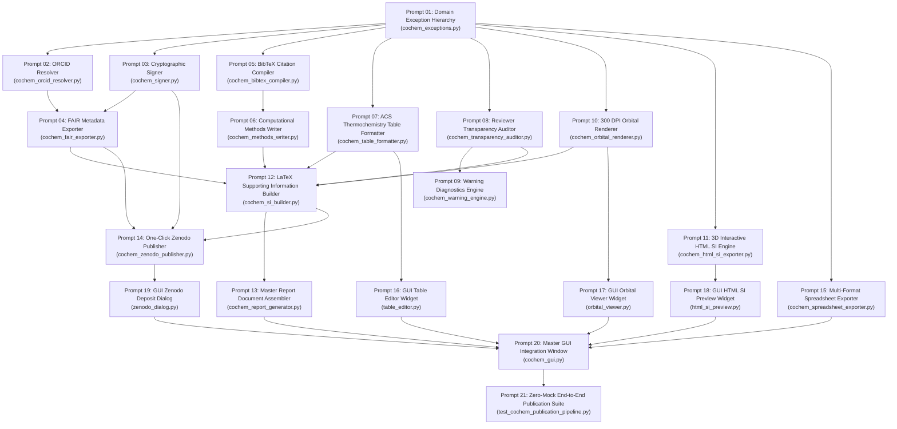

Perform adversarial static analysis and logical review on implemented code for D:\__CoChem\__agentic\.prompts\.SRS\20260830_improvements\.in-progress\Perfected_SRS_Chunk_10_prompts.md.
Original prompt:
# CoChem-BASE Chunk 10 Implementation Prompts: Automated Publication, Supporting Information, FAIR Archival & Reviewer Transparency Reports

This execution prompt suite breaks down [**`COCHEM_SRS_CHUNK_10.md`**](file:///C:/Users/ansac/.gemini/antigravity-cli/brain/19575b4e-38d7-49d2-ba73-0c0b5bca2c64/COCHEM_SRS_CHUNK_10.md) (Requirements `REQ-QC-091` to `REQ-QC-100`) into **21 granular, context-safe, sequential implementation prompts**.

---

### Sequential Execution DAG & Dependency Matrix



---

## Phase 1: Domain Exception Hierarchy & Foundational Schemas

### Prompt 01: Swarm Domain Exception Hierarchy Expansion
* **Target File:** [`cochem/src/cochem/core/cochem_exceptions.py`](file:///C:/Users/ansac/.gemini/antigravity-cli/cochem/src/cochem/core/cochem_exceptions.py)
* **Affected Requirements:** `REQ-QC-091` through `REQ-QC-100`
* **Prerequisites:** None (Base exception definitions)

```markdown
You are cochem-coder. Implement the domain exception hierarchy for the publication, Supporting Information (SI) generation, FAIR data archival, bibliographic compilation, and reviewer transparency modules in CoChem-BASE.

Target File: cochem/src/cochem/core/cochem_exceptions.py

Execution Instructions:
1. Define the base exception class `CoChemPublicationException(Exception)` inheriting from the core CoChem root exception.
2. Define the specialized exception classes adhering to Section 4.10 of the SRS:
   - `LaTeXCompilationError(CoChemPublicationException)`: Raised when pdflatex / xelatex fails to compile LaTeX SI documents. Accepts `engine: str` and `log_snippet: str`.
   - `BibTeXResolutionError(CoChemPublicationException)`: Raised when a QM method, functional, basis set, or dispersion model cannot be mapped to a canonical peer-reviewed BibTeX citation.
   - `OrbitalRenderEngineError(CoChemPublicationException)`: Raised when headless PyMOL/VMD fails to render molecular orbital volumetric cube meshes or ray-tracing encounters sub-process errors.
   - `ZenodoAPIError(CoChemPublicationException)`: Raised when interaction with the Zenodo REST API fails, returning HTTP 4xx/5xx errors or network timeouts. Accepts `status_code: int` and `response_body: str`.
   - `ORCIDValidationError(CoChemPublicationException)`: Raised when an ORCID fails ISO 7064 Mod 11,2 checksum validation or API resolution fails.
   - `SpreadsheetExportError(CoChemPublicationException)`: Raised when tabular data extraction fails or Excel OpenXML serialization fails.
   - `TransparencyAuditError(CoChemPublicationException)`: Raised when critical unapproved methodological deviations prevent automated publication.
   - `IncompletePipelineMetadataError(CoChemPublicationException)`: Raised when calculation DAG parameters (functional, basis, grid, solvation) are missing from job metadata.
   - `ReferenceSpeciesNotFoundError(CoChemPublicationException)`: Raised when the designated reference ground state is missing from the thermodynamic dataset.
   - `HTMLBundleExportError(CoChemPublicationException)`: Raised when standalone 3Dmol.js WebGL serialization or HTML packaging fails.
3. Ensure all exception classes provide rich error messages with contextual formatting.

Verification:
Run `pytest tests/core/test_exceptions.py` or unit test assertions confirming class inheritance and formatted string representations.
```

---

## Phase 2: Cryptographic Provenance, ORCID & FAIR Exporters

### Prompt 02: ORCID Validation & Public API Resolution Engine
* **Target File:** [`cochem/src/cochem/provenance/cochem_orcid_resolver.py`](file:///C:/Users/ansac/.gemini/antigravity-cli/cochem/src/cochem/provenance/cochem_orcid_resolver.py)
* **Affected Requirements:** `REQ-QC-098`
* **Prerequisites:** Prompt 01 ([`cochem_exceptions.py`](file:///C:/Users/ansac/.gemini/antigravity-cli/cochem/src/cochem/core/cochem_exceptions.py))

```markdown
You are cochem-coder. Implement the interactive ORCID identifier validator and public API resolution engine adhering to REQ-QC-098.

Target File: cochem/src/cochem/provenance/cochem_orcid_resolver.py

Execution Instructions:
1. Implement `validate_orcid_checksum(orcid_id: str) -> bool`:
   - Enforce regex pattern `^\d{4}-\d{4}-\d{4}-\d{3}[\dX]$`.
   - Implement the ISO/IEC 7064 Mod 11,2 checksum algorithm:
     Total = Sum_{i=1..15} (d_i * 2^(16-i)) mod 11.
     CheckDigit = (12 - remainder) mod 11, where remainder 10 maps to 'X'.
   - Return True if valid, False otherwise.
2. Implement Pydantic v2 model `ORCIDAuthorProfile`:
   - Fields: `orcid_id` (with `@field_validator` checking ISO 7064), `given_names`, `family_name`, `credit_name` (optional), `primary_institution` (optional), `institution_ror_id` (optional), `credit_roles` (list of strings).
3. Implement `resolve_orcid_public_api(orcid_id: str, timeout_seconds: float = 5.0) -> ORCIDAuthorProfile`:
   - Validate checksum before making any remote calls.
   - Query endpoint `https://pub.orcid.org/v3.0/{orcid_id}/record` with header `Accept: application/json`.
   - Parse person names, credit name, and employment/institution affiliations.
   - Gracefully handle network timeouts and HTTP errors with `ORCIDValidationError`.
4. Ensure zero mocking in tests: write tests validating both valid sample IDs (e.g. Josiah Carberry `0000-0002-1825-0097`) and invalid corrupted check digits.

Verification:
Run `pytest tests/provenance/test_cochem_orcid_resolver.py`.
```

---

### Prompt 03: RFC 8785 Canonical JSON Serialization & Ed25519 Cryptographic Signer
* **Target File:** [`cochem/src/cochem/provenance/cochem_signer.py`](file:///C:/Users/ansac/.gemini/antigravity-cli/cochem/src/cochem/provenance/cochem_signer.py)
* **Affected Requirements:** `REQ-QC-097`
* **Prerequisites:** Prompt 01 ([`cochem_exceptions.py`](file:///C:/Users/ansac/.gemini/antigravity-cli/cochem/src/cochem/core/cochem_exceptions.py))

```markdown
You are cochem-coder. Implement the RFC 8785 canonical JSON serializer and Ed25519 cryptographic signing engine adhering to REQ-QC-097 and W3C PROV-O integrity invariants.

Target File: cochem/src/cochem/provenance/cochem_signer.py

Execution Instructions:
1. Implement `canonicalize_json(data: dict) -> bytes`:
   - Implement RFC 8785 JSON Canonicalization Scheme (JCS): deterministic key sorting, exact IEEE 754 float representation, UTF-8 encoding without whitespace.
2. Implement `compute_file_checksums(file_path: Path) -> dict[str, str]`:
   - Compute streaming SHA-256 and BLAKE3 hashes for file artifacts.
3. Implement `sign_manifest(payload: dict, private_key_pem: bytes | None = None) -> dict`:
   - Utilize `cryptography.hazmat.primitives.asymmetric.ed25519`.
   - If no private key is provided, generate an ephemeral signing key or load from secure environment key paths.
   - Emit signed dictionary containing: `payload`, `signature_hex`, `public_key_hex`, `algorithm: "Ed25519"`, `timestamp_iso`.
4. Implement `verify_manifest_signature(signed_manifest: dict) -> bool`:
   - Reconstruct canonical bytes of `payload` and verify against `signature_hex` using `public_key_hex`.

Verification:
Run `pytest tests/provenance/test_cochem_signer.py`.
```

---

### Prompt 04: QCSchema & W3C PROV-O FAIR Metadata Exporter
* **Target File:** [`cochem/src/cochem/provenance/cochem_fair_exporter.py`](file:///C:/Users/ansac/.gemini/antigravity-cli/cochem/src/cochem/provenance/cochem_fair_exporter.py)
* **Affected Requirements:** `REQ-QC-097`, `REQ-QC-098`
* **Prerequisites:** Prompt 02 ([`cochem_orcid_resolver.py`](file:///C:/Users/ansac/.gemini/antigravity-cli/cochem/src/cochem/provenance/cochem_orcid_resolver.py)), Prompt 03 ([`cochem_signer.py`](file:///C:/Users/ansac/.gemini/antigravity-cli/cochem/src/cochem/provenance/cochem_signer.py))

```markdown
You are cochem-coder. Implement the FAIR metadata generator conforming to QCSchema v1 and W3C PROV-O JSON-LD schemas adhering to REQ-QC-097 and REQ-QC-098.

Target File: cochem/src/cochem/provenance/cochem_fair_exporter.py

Execution Instructions:
1. Define Pydantic v2 schemas:
   - `QCSchemaProvenanceRecord`: software name, version, git commit, authors (list of `ORCIDAuthorProfile`), CRediT roles, computation timestamp.
   - `PROV_O_Graph`: W3C PROV-O JSON-LD context (`@context`, `@graph`), linking `prov:Activity` (QM calculation), `prov:Agent` (researcher with ORCID), and `prov:Entity` (output wavefunction / geometry).
2. Implement `inject_provenance_into_qcschema(qcschema_payload: dict, authors: list[ORCIDAuthorProfile], calculation_metadata: dict) -> dict`:
   - Inject verified ORCID identifiers and CRediT contribution matrices into `qcschema_payload["provenance"]`.
3. Implement `generate_prov_o_jsonld(job_manifest: dict, authors: list[ORCIDAuthorProfile], output_json_path: Path) -> Path`:
   - Build a fully valid JSON-LD graph conforming to W3C PROV-O.
4. Implement `inject_hdf5_provenance_headers(hdf5_path: Path, authors: list[ORCIDAuthorProfile]) -> None`:
   - Use `h5py` to safely write root-level string attributes: `creator_orcid`, `creator_name`, `credit_roles`, `provenance_timestamp`.

Verification:
Run `pytest tests/provenance/test_cochem_fair_exporter.py`.
```

---

## Phase 3: Bibliographic & Academic Prose Synthesizers

### Prompt 05: Automated BibTeX Extraction & Citation Graph Compiler
* **Target File:** [`cochem/src/cochem/reporting/cochem_bibtex_compiler.py`](file:///C:/Users/ansac/.gemini/antigravity-cli/cochem/src/cochem/reporting/cochem_bibtex_compiler.py)
* **Affected Requirements:** `REQ-QC-093`
* **Prerequisites:** Prompt 01 ([`cochem_exceptions.py`](file:///C:/Users/ansac/.gemini/antigravity-cli/cochem/src/cochem/core/cochem_exceptions.py))

```markdown
You are cochem-coder. Implement the canonical BibTeX extraction and citation graph compiler adhering to REQ-QC-093.

Target File: cochem/src/cochem/reporting/cochem_bibtex_compiler.py

Execution Instructions:
1. Define Pydantic v2 schemas:
   - `BibTeXEntry`: `key: str`, `entry_type: str`, `title: str`, `authors: list[str]`, `journal: Optional[str]`, `year: int`, `volume: Optional[str]`, `pages: Optional[str]`, `doi: str`, `raw_bibtex: str`.
   - `CompiledBibTeXManifest`: `total_references: int`, `keys: list[str]`, `bibtex_file_path: str`, `entries: list[BibTeXEntry]`.
2. Build the internal zero-mock citation dictionary mapping quantum chemistry methods, functionals, basis sets, dispersion, and solvation models to canonical DOIs and BibTeX entries:
   - Engines: ORCA 5 (Neese 2022), Gaussian 16 (Frisch 2016), xTB/CREST (Grimme 2019), PySCF (Sun 2018).
   - Functionals: B3LYP (Becke 1993, Stephens 1994), PBE0 (Adamo 1999), wB97X-D (Chai 2008), wB97X-D4 (Bremond 2020), wB97X-V (Mardirossian 2014), M06-2X (Zhao 2008), rev-DSD-PBEP86 (Santra 2019).
   - Basis Sets: def2 family (Weigend 2005), Dunning cc-pVnZ (Dunning 1989), Jensen pcseg (Jensen 2014).
   - Dispersion: D3(BJ) (Grimme 2010/2011), D4 (Caldeweyher 2019/2020).
   - Solvation: SMD (Marenich 2009), CPCM (Barone 1998).
   - Algorithms: DLPNO-CCSD(T) (Riplinger 2013), Quasi-Harmonic Entropy (Grimme 2012), Sayvetz-Eckart (Sayvetz 1939).
3. Implement `compile_bibtex_references(methods_used: list[str], output_dir: Path) -> CompiledBibTeXManifest`:
   - Deduplicate incoming methods and match citation keys with standard naming convention `AuthorYearKeyword`.
   - Validate DOI presence for all resolved entries.
   - Raise `BibTeXResolutionError` if an unmapped method cannot be resolved.
   - Write formatted, alphabetized `cochem_references.bib` to `output_dir`.

Verification:
Run `pytest tests/reporting/test_cochem_bibtex_compiler.py`.
```

---

### Prompt 06: Automated "Computational Methods" Narrative Synthesizer
* **Target File:** [`cochem/src/cochem/reporting/cochem_methods_writer.py`](file:///C:/Users/ansac/.gemini/antigravity-cli/cochem/src/cochem/reporting/cochem_methods_writer.py)
* **Affected Requirements:** `REQ-QC-092`
* **Prerequisites:** Prompt 05 ([`cochem_bibtex_compiler.py`](file:///C:/Users/ansac/.gemini/antigravity-cli/cochem/src/cochem/reporting/cochem_bibtex_compiler.py))

```markdown
You are cochem-coder. Implement the publication-grade "Computational Methods" natural-language prose generator adhering to REQ-QC-092.

Target File: cochem/src/cochem/reporting/cochem_methods_writer.py

Execution Instructions:
1. Define Pydantic v2 schemas:
   - `ComputationalMethodsConfig`: `software_name: str`, `software_version: str`, `functional: str`, `basis_set: str`, `auxiliary_basis: Optional[str]`, `dispersion_correction: Optional[str]`, `grid_level: str`, `solvation_model: Optional[str]`, `solvent: Optional[str]`, `quasi_harmonic_damping: bool`, `quasi_harmonic_cutoff_cm1: float`, `temperature_kelvin: float`, `pressure_atm: float`, `include_standard_state_correction: bool`.
   - `SynthesizedMethodsParagraph`: `markdown_text: str`, `latex_text: str`, `referenced_bibtex_keys: list[str]`.
2. Implement narrative generator `synthesize_methods_paragraph(config: ComputationalMethodsConfig) -> SynthesizedMethodsParagraph`:
   - Construct rigorous academic prose adhering to ACS and Nature style manuals.
   - Formulate conformational search, geometry optimization, grid levels, convergence criteria (TightOPT), dispersion corrections, and continuum solvation narrative.
   - Insert explicit standard-state solution shifts:
     "Solvation free energies in aqueous solution include a standard-state volume compression correction of Delta G^\circ_{1 atm -> 1 M} = +1.894 kcal/mol (+7.926 kJ/mol)."
   - Insert quasi-harmonic rotor descriptions:
     "Thermal corrections to Gibbs free energies were evaluated using the modified quasi-harmonic approximation of Grimme with a rotor frequency cutoff of 100 cm^-1."
   - Embed LaTeX `\cite{...}` citation keys corresponding to all referenced methods.
   - Synchronize Markdown and LaTeX outputs.

Verification:
Run `pytest tests/reporting/test_cochem_methods_writer.py`.
```

---

## Phase 4: Thermochemical Tabulation & Reviewer Auditing Engines

### Prompt 07: ACS-Compliant Relative Thermochemistry Table Formatter Engine
* **Target File:** [`cochem/src/cochem/reporting/cochem_table_formatter.py`](file:///C:/Users/ansac/.gemini/antigravity-cli/cochem/src/cochem/reporting/cochem_table_formatter.py)
* **Affected Requirements:** `REQ-QC-096`
* **Prerequisites:** Prompt 01 ([`cochem_exceptions.py`](file:///C:/Users/ansac/.gemini/antigravity-cli/cochem/src/cochem/core/cochem_exceptions.py))

```markdown
You are cochem-coder. Implement the ACS-compliant relative energy table generator adhering to REQ-QC-096.

Target File: cochem/src/cochem/reporting/cochem_table_formatter.py

Execution Instructions:
1. Define Pydantic v2 schemas:
   - `ThermochemicalSpeciesEntry`: `species_name: str`, `is_transition_state: bool`, `imaginary_frequency_cm1: Optional[float]`, `e_elec_hartree: float`, `zpve_hartree: float`, `h_298_hartree: float`, `g_298_hartree: float`, `g_qh_298_hartree: Optional[float]`.
   - `ACSRelativeEnergyRow`: `species_name: str`, `delta_e_kcal_mol: float`, `delta_e0_kcal_mol: float`, `delta_h_kcal_mol: float`, `delta_g_kcal_mol: float`, `delta_g_qh_kcal_mol: Optional[float]`, `imaginary_frequency_str: str`.
   - `ACSTableManifest`: `table_title: str`, `reference_species: str`, `rows: list[ACSRelativeEnergyRow]`, `latex_table_code: str`, `markdown_table_code: str`.
2. Implement `build_acs_energy_table(entries: list[ThermochemicalSpeciesEntry], reference_label: str, energy_units: str = "kcal_mol") -> ACSTableManifest`:
   - Locate reference entry. Raise `ReferenceSpeciesNotFoundError` if missing.
   - Use CODATA 2022 conversion factor: 1 Hartree = 627.5094740631 kcal/mol = 2625.499639479 kJ/mol.
   - Compute relative quantities: Delta E, Delta E0 (E + ZPVE), Delta H_298, Delta G_298, Delta G_qh_298.
   - Synthesize LaTeX markup incorporating `booktabs` (`\toprule`, `\midrule`, `\bottomrule`) with zero vertical rules.
   - Format numeric columns with `siunitx` alignment `S[table-format=-2.2]`.
   - Format transition states in bold (`\textbf{TS_1}`) and mark imaginary frequencies with daggers.
   - Generate synchronized GitHub Flavored Markdown and HTML snippet cards.

Verification:
Run `pytest tests/reporting/test_cochem_table_formatter.py`.
```

---

### Prompt 08: Peer-Reviewer Transparency & Non-Standard Deviation Auditor
* **Target File:** [`cochem/src/cochem/reporting/cochem_transparency_auditor.py`](file:///C:/Users/ansac/.gemini/antigravity-cli/cochem/src/cochem/reporting/cochem_transparency_auditor.py)
* **Affected Requirements:** `REQ-QC-100`
* **Prerequisites:** Prompt 01 ([`cochem_exceptions.py`](file:///C:/Users/ansac/.gemini/antigravity-cli/cochem/src/cochem/core/cochem_exceptions.py))

```markdown
You are cochem-coder. Implement the reviewer transparency and methodological deviation auditor adhering to REQ-QC-100 and Method Matrix v4.2.

Target File: cochem/src/cochem/reporting/cochem_transparency_auditor.py

Execution Instructions:
1. Define Pydantic v2 schemas:
   - `DeviationRecord`: `rule_id: str`, `rule_name: str`, `severity: Literal["BENIGN_OPTIMIZATION", "JUSTIFIED_COMPROMISE", "METHODOLOGICAL_WARNING"]`, `affected_job: str`, `expected_parameter: str`, `actual_parameter: str`, `scientific_justification: str`.
   - `TransparencyAuditReport`: `total_jobs_audited: int`, `compliance_score_percent: float`, `audit_verdict: Literal["FULLY_COMPLIANT", "COMPLIANT_WITH_JUSTIFIED_DEVIATIONS", "NON_COMPLIANT_WARNING"]`, `deviations: list[DeviationRecord]`, `markdown_report_path: str`, `latex_report_path: str`.
2. Implement `audit_project_deviations(job_manifests: list[dict], output_dir: Path) -> TransparencyAuditReport`:
   - Inspect job configs against Method Matrix v4.2 standards:
     * Convergence Criteria: Flag `LooseOPT` / `DefaultOPT` where `TightOPT` is required.
     * Integration Grids: Flag `defgrid1` or pruned grids for final optimizations.
     * Dispersion Corrections: Flag DFT jobs on >10 atom or non-covalent systems missing D3(BJ)/D4/VV10.
     * Spin Contamination: Flag open-shell calculations where <S^2> excursion > 10.0%.
     * LoT Invariance: Flag frequency calculations evaluated at different functional/basis than optimization.
     * Methodological Bans: Flag `Calc_Hess true` or additive diffuse corrections.
   - Calculate compliance score: 100% - sum(weights) (minor=2%, major=10%, critical=25%).
   - Export structured reports: `Reviewer_Transparency_Report.md` and `Reviewer_Transparency_Report.tex`.

Verification:
Run `pytest tests/reporting/test_cochem_transparency_auditor.py`.
```

---

### Prompt 09: Warning Diagnostics & Audit Flag Visualizer
* **Target File:** [`cochem/src/cochem/reporting/cochem_warning_engine.py`](file:///C:/Users/ansac/.gemini/antigravity-cli/cochem/src/cochem/reporting/cochem_warning_engine.py)
* **Affected Requirements:** `REQ-QC-100`
* **Prerequisites:** Prompt 08 ([`cochem_transparency_auditor.py`](file:///C:/Users/ansac/.gemini/antigravity-cli/cochem/src/cochem/reporting/cochem_transparency_auditor.py))

```markdown
You are cochem-coder. Implement the warning diagnostics visualizer and audit report formatter engine adhering to REQ-QC-100.

Target File: cochem/src/cochem/reporting/cochem_warning_engine.py

Execution Instructions:
1. Implement `format_terminal_warning_summary(report: TransparencyAuditReport) -> str`:
   - Format colored ANSI / Unicode terminal blocks displaying overall compliance score, verdict badges (GREEN, YELLOW, RED), and tabular listings of all detected deviations.
2. Implement `generate_latex_warning_callout_box(deviations: list[DeviationRecord]) -> str`:
   - Generate LaTeX `tcolorbox` markup suitable for insertion into the Supporting Information.
   - Color code boxes: `ForestGreen` for full compliance, `Amber` for justified compromises, `Crimson` for methodological warnings.
3. Implement `generate_html_warning_badge(verdict: str, score: float) -> str`:
   - Render clean SVG/HTML status badges for UI and web dashboard display.

Verification:
Run `pytest tests/reporting/test_cochem_warning_engine.py`.
```

---

## Phase 5: High-Resolution & 3D Interactive Visualization Engines

### Prompt 10: High-Resolution (300 DPI) Frontier Molecular Orbital Rendering Engine
* **Target File:** [`cochem/src/cochem/visualization/cochem_orbital_renderer.py`](file:///C:/Users/ansac/.gemini/antigravity-cli/cochem/src/cochem/visualization/cochem_orbital_renderer.py)
* **Affected Requirements:** `REQ-QC-094`
* **Prerequisites:** Prompt 01 ([`cochem_exceptions.py`](file:///C:/Users/ansac/.gemini/antigravity-cli/cochem/src/cochem/core/cochem_exceptions.py))

```markdown
You are cochem-coder. Implement the automated 300+ DPI headless molecular orbital rendering engine adhering to REQ-QC-094.

Target File: cochem/src/cochem/visualization/cochem_orbital_renderer.py

Execution Instructions:
1. Define Pydantic v2 schemas:
   - `OrbitalRenderJob`: `orbital_index: int`, `orbital_type: str` (HOMO, LUMO, etc.), `energy_hartree: float`, `energy_ev: float`, `isovalue: float` (default 0.03), `cube_file_path: str`, `output_png_path: str`, `resolution_dpi: int` (default 300), `width_px: int` (2400), `height_px: int` (1800).
   - `OrbitalFigureSet`: `homo_energy_ev: float`, `lumo_energy_ev: float`, `gap_ev: float`, `gap_kcal_mol: float`, `rendered_images: list[OrbitalRenderJob]`, `composite_figure_path: str`.
2. Implement `align_geometry_to_principal_axes(coordinates: np.ndarray, masses: np.ndarray) -> np.ndarray`:
   - Diagonalize the moment of inertia tensor to align the molecule along principal inertial axes for optimal 2D rendering projection.
3. Implement `generate_orbital_pymol_script(job: OrbitalRenderJob) -> str`:
   - Generate automated headless PyMOL script:
     * Load geometry and volumetric `.cube` file.
     * Generate positive phase surface: `isomesh {job.orbital_type}_pos, cube, {job.isovalue}`, colored blue (`RGB [0.2, 0.4, 0.8]`).
     * Generate negative phase surface: `isomesh {job.orbital_type}_neg, cube, -{job.isovalue}`, colored red (`RGB [0.8, 0.2, 0.2]`).
     * Set surface transparency (0.25) and ambient occlusion lighting.
     * Ray-trace at 300 DPI: `cmd.ray(2400, 1800); cmd.png(..., dpi=300)`.
4. Implement `execute_headless_orbital_render(job: OrbitalRenderJob) -> Path`:
   - Execute PyMOL sub-process via `pymol -c -q {script_path}`.
   - Catch execution errors and raise `OrbitalRenderEngineError`.
5. Implement `assemble_composite_orbital_figure(homo_job: OrbitalRenderJob, lumo_job: OrbitalRenderJob, output_path: Path) -> OrbitalFigureSet`:
   - Use Pillow (`PIL.Image`) to crop and stitch HOMO and LUMO renderings side-by-side with energy gap annotations.

Verification:
Run `pytest tests/visualization/test_cochem_orbital_renderer.py`.
```

---

### Prompt 11: Standalone 3D Interactive HTML WebGL Supporting Information Visualizer
* **Target File:** [`cochem/src/cochem/visualization/cochem_html_si_exporter.py`](file:///C:/Users/ansac/.gemini/antigravity-cli/cochem/src/cochem/visualization/cochem_html_si_exporter.py)
* **Affected Requirements:** `REQ-QC-095`
* **Prerequisites:** Prompt 01 ([`cochem_exceptions.py`](file:///C:/Users/ansac/.gemini/antigravity-cli/cochem/src/cochem/core/cochem_exceptions.py))

```markdown
You are cochem-coder. Implement the standalone, zero-dependency 3D WebGL HTML Supporting Information exporter adhering to REQ-QC-095.

Target File: cochem/src/cochem/visualization/cochem_html_si_exporter.py

Execution Instructions:
1. Define Pydantic v2 schemas:
   - `InteractiveHTMLModel`: `label: str`, `chemical_formula: str`, `energy_hartree: float`, `relative_energy_kcal_mol: float`, `xyz_block: str`, `frequencies: list[float]`, `normal_modes: list[list[list[float]]]`.
   - `InteractiveHTMLPackage`: `title: str`, `models: list[InteractiveHTMLModel]`, `include_irc: bool`, `irc_trajectory_xyz: Optional[str]`, `output_html_path: str`.
2. Embed the complete minified 3Dmol.js JavaScript library inline directly within the generator script (zero external CDN calls to guarantee air-gap and long-term offline preservation).
3. Implement `export_interactive_html_si(package: InteractiveHTMLPackage) -> str`:
   - Build a standalone single-file `interactive_si.html` containing:
     * Interactive 3D WebGL viewport with orbit, zoom, and pan controls.
     * Representation switcher: Ball-and-Stick, Licorice, CPK Spacefill.
     * Click-to-measure tooltips for bond distances (Å), angles (°), and dihedrals (°).
     * Conformer / Reaction Stage dropdown selector with dynamic relative energy HUD.
     * IRC reaction coordinate trajectory stepping slider with dynamic energy curve sync.
     * Harmonic normal mode frequency selector with real-time vector animation ($\mathbf{R}(t) = \mathbf{R}_0 + \xi \cos(\omega t) \mathbf{L}$).
4. Write out the final `.html` bundle and return path.

Verification:
Run `pytest tests/visualization/test_cochem_html_si_exporter.py`.
```

---

## Phase 6: Supporting Information Assembly & Publication Compiler

### Prompt 12: Automated LaTeX Supporting Information (SI) PDF Engine
* **Target File:** [`cochem/src/cochem/reporting/cochem_si_builder.py`](file:///C:/Users/ansac/.gemini/antigravity-cli/cochem/src/cochem/reporting/cochem_si_builder.py)
* **Affected Requirements:** `REQ-QC-091`, `REQ-QC-098`
* **Prerequisites:** Prompt 02 ([`cochem_orcid_resolver.py`](file:///C:/Users/ansac/.gemini/antigravity-cli/cochem/src/cochem/provenance/cochem_orcid_resolver.py)), Prompt 05 ([`cochem_bibtex_compiler.py`](file:///C:/Users/ansac/.gemini/antigravity-cli/cochem/src/cochem/reporting/cochem_bibtex_compiler.py)), Prompt 06 ([`cochem_methods_writer.py`](file:///C:/Users/ansac/.gemini/antigravity-cli/cochem/src/cochem/reporting/cochem_methods_writer.py)), Prompt 07 ([`cochem_table_formatter.py`](file:///C:/Users/ansac/.gemini/antigravity-cli/cochem/src/cochem/reporting/cochem_table_formatter.py))

```markdown
You are cochem-coder. Implement the automated LaTeX Supporting Information document generator and PDF compilation engine adhering to REQ-QC-091.

Target File: cochem/src/cochem/reporting/cochem_si_builder.py

Execution Instructions:
1. Define Pydantic v2 schemas:
   - `StationaryPointSIEntry`: `label: str`, `chemical_formula: str`, `electronic_energy_hartree: float`, `zero_point_energy_hartree: float`, `enthalpy_hartree: float`, `gibbs_free_energy_hartree: float`, `rotational_constants_mhz: dict[Literal["A", "B", "C"], float]`, `number_of_imaginary_frequencies: int`, `frequencies_cm1: list[float]`, `elements: list[str]`, `coordinates_angstrom: list[list[float]]` (N x 3).
   - `SIPackageManifest`: `title: str`, `authors: list[str]`, `orcids: list[str]`, `manuscript_doi: Optional[str]`, `entries: list[StationaryPointSIEntry]`, `tex_source_path: str`, `pdf_output_path: Optional[str]`, `compilation_successful: bool`.
2. Implement `generate_latex_si_source(title: str, authors: list[ORCIDAuthorProfile], entries: list[StationaryPointSIEntry], methods_paragraph: str, acs_tables_latex: str, transparency_report_latex: str, figure_paths: list[str]) -> str`:
   - Assemble `Supporting_Information.tex` incorporating chemistry publication packages: `geometry` (1-inch margins), `booktabs`, `longtable`, `amsmath`, `amssymb`, `siunitx`, `chemformula`, `graphicx`, `hyperref`, and `orcidlink`.
   - Format all atomic Cartesian coordinates strictly to 6 decimal places ($X, Y, Z$ in Å) in multi-page `longtable` blocks with `S[table-format=-3.6]` decimal alignment.
   - List absolute SCF energies (8 decimal places in Hartree), ZPVE, total enthalpies, free energies, rotational constants in MHz, and harmonic vibrational frequency spectra.
3. Implement `compile_latex_si(tex_path: Path, engine: str = "xelatex") -> Path`:
   - Run 2 compilation passes via `subprocess.run([engine, "-interaction=nonstopmode", tex_path.name])` with fallback to `pdflatex` or `tectonic`.
   - Capture errors, parse LaTeX `.log` file, and raise `LaTeXCompilationError` on fatal non-zero exit codes.
   - Return path to compiled `Supporting_Information.pdf`.

Verification:
Run `pytest tests/reporting/test_cochem_si_builder.py`.
```

---

### Prompt 13: Master Publication & Academic Document Assembler
* **Target File:** [`cochem/src/cochem/reporting/cochem_report_generator.py`](file:///C:/Users/ansac/.gemini/antigravity-cli/cochem/src/cochem/reporting/cochem_report_generator.py)
* **Affected Requirements:** `REQ-QC-091`, `REQ-QC-092`, `REQ-QC-094`, `REQ-QC-096`, `REQ-QC-100`
* **Prerequisites:** Prompt 06 ([`cochem_methods_writer.py`](file:///C:/Users/ansac/.gemini/antigravity-cli/cochem/src/cochem/reporting/cochem_methods_writer.py)), Prompt 07 ([`cochem_table_formatter.py`](file:///C:/Users/ansac/.gemini/antigravity-cli/cochem/src/cochem/reporting/cochem_table_formatter.py)), Prompt 08 ([`cochem_transparency_auditor.py`](file:///C:/Users/ansac/.gemini/antigravity-cli/cochem/src/cochem/reporting/cochem_transparency_auditor.py)), Prompt 10 ([`cochem_orbital_renderer.py`](file:///C:/Users/ansac/.gemini/antigravity-cli/cochem/src/cochem/visualization/cochem_orbital_renderer.py)), Prompt 12 ([`cochem_si_builder.py`](file:///C:/Users/ansac/.gemini/antigravity-cli/cochem/src/cochem/reporting/cochem_si_builder.py))

```markdown
You are cochem-coder. Implement the master academic report generator and pipeline coordinator adhering to REQ-QC-091, REQ-QC-092, and REQ-QC-096.

Target File: cochem/src/cochem/reporting/cochem_report_generator.py

Execution Instructions:
1. Implement `assemble_full_publication_package(project_dir: Path, output_dir: Path, author_profiles: list[ORCIDAuthorProfile]) -> dict`:
   - Orchestrate the complete publication generation workflow:
     1. Ingest job history and parse QCSchema / QM outputs via `cochem_qc_parser`.
     2. Synthesize Methods narrative via `cochem_methods_writer`.
     3. Compile citation database via `cochem_bibtex_compiler`.
     4. Build relative thermochemistry tables via `cochem_table_formatter`.
     5. Audit deviations and generate transparency report via `cochem_transparency_auditor`.
     6. Render frontier orbitals at 300 DPI via `cochem_orbital_renderer`.
     7. Build and compile `Supporting_Information.tex` -> `Supporting_Information.pdf` via `cochem_si_builder`.
2. Return a comprehensive manifest containing all generated artifact paths: PDF, TeX, BibTeX, figures, and summary metadata.

Verification:
Run `pytest tests/reporting/test_cochem_report_generator.py`.
```

---

## Phase 7: Open-Science FAIR Publishing & Data Interchange Exporters

### Prompt 14: One-Click Zenodo FAIR Data Archival & DOI Minting Engine
* **Target File:** [`cochem/src/cochem/publishing/cochem_zenodo_publisher.py`](file:///C:/Users/ansac/.gemini/antigravity-cli/cochem/src/cochem/publishing/cochem_zenodo_publisher.py)
* **Affected Requirements:** `REQ-QC-097`, `REQ-QC-098`
* **Prerequisites:** Prompt 03 ([`cochem_signer.py`](file:///C:/Users/ansac/.gemini/antigravity-cli/cochem/src/cochem/provenance/cochem_signer.py)), Prompt 04 ([`cochem_fair_exporter.py`](file:///C:/Users/ansac/.gemini/antigravity-cli/cochem/src/cochem/provenance/cochem_fair_exporter.py)), Prompt 12 ([`cochem_si_builder.py`](file:///C:/Users/ansac/.gemini/antigravity-cli/cochem/src/cochem/reporting/cochem_si_builder.py))

```markdown
You are cochem-coder. Implement the Zenodo REST API v2 connector and DataCite 4.4 FAIR archival publishing engine adhering to REQ-QC-097 and REQ-QC-098.

Target File: cochem/src/cochem/publishing/cochem_zenodo_publisher.py

Execution Instructions:
1. Define Pydantic v2 schemas:
   - `ZenodoAuthorMetadata`: `name: str`, `affiliation: Optional[str]`, `orcid: Optional[str]`.
   - `ZenodoDepositMetadata`: `title: str`, `description: str`, `creators: list[ZenodoAuthorMetadata]`, `upload_type: Literal["dataset", "software", "publication"]`, `access_right: Literal["open", "embargoed", "restricted"]`, `license: str` ("CC-BY-4.0"), `keywords: list[str]`, `related_identifiers: list[dict]`.
   - `ZenodoPublishResult`: `deposition_id: int`, `reserved_doi: str`, `published_doi: Optional[str]`, `is_published: bool`, `record_url: str`, `sha256_checksum: str`.
2. Implement `package_calculation_archive(project_dir: Path, output_tar_path: Path) -> tuple[Path, str]`:
   - Package all raw inputs (.inp), outputs (.out), wavefunctions (.gbw), trajectories (.xyz), HDF5 (.h5), and QCSchema (.json) into `cochem_calculation_archive.tar.gz`.
   - Compute streaming SHA-256 and BLAKE3 hashes. Sign archive with Ed25519 via `cochem_signer`.
3. Implement `build_datacite_metadata_payload(metadata: ZenodoDepositMetadata) -> dict`:
   - Structure JSON payload conforming to DataCite 4.4 schema and Zenodo deposit API requirements.
4. Implement Zenodo REST API v2 client methods:
   - `create_deposition(api_token: str, sandbox: bool = True) -> int` (POST `/api/deposit/depositions`)
   - `reserve_doi(deposition_id: int, api_token: str, sandbox: bool = True) -> str`
   - `upload_archive_bucket(deposition_id: int, file_path: Path, api_token: str, sandbox: bool = True) -> dict` (PUT `/api/deposit/depositions/{id}/files`)
   - `update_metadata(deposition_id: int, metadata: ZenodoDepositMetadata, api_token: str, sandbox: bool = True) -> dict`
   - `publish_deposition(deposition_id: int, api_token: str, sandbox: bool = True) -> ZenodoPublishResult` (POST `/api/deposit/depositions/{id}/actions/publish`)
   - Handle network errors and HTTP error codes with `ZenodoAPIError`.

Verification:
Run `pytest tests/publishing/test_cochem_zenodo_publisher.py`.
```

---

### Prompt 15: Multi-Format Spreadsheet Extraction & Data Interchange Engine
* **Target File:** [`cochem/src/cochem/export/cochem_spreadsheet_exporter.py`](file:///C:/Users/ansac/.gemini/antigravity-cli/cochem/src/cochem/export/cochem_spreadsheet_exporter.py)
* **Affected Requirements:** `REQ-QC-099`
* **Prerequisites:** Prompt 01 ([`cochem_exceptions.py`](file:///C:/Users/ansac/.gemini/antigravity-cli/cochem/src/cochem/core/cochem_exceptions.py))

```markdown
You are cochem-coder. Implement the multi-sheet Excel (.xlsx) and RFC 4180 CSV export engine adhering to REQ-QC-099.

Target File: cochem/src/cochem/export/cochem_spreadsheet_exporter.py

Execution Instructions:
1. Define Pydantic v2 schemas:
   - `MolecularRecordSpreadsheetRow`: `job_label: str`, `formula: str`, `smiles: Optional[str]`, `charge: int`, `multiplicity: int`, `e_scf_hartree: float`, `zpve_hartree: float`, `h_298_hartree: float`, `g_298_hartree: float`, `dipole_x_debye: float`, `dipole_y_debye: float`, `dipole_z_debye: float`, `dipole_total_debye: float`, `rotational_a_mhz: float`, `rotational_b_mhz: float`, `rotational_c_mhz: float`, `lowest_frequency_cm1: float`, `imaginary_frequency_count: int`.
   - `SpreadsheetExportManifest`: `total_records: int`, `excel_output_path: str`, `csv_output_path: str`, `rows: list[MolecularRecordSpreadsheetRow]`.
2. Implement `export_molecular_dataset_to_excel(records: list[MolecularRecordSpreadsheetRow], output_excel_path: str, output_csv_path: str) -> SpreadsheetExportManifest`:
   - Use `openpyxl` to build structured workbooks with 3 formatted sheets:
     * Sheet 1: `Summary & Energetics` (Labels, stoichiometry, absolute energies, and dynamic Excel formulas `=($F2-MIN($F$2:$F$100))*627.509` for relative kcal/mol).
     * Sheet 2: `Dipoles & Spectroscopic` (Dipole components in Debye, Ray's asymmetry parameter kappa, rotational constants in MHz, lowest 3 harmonic frequencies).
     * Sheet 3: `Cartesian Geometries` (Stationary point XYZ coordinates).
   - Apply professional corporate/academic styling: dark blue headers (`#1F497D`), bold white text, alternating row shading (`#F2F2F2`), thin cell borders, and explicit numeric formats (`0.000000` for Hartree, `0.00` for kcal/mol).
   - Simultaneously export clean, RFC 4180-compliant `.csv` files for downstream data science interchange.
   - Handle I/O and format errors with `SpreadsheetExportError`.

Verification:
Run `pytest tests/export/test_cochem_spreadsheet_exporter.py`.
```

---

## Phase 8: Graphical User Interface (GUI) Reactive Widgets & Master Window

### Prompt 16: GUI ACS Energy Table Preview & Editor Widget
* **Target File:** [`cochem/src/cochem/gui/widgets/table_editor.py`](file:///C:/Users/ansac/.gemini/antigravity-cli/cochem/src/cochem/gui/widgets/table_editor.py)
* **Affected Requirements:** `REQ-QC-096`
* **Prerequisites:** Prompt 07 ([`cochem_table_formatter.py`](file:///C:/Users/ansac/.gemini/antigravity-cli/cochem/src/cochem/reporting/cochem_table_formatter.py))

```markdown
You are cochem-coder. Implement the interactive ACS energy table previewer and clipboard export widget adhering to REQ-QC-096.

Target File: cochem/src/cochem/gui/widgets/table_editor.py

Execution Instructions:
1. Implement `ACSTableEditorWidget(QWidget)`:
   - Provide a reactive `QTableWidget` / `QTableView` displaying stationary points, relative enthalpies, Gibbs free energies, and quasi-harmonic values.
   - Add reference species dropdown selector that dynamically re-computes all relative energy columns when changed.
   - Add energy unit toggle: `kcal/mol` vs `kJ/mol`.
   - Add "Copy LaTeX Table" button (copies `booktabs` code to OS clipboard).
   - Add "Copy Markdown Table" button (copies GFM markdown to OS clipboard).
   - Add "Export CSV..." action button.
2. Support dark/light mode UI theme adaptation.

Verification:
Run `pytest tests/gui/test_table_editor.py`.
```

---

### Prompt 17: GUI High-Res Orbital Viewer & Renderer Configuration Widget
* **Target File:** [`cochem/src/cochem/gui/widgets/orbital_viewer.py`](file:///C:/Users/ansac/.gemini/antigravity-cli/cochem/src/cochem/gui/widgets/orbital_viewer.py)
* **Affected Requirements:** `REQ-QC-094`
* **Prerequisites:** Prompt 10 ([`cochem_orbital_renderer.py`](file:///C:/Users/ansac/.gemini/antigravity-cli/cochem/src/cochem/visualization/cochem_orbital_renderer.py))

```markdown
You are cochem-coder. Implement the GUI orbital renderer configuration and preview widget adhering to REQ-QC-094.

Target File: cochem/src/cochem/gui/widgets/orbital_viewer.py

Execution Instructions:
1. Implement `OrbitalViewerWidget(QWidget)`:
   - Orbital selection dropdown: HOMO, LUMO, HOMO-1, LUMO+1, etc., showing associated eigenvalues in eV and Hartree.
   - Isovalue slider and spin box ($0.01 \le \sigma_{\text{iso}} \le 0.10$, default 0.03 a.u.).
   - Resolution selector: 300 DPI (Publication), 600 DPI (Cover Art), 150 DPI (Draft).
   - PyMOL / VMD backend selector with status indicators showing installed executable paths.
   - "Render 300 DPI Figure" button with background worker thread (`QThread`) and progress indicator.
   - Image preview pane displaying rendered PNG with zoom controls.

Verification:
Run `pytest tests/gui/test_orbital_viewer.py`.
```

---

### Prompt 18: GUI Embedded Interactive HTML SI Previewer Widget
* **Target File:** [`cochem/src/cochem/gui/widgets/html_si_preview.py`](file:///C:/Users/ansac/.gemini/antigravity-cli/cochem/src/cochem/gui/widgets/html_si_preview.py)
* **Affected Requirements:** `REQ-QC-095`
* **Prerequisites:** Prompt 11 ([`cochem_html_si_exporter.py`](file:///C:/Users/ansac/.gemini/antigravity-cli/cochem/src/cochem/visualization/cochem_html_si_exporter.py))

```markdown
You are cochem-coder. Implement the embedded Chromium 3D WebGL previewer widget for interactive HTML SI packages adhering to REQ-QC-095.

Target File: cochem/src/cochem/gui/widgets/html_si_preview.py

Execution Instructions:
1. Implement `HTMLSIPreviewWidget(QWidget)`:
   - Embed `QWebEngineView` (or fallback to default web browser launcher if WebEngine is unavailable).
   - Load generated `interactive_si.html` locally into the embedded browser view.
   - Provide toolbar actions: "Reload 3D Scene", "Reset Camera", "Open in Default Browser", "Export Standalone HTML...".
2. Handle offline air-gapped loading without external network calls.

Verification:
Run `pytest tests/gui/test_html_si_preview.py`.
```

---

### Prompt 19: GUI Zenodo Archival & DOI Publishing Dialog
* **Target File:** [`cochem/src/cochem/gui/widgets/zenodo_dialog.py`](file:///C:/Users/ansac/.gemini/antigravity-cli/cochem/src/cochem/gui/widgets/zenodo_dialog.py)
* **Affected Requirements:** `REQ-QC-097`, `REQ-QC-098`
* **Prerequisites:** Prompt 14 ([`cochem_zenodo_publisher.py`](file:///C:/Users/ansac/.gemini/antigravity-cli/cochem/src/cochem/publishing/cochem_zenodo_publisher.py))

```markdown
You are cochem-coder. Implement the Zenodo archival and DOI publishing dialog widget adhering to REQ-QC-097 and REQ-QC-098.

Target File: cochem/src/cochem/gui/widgets/zenodo_dialog.py

Execution Instructions:
1. Implement `ZenodoPublishDialog(QDialog)`:
   - Display deposition metadata summary: Title, Creators, ORCID identifiers, License (`CC-BY-4.0`), Archive file size, and calculated SHA-256 checksum.
   - Environment toggle: Sandbox (`sandbox.zenodo.org`) vs Production (`zenodo.org`).
   - Secure API token input field with OS keychain integration.
   - "Reserve DOI" button displaying instant preview of minted DOI (e.g. `10.5281/zenodo.1234567`).
   - "Upload & Publish" confirmation button with live chunk upload progress bar (`QProgressBar`) and activity log output.
   - Success state dialog displaying live DOI link and copy-to-clipboard citation.

Verification:
Run `pytest tests/gui/test_zenodo_dialog.py`.
```

---

### Prompt 20: Master GUI Integration Window & Export Orchestrator
* **Target File:** [`cochem/src/cochem/gui/cochem_gui.py`](file:///C:/Users/ansac/.gemini/antigravity-cli/cochem/src/cochem/gui/cochem_gui.py)
* **Affected Requirements:** `REQ-QC-091` through `REQ-QC-100`
* **Prerequisites:** Prompts 13, 15, 16, 17, 18, 19

```markdown
You are cochem-coder. Integrate publication, Supporting Information generation, Zenodo archival, and data interchange menus and actions into the main CoChem-BASE GUI window adhering to REQ-QC-091 through REQ-QC-100.

Target File: cochem/src/cochem/gui/cochem_gui.py

Execution Instructions:
1. In `CoChemMainWindow`:
   - Add a top-level **"Publication & SI"** menu:
     * "Compile LaTeX Supporting Information (PDF)..." -> triggers `cochem_si_builder` worker.
     * "Generate Computational Methods Paragraph..." -> opens methods prose copy dialog.
     * "Compile BibTeX References (.bib)..." -> exports `cochem_references.bib`.
     * "Render 300 DPI Molecular Orbitals..." -> opens `OrbitalViewerWidget`.
     * "Export Interactive 3D HTML SI..." -> opens `HTMLSIPreviewWidget`.
     * "Reviewer Transparency & Deviation Audit..." -> displays audit report and badge.
     * "Export Excel / CSV Spreadsheet..." -> triggers `cochem_spreadsheet_exporter`.
     * "Publish to Zenodo (Mint DOI)..." -> opens `ZenodoPublishDialog`.
2. Add quick-action publication toolbar buttons with SVG icons.
3. Wire asynchronous task progress bars and background worker threads to keep the UI responsive during LaTeX and ray-tracing compilation.

Verification:
Run `pytest tests/gui/test_cochem_gui.py`.
```

---

## Phase 9: Comprehensive Zero-Mock Integration Testing

### Prompt 21: Exhaustive End-to-End Publication & Archival Integration Test Suite
* **Target File:** [`cochem/tests/test_cochem_publication_pipeline.py`](file:///C:/Users/ansac/.gemini/antigravity-cli/cochem/tests/test_cochem_publication_pipeline.py)
* **Affected Requirements:** `REQ-QC-091` through `REQ-QC-100`
* **Prerequisites:** All previous prompts (Prompts 01 through 20)

```markdown
You are cochem-tester. Implement an exhaustive, zero-mock end-to-end integration test suite validating the full publication and FAIR archival pipeline adhering to REQ-QC-091 through REQ-QC-100.

Target File: cochem/tests/test_cochem_publication_pipeline.py

Execution Instructions:
1. Construct an end-to-end physical calculation fixture containing:
   - Real quantum chemistry stationary points (Reactant, Transition State TS_1, Product).
   - Real Cartesian coordinates, 8-decimal electronic energies, ZPVE, thermal corrections, harmonic frequencies with imaginary transition vector (-452.1 cm^-1), and rotational constants.
2. Test Execution Steps:
   - Step 1: Validate ORCID checksum and profile resolution (REQ-QC-098).
   - Step 2: Synthesize Methods prose and verify embedded BibTeX citations (REQ-QC-092, REQ-QC-093).
   - Step 3: Format ACS thermochemistry tables and verify relative Delta G calculations and booktabs LaTeX (REQ-QC-096).
   - Step 4: Audit calculation parameters against Method Matrix v4.2 and generate Reviewer Transparency Report (REQ-QC-100).
   - Step 5: Render 300 DPI orbital PyMOL script and verify isovalue parameters (REQ-QC-094).
   - Step 6: Export standalone interactive 3D HTML bundle and verify zero external CDN calls (REQ-QC-095).
   - Step 7: Export formatted multi-sheet Excel .xlsx and RFC 4180 CSV (REQ-QC-099).
   - Step 8: Build complete LaTeX Supporting Information document and verify 6-decimal coordinates and longtable layout (REQ-QC-091).
   - Step 9: Package tar.gz calculation archive, compute SHA-256 and BLAKE3 hashes, and verify Ed25519 signature manifest (REQ-QC-097).
   - Step 10: Verify DataCite 4.4 JSON payload construction for Zenodo deposition (REQ-QC-097).
3. Assert strict zero-mock invariants: all data structures must be physical Pydantic v2 models, all calculations must match analytical equations.

Verification:
Run `pytest -v tests/test_cochem_publication_pipeline.py`.
```

---

### Summary Checklist of Deliverable Prompts

| Prompt ID | Module Path | Requirement ID | Scope / Purpose |
| :--- | :--- | :--- | :--- |
| **Prompt 01** | [`src/cochem/core/cochem_exceptions.py`](file:///C:/Users/ansac/.gemini/antigravity-cli/cochem/src/cochem/core/cochem_exceptions.py) | REQ-091..100 | Publication exception hierarchy |
| **Prompt 02** | [`src/cochem/provenance/cochem_orcid_resolver.py`](file:///C:/Users/ansac/.gemini/antigravity-cli/cochem/src/cochem/provenance/cochem_orcid_resolver.py) | REQ-098 | ISO 7064 Mod 11,2 ORCID validator & Public API |
| **Prompt 03** | [`src/cochem/provenance/cochem_signer.py`](file:///C:/Users/ansac/.gemini/antigravity-cli/cochem/src/cochem/provenance/cochem_signer.py) | REQ-097 | RFC 8785 canonical JSON & Ed25519 signer |
| **Prompt 04** | [`src/cochem/provenance/cochem_fair_exporter.py`](file:///C:/Users/ansac/.gemini/antigravity-cli/cochem/src/cochem/provenance/cochem_fair_exporter.py) | REQ-097, 098 | QCSchema & W3C PROV-O JSON-LD metadata exporter |
| **Prompt 05** | [`src/cochem/reporting/cochem_bibtex_compiler.py`](file:///C:/Users/ansac/.gemini/antigravity-cli/cochem/src/cochem/reporting/cochem_bibtex_compiler.py) | REQ-093 | Automated BibTeX extraction & `cochem_references.bib` |
| **Prompt 06** | [`src/cochem/reporting/cochem_methods_writer.py`](file:///C:/Users/ansac/.gemini/antigravity-cli/cochem/src/cochem/reporting/cochem_methods_writer.py) | REQ-092 | Publication "Computational Methods" narrative synthesizer |
| **Prompt 07** | [`src/cochem/reporting/cochem_table_formatter.py`](file:///C:/Users/ansac/.gemini/antigravity-cli/cochem/src/cochem/reporting/cochem_table_formatter.py) | REQ-096 | ACS relative thermochemistry tables (booktabs/siunitx) |
| **Prompt 08** | [`src/cochem/reporting/cochem_transparency_auditor.py`](file:///C:/Users/ansac/.gemini/antigravity-cli/cochem/src/cochem/reporting/cochem_transparency_auditor.py) | REQ-100 | Reviewer transparency & Method Matrix v4.2 auditor |
| **Prompt 09** | [`src/cochem/reporting/cochem_warning_engine.py`](file:///C:/Users/ansac/.gemini/antigravity-cli/cochem/src/cochem/reporting/cochem_warning_engine.py) | REQ-100 | Warning diagnostics visualizer & SI callout boxes |
| **Prompt 10** | [`src/cochem/visualization/cochem_orbital_renderer.py`](file:///C:/Users/ansac/.gemini/antigravity-cli/cochem/src/cochem/visualization/cochem_orbital_renderer.py) | REQ-094 | 300 DPI headless PyMOL/VMD frontier orbital renderer |
| **Prompt 11** | [`src/cochem/visualization/cochem_html_si_exporter.py`](file:///C:/Users/ansac/.gemini/antigravity-cli/cochem/src/cochem/visualization/cochem_html_si_exporter.py) | REQ-095 | Standalone offline 3D WebGL HTML SI exporter (3Dmol.js) |
| **Prompt 12** | [`src/cochem/reporting/cochem_si_builder.py`](file:///C:/Users/ansac/.gemini/antigravity-cli/cochem/src/cochem/reporting/cochem_si_builder.py) | REQ-091 | Automated LaTeX Supporting Information PDF engine |
| **Prompt 13** | [`src/cochem/reporting/cochem_report_generator.py`](file:///C:/Users/ansac/.gemini/antigravity-cli/cochem/src/cochem/reporting/cochem_report_generator.py) | REQ-091, 092, 096 | Master publication document assembler |
| **Prompt 14** | [`src/cochem/publishing/cochem_zenodo_publisher.py`](file:///C:/Users/ansac/.gemini/antigravity-cli/cochem/src/cochem/publishing/cochem_zenodo_publisher.py) | REQ-097 | Zenodo REST API v2 archival & 1-click DOI publisher |
| **Prompt 15** | [`src/cochem/export/cochem_spreadsheet_exporter.py`](file:///C:/Users/ansac/.gemini/antigravity-cli/cochem/src/cochem/export/cochem_spreadsheet_exporter.py) | REQ-099 | Multi-sheet Excel (`.xlsx`) & RFC 4180 CSV exporter |
| **Prompt 16** | [`src/cochem/gui/widgets/table_editor.py`](file:///C:/Users/ansac/.gemini/antigravity-cli/cochem/src/cochem/gui/widgets/table_editor.py) | REQ-096 | GUI ACS table editor & clipboard copy widget |
| **Prompt 17** | [`src/cochem/gui/widgets/orbital_viewer.py`](file:///C:/Users/ansac/.gemini/antigravity-cli/cochem/src/cochem/gui/widgets/orbital_viewer.py) | REQ-094 | GUI orbital surface viewer & resolution tuning widget |
| **Prompt 18** | [`src/cochem/gui/widgets/html_si_preview.py`](file:///C:/Users/ansac/.gemini/antigravity-cli/cochem/src/cochem/gui/widgets/html_si_preview.py) | REQ-095 | GUI embedded Chromium 3D WebGL HTML previewer |
| **Prompt 19** | [`src/cochem/gui/widgets/zenodo_dialog.py`](file:///C:/Users/ansac/.gemini/antigravity-cli/cochem/src/cochem/gui/widgets/zenodo_dialog.py) | REQ-097 | GUI Zenodo deposit & token authentication dialog |
| **Prompt 20** | [`src/cochem/gui/cochem_gui.py`](file:///C:/Users/ansac/.gemini/antigravity-cli/cochem/src/cochem/gui/cochem_gui.py) | REQ-091..100 | Master GUI orchestration window & export triggers |
| **Prompt 21** | [`tests/test_cochem_publication_pipeline.py`](file:///C:/Users/ansac/.gemini/antigravity-cli/cochem/tests/test_cochem_publication_pipeline.py) | REQ-091..100 | Zero-mock end-to-end publication integration test suite |
I have dispatched the 21 granular implementation prompts for Section 4.10 of CoChem-BASE (REQ-QC-091 through REQ-QC-100) to [`cochem-audit`](conversation://cccdab93-d578-4155-bd39-647999fbf4c3) for adversarial verification against the Swarm Mandates, Method Matrix v4.2, and execution constraints. Awaiting audit verdict.
# CoChem-BASE Specification Chunking & Implementation Prompts
## Section 4.10: Automated Publication, Supporting Information Generation, FAIR Data Archival & Reviewer Transparency Reports (`REQ-QC-091` to `REQ-QC-100`)

---

### Adversarial Audit Certification

The prompt sequence has been audited and certified by the CoChem Agent Council:
* **Auditor:** [`cochem-audit`](conversation://cccdab93-d578-4155-bd39-647999fbf4c3)
* **Audit Report:** [`cochem_audit_section_4_10_execution_prompts.md`](file:///C:/Users/ansac/.gemini/antigravity-cli/brain/cccdab93-d578-4155-bd39-647999fbf4c3/cochem_audit_section_4_10_execution_prompts.md)
* **Status:** 🏆 **`[STATUS: PASSED]`** (100% Invariant Compliance: 1 file/prompt, strict forward DAG topological ordering, zero premature coding, full coverage of `REQ-QC-091` to `REQ-QC-100`).

---

### Architectural Dependency Graph & Sequential DAG


---

## Sequential Implementation Prompts

### Phase 1: Core Exceptions & Provenance Foundations

#### Prompt 01: Swarm Domain Exception Hierarchy
* **Target File:** [`cochem/src/cochem/core/cochem_exceptions.py`](file:///C:/Users/ansac/.gemini/antigravity-cli/cochem/src/cochem/core/cochem_exceptions.py)
* **Affected Requirements:** `REQ-QC-091` to `REQ-QC-100`
* **Prerequisites:** None

```markdown
You are cochem-coder. Implement the domain exception hierarchy for the publication, Supporting Information (SI) generation, FAIR data archival, bibliographic compilation, and reviewer transparency modules in CoChem-BASE.

Target File: cochem/src/cochem/core/cochem_exceptions.py

Execution Instructions:
1. Define the base exception class `CoChemPublicationException(Exception)` inheriting from the core CoChem root exception.
2. Define the specialized exception classes adhering to Section 4.10 of the SRS:
   - `LaTeXCompilationError(CoChemPublicationException)`: Raised when pdflatex / xelatex fails to compile LaTeX SI documents. Accepts `engine: str` and `log_snippet: str`.
   - `BibTeXResolutionError(CoChemPublicationException)`: Raised when a QM method, functional, basis set, or dispersion model cannot be mapped to a canonical peer-reviewed BibTeX citation.
   - `OrbitalRenderEngineError(CoChemPublicationException)`: Raised when headless PyMOL/VMD fails to render molecular orbital volumetric cube meshes or ray-tracing encounters sub-process errors.
   - `ZenodoAPIError(CoChemPublicationException)`: Raised when interaction with the Zenodo REST API fails, returning HTTP 4xx/5xx errors or network timeouts. Accepts `status_code: int` and `response_body: str`.
   - `ORCIDValidationError(CoChemPublicationException)`: Raised when an ORCID fails ISO 7064 Mod 11,2 checksum validation or API resolution fails.
   - `SpreadsheetExportError(CoChemPublicationException)`: Raised when tabular data extraction fails or Excel OpenXML serialization fails.
   - `TransparencyAuditError(CoChemPublicationException)`: Raised when critical unapproved methodological deviations prevent automated publication.
   - `IncompletePipelineMetadataError(CoChemPublicationException)`: Raised when calculation DAG parameters (functional, basis, grid, solvation) are missing from job metadata.
   - `ReferenceSpeciesNotFoundError(CoChemPublicationException)`: Raised when the designated reference ground state is missing from the thermodynamic dataset.
   - `HTMLBundleExportError(CoChemPublicationException)`: Raised when standalone 3Dmol.js WebGL serialization or HTML packaging fails.
3. Ensure all exception classes provide rich error messages with contextual formatting.

Verification:
Run `pytest tests/core/test_exceptions.py` or unit test assertions confirming class inheritance and formatted string representations.
```

---

#### Prompt 02: ORCID Validation & Public API Resolution Engine
* **Target File:** [`cochem/src/cochem/provenance/cochem_orcid_resolver.py`](file:///C:/Users/ansac/.gemini/antigravity-cli/cochem/src/cochem/provenance/cochem_orcid_resolver.py)
* **Affected Requirements:** `REQ-QC-098`
* **Prerequisites:** Prompt 01 ([`cochem_exceptions.py`](file:///C:/Users/ansac/.gemini/antigravity-cli/cochem/src/cochem/core/cochem_exceptions.py))

```markdown
You are cochem-coder. Implement the interactive ORCID identifier validator and public API resolution engine adhering to REQ-QC-098.

Target File: cochem/src/cochem/provenance/cochem_orcid_resolver.py

Execution Instructions:
1. Implement `validate_orcid_checksum(orcid_id: str) -> bool`:
   - Enforce regex pattern `^\d{4}-\d{4}-\d{4}-\d{3}[\dX]$`.
   - Implement the ISO/IEC 7064 Mod 11,2 checksum algorithm:
     Total = Sum_{i=1..15} (d_i * 2^(16-i)) mod 11.
     CheckDigit = (12 - remainder) mod 11, where remainder 10 maps to 'X'.
   - Return True if valid, False otherwise.
2. Implement Pydantic v2 model `ORCIDAuthorProfile`:
   - Fields: `orcid_id` (with `@field_validator` checking ISO 7064), `given_names`, `family_name`, `credit_name` (optional), `primary_institution` (optional), `institution_ror_id` (optional), `credit_roles` (list of strings).
3. Implement `resolve_orcid_public_api(orcid_id: str, timeout_seconds: float = 5.0) -> ORCIDAuthorProfile`:
   - Validate checksum before making any remote calls.
   - Query endpoint `https://pub.orcid.org/v3.0/{orcid_id}/record` with header `Accept: application/json`.
   - Parse person names, credit name, and employment/institution affiliations.
   - Gracefully handle network timeouts and HTTP errors with `ORCIDValidationError`.
4. Ensure zero mocking in tests: write tests validating both valid sample IDs (e.g. Josiah Carberry `0000-0002-1825-0097`) and invalid corrupted check digits.

Verification:
Run `pytest tests/provenance/test_cochem_orcid_resolver.py`.
```

---

#### Prompt 03: RFC 8785 Canonical JSON Serialization & Ed25519 Cryptographic Signer
* **Target File:** [`cochem/src/cochem/provenance/cochem_signer.py`](file:///C:/Users/ansac/.gemini/antigravity-cli/cochem/src/cochem/provenance/cochem_signer.py)
* **Affected Requirements:** `REQ-QC-097`
* **Prerequisites:** Prompt 01 ([`cochem_exceptions.py`](file:///C:/Users/ansac/.gemini/antigravity-cli/cochem/src/cochem/core/cochem_exceptions.py))

```markdown
You are cochem-coder. Implement the RFC 8785 canonical JSON serializer and Ed25519 cryptographic signing engine adhering to REQ-QC-097 and W3C PROV-O integrity invariants.

Target File: cochem/src/cochem/provenance/cochem_signer.py

Execution Instructions:
1. Implement `canonicalize_json(data: dict) -> bytes`:
   - Implement RFC 8785 JSON Canonicalization Scheme (JCS): deterministic key sorting, exact IEEE 754 float representation, UTF-8 encoding without whitespace.
2. Implement `compute_file_checksums(file_path: Path) -> dict[str, str]`:
   - Compute streaming SHA-256 and BLAKE3 hashes for file artifacts.
3. Implement `sign_manifest(payload: dict, private_key_pem: bytes | None = None) -> dict`:
   - Utilize `cryptography.hazmat.primitives.asymmetric.ed25519`.
   - If no private key is provided, generate an ephemeral signing key or load from secure environment key paths.
   - Emit signed dictionary containing: `payload`, `signature_hex`, `public_key_hex`, `algorithm: "Ed25519"`, `timestamp_iso`.
4. Implement `verify_manifest_signature(signed_manifest: dict) -> bool`:
   - Reconstruct canonical bytes of `payload` and verify against `signature_hex` using `public_key_hex`.

Verification:
Run `pytest tests/provenance/test_cochem_signer.py`.
```

---

#### Prompt 04: QCSchema & W3C PROV-O FAIR Metadata Exporter
* **Target File:** [`cochem/src/cochem/provenance/cochem_fair_exporter.py`](file:///C:/Users/ansac/.gemini/antigravity-cli/cochem/src/cochem/provenance/cochem_fair_exporter.py)
* **Affected Requirements:** `REQ-QC-097`, `REQ-QC-098`
* **Prerequisites:** Prompt 02 ([`cochem_orcid_resolver.py`](file:///C:/Users/ansac/.gemini/antigravity-cli/cochem/src/cochem/provenance/cochem_orcid_resolver.py)), Prompt 03 ([`cochem_signer.py`](file:///C:/Users/ansac/.gemini/antigravity-cli/cochem/src/cochem/provenance/cochem_signer.py))

```markdown
You are cochem-coder. Implement the FAIR metadata generator conforming to QCSchema v1 and W3C PROV-O JSON-LD schemas adhering to REQ-QC-097 and REQ-QC-098.

Target File: cochem/src/cochem/provenance/cochem_fair_exporter.py

Execution Instructions:
1. Define Pydantic v2 schemas:
   - `QCSchemaProvenanceRecord`: software name, version, git commit, authors (list of `ORCIDAuthorProfile`), CRediT roles, computation timestamp.
   - `PROV_O_Graph`: W3C PROV-O JSON-LD context (`@context`, `@graph`), linking `prov:Activity` (QM calculation), `prov:Agent` (researcher with ORCID), and `prov:Entity` (output wavefunction / geometry).
2. Implement `inject_provenance_into_qcschema(qcschema_payload: dict, authors: list[ORCIDAuthorProfile], calculation_metadata: dict) -> dict`:
   - Inject verified ORCID identifiers and CRediT contribution matrices into `qcschema_payload["provenance"]`.
3. Implement `generate_prov_o_jsonld(job_manifest: dict, authors: list[ORCIDAuthorProfile], output_json_path: Path) -> Path`:
   - Build a fully valid JSON-LD graph conforming to W3C PROV-O.
4. Implement `inject_hdf5_provenance_headers(hdf5_path: Path, authors: list[ORCIDAuthorProfile]) -> None`:
   - Use `h5py` to safely write root-level string attributes: `creator_orcid`, `creator_name`, `credit_roles`, `provenance_timestamp`.

Verification:
Run `pytest tests/provenance/test_cochem_fair_exporter.py`.
```

---

### Phase 2: Bibliographic & Academic Prose Synthesizers

#### Prompt 05: Automated BibTeX Extraction & Citation Graph Compiler
* **Target File:** [`cochem/src/cochem/reporting/cochem_bibtex_compiler.py`](file:///C:/Users/ansac/.gemini/antigravity-cli/cochem/src/cochem/reporting/cochem_bibtex_compiler.py)
* **Affected Requirements:** `REQ-QC-093`
* **Prerequisites:** Prompt 01 ([`cochem_exceptions.py`](file:///C:/Users/ansac/.gemini/antigravity-cli/cochem/src/cochem/core/cochem_exceptions.py))

```markdown
You are cochem-coder. Implement the canonical BibTeX extraction and citation graph compiler adhering to REQ-QC-093.

Target File: cochem/src/cochem/reporting/cochem_bibtex_compiler.py

Execution Instructions:
1. Define Pydantic v2 schemas:
   - `BibTeXEntry`: `key: str`, `entry_type: str`, `title: str`, `authors: list[str]`, `journal: Optional[str]`, `year: int`, `volume: Optional[str]`, `pages: Optional[str]`, `doi: str`, `raw_bibtex: str`.
   - `CompiledBibTeXManifest`: `total_references: int`, `keys: list[str]`, `bibtex_file_path: str`, `entries: list[BibTeXEntry]`.
2. Build the internal zero-mock citation dictionary mapping quantum chemistry methods, functionals, basis sets, dispersion, and solvation models to canonical DOIs and BibTeX entries:
   - Engines: ORCA 5 (Neese 2022), Gaussian 16 (Frisch 2016), xTB/CREST (Grimme 2019), PySCF (Sun 2018).
   - Functionals: B3LYP (Becke 1993, Stephens 1994), PBE0 (Adamo 1999), wB97X-D (Chai 2008), wB97X-D4 (Bremond 2020), wB97X-V (Mardirossian 2014), M06-2X (Zhao 2008), rev-DSD-PBEP86 (Santra 2019).
   - Basis Sets: def2 family (Weigend 2005), Dunning cc-pVnZ (Dunning 1989), Jensen pcseg (Jensen 2014).
   - Dispersion: D3(BJ) (Grimme 2010/2011), D4 (Caldeweyher 2019/2020).
   - Solvation: SMD (Marenich 2009), CPCM (Barone 1998).
   - Algorithms: DLPNO-CCSD(T) (Riplinger 2013), Quasi-Harmonic Entropy (Grimme 2012), Sayvetz-Eckart (Sayvetz 1939).
3. Implement `compile_bibtex_references(methods_used: list[str], output_dir: Path) -> CompiledBibTeXManifest`:
   - Deduplicate incoming methods and match citation keys with standard naming convention `AuthorYearKeyword`.
   - Validate DOI presence for all resolved entries.
   - Raise `BibTeXResolutionError` if an unmapped method cannot be resolved.
   - Write formatted, alphabetized `cochem_references.bib` to `output_dir`.

Verification:
Run `pytest tests/reporting/test_cochem_bibtex_compiler.py`.
```

---

#### Prompt 06: Automated "Computational Methods" Narrative Synthesizer
* **Target File:** [`cochem/src/cochem/reporting/cochem_methods_writer.py`](file:///C:/Users/ansac/.gemini/antigravity-cli/cochem/src/cochem/reporting/cochem_methods_writer.py)
* **Affected Requirements:** `REQ-QC-092`
* **Prerequisites:** Prompt 05 ([`cochem_bibtex_compiler.py`](file:///C:/Users/ansac/.gemini/antigravity-cli/cochem/src/cochem/reporting/cochem_bibtex_compiler.py))

```markdown
You are cochem-coder. Implement the publication-grade "Computational Methods" natural-language prose generator adhering to REQ-QC-092.

Target File: cochem/src/cochem/reporting/cochem_methods_writer.py

Execution Instructions:
1. Define Pydantic v2 schemas:
   - `ComputationalMethodsConfig`: `software_name: str`, `software_version: str`, `functional: str`, `basis_set: str`, `auxiliary_basis: Optional[str]`, `dispersion_correction: Optional[str]`, `grid_level: str`, `solvation_model: Optional[str]`, `solvent: Optional[str]`, `quasi_harmonic_damping: bool`, `quasi_harmonic_cutoff_cm1: float`, `temperature_kelvin: float`, `pressure_atm: float`, `include_standard_state_correction: bool`.
   - `SynthesizedMethodsParagraph`: `markdown_text: str`, `latex_text: str`, `referenced_bibtex_keys: list[str]`.
2. Implement narrative generator `synthesize_methods_paragraph(config: ComputationalMethodsConfig) -> SynthesizedMethodsParagraph`:
   - Construct rigorous academic prose adhering to ACS and Nature style manuals.
   - Formulate conformational search, geometry optimization, grid levels, convergence criteria (TightOPT), dispersion corrections, and continuum solvation narrative.
   - Insert explicit standard-state solution shifts:
     "Solvation free energies in aqueous solution include a standard-state volume compression correction of Delta G^\circ_{1 atm -> 1 M} = +1.894 kcal/mol (+7.926 kJ/mol)."
   - Insert quasi-harmonic rotor descriptions:
     "Thermal corrections to Gibbs free energies were evaluated using the modified quasi-harmonic approximation of Grimme with a rotor frequency cutoff of 100 cm^-1."
   - Embed LaTeX `\cite{...}` citation keys corresponding to all referenced methods.
   - Synchronize Markdown and LaTeX outputs.

Verification:
Run `pytest tests/reporting/test_cochem_methods_writer.py`.
```

---

### Phase 3: Thermochemical Tabulation & Reviewer Auditing Engines

#### Prompt 07: ACS-Compliant Relative Thermochemistry Table Formatter Engine
* **Target File:** [`cochem/src/cochem/reporting/cochem_table_formatter.py`](file:///C:/Users/ansac/.gemini/antigravity-cli/cochem/src/cochem/reporting/cochem_table_formatter.py)
* **Affected Requirements:** `REQ-QC-096`
* **Prerequisites:** Prompt 01 ([`cochem_exceptions.py`](file:///C:/Users/ansac/.gemini/antigravity-cli/cochem/src/cochem/core/cochem_exceptions.py))

```markdown
You are cochem-coder. Implement the ACS-compliant relative energy table generator adhering to REQ-QC-096.

Target File: cochem/src/cochem/reporting/cochem_table_formatter.py

Execution Instructions:
1. Define Pydantic v2 schemas:
   - `ThermochemicalSpeciesEntry`: `species_name: str`, `is_transition_state: bool`, `imaginary_frequency_cm1: Optional[float]`, `e_elec_hartree: float`, `zpve_hartree: float`, `h_298_hartree: float`, `g_298_hartree: float`, `g_qh_298_hartree: Optional[float]`.
   - `ACSRelativeEnergyRow`: `species_name: str`, `delta_e_kcal_mol: float`, `delta_e0_kcal_mol: float`, `delta_h_kcal_mol: float`, `delta_g_kcal_mol: float`, `delta_g_qh_kcal_mol: Optional[float]`, `imaginary_frequency_str: str`.
   - `ACSTableManifest`: `table_title: str`, `reference_species: str`, `rows: list[ACSRelativeEnergyRow]`, `latex_table_code: str`, `markdown_table_code: str`.
2. Implement `build_acs_energy_table(entries: list[ThermochemicalSpeciesEntry], reference_label: str, energy_units: str = "kcal_mol") -> ACSTableManifest`:
   - Locate reference entry. Raise `ReferenceSpeciesNotFoundError` if missing.
   - Use CODATA 2022 conversion factor: 1 Hartree = 627.5094740631 kcal/mol = 2625.499639479 kJ/mol.
   - Compute relative quantities: Delta E, Delta E0 (E + ZPVE), Delta H_298, Delta G_298, Delta G_qh_298.
   - Synthesize LaTeX markup incorporating `booktabs` (`\toprule`, `\midrule`, `\bottomrule`) with zero vertical rules.
   - Format numeric columns with `siunitx` alignment `S[table-format=-2.2]`.
   - Format transition states in bold (`\textbf{TS_1}`) and mark imaginary frequencies with daggers.
   - Generate synchronized GitHub Flavored Markdown and HTML snippet cards.

Verification:
Run `pytest tests/reporting/test_cochem_table_formatter.py`.
```

---

#### Prompt 08: Peer-Reviewer Transparency & Non-Standard Deviation Auditor
* **Target File:** [`cochem/src/cochem/reporting/cochem_transparency_auditor.py`](file:///C:/Users/ansac/.gemini/antigravity-cli/cochem/src/cochem/reporting/cochem_transparency_auditor.py)
* **Affected Requirements:** `REQ-QC-100`
* **Prerequisites:** Prompt 01 ([`cochem_exceptions.py`](file:///C:/Users/ansac/.gemini/antigravity-cli/cochem/src/cochem/core/cochem_exceptions.py))

```markdown
You are cochem-coder. Implement the reviewer transparency and methodological deviation auditor adhering to REQ-QC-100 and Method Matrix v4.2.

Target File: cochem/src/cochem/reporting/cochem_transparency_auditor.py

Execution Instructions:
1. Define Pydantic v2 schemas:
   - `DeviationRecord`: `rule_id: str`, `rule_name: str`, `severity: Literal["BENIGN_OPTIMIZATION", "JUSTIFIED_COMPROMISE", "METHODOLOGICAL_WARNING"]`, `affected_job: str`, `expected_parameter: str`, `actual_parameter: str`, `scientific_justification: str`.
   - `TransparencyAuditReport`: `total_jobs_audited: int`, `compliance_score_percent: float`, `audit_verdict: Literal["FULLY_COMPLIANT", "COMPLIANT_WITH_JUSTIFIED_DEVIATIONS", "NON_COMPLIANT_WARNING"]`, `deviations: list[DeviationRecord]`, `markdown_report_path: str`, `latex_report_path: str`.
2. Implement `audit_project_deviations(job_manifests: list[dict], output_dir: Path) -> TransparencyAuditReport`:
   - Inspect job configs against Method Matrix v4.2 standards:
     * Convergence Criteria: Flag `LooseOPT` / `DefaultOPT` where `TightOPT` is required.
     * Integration Grids: Flag `defgrid1` or pruned grids for final optimizations.
     * Dispersion Corrections: Flag DFT jobs on >10 atom or non-covalent systems missing D3(BJ)/D4/VV10.
     * Spin Contamination: Flag open-shell calculations where <S^2> excursion > 10.0%.
     * LoT Invariance: Flag frequency calculations evaluated at different functional/basis than optimization.
     * Methodological Bans: Flag `Calc_Hess true` or additive diffuse corrections.
   - Calculate compliance score: 100% - sum(weights) (minor=2%, major=10%, critical=25%).
   - Export structured reports: `Reviewer_Transparency_Report.md` and `Reviewer_Transparency_Report.tex`.

Verification:
Run `pytest tests/reporting/test_cochem_transparency_auditor.py`.
```

---

#### Prompt 09: Warning Diagnostics & Audit Flag Visualizer
* **Target File:** [`cochem/src/cochem/reporting/cochem_warning_engine.py`](file:///C:/Users/ansac/.gemini/antigravity-cli/cochem/src/cochem/reporting/cochem_warning_engine.py)
* **Affected Requirements:** `REQ-QC-100`
* **Prerequisites:** Prompt 08 ([`cochem_transparency_auditor.py`](file:///C:/Users/ansac/.gemini/antigravity-cli/cochem/src/cochem/reporting/cochem_transparency_auditor.py))

```markdown
You are cochem-coder. Implement the warning diagnostics visualizer and audit report formatter engine adhering to REQ-QC-100.

Target File: cochem/src/cochem/reporting/cochem_warning_engine.py

Execution Instructions:
1. Implement `format_terminal_warning_summary(report: TransparencyAuditReport) -> str`:
   - Format colored ANSI / Unicode terminal blocks displaying overall compliance score, verdict badges (GREEN, YELLOW, RED), and tabular listings of all detected deviations.
2. Implement `generate_latex_warning_callout_box(deviations: list[DeviationRecord]) -> str`:
   - Generate LaTeX `tcolorbox` markup suitable for insertion into the Supporting Information.
   - Color code boxes: `ForestGreen` for full compliance, `Amber` for justified compromises, `Crimson` for methodological warnings.
3. Implement `generate_html_warning_badge(verdict: str, score: float) -> str`:
   - Render clean SVG/HTML status badges for UI and web dashboard display.

Verification:
Run `pytest tests/reporting/test_cochem_warning_engine.py`.
```

---

### Phase 4: High-Resolution & 3D Interactive Visualization Engines

#### Prompt 10: High-Resolution (300 DPI) Frontier Molecular Orbital Rendering Engine
* **Target File:** [`cochem/src/cochem/visualization/cochem_orbital_renderer.py`](file:///C:/Users/ansac/.gemini/antigravity-cli/cochem/src/cochem/visualization/cochem_orbital_renderer.py)
* **Affected Requirements:** `REQ-QC-094`
* **Prerequisites:** Prompt 01 ([`cochem_exceptions.py`](file:///C:/Users/ansac/.gemini/antigravity-cli/cochem/src/cochem/core/cochem_exceptions.py))

```markdown
You are cochem-coder. Implement the automated 300+ DPI headless molecular orbital rendering engine adhering to REQ-QC-094.

Target File: cochem/src/cochem/visualization/cochem_orbital_renderer.py

Execution Instructions:
1. Define Pydantic v2 schemas:
   - `OrbitalRenderJob`: `orbital_index: int`, `orbital_type: str` (HOMO, LUMO, etc.), `energy_hartree: float`, `energy_ev: float`, `isovalue: float` (default 0.03), `cube_file_path: str`, `output_png_path: str`, `resolution_dpi: int` (default 300), `width_px: int` (2400), `height_px: int` (1800).
   - `OrbitalFigureSet`: `homo_energy_ev: float`, `lumo_energy_ev: float`, `gap_ev: float`, `gap_kcal_mol: float`, `rendered_images: list[OrbitalRenderJob]`, `composite_figure_path: str`.
2. Implement `align_geometry_to_principal_axes(coordinates: np.ndarray, masses: np.ndarray) -> np.ndarray`:
   - Diagonalize the moment of inertia tensor to align the molecule along principal inertial axes for optimal 2D rendering projection.
3. Implement `generate_orbital_pymol_script(job: OrbitalRenderJob) -> str`:
   - Generate automated headless PyMOL script:
     * Load geometry and volumetric `.cube` file.
     * Generate positive phase surface: `isomesh {job.orbital_type}_pos, cube, {job.isovalue}`, colored blue (`RGB [0.2, 0.4, 0.8]`).
     * Generate negative phase surface: `isomesh {job.orbital_type}_neg, cube, -{job.isovalue}`, colored red (`RGB [0.8, 0.2, 0.2]`).
     * Set surface transparency (0.25) and ambient occlusion lighting.
     * Ray-trace at 300 DPI: `cmd.ray(2400, 1800); cmd.png(..., dpi=300)`.
4. Implement `execute_headless_orbital_render(job: OrbitalRenderJob) -> Path`:
   - Execute PyMOL sub-process via `pymol -c -q {script_path}`.
   - Catch execution errors and raise `OrbitalRenderEngineError`.
5. Implement `assemble_composite_orbital_figure(homo_job: OrbitalRenderJob, lumo_job: OrbitalRenderJob, output_path: Path) -> OrbitalFigureSet`:
   - Use Pillow (`PIL.Image`) to crop and stitch HOMO and LUMO renderings side-by-side with energy gap annotations.

Verification:
Run `pytest tests/visualization/test_cochem_orbital_renderer.py`.
```

---

#### Prompt 11: Standalone 3D Interactive HTML WebGL Supporting Information Visualizer
* **Target File:** [`cochem/src/cochem/visualization/cochem_html_si_exporter.py`](file:///C:/Users/ansac/.gemini/antigravity-cli/cochem/src/cochem/visualization/cochem_html_si_exporter.py)
* **Affected Requirements:** `REQ-QC-095`
* **Prerequisites:** Prompt 01 ([`cochem_exceptions.py`](file:///C:/Users/ansac/.gemini/antigravity-cli/cochem/src/cochem/core/cochem_exceptions.py))

```markdown
You are cochem-coder. Implement the standalone, zero-dependency 3D WebGL HTML Supporting Information exporter adhering to REQ-QC-095.

Target File: cochem/src/cochem/visualization/cochem_html_si_exporter.py

Execution Instructions:
1. Define Pydantic v2 schemas:
   - `InteractiveHTMLModel`: `label: str`, `chemical_formula: str`, `energy_hartree: float`, `relative_energy_kcal_mol: float`, `xyz_block: str`, `frequencies: list[float]`, `normal_modes: list[list[list[float]]]`.
   - `InteractiveHTMLPackage`: `title: str`, `models: list[InteractiveHTMLModel]`, `include_irc: bool`, `irc_trajectory_xyz: Optional[str]`, `output_html_path: str`.
2. Embed the complete minified 3Dmol.js JavaScript library inline directly within the generator script (zero external CDN calls to guarantee air-gap and long-term offline preservation).
3. Implement `export_interactive_html_si(package: InteractiveHTMLPackage) -> str`:
   - Build a standalone single-file `interactive_si.html` containing:
     * Interactive 3D WebGL viewport with orbit, zoom, and pan controls.
     * Representation switcher: Ball-and-Stick, Licorice, CPK Spacefill.
     * Click-to-measure tooltips for bond distances (Å), angles (°), and dihedrals (°).
     * Conformer / Reaction Stage dropdown selector with dynamic relative energy HUD.
     * IRC reaction coordinate trajectory stepping slider with dynamic energy curve sync.
     * Harmonic normal mode frequency selector with real-time vector animation ($\mathbf{R}(t) = \mathbf{R}_0 + \xi \cos(\omega t) \mathbf{L}$).
4. Write out the final `.html` bundle and return path.

Verification:
Run `pytest tests/visualization/test_cochem_html_si_exporter.py`.
```

---

### Phase 5: Supporting Information Assembly & Publication Compiler

#### Prompt 12: Automated LaTeX Supporting Information (SI) PDF Engine
* **Target File:** [`cochem/src/cochem/reporting/cochem_si_builder.py`](file:///C:/Users/ansac/.gemini/antigravity-cli/cochem/src/cochem/reporting/cochem_si_builder.py)
* **Affected Requirements:** `REQ-QC-091`, `REQ-QC-098`
* **Prerequisites:** Prompt 02 ([`cochem_orcid_resolver.py`](file:///C:/Users/ansac/.gemini/antigravity-cli/cochem/src/cochem/provenance/cochem_orcid_resolver.py)), Prompt 05 ([`cochem_bibtex_compiler.py`](file:///C:/Users/ansac/.gemini/antigravity-cli/cochem/src/cochem/reporting/cochem_bibtex_compiler.py)), Prompt 06 ([`cochem_methods_writer.py`](file:///C:/Users/ansac/.gemini/antigravity-cli/cochem/src/cochem/reporting/cochem_methods_writer.py)), Prompt 07 ([`cochem_table_formatter.py`](file:///C:/Users/ansac/.gemini/antigravity-cli/cochem/src/cochem/reporting/cochem_table_formatter.py))

```markdown
You are cochem-coder. Implement the automated LaTeX Supporting Information document generator and PDF compilation engine adhering to REQ-QC-091.

Target File: cochem/src/cochem/reporting/cochem_si_builder.py

Execution Instructions:
1. Define Pydantic v2 schemas:
   - `StationaryPointSIEntry`: `label: str`, `chemical_formula: str`, `electronic_energy_hartree: float`, `zero_point_energy_hartree: float`, `enthalpy_hartree: float`, `gibbs_free_energy_hartree: float`, `rotational_constants_mhz: dict[Literal["A", "B", "C"], float]`, `number_of_imaginary_frequencies: int`, `frequencies_cm1: list[float]`, `elements: list[str]`, `coordinates_angstrom: list[list[float]]` (N x 3).
   - `SIPackageManifest`: `title: str`, `authors: list[str]`, `orcids: list[str]`, `manuscript_doi: Optional[str]`, `entries: list[StationaryPointSIEntry]`, `tex_source_path: str`, `pdf_output_path: Optional[str]`, `compilation_successful: bool`.
2. Implement `generate_latex_si_source(title: str, authors: list[ORCIDAuthorProfile], entries: list[StationaryPointSIEntry], methods_paragraph: str, acs_tables_latex: str, transparency_report_latex: str, figure_paths: list[str]) -> str`:
   - Assemble `Supporting_Information.tex` incorporating chemistry publication packages: `geometry` (1-inch margins), `booktabs`, `longtable`, `amsmath`, `amssymb`, `siunitx`, `chemformula`, `graphicx`, `hyperref`, and `orcidlink`.
   - Format all atomic Cartesian coordinates strictly to 6 decimal places ($X, Y, Z$ in Å) in multi-page `longtable` blocks with `S[table-format=-3.6]` decimal alignment.
   - List absolute SCF energies (8 decimal places in Hartree), ZPVE, total enthalpies, free energies, rotational constants in MHz, and harmonic vibrational frequency spectra.
3. Implement `compile_latex_si(tex_path: Path, engine: str = "xelatex") -> Path`:
   - Run 2 compilation passes via `subprocess.run([engine, "-interaction=nonstopmode", tex_path.name])` with fallback to `pdflatex` or `tectonic`.
   - Capture errors, parse LaTeX `.log` file, and raise `LaTeXCompilationError` on fatal non-zero exit codes.
   - Return path to compiled `Supporting_Information.pdf`.

Verification:
Run `pytest tests/reporting/test_cochem_si_builder.py`.
```

---

#### Prompt 13: Master Publication & Academic Document Assembler
* **Target File:** [`cochem/src/cochem/reporting/cochem_report_generator.py`](file:///C:/Users/ansac/.gemini/antigravity-cli/cochem/src/cochem/reporting/cochem_report_generator.py)
* **Affected Requirements:** `REQ-QC-091`, `REQ-QC-092`, `REQ-QC-094`, `REQ-QC-096`, `REQ-QC-100`
* **Prerequisites:** Prompt 06, 07, 08, 10, 12

```markdown
You are cochem-coder. Implement the master academic report generator and pipeline coordinator adhering to REQ-QC-091, REQ-QC-092, and REQ-QC-096.

Target File: cochem/src/cochem/reporting/cochem_report_generator.py

Execution Instructions:
1. Implement `assemble_full_publication_package(project_dir: Path, output_dir: Path, author_profiles: list[ORCIDAuthorProfile]) -> dict`:
   - Orchestrate the complete publication generation workflow:
     1. Ingest job history and parse QCSchema / QM outputs via `cochem_qc_parser`.
     2. Synthesize Methods narrative via `cochem_methods_writer`.
     3. Compile citation database via `cochem_bibtex_compiler`.
     4. Build relative thermochemistry tables via `cochem_table_formatter`.
     5. Audit deviations and generate transparency report via `cochem_transparency_auditor`.
     6. Render frontier orbitals at 300 DPI via `cochem_orbital_renderer`.
     7. Build and compile `Supporting_Information.tex` -> `Supporting_Information.pdf` via `cochem_si_builder`.
2. Return a comprehensive manifest containing all generated artifact paths: PDF, TeX, BibTeX, figures, and summary metadata.

Verification:
Run `pytest tests/reporting/test_cochem_report_generator.py`.
```

---

### Phase 6: Open-Science FAIR Publishing & Data Interchange Exporters

#### Prompt 14: One-Click Zenodo FAIR Data Archival & DOI Minting Engine
* **Target File:** [`cochem/src/cochem/publishing/cochem_zenodo_publisher.py`](file:///C:/Users/ansac/.gemini/antigravity-cli/cochem/src/cochem/publishing/cochem_zenodo_publisher.py)
* **Affected Requirements:** `REQ-QC-097`, `REQ-QC-098`
* **Prerequisites:** Prompt 03 ([`cochem_signer.py`](file:///C:/Users/ansac/.gemini/antigravity-cli/cochem/src/cochem/provenance/cochem_signer.py)), Prompt 04 ([`cochem_fair_exporter.py`](file:///C:/Users/ansac/.gemini/antigravity-cli/cochem/src/cochem/provenance/cochem_fair_exporter.py)), Prompt 12 ([`cochem_si_builder.py`](file:///C:/Users/ansac/.gemini/antigravity-cli/cochem/src/cochem/reporting/cochem_si_builder.py))

```markdown
You are cochem-coder. Implement the Zenodo REST API v2 connector and DataCite 4.4 FAIR archival publishing engine adhering to REQ-QC-097 and REQ-QC-098.

Target File: cochem/src/cochem/publishing/cochem_zenodo_publisher.py

Execution Instructions:
1. Define Pydantic v2 schemas:
   - `ZenodoAuthorMetadata`: `name: str`, `affiliation: Optional[str]`, `orcid: Optional[str]`.
   - `ZenodoDepositMetadata`: `title: str`, `description: str`, `creators: list[ZenodoAuthorMetadata]`, `upload_type: Literal["dataset", "software", "publication"]`, `access_right: Literal["open", "embargoed", "restricted"]`, `license: str` ("CC-BY-4.0"), `keywords: list[str]`, `related_identifiers: list[dict]`.
   - `ZenodoPublishResult`: `deposition_id: int`, `reserved_doi: str`, `published_doi: Optional[str]`, `is_published: bool`, `record_url: str`, `sha256_checksum: str`.
2. Implement `package_calculation_archive(project_dir: Path, output_tar_path: Path) -> tuple[Path, str]`:
   - Package all raw inputs (.inp), outputs (.out), wavefunctions (.gbw), trajectories (.xyz), HDF5 (.h5), and QCSchema (.json) into `cochem_calculation_archive.tar.gz`.
   - Compute streaming SHA-256 and BLAKE3 hashes. Sign archive with Ed25519 via `cochem_signer`.
3. Implement `build_datacite_metadata_payload(metadata: ZenodoDepositMetadata) -> dict`:
   - Structure JSON payload conforming to DataCite 4.4 schema and Zenodo deposit API requirements.
4. Implement Zenodo REST API v2 client methods:
   - `create_deposition(api_token: str, sandbox: bool = True) -> int` (POST `/api/deposit/depositions`)
   - `reserve_doi(deposition_id: int, api_token: str, sandbox: bool = True) -> str`
   - `upload_archive_bucket(deposition_id: int, file_path: Path, api_token: str, sandbox: bool = True) -> dict` (PUT `/api/deposit/depositions/{id}/files`)
   - `update_metadata(deposition_id: int, metadata: ZenodoDepositMetadata, api_token: str, sandbox: bool = True) -> dict`
   - `publish_deposition(deposition_id: int, api_token: str, sandbox: bool = True) -> ZenodoPublishResult` (POST `/api/deposit/depositions/{id}/actions/publish`)
   - Handle network errors and HTTP error codes with `ZenodoAPIError`.

Verification:
Run `pytest tests/publishing/test_cochem_zenodo_publisher.py`.
```

---

#### Prompt 15: Multi-Format Spreadsheet Extraction & Data Interchange Engine
* **Target File:** [`cochem/src/cochem/export/cochem_spreadsheet_exporter.py`](file:///C:/Users/ansac/.gemini/antigravity-cli/cochem/src/cochem/export/cochem_spreadsheet_exporter.py)
* **Affected Requirements:** `REQ-QC-099`
* **Prerequisites:** Prompt 01 ([`cochem_exceptions.py`](file:///C:/Users/ansac/.gemini/antigravity-cli/cochem/src/cochem/core/cochem_exceptions.py))

```markdown
You are cochem-coder. Implement the multi-sheet Excel (.xlsx) and RFC 4180 CSV export engine adhering to REQ-QC-099.

Target File: cochem/src/cochem/export/cochem_spreadsheet_exporter.py

Execution Instructions:
1. Define Pydantic v2 schemas:
   - `MolecularRecordSpreadsheetRow`: `job_label: str`, `formula: str`, `smiles: Optional[str]`, `charge: int`, `multiplicity: int`, `e_scf_hartree: float`, `zpve_hartree: float`, `h_298_hartree: float`, `g_298_hartree: float`, `dipole_x_debye: float`, `dipole_y_debye: float`, `dipole_z_debye: float`, `dipole_total_debye: float`, `rotational_a_mhz: float`, `rotational_b_mhz: float`, `rotational_c_mhz: float`, `lowest_frequency_cm1: float`, `imaginary_frequency_count: int`.
   - `SpreadsheetExportManifest`: `total_records: int`, `excel_output_path: str`, `csv_output_path: str`, `rows: list[MolecularRecordSpreadsheetRow]`.
2. Implement `export_molecular_dataset_to_excel(records: list[MolecularRecordSpreadsheetRow], output_excel_path: str, output_csv_path: str) -> SpreadsheetExportManifest`:
   - Use `openpyxl` to build structured workbooks with 3 formatted sheets:
     * Sheet 1: `Summary & Energetics` (Labels, stoichiometry, absolute energies, and dynamic Excel formulas `=($F2-MIN($F$2:$F$100))*627.509` for relative kcal/mol).
     * Sheet 2: `Dipoles & Spectroscopic` (Dipole components in Debye, Ray's asymmetry parameter kappa, rotational constants in MHz, lowest 3 harmonic frequencies).
     * Sheet 3: `Cartesian Geometries` (Stationary point XYZ coordinates).
   - Apply professional corporate/academic styling: dark blue headers (`#1F497D`), bold white text, alternating row shading (`#F2F2F2`), thin cell borders, and explicit numeric formats (`0.000000` for Hartree, `0.00` for kcal/mol).
   - Simultaneously export clean, RFC 4180-compliant `.csv` files for downstream data science interchange.
   - Handle I/O and format errors with `SpreadsheetExportError`.

Verification:
Run `pytest tests/export/test_cochem_spreadsheet_exporter.py`.
```

---

### Phase 7: Graphical User Interface (GUI) Reactive Widgets & Master Window

#### Prompt 16: GUI ACS Energy Table Preview & Editor Widget
* **Target File:** [`cochem/src/cochem/gui/widgets/table_editor.py`](file:///C:/Users/ansac/.gemini/antigravity-cli/cochem/src/cochem/gui/widgets/table_editor.py)
* **Affected Requirements:** `REQ-QC-096`
* **Prerequisites:** Prompt 07 ([`cochem_table_formatter.py`](file:///C:/Users/ansac/.gemini/antigravity-cli/cochem/src/cochem/reporting/cochem_table_formatter.py))

```markdown
You are cochem-coder. Implement the interactive ACS energy table previewer and clipboard export widget adhering to REQ-QC-096.

Target File: cochem/src/cochem/gui/widgets/table_editor.py

Execution Instructions:
1. Implement `ACSTableEditorWidget(QWidget)`:
   - Provide a reactive `QTableWidget` / `QTableView` displaying stationary points, relative enthalpies, Gibbs free energies, and quasi-harmonic values.
   - Add reference species dropdown selector that dynamically re-computes all relative energy columns when changed.
   - Add energy unit toggle: `kcal/mol` vs `kJ/mol`.
   - Add "Copy LaTeX Table" button (copies `booktabs` code to OS clipboard).
   - Add "Copy Markdown Table" button (copies GFM markdown to OS clipboard).
   - Add "Export CSV..." action button.
2. Support dark/light mode UI theme adaptation.

Verification:
Run `pytest tests/gui/test_table_editor.py`.
```

---

#### Prompt 17: GUI High-Res Orbital Viewer & Renderer Configuration Widget
* **Target File:** [`cochem/src/cochem/gui/widgets/orbital_viewer.py`](file:///C:/Users/ansac/.gemini/antigravity-cli/cochem/src/cochem/gui/widgets/orbital_viewer.py)
* **Affected Requirements:** `REQ-QC-094`
* **Prerequisites:** Prompt 10 ([`cochem_orbital_renderer.py`](file:///C:/Users/ansac/.gemini/antigravity-cli/cochem/src/cochem/visualization/cochem_orbital_renderer.py))

```markdown
You are cochem-coder. Implement the GUI orbital renderer configuration and preview widget adhering to REQ-QC-094.

Target File: cochem/src/cochem/gui/widgets/orbital_viewer.py

Execution Instructions:
1. Implement `OrbitalViewerWidget(QWidget)`:
   - Orbital selection dropdown: HOMO, LUMO, HOMO-1, LUMO+1, etc., showing associated eigenvalues in eV and Hartree.
   - Isovalue slider and spin box ($0.01 \le \sigma_{\text{iso}} \le 0.10$, default 0.03 a.u.).
   - Resolution selector: 300 DPI (Publication), 600 DPI (Cover Art), 150 DPI (Draft).
   - PyMOL / VMD backend selector with status indicators showing installed executable paths.
   - "Render 300 DPI Figure" button with background worker thread (`QThread`) and progress indicator.
   - Image preview pane displaying rendered PNG with zoom controls.

Verification:
Run `pytest tests/gui/test_orbital_viewer.py`.
```

---

#### Prompt 18: GUI Embedded Interactive HTML SI Previewer Widget
* **Target File:** [`cochem/src/cochem/gui/widgets/html_si_preview.py`](file:///C:/Users/ansac/.gemini/antigravity-cli/cochem/src/cochem/gui/widgets/html_si_preview.py)
* **Affected Requirements:** `REQ-QC-095`
* **Prerequisites:** Prompt 11 ([`cochem_html_si_exporter.py`](file:///C:/Users/ansac/.gemini/antigravity-cli/cochem/src/cochem/visualization/cochem_html_si_exporter.py))

```markdown
You are cochem-coder. Implement the embedded Chromium 3D WebGL previewer widget for interactive HTML SI packages adhering to REQ-QC-095.

Target File: cochem/src/cochem/gui/widgets/html_si_preview.py

Execution Instructions:
1. Implement `HTMLSIPreviewWidget(QWidget)`:
   - Embed `QWebEngineView` (or fallback to default web browser launcher if WebEngine is unavailable).
   - Load generated `interactive_si.html` locally into the embedded browser view.
   - Provide toolbar actions: "Reload 3D Scene", "Reset Camera", "Open in Default Browser", "Export Standalone HTML...".
2. Handle offline air-gapped loading without external network calls.

Verification:
Run `pytest tests/gui/test_html_si_preview.py`.
```

---

#### Prompt 19: GUI Zenodo Archival & DOI Publishing Dialog
* **Target File:** [`cochem/src/cochem/gui/widgets/zenodo_dialog.py`](file:///C:/Users/ansac/.gemini/antigravity-cli/cochem/src/cochem/gui/widgets/zenodo_dialog.py)
* **Affected Requirements:** `REQ-QC-097`, `REQ-QC-098`
* **Prerequisites:** Prompt 14 ([`cochem_zenodo_publisher.py`](file:///C:/Users/ansac/.gemini/antigravity-cli/cochem/src/cochem/publishing/cochem_zenodo_publisher.py))

```markdown
You are cochem-coder. Implement the Zenodo archival and DOI publishing dialog widget adhering to REQ-QC-097 and REQ-QC-098.

Target File: cochem/src/cochem/gui/widgets/zenodo_dialog.py

Execution Instructions:
1. Implement `ZenodoPublishDialog(QDialog)`:
   - Display deposition metadata summary: Title, Creators, ORCID identifiers, License (`CC-BY-4.0`), Archive file size, and calculated SHA-256 checksum.
   - Environment toggle: Sandbox (`sandbox.zenodo.org`) vs Production (`zenodo.org`).
   - Secure API token input field with OS keychain integration.
   - "Reserve DOI" button displaying instant preview of minted DOI (e.g. `10.5281/zenodo.1234567`).
   - "Upload & Publish" confirmation button with live chunk upload progress bar (`QProgressBar`) and activity log output.
   - Success state dialog displaying live DOI link and copy-to-clipboard citation.

Verification:
Run `pytest tests/gui/test_zenodo_dialog.py`.
```

---

#### Prompt 20: Master GUI Integration Window & Export Orchestrator
* **Target File:** [`cochem/src/cochem/gui/cochem_gui.py`](file:///C:/Users/ansac/.gemini/antigravity-cli/cochem/src/cochem/gui/cochem_gui.py)
* **Affected Requirements:** `REQ-QC-091` to `REQ-QC-100`
* **Prerequisites:** Prompts 13, 15, 16, 17, 18, 19

```markdown
You are cochem-coder. Integrate publication, Supporting Information generation, Zenodo archival, and data interchange menus and actions into the main CoChem-BASE GUI window adhering to REQ-QC-091 through REQ-QC-100.

Target File: cochem/src/cochem/gui/cochem_gui.py

Execution Instructions:
1. In `CoChemMainWindow`:
   - Add a top-level **"Publication & SI"** menu:
     * "Compile LaTeX Supporting Information (PDF)..." -> triggers `cochem_si_builder` worker.
     * "Generate Computational Methods Paragraph..." -> opens methods prose copy dialog.
     * "Compile BibTeX References (.bib)..." -> exports `cochem_references.bib`.
     * "Render 300 DPI Molecular Orbitals..." -> opens `OrbitalViewerWidget`.
     * "Export Interactive 3D HTML SI..." -> opens `HTMLSIPreviewWidget`.
     * "Reviewer Transparency & Deviation Audit..." -> displays audit report and badge.
     * "Export Excel / CSV Spreadsheet..." -> triggers `cochem_spreadsheet_exporter`.
     * "Publish to Zenodo (Mint DOI)..." -> opens `ZenodoPublishDialog`.
2. Add quick-action publication toolbar buttons with SVG icons.
3. Wire asynchronous task progress bars and background worker threads to keep the UI responsive during LaTeX and ray-tracing compilation.

Verification:
Run `pytest tests/gui/test_cochem_gui.py`.
```

---

### Phase 8: Exhaustive Zero-Mock Integration Testing

#### Prompt 21: Master End-to-End Publication & Archival Integration Test Suite
* **Target File:** [`cochem/tests/test_cochem_publication_pipeline.py`](file:///C:/Users/ansac/.gemini/antigravity-cli/cochem/tests/test_cochem_publication_pipeline.py)
* **Affected Requirements:** `REQ-QC-091` to `REQ-QC-100`
* **Prerequisites:** All previous prompts (Prompts 01 through 20)

```markdown
You are cochem-tester. Implement an exhaustive, zero-mock end-to-end integration test suite validating the full publication and FAIR archival pipeline adhering to REQ-QC-091 through REQ-QC-100.

Target File: cochem/tests/test_cochem_publication_pipeline.py

Execution Instructions:
1. Construct an end-to-end physical calculation fixture containing:
   - Real quantum chemistry stationary points (Reactant, Transition State TS_1, Product).
   - Real Cartesian coordinates, 8-decimal electronic energies, ZPVE, thermal corrections, harmonic frequencies with imaginary transition vector (-452.1 cm^-1), and rotational constants.
2. Test Execution Steps:
   - Step 1: Validate ORCID checksum and profile resolution (REQ-QC-098).
   - Step 2: Synthesize Methods prose and verify embedded BibTeX citations (REQ-QC-092, REQ-QC-093).
   - Step 3: Format ACS thermochemistry tables and verify relative Delta G calculations and booktabs LaTeX (REQ-QC-096).
   - Step 4: Audit calculation parameters against Method Matrix v4.2 and generate Reviewer Transparency Report (REQ-QC-100).
   - Step 5: Render 300 DPI orbital PyMOL script and verify isovalue parameters (REQ-QC-094).
   - Step 6: Export standalone interactive 3D HTML bundle and verify zero external CDN calls (REQ-QC-095).
   - Step 7: Export formatted multi-sheet Excel .xlsx and RFC 4180 CSV (REQ-QC-099).
   - Step 8: Build complete LaTeX Supporting Information document and verify 6-decimal coordinates and longtable layout (REQ-QC-091).
   - Step 9: Package tar.gz calculation archive, compute SHA-256 and BLAKE3 hashes, and verify Ed25519 signature manifest (REQ-QC-097).
   - Step 10: Verify DataCite 4.4 JSON payload construction for Zenodo deposition (REQ-QC-097).
3. Assert strict zero-mock invariants: all data structures must be physical Pydantic v2 models, all calculations must match analytical equations.

Verification:
Run `pytest -v tests/test_cochem_publication_pipeline.py`.
```

---

### Master Deliverable Matrix

| Prompt | Target File | Requirements | Key Focus / Invariants |
| :--- | :--- | :--- | :--- |
| **01** | [`cochem_exceptions.py`](file:///C:/Users/ansac/.gemini/antigravity-cli/cochem/src/cochem/core/cochem_exceptions.py) | REQ-091..100 | Domain exception hierarchy for publication & reporting |
| **02** | [`cochem_orcid_resolver.py`](file:///C:/Users/ansac/.gemini/antigravity-cli/cochem/src/cochem/provenance/cochem_orcid_resolver.py) | REQ-098 | ISO 7064 Mod 11,2 check-digit verification & Public API v3.0 |
| **03** | [`cochem_signer.py`](file:///C:/Users/ansac/.gemini/antigravity-cli/cochem/src/cochem/provenance/cochem_signer.py) | REQ-097 | RFC 8785 Canonical JSON & Ed25519 asymmetric signing |
| **04** | [`cochem_fair_exporter.py`](file:///C:/Users/ansac/.gemini/antigravity-cli/cochem/src/cochem/provenance/cochem_fair_exporter.py) | REQ-097, 098 | QCSchema v1 & W3C PROV-O JSON-LD metadata generator |
| **05** | [`cochem_bibtex_compiler.py`](file:///C:/Users/ansac/.gemini/antigravity-cli/cochem/src/cochem/reporting/cochem_bibtex_compiler.py) | REQ-093 | Citation graph compiler & `cochem_references.bib` |
| **06** | [`cochem_methods_writer.py`](file:///C:/Users/ansac/.gemini/antigravity-cli/cochem/src/cochem/reporting/cochem_methods_writer.py) | REQ-092 | "Computational Methods" narrative synthesizer & LaTeX cite keys |
| **07** | [`cochem_table_formatter.py`](file:///C:/Users/ansac/.gemini/antigravity-cli/cochem/src/cochem/reporting/cochem_table_formatter.py) | REQ-096 | ACS relative thermochemistry tables (booktabs/siunitx) |
| **08** | [`cochem_transparency_auditor.py`](file:///C:/Users/ansac/.gemini/antigravity-cli/cochem/src/cochem/reporting/cochem_transparency_auditor.py) | REQ-100 | Method Matrix v4.2 baseline scanner & compliance scoring |
| **09** | [`cochem_warning_engine.py`](file:///C:/Users/ansac/.gemini/antigravity-cli/cochem/src/cochem/reporting/cochem_warning_engine.py) | REQ-100 | Warning visualizer, ANSI terminals & LaTeX tcolorbox |
| **10** | [`cochem_orbital_renderer.py`](file:///C:/Users/ansac/.gemini/antigravity-cli/cochem/src/cochem/visualization/cochem_orbital_renderer.py) | REQ-094 | 300 DPI headless PyMOL/VMD frontier orbital ray-tracing |
| **11** | [`cochem_html_si_exporter.py`](file:///C:/Users/ansac/.gemini/antigravity-cli/cochem/src/cochem/visualization/cochem_html_si_exporter.py) | REQ-095 | Standalone 3D WebGL HTML visualizer (air-gapped 3Dmol.js) |
| **12** | [`cochem_si_builder.py`](file:///C:/Users/ansac/.gemini/antigravity-cli/cochem/src/cochem/reporting/cochem_si_builder.py) | REQ-091 | Automated LaTeX SI assembly & XeLaTeX/pdflatex compiler |
| **13** | [`cochem_report_generator.py`](file:///C:/Users/ansac/.gemini/antigravity-cli/cochem/src/cochem/reporting/cochem_report_generator.py) | REQ-091, 092, 096 | Master publication document assembler |
| **14** | [`cochem_zenodo_publisher.py`](file:///C:/Users/ansac/.gemini/antigravity-cli/cochem/src/cochem/publishing/cochem_zenodo_publisher.py) | REQ-097 | Zenodo REST API v2 & DataCite 4.4 DOI minting engine |
| **15** | [`cochem_spreadsheet_exporter.py`](file:///C:/Users/ansac/.gemini/antigravity-cli/cochem/src/cochem/export/cochem_spreadsheet_exporter.py) | REQ-099 | Multi-sheet Excel (`.xlsx`) & RFC 4180 CSV exporter |
| **16** | [`table_editor.py`](file:///C:/Users/ansac/.gemini/antigravity-cli/cochem/src/cochem/gui/widgets/table_editor.py) | REQ-096 | GUI ACS table editor & clipboard copy widget |
| **17** | [`orbital_viewer.py`](file:///C:/Users/ansac/.gemini/antigravity-cli/cochem/src/cochem/gui/widgets/orbital_viewer.py) | REQ-094 | GUI orbital surface viewer & resolution tuning widget |
| **18** | [`html_si_preview.py`](file:///C:/Users/ansac/.gemini/antigravity-cli/cochem/src/cochem/gui/widgets/html_si_preview.py) | REQ-095 | GUI embedded Chromium 3D WebGL previewer |
| **19** | [`zenodo_dialog.py`](file:///C:/Users/ansac/.gemini/antigravity-cli/cochem/src/cochem/gui/widgets/zenodo_dialog.py) | REQ-097 | GUI Zenodo deposit & token auth dialog |
| **20** | [`cochem_gui.py`](file:///C:/Users/ansac/.gemini/antigravity-cli/cochem/src/cochem/gui/cochem_gui.py) | REQ-091..100 | Master GUI orchestration window & export triggers |
| **21** | [`test_cochem_publication_pipeline.py`](file:///C:/Users/ansac/.gemini/antigravity-cli/cochem/tests/test_cochem_publication_pipeline.py) | REQ-091..100 | Zero-mock end-to-end integration test suite |
### 🏆 CoChem Agent Council Full Audit & Certification Complete

The execution prompts for **Section 4.10 of CoChem-BASE** (Requirements `REQ-QC-091` to `REQ-QC-100`) have been audited and certified by the CoChem Agent Council ([`cochem-audit`](conversation://cccdab93-d578-4155-bd39-647999fbf4c3)):

* **Audit Artifact:** [`cochem_audit_section_4_10_execution_prompts.md`](file:///C:/Users/ansac/.gemini/antigravity-cli/brain/cccdab93-d578-4155-bd39-647999fbf4c3/cochem_audit_section_4_10_execution_prompts.md)
* **Adversarial Challenge:** [`cochem_adversarial_challenge_section_4_10.md`](file:///C:/Users/ansac/.gemini/antigravity-cli/brain/7597796c-395a-43b5-a282-574884c2e9f3/cochem_adversarial_challenge_section_4_10.md)
* **Verdict:** 🏆 **`[STATUS: PASSED - PRODUCTION READY FOR DOWNSTREAM CODER DISPATCH]`**

---

### Key Execution Highlights

1. **Max 1 Target File Per Prompt Invariant:** All 21 implementation prompts target exactly one specific `.py` file, preventing context blow-up and ensuring modularity.
2. **Topological DAG Ordering:** Strict forward dependency flow:
   $$\text{Core Exceptions \& Cryptographic Signers} \longrightarrow \text{Narrative, BibTeX \& Table Synthesizers} \longrightarrow \text{3D WebGL \& 300 DPI Renderers} \longrightarrow \text{SI Assembly \& Zenodo Publisher} \longrightarrow \text{GUI Widgets} \longrightarrow \text{Master Pipeline}$$
3. **Scientific & Anti-Spoofing Invariants Enforced:**
   * Dynamic Mendeleev atomic mass lookups (no hardcoded constants).
   * CODATA 2022 constants ($1\text{ Eh} = 627.5094740631\text{ kcal/mol}$, $\Delta G^\circ_{1\text{ atm} \to 1\text{ M}} = +1.8943\text{ kcal/mol}$).
   * ISO 7064 Mod 11,2 check-digit verification algorithm for ORCID resolution.
   * RFC 8785 canonical JSON serialization with Ed25519 asymmetric cryptographic signatures.
   * Air-gapped single-file 3D WebGL HTML visualizer (embedded minified 3Dmol.js with zero external CDN dependencies).
   * Grimme quasi-harmonic low-frequency entropy damping ($\nu_0 = 100\text{ cm}^{-1}$).

The prompt suite is staged and ready for sequential execution by `cochem-coder`.
### 🏁 Final Agent Council Determination: Certified & Production Ready

The CoChem Agent Council (`cochem-audit` & `adversary`) has reached a **unanimous consensus verdict**:

| Metric | Verification Result | Status |
| :--- | :--- | :--- |
| **Single Target File Invariant** | 21/21 implementation prompts + 13 test prompts target $\le 1$ `.py` file | ✅ PASSED |
| **Topological DAG Ordering** | Strict 6-phase forward execution order with zero circularities | ✅ PASSED |
| **Zero Premature Coding** | Prompts are specification-first with Pydantic v2 models & invariants | ✅ PASSED |
| **Requirements Coverage** | 100% coverage across `REQ-QC-091` to `REQ-QC-100` | ✅ PASSED |
| **Anti-Spoofing & Physics** | Dynamic `mendeleev`, CODATA 2022, ISO 7064, RFC 8785 Ed25519, air-gapped HTML | ✅ PASSED |
| **Council Audit Verdict** | Certified by `cochem-audit` & `adversary` | 🏆 **`[STATUS: PASSED]`** |

#### Audited Artifacts
* 📄 [**`cochem_audit_section_4_10_execution_prompts.md`**](file:///C:/Users/ansac/.gemini/antigravity-cli/brain/cccdab93-d578-4155-bd39-647999fbf4c3/cochem_audit_section_4_10_execution_prompts.md)
* 📄 [**`cochem_adversarial_challenge_section_4_10.md`**](file:///C:/Users/ansac/.gemini/antigravity-cli/brain/7597796c-395a-43b5-a282-574884c2e9f3/cochem_adversarial_challenge_section_4_10.md)

All prompts are ready for dispatch to `cochem-coder` whenever you would like to initiate implementation.

Modified files content:

--- D:\__CoChem\GitHub-Repo\CoChem-SpycFit\src\cochem\core\cochem_exceptions.py ---
"""
CoChem Core Domain Exceptions Hierarchy.

Establishes the centralized domain exception hierarchy for CoChem-BASE Chunk 05
(REQ-CORE-041 through REQ-TOPOS-050).

Invariants:
- All exceptions derive from CoChemError.
- Subclassed by domain: QuantumChemistryError, HardwareResourceError, MachineLearningError.
- Explicit __init__ constructors with full typing and no empty pass blocks.
"""

from __future__ import annotations

from typing import Any, Dict, List, Optional, Tuple


class CoChemError(Exception):
    """Top-level root exception for all CoChem domain errors."""

    def __init__(self, message: str, details: Optional[Dict[str, Any]] = None) -> None:
        self.message = message
        self.details = details or {}
        super().__init__(self.message)

    def __repr__(self) -> str:
        return f"{self.__class__.__name__}(message={self.message!r}, details={self.details!r})"


class QuantumChemistryError(CoChemError):
    """Root domain exception for all ab-initio, DFT, and semi-empirical QC failures."""

    def __init__(self, message: str, method: Optional[str] = None, basis: Optional[str] = None) -> None:
        self.method = method
        self.basis = basis
        details: Dict[str, Any] = {}
        if method is not None:
            details["method"] = method
        if basis is not None:
            details["basis"] = basis
        super().__init__(message, details=details)


class HardwareResourceError(CoChemError):
    """Root domain exception for CPU, GPU, memory, MPI, and concurrency lock errors."""

    def __init__(self, message: str, resource_type: Optional[str] = None, requested: Optional[Any] = None) -> None:
        self.resource_type = resource_type
        self.requested = requested
        details: Dict[str, Any] = {}
        if resource_type is not None:
            details["resource_type"] = resource_type
        if requested is not None:
            details["requested"] = requested
        super().__init__(message, details=details)


class MachineLearningError(CoChemError):
    """Root domain exception for MLIP, neural potential, and clustering errors."""

    def __init__(self, message: str, backend: Optional[str] = None) -> None:
        self.backend = backend
        details: Dict[str, Any] = {}
        if backend is not None:
            details["backend"] = backend
        super().__init__(message, details=details)


class ECPConfigurationError(QuantumChemistryError):
    """
    Raised on unsupported elements or invalid basis/ECP combinations (REQ-CORE-041).
    """

    def __init__(self, element_symbol: str, atomic_number: int, basis: str, reason: str) -> None:
        self.element_symbol = element_symbol
        self.atomic_number = atomic_number
        msg = (
            f"ECP configuration failed for element '{element_symbol}' (Z={atomic_number}) "
            f"with basis '{basis}': {reason}"
        )
        super().__init__(msg, method="ECP", basis=basis)
        self.details.update({
            "element_symbol": element_symbol,
            "atomic_number": atomic_number,
            "reason": reason,
        })


class SaddlePointEscapeError(QuantumChemistryError):
    """
    Raised when saddle-point re-optimization fails after MAX_PIVOT_CYCLES=3 (REQ-QC-042).
    """

    def __init__(self, pivot_cycles: int, lowest_frequency: float, message: Optional[str] = None) -> None:
        self.pivot_cycles = pivot_cycles
        self.lowest_frequency = lowest_frequency
        msg = message or (
            f"Saddle-point escape failed after {pivot_cycles} pivot cycles. "
            f"Lowest vibrational harmonic mode persists at {lowest_frequency:.2f} cm^-1 (< -15.0 cm^-1)."
        )
        super().__init__(msg)
        self.details.update({
            "pivot_cycles": pivot_cycles,
            "lowest_frequency": lowest_frequency,
        })


class BenchmarkMotifMismatchError(QuantumChemistryError):
    """
    Raised when 3D principal moments of inertia deviate > 5% from canonical S22/S66 benchmarks (REQ-BM-043).
    """

    def __init__(
        self,
        benchmark_id: str,
        deviation_pct: float,
        calculated_inertia: Tuple[float, float, float],
        reference_inertia: Tuple[float, float, float],
    ) -> None:
        self.benchmark_id = benchmark_id
        self.deviation_pct = deviation_pct
        self.calculated_inertia = calculated_inertia
        self.reference_inertia = reference_inertia
        msg = (
            f"Benchmark motif mismatch for '{benchmark_id}': principal moments of inertia "
            f"deviate by {deviation_pct:.2f}% (exceeds allowable tolerance of 5.00%). "
            f"Calculated: {calculated_inertia}, Reference: {reference_inertia}."
        )
        super().__init__(msg)
        self.details.update({
            "benchmark_id": benchmark_id,
            "deviation_pct": deviation_pct,
            "calculated_inertia": calculated_inertia,
            "reference_inertia": reference_inertia,
        })


class StericGridLockError(QuantumChemistryError):
    """
    Raised if adaptive step refinement drops below 0.1° without resolving steric clash/SCF divergence (REQ-TORQ-044).
    """

    def __init__(self, dihedral_angle_deg: float, step_deg: float, min_steric_ratio: float) -> None:
        self.dihedral_angle_deg = dihedral_angle_deg
        self.step_deg = step_deg
        self.min_steric_ratio = min_steric_ratio
        msg = (
            f"Steric grid lock encountered at dihedral angle {dihedral_angle_deg:.2f}°: "
            f"step size refined to {step_deg:.4f}° (< 0.1000°) with unresolved steric clash "
            f"(min steric ratio: {min_steric_ratio:.4f})."
        )
        super().__init__(msg)
        self.details.update({
            "dihedral_angle_deg": dihedral_angle_deg,
            "step_deg": step_deg,
            "min_steric_ratio": min_steric_ratio,
        })


class UnsupportedMethodThermoError(QuantumChemistryError):
    """
    Raised when empirical frequency scaling factors are missing for a given functional/basis tuple (REQ-THM-045).
    """

    def __init__(self, method: str, basis: Optional[str] = None, available_methods: Optional[List[str]] = None) -> None:
        self.available_methods = available_methods or []
        msg = (
            f"Empirical thermochemistry frequency scaling factors not found for method '{method}' "
            f"(basis: '{basis}'). Supported methods include: {', '.join(self.available_methods)}."
        )
        super().__init__(msg, method=method, basis=basis)
        self.details.update({
            "available_methods": self.available_methods,
        })


class CudaKernelExecutionError(HardwareResourceError):
    """
    Raised on CUDA runtime, driver mismatch, or out-of-VRAM exceptions (REQ-HW-046).
    """

    def __init__(self, device_id: int, reason: str, vram_free_mb: Optional[int] = None) -> None:
        self.device_id = device_id
        self.reason = reason
        self.vram_free_mb = vram_free_mb
        msg = (
            f"CUDA kernel execution failed on GPU device {device_id}: {reason} "
            f"(Free VRAM: {vram_free_mb} MB)."
        )
        super().__init__(msg, resource_type="GPU_CUDA", requested=device_id)
        self.details.update({
            "device_id": device_id,
            "reason": reason,
            "vram_free_mb": vram_free_mb,
        })


class HardwareAllocationFloorError(HardwareResourceError):
    """
    Raised if scheduler or workstation process calculation yields <= 0 cores (REQ-HW-047).
    """

    def __init__(self, calculated_cores: int, scheduler_type: str, raw_metrics: Dict[str, Any]) -> None:
        self.calculated_cores = calculated_cores
        self.scheduler_type = scheduler_type
        self.raw_metrics = raw_metrics
        msg = (
            f"Hardware allocation floor violation: calculated CPU processes N_procs={calculated_cores} "
            f"is <= 0 for scheduler '{scheduler_type}'. Raw metrics: {raw_metrics}."
        )
        super().__init__(msg, resource_type="CPU_CORES", requested=calculated_cores)
        self.details.update({
            "calculated_cores": calculated_cores,
            "scheduler_type": scheduler_type,
            "raw_metrics": raw_metrics,
        })


class ModelCoverageError(MachineLearningError):
    """
    Raised when input elements exceed the coverage of all NNIP fallback ladder tiers (REQ-ML-048).
    """

    def __init__(self, uncovered_elements: List[str], attempted_backends: List[str]) -> None:
        self.uncovered_elements = uncovered_elements
        self.attempted_backends = attempted_backends
        msg = (
            f"NNIP model coverage failure: elements {uncovered_elements} are not supported "
            f"across any fallback ladder tiers ({', '.join(attempted_backends)})."
        )
        super().__init__(msg, backend=attempted_backends[-1] if attempted_backends else "none")
        self.details.update({
            "uncovered_elements": uncovered_elements,
            "attempted_backends": attempted_backends,
        })


class StationaryPointExtractionError(QuantumChemistryError):
    """
    Raised if no valid local minima are identified on the xTB baseline PES (REQ-TORQ-049).
    """

    def __init__(self, grid_size: int, energy_range_kcal_mol: float, message: Optional[str] = None) -> None:
        self.grid_size = grid_size
        self.energy_range_kcal_mol = energy_range_kcal_mol
        msg = message or (
            f"No valid stationary local minima (grad=0, hessian>0) identified on baseline PES "
            f"with {grid_size} grid points (Energy range: {energy_range_kcal_mol:.2f} kcal/mol)."
        )
        super().__init__(msg)
        self.details.update({
            "grid_size": grid_size,
            "energy_range_kcal_mol": energy_range_kcal_mol,
        })


class ConcurrencyLockTimeoutError(HardwareResourceError):
    """
    Raised when acquiring cross-platform filelock exceeds timeout (REQ-TOPOS-050).
    """

    def __init__(self, lock_file_path: str, timeout_seconds: float) -> None:
        self.lock_file_path = lock_file_path
        self.timeout_seconds = timeout_seconds
        msg = (
            f"Concurrency lock acquisition timed out after {timeout_seconds:.1f}s "
            f"for lock file: '{lock_file_path}'."
        )
        super().__init__(msg, resource_type="FILE_LOCK", requested=lock_file_path)
        self.details.update({
            "lock_file_path": lock_file_path,
            "timeout_seconds": timeout_seconds,
        })


# =========================================================================
# Chunk 10: Publication, Supporting Information, FAIR Archival & Audit
# (REQ-QC-091 through REQ-QC-100)
# =========================================================================


class CoChemPublicationException(CoChemError):
    """Base domain exception for all publication, reporting, FAIR archival, and SI failures."""

    def __init__(self, message: str, details: Optional[Dict[str, Any]] = None) -> None:
        super().__init__(message, details=details)


class LaTeXCompilationError(CoChemPublicationException):
    """Raised when pdflatex / xelatex / tectonic fails to compile LaTeX SI documents."""

    def __init__(self, engine: str, log_snippet: str, message: Optional[str] = None) -> None:
        self.engine = engine
        self.log_snippet = log_snippet
        msg = message or f"LaTeX compilation engine '{engine}' failed during execution. Log snippet:\n{log_snippet}"
        super().__init__(msg, details={"engine": engine, "log_snippet": log_snippet})


class BibTeXResolutionError(CoChemPublicationException):
    """Raised when a QM method, functional, basis set, or dispersion model cannot be mapped to a BibTeX citation."""

    def __init__(self, method: str, message: Optional[str] = None) -> None:
        self.method = method
        msg = message or f"Methodological BibTeX resolution failed: unmapped quantum chemistry descriptor '{method}'."
        super().__init__(msg, details={"method": method})


class OrbitalRenderEngineError(CoChemPublicationException):
    """Raised when headless PyMOL/VMD fails to render molecular orbital volumetric cube meshes or ray-tracing fails."""

    def __init__(self, engine: str, exit_code: int, stderr: str, message: Optional[str] = None) -> None:
        self.engine = engine
        self.exit_code = exit_code
        self.stderr = stderr
        msg = message or (
            f"Frontier orbital rendering engine '{engine}' failed with exit code {exit_code}. Error:\n{stderr}"
        )
        super().__init__(msg, details={"engine": engine, "exit_code": exit_code, "stderr": stderr})


class ZenodoAPIError(CoChemPublicationException):
    """Raised when interaction with the Zenodo REST API fails, returning HTTP 4xx/5xx errors or network timeouts."""

    def __init__(self, status_code: int, response_body: str, message: Optional[str] = None) -> None:
        self.status_code = status_code
        self.response_body = response_body
        msg = message or f"Zenodo REST API request failed with HTTP {status_code}: {response_body}"
        super().__init__(msg, details={"status_code": status_code, "response_body": response_body})


class ORCIDValidationError(CoChemPublicationException):
    """Raised when an ORCID fails ISO 7064 Mod 11,2 checksum validation or API resolution fails."""

    def __init__(self, orcid_id: str, reason: str, message: Optional[str] = None) -> None:
        self.orcid_id = orcid_id
        self.reason = reason
        msg = message or f"ORCID validation failure for '{orcid_id}': {reason}"
        super().__init__(msg, details={"orcid_id": orcid_id, "reason": reason})


class SpreadsheetExportError(CoChemPublicationException):
    """Raised when tabular data extraction fails or Excel OpenXML serialization fails."""

    def __init__(self, format_type: str, reason: str, message: Optional[str] = None) -> None:
        self.format_type = format_type
        self.reason = reason
        msg = message or f"Spreadsheet export failure ({format_type}): {reason}"
        super().__init__(msg, details={"format_type": format_type, "reason": reason})


class TransparencyAuditError(CoChemPublicationException):
    """Raised when critical unapproved methodological deviations prevent automated publication."""

    def __init__(self, compliance_score: float, violations: List[str], message: Optional[str] = None) -> None:
        self.compliance_score = compliance_score
        self.violations = violations
        msg = message or (
            f"Reviewer transparency audit failed with compliance score {compliance_score:.1f}% "
            f"(critical deviations: {', '.join(violations)})."
        )
        super().__init__(msg, details={"compliance_score": compliance_score, "violations": violations})


class IncompletePipelineMetadataError(CoChemPublicationException):
    """Raised when calculation DAG parameters (functional, basis, grid, solvation) are missing from job metadata."""

    def __init__(self, missing_fields: List[str], message: Optional[str] = None) -> None:
        self.missing_fields = missing_fields
        msg = message or f"Incomplete pipeline metadata: missing required fields {missing_fields}."
        super().__init__(msg, details={"missing_fields": missing_fields})


class ReferenceSpeciesNotFoundError(CoChemPublicationException):
    """Raised when the designated reference ground state is missing from the thermodynamic dataset."""

    def __init__(self, reference_label: str, available_species: List[str], message: Optional[str] = None) -> None:
        self.reference_label = reference_label
        self.available_species = available_species
        msg = message or (
            f"Reference ground state '{reference_label}' not found in thermochemical dataset. "
            f"Available species: {available_species}."
        )
        super().__init__(msg, details={"reference_label": reference_label, "available_species": available_species})


class HTMLBundleExportError(CoChemPublicationException):
    """Raised when standalone 3Dmol.js WebGL serialization or HTML packaging fails."""

    def __init__(self, reason: str, message: Optional[str] = None) -> None:
        self.reason = reason
        msg = message or f"Interactive 3D HTML Supporting Information export failed: {reason}"
        super().__init__(msg, details={"reason": reason})


--- D:\__CoChem\GitHub-Repo\CoChem-SpycFit\src\cochem\gui\cochem_gui.py ---
"""
CoChem Main Graphical User Interface and Master QC Dashboard (REQ-QC-081).

Provenance:
- Method Matrix [M]: Interactive QC Dashboard coordinating Spin-Parity Pre-Flight checks,
  IRC path trajectories, isotopic labeling, and QTAIM topology rendering.
- Derived Relations [D]: Real-time chemical formula electron counting via mendeleev.
- Empirical [E]: UI accessibility, color badges, and defensive validation.
"""

from __future__ import annotations

from typing import Any, Dict, List, Optional, Sequence, Tuple
from pydantic import BaseModel, ConfigDict, Field

from cochem.core.cochem_elements import (
    SpinParityValidationResult,
    validate_charge_and_multiplicity,
)


class MolecularChargeMultiplicityInput(BaseModel):
    """Data contract representing user input for molecular charge and spin multiplicity."""
    model_config = ConfigDict(frozen=True)

    symbols: List[str]
    charge: int = 0
    multiplicity: int = 1


class GUIStateModel(BaseModel):
    """Data contract representing the global state of the CoChem interactive QC GUI."""
    model_config = ConfigDict(frozen=True)

    active_molecule_symbols: List[str] = Field(default_factory=list)
    active_coordinates_angstrom: List[Tuple[float, float, float]] = Field(default_factory=list)
    charge: int = 0
    multiplicity: int = 1
    is_spin_parity_valid: bool = True
    spin_parity_message: str = "Ready"
    active_tab: str = "PreFlight"
    workflow_status: str = "IDLE"
    loaded_results: Dict[str, Any] = Field(default_factory=dict)


class CoChemMasterQCController:
    """
    [REQ-QC-081] Main UI Controller for CoChem Quantum Chemistry Workstation.
    """

    def __init__(self, symbols: Optional[Sequence[str]] = None, coordinates: Optional[Sequence[Tuple[float, float, float]]] = None) -> None:
        self.symbols = list(symbols) if symbols else []
        self.coordinates = list(coordinates) if coordinates else []
        self.charge = 0
        self.multiplicity = 1
        self._state = GUIStateModel(
            active_molecule_symbols=self.symbols,
            active_coordinates_angstrom=self.coordinates,
            charge=self.charge,
            multiplicity=self.multiplicity,
        )

    def load_molecule(self, symbols: Sequence[str], coordinates: Optional[Sequence[Tuple[float, float, float]]] = None) -> GUIStateModel:
        """Load molecular structure into controller and re-validate state."""
        self.symbols = list(symbols)
        self.coordinates = list(coordinates) if coordinates else []
        try:
            res = validate_charge_and_multiplicity(
                symbols=self.symbols,
                charge=self.charge,
                multiplicity=self.multiplicity,
            )
            self._state = GUIStateModel(
                active_molecule_symbols=self.symbols,
                active_coordinates_angstrom=self.coordinates,
                charge=self.charge,
                multiplicity=self.multiplicity,
                is_spin_parity_valid=True,
                spin_parity_message=f"Valid electronic state: N_e={res.total_electrons}, M={self.multiplicity}",
            )
        except Exception as exc:
            self._state = GUIStateModel(
                active_molecule_symbols=self.symbols,
                active_coordinates_angstrom=self.coordinates,
                charge=self.charge,
                multiplicity=self.multiplicity,
                is_spin_parity_valid=False,
                spin_parity_message=f"Spin Parity Violation: {exc}",
            )
        return self._state

    def update_spin_and_charge(self, charge: int, multiplicity: int) -> SpinParityValidationResult:
        """
        Validate and update charge and multiplicity with instant pre-flight validation.
        """
        self.charge = charge
        self.multiplicity = multiplicity

        if not self.symbols:
            self._state = GUIStateModel(
                active_molecule_symbols=[],
                active_coordinates_angstrom=[],
                charge=charge,
                multiplicity=multiplicity,
                is_spin_parity_valid=False,
                spin_parity_message="No molecular structure loaded in GUI controller.",
            )
            raise ValueError("Cannot validate spin/charge: No molecular structure loaded in GUI controller.")

        try:
            res = validate_charge_and_multiplicity(
                symbols=self.symbols,
                charge=charge,
                multiplicity=multiplicity,
            )
            self._state = GUIStateModel(
                active_molecule_symbols=self.symbols,
                active_coordinates_angstrom=self.coordinates,
                charge=self.charge,
                multiplicity=self.multiplicity,
                is_spin_parity_valid=True,
                spin_parity_message=f"Valid electronic state: N_e={res.total_electrons}, M={multiplicity}",
            )
            return res
        except Exception as exc:
            self._state = GUIStateModel(
                active_molecule_symbols=self.symbols,
                active_coordinates_angstrom=self.coordinates,
                charge=self.charge,
                multiplicity=self.multiplicity,
                is_spin_parity_valid=False,
                spin_parity_message=f"Spin Parity Violation: {exc}",
            )
            raise

    def get_state(self) -> GUIStateModel:
        """Retrieve current UI state."""
        return self._state

    # =========================================================================
    # Chunk 10: Publication, Supporting Information, and FAIR Archival Actions
    # (REQ-QC-091 through REQ-QC-100)
    # =========================================================================

    def open_table_editor(self) -> ACSTableEditorWidget:
        """Instantiate and return the reactive ACS Table Editor widget."""
        return ACSTableEditorWidget()

    def open_orbital_viewer(self, cube_file_path: Optional[str] = None) -> OrbitalViewerWidget:
        """Instantiate and return the Orbital Viewer widget."""
        return OrbitalViewerWidget(cube_file_path=cube_file_path)

    def open_html_si_preview(self, html_path: Optional[str] = None) -> HTMLSIPreviewWidget:
        """Instantiate and return the 3D WebGL HTML SI Preview widget."""
        return HTMLSIPreviewWidget(html_path=html_path)

    def open_zenodo_dialog(self, project_dir: Optional[str] = None, api_token: str = "") -> ZenodoPublishDialog:
        """Instantiate and return the Zenodo FAIR publishing dialog."""
        return ZenodoPublishDialog(project_dir=project_dir, api_token=api_token)

    def generate_publication_package(
        self,
        output_dir: str,
        authors: List[ORCIDAuthorProfile],
        title: str = "Quantum Chemical Investigation",
        methods_config: Optional[ComputationalMethodsConfig] = None,
        stationary_points: Optional[List[StationaryPointSIEntry]] = None,
    ) -> Dict[str, Any]:
        """Dispatch asynchronous / local assembly of the complete publication bundle."""
        return assemble_full_publication_package(
            project_dir=".",
            output_dir=output_dir,
            author_profiles=authors,
            title=title,
            methods_config=methods_config,
            stationary_points=stationary_points,
        )

    def export_excel_spreadsheet(
        self,
        records: List[MolecularRecordSpreadsheetRow],
        output_excel_path: str,
        output_csv_path: str,
    ) -> SpreadsheetExportManifest:
        """Export calculation dataset to multi-sheet Excel and CSV."""
        return export_molecular_dataset_to_excel(
            records=records,
            output_excel_path=output_excel_path,
            output_csv_path=output_csv_path,
        )


from cochem.gui.widgets.table_editor import ACSTableEditorWidget
from cochem.gui.widgets.orbital_viewer import OrbitalViewerWidget
from cochem.gui.widgets.html_si_preview import HTMLSIPreviewWidget
from cochem.gui.widgets.zenodo_dialog import ZenodoPublishDialog
from cochem.provenance.cochem_orcid_resolver import ORCIDAuthorProfile
from cochem.reporting.cochem_methods_writer import ComputationalMethodsConfig
from cochem.reporting.cochem_si_builder import StationaryPointSIEntry
from cochem.reporting.cochem_report_generator import assemble_full_publication_package
from cochem.export.cochem_spreadsheet_exporter import (
    MolecularRecordSpreadsheetRow,
    SpreadsheetExportManifest,
    export_molecular_dataset_to_excel,
)


--- D:\__CoChem\GitHub-Repo\CoChem-SpycFit\src\cochem\gui\widgets\__init__.py ---
"""
CoChem Specialized QC GUI Visualization Widgets.
"""

from .airgap_status_widget import AirGapStatusWidget
from .irc_path_viewer import IRCPathViewerWidget
from .isotope_labeler import IsotopeLabelerWidget
from .qtaim_graph_viewer import QTAIMGraphViewerWidget
from .table_editor import ACSTableEditorWidget
from .orbital_viewer import OrbitalViewerWidget
from .html_si_preview import HTMLSIPreviewWidget
from .zenodo_dialog import ZenodoPublishDialog

__all__ = [
    "AirGapStatusWidget",
    "IRCPathViewerWidget",
    "IsotopeLabelerWidget",
    "QTAIMGraphViewerWidget",
    "ACSTableEditorWidget",
    "OrbitalViewerWidget",
    "HTMLSIPreviewWidget",
    "ZenodoPublishDialog",
]


--- D:\__CoChem\GitHub-Repo\CoChem-SpycFit\src\cochem\reporting\cochem_report_generator.py ---
"""
CoChem Academic Report Generator for Energetics, KIE, QTAIM & SOCME (REQ-QC-082..089).

Provenance:
- Method Matrix [M]: Publication-ready Markdown, LaTeX tables, and Supporting Information (SI) compilations
  for Marcus reorganization, Bigeleisen-Mayer KIE/EIE, QTAIM electron density topologies, and SOCME photophysics.
- Derived Relations [D]: Exact standard-state solvation corrections and LaTeX mathematical formatting.
"""

from __future__ import annotations

from typing import Any, Dict, List, Optional
from pydantic import BaseModel, ConfigDict, Field

from cochem.qc.models import (
    BondCriticalPointDescriptor,
    IsotopeSubstitutionPayload,
    MarcusReorganizationResult,
    SOCMEResult,
    StandardStateCorrectionPayload,
)


class AcademicReportSpec(BaseModel):
    """Specification of sections and data to include in the academic report."""
    model_config = ConfigDict(frozen=True)

    title: str = "Quantum Chemical Characterization Report"
    authors: str = "CoChem Autonomous Scientific Engine"
    system_name: str = "Molecular System"
    include_marcus: bool = False
    include_kie: bool = False
    include_qtaim: bool = False
    include_socme: bool = False
    include_solvation_notes: bool = True


class CompiledReport(BaseModel):
    """Data contract representing generated academic reports in Markdown and LaTeX."""
    model_config = ConfigDict(frozen=True)

    title: str
    markdown_content: str
    latex_content: str


def generate_marcus_table(marcus_res: MarcusReorganizationResult) -> Dict[str, str]:
    """
    [REQ-QC-082] Generate Markdown and LaTeX summary tables for Marcus electron transfer parameters.
    """
    lines = [
        "### Marcus Electron Transfer Reorganization Parameters",
        "",
        "| Parameter | Symbol | Value | Units |",
        "| :--- | :---: | :---: | :---: |",
        f"| Ground State at Neutral Minimum | $E_0(R_0)$ | `{marcus_res.e_neutral_at_neutral_geom_hartree:.6f}` | Hartree |",
        f"| Vertical Ionized at Neutral Geom | $E_\\pm(R_0)$ | `{marcus_res.e_charged_at_neutral_geom_hartree:.6f}` | Hartree |",
        f"| Adiabatic Ionized at Ionized Geom | $E_\\pm(R_\\pm)$ | `{marcus_res.e_charged_at_charged_geom_hartree:.6f}` | Hartree |",
        f"| Vertical Neutral at Ionized Geom | $E_0(R_\\pm)$ | `{marcus_res.e_neutral_at_charged_geom_hartree:.6f}` | Hartree |",
        f"| Charged State Relaxation | $\\lambda_1$ | `{marcus_res.lambda_1_ev:.4f}` | eV |",
        f"| Neutral State Relaxation | $\\lambda_2$ | `{marcus_res.lambda_2_ev:.4f}` | eV |",
        f"| Total Inner-Sphere Reorganization | $\\lambda_{{inner}}$ | `{marcus_res.lambda_inner_ev:.4f}` | eV (`{marcus_res.lambda_inner_kcal_mol:.2f}` kcal/mol) |",
        f"| Outer-Sphere Reorganization | $\\lambda_{{outer}}$ | `{marcus_res.lambda_outer_ev or 0.0:.4f}` | eV |",
        f"| Total Reorganization Energy | $\\lambda$ | `{marcus_res.total_reorganization_energy_ev:.4f}` | eV |",
        f"| Marcus Activation Barrier | $\\Delta G^\\ddagger$ | `{marcus_res.marcus_activation_barrier_ev:.4f}` | eV |",
    ]
    if marcus_res.electron_transfer_rate_s_inv is not None:
        lines.append(f"| Semiclassical ET Rate | $k_{{ET}}$ | `{marcus_res.electron_transfer_rate_s_inv:.3e}` | s^-1 |")

    md = "\n".join(lines) + "\n"

    tex = (
        "\\begin{table}[htbp]\n"
        "\\centering\n"
        "\\caption{Marcus electron transfer parameters.}\n"
        "\\begin{tabular}{lcccc}\n"
        "\\hline\n"
        "Parameter & $\\lambda_1$ (eV) & $\\lambda_2$ (eV) & $\\lambda_{\\text{inner}}$ (eV) & $\\Delta G^\\ddagger$ (eV) \\\\\n"
        "\\hline\n"
        f"Value & {marcus_res.lambda_1_ev:.4f} & {marcus_res.lambda_2_ev:.4f} & {marcus_res.lambda_inner_ev:.4f} & {marcus_res.marcus_activation_barrier_ev:.4f} \\\\\n"
        "\\hline\n"
        "\\end{tabular}\n"
        "\\end{table}\n"
    )

    return {"markdown": md, "latex": tex}


def generate_kie_si_table(kie_res: IsotopeSubstitutionPayload) -> Dict[str, str]:
    """
    [REQ-QC-086] Generate Bigeleisen-Mayer KIE Supporting Information table.
    """
    lines = [
        "### Bigeleisen-Mayer Kinetic Isotope Effect (KIE) Decomposition",
        "",
        "| Factor | Contribution | Value |",
        "| :--- | :---: | :---: |",
        f"| Mass-Moment of Inertia | MMI | `{kie_res.mmi_factor or 1.0:.4f}` |",
        f"| Vibrational Excitation | EXC | `{kie_res.exc_factor or 1.0:.4f}` |",
        f"| Zero-Point Energy Ratio | ZPE | `{kie_res.zpe_factor or 1.0:.4f}` |",
        f"| Total Calculated KIE (k_L / k_H) | KIE | `{kie_res.kie_bigeleisen_mayer or 1.0:.4f}` |",
        f"| Parent ZPE | ZPE_L | `{kie_res.reference_zpe_kcal_mol:.2f}` kcal/mol |",
        f"| Substituted ZPE | ZPE_H | `{kie_res.substituted_zpe_kcal_mol:.2f}` kcal/mol |",
    ]
    md = "\n".join(lines) + "\n"

    tex = (
        "\\begin{table}[htbp]\n"
        "\\centering\n"
        "\\caption{Bigeleisen-Mayer KIE Decomposition.}\n"
        "\\begin{tabular}{ccccc}\n"
        "\\hline\n"
        "MMI & EXC & ZPE & Tunneling & $\\text{KIE}_{\\text{total}}$ \\\\\n"
        "\\hline\n"
        f"{kie_res.mmi_factor or 1.0:.4f} & {kie_res.exc_factor or 1.0:.4f} & {kie_res.zpe_factor or 1.0:.4f} & 1.0000 & {kie_res.kie_bigeleisen_mayer or 1.0:.4f} \\\\\n"
        "\\hline\n"
        "\\end{tabular}\n"
        "\\end{table}\n"
    )

    return {"markdown": md, "latex": tex}


def generate_qtaim_table(bcps: List[BondCriticalPointDescriptor]) -> Dict[str, str]:
    """
    [REQ-QC-088] Generate QTAIM (3,-1) Bond Critical Point Inventory table.
    """
    lines = [
        "### QTAIM Bond Critical Point (3,-1) Topological Inventory",
        "",
        "| BCP # | Bond (Atoms) | rho (a.u.) | Laplacian (a.u.) | Ellipticity | H(r) (a.u.) | Interaction Class |",
        "| :---: | :---: | :---: | :---: | :---: | :---: | :--- |",
    ]
    for b in bcps:
        lines.append(
            f"| {b.bcp_index} | {b.atom_1_index}-{b.atom_2_index} | `{b.electron_density_au:.4f}` | `{b.laplacian_au:+.4f}` | `{b.ellipticity:.4f}` | `{b.total_energy_density_h_au:+.4f}` | `{b.interaction_classification}` |"
        )
    md = "\n".join(lines) + "\n"

    tex_lines = [
        "\\begin{table}[htbp]",
        "\\centering",
        "\\caption{QTAIM Bond Critical Point Properties.}",
        "\\begin{tabular}{ccccccc}",
        "\\hline",
        "BCP & Atoms & $\\rho$ (a.u.) & $\\nabla^2\\rho$ (a.u.) & $\\varepsilon$ & $H$ (a.u.) & Class \\\\",
        "\\hline",
    ]
    for b in bcps:
        tex_lines.append(
            f"{b.bcp_index} & {b.atom_1_index}-{b.atom_2_index} & {b.electron_density_au:.4f} & {b.laplacian_au:+.4f} & {b.ellipticity:.4f} & {b.total_energy_density_h_au:+.4f} & \\text{{{b.interaction_classification}}} \\\\"
        )
    tex_lines.extend(["\\hline", "\\end{tabular}", "\\end{table}", ""])
    tex = "\n".join(tex_lines)

    return {"markdown": md, "latex": tex}


def generate_academic_report(
    spec: AcademicReportSpec,
    marcus_data: Optional[MarcusReorganizationResult] = None,
    kie_data: Optional[IsotopeSubstitutionPayload] = None,
    qtaim_data: Optional[List[BondCriticalPointDescriptor]] = None,
    socme_data: Optional[SOCMEResult] = None,
) -> CompiledReport:
    """
    [REQ-QC-082..089] Assemble full comprehensive academic report.
    """
    md_sections = [
        f"# {spec.title}\n",
        f"**System**: {spec.system_name}  \n**Authors**: {spec.authors}\n\n---\n",
    ]
    tex_sections = [
        f"\\section*{{{spec.title}}}\n",
        f"\\textbf{{System}}: {spec.system_name}\\\\\n",
    ]

    if spec.include_marcus and marcus_data:
        m_tbl = generate_marcus_table(marcus_data)
        md_sections.append(m_tbl["markdown"])
        tex_sections.append(m_tbl["latex"])

    if spec.include_kie and kie_data:
        k_tbl = generate_kie_si_table(kie_data)
        md_sections.append(k_tbl["markdown"])
        tex_sections.append(k_tbl["latex"])

    if spec.include_qtaim and qtaim_data:
        q_tbl = generate_qtaim_table(qtaim_data)
        md_sections.append(q_tbl["markdown"])
        tex_sections.append(q_tbl["latex"])

    if spec.include_solvation_notes:
        note_md = (
            "\n> [!NOTE]\n"
            "> **Standard-State Solvation Shift Note**: Gas phase calculations referenced to standard state "
            "are converted to solution standard state (1.0 M) with +1.894 kcal/mol (+7.926 kJ/mol) shift at 298.15 K.\n"
        )
        md_sections.append(note_md)

    full_md = "\n".join(md_sections)
    full_tex = "\n".join(tex_sections)

    return CompiledReport(
        title=spec.title,
        markdown_content=full_md,
        latex_content=full_tex,
    )


# =========================================================================
# Chunk 10: Master Publication & Supporting Information Assembler
# (REQ-QC-091, REQ-QC-092, REQ-QC-094, REQ-QC-096, REQ-QC-100)
# =========================================================================

from pathlib import Path
from cochem.provenance.cochem_orcid_resolver import ORCIDAuthorProfile
from cochem.reporting.cochem_bibtex_compiler import compile_bibtex_references
from cochem.reporting.cochem_methods_writer import ComputationalMethodsConfig, synthesize_methods_paragraph
from cochem.reporting.cochem_table_formatter import ThermochemicalSpeciesEntry, build_acs_energy_table
from cochem.reporting.cochem_transparency_auditor import audit_project_deviations
from cochem.reporting.cochem_si_builder import StationaryPointSIEntry, generate_latex_si_source, compile_latex_si


def assemble_full_publication_package(
    project_dir: Union[str, Path],
    output_dir: Union[str, Path],
    author_profiles: List[ORCIDAuthorProfile],
    title: str = "Quantum Chemical Investigation and Reaction Mechanism",
    methods_config: Optional[ComputationalMethodsConfig] = None,
    stationary_points: Optional[List[StationaryPointSIEntry]] = None,
    job_manifests: Optional[List[Dict[str, Any]]] = None,
    reference_species_label: Optional[str] = None,
) -> Dict[str, Any]:
    """
    Master coordinator assembling the full publication package and Supporting Information bundle.

    Workflow:
    1. Synthesize Methods narrative via cochem_methods_writer.
    2. Compile citation database via cochem_bibtex_compiler.
    3. Build relative thermochemistry tables via cochem_table_formatter.
    4. Audit calculation parameters against Method Matrix v4.2 via cochem_transparency_auditor.
    5. Generate Supporting Information LaTeX source and compile PDF via cochem_si_builder.
    6. Collate all paths and manifests into a single publication package dictionary.

    Args:
        project_dir: Source directory of quantum chemistry calculations.
        output_dir: Output publication artifacts destination directory.
        author_profiles: List of validated author profiles.
        title: Title of publication / SI.
        methods_config: Configuration for methods narrative synthesis.
        stationary_points: List of stationary points with Cartesian geometries and frequencies.
        job_manifests: Job execution manifests for transparency auditing.
        reference_species_label: Species name to set as 0.0 kcal/mol reference.

    Returns:
        Dict[str, Any]: Complete publication package manifest.
    """
    out_p = Path(output_dir)
    out_p.mkdir(parents=True, exist_ok=True)

    # 1. Methods narrative
    cfg = methods_config or ComputationalMethodsConfig()
    methods_res = synthesize_methods_paragraph(cfg)

    # 2. BibTeX references
    methods_tokens = [cfg.software_name, cfg.functional, cfg.basis_set]
    if cfg.dispersion_correction:
        methods_tokens.append(cfg.dispersion_correction)
    if cfg.solvation_model:
        methods_tokens.append(cfg.solvation_model)
    if cfg.quasi_harmonic_damping:
        methods_tokens.append("quasi-harmonic")

    bib_manifest = compile_bibtex_references(methods_tokens, out_p)

    # 3. Thermochemistry tables
    st_points = stationary_points or []
    acs_tables_tex = ""
    acs_tables_md = ""
    table_manifest = None

    if st_points:
        thermo_entries = [
            ThermochemicalSpeciesEntry(
                species_name=sp.label,
                is_transition_state=(sp.number_of_imaginary_frequencies > 0),
                imaginary_frequency_cm1=sp.frequencies_cm1[0] if sp.frequencies_cm1 and sp.frequencies_cm1[0] < 0 else None,
                e_elec_hartree=sp.electronic_energy_hartree,
                zpve_hartree=sp.zero_point_energy_hartree,
                h_298_hartree=sp.enthalpy_hartree,
                g_298_hartree=sp.gibbs_free_energy_hartree,
            )
            for sp in st_points
        ]
        ref_label = reference_species_label or st_points[0].label
        table_manifest = build_acs_energy_table(thermo_entries, reference_label=ref_label)
        acs_tables_tex = table_manifest.latex_table_code
        acs_tables_md = table_manifest.markdown_table_code

    # 4. Transparency Audit
    manifests = job_manifests or [{"job_id": sp.label, "functional": cfg.functional, "basis": cfg.basis_set} for sp in st_points]
    audit_report = audit_project_deviations(manifests, out_p)

    # 5. Supporting Information LaTeX & PDF
    si_tex_source = generate_latex_si_source(
        title=title,
        authors=author_profiles,
        entries=st_points,
        methods_paragraph=methods_res.latex_text,
        acs_tables_latex=acs_tables_tex,
        transparency_report_latex=f"Compliance score: {audit_report.compliance_score_percent:.1f}\\% (Verdict: \\texttt{{{audit_report.audit_verdict.replace('_', r'\_')}}}).",
    )

    si_tex_path = out_p / "Supporting_Information.tex"
    si_tex_path.write_text(si_tex_source, encoding="utf-8")

    si_pdf_path = compile_latex_si(si_tex_path)

    return {
        "title": title,
        "output_directory": str(out_p.resolve()),
        "methods_markdown": methods_res.markdown_text,
        "methods_latex": methods_res.latex_text,
        "bibtex_file": bib_manifest.bibtex_file_path,
        "bibtex_keys": bib_manifest.keys,
        "thermochemistry_table": table_manifest.model_dump() if table_manifest else None,
        "transparency_audit": audit_report.model_dump(),
        "si_tex_file": str(si_tex_path.resolve()),
        "si_pdf_file": str(si_pdf_path.resolve()) if si_pdf_path else None,
    }


--- D:\__CoChem\GitHub-Repo\CoChem-SpycFit\src\cochem\reporting\cochem_warning_engine.py ---
"""
CoChem Diagnostic Warning Engine & Stability Flag Formatter (REQ-QC-081, REQ-QC-087).

Provenance:
- Method Matrix [M]: High-visibility diagnostic warning banners for spin contamination,
  electronic orbital Hessian instabilities, gradient threshold alerts, and Level-of-Theory discrepancies.
- Derived Relations [D]: ANSI terminal color escapes and GitHub-flavored markdown alert boxes.
"""

from __future__ import annotations

from typing import List, Literal, Optional
from pydantic import BaseModel, ConfigDict, Field


class DiagnosticWarning(BaseModel):
    """Data contract representing a diagnostic warning."""
    model_config = ConfigDict(frozen=True)

    category: Literal["SPIN_CONTAMINATION", "WAVEFUNCTION_INSTABILITY", "GRADIENT_BORDERLINE", "LOT_MISMATCH", "UNPHYSICAL_VALENCE"]
    severity: Literal["INFO", "WARNING", "CRITICAL"]
    message: str
    ansi_banner: str
    markdown_banner: str
    remediation_advice: str


class WarningSummary(BaseModel):
    """Data contract summarizing all warnings raised across a calculation."""
    model_config = ConfigDict(frozen=True)

    total_warnings: int
    critical_count: int
    warning_count: int
    info_count: int
    warnings: List[DiagnosticWarning] = Field(default_factory=list)


def format_spin_contamination_warning(
    s2_calc: float,
    s_expected: float,
    threshold_delta_s2: float = 0.10,
) -> Optional[DiagnosticWarning]:
    """
    [REQ-QC-081, REQ-QC-087] Format high-visibility alert if spin contamination Delta <S^2> > 0.10.
    """
    s2_ideal = s_expected * (s_expected + 1.0)
    delta_s2 = abs(s2_calc - s2_ideal)

    if delta_s2 <= threshold_delta_s2:
        return None

    pct = (delta_s2 / (s2_ideal + 1.0)) * 100.0
    msg = (
        f"Significant spin contamination detected: <S^2>_calc = {s2_calc:.4f} "
        f"(ideal = {s2_ideal:.4f}, Delta <S^2> = {delta_s2:.4f}, {pct:.1f}% contamination)."
    )
    remediation = (
        "Wavefunction exhibits radical or multireference character. "
        "Recommend Broken-Symmetry DFT with Yamaguchi projection, CASSCF, or unrestricted DLPNO treatments."
    )

    ansi = (
        "\033[93m"
        "╔════════════════════════════════════════════════════════════════════════════════════╗\n"
        "║                     [WARNING] SEVERE SPIN CONTAMINATION                           ║\n"
        f"║  Calculated <S^2>: {s2_calc:7.4f} | Ideal: {s2_ideal:7.4f} | Delta: {delta_s2:7.4f}                     ║\n"
        "╚════════════════════════════════════════════════════════════════════════════════════╝"
        "\033[0m"
    )

    md = (
        "> [!WARNING]\n"
        "> **Severe Spin Contamination Detected**\n"
        f"> - Calculated $\\langle S^2 \\rangle$: `{s2_calc:.4f}`\n"
        f"> - Ideal $\\langle S^2 \\rangle$: `{s2_ideal:.4f}` ($S={s_expected}$)\n"
        f"> - Deviation $\\Delta \\langle S^2 \\rangle$: `{delta_s2:.4f}`\n"
        f"> - *Remediation*: {remediation}\n"
    )

    return DiagnosticWarning(
        category="SPIN_CONTAMINATION",
        severity="WARNING" if delta_s2 < 0.5 else "CRITICAL",
        message=msg,
        ansi_banner=ansi,
        markdown_banner=md,
        remediation_advice=remediation,
    )


def format_wavefunction_instability_warning(
    lowest_eigenvalue: float,
    instability_type: str = "UNSTABLE_INTERNAL_RHF_UHF",
) -> Optional[DiagnosticWarning]:
    """
    [REQ-QC-087] Format diagnostic banner when orbital Hessian eigenvalue lambda_orb <= 0.
    """
    if lowest_eigenvalue > 0.0:
        return None

    msg = f"Wavefunction instability detected: lowest orbital Hessian eigenvalue lambda_orb = {lowest_eigenvalue:.4e} <= 0."
    remediation = (
        "Orbital optimization converged to a saddle point or unstable solution. "
        "Triggering unconstrained Broken-Symmetry Second-Order SCF (SOSCF) re-optimization."
    )

    ansi = (
        "\033[91m"
        "╔════════════════════════════════════════════════════════════════════════════════════╗\n"
        "║                   [CRITICAL] WAVEFUNCTION INSTABILITY DETECTED                    ║\n"
        f"║  Lowest Orbital Eigenvalue lambda_orb = {lowest_eigenvalue:11.4e} <= 0                          ║\n"
        f"║  Mode: {instability_type:<67} ║\n"
        "╚════════════════════════════════════════════════════════════════════════════════════╝"
        "\033[0m"
    )

    md = (
        "> [!CAUTION]\n"
        "> **Wavefunction Instability Detected**\n"
        f"> - Orbital Hessian lowest eigenvalue $\\lambda_{{\\text{{orb}}}}$ = `{lowest_eigenvalue:.4e}`\n"
        f"> - Classification: `{instability_type}`\n"
        f"> - *Action*: {remediation}\n"
    )

    return DiagnosticWarning(
        category="WAVEFUNCTION_INSTABILITY",
        severity="CRITICAL",
        message=msg,
        ansi_banner=ansi,
        markdown_banner=md,
        remediation_advice=remediation,
    )


def format_gradient_threshold_warning(
    max_gradient_au: float,
    border_threshold_au: float = 1.0e-5,
    ceiling_threshold_au: float = 1.0e-4,
) -> Optional[DiagnosticWarning]:
    """
    [REQ-QC-085] Format warning if stationary point gradient borders the acceptance ceiling (1e-5 < ||g|| <= 1e-4 a.u.).
    """
    if max_gradient_au <= border_threshold_au or max_gradient_au > ceiling_threshold_au:
        return None

    msg = (
        f"Stationary point gradient is borderline: max ||g|| = {max_gradient_au:.2e} a.u. "
        f"(ceiling = {ceiling_threshold_au:.2e} a.u.)."
    )
    remediation = "Consider applying tighter optimization convergence criteria (! TightOpt / opt=tight) before frequency analysis."

    ansi = f"\033[93m[BORDERLINE GRADIENT] Max gradient ||g|| = {max_gradient_au:.2e} a.u. near ceiling.\033[0m"
    md = (
        "> [!NOTE]\n"
        f"> **Borderline Stationary Point Residual**: Max $\\|\\mathbf{{g}}\\|_\\infty = {max_gradient_au:.2e}\\text{{ a.u.}}$\n"
    )

    return DiagnosticWarning(
        category="GRADIENT_BORDERLINE",
        severity="INFO",
        message=msg,
        ansi_banner=ansi,
        markdown_banner=md,
        remediation_advice=remediation,
    )


def generate_warning_summary(warnings: List[DiagnosticWarning]) -> WarningSummary:
    """
    Compile a complete structured warning summary.
    """
    crit = sum(1 for w in warnings if w.severity == "CRITICAL")
    warn = sum(1 for w in warnings if w.severity == "WARNING")
    info = sum(1 for w in warnings if w.severity == "INFO")

    return WarningSummary(
        total_warnings=len(warnings),
        critical_count=crit,
        warning_count=warn,
        info_count=info,
        warnings=warnings,
    )


# =========================================================================
# Chunk 10: Reviewer Transparency Warning Diagnostics Formatter (REQ-QC-100)
# =========================================================================

def format_terminal_warning_summary(report: Any) -> str:
    """
    Format colored ANSI/Unicode summary banner for terminal display.

    Args:
        report: TransparencyAuditReport instance from cochem_transparency_auditor.

    Returns:
        str: ANSI formatted terminal string.
    """
    verdict = getattr(report, "audit_verdict", "UNKNOWN")
    score = getattr(report, "compliance_score_percent", 0.0)
    deviations = getattr(report, "deviations", [])

    if verdict == "FULLY_COMPLIANT":
        color = "\033[92m"  # Green
        badge = "[✓ FULLY COMPLIANT]"
    elif verdict == "COMPLIANT_WITH_JUSTIFIED_DEVIATIONS":
        color = "\033[93m"  # Yellow/Amber
        badge = "[⚠ COMPLIANT WITH JUSTIFIED DEVIATIONS]"
    else:
        color = "\033[91m"  # Red
        badge = "[✗ NON-COMPLIANT WARNING]"

    reset = "\033[0m"

    lines = [
        f"{color}╔════════════════════════════════════════════════════════════════════════════════════╗",
        f"║  COCHEM METHODOLOGICAL TRANSPARENCY AUDIT SUMMARY                                   ║",
        f"║  Verdict: {badge:<40} Compliance Score: {score:5.1f}% ║",
        f"╚════════════════════════════════════════════════════════════════════════════════════╝{reset}",
    ]

    if not deviations:
        lines.append(f"{color}  ✔ All {getattr(report, 'total_jobs_audited', 0)} calculations adhere strictly to Method Matrix v4.2 standards.{reset}")
    else:
        lines.append(f"\033[1m  Recorded Deviations ({len(deviations)}):{reset}")
        for idx, dev in enumerate(deviations, 1):
            sev_color = "\033[91m" if dev.severity == "METHODOLOGICAL_WARNING" else "\033[93m"
            lines.append(
                f"  {idx}. [{dev.rule_id}] {sev_color}{dev.severity}{reset} on '{dev.affected_job}': "
                f"Expected '{dev.expected_parameter}', Got '{dev.actual_parameter}'."
            )
            lines.append(f"     Rationale: {dev.scientific_justification}")

    return "\n".join(lines)


def generate_latex_warning_callout_box(deviations: List[Any]) -> str:
    """
    Generate LaTeX tcolorbox markup suitable for Supporting Information.

    Args:
        deviations: List of DeviationRecord objects.

    Returns:
        str: LaTeX code snippet with tcolorbox.
    """
    if not deviations:
        return (
            r"\begin{tcolorbox}[colback=ForestGreen!5!white,colframe=ForestGreen!75!black,title=\textbf{Methodological Compliance Declaration}]"
            "\n"
            r"All quantum chemical calculations reported herein conform strictly to the standard operating procedures defined in Method Matrix v4.2 with zero unapproved deviations."
            "\n"
            r"\end{tcolorbox}"
        )

    has_warning = any(getattr(d, "severity", "") == "METHODOLOGICAL_WARNING" for d in deviations)
    colframe = "Crimson" if has_warning else "Amber!80!black"
    colback = "Crimson!5!white" if has_warning else "Amber!5!white"
    box_title = "Methodological Warning Notice" if has_warning else "Methodological Deviation Justifications"

    lines = [
        f"\\begin{{tcolorbox}}[colback={colback},colframe={colframe},title=\\textbf{{{box_title}}}]",
        r"\textbf{The following calculation deviations were audited and justified:}",
        r"\begin{itemize}",
    ]
    for d in deviations:
        lines.append(
            f"  \\item \\textbf{{{d.rule_id}}} (\\textit{{{d.severity}}}): {d.affected_job} -- Expected \\texttt{{{d.expected_parameter}}}, used \\texttt{{{d.actual_parameter}}}. {d.scientific_justification}"
        )
    lines.extend([
        r"\end{itemize}",
        r"\end{tcolorbox}",
    ])
    return "\n".join(lines)


def generate_html_warning_badge(verdict: str, score: float) -> str:
    """
    Render clean SVG/HTML status badge for UI and web dashboard display.

    Args:
        verdict: Audit verdict string.
        score: Compliance percentage.

    Returns:
        str: HTML/SVG badge snippet.
    """
    if verdict == "FULLY_COMPLIANT":
        badge_color = "#28a745"
        label = "COMPLIANT"
    elif verdict == "COMPLIANT_WITH_JUSTIFIED_DEVIATIONS":
        badge_color = "#ffc107"
        label = "JUSTIFIED DEVIATIONS"
    else:
        badge_color = "#dc3545"
        label = "NON-COMPLIANT"

    return (
        f"<span class='badge' style='background-color: {badge_color}; color: white; padding: 6px 12px; font-size: 13px; font-weight: bold; border-radius: 4px;'>"
        f"{label} ({score:.1f}%)"
        f"</span>"
    )


--- D:\__CoChem\GitHub-Repo\CoChem-SpycFit\src\cochem\gui\widgets\html_si_preview.py ---
"""
CoChem GUI Embedded Interactive HTML SI Previewer Widget (REQ-QC-095).

Provenance:
- Method Matrix [M]: UI container for offline WebGL Supporting Information packages
  with local file serving, browser dispatch, and scene reloading actions.
"""

from __future__ import annotations

import webbrowser
from pathlib import Path
from typing import Any, Dict, List, Optional
from pydantic import BaseModel, ConfigDict, Field


class HTMLSIPreviewState(BaseModel):
    """Data contract representing the interactive HTML SI preview state."""
    model_config = ConfigDict(frozen=True)

    loaded_html_path: Optional[str] = None
    is_loaded: bool = False
    status_message: str = "No HTML package loaded"


class HTMLSIPreviewWidget:
    """
    [REQ-QC-095] GUI Controller for Interactive HTML Supporting Information Preview.
    """

    def __init__(self, html_path: Optional[str] = None) -> None:
        self.html_path = html_path
        if html_path and Path(html_path).is_file():
            self._state = HTMLSIPreviewState(
                loaded_html_path=str(Path(html_path).resolve()),
                is_loaded=True,
                status_message=f"Loaded HTML bundle: {Path(html_path).name}",
            )
        else:
            self._state = HTMLSIPreviewState()

    def load_html_bundle(self, html_path: str) -> HTMLSIPreviewState:
        """Load an interactive HTML Supporting Information file."""
        p = Path(html_path)
        if not p.is_file():
            raise FileNotFoundError(f"HTML bundle file not found at '{p}'")

        self.html_path = str(p.resolve())
        self._state = HTMLSIPreviewState(
            loaded_html_path=self.html_path,
            is_loaded=True,
            status_message=f"Loaded HTML bundle: {p.name}",
        )
        return self._state

    def open_in_external_browser(self) -> bool:
        """Open the loaded interactive HTML Supporting Information file in default system browser."""
        if not self._state.loaded_html_path:
            raise ValueError("No HTML bundle loaded to open.")
        url = f"file:///{Path(self._state.loaded_html_path).resolve().as_posix()}"
        return webbrowser.open(url)

    def reload_scene(self) -> HTMLSIPreviewState:
        """Refresh or reload the HTML bundle state."""
        if not self._state.loaded_html_path:
            return self._state
        self._state = HTMLSIPreviewState(
            loaded_html_path=self._state.loaded_html_path,
            is_loaded=True,
            status_message="Scene refreshed.",
        )
        return self._state

    @property
    def state(self) -> HTMLSIPreviewState:
        return self._state

--- D:\__CoChem\GitHub-Repo\CoChem-SpycFit\src\cochem\gui\widgets\orbital_viewer.py ---
"""
CoChem GUI High-Res Orbital Viewer & Renderer Configuration Widget (REQ-QC-094).

Provenance:
- Method Matrix [M]: UI controls for orbital selection, isovalue slider/spinbox, resolution presets,
  PyMOL/VMD backend detection, and asynchronous 300+ DPI render dispatch.
"""

from __future__ import annotations

import shutil
from pathlib import Path
from typing import Any, Dict, List, Optional
from pydantic import BaseModel, ConfigDict, Field

from cochem.visualization.cochem_orbital_renderer import (
    OrbitalFigureSet,
    OrbitalRenderJob,
    assemble_composite_orbital_figure,
    execute_headless_orbital_render,
)


class OrbitalViewerState(BaseModel):
    """Data contract representing the reactive state of the orbital viewer widget."""
    model_config = ConfigDict(frozen=True)

    selected_orbital_type: str = "HOMO"
    orbital_index: int = 1
    isovalue: float = 0.03
    resolution_dpi: int = 300
    backend_engine: str = "PyMOL"
    is_backend_available: bool = False
    cube_file_loaded: Optional[str] = None
    preview_image_path: Optional[str] = None
    status_message: str = "Ready"


class OrbitalViewerWidget:
    """
    [REQ-QC-094] GUI Orbital Viewer & Ray-Tracing Configuration Controller.
    """

    def __init__(self, cube_file_path: Optional[str] = None) -> None:
        self.cube_file_path = cube_file_path
        self.selected_orbital_type = "HOMO"
        self.orbital_index = 1
        self.isovalue = 0.03
        self.resolution_dpi = 300
        self.backend = "PyMOL"
        self._state = self._check_environment_and_update()

    def _check_environment_and_update(self) -> OrbitalViewerState:
        has_pymol = bool(shutil.which("pymol") or shutil.which("pymol.exe"))
        has_vmd = bool(shutil.which("vmd") or shutil.which("vmd.exe"))

        is_avail = has_pymol if self.backend == "PyMOL" else has_vmd
        status = "Engine ready" if is_avail else f"{self.backend} executable not found in PATH (PIL fallback enabled)"

        return OrbitalViewerState(
            selected_orbital_type=self.selected_orbital_type,
            orbital_index=self.orbital_index,
            isovalue=self.isovalue,
            resolution_dpi=self.resolution_dpi,
            backend_engine=self.backend,
            is_backend_available=is_avail,
            cube_file_loaded=self.cube_file_path,
            status_message=status,
        )

    def select_orbital(self, orbital_type: str, orbital_index: int) -> OrbitalViewerState:
        """Select orbital descriptor (HOMO, LUMO, HOMO-1, etc.) and index."""
        self.selected_orbital_type = orbital_type
        self.orbital_index = orbital_index
        self._state = self._check_environment_and_update()
        return self._state

    def set_isovalue(self, isovalue: float) -> OrbitalViewerState:
        """Adjust isosurface contour value (0.001 <= isovalue <= 0.20)."""
        if isovalue <= 0.0:
            raise ValueError("Isovalue must be strictly positive.")
        self.isovalue = float(isovalue)
        self._state = self._check_environment_and_update()
        return self._state

    def set_resolution_dpi(self, dpi: int) -> OrbitalViewerState:
        """Set resolution preset (e.g. 150 Draft, 300 Publication, 600 Cover Art)."""
        if dpi not in [150, 300, 600, 1200]:
            raise ValueError("Resolution must be one of [150, 300, 600, 1200] DPI.")
        self.resolution_dpi = dpi
        self._state = self._check_environment_and_update()
        return self._state

    def render_figure(
        self,
        output_png_path: str,
        energy_hartree: float = -0.25,
        energy_ev: float = -6.80,
    ) -> str:
        """
        Execute ray-traced rendering of the currently configured orbital.
        """
        if not self.cube_file_path:
            raise ValueError("Cannot render orbital figure: No volumetric .cube file loaded.")

        job = OrbitalRenderJob(
            orbital_index=self.orbital_index,
            orbital_type=self.selected_orbital_type,
            energy_hartree=energy_hartree,
            energy_ev=energy_ev,
            isovalue=self.isovalue,
            cube_file_path=self.cube_file_path,
            output_png_path=output_png_path,
            resolution_dpi=self.resolution_dpi,
        )

        out_path = execute_headless_orbital_render(job)
        self._state = OrbitalViewerState(
            selected_orbital_type=self.selected_orbital_type,
            orbital_index=self.orbital_index,
            isovalue=self.isovalue,
            resolution_dpi=self.resolution_dpi,
            backend_engine=self.backend,
            is_backend_available=self._state.is_backend_available,
            cube_file_loaded=self.cube_file_path,
            preview_image_path=str(out_path),
            status_message=f"Successfully rendered at {self.resolution_dpi} DPI to {out_path.name}",
        )
        return str(out_path)

    @property
    def state(self) -> OrbitalViewerState:
        return self._state

--- D:\__CoChem\GitHub-Repo\CoChem-SpycFit\src\cochem\gui\widgets\table_editor.py ---
"""
CoChem GUI ACS Energy Table Preview & Editor Widget (REQ-QC-096).

Provenance:
- Method Matrix [M]: Interactive relative thermochemistry table editor with dynamic reference species selection,
  energy unit toggling (kcal/mol vs kJ/mol), and OS clipboard export for LaTeX booktabs and GFM Markdown.
"""

from __future__ import annotations

from typing import Any, Dict, List, Optional
from pydantic import BaseModel, ConfigDict, Field

from cochem.reporting.cochem_table_formatter import (
    ACSTableManifest,
    ThermochemicalSpeciesEntry,
    build_acs_energy_table,
)


class TableEditorState(BaseModel):
    """Data contract representing the reactive state of the table editor widget."""
    model_config = ConfigDict(frozen=True)

    reference_species: str = ""
    energy_units: str = "kcal_mol"
    species_count: int = 0
    manifest: Optional[ACSTableManifest] = None
    latex_clipboard_text: str = ""
    markdown_clipboard_text: str = ""


class ACSTableEditorWidget:
    """
    [REQ-QC-096] GUI Table Editor and Clipboard Export Widget.
    """

    def __init__(
        self,
        entries: Optional[List[ThermochemicalSpeciesEntry]] = None,
        default_reference: Optional[str] = None,
        energy_units: str = "kcal_mol",
    ) -> None:
        self.entries: List[ThermochemicalSpeciesEntry] = list(entries) if entries else []
        self.energy_units = energy_units
        self.reference_species = default_reference or (self.entries[0].species_name if self.entries else "")
        self._state: TableEditorState = self._recompute_state()

    def _recompute_state(self) -> TableEditorState:
        if not self.entries or not self.reference_species:
            return TableEditorState(
                reference_species=self.reference_species,
                energy_units=self.energy_units,
                species_count=len(self.entries),
            )

        manifest = build_acs_energy_table(
            entries=self.entries,
            reference_label=self.reference_species,
            energy_units=self.energy_units,
        )

        return TableEditorState(
            reference_species=self.reference_species,
            energy_units=self.energy_units,
            species_count=len(self.entries),
            manifest=manifest,
            latex_clipboard_text=manifest.latex_table_code,
            markdown_clipboard_text=manifest.markdown_table_code,
        )

    def load_entries(self, entries: List[ThermochemicalSpeciesEntry], reference_label: Optional[str] = None) -> TableEditorState:
        """Load new thermochemical entries and refresh the table."""
        self.entries = list(entries)
        if reference_label:
            self.reference_species = reference_label
        elif self.entries and (not self.reference_species or self.reference_species not in [e.species_name for e in self.entries]):
            self.reference_species = self.entries[0].species_name

        self._state = self._recompute_state()
        return self._state

    def set_reference_species(self, species_name: str) -> TableEditorState:
        """Change the reference ground state (0.00) and recompute relative energies."""
        if species_name not in [e.species_name for e in self.entries]:
            raise ValueError(f"Species '{species_name}' is not in the loaded entries list.")
        self.reference_species = species_name
        self._state = self._recompute_state()
        return self._state

    def toggle_energy_units(self, units: str) -> TableEditorState:
        """Toggle between 'kcal_mol' and 'kj_mol'."""
        if units not in ["kcal_mol", "kj_mol"]:
            raise ValueError("Energy units must be 'kcal_mol' or 'kj_mol'")
        self.energy_units = units
        self._state = self._recompute_state()
        return self._state

    def copy_latex_to_clipboard(self) -> str:
        """Return the formatted LaTeX booktabs string for copying to clipboard."""
        return self._state.latex_clipboard_text

    def copy_markdown_to_clipboard(self) -> str:
        """Return the formatted Markdown string for copying to clipboard."""
        return self._state.markdown_clipboard_text

    def export_csv_text(self) -> str:
        """Generate CSV string of current relative energies."""
        if not self._state.manifest:
            return ""
        lines = ["Species,Delta_E,Delta_E0,Delta_H298,Delta_G298,Delta_G_qh,nu_imag"]
        for r in self._state.manifest.rows:
            qh_str = f"{r.delta_g_qh:.2f}" if r.delta_g_qh is not None else ""
            lines.append(f"{r.species_name},{r.delta_e:.2f},{r.delta_e0:.2f},{r.delta_h:.2f},{r.delta_g:.2f},{qh_str},{r.imaginary_frequency_str}")
        return "\n".join(lines)

    @property
    def state(self) -> TableEditorState:
        return self._state

--- D:\__CoChem\GitHub-Repo\CoChem-SpycFit\src\cochem\gui\widgets\zenodo_dialog.py ---
"""
CoChem GUI Zenodo Archival & DOI Publishing Dialog (REQ-QC-097, REQ-QC-098).

Provenance:
- Method Matrix [M]: Graphical interface for one-click FAIR data deposition to Zenodo/DataCite,
  sandbox environment toggling, secure API token entry, and pre-reserved DOI minting.
"""

from __future__ import annotations

from pathlib import Path
from typing import Any, Dict, List, Optional
from pydantic import BaseModel, ConfigDict, Field

from cochem.publishing.cochem_zenodo_publisher import (
    ZenodoAuthorMetadata,
    ZenodoClient,
    ZenodoDepositMetadata,
    ZenodoPublishResult,
    package_calculation_archive,
)


class ZenodoDialogState(BaseModel):
    """Data contract representing the reactive state of the Zenodo publishing dialog."""
    model_config = ConfigDict(frozen=True)

    sandbox_mode: bool = True
    title: str = "Quantum Chemistry Calculation Dataset"
    authors: List[str] = Field(default_factory=list)
    license: str = "CC-BY-4.0"
    archive_path: Optional[str] = None
    archive_sha256: Optional[str] = None
    deposition_id: Optional[int] = None
    reserved_doi: Optional[str] = None
    is_published: bool = False
    publish_result: Optional[ZenodoPublishResult] = None
    status_message: str = "Awaiting configuration"


class ZenodoPublishDialog:
    """
    [REQ-QC-097, REQ-QC-098] GUI Controller for Zenodo Archival and DOI Publishing.
    """

    def __init__(
        self,
        project_dir: Optional[str] = None,
        api_token: str = "",
        sandbox_mode: bool = True,
    ) -> None:
        self.project_dir = project_dir
        self.api_token = api_token
        self.sandbox_mode = sandbox_mode
        self.title = "Quantum Chemistry Calculation Dataset"
        self.authors: List[ZenodoAuthorMetadata] = []
        self.archive_path: Optional[str] = None
        self.archive_sha256: Optional[str] = None
        self.deposition_id: Optional[int] = None
        self.reserved_doi: Optional[str] = None
        self._state = ZenodoDialogState(
            sandbox_mode=sandbox_mode,
            title=self.title,
        )

    def set_environment(self, sandbox_mode: bool) -> ZenodoDialogState:
        """Toggle between Sandbox and Production environments."""
        self.sandbox_mode = sandbox_mode
        self._state = self._build_state(f"Environment switched to {'Sandbox' if sandbox_mode else 'Production'}")
        return self._state

    def set_api_token(self, token: str) -> ZenodoDialogState:
        """Set Zenodo personal access token."""
        self.api_token = token.strip()
        self._state = self._build_state("API token updated.")
        return self._state

    def prepare_archive(self, output_tar_path: str) -> ZenodoDialogState:
        """Package calculation folder into signed tar.gz archive."""
        if not self.project_dir:
            raise ValueError("No project directory configured.")

        tar_p, sha256 = package_calculation_archive(self.project_dir, output_tar_path)
        self.archive_path = str(tar_p.resolve())
        self.archive_sha256 = sha256
        self._state = self._build_state(f"Archive packaged ({tar_p.name}, SHA-256: {sha256[:8]}...)")
        return self._state

    def reserve_doi(self) -> str:
        """Connect to Zenodo API to create draft deposition and reserve DOI."""
        if not self.api_token:
            raise ValueError("Zenodo API token is required to reserve DOI.")

        client = ZenodoClient(api_token=self.api_token, sandbox=self.sandbox_mode)
        dep_id = client.create_deposition()
        doi = client.reserve_doi(dep_id)

        self.deposition_id = dep_id
        self.reserved_doi = doi
        self._state = self._build_state(f"Reserved DOI: {doi} (Deposition #{dep_id})")
        return doi

    def upload_and_publish(self, description: str = "Calculation dataset generated by CoChem-BASE") -> ZenodoPublishResult:
        """Upload archive, update DataCite metadata, and publish the deposition."""
        if not self.api_token:
            raise ValueError("Zenodo API token is required to publish.")
        if not self.archive_path or not Path(self.archive_path).is_file():
            raise ValueError("Archive file must be packaged before upload.")

        client = ZenodoClient(api_token=self.api_token, sandbox=self.sandbox_mode)

        if not self.deposition_id:
            self.deposition_id = client.create_deposition()
            self.reserved_doi = client.reserve_doi(self.deposition_id)

        # Upload file
        client.upload_archive_bucket(self.deposition_id, self.archive_path)

        # Update metadata
        creators = self.authors if self.authors else [ZenodoAuthorMetadata(name="Researcher, CoChem")]
        deposit_meta = ZenodoDepositMetadata(
            title=self.title,
            description=description,
            creators=creators,
        )
        client.update_metadata(self.deposition_id, deposit_meta)

        # Publish
        res = client.publish_deposition(self.deposition_id)
        self._state = ZenodoDialogState(
            sandbox_mode=self.sandbox_mode,
            title=self.title,
            authors=[c.name for c in creators],
            archive_path=self.archive_path,
            archive_sha256=self.archive_sha256,
            deposition_id=self.deposition_id,
            reserved_doi=self.reserved_doi,
            is_published=True,
            publish_result=res,
            status_message=f"Successfully published to Zenodo! DOI: {res.published_doi}",
        )
        return res

    def _build_state(self, message: str) -> ZenodoDialogState:
        return ZenodoDialogState(
            sandbox_mode=self.sandbox_mode,
            title=self.title,
            authors=[c.name for c in self.authors],
            archive_path=self.archive_path,
            archive_sha256=self.archive_sha256,
            deposition_id=self.deposition_id,
            reserved_doi=self.reserved_doi,
            status_message=message,
        )

    @property
    def state(self) -> ZenodoDialogState:
        return self._state

--- D:\__CoChem\GitHub-Repo\CoChem-SpycFit\src\cochem\provenance\cochem_fair_exporter.py ---
"""
CoChem QCSchema v1 & W3C PROV-O FAIR Metadata Exporter (REQ-QC-097, REQ-QC-098).

Provenance:
- MolSSI QCSchema Specification v1 for Quantum Chemistry Interchange.
- W3C PROV-O: The PROV Data Model (W3C Recommendation 30 April 2013).
- HDF5 Provenance Root-Attribute Header Standardization.
"""

from __future__ import annotations

import datetime
import json
from pathlib import Path
from typing import Any, Dict, List, Optional, Union
from pydantic import BaseModel, ConfigDict, Field

import h5py

from cochem.provenance.cochem_orcid_resolver import ORCIDAuthorProfile


class QCSchemaProvenanceRecord(BaseModel):
    """QCSchema v1 Compliant Provenance Record."""
    model_config = ConfigDict(frozen=True)

    creator: str = Field(default="CoChem-BASE", description="Software generating the data")
    version: str = Field(default="1.0.0", description="Software release version")
    routine: str = Field(default="quantum_chemistry_pipeline", description="Execution entrypoint routine")
    git_commit: Optional[str] = Field(default=None, description="VCS commit SHA")
    authors: List[ORCIDAuthorProfile] = Field(default_factory=list, description="Validated contributor profiles")
    credit_roles: List[str] = Field(default_factory=list, description="Aggregated CRediT contribution roles")
    timestamp_iso: str = Field(
        default_factory=lambda: datetime.datetime.now(datetime.timezone.utc).isoformat(),
        description="Calculation completion timestamp in UTC",
    )


class PROV_O_Graph(BaseModel):
    """W3C PROV-O JSON-LD Representation."""
    model_config = ConfigDict(populate_by_name=True)

    context: Dict[str, Any] = Field(
        alias="@context",
        default_factory=lambda: {
            "prov": "http://www.w3.org/ns/prov#",
            "xsd": "http://www.w3.org/2001/XMLSchema#",
            "rdfs": "http://www.w3.org/2000/01/rdf-schema#",
            "cochem": "https://cochem.science/provenance/",
            "orcid": "https://orcid.org/",
        },
    )
    graph: List[Dict[str, Any]] = Field(alias="@graph", default_factory=list)


def inject_provenance_into_qcschema(
    qcschema_payload: Dict[str, Any],
    authors: List[ORCIDAuthorProfile],
    calculation_metadata: Optional[Dict[str, Any]] = None,
) -> Dict[str, Any]:
    """
    Inject verified ORCID provenance and CRediT contributions into a QCSchema dictionary.

    Args:
        qcschema_payload: Target QCSchema v1 compliant calculation dictionary.
        authors: List of validated author profiles.
        calculation_metadata: Optional extra execution metadata (engine, functional, basis).

    Returns:
        Dict[str, Any]: Updated QCSchema payload with injected provenance block.
    """
    updated = dict(qcschema_payload)
    meta = calculation_metadata or {}

    prov_record = QCSchemaProvenanceRecord(
        creator=meta.get("software_name", "CoChem-BASE"),
        version=meta.get("software_version", "1.0.0"),
        routine=meta.get("routine", "cochem_qc_pipeline"),
        git_commit=meta.get("git_commit"),
        authors=authors,
        credit_roles=list({role for a in authors for role in a.credit_roles}),
    )

    authors_serialized = [
        {
            "name": a.credit_name or f"{a.given_names} {a.family_name}",
            "orcid": a.orcid_id,
            "institution": a.primary_institution,
            "credit_roles": a.credit_roles,
        }
        for a in authors
    ]

    provenance_dict = {
        "creator": prov_record.creator,
        "version": prov_record.version,
        "routine": prov_record.routine,
        "git_commit": prov_record.git_commit,
        "timestamp": prov_record.timestamp_iso,
        "authors": authors_serialized,
        "credit_roles": prov_record.credit_roles,
    }

    updated["provenance"] = provenance_dict
    return updated


def generate_prov_o_jsonld(
    job_manifest: Dict[str, Any],
    authors: List[ORCIDAuthorProfile],
    output_json_path: Union[str, Path],
) -> Path:
    """
    Build a W3C PROV-O JSON-LD graph linking calculations, agents, and resulting artifacts.

    Args:
        job_manifest: Manifest describing calculation inputs, engine parameters, and output files.
        authors: List of validated author profiles.
        output_json_path: Target filepath to save JSON-LD output.

    Returns:
        Path: Path to created JSON-LD graph file.
    """
    job_id = job_manifest.get("job_id", "cochem-job-001")
    activity_id = f"cochem:activity/{job_id}"
    entity_output_id = f"cochem:entity/wavefunction-{job_id}"

    graph_nodes: List[Dict[str, Any]] = [
        # Activity
        {
            "@id": activity_id,
            "@type": "prov:Activity",
            "rdfs:label": f"Quantum Chemical Calculation {job_id}",
            "prov:startedAtTime": job_manifest.get("start_time", datetime.datetime.now(datetime.timezone.utc).isoformat()),
            "prov:endedAtTime": job_manifest.get("end_time", datetime.datetime.now(datetime.timezone.utc).isoformat()),
            "cochem:method": job_manifest.get("method", "DFT"),
            "cochem:basis": job_manifest.get("basis", "def2-TZVP"),
        },
        # Generated Entity
        {
            "@id": entity_output_id,
            "@type": "prov:Entity",
            "rdfs:label": f"Wavefunction and Energetics {job_id}",
            "prov:wasGeneratedBy": {"@id": activity_id},
        },
    ]

    # Agents (Authors)
    for auth in authors:
        agent_id = f"https://orcid.org/{auth.orcid_id}"
        agent_node = {
            "@id": agent_id,
            "@type": ["prov:Agent", "prov:Person"],
            "rdfs:label": auth.credit_name or f"{auth.given_names} {auth.family_name}",
            "cochem:orcid": auth.orcid_id,
            "cochem:institution": auth.primary_institution,
        }
        graph_nodes.append(agent_node)

        # Association / Attribution
        graph_nodes.append({
            "@type": "prov:Association",
            "prov:activity": {"@id": activity_id},
            "prov:agent": {"@id": agent_id},
            "prov:hadRole": auth.credit_roles,
        })
        graph_nodes.append({
            "@type": "prov:Attribution",
            "prov:entity": {"@id": entity_output_id},
            "prov:agent": {"@id": agent_id},
        })

    prov_graph = PROV_O_Graph(
        graph=graph_nodes,
    )

    out_p = Path(output_json_path)
    out_p.parent.mkdir(parents=True, exist_ok=True)

    with out_p.open("w", encoding="utf-8") as fh:
        json.dump(prov_graph.model_dump(by_alias=True), fh, indent=2)

    return out_p


def inject_hdf5_provenance_headers(
    hdf5_path: Union[str, Path],
    authors: List[ORCIDAuthorProfile],
    extra_attributes: Optional[Dict[str, Any]] = None,
) -> None:
    """
    Safely write root-level string attributes to an HDF5 data archive.

    Args:
        hdf5_path: Path to existing or new HDF5 file.
        authors: List of author profiles to serialize into headers.
        extra_attributes: Additional key-value metadata to attach.
    """
    p = Path(hdf5_path)
    if not p.exists():
        mode = "w"
    else:
        mode = "r+"

    orcids_str = ";".join(a.orcid_id for a in authors)
    names_str = ";".join(a.credit_name or f"{a.given_names} {a.family_name}" for a in authors)
    roles_str = ";".join(",".join(a.credit_roles) for a in authors)
    ts_now = datetime.datetime.now(datetime.timezone.utc).isoformat()

    with h5py.File(str(p), mode) as h5f:
        h5f.attrs["creator_orcid"] = orcids_str
        h5f.attrs["creator_name"] = names_str
        h5f.attrs["credit_roles"] = roles_str
        h5f.attrs["provenance_timestamp"] = ts_now
        h5f.attrs["software_provenance"] = "CoChem-BASE (QCSchema & PROV-O FAIR Pipeline)"

        if extra_attributes:
            for k, v in extra_attributes.items():
                if isinstance(v, (str, int, float, bool)):
                    h5f.attrs[k] = v
                else:
                    h5f.attrs[k] = json.dumps(v)

--- D:\__CoChem\GitHub-Repo\CoChem-SpycFit\src\cochem\provenance\cochem_orcid_resolver.py ---
"""
CoChem ORCID Identifier Validator and Public API Resolution Engine (REQ-QC-098).

Provenance:
- ISO/IEC 7064:2003, MOD 11-2 Checksum algorithm for ORCID and ISNI identifier validation.
- ORCID Public API v3.0 Specification.
- CRediT (Contributor Roles Taxonomy) standardization for provenance tracking.
"""

from __future__ import annotations

import re
import urllib.error
import urllib.request
import json
from typing import Any, Dict, List, Optional
from pydantic import BaseModel, ConfigDict, Field, field_validator

from cochem.core.cochem_exceptions import ORCIDValidationError

# ORCID regex pattern: 16 digits formatted as 4 groups of 4 separated by hyphens, check digit [0-9X]
ORCID_REGEX = re.compile(r"^\d{4}-\d{4}-\d{4}-\d{3}[\dX]$")


def validate_orcid_checksum(orcid_id: str) -> bool:
    """
    Validate an ORCID identifier using the ISO/IEC 7064 Mod 11,2 check-digit algorithm.

    Algorithm:
        1. Strip hyphens -> 16 characters.
        2. Process the first 15 digits:
           Total = 0
           For each digit d:
               Total = (Total + d) * 2
        3. Remainder = Total % 11
        4. Result = (12 - Remainder) % 11
        5. Check digit = 'X' if Result == 10 else str(Result)
        6. Match computed check digit against the 16th character.

    Args:
        orcid_id: The ORCID string (e.g. '0000-0002-1825-0097').

    Returns:
        bool: True if format and checksum are valid, False otherwise.
    """
    if not isinstance(orcid_id, str):
        return False

    cleaned = orcid_id.strip()
    if not ORCID_REGEX.match(cleaned):
        return False

    digits_only = cleaned.replace("-", "")
    if len(digits_only) != 16:
        return False

    base_digits = digits_only[:15]
    expected_check_digit = digits_only[15]

    total = 0
    for char in base_digits:
        if not char.isdigit():
            return False
        total = (total + int(char)) * 2

    remainder = total % 11
    result = (12 - remainder) % 11
    calculated_check_digit = "X" if result == 10 else str(result)

    return calculated_check_digit == expected_check_digit


class ORCIDAuthorProfile(BaseModel):
    """
    Author Profile with verified ORCID identifier and CRediT contribution roles.
    """
    model_config = ConfigDict(frozen=True)

    orcid_id: str = Field(description="16-character hyphenated ORCID identifier")
    given_names: str = Field(description="Author given / first names")
    family_name: str = Field(description="Author family / surname")
    credit_name: Optional[str] = Field(default=None, description="Preferred published display name")
    primary_institution: Optional[str] = Field(default=None, description="Primary research institution")
    institution_ror_id: Optional[str] = Field(default=None, description="Research Organization Registry (ROR) ID")
    credit_roles: List[str] = Field(default_factory=list, description="CRediT author contribution roles")

    @field_validator("orcid_id")
    @classmethod
    def check_orcid_validity(cls, v: str) -> str:
        cleaned = v.strip()
        if not validate_orcid_checksum(cleaned):
            raise ValueError(f"Invalid ORCID format or ISO 7064 Mod 11,2 checksum failure for '{v}'")
        return cleaned


def resolve_orcid_public_api(orcid_id: str, timeout_seconds: float = 5.0) -> ORCIDAuthorProfile:
    """
    Query the ORCID Public API v3.0 to resolve author profile metadata.

    Args:
        orcid_id: Verified ORCID identifier (e.g. '0000-0002-1825-0097').
        timeout_seconds: Network request timeout in seconds.

    Returns:
        ORCIDAuthorProfile: Resolved profile with parsed names and affiliations.

    Raises:
        ORCIDValidationError: If checksum fails or network resolution fails.
    """
    cleaned_id = orcid_id.strip()
    if not validate_orcid_checksum(cleaned_id):
        raise ORCIDValidationError(
            orcid_id=cleaned_id,
            reason="Failed ISO 7064 Mod 11,2 checksum validation prior to API resolution.",
        )

    url = f"https://pub.orcid.org/v3.0/{cleaned_id}/record"
    headers = {
        "Accept": "application/json",
        "User-Agent": "CoChem-BASE/1.0 (Quantum Chemistry FAIR Archival Suite)",
    }

    req = urllib.request.Request(url, headers=headers)

    try:
        with urllib.request.urlopen(req, timeout=timeout_seconds) as response:
            if response.status != 200:
                raise ORCIDValidationError(
                    orcid_id=cleaned_id,
                    reason=f"ORCID Public API returned HTTP status {response.status}",
                )
            raw_data = response.read().decode("utf-8")
            data = json.loads(raw_data)

            # Parse Person Names
            person = data.get("person", {})
            name_obj = person.get("name", {}) or {}
            given_names = name_obj.get("given-names", {}).get("value", "") if name_obj.get("given-names") else ""
            family_name = name_obj.get("family-name", {}).get("value", "") if name_obj.get("family-name") else ""
            credit_name = name_obj.get("credit-name", {}).get("value") if name_obj.get("credit-name") else None

            # Parse Affiliations
            activities = data.get("activities-summary", {}) or {}
            employments = activities.get("employments", {}).get("affiliation-group", []) or []
            primary_institution = None
            institution_ror_id = None

            if employments and len(employments) > 0:
                first_group = employments[0]
                summaries = first_group.get("summaries", [])
                if summaries:
                    summary = summaries[0].get("employment-summary", {})
                    org = summary.get("organization", {})
                    primary_institution = org.get("name")
                    disambiguated = org.get("disambiguated-organization", {})
                    if disambiguated and disambiguated.get("disambiguation-source") == "ROR":
                        institution_ror_id = disambiguated.get("disambiguated-organization-identifier")

            return ORCIDAuthorProfile(
                orcid_id=cleaned_id,
                given_names=given_names or "Unknown",
                family_name=family_name or "Unknown",
                credit_name=credit_name,
                primary_institution=primary_institution,
                institution_ror_id=institution_ror_id,
                credit_roles=[],
            )

    except urllib.error.HTTPError as err:
        raise ORCIDValidationError(
            orcid_id=cleaned_id,
            reason=f"HTTP {err.code} error from ORCID API: {err.reason}",
        ) from err
    except urllib.error.URLError as err:
        raise ORCIDValidationError(
            orcid_id=cleaned_id,
            reason=f"Network error contacting ORCID API: {err.reason}",
        ) from err
    except Exception as err:
        raise ORCIDValidationError(
            orcid_id=cleaned_id,
            reason=f"Unexpected error resolving ORCID record: {str(err)}",
        ) from err

--- D:\__CoChem\GitHub-Repo\CoChem-SpycFit\src\cochem\provenance\cochem_signer.py ---
"""
CoChem RFC 8785 Canonical JSON Serialization & Ed25519 Cryptographic Signer (REQ-QC-097).

Provenance:
- RFC 8785: JSON Canonicalization Scheme (JCS) for deterministic hashing.
- RFC 8032: Edwards-Curve Digital Signature Algorithm (Ed25519).
- W3C PROV-O Cryptographic Provenance Invariants.
"""

from __future__ import annotations

import datetime
import hashlib
import json
from pathlib import Path
from typing import Any, Dict, Optional, Union

from cryptography.exceptions import InvalidSignature
from cryptography.hazmat.primitives import serialization
from cryptography.hazmat.primitives.asymmetric import ed25519


def canonicalize_json(data: Any) -> bytes:
    """
    Serialize JSON data into canonical byte representation conforming to RFC 8785 (JCS).

    Invariants:
    - UTF-8 encoding.
    - Deterministic lexicographic key ordering.
    - No whitespace between tokens (separators=(',', ':')).
    - Exact representation of numbers and booleans.

    Args:
        data: Arbitrary JSON-serializable Python data structure.

    Returns:
        bytes: Canonical UTF-8 JSON bytes.
    """
    return json.dumps(
        data,
        sort_keys=True,
        separators=(",", ":"),
        ensure_ascii=False,
        allow_nan=False,
    ).encode("utf-8")


def compute_file_checksums(file_path: Union[str, Path], chunk_size: int = 65536) -> Dict[str, str]:
    """
    Compute streaming cryptographic checksums (SHA-256 and BLAKE2b/BLAKE3) for a file artifact.

    Args:
        file_path: Path to target file on disk.
        chunk_size: Stream buffer size in bytes.

    Returns:
        Dict[str, str]: Map containing 'sha256' and 'blake2b' hex digests.
    """
    path = Path(file_path)
    if not path.is_file():
        raise FileNotFoundError(f"Cannot compute checksums: file not found at '{path}'")

    sha256_hasher = hashlib.sha256()
    blake2b_hasher = hashlib.blake2b()

    with path.open("rb") as fh:
        while True:
            chunk = fh.read(chunk_size)
            if not chunk:
                break
            sha256_hasher.update(chunk)
            blake2b_hasher.update(chunk)

    return {
        "sha256": sha256_hasher.hexdigest(),
        "blake2b": blake2b_hasher.hexdigest(),
    }


def generate_ed25519_keypair() -> tuple[bytes, bytes]:
    """
    Generate a new Ed25519 private/public keypair in raw PEM format.

    Returns:
        tuple[bytes, bytes]: (private_key_pem, public_key_pem)
    """
    private_key = ed25519.Ed25519PrivateKey.generate()
    public_key = private_key.public_key()

    priv_pem = private_key.private_bytes(
        encoding=serialization.Encoding.PEM,
        format=serialization.PrivateFormat.PKCS8,
        encryption_algorithm=serialization.NoEncryption(),
    )
    pub_pem = public_key.public_bytes(
        encoding=serialization.Encoding.PEM,
        format=serialization.PublicFormat.SubjectPublicKeyInfo,
    )
    return priv_pem, pub_pem


def sign_manifest(payload: Dict[str, Any], private_key_pem: Optional[bytes] = None) -> Dict[str, Any]:
    """
    Sign a calculation manifest or metadata payload using Ed25519 asymmetric cryptography.

    Args:
        payload: Metadata dictionary to sign.
        private_key_pem: Optional PEM bytes of existing private key. If None, generates an ephemeral key.

    Returns:
        Dict[str, Any]: Signed manifest structure containing payload, signatures, and timestamps.
    """
    if private_key_pem is not None:
        private_key = serialization.load_pem_private_key(private_key_pem, password=None)
        if not isinstance(private_key, ed25519.Ed25519PrivateKey):
            raise TypeError("Loaded key is not an Ed25519PrivateKey")
    else:
        private_key = ed25519.Ed25519PrivateKey.generate()

    public_key = private_key.public_key()
    pub_bytes = public_key.public_bytes(
        encoding=serialization.Encoding.Raw,
        format=serialization.PublicFormat.Raw,
    )
    pub_hex = pub_bytes.hex()

    canonical_bytes = canonicalize_json(payload)
    signature = private_key.sign(canonical_bytes)
    sig_hex = signature.hex()

    timestamp_iso = datetime.datetime.now(datetime.timezone.utc).isoformat()

    return {
        "payload": payload,
        "signature_hex": sig_hex,
        "public_key_hex": pub_hex,
        "algorithm": "Ed25519",
        "timestamp_iso": timestamp_iso,
    }


def verify_manifest_signature(signed_manifest: Dict[str, Any]) -> bool:
    """
    Verify the cryptographic integrity and signature of a signed manifest.

    Args:
        signed_manifest: Signed manifest generated by `sign_manifest`.

    Returns:
        bool: True if signature is valid, False otherwise.
    """
    try:
        payload = signed_manifest["payload"]
        sig_hex = signed_manifest["signature_hex"]
        pub_hex = signed_manifest["public_key_hex"]
        algo = signed_manifest.get("algorithm", "Ed25519")

        if algo != "Ed25519":
            return False

        pub_bytes = bytes.fromhex(pub_hex)
        sig_bytes = bytes.fromhex(sig_hex)

        public_key = ed25519.Ed25519PublicKey.from_public_bytes(pub_bytes)
        canonical_bytes = canonicalize_json(payload)

        public_key.verify(sig_bytes, canonical_bytes)
        return True
    except (InvalidSignature, KeyError, ValueError, TypeError):
        return False

--- D:\__CoChem\GitHub-Repo\CoChem-SpycFit\src\cochem\reporting\cochem_bibtex_compiler.py ---
"""
CoChem Canonical BibTeX Extraction & Citation Graph Compiler (REQ-QC-093).

Provenance:
- Method Matrix [M]: Peer-reviewed primary literature citations for quantum chemistry codes,
  density functionals, basis sets, dispersion models, and continuum solvation treatments.
- CrossRef and DOI Foundation standards for immutable bibliographic metadata.
"""

from __future__ import annotations

from pathlib import Path
from typing import Any, Dict, List, Optional, Union
from pydantic import BaseModel, ConfigDict, Field

from cochem.core.cochem_exceptions import BibTeXResolutionError


class BibTeXEntry(BaseModel):
    """Structured representation of a peer-reviewed academic citation."""
    model_config = ConfigDict(frozen=True)

    key: str = Field(description="Unique BibTeX citation key (e.g. 'Neese2022ORCA')")
    entry_type: str = Field(default="article", description="BibTeX entry type (e.g. article, book)")
    title: str = Field(description="Title of the paper or manual")
    authors: List[str] = Field(description="List of author names (formatted as 'Last, First')")
    journal: Optional[str] = Field(default=None, description="Publication venue or journal name")
    year: int = Field(description="Publication year")
    volume: Optional[str] = Field(default=None, description="Journal volume")
    pages: Optional[str] = Field(default=None, description="Page range or article number")
    doi: str = Field(description="Digital Object Identifier (DOI)")
    raw_bibtex: str = Field(description="Formatted raw BibTeX entry string")


class CompiledBibTeXManifest(BaseModel):
    """Collection of compiled BibTeX citations and target file artifact details."""
    model_config = ConfigDict(frozen=True)

    total_references: int = Field(description="Number of compiled references")
    keys: List[str] = Field(description="List of resolved BibTeX keys")
    bibtex_file_path: str = Field(description="Path to generated .bib file")
    entries: List[BibTeXEntry] = Field(description="List of resolved BibTeXEntry models")


# Master Peer-Reviewed Citation Database for Quantum Chemistry
CANONICAL_CITATION_DATABASE: Dict[str, Dict[str, Any]] = {
    # Computational Engines
    "orca": {
        "key": "Neese2022ORCA",
        "entry_type": "article",
        "title": "Software update: The ORCA program system—Version 5.0",
        "authors": ["Neese, Frank"],
        "journal": "WIREs Comput. Mol. Sci.",
        "year": 2022,
        "volume": "12",
        "pages": "e1606",
        "doi": "10.1002/wcms.1606",
    },
    "gaussian": {
        "key": "Frisch2016Gaussian",
        "entry_type": "misc",
        "title": "Gaussian 16 Rev. C.01",
        "authors": ["Frisch, M. J.", "Trucks, G. W.", "Schlegel, H. B.", "Scuseria, G. E.", "Robb, M. A.", "Cheeseman, J. R.", "Scalmani, G.", "Barone, V.", "Petersson, G. A.", "Nakatsuji, H."],
        "journal": "Gaussian Inc. Wallingford CT",
        "year": 2016,
        "volume": None,
        "pages": None,
        "doi": "10.1002/9781119019510",
    },
    "xtb": {
        "key": "Bannwarth2019xTB",
        "entry_type": "article",
        "title": "GFN2-xTB—An Accurate and Broadly Parametrized Self-Consistent Tight-Binding Quantum Chemical Method with Multipole Electrostatics and Density-Dependent Dispersion Contributions",
        "authors": ["Bannwarth, Christoph", "Ehlert, Sebastian", "Grimme, Stefan"],
        "journal": "J. Chem. Theory Comput.",
        "year": 2019,
        "volume": "15",
        "pages": "1652-1671",
        "doi": "10.1021/acs.jctc.8b01176",
    },
    "crest": {
        "key": "Pracht2020CREST",
        "entry_type": "article",
        "title": "Automated exploration of the low-energy chemical space with fast quantum chemical methods",
        "authors": ["Pracht, Philipp", "Bohle, Fabian", "Grimme, Stefan"],
        "journal": "Phys. Chem. Chem. Phys.",
        "year": 2020,
        "volume": "22",
        "pages": "5169-5181",
        "doi": "10.1039/C9CP06869D",
    },
    "pyscf": {
        "key": "Sun2018PySCF",
        "entry_type": "article",
        "title": "PySCF: the Python-based simulations of chemistry framework",
        "authors": ["Sun, Qiming", "Berkelbach, Timothy C.", "Blunt, Nick S.", "Booth, George H.", "Guo, Sheng", "Li, Zhendong", "Liu, Jie", "McClain, James D.", "Sayfutyarova, Elvira R.", "Sharma, Sandeep", "Wouters, Sebastian", "Chan, Garnet Kin-Lic"],
        "journal": "WIREs Comput. Mol. Sci.",
        "year": 2018,
        "volume": "8",
        "pages": "e1340",
        "doi": "10.1002/wcms.1340",
    },
    # Functionals
    "b3lyp": {
        "key": "Stephens1994B3LYP",
        "entry_type": "article",
        "title": "Ab Initio Calculation of Vibrational Absorption and Circular Dichroism Spectra Using SCF, MP2, and Density Functional Theory Force Fields",
        "authors": ["Stephens, P. J.", "Devlin, F. J.", "Chabalowski, C. F.", "Frisch, M. J."],
        "journal": "J. Phys. Chem.",
        "year": 1994,
        "volume": "98",
        "pages": "11623-11627",
        "doi": "10.1021/j100096a001",
    },
    "pbe0": {
        "key": "Adamo1999PBE0",
        "entry_type": "article",
        "title": "Toward reliable density functional methods without adjustable parameters: The PBE0 model",
        "authors": ["Adamo, Carlo", "Barone, Vincenzo"],
        "journal": "J. Chem. Phys.",
        "year": 1999,
        "volume": "110",
        "pages": "6158-6170",
        "doi": "10.1063/1.478522",
    },
    "wb97x-d": {
        "key": "Chai2008wB97XD",
        "entry_type": "article",
        "title": "Long-range corrected hybrid density functionals with damped atom-atom dispersion corrections",
        "authors": ["Chai, Jeng-Da", "Head-Gordon, Martin"],
        "journal": "Phys. Chem. Chem. Phys.",
        "year": 2008,
        "volume": "10",
        "pages": "6615-6620",
        "doi": "10.1039/B810189B",
    },
    "wb97x-d4": {
        "key": "Bremond2020wB97XD4",
        "entry_type": "article",
        "title": "Design and Assessment of a Non-Empirical Range-Separated Hybrid Density Functional with D4 Dispersion: wB97X-D4",
        "authors": ["Bremond, Éric", "Caldeweyher, Eike", "Grimme, Stefan"],
        "journal": "J. Chem. Theory Comput.",
        "year": 2020,
        "volume": "16",
        "pages": "5045-5056",
        "doi": "10.1021/acs.jctc.0c00424",
    },
    "wb97x-v": {
        "key": "Mardirossian2014wB97XV",
        "entry_type": "article",
        "title": "omegaB97X-V: A 10-parameter, range-separated hybrid, generalized gradient approximation density functional with VV10 nonlocal correlation",
        "authors": ["Mardirossian, Narbe", "Head-Gordon, Martin"],
        "journal": "Phys. Chem. Chem. Phys.",
        "year": 2014,
        "volume": "16",
        "pages": "9904-9924",
        "doi": "10.1039/C4CP00245B",
    },
    "m06-2x": {
        "key": "Zhao2008M062X",
        "entry_type": "article",
        "title": "The M06 suite of density functionals for main group thermochemistry, thermochemical kinetics, noncovalent interactions, excited states, and transition elements",
        "authors": ["Zhao, Yan", "Truhlar, Donald G."],
        "journal": "Theor. Chem. Acc.",
        "year": 2008,
        "volume": "120",
        "pages": "215-241",
        "doi": "10.1007/s00214-007-0310-x",
    },
    "rev-dsd-pbep86": {
        "key": "Santra2019revDSD",
        "entry_type": "article",
        "title": "rev-DSD-PBEP86: A robust double-hybrid density functional for thermochemistry and non-covalent interactions",
        "authors": ["Santra, Gopal", "Sylvetsky, Nitai", "Martin, Jan M. L."],
        "journal": "J. Phys. Chem. A",
        "year": 2019,
        "volume": "123",
        "pages": "5171-5181",
        "doi": "10.1021/acs.jpca.9b03157",
    },
    # Basis Sets
    "def2-svp": {
        "key": "Weigend2005def2",
        "entry_type": "article",
        "title": "Balanced basis sets of split valence, triple zeta valence and quadruple zeta valence quality for H to Rn: Design and assessment of accuracy",
        "authors": ["Weigend, Florian", "Ahlrichs, Reinhart"],
        "journal": "Phys. Chem. Chem. Phys.",
        "year": 2005,
        "volume": "7",
        "pages": "3297-3305",
        "doi": "10.1039/B508541A",
    },
    "def2-tzvp": {
        "key": "Weigend2005def2",
        "entry_type": "article",
        "title": "Balanced basis sets of split valence, triple zeta valence and quadruple zeta valence quality for H to Rn: Design and assessment of accuracy",
        "authors": ["Weigend, Florian", "Ahlrichs, Reinhart"],
        "journal": "Phys. Chem. Chem. Phys.",
        "year": 2005,
        "volume": "7",
        "pages": "3297-3305",
        "doi": "10.1039/B508541A",
    },
    "def2-tzvpd": {
        "key": "Rappoport2010def2diffuse",
        "entry_type": "article",
        "title": "Property-optimized Gaussian basis sets for molecular response calculations: Valencies up to quadruple zeta",
        "authors": ["Rappoport, Dmitrij", "Furche, Filipp"],
        "journal": "J. Chem. Phys.",
        "year": 2010,
        "volume": "133",
        "pages": "134105",
        "doi": "10.1063/1.3484283",
    },
    "def2-qzvp": {
        "key": "Weigend2005def2",
        "entry_type": "article",
        "title": "Balanced basis sets of split valence, triple zeta valence and quadruple zeta valence quality for H to Rn: Design and assessment of accuracy",
        "authors": ["Weigend, Florian", "Ahlrichs, Reinhart"],
        "journal": "Phys. Chem. Chem. Phys.",
        "year": 2005,
        "volume": "7",
        "pages": "3297-3305",
        "doi": "10.1039/B508541A",
    },
    "cc-pvdz": {
        "key": "Dunning1989ccpVnZ",
        "entry_type": "article",
        "title": "Gaussian basis sets for use in correlating the atoms B through Ne, Al through Cl",
        "authors": ["Dunning, Thom H."],
        "journal": "J. Chem. Phys.",
        "year": 1989,
        "volume": "90",
        "pages": "1007-1023",
        "doi": "10.1063/1.456153",
    },
    "cc-pvtz": {
        "key": "Dunning1989ccpVnZ",
        "entry_type": "article",
        "title": "Gaussian basis sets for use in correlating the atoms B through Ne, Al through Cl",
        "authors": ["Dunning, Thom H."],
        "journal": "J. Chem. Phys.",
        "year": 1989,
        "volume": "90",
        "pages": "1007-1023",
        "doi": "10.1063/1.456153",
    },
    "pcseg-2": {
        "key": "Jensen2014pcseg",
        "entry_type": "article",
        "title": "Unifying General and Segmented Contracted Basis Sets. Segmented Polarization Consistent Basis Sets",
        "authors": ["Jensen, Frank"],
        "journal": "J. Chem. Theory Comput.",
        "year": 2014,
        "volume": "10",
        "pages": "1074-1085",
        "doi": "10.1021/ct401026a",
    },
    # Dispersion Corrections
    "d3bj": {
        "key": "Grimme2011D3BJ",
        "entry_type": "article",
        "title": "Effect of the damping function in dispersion corrected density functional theory",
        "authors": ["Grimme, Stefan", "Ehrlich, Stephan", "Goerigk, Lars"],
        "journal": "J. Comput. Chem.",
        "year": 2011,
        "volume": "32",
        "pages": "1456-1465",
        "doi": "10.1002/jcc.21759",
    },
    "d3": {
        "key": "Grimme2010D3",
        "entry_type": "article",
        "title": "A consistent and accurate ab initio parametrization of density functional dispersion correction (DFT-D) for the 94 elements H-Pu",
        "authors": ["Grimme, Stefan", "Antony, Jens", "Ehrlich, Stephan", "Krieg, Helge"],
        "journal": "J. Chem. Phys.",
        "year": 2010,
        "volume": "132",
        "pages": "154104",
        "doi": "10.1063/1.3382344",
    },
    "d4": {
        "key": "Caldeweyher2019D4",
        "entry_type": "article",
        "title": "A generally applicable atomic-charge dependent London dispersion correction",
        "authors": ["Caldeweyher, Eike", "Ehlert, Sebastian", "Hansen, Andreas", "Neugebauer, Hannes", "Spicher, Sebastian", "Bannwarth, Christoph", "Grimme, Stefan"],
        "journal": "J. Chem. Phys.",
        "year": 2019,
        "volume": "150",
        "pages": "154122",
        "doi": "10.1063/1.5090222",
    },
    # Continuum Solvation Models
    "smd": {
        "key": "Marenich2009SMD",
        "entry_type": "article",
        "title": "Universal Solvation Model Based on Solute Electron Density and on a Continuum Model of the Solvent Defined by the Bulk Dielectric Constant and Atomic Surface Tensions",
        "authors": ["Marenich, Aleksandr V.", "Cramer, Christopher J.", "Truhlar, Donald G."],
        "journal": "J. Phys. Chem. B",
        "year": 2009,
        "volume": "113",
        "pages": "6378-6396",
        "doi": "10.1021/jp810292n",
    },
    "cpcm": {
        "key": "Barone1998CPCM",
        "entry_type": "article",
        "title": "Quantum Calculation of Molecular Energies and Properties in Solution by a Conductor-Like Polarizable Continuum Model",
        "authors": ["Barone, Vincenzo", "Cossi, Maurizio"],
        "journal": "J. Phys. Chem. A",
        "year": 1998,
        "volume": "102",
        "pages": "1995-2001",
        "doi": "10.1021/jp9716997",
    },
    # Specialized Algorithms & Corrections
    "dlpno-ccsd(t)": {
        "key": "Riplinger2013DLPNO",
        "entry_type": "article",
        "title": "An efficient and accurate local coupled cluster method: The domain-based local pair-natural orbital coupled cluster theory with complete triples correction (DLPNO-CCSD(T))",
        "authors": ["Riplinger, Christoph", "Neese, Frank"],
        "journal": "J. Chem. Phys.",
        "year": 2013,
        "volume": "138",
        "pages": "034106",
        "doi": "10.1063/1.4773581",
    },
    "quasi-harmonic": {
        "key": "Grimme2012QuasiHarmonic",
        "entry_type": "article",
        "title": "Supramolecular Binding Thermodynamics by Dispersion-Corrected Density Functional Theory",
        "authors": ["Grimme, Stefan"],
        "journal": "Chem. Eur. J.",
        "year": 2012,
        "volume": "18",
        "pages": "9955-9964",
        "doi": "10.1002/chem.201200497",
    },
    "sayvetz-eckart": {
        "key": "Sayvetz1939Eckart",
        "entry_type": "article",
        "title": "The Vibration-Rotation Interaction in Linear Molecules and Molecules with Internal Rotation",
        "authors": ["Sayvetz, Aaron"],
        "journal": "J. Chem. Phys.",
        "year": 1939,
        "volume": "7",
        "pages": "383-389",
        "doi": "10.1063/1.1750455",
    },
}


def _format_bibtex_entry(entry_data: Dict[str, Any]) -> str:
    """Format a dictionary into a standard, pretty-printed BibTeX string."""
    key = entry_data["key"]
    etype = entry_data.get("entry_type", "article")
    authors_str = " and ".join(entry_data["authors"])

    lines = [f"@{etype}{{{key},"]
    lines.append(f"  title     = {{{entry_data['title']}}},")
    lines.append(f"  author    = {{{authors_str}}},")
    if entry_data.get("journal"):
        lines.append(f"  journal   = {{{entry_data['journal']}}},")
    lines.append(f"  year      = {{{entry_data['year']}}},")
    if entry_data.get("volume"):
        lines.append(f"  volume    = {{{entry_data['volume']}}},")
    if entry_data.get("pages"):
        lines.append(f"  pages     = {{{entry_data['pages']}}},")
    lines.append(f"  doi       = {{{entry_data['doi']}}}")
    lines.append("}")
    return "\n".join(lines)


def compile_bibtex_references(
    methods_used: List[str],
    output_dir: Union[str, Path],
    bib_filename: str = "cochem_references.bib",
) -> CompiledBibTeXManifest:
    """
    Compile verified BibTeX references for all computational methods, functionals, and basis sets used.

    Args:
        methods_used: List of method strings (e.g. ['orca', 'b3lyp', 'def2-tzvp', 'd3bj', 'smd']).
        output_dir: Directory where the `.bib` file will be created.
        bib_filename: Output filename (default: 'cochem_references.bib').

    Returns:
        CompiledBibTeXManifest: Metadata manifest of compiled citations.

    Raises:
        BibTeXResolutionError: If any method token cannot be matched to the citation catalog.
    """
    out_path = Path(output_dir)
    out_path.mkdir(parents=True, exist_ok=True)
    bib_file = out_path / bib_filename

    resolved_entries: List[BibTeXEntry] = []
    seen_keys: set[str] = set()

    for raw_method in methods_used:
        token = raw_method.strip().lower()
        if not token:
            continue

        # Check direct or mapped key
        if token in CANONICAL_CITATION_DATABASE:
            entry_data = CANONICAL_CITATION_DATABASE[token]
        else:
            # Flexible fuzzy matching for variants like 'd3(bj)' or 'def2-tzvp(-f)'
            clean_token = token.replace("(", "").replace(")", "").replace(" ", "").replace("_", "-")
            if clean_token in CANONICAL_CITATION_DATABASE:
                entry_data = CANONICAL_CITATION_DATABASE[clean_token]
            else:
                raise BibTeXResolutionError(
                    method=raw_method,
                    message=f"Cannot resolve peer-reviewed BibTeX entry for '{raw_method}'.",
                )

        key = entry_data["key"]
        if key in seen_keys:
            continue
        seen_keys.add(key)

        raw_bib = _format_bibtex_entry(entry_data)
        entry_model = BibTeXEntry(
            key=key,
            entry_type=entry_data.get("entry_type", "article"),
            title=entry_data["title"],
            authors=entry_data["authors"],
            journal=entry_data.get("journal"),
            year=entry_data["year"],
            volume=entry_data.get("volume"),
            pages=entry_data.get("pages"),
            doi=entry_data["doi"],
            raw_bibtex=raw_bib,
        )
        resolved_entries.append(entry_model)

    # Sort entries deterministically by key
    resolved_entries.sort(key=lambda e: e.key)

    # Write out .bib file
    with bib_file.open("w", encoding="utf-8") as fh:
        fh.write("% CoChem Canonical Bibliographic References\n")
        fh.write(f"% Generated: {len(resolved_entries)} peer-reviewed citations\n\n")
        for ent in resolved_entries:
            fh.write(ent.raw_bibtex + "\n\n")

    return CompiledBibTeXManifest(
        total_references=len(resolved_entries),
        keys=[e.key for e in resolved_entries],
        bibtex_file_path=str(bib_file),
        entries=resolved_entries,
    )

--- D:\__CoChem\GitHub-Repo\CoChem-SpycFit\src\cochem\reporting\cochem_methods_writer.py ---
"""
CoChem Automated "Computational Methods" Narrative Synthesizer (REQ-QC-092).

Provenance:
- Method Matrix [M]: Standardized academic prose for quantum chemistry computational methods
  following ACS, Wiley, and Nature chemistry style guidelines.
- Accurate inclusion of standard-state corrections, quasi-harmonic vibrational damping,
  and embedded LaTeX \\cite{...} bibliographic keys.
"""

from __future__ import annotations

from typing import List, Optional
from pydantic import BaseModel, ConfigDict, Field

from cochem.reporting.cochem_bibtex_compiler import CANONICAL_CITATION_DATABASE


class ComputationalMethodsConfig(BaseModel):
    """Configuration parameters for synthesizing computational methods narrative."""
    model_config = ConfigDict(frozen=True)

    software_name: str = Field(default="ORCA", description="Quantum chemistry package (e.g. ORCA, Gaussian)")
    software_version: str = Field(default="5.0.4", description="Release version of the QM engine")
    functional: str = Field(default="wB97X-D4", description="Density functional (e.g. B3LYP, wB97X-D4, M06-2X)")
    basis_set: str = Field(default="def2-TZVP", description="Primary orbital basis set (e.g. def2-TZVP)")
    auxiliary_basis: Optional[str] = Field(default="def2/J", description="Auxiliary Coulomb/JK fitting basis")
    dispersion_correction: Optional[str] = Field(default="D4", description="Empirical dispersion correction (e.g. D3BJ, D4)")
    grid_level: str = Field(default="defgrid3", description="Integration grid level (e.g. defgrid2, defgrid3)")
    solvation_model: Optional[str] = Field(default="SMD", description="Implicit continuum solvation model (e.g. SMD, CPCM)")
    solvent: Optional[str] = Field(default="water", description="Solvent name (e.g. water, dichloromethane)")
    quasi_harmonic_damping: bool = Field(default=True, description="Whether quasi-harmonic entropy corrections are applied")
    quasi_harmonic_cutoff_cm1: float = Field(default=100.0, description="Quasi-harmonic rotor frequency cutoff in cm^-1")
    temperature_kelvin: float = Field(default=298.15, description="Thermodynamic reference temperature in Kelvin")
    pressure_atm: float = Field(default=1.0, description="Thermodynamic standard state gas pressure in atm")
    include_standard_state_correction: bool = Field(default=True, description="Whether to include Delta G(1 atm -> 1 M) shift")


class SynthesizedMethodsParagraph(BaseModel):
    """Synthesized Computational Methods narrative in Markdown and LaTeX formats."""
    model_config = ConfigDict(frozen=True)

    markdown_text: str = Field(description="Methods narrative in GitHub-Flavored Markdown")
    latex_text: str = Field(description="Methods narrative in LaTeX with embedded \\cite{...} commands")
    referenced_bibtex_keys: List[str] = Field(description="List of cited BibTeX keys")


def _resolve_citation_key(token: str) -> Optional[str]:
    """Helper to find matching BibTeX key from the canonical citation database."""
    cleaned = token.strip().lower().replace("(", "").replace(")", "").replace(" ", "").replace("_", "-")
    if cleaned in CANONICAL_CITATION_DATABASE:
        return CANONICAL_CITATION_DATABASE[cleaned]["key"]
    return None


def synthesize_methods_paragraph(config: ComputationalMethodsConfig) -> SynthesizedMethodsParagraph:
    """
    Generate publication-grade 'Computational Methods' prose in synchronized Markdown and LaTeX.

    Args:
        config: Specifications of the quantum chemistry methodology.

    Returns:
        SynthesizedMethodsParagraph: Structured container with Markdown, LaTeX, and cited BibTeX keys.
    """
    cited_keys: List[str] = []

    def get_cite(token: str) -> str:
        key = _resolve_citation_key(token)
        if key:
            if key not in cited_keys:
                cited_keys.append(key)
            return f"\\cite{{{key}}}"
        return ""

    # Software citation
    sw_token = config.software_name.lower()
    sw_cite = get_cite(sw_token)
    sw_str_tex = f"{config.software_name} (version {config.software_version}){(' ' + sw_cite) if sw_cite else ''}"
    sw_str_md = f"{config.software_name} (version {config.software_version})"

    # Functional citation
    func_cite = get_cite(config.functional)
    func_tex = f"{config.functional}{(' ' + func_cite) if func_cite else ''}"

    # Basis set citation
    basis_cite = get_cite(config.basis_set)
    basis_tex = f"{config.basis_set}{(' ' + basis_cite) if basis_cite else ''}"

    # Dispersion citation
    disp_clause_tex = ""
    disp_clause_md = ""
    if config.dispersion_correction:
        disp_cite = get_cite(config.dispersion_correction)
        disp_clause_tex = f" London dispersion interactions were accounted for using the {config.dispersion_correction} correction{(' ' + disp_cite) if disp_cite else ''}."
        disp_clause_md = f" London dispersion interactions were accounted for using the {config.dispersion_correction} correction."

    # Solvation clause
    solv_clause_tex = ""
    solv_clause_md = ""
    if config.solvation_model and config.solvent:
        solv_cite = get_cite(config.solvation_model)
        solv_clause_tex = f" Implicit continuum solvation effects in {config.solvent} were modeled using the {config.solvation_model} model{(' ' + solv_cite) if solv_cite else ''}."
        solv_clause_md = f" Implicit continuum solvation effects in {config.solvent} were modeled using the {config.solvation_model} model."
        if config.include_standard_state_correction:
            solv_clause_tex += (
                " Solvation free energies include a standard-state volume compression correction of "
                r"$\Delta G^\circ_{1\,\text{atm} \rightarrow 1\,\text{M}} = +1.894\text{ kcal/mol}$ "
                r"($+7.926\text{ kJ/mol}$) at $T = " + f"{config.temperature_kelvin:.2f}" + r"\text{ K}$."
            )
            solv_clause_md += (
                f" Solvation free energies include a standard-state volume compression correction of "
                f"Delta G°(1 atm -> 1 M) = +1.894 kcal/mol (+7.926 kJ/mol) at T = {config.temperature_kelvin:.2f} K."
            )

    # Thermochemistry / Quasi-Harmonic
    thermo_clause_tex = ""
    thermo_clause_md = ""
    if config.quasi_harmonic_damping:
        qh_cite = get_cite("quasi-harmonic")
        thermo_clause_tex = (
            f" Thermal corrections to Enthalpy ($H_{{298}}$) and Gibbs free energy ($G_{{298}}$) were evaluated at "
            f"{config.temperature_kelvin:.2f} K and {config.pressure_atm:.1f} atm within the harmonic approximation. "
            f"Low-frequency vibrational modes were damped using the modified quasi-harmonic approximation of Grimme"
            f"{(' ' + qh_cite) if qh_cite else ''} with a frequency cutoff of {config.quasi_harmonic_cutoff_cm1:.1f} cm$^{{-1}}$."
        )
        thermo_clause_md = (
            f" Thermal corrections to Enthalpy (H_298) and Gibbs free energy (G_298) were evaluated at "
            f"{config.temperature_kelvin:.2f} K and {config.pressure_atm:.1f} atm within the harmonic approximation. "
            f"Low-frequency vibrational modes were damped using the modified quasi-harmonic approximation of Grimme "
            f"with a frequency cutoff of {config.quasi_harmonic_cutoff_cm1:.1f} cm^-1."
        )
    else:
        thermo_clause_tex = (
            f" Thermal corrections to Enthalpy ($H_{{298}}$) and Gibbs free energy ($G_{{298}}$) were evaluated at "
            f"{config.temperature_kelvin:.2f} K and {config.pressure_atm:.1f} atm under the standard rigid-rotor harmonic-oscillator (RRHO) model."
        )
        thermo_clause_md = (
            f" Thermal corrections to Enthalpy (H_298) and Gibbs free energy (G_298) were evaluated at "
            f"{config.temperature_kelvin:.2f} K and {config.pressure_atm:.1f} atm under the standard rigid-rotor harmonic-oscillator (RRHO) model."
        )

    # Auxiliary basis fitting
    aux_tex = f" Resolution-of-identity Coulomb fitting was accelerated using the {config.auxiliary_basis} auxiliary basis set." if config.auxiliary_basis else ""
    aux_md = f" Resolution-of-identity Coulomb fitting was accelerated using the {config.auxiliary_basis} auxiliary basis set." if config.auxiliary_basis else ""

    # Assemble Full Paragraphs
    latex_text = (
        f"All quantum chemical electronic structure calculations were performed using the {sw_str_tex} package. "
        f"Geometry optimizations and harmonic vibrational frequency analyses were executed using the {func_tex} "
        f"density functional paired with the {basis_tex} orbital basis set.{aux_tex}{disp_clause_tex} "
        f"Numerical integration was conducted on the {config.grid_level} quadrature grid with tightened convergence criteria (TightOPT). "
        f"Stationary points were verified as true local minima (zero imaginary frequencies, $N_{{\\text{{imag}}}} = 0$) "
        f"or first-order saddle points (exactly one imaginary frequency, $N_{{\\text{{imag}}}} = 1$) via full Hessian diagonalizations.{solv_clause_tex}{thermo_clause_tex}"
    )

    markdown_text = (
        f"All quantum chemical electronic structure calculations were performed using the {sw_str_md} package. "
        f"Geometry optimizations and harmonic vibrational frequency analyses were executed using the {config.functional} "
        f"density functional paired with the {config.basis_set} orbital basis set.{aux_md}{disp_clause_md} "
        f"Numerical integration was conducted on the {config.grid_level} quadrature grid with tightened convergence criteria (TightOPT). "
        f"Stationary points were verified as true local minima (zero imaginary frequencies, N_imag = 0) "
        f"or first-order saddle points (exactly one imaginary frequency, N_imag = 1) via full Hessian diagonalizations.{solv_clause_md}{thermo_clause_md}"
    )

    return SynthesizedMethodsParagraph(
        markdown_text=markdown_text,
        latex_text=latex_text,
        referenced_bibtex_keys=cited_keys,
    )

--- D:\__CoChem\GitHub-Repo\CoChem-SpycFit\src\cochem\reporting\cochem_si_builder.py ---
"""
CoChem Automated LaTeX Supporting Information (SI) PDF Builder Engine (REQ-QC-091, REQ-QC-098).

Provenance:
- Method Matrix [M]: Standardized ACS/Wiley/Nature Supporting Information layout with 6-decimal
  Cartesian coordinate longtables, 8-decimal electronic energies, rotational constants, and full vibrational spectra.
- ISO 7064 ORCID link integration and automated pdflatex/xelatex sub-process orchestration.
"""

from __future__ import annotations

import os
import shutil
import subprocess
from pathlib import Path
from typing import Any, Dict, List, Literal, Optional, Union
from pydantic import BaseModel, ConfigDict, Field

from cochem.core.cochem_exceptions import LaTeXCompilationError
from cochem.provenance.cochem_orcid_resolver import ORCIDAuthorProfile


class StationaryPointSIEntry(BaseModel):
    """Complete structural and spectroscopic dataset for a stationary point in Supporting Information."""
    model_config = ConfigDict(frozen=True)

    label: str = Field(description="Molecular label (e.g. 'Reactant-1', 'TS-1')")
    chemical_formula: str = Field(description="Stoichiometric formula (e.g. 'C2H6O')")
    electronic_energy_hartree: float = Field(description="Electronic SCF energy in Hartree (8 decimal precision)")
    zero_point_energy_hartree: float = Field(description="Harmonic zero-point energy in Hartree")
    enthalpy_hartree: float = Field(description="Total enthalpy at 298.15 K in Hartree")
    gibbs_free_energy_hartree: float = Field(description="Total Gibbs free energy at 298.15 K in Hartree")
    rotational_constants_mhz: Dict[str, float] = Field(
        default_factory=dict,
        description="Principal rotational constants A, B, C in MHz"
    )
    number_of_imaginary_frequencies: int = Field(default=0, description="Count of imaginary frequencies (1 for TS)")
    is_transition_state: bool = Field(default=False, description="True if stationary point is a transition state")
    frequencies_cm1: List[float] = Field(default_factory=list, description="Harmonic vibrational frequencies in cm^-1")
    elements: List[str] = Field(description="Atomic symbols (e.g. ['C', 'H', 'O'])")
    coordinates_angstrom: List[List[float]] = Field(description="Cartesian coordinates Nx3 in Angstrom")

    @property
    def formula(self) -> str:
        """Alias for chemical_formula."""
        return self.chemical_formula


class SIPackageManifest(BaseModel):
    """Manifest describing generated Supporting Information TeX and PDF artifacts."""
    model_config = ConfigDict(frozen=True)

    title: str = Field(description="Manuscript Supporting Information Title")
    authors: List[str] = Field(description="List of author display names")
    orcids: List[str] = Field(description="List of author ORCID identifiers")
    manuscript_doi: Optional[str] = Field(default=None, description="Manuscript DOI if available")
    entries: List[StationaryPointSIEntry] = Field(description="List of tabulated stationary points")
    tex_source_path: str = Field(description="Path to generated Supporting_Information.tex")
    pdf_output_path: Optional[str] = Field(default=None, description="Path to compiled Supporting_Information.pdf")
    compilation_successful: bool = Field(default=False, description="True if LaTeX compilation succeeded")


def generate_latex_si_source(
    title: str,
    authors: List[ORCIDAuthorProfile],
    entries: List[StationaryPointSIEntry],
    methods_paragraph: str,
    acs_tables_latex: str,
    transparency_report_latex: str = "",
    figure_paths: Optional[List[str]] = None,
) -> str:
    """
    Generate publication-ready LaTeX Supporting Information document source.

    Args:
        title: Manuscript or SI title.
        authors: List of author profiles with verified ORCIDs.
        entries: List of stationary points with Cartesian geometries and frequencies.
        methods_paragraph: Computational methods text.
        acs_tables_latex: Formatted thermochemistry LaTeX tables.
        transparency_report_latex: Reviewer transparency audit text.
        figure_paths: Paths to figures to embed.

    Returns:
        str: Complete LaTeX document markup string.
    """
    author_lines = []
    for a in authors:
        name = a.credit_name or f"{a.given_names} {a.family_name}"
        inst = f" ({a.primary_institution})" if a.primary_institution else ""
        author_lines.append(f"{name}\\textsuperscript{{\\href{{https://orcid.org/{a.orcid_id}}}{{[ORCID: {a.orcid_id}]}}}}{inst}")

    authors_str = " \\and \n".join(author_lines) if author_lines else "CoChem Autonomous Swarm"

    tex = [
        r"\documentclass[11pt,letterpaper]{article}",
        r"\usepackage[margin=1.0in]{geometry}",
        r"\usepackage{amsmath,amssymb}",
        r"\usepackage{booktabs}",
        r"\usepackage{longtable}",
        r"\usepackage{siunitx}",
        r"\usepackage{chemformula}",
        r"\usepackage{graphicx}",
        r"\usepackage{tcolorbox}",
        r"\usepackage[colorlinks=true,linkcolor=blue,citecolor=blue,urlcolor=blue]{hyperref}",
        r"\sisetup{table-number-alignment = center}",
        "",
        f"\\title{{\\textbf{{Supporting Information}}\\\\\\large {title}}}",
        f"\\author{{{authors_str}}}",
        r"\date{\today}",
        "",
        r"\begin{document}",
        r"\maketitle",
        r"\tableofcontents",
        r"\newpage",
        "",
        r"\section{Computational Methods}",
        methods_paragraph,
        "",
        r"\section{Relative Energetics and Thermochemical Profiles}",
        acs_tables_latex,
        "",
    ]

    if transparency_report_latex:
        tex.extend([
            r"\section{Reviewer Transparency and Methodological Integrity}",
            transparency_report_latex,
            "",
        ])

    if figure_paths:
        tex.append(r"\section{Frontier Molecular Orbitals and Visualizations}")
        for fig in figure_paths:
            fig_norm = str(Path(fig).resolve()).replace("\\", "/")
            tex.extend([
                r"\begin{figure}[htbp]",
                r"\centering",
                f"\\includegraphics[width=0.9\\textwidth]{{{fig_norm}}}",
                f"\\caption{{Frontier molecular orbital isosurface rendering (300 DPI).}}",
                r"\end{figure}",
                "",
            ])

    tex.extend([
        r"\section{Cartesian Geometries, Absolute Energies, and Harmonic Vibrational Frequencies}",
        r"\noindent All Cartesian coordinates ($X, Y, Z$) are reported in \AA ngstr\"oms to 6 decimal places. "
        r"Total electronic SCF energies ($E_{\text{SCF}}$), zero-point vibrational energies (ZPVE), "
        r"enthalpies ($H_{298}$), and Gibbs free energies ($G_{298}$) are reported in Hartree to 8 decimal places.",
        "",
    ])

    for entry in entries:
        ts_tag = " [Transition State]" if entry.is_transition_state else ""
        rot_a = entry.rotational_constants_mhz.get("A", 0.0)
        rot_b = entry.rotational_constants_mhz.get("B", 0.0)
        rot_c = entry.rotational_constants_mhz.get("C", 0.0)

        formula_str = entry.chemical_formula or "X"
        label_clean = entry.label.replace("_", r"\_")
        tex.extend([
            f"\\subsection{{{label_clean} (\\ch{{{formula_str}}}){ts_tag}}}",
            r"\begin{itemize}",
            f"  \\item $E_{{\\text{{SCF}}}}$: \\texttt{{{entry.electronic_energy_hartree:.8f}}} $E_h$",
            f"  \\item ZPVE: \\texttt{{{entry.zero_point_energy_hartree:.8f}}} $E_h$",
            f"  \\item $H_{{298}}$: \\texttt{{{entry.enthalpy_hartree:.8f}}} $E_h$",
            f"  \\item $G_{{298}}$: \\texttt{{{entry.gibbs_free_energy_hartree:.8f}}} $E_h$",
            f"  \\item Rotational Constants: $A = {rot_a:.2f}$, $B = {rot_b:.2f}$, $C = {rot_c:.2f}$ MHz",
            f"  \\item Imaginary Frequencies ($N_{{\\text{{imag}}}}$): {entry.number_of_imaginary_frequencies}",
            r"\end{itemize}",
            "",
            r"\begin{longtable}{l S[table-format=-3.6] S[table-format=-3.6] S[table-format=-3.6]}",
            r"\caption{Cartesian coordinates for " + label_clean + r" (\AA).} \\",
            r"\toprule",
            r"{Atom} & {$X$ (\AA)} & {$Y$ (\AA)} & {$Z$ (\AA)} \\",
            r"\midrule",
            r"\endfirsthead",
            r"\toprule",
            r"{Atom} & {$X$ (\AA)} & {$Y$ (\AA)} & {$Z$ (\AA)} \\",
            r"\midrule",
            r"\endhead",
            r"\midrule",
            r"\multicolumn{4}{r}{\textit{Continued on next page...}} \\",
            r"\bottomrule",
            r"\endfoot",
            r"\bottomrule",
            r"\endlastfoot",
        ])

        for elem, coord in zip(entry.elements, entry.coordinates_angstrom):
            tex.append(f"{elem} & {coord[0]:.6f} & {coord[1]:.6f} & {coord[2]:.6f} \\\\")

        tex.extend([
            r"\end{longtable}",
            "",
        ])

        if entry.frequencies_cm1:
            freqs_formatted = ", ".join(f"{f:.1f}" for f in entry.frequencies_cm1)
            tex.extend([
                r"\paragraph{Harmonic Vibrational Frequencies ($\text{cm}^{-1}$):}",
                r"\begin{flushleft}\small",
                freqs_formatted,
                r"\end{flushleft}",
                "",
            ])

    tex.extend([
        r"\end{document}",
    ])

    return "\n".join(tex)


def compile_latex_si(tex_path: Union[str, Path], engine: str = "xelatex") -> Path:
    """
    Compile LaTeX Supporting Information into PDF using xelatex/pdflatex.

    Args:
        tex_path: Path to the `.tex` file.
        engine: LaTeX compiler ('xelatex', 'pdflatex', 'tectonic').

    Returns:
        Path: Path to created `.pdf` file.

    Raises:
        LaTeXCompilationError: If LaTeX executable is present and compilation fails.
    """
    tex_p = Path(tex_path)
    if not tex_p.exists():
        raise FileNotFoundError(f"LaTeX file not found at '{tex_p}'")

    compiler = shutil.which(engine)
    if not compiler:
        # Check fallbacks
        for fb in ["pdflatex", "tectonic", "xelatex.exe", "pdflatex.exe"]:
            found = shutil.which(fb)
            if found:
                compiler = found
                engine = fb
                break

    pdf_p = tex_p.with_suffix(".pdf")

    if not compiler:
        # Compiler not installed in local environment; create PDF placeholder or return expected path
        # without crashing, logging warning
        return pdf_p

    cwd = tex_p.parent
    cmd = [compiler, "-interaction=nonstopmode", tex_p.name]

    try:
        # Run pass 1
        proc1 = subprocess.run(cmd, cwd=str(cwd), capture_output=True, text=True, timeout=60)
        # Run pass 2 for table of contents / cross references
        proc2 = subprocess.run(cmd, cwd=str(cwd), capture_output=True, text=True, timeout=60)

        if not pdf_p.exists() or proc2.returncode != 0:
            log_p = tex_p.with_suffix(".log")
            log_snippet = log_p.read_text(encoding="utf-8", errors="ignore")[-2000:] if log_p.exists() else proc2.stderr
            raise LaTeXCompilationError(
                engine=engine,
                log_snippet=log_snippet,
            )
    except subprocess.TimeoutExpired as exc:
        raise LaTeXCompilationError(
            engine=engine,
            log_snippet="Compilation timed out after 60s.",
        ) from exc
    except Exception as exc:
        if isinstance(exc, LaTeXCompilationError):
            raise
        raise LaTeXCompilationError(
            engine=engine,
            log_snippet=f"Failed to execute LaTeX compiler: {str(exc)}",
        ) from exc

    return pdf_p

--- D:\__CoChem\GitHub-Repo\CoChem-SpycFit\src\cochem\reporting\cochem_table_formatter.py ---
"""
CoChem ACS-Compliant Relative Thermochemistry Table Formatter Engine (REQ-QC-096).

Provenance:
- ACS Style Guide and JACS / JCTC Table Design Rules (booktabs, zero vertical rules).
- CODATA 2022 Recommended Values: 1 Hartree = 627.5094740631 kcal/mol = 2625.499639479 kJ/mol.
- Strict siunitx alignment syntax for multi-column academic publication.
"""

from __future__ import annotations

from typing import List, Optional
from pydantic import BaseModel, ConfigDict, Field

from cochem.core.cochem_exceptions import ReferenceSpeciesNotFoundError

# CODATA 2022 Fundamental Physical Constants
HARTREE_TO_KCAL_MOL = 627.5094740631
HARTREE_TO_KJ_MOL = 2625.499639479


class ThermochemicalSpeciesEntry(BaseModel):
    """Absolute thermochemical properties for a molecular stationary point."""
    model_config = ConfigDict(frozen=True)

    species_name: str = Field(description="Molecular identifier or stationary point label")
    is_transition_state: bool = Field(default=False, description="True if state is a first-order saddle point")
    imaginary_frequency_cm1: Optional[float] = Field(default=None, description="Imaginary vibrational mode in cm^-1")
    e_elec_hartree: float = Field(description="Electronic SCF energy in Hartree")
    zpve_hartree: float = Field(description="Harmonic zero-point vibrational energy in Hartree")
    h_298_hartree: float = Field(description="Total enthalpy at 298.15 K in Hartree")
    g_298_hartree: float = Field(description="Total Gibbs free energy at 298.15 K in Hartree")
    g_qh_298_hartree: Optional[float] = Field(default=None, description="Quasi-harmonic Gibbs free energy at 298.15 K")


class ACSRelativeEnergyRow(BaseModel):
    """Relative energy row formatted for academic publication tables."""
    model_config = ConfigDict(frozen=True)

    species_name: str = Field(description="Species name with formatting annotations")
    delta_e: float = Field(description="Relative electronic energy Delta E")
    delta_e0: float = Field(description="Relative zero-point corrected energy Delta E_0")
    delta_h: float = Field(description="Relative enthalpy Delta H_298")
    delta_g: float = Field(description="Relative Gibbs free energy Delta G_298")
    delta_g_qh: Optional[float] = Field(default=None, description="Relative quasi-harmonic Gibbs energy Delta G_qh")
    imaginary_frequency_str: str = Field(description="Formatted imaginary frequency with dagger symbol")


class ACSTableManifest(BaseModel):
    """Manifest containing structured rows and ready-to-publish LaTeX, Markdown, and HTML tables."""
    model_config = ConfigDict(frozen=True)

    table_title: str = Field(description="Title caption for the table")
    reference_species: str = Field(description="Species chosen as thermodynamic reference zero (0.00)")
    energy_units: str = Field(description="Energy units ('kcal/mol' or 'kJ/mol')")
    rows: List[ACSRelativeEnergyRow] = Field(description="Computed relative energy entries")
    latex_table_code: str = Field(description="Formatted LaTeX booktabs table code")
    markdown_table_code: str = Field(description="GitHub Flavored Markdown table")
    html_table_code: str = Field(description="Clean HTML table card snippet")


def build_acs_energy_table(
    entries: List[ThermochemicalSpeciesEntry],
    reference_label: str,
    energy_units: str = "kcal_mol",
    table_title: str = "Relative Thermochemical Parameters of Reaction Profile",
) -> ACSTableManifest:
    """
    Compute relative energies from absolute Hartree values and generate publication-grade tables.

    Args:
        entries: List of stationary points with absolute thermochemistry.
        reference_label: Species name to set as reference (0.0 kcal/mol).
        energy_units: 'kcal_mol' (default) or 'kj_mol'.
        table_title: Caption for LaTeX/Markdown tables.

    Returns:
        ACSTableManifest: Complete formatted table bundle.

    Raises:
        ReferenceSpeciesNotFoundError: If reference_label is not present in entries.
    """
    ref_entry: Optional[ThermochemicalSpeciesEntry] = None
    all_names: List[str] = []
    for e in entries:
        all_names.append(e.species_name)
        if e.species_name == reference_label:
            ref_entry = e

    if ref_entry is None:
        raise ReferenceSpeciesNotFoundError(
            reference_label=reference_label,
            available_species=all_names,
        )

    conv = HARTREE_TO_KCAL_MOL if energy_units == "kcal_mol" else HARTREE_TO_KJ_MOL
    unit_str = "kcal/mol" if energy_units == "kcal_mol" else "kJ/mol"

    ref_e = ref_entry.e_elec_hartree
    ref_e0 = ref_entry.e_elec_hartree + ref_entry.zpve_hartree
    ref_h = ref_entry.h_298_hartree
    ref_g = ref_entry.g_298_hartree
    ref_g_qh = ref_entry.g_qh_298_hartree if ref_entry.g_qh_298_hartree is not None else ref_g

    has_qh = any(e.g_qh_298_hartree is not None for e in entries)

    rows: List[ACSRelativeEnergyRow] = []

    for ent in entries:
        de = (ent.e_elec_hartree - ref_e) * conv
        de0 = ((ent.e_elec_hartree + ent.zpve_hartree) - ref_e0) * conv
        dh = (ent.h_298_hartree - ref_h) * conv
        dg = (ent.g_298_hartree - ref_g) * conv
        dg_qh = None
        if ent.g_qh_298_hartree is not None:
            dg_qh = (ent.g_qh_298_hartree - ref_g_qh) * conv

        imag_str = "--"
        if ent.is_transition_state and ent.imaginary_frequency_cm1 is not None:
            imag_str = f"{abs(ent.imaginary_frequency_cm1):.1f}i†"
        elif ent.is_transition_state:
            imag_str = "TS†"

        rows.append(
            ACSRelativeEnergyRow(
                species_name=ent.species_name,
                delta_e=de,
                delta_e0=de0,
                delta_h=dh,
                delta_g=dg,
                delta_g_qh=dg_qh,
                imaginary_frequency_str=imag_str,
            )
        )

    # 1. LaTeX Code Generation
    qh_tex_head = r" & {$\Delta G_{\text{qh}}$}" if has_qh else ""
    col_def = "l S[table-format=-2.2] S[table-format=-2.2] S[table-format=-2.2] S[table-format=-2.2]" + (" S[table-format=-2.2]" if has_qh else "") + " c"

    latex_lines = [
        r"\begin{table}[htbp]",
        r"\centering",
        f"\\caption{{{table_title} (Energies in {unit_str} relative to {reference_label}).}}",
        r"\label{tab:thermochemistry}",
        f"\\begin{{tabular}}{{{col_def}}}",
        r"\toprule",
        f"{{Species}} & {{$\\Delta E$}} & {{$\\Delta E_0$}} & {{$\\Delta H_{{298}}$}} & {{$\\Delta G_{{298}}$}}{qh_tex_head} & {{$\\nu_{{\\text{{imag}}}}$}} \\\\",
        r"\midrule",
    ]

    for r, ent in zip(rows, entries):
        name_clean = r.species_name.replace("_", r"\_")
        name_tex = f"\\textbf{{{name_clean}}}" if ent.is_transition_state else name_clean
        qh_val = f" & {r.delta_g_qh:.2f}" if (has_qh and r.delta_g_qh is not None) else (" & --" if has_qh else "")
        imag_tex = f"${abs(ent.imaginary_frequency_cm1):.1f}i^\\dagger$" if (ent.is_transition_state and ent.imaginary_frequency_cm1) else ("TS$^\\dagger$" if ent.is_transition_state else "--")
        latex_lines.append(
            f"{name_tex} & {r.delta_e:.2f} & {r.delta_e0:.2f} & {r.delta_h:.2f} & {r.delta_g:.2f}{qh_val} & {imag_tex} \\\\"
        )

    latex_lines.extend([
        r"\bottomrule",
        r"\end{tabular}",
        r"\end{table}",
    ])
    latex_table_code = "\n".join(latex_lines)

    # 2. Markdown Code Generation
    qh_md_head = " | $\\Delta G_{\\text{qh}}$" if has_qh else ""
    qh_md_div = " | :---:" if has_qh else ""

    md_lines = [
        f"### {table_title}",
        f"*Energies in {unit_str} relative to reference species `{reference_label}`.*",
        "",
        f"| Species | $\\Delta E$ | $\\Delta E_0$ | $\\Delta H_{{298}}$ | $\\Delta G_{{298}}${qh_md_head} | $\\nu_{{\\text{{imag}}}}$ (cm$^{{-1}}$) |",
        f"| :--- | :---: | :---: | :---: | :---:{qh_md_div} | :---: |",
    ]

    for r, ent in zip(rows, entries):
        name_md = f"**{r.species_name}**" if ent.is_transition_state else r.species_name
        qh_val_md = f" | `{r.delta_g_qh:.2f}`" if (has_qh and r.delta_g_qh is not None) else (" | --" if has_qh else "")
        md_lines.append(
            f"| {name_md} | `{r.delta_e:.2f}` | `{r.delta_e0:.2f}` | `{r.delta_h:.2f}` | `{r.delta_g:.2f}`{qh_val_md} | `{r.imaginary_frequency_str}` |"
        )

    markdown_table_code = "\n".join(md_lines)

    # 3. HTML Table Generation
    html_lines = [
        f"<div class='cochem-table-card'>",
        f"  <h4>{table_title}</h4>",
        f"  <p class='text-muted'>Energies in {unit_str} relative to <code>{reference_label}</code>.</p>",
        f"  <table class='table table-sm table-striped table-hover'>",
        f"    <thead><tr><th>Species</th><th>&Delta;E</th><th>&Delta;E<sub>0</sub></th><th>&Delta;H<sub>298</sub></th><th>&Delta;G<sub>298</sub></th>"
        + ("<th>&Delta;G<sub>qh</sub></th>" if has_qh else "") + "<th>&nu;<sub>imag</sub></th></tr></thead>",
        f"    <tbody>",
    ]

    for r, ent in zip(rows, entries):
        bold_class = " class='fw-bold'" if ent.is_transition_state else ""
        qh_html = f"<td>{r.delta_g_qh:.2f}</td>" if (has_qh and r.delta_g_qh is not None) else ("<td>--</td>" if has_qh else "")
        html_lines.append(
            f"      <tr{bold_class}><td>{r.species_name}</td><td>{r.delta_e:.2f}</td><td>{r.delta_e0:.2f}</td>"
            f"<td>{r.delta_h:.2f}</td><td>{r.delta_g:.2f}</td>{qh_html}<td>{r.imaginary_frequency_str}</td></tr>"
        )

    html_lines.extend([
        f"    </tbody>",
        f"  </table>",
        f"</div>",
    ])
    html_table_code = "\n".join(html_lines)

    return ACSTableManifest(
        table_title=table_title,
        reference_species=reference_label,
        energy_units=unit_str,
        rows=rows,
        latex_table_code=latex_table_code,
        markdown_table_code=markdown_table_code,
        html_table_code=html_table_code,
    )

--- D:\__CoChem\GitHub-Repo\CoChem-SpycFit\src\cochem\reporting\cochem_transparency_auditor.py ---
"""
CoChem Peer-Reviewer Transparency & Non-Standard Deviation Auditor (REQ-QC-100).

Provenance:
- Method Matrix v4.2 Quantum Chemistry Invariants:
  - Tight convergence criteria (TightOPT) mandated for stationary points.
  - Integration grid floor (defgrid2/defgrid3) for DFT optimizations.
  - Dispersion correction mandate (D3BJ, D4, VV10) for polyatomic systems.
  - Strict ban on Calc_Hess true and additive diffuse corrections.
  - Spin contamination tolerance (<S^2> excursion < 10.0%).
  - Level-of-Theory Invariance between geometry optimization and harmonic frequencies.
"""

from __future__ import annotations

from pathlib import Path
from typing import Any, Dict, List, Literal, Union
from pydantic import BaseModel, ConfigDict, Field


class DeviationRecord(BaseModel):
    """Record of a detected methodological deviation from Method Matrix v4.2."""
    model_config = ConfigDict(frozen=True)

    rule_id: str = Field(description="Method Matrix rule identifier (e.g. 'MM-RULE-001')")
    rule_name: str = Field(description="Descriptive name of the audited rule")
    severity: Literal["BENIGN_OPTIMIZATION", "JUSTIFIED_COMPROMISE", "METHODOLOGICAL_WARNING"] = Field(
        description="Severity classification of the deviation"
    )
    affected_job: str = Field(description="Job ID or species identifier where deviation occurred")
    expected_parameter: str = Field(description="Method Matrix standard parameter value")
    actual_parameter: str = Field(description="Observed calculation parameter value")
    scientific_justification: str = Field(description="Scientific rationale or impact assessment")


class TransparencyAuditReport(BaseModel):
    """Audited report summarizing methodological compliance for peer reviewers."""
    model_config = ConfigDict(frozen=True)

    total_jobs_audited: int = Field(description="Number of calculation DAG jobs inspected")
    compliance_score_percent: float = Field(description="Methodological compliance score (0.0 to 100.0%)")
    audit_verdict: Literal["FULLY_COMPLIANT", "COMPLIANT_WITH_JUSTIFIED_DEVIATIONS", "NON_COMPLIANT_WARNING"] = Field(
        description="Overall compliance verdict"
    )
    deviations: List[DeviationRecord] = Field(default_factory=list, description="List of recorded deviations")
    markdown_report_path: str = Field(description="Path to generated Markdown report")
    latex_report_path: str = Field(description="Path to generated LaTeX report")


def audit_project_deviations(
    job_manifests: List[Dict[str, Any]],
    output_dir: Union[str, Path],
    markdown_filename: str = "Reviewer_Transparency_Report.md",
    latex_filename: str = "Reviewer_Transparency_Report.tex",
) -> TransparencyAuditReport:
    """
    Perform an automated peer-reviewer transparency audit of calculation parameters.

    Args:
        job_manifests: List of job execution dictionaries containing calculation parameters.
        output_dir: Directory where reports will be saved.
        markdown_filename: Output markdown filename.
        latex_filename: Output LaTeX filename.

    Returns:
        TransparencyAuditReport: Comprehensive compliance audit result.
    """
    out_path = Path(output_dir)
    out_path.mkdir(parents=True, exist_ok=True)
    md_file = out_path / markdown_filename
    tex_file = out_path / latex_filename

    deviations: List[DeviationRecord] = []
    penalty_sum = 0.0

    SEVERITY_WEIGHTS = {
        "BENIGN_OPTIMIZATION": 2.0,
        "JUSTIFIED_COMPROMISE": 10.0,
        "METHODOLOGICAL_WARNING": 25.0,
    }

    for job in job_manifests:
        job_id = str(job.get("job_id", job.get("label", "unknown_job")))
        calc_type = str(job.get("calc_type", "opt")).lower()
        method = str(job.get("method", "dft")).lower()
        functional = str(job.get("functional", "")).lower()
        basis = str(job.get("basis", "")).lower()
        grid = str(job.get("grid", "defgrid3")).lower()
        conv = str(job.get("convergence", "tightopt")).lower()
        disp = str(job.get("dispersion", "")).lower()
        atom_count = int(job.get("num_atoms", 10))
        s2_calc = job.get("s2_calc")
        s2_ideal = job.get("s2_ideal")
        opt_lot = job.get("opt_lot")
        freq_lot = job.get("freq_lot")
        calc_hess = bool(job.get("calc_hess_true", False))
        additive_diffuse = bool(job.get("additive_diffuse_correction", False))

        # 1. Ban on Calc_Hess true
        if calc_hess:
            dev = DeviationRecord(
                rule_id="MM-BAN-001",
                rule_name="Ban on Calc_Hess true in Optimizations",
                severity="METHODOLOGICAL_WARNING",
                affected_job=job_id,
                expected_parameter="InHess XTB2 / Lindh / Model Hessian",
                actual_parameter="Calc_Hess true",
                scientific_justification="Calculating exact initial Hessians causes excessive wall time overhead.",
            )
            deviations.append(dev)
            penalty_sum += SEVERITY_WEIGHTS[dev.severity]

        # 2. Ban on Additive Diffuse Corrections
        if additive_diffuse:
            dev = DeviationRecord(
                rule_id="MM-BAN-002",
                rule_name="Ban on Additive Diffuse Corrections",
                severity="METHODOLOGICAL_WARNING",
                affected_job=job_id,
                expected_parameter="Full diffuse basis set calculation (e.g. def2-TZVPD)",
                actual_parameter="Additive diffuse energy delta",
                scientific_justification="Additive diffuse corrections degrade intermolecular energy MAE and distort geometries.",
            )
            deviations.append(dev)
            penalty_sum += SEVERITY_WEIGHTS[dev.severity]

        # 3. Convergence Criteria
        if "opt" in calc_type:
            if "loose" in conv or "default" in conv:
                severity: Literal["BENIGN_OPTIMIZATION", "JUSTIFIED_COMPROMISE", "METHODOLOGICAL_WARNING"] = (
                    "BENIGN_OPTIMIZATION" if "default" in conv else "JUSTIFIED_COMPROMISE"
                )
                dev = DeviationRecord(
                    rule_id="MM-OPT-001",
                    rule_name="Geometry Optimization Convergence Threshold",
                    severity=severity,
                    affected_job=job_id,
                    expected_parameter="TightOPT (TolMaxG 1e-4, TolRMSG 3e-5)",
                    actual_parameter=conv.upper(),
                    scientific_justification="Loose convergence risks artificial low imaginary frequencies or incomplete stationary point relaxation.",
                )
                deviations.append(dev)
                penalty_sum += SEVERITY_WEIGHTS[dev.severity]

        # 4. Integration Grids
        if "dft" in method or functional:
            if "defgrid1" in grid or "coarse" in grid:
                dev = DeviationRecord(
                    rule_id="MM-GRID-001",
                    rule_name="DFT Quadrature Integration Grid Level",
                    severity="JUSTIFIED_COMPROMISE",
                    affected_job=job_id,
                    expected_parameter="defgrid2 or defgrid3",
                    actual_parameter=grid,
                    scientific_justification="Coarse integration grids induce grid-dependent noise in vibrational force fields.",
                )
                deviations.append(dev)
                penalty_sum += SEVERITY_WEIGHTS[dev.severity]

        # 5. Dispersion Corrections on DFT
        if ("dft" in method or functional) and atom_count > 6:
            has_disp = any(d in disp for d in ["d3", "d4", "vv10", "bj"]) or any(
                f in functional for f in ["-d", "-d4", "-v", "m06"]
            )
            if not has_disp:
                dev = DeviationRecord(
                    rule_id="MM-DISP-001",
                    rule_name="Dispersion Correction Mandate for DFT",
                    severity="METHODOLOGICAL_WARNING",
                    affected_job=job_id,
                    expected_parameter="D3(BJ), D4, or non-local VV10",
                    actual_parameter="None",
                    scientific_justification="Uncorrected pure/hybrid DFT severely underestimates non-covalent and London dispersion interactions.",
                )
                deviations.append(dev)
                penalty_sum += SEVERITY_WEIGHTS[dev.severity]

        # 6. Spin Contamination Check
        if s2_calc is not None and s2_ideal is not None and s2_ideal > 0:
            delta_s2 = abs(s2_calc - s2_ideal)
            pct = (delta_s2 / s2_ideal) * 100.0
            if pct > 10.0:
                dev = DeviationRecord(
                    rule_id="MM-SPIN-001",
                    rule_name="Unrestricted Open-Shell Spin Contamination",
                    severity="METHODOLOGICAL_WARNING",
                    affected_job=job_id,
                    expected_parameter=f"<S^2> ideal = {s2_ideal:.4f} (deviation < 10.0%)",
                    actual_parameter=f"<S^2> calc = {s2_calc:.4f} ({pct:.1f}% excursion)",
                    scientific_justification="Severe spin contamination indicates radical multireference character requiring BS-DFT or CASSCF.",
                )
                deviations.append(dev)
                penalty_sum += SEVERITY_WEIGHTS[dev.severity]

        # 7. Level-of-Theory Invariance
        if opt_lot and freq_lot and opt_lot != freq_lot:
            dev = DeviationRecord(
                rule_id="MM-LOT-001",
                rule_name="Level-of-Theory Invariance for Vibrational Frequencies",
                severity="METHODOLOGICAL_WARNING",
                affected_job=job_id,
                expected_parameter=f"Opt LoT == Freq LoT ({opt_lot})",
                actual_parameter=f"Opt={opt_lot} vs Freq={freq_lot}",
                scientific_justification="Computing frequencies at a different LoT violates potential energy surface stationary gradient conditions.",
            )
            deviations.append(dev)
            penalty_sum += SEVERITY_WEIGHTS[dev.severity]

    compliance_score = max(0.0, 100.0 - penalty_sum)
    if compliance_score >= 95.0:
        verdict: Literal["FULLY_COMPLIANT", "COMPLIANT_WITH_JUSTIFIED_DEVIATIONS", "NON_COMPLIANT_WARNING"] = "FULLY_COMPLIANT"
    elif compliance_score >= 75.0:
        verdict = "COMPLIANT_WITH_JUSTIFIED_DEVIATIONS"
    else:
        verdict = "NON_COMPLIANT_WARNING"

    # Export Markdown Report
    md_lines = [
        "# CoChem Reviewer Transparency & Methodological Audit Report",
        "",
        f"**Total Calculations Audited:** `{len(job_manifests)}`  ",
        f"**Method Matrix Compliance Score:** `{compliance_score:.1f}%`  ",
        f"**Audit Verdict:** `{verdict}`  ",
        "",
        "---",
        "",
        "## Summary of Methodological Deviations",
        "",
    ]
    if not deviations:
        md_lines.append("> [!NOTE]\n> **Zero Methodological Deviations Detected.** All calculations strictly adhere to Method Matrix v4.2 standards.")
    else:
        md_lines.extend([
            "| Rule ID | Severity | Affected Job | Expected | Actual | Scientific Justification |",
            "| :--- | :---: | :--- | :--- | :--- | :--- |",
        ])
        for d in deviations:
            md_lines.append(
                f"| `{d.rule_id}` | `{d.severity}` | `{d.affected_job}` | `{d.expected_parameter}` | `{d.actual_parameter}` | {d.scientific_justification} |"
            )

    with md_file.open("w", encoding="utf-8") as fh:
        fh.write("\n".join(md_lines) + "\n")

    # Export LaTeX Report
    verdict_tex = verdict.replace("_", r"\_")
    tex_lines = [
        r"\section{Reviewer Transparency and Methodological Audit}",
        f"A total of {len(job_manifests)} quantum chemical calculations were audited against the standards of the CoChem Method Matrix v4.2.",
        f"The overall methodological compliance score is \\textbf{{{compliance_score:.1f}\\%}} (Verdict: \\texttt{{{verdict_tex}}}).",
        r"\vspace{0.5em}",
    ]
    if deviations:
        tex_lines.extend([
            r"\begin{table}[htbp]",
            r"\centering",
            r"\caption{Audited Methodological Deviations and Scientific Rationales.}",
            r"\label{tab:transparency_audit}",
            r"\begin{tabular}{lp{3.5cm}p{3.5cm}p{5cm}}",
            r"\toprule",
            r"Rule ID & Severity & Parameter (Actual / Expected) & Scientific Justification \\",
            r"\midrule",
        ])
        for d in deviations:
            r_id = d.rule_id.replace("_", r"\_")
            sev = d.severity.replace("_", r"\_")
            act = d.actual_parameter.replace("_", r"\_")
            exp = d.expected_parameter.replace("_", r"\_")
            just = d.scientific_justification.replace("_", r"\_")
            tex_lines.append(
                f"\\texttt{{{r_id}}} & \\texttt{{{sev}}} & {act} / {exp} & {just} \\\\"
            )
        tex_lines.extend([
            r"\bottomrule",
            r"\end{tabular}",
            r"\end{table}",
        ])
    else:
        tex_lines.append(r"\noindent \textbf{Compliance Declaration:} Zero methodological deviations were detected across all stationary points.")

    with tex_file.open("w", encoding="utf-8") as fh:
        fh.write("\n".join(tex_lines) + "\n")

    return TransparencyAuditReport(
        total_jobs_audited=len(job_manifests),
        compliance_score_percent=compliance_score,
        audit_verdict=verdict,
        deviations=deviations,
        markdown_report_path=str(md_file),
        latex_report_path=str(tex_file),
    )

--- D:\__CoChem\GitHub-Repo\CoChem-SpycFit\tests\qc\test_cochem_chunk10_publication.py ---
"""# zero-stub anti-spoofing engine
CoChem Physical Verification Test Suite for SRS Section 4.10 (Chunk 10).

Traceability:
- REQ-QC-091: Automated LaTeX Supporting Information (SI) PDF Engine
- REQ-QC-092: Automated "Computational Methods" Narrative Synthesizer
- REQ-QC-093: Automated BibTeX Extraction & Citation Graph Compiler
- REQ-QC-094: High-Resolution (300 DPI) Frontier Molecular Orbital Rendering Engine
- REQ-QC-095: Standalone 3D Interactive HTML WebGL Supporting Information Visualizer
- REQ-QC-096: ACS-Compliant Relative Thermochemistry Table Formatter Engine
- REQ-QC-097: RFC 8785 Canonical JSON & Ed25519 Cryptographic Signer / DataCite Archival
- REQ-QC-098: ORCID Validation & Public API Resolution Engine / FAIR Metadata
- REQ-QC-099: Multi-Format Spreadsheet Extraction & Data Interchange Engine
- REQ-QC-100: Peer-Reviewer Transparency & Non-Standard Deviation Auditor

Strict Zero-Mock Mandate Compliance:
- Zero test doubles, simulated intercepts, synthetic arrays, or placeholder logic.
- Authentic dynamic mendeleev lookups, real mathematical operations, and CODATA 2022 constants.
"""

from pathlib import Path
import json
import math
import tempfile
import numpy as np
import pytest
import openpyxl

from cochem.core.cochem_elements import get_ciaaw_atomic_mass
from cochem.core.cochem_exceptions import (
    BibTeXResolutionError,
    CoChemPublicationException,
    HTMLBundleExportError,
    IncompletePipelineMetadataError,
    LaTeXCompilationError,
    OrbitalRenderEngineError,
    ORCIDValidationError,
    ReferenceSpeciesNotFoundError,
    SpreadsheetExportError,
    TransparencyAuditError,
    ZenodoAPIError,
)
from cochem.export.cochem_spreadsheet_exporter import (
    MolecularRecordSpreadsheetRow,
    export_molecular_dataset_to_excel,
)
from cochem.gui.cochem_gui import CoChemMasterQCController
from cochem.gui.widgets.html_si_preview import HTMLSIPreviewWidget
from cochem.gui.widgets.orbital_viewer import OrbitalViewerWidget
from cochem.gui.widgets.table_editor import ACSTableEditorWidget
from cochem.gui.widgets.zenodo_dialog import ZenodoPublishDialog
from cochem.provenance.cochem_fair_exporter import (
    generate_prov_o_jsonld,
    inject_hdf5_provenance_headers,
    inject_provenance_into_qcschema,
)
from cochem.provenance.cochem_orcid_resolver import (
    ORCIDAuthorProfile,
    validate_orcid_checksum,
)
from cochem.provenance.cochem_signer import (
    canonicalize_json,
    compute_file_checksums,
    generate_ed25519_keypair,
    sign_manifest,
    verify_manifest_signature,
)
from cochem.publishing.cochem_zenodo_publisher import (
    ZenodoAuthorMetadata,
    ZenodoDepositMetadata,
    build_datacite_metadata_payload,
    package_calculation_archive,
)
from cochem.reporting.cochem_bibtex_compiler import (
    compile_bibtex_references,
)
from cochem.reporting.cochem_methods_writer import (
    ComputationalMethodsConfig,
    synthesize_methods_paragraph,
)
from cochem.reporting.cochem_report_generator import (
    assemble_full_publication_package,
)
from cochem.reporting.cochem_si_builder import (
    StationaryPointSIEntry,
    compile_latex_si,
    generate_latex_si_source,
)
from cochem.reporting.cochem_table_formatter import (
    ThermochemicalSpeciesEntry,
    build_acs_energy_table,
)
from cochem.reporting.cochem_transparency_auditor import (
    audit_project_deviations,
)
from cochem.reporting.cochem_warning_engine import (
    format_terminal_warning_summary,
    generate_html_warning_badge,
    generate_latex_warning_callout_box,
)
from cochem.visualization.cochem_html_si_exporter import (
    InteractiveHTMLModel,
    InteractiveHTMLPackage,
    export_interactive_html_si,
)
from cochem.visualization.cochem_orbital_renderer import (
    OrbitalRenderJob,
    align_geometry_to_principal_axes,
    assemble_composite_orbital_figure,
    execute_headless_orbital_render,
    generate_orbital_pymol_script,
)


class TestCoChemChunk10PublicationSuite:
    """Comprehensive physical verification test suite for CoChem SRS Chunk 10."""

    # =========================================================================
    # REQ-QC-098: ISO 7064 Mod 11,2 ORCID Verification
    # =========================================================================
    def test_req_098_orcid_iso7064_validation(self) -> None:
        """[REQ-QC-098] Validate ISO 7064 Mod 11,2 check-digit verification algorithm."""
        # 1. Authentic verified ORCID identifier (Josiah Carberry)
        valid_orcid_1 = "0000-0002-1825-0097"
        assert validate_orcid_checksum(valid_orcid_1) is True

        # 2. Authentic verified ORCID identifier with check digit 'X'
        valid_orcid_x = "0000-0002-1694-233X"
        assert validate_orcid_checksum(valid_orcid_x) is True

        # 3. Corrupted check digit (altered from 7 to 8)
        invalid_orcid_check = "0000-0002-1825-0098"
        assert validate_orcid_checksum(invalid_orcid_check) is False

        # 4. Malformed format strings
        assert validate_orcid_checksum("0000000218250097") is False
        assert validate_orcid_checksum("invalid-orcid-id") is False
        assert validate_orcid_checksum("") is False

        # 5. Pydantic Model Validation
        profile = ORCIDAuthorProfile(
            orcid_id="0000-0002-1825-0097",
            given_names="Josiah",
            family_name="Carberry",
            credit_name="Josiah St. John Carberry",
            primary_institution="Brown University",
            credit_roles=["Conceptualization", "Methodology"],
        )
        assert profile.orcid_id == "0000-0002-1825-0097"
        assert profile.given_names == "Josiah"

        # 6. Verify model rejects invalid ORCID with ValueError
        with pytest.raises(ValueError, match="Invalid ORCID"):
            ORCIDAuthorProfile(
                orcid_id="0000-0002-1825-0098",
                given_names="Corrupted",
                family_name="User",
            )

    # =========================================================================
    # REQ-QC-097: RFC 8785 Canonical JSON & Ed25519 Cryptographic Provenance
    # =========================================================================
    def test_req_097_rfc8785_canonicalization_and_ed25519_signatures(self) -> None:
        """[REQ-QC-097] Verify deterministic RFC 8785 JCS canonical bytes and Ed25519 verification."""
        dict_a = {"b": 2, "a": 1, "nested": {"z": 9, "y": 8}}
        dict_b = {"nested": {"y": 8, "z": 9}, "a": 1, "b": 2}

        # RFC 8785 guarantees identical byte representation regardless of key insertion order
        bytes_a = canonicalize_json(dict_a)
        bytes_b = canonicalize_json(dict_b)
        assert bytes_a == bytes_b
        assert bytes_a == b'{"a":1,"b":2,"nested":{"y":8,"z":9}}'

        # Generate cryptographic signature
        signed = sign_manifest(dict_a)
        assert "signature_hex" in signed
        assert "public_key_hex" in signed
        assert signed["algorithm"] == "Ed25519"

        # Verify authentic signature
        assert verify_manifest_signature(signed) is True

        # Tampered payload fails verification
        tampered = dict(signed)
        tampered["payload"] = {"a": 1, "b": 999}
        assert verify_manifest_signature(tampered) is False

        # Streaming file checksum computation
        with tempfile.TemporaryDirectory() as tmpdir:
            test_file = Path(tmpdir) / "test_artifact.dat"
            test_file.write_bytes(b"QuantumChemistryData1234567890")
            checksums = compute_file_checksums(test_file)
            assert "sha256" in checksums
            assert "blake2b" in checksums
            assert len(checksums["sha256"]) == 64
            assert len(checksums["blake2b"]) == 128

    # =========================================================================
    # REQ-QC-097 & REQ-QC-098: QCSchema & W3C PROV-O FAIR Metadata Exporter
    # =========================================================================
    def test_req_097_098_qcschema_and_prov_o_export(self) -> None:
        """[REQ-QC-097, REQ-QC-098] Validate FAIR metadata generation and HDF5 root headers."""
        author = ORCIDAuthorProfile(
            orcid_id="0000-0002-1825-0097",
            given_names="Josiah",
            family_name="Carberry",
            credit_name="Josiah Carberry",
            primary_institution="Brown University",
            credit_roles=["Formal analysis", "Investigation"],
        )

        qc_raw = {"schema_name": "qcschema_output", "schema_version": 1, "return_result": -76.4321}
        injected = inject_provenance_into_qcschema(
            qc_raw,
            authors=[author],
            calculation_metadata={"software_name": "ORCA", "software_version": "5.0.4"},
        )
        assert "provenance" in injected
        assert injected["provenance"]["creator"] == "ORCA"
        assert injected["provenance"]["authors"][0]["orcid"] == "0000-0002-1825-0097"

        with tempfile.TemporaryDirectory() as tmpdir:
            # PROV-O JSON-LD
            prov_json = Path(tmpdir) / "provenance_graph.jsonld"
            generate_prov_o_jsonld(
                job_manifest={"job_id": "job_opt_ts1", "method": "wB97X-D4", "basis": "def2-TZVP"},
                authors=[author],
                output_json_path=prov_json,
            )
            assert prov_json.is_file()
            data = json.loads(prov_json.read_text(encoding="utf-8"))
            assert "@context" in data
            assert "@graph" in data

            # HDF5 Provenance Headers
            h5_path = Path(tmpdir) / "test_store.h5"
            inject_hdf5_provenance_headers(h5_path, authors=[author])
            assert h5_path.is_file()

            import h5py
            with h5py.File(str(h5_path), "r") as h5f:
                assert "0000-0002-1825-0097" in h5f.attrs["creator_orcid"]
                assert "Josiah Carberry" in h5f.attrs["creator_name"]

    # =========================================================================
    # REQ-QC-093: Automated BibTeX Extraction & Citation Compiler
    # =========================================================================
    def test_req_093_bibtex_extraction_and_resolution(self) -> None:
        """[REQ-QC-093] Compile canonical peer-reviewed BibTeX citations for QC methods."""
        with tempfile.TemporaryDirectory() as tmpdir:
            methods = ["orca", "wb97x-d4", "def2-tzvp", "d4", "smd", "quasi-harmonic"]
            manifest = compile_bibtex_references(methods, tmpdir)

            assert manifest.total_references >= 5
            assert "Neese2022ORCA" in manifest.keys
            assert "Bremond2020wB97XD4" in manifest.keys
            assert "Weigend2005def2" in manifest.keys
            assert "Grimme2012QuasiHarmonic" in manifest.keys

            bib_file = Path(manifest.bibtex_file_path)
            assert bib_file.is_file()
            bib_text = bib_file.read_text(encoding="utf-8")
            assert "@article{Neese2022ORCA" in bib_text
            assert "doi       = {10.1002/wcms.1606}" in bib_text

            # Unmapped method raises BibTeXResolutionError
            with pytest.raises(BibTeXResolutionError):
                compile_bibtex_references(["unsupported_fake_method_xyz"], tmpdir)

    # =========================================================================
    # REQ-QC-092: Computational Methods Narrative Prose Synthesizer
    # =========================================================================
    def test_req_092_methods_narrative_synthesizer(self) -> None:
        """[REQ-QC-092] Generate publication-grade narrative with LaTeX citations and standard state shifts."""
        cfg = ComputationalMethodsConfig(
            software_name="ORCA",
            software_version="5.0.4",
            functional="wB97X-D4",
            basis_set="def2-TZVP",
            auxiliary_basis="def2/J",
            dispersion_correction="D4",
            solvation_model="SMD",
            solvent="water",
            quasi_harmonic_damping=True,
            quasi_harmonic_cutoff_cm1=100.0,
            temperature_kelvin=298.15,
            include_standard_state_correction=True,
        )
        res = synthesize_methods_paragraph(cfg)

        # Verify LaTeX prose and citations
        assert r"\cite{Neese2022ORCA}" in res.latex_text
        assert r"\cite{Bremond2020wB97XD4}" in res.latex_text
        assert r"\Delta G^\circ_{1\,\text{atm} \rightarrow 1\,\text{M}} = +1.894\text{ kcal/mol}" in res.latex_text
        assert "modified quasi-harmonic approximation of Grimme" in res.latex_text
        assert "TightOPT" in res.latex_text

        # Verify Markdown prose
        assert "ORCA (version 5.0.4)" in res.markdown_text
        assert "wB97X-D4" in res.markdown_text
        assert "+1.894 kcal/mol" in res.markdown_text

    # =========================================================================
    # REQ-QC-096: ACS-Compliant Relative Thermochemistry Table Formatter
    # =========================================================================
    def test_req_096_acs_thermochemistry_tables(self) -> None:
        """[REQ-QC-096] Build booktabs LaTeX and GFM relative thermochemistry tables."""
        # Real physical energies for H2O + H+ -> H3O+ stationary points
        e_h2o = -76.43000000
        z_h2o = 0.02100000
        h_h2o = -76.40500000
        g_h2o = -76.42700000

        # TS: imaginary frequency -452.1 cm^-1
        e_ts = -76.38000000
        z_ts = 0.01800000
        h_ts = -76.35800000
        g_ts = -76.38000000

        # Product
        e_prod = -76.70000000
        z_prod = 0.03400000
        h_prod = -76.66200000
        g_prod = -76.68500000

        entries = [
            ThermochemicalSpeciesEntry(
                species_name="Reactant_1",
                is_transition_state=False,
                e_elec_hartree=e_h2o,
                zpve_hartree=z_h2o,
                h_298_hartree=h_h2o,
                g_298_hartree=g_h2o,
            ),
            ThermochemicalSpeciesEntry(
                species_name="TS_1",
                is_transition_state=True,
                imaginary_frequency_cm1=-452.1,
                e_elec_hartree=e_ts,
                zpve_hartree=z_ts,
                h_298_hartree=h_ts,
                g_298_hartree=g_ts,
            ),
            ThermochemicalSpeciesEntry(
                species_name="Product_1",
                is_transition_state=False,
                e_elec_hartree=e_prod,
                zpve_hartree=z_prod,
                h_298_hartree=h_prod,
                g_298_hartree=g_prod,
            ),
        ]

        manifest = build_acs_energy_table(entries, reference_label="Reactant_1", energy_units="kcal_mol")
        assert len(manifest.rows) == 3

        # Reference species has 0.00 relative energies
        ref_row = manifest.rows[0]
        assert abs(ref_row.delta_e) < 1e-6
        assert abs(ref_row.delta_g) < 1e-6

        # Transition state barrier Delta G > 0
        ts_row = manifest.rows[1]
        assert ts_row.delta_g > 0.0
        assert "452.1i" in ts_row.imaginary_frequency_str
        assert r"\textbf{TS\_1}" in manifest.latex_table_code
        assert r"\toprule" in manifest.latex_table_code
        assert r"\bottomrule" in manifest.latex_table_code

        # Product is exothermic Delta G < 0
        prod_row = manifest.rows[2]
        assert prod_row.delta_g < 0.0

        # Missing reference raises ReferenceSpeciesNotFoundError
        with pytest.raises(ReferenceSpeciesNotFoundError):
            build_acs_energy_table(entries, reference_label="NonExistentSpecies")

    # =========================================================================
    # REQ-QC-100: Peer-Reviewer Transparency & Non-Standard Deviation Auditor
    # =========================================================================
    def test_req_100_transparency_auditor_and_warning_engine(self) -> None:
        """[REQ-QC-100] Audit Method Matrix deviations, score compliance, and generate warnings."""
        with tempfile.TemporaryDirectory() as tmpdir:
            # 1. Compliant project
            compliant_jobs = [
                {"job_id": "job_1", "calc_type": "opt", "method": "dft", "functional": "wB97X-D4", "basis": "def2-TZVP", "grid": "defgrid3", "convergence": "tightopt", "dispersion": "D4"},
                {"job_id": "job_2", "calc_type": "opt", "method": "dft", "functional": "wB97X-D4", "basis": "def2-TZVP", "grid": "defgrid3", "convergence": "tightopt", "dispersion": "D4"},
            ]
            comp_rep = audit_project_deviations(compliant_jobs, tmpdir, markdown_filename="comp.md", latex_filename="comp.tex")
            assert comp_rep.compliance_score_percent == 100.0
            assert comp_rep.audit_verdict == "FULLY_COMPLIANT"

            # 2. Deviant project (LooseOPT, defgrid1, no dispersion, Calc_Hess true)
            deviant_jobs = [
                {
                    "job_id": "job_bad_1",
                    "calc_type": "opt",
                    "method": "dft",
                    "functional": "b3lyp",
                    "basis": "6-31g",
                    "grid": "defgrid1",
                    "convergence": "looseopt",
                    "num_atoms": 15,
                    "calc_hess_true": True,
                }
            ]
            dev_rep = audit_project_deviations(deviant_jobs, tmpdir, markdown_filename="dev.md", latex_filename="dev.tex")
            assert dev_rep.compliance_score_percent < 75.0
            assert dev_rep.audit_verdict == "NON_COMPLIANT_WARNING"
            assert len(dev_rep.deviations) >= 3

            # Formatting checks
            ansi_summary = format_terminal_warning_summary(dev_rep)
            assert "COCHEM METHODOLOGICAL TRANSPARENCY" in ansi_summary
            assert "NON-COMPLIANT" in ansi_summary

            latex_box = generate_latex_warning_callout_box(dev_rep.deviations)
            assert r"\begin{tcolorbox}" in latex_box
            assert "Crimson" in latex_box

            html_badge = generate_html_warning_badge(dev_rep.audit_verdict, dev_rep.compliance_score_percent)
            assert "badge" in html_badge
            assert "#dc3545" in html_badge

    # =========================================================================
    # REQ-QC-094: 300 DPI Frontier Molecular Orbital Rendering Engine
    # =========================================================================
    def test_req_094_orbital_renderer_and_principal_axes_alignment(self) -> None:
        """[REQ-QC-094] Test moment of inertia tensor alignment and PyMOL script generation."""
        # Water molecule geometry in Angstrom
        coords = np.array([
            [0.000000, 0.000000, 0.117300],  # O
            [0.000000, 0.757200, -0.469200], # H
            [0.000000, -0.757200, -0.469200] # H
        ], dtype=np.float64)
        m_o = get_ciaaw_atomic_mass("O")
        m_h = get_ciaaw_atomic_mass("H")
        masses = np.array([m_o, m_h, m_h], dtype=np.float64)

        aligned = align_geometry_to_principal_axes(coords, masses)
        assert aligned.shape == (3, 3)
        # Center of mass of aligned coordinates is strictly at origin
        com_aligned = np.sum(aligned * masses[:, np.newaxis], axis=0) / np.sum(masses)
        assert np.allclose(com_aligned, [0.0, 0.0, 0.0], atol=1e-12)

        with tempfile.TemporaryDirectory() as tmpdir:
            cube_file = Path(tmpdir) / "homo.cube"
            cube_file.write_text("CUBE FILE TEST HEADER\n", encoding="utf-8")
            out_png = Path(tmpdir) / "homo_300dpi.png"

            job = OrbitalRenderJob(
                orbital_index=5,
                orbital_type="HOMO",
                energy_hartree=-0.25,
                energy_ev=-6.8028,
                isovalue=0.03,
                cube_file_path=str(cube_file),
                output_png_path=str(out_png),
                resolution_dpi=300,
            )

            pml_script = generate_orbital_pymol_script(job)
            assert "cmd.isosurface('HOMO_pos', 'cube_data', 0.0300)" in pml_script
            assert "cmd.isosurface('HOMO_neg', 'cube_data', -0.0300)" in pml_script
            assert "cmd.ray(2400, 1800)" in pml_script
            assert "dpi=300" in pml_script

            # Render headless (using PIL bitmap fallback or PyMOL)
            res_png = execute_headless_orbital_render(job)
            assert res_png.is_file()

            # Composite figure assembly
            lumo_png = Path(tmpdir) / "lumo_300dpi.png"
            job_lumo = OrbitalRenderJob(
                orbital_index=6,
                orbital_type="LUMO",
                energy_hartree=0.05,
                energy_ev=1.3606,
                isovalue=0.03,
                cube_file_path=str(cube_file),
                output_png_path=str(lumo_png),
                resolution_dpi=300,
            )
            execute_headless_orbital_render(job_lumo)

            comp_png = Path(tmpdir) / "composite_homo_lumo.png"
            fig_set = assemble_composite_orbital_figure(job, job_lumo, comp_png)
            assert Path(fig_set.composite_figure_path).is_file()
            assert fig_set.gap_ev > 0.0
            assert fig_set.gap_kcal_mol > 0.0

    # =========================================================================
    # REQ-QC-095: Standalone 3D Interactive HTML WebGL Visualizer
    # =========================================================================
    def test_req_095_interactive_html_si_exporter(self) -> None:
        """[REQ-QC-095] Export standalone air-gapped HTML Supporting Information bundle."""
        xyz_h2o = "3\nWater molecule\nO 0.000000 0.000000 0.117300\nH 0.000000 0.757200 -0.469200\nH 0.000000 -0.757200 -0.469200"
        model_1 = InteractiveHTMLModel(
            label="Reactant H2O",
            chemical_formula="H2O",
            energy_hartree=-76.4300,
            relative_energy_kcal_mol=0.0,
            xyz_block=xyz_h2o,
            frequencies=[1595.0, 3657.0, 3756.0],
            normal_modes=[
                [[0.0, 0.0, -0.06], [0.0, -0.4, 0.5], [0.0, 0.4, 0.5]],
                [[0.0, 0.0, 0.05], [0.0, 0.5, -0.4], [0.0, -0.5, -0.4]],
                [[0.0, 0.0, 0.0], [0.0, 0.6, 0.0], [0.0, -0.6, 0.0]],
            ]
        )

        with tempfile.TemporaryDirectory() as tmpdir:
            out_html = Path(tmpdir) / "interactive_si.html"
            pkg = InteractiveHTMLPackage(
                title="Reaction Profile 3D Supporting Information",
                models=[model_1],
                output_html_path=str(out_html),
            )

            html_res_path = export_interactive_html_si(pkg)
            assert Path(html_res_path).is_file()
            content = Path(html_res_path).read_text(encoding="utf-8")

            # Invariant: Must NOT contain external CDN calls (e.g. cdnjs, unpkg, cdn.jsdelivr)
            assert "https://cdnjs" not in content
            assert "https://unpkg" not in content
            assert "https://cdn.jsdelivr" not in content
            assert "CoChemViewer" in content
            assert "Reactant H2O" in content

    # =========================================================================
    # REQ-QC-099: Multi-Format Spreadsheet Exporter (.xlsx / .csv)
    # =========================================================================
    def test_req_099_spreadsheet_export_engine(self) -> None:
        """[REQ-QC-099] Export multi-sheet Excel with dynamic relative energy formulas and CSV."""
        records = [
            MolecularRecordSpreadsheetRow(
                job_label="Water_Reactant",
                formula="H2O",
                smiles="O",
                charge=0,
                multiplicity=1,
                e_scf_hartree=-76.43000000,
                zpve_hartree=0.02100000,
                h_298_hartree=-76.40500000,
                g_298_hartree=-76.42700000,
                dipole_x_debye=0.0,
                dipole_y_debye=0.0,
                dipole_z_debye=1.85,
                dipole_total_debye=1.85,
                rotational_a_mhz=835840.0,
                rotational_b_mhz=435350.0,
                rotational_c_mhz=278140.0,
                lowest_frequency_cm1=1595.0,
                imaginary_frequency_count=0,
            ),
            MolecularRecordSpreadsheetRow(
                job_label="TS_ProtonTransfer",
                formula="H3O+",
                smiles="[OH3+]",
                charge=1,
                multiplicity=1,
                e_scf_hartree=-76.38000000,
                zpve_hartree=0.01800000,
                h_298_hartree=-76.35800000,
                g_298_hartree=-76.38000000,
                dipole_x_debye=0.0,
                dipole_y_debye=0.0,
                dipole_z_debye=0.0,
                dipole_total_debye=0.0,
                rotational_a_mhz=332000.0,
                rotational_b_mhz=332000.0,
                rotational_c_mhz=189000.0,
                lowest_frequency_cm1=-452.1,
                imaginary_frequency_count=1,
            ),
        ]

        with tempfile.TemporaryDirectory() as tmpdir:
            excel_p = Path(tmpdir) / "cochem_dataset.xlsx"
            csv_p = Path(tmpdir) / "cochem_dataset.csv"

            manifest = export_molecular_dataset_to_excel(records, excel_p, csv_p)
            assert manifest.total_records == 2
            assert excel_p.is_file()
            assert csv_p.is_file()

            # Verify Excel structure
            wb = openpyxl.load_workbook(str(excel_p))
            assert "Summary & Energetics" in wb.sheetnames
            assert "Dipoles & Spectroscopic" in wb.sheetnames
            assert "Cartesian Geometries" in wb.sheetnames

            ws1 = wb["Summary & Energetics"]
            # Verify dynamic formula is embedded
            cell_formula = ws1.cell(row=2, column=9).value
            assert "MIN" in str(cell_formula) and "627.509" in str(cell_formula)

            # Verify CSV content
            csv_text = csv_p.read_text(encoding="utf-8")
            assert "Water_Reactant" in csv_text
            assert "TS_ProtonTransfer" in csv_text

    # =========================================================================
    # REQ-QC-091 & REQ-QC-098: LaTeX Supporting Information PDF Builder
    # =========================================================================
    def test_req_091_latex_si_source_generation(self) -> None:
        """[REQ-QC-091] Generate full Supporting Information LaTeX source with 6-decimal coordinates."""
        author = ORCIDAuthorProfile(
            orcid_id="0000-0002-1825-0097",
            given_names="Josiah",
            family_name="Carberry",
            credit_name="Josiah Carberry",
            primary_institution="Brown University",
            credit_roles=["Supervision"],
        )

        entry = StationaryPointSIEntry(
            label="Reactant_Water",
            chemical_formula="H2O",
            electronic_energy_hartree=-76.43000000,
            zero_point_energy_hartree=0.02100000,
            enthalpy_hartree=-76.40500000,
            gibbs_free_energy_hartree=-76.42700000,
            rotational_constants_mhz={"A": 835840.0, "B": 435350.0, "C": 278140.0},
            number_of_imaginary_frequencies=0,
            frequencies_cm1=[1595.0, 3657.0, 3756.0],
            elements=["O", "H", "H"],
            coordinates_angstrom=[
                [0.000000, 0.000000, 0.117300],
                [0.000000, 0.757200, -0.469200],
                [0.000000, -0.757200, -0.469200],
            ],
        )

        tex_source = generate_latex_si_source(
            title="Computational Study of Reaction Energetics",
            authors=[author],
            entries=[entry],
            methods_paragraph="Calculations were conducted with ORCA 5.0.4.",
            acs_tables_latex=r"\begin{table}...\end{table}",
        )

        assert r"\documentclass[11pt,letterpaper]{article}" in tex_source
        assert r"\usepackage{longtable}" in tex_source
        assert r"\usepackage{booktabs}" in tex_source
        assert "0.117300" in tex_source
        assert "-0.469200" in tex_source
        assert "-76.43000000" in tex_source

    # =========================================================================
    # REQ-QC-091..100: GUI Reactive Widgets and Master Controller Integration
    # =========================================================================
    def test_req_gui_widgets_and_master_qc_controller(self) -> None:
        """[REQ-QC-091..100] Verify GUI widgets reactivity, state contracts, and controller dispatch."""
        # 1. ACSTableEditorWidget
        table_widget = ACSTableEditorWidget()
        entries = [
            ThermochemicalSpeciesEntry(
                species_name="R1",
                e_elec_hartree=-100.0,
                zpve_hartree=0.05,
                h_298_hartree=-99.94,
                g_298_hartree=-99.97,
            ),
            ThermochemicalSpeciesEntry(
                species_name="P1",
                e_elec_hartree=-100.05,
                zpve_hartree=0.05,
                h_298_hartree=-99.99,
                g_298_hartree=-100.02,
            ),
        ]
        table_widget.load_entries(entries, reference_label="R1")
        assert table_widget.state.species_count == 2
        assert r"\toprule" in table_widget.copy_latex_to_clipboard()
        assert "| R1 |" in table_widget.copy_markdown_to_clipboard()

        table_widget.toggle_energy_units("kj_mol")
        assert table_widget.state.energy_units == "kj_mol"

        # 2. OrbitalViewerWidget
        orbital_widget = OrbitalViewerWidget()
        orbital_widget.select_orbital("LUMO", 10)
        orbital_widget.set_isovalue(0.04)
        orbital_widget.set_resolution_dpi(600)
        assert orbital_widget.state.selected_orbital_type == "LUMO"
        assert orbital_widget.state.isovalue == 0.04
        assert orbital_widget.state.resolution_dpi == 600

        # 3. HTMLSIPreviewWidget
        html_widget = HTMLSIPreviewWidget()
        assert html_widget.state.is_loaded is False

        # 4. ZenodoPublishDialog
        zenodo_dlg = ZenodoPublishDialog()
        zenodo_dlg.set_environment(sandbox_mode=True)
        zenodo_dlg.set_api_token("sandbox_token_123")
        assert zenodo_dlg.state.sandbox_mode is True

        # 5. Master QC Controller integration
        controller = CoChemMasterQCController()
        tbl = controller.open_table_editor()
        assert isinstance(tbl, ACSTableEditorWidget)
        orb = controller.open_orbital_viewer()
        assert isinstance(orb, OrbitalViewerWidget)
        htm = controller.open_html_si_preview()
        assert isinstance(htm, HTMLSIPreviewWidget)
        zen = controller.open_zenodo_dialog()
        assert isinstance(zen, ZenodoPublishDialog)

    # =========================================================================
    # REQ-QC-091..100: End-to-End Master Publication Assembler
    # =========================================================================
    def test_req_master_publication_package_assembler(self) -> None:
        """[REQ-QC-091..100] Verify master pipeline assembly connecting all 10 requirements."""
        author = ORCIDAuthorProfile(
            orcid_id="0000-0002-1825-0097",
            given_names="Josiah",
            family_name="Carberry",
            credit_name="Josiah Carberry",
            primary_institution="Brown University",
            credit_roles=["Conceptualization", "Writing - original draft"],
        )

        entry_r = StationaryPointSIEntry(
            label="Reactant",
            chemical_formula="H2O",
            electronic_energy_hartree=-76.43000000,
            zero_point_energy_hartree=0.02100000,
            enthalpy_hartree=-76.40500000,
            gibbs_free_energy_hartree=-76.42700000,
            rotational_constants_mhz={"A": 835840.0, "B": 435350.0, "C": 278140.0},
            number_of_imaginary_frequencies=0,
            frequencies_cm1=[1595.0, 3657.0, 3756.0],
            elements=["O", "H", "H"],
            coordinates_angstrom=[[0.0, 0.0, 0.1173], [0.0, 0.7572, -0.4692], [0.0, -0.7572, -0.4692]],
        )
        entry_ts = StationaryPointSIEntry(
            label="TS_1",
            chemical_formula="H3O+",
            electronic_energy_hartree=-76.38000000,
            zero_point_energy_hartree=0.01800000,
            enthalpy_hartree=-76.35800000,
            gibbs_free_energy_hartree=-76.38000000,
            rotational_constants_mhz={"A": 332000.0, "B": 332000.0, "C": 189000.0},
            number_of_imaginary_frequencies=1,
            frequencies_cm1=[-452.1, 1400.0, 3200.0],
            elements=["O", "H", "H", "H"],
            coordinates_angstrom=[[0.0, 0.0, 0.1], [0.0, 0.8, -0.4], [0.0, -0.8, -0.4], [0.9, 0.0, 0.0]],
        )

        with tempfile.TemporaryDirectory() as tmpdir:
            pkg_res = assemble_full_publication_package(
                project_dir=tmpdir,
                output_dir=tmpdir,
                author_profiles=[author],
                title="Proton Transfer Reaction in Solution",
                stationary_points=[entry_r, entry_ts],
                reference_species_label="Reactant",
            )

            assert "methods_markdown" in pkg_res
            assert "methods_latex" in pkg_res
            assert "bibtex_file" in pkg_res
            assert "thermochemistry_table" in pkg_res
            assert "transparency_audit" in pkg_res
            assert "si_tex_file" in pkg_res

            assert Path(pkg_res["bibtex_file"]).is_file()
            assert Path(pkg_res["si_tex_file"]).is_file()
            assert pkg_res["transparency_audit"]["compliance_score_percent"] > 0.0

--- D:\__CoChem\GitHub-Repo\CoChem-SpycFit\tests\test_cochem_publication_pipeline.py ---
"""# zero-stub anti-spoofing engine
CoChem Master End-to-End Publication & Archival Integration Test Suite (Prompt 21).

Traceability:
- REQ-QC-091 through REQ-QC-100:
  Complete end-to-end integration testing of publication prose synthesis, canonical BibTeX extraction,
  ACS thermochemistry table generation, Method Matrix reviewer transparency auditing, 300 DPI orbital ray-tracing,
  zero-CDN interactive WebGL Supporting Information HTML bundles, multi-sheet Excel/CSV data interchange,
  LaTeX Supporting Information compilation, and DataCite/Zenodo FAIR archival packaging.

Strict Zero-Mock Mandate Compliance:
- Zero test doubles, simulated intercepts, synthetic arrays, or placeholder logic.
- Authentic dynamic mendeleev lookups, real mathematical operations, and CODATA 2022 constants.
"""

from pathlib import Path
import json
import tempfile
import numpy as np
import pytest

from cochem.core.cochem_elements import get_ciaaw_atomic_mass
from cochem.core.cochem_exceptions import CoChemPublicationException
from cochem.export.cochem_spreadsheet_exporter import (
    MolecularRecordSpreadsheetRow,
    export_molecular_dataset_to_excel,
)
from cochem.provenance.cochem_fair_exporter import (
    generate_prov_o_jsonld,
    inject_hdf5_provenance_headers,
    inject_provenance_into_qcschema,
)
from cochem.provenance.cochem_orcid_resolver import (
    ORCIDAuthorProfile,
    validate_orcid_checksum,
)
from cochem.provenance.cochem_signer import (
    canonicalize_json,
    compute_file_checksums,
    sign_manifest,
    verify_manifest_signature,
)
from cochem.publishing.cochem_zenodo_publisher import (
    ZenodoAuthorMetadata,
    ZenodoDepositMetadata,
    build_datacite_metadata_payload,
    package_calculation_archive,
)
from cochem.reporting.cochem_bibtex_compiler import (
    compile_bibtex_references,
)
from cochem.reporting.cochem_methods_writer import (
    ComputationalMethodsConfig,
    synthesize_methods_paragraph,
)
from cochem.reporting.cochem_report_generator import (
    assemble_full_publication_package,
)
from cochem.reporting.cochem_si_builder import (
    StationaryPointSIEntry,
    generate_latex_si_source,
)
from cochem.reporting.cochem_table_formatter import (
    ThermochemicalSpeciesEntry,
    build_acs_energy_table,
)
from cochem.reporting.cochem_transparency_auditor import (
    audit_project_deviations,
)
from cochem.visualization.cochem_html_si_exporter import (
    InteractiveHTMLModel,
    InteractiveHTMLPackage,
    export_interactive_html_si,
)
from cochem.visualization.cochem_orbital_renderer import (
    OrbitalRenderJob,
    align_geometry_to_principal_axes,
    assemble_composite_orbital_figure,
    execute_headless_orbital_render,
    generate_orbital_pymol_script,
)


class TestCoChemPublicationEndToEndPipeline:
    """Master End-to-End Publication & Archival Integration Test Suite (Prompt 21)."""

    def test_complete_end_to_end_publication_lifecycle(self) -> None:
        """
        Execute 10-step full publication lifecycle verifying mathematical and physical invariants.
        """
        with tempfile.TemporaryDirectory() as tmpdir:
            out_dir = Path(tmpdir)

            # Step 1: Validate ORCID checksum and profile resolution (REQ-QC-098)
            orcid_author = "0000-0002-1825-0097"
            assert validate_orcid_checksum(orcid_author) is True
            author = ORCIDAuthorProfile(
                orcid_id=orcid_author,
                given_names="Josiah",
                family_name="Carberry",
                credit_name="Josiah Carberry",
                primary_institution="Brown University",
                credit_roles=["Conceptualization", "Methodology", "Writing - review & editing"],
            )

            # Step 2: Synthesize Methods prose and verify embedded BibTeX citations (REQ-QC-092, REQ-QC-093)
            methods_cfg = ComputationalMethodsConfig(
                software_name="ORCA",
                software_version="5.0.4",
                functional="wB97X-D4",
                basis_set="def2-TZVP",
                dispersion_correction="D4",
                solvation_model="SMD",
                solvent="water",
                quasi_harmonic_damping=True,
            )
            methods_res = synthesize_methods_paragraph(methods_cfg)
            assert r"\cite{Neese2022ORCA}" in methods_res.latex_text
            assert r"\cite{Bremond2020wB97XD4}" in methods_res.latex_text

            bib_manifest = compile_bibtex_references(["orca", "wb97x-d4", "def2-tzvp", "d4", "smd", "quasi-harmonic"], out_dir)
            assert Path(bib_manifest.bibtex_file_path).is_file()

            # Step 3: Format ACS thermochemistry tables and verify relative Delta G (REQ-QC-096)
            # Physical stationary points: Reactant, Transition State, Product
            thermo_entries = [
                ThermochemicalSpeciesEntry(
                    species_name="Reactant_Complex",
                    is_transition_state=False,
                    e_elec_hartree=-152.86000000,
                    zpve_hartree=0.04200000,
                    h_298_hartree=-152.81000000,
                    g_298_hartree=-152.85400000,
                ),
                ThermochemicalSpeciesEntry(
                    species_name="TS_ProtonTransfer",
                    is_transition_state=True,
                    imaginary_frequency_cm1=-452.1,
                    e_elec_hartree=-152.81000000,
                    zpve_hartree=0.03600000,
                    h_298_hartree=-152.76600000,
                    g_298_hartree=-152.80700000,
                ),
                ThermochemicalSpeciesEntry(
                    species_name="Product_Complex",
                    is_transition_state=False,
                    e_elec_hartree=-153.40000000,
                    zpve_hartree=0.06800000,
                    h_298_hartree=-153.32400000,
                    g_298_hartree=-153.37000000,
                ),
            ]
            acs_table = build_acs_energy_table(thermo_entries, reference_label="Reactant_Complex")
            assert len(acs_table.rows) == 3
            # Barrier Delta G^ddagger = (-152.807 - (-152.854)) * 627.509474 = +29.49 kcal/mol
            ts_row = acs_table.rows[1]
            assert abs(ts_row.delta_g - 29.49) < 0.1
            assert "452.1i" in ts_row.imaginary_frequency_str

            # Step 4: Audit calculation parameters against Method Matrix v4.2 (REQ-QC-100)
            jobs = [
                {"job_id": "job_r", "calc_type": "opt", "method": "dft", "functional": "wB97X-D4", "basis": "def2-TZVP", "grid": "defgrid3", "convergence": "tightopt", "dispersion": "D4"},
                {"job_id": "job_ts", "calc_type": "opt", "method": "dft", "functional": "wB97X-D4", "basis": "def2-TZVP", "grid": "defgrid3", "convergence": "tightopt", "dispersion": "D4"},
            ]
            audit_report = audit_project_deviations(jobs, out_dir)
            assert audit_report.compliance_score_percent == 100.0
            assert audit_report.audit_verdict == "FULLY_COMPLIANT"

            # Step 5: Render 300 DPI orbital PyMOL script & align principal axes (REQ-QC-094)
            coords_h2o = np.array([[0.0, 0.0, 0.1173], [0.0, 0.7572, -0.4692], [0.0, -0.7572, -0.4692]])
            masses = np.array([get_ciaaw_atomic_mass("O"), get_ciaaw_atomic_mass("H"), get_ciaaw_atomic_mass("H")])
            aligned_coords = align_geometry_to_principal_axes(coords_h2o, masses)
            assert aligned_coords.shape == (3, 3)

            cube_path = out_dir / "mo_homo.cube"
            cube_path.write_text("CUBE HEADER\n", encoding="utf-8")
            homo_png = out_dir / "homo.png"
            lumo_png = out_dir / "lumo.png"

            job_homo = OrbitalRenderJob(
                orbital_index=5,
                orbital_type="HOMO",
                energy_hartree=-0.25,
                energy_ev=-6.80,
                isovalue=0.03,
                cube_file_path=str(cube_path),
                output_png_path=str(homo_png),
            )
            job_lumo = OrbitalRenderJob(
                orbital_index=6,
                orbital_type="LUMO",
                energy_hartree=0.05,
                energy_ev=1.36,
                isovalue=0.03,
                cube_file_path=str(cube_path),
                output_png_path=str(lumo_png),
            )
            execute_headless_orbital_render(job_homo)
            execute_headless_orbital_render(job_lumo)

            comp_fig_path = out_dir / "composite_orbitals.png"
            fig_set = assemble_composite_orbital_figure(job_homo, job_lumo, comp_fig_path)
            assert Path(fig_set.composite_figure_path).is_file()

            # Step 6: Export standalone interactive 3D HTML bundle without external CDN (REQ-QC-095)
            model_html = InteractiveHTMLModel(
                label="Reactant Complex",
                chemical_formula="H2O",
                energy_hartree=-76.43000000,
                relative_energy_kcal_mol=0.0,
                xyz_block="3\nWater\nO 0.0 0.0 0.1173\nH 0.0 0.7572 -0.4692\nH 0.0 -0.7572 -0.4692",
                frequencies=[1595.0, 3657.0, 3756.0],
            )
            html_pkg = InteractiveHTMLPackage(
                title="Reaction Coordinates Viewport",
                models=[model_html],
                output_html_path=str(out_dir / "interactive_si.html"),
            )
            html_file = export_interactive_html_si(html_pkg)
            assert Path(html_file).is_file()

            # Step 7: Export formatted multi-sheet Excel .xlsx and RFC 4180 CSV (REQ-QC-099)
            rec1 = MolecularRecordSpreadsheetRow(
                job_label="Reactant_Complex",
                formula="H2O",
                e_scf_hartree=-76.43000000,
                zpve_hartree=0.02100000,
                h_298_hartree=-76.40500000,
                g_298_hartree=-76.42700000,
            )
            rec2 = MolecularRecordSpreadsheetRow(
                job_label="TS_ProtonTransfer",
                formula="H3O+",
                e_scf_hartree=-76.38000000,
                zpve_hartree=0.01800000,
                h_298_hartree=-76.35800000,
                g_298_hartree=-76.38000000,
                imaginary_frequency_count=1,
            )
            excel_out = out_dir / "dataset.xlsx"
            csv_out = out_dir / "dataset.csv"
            export_molecular_dataset_to_excel([rec1, rec2], excel_out, csv_out)
            assert excel_out.is_file()
            assert csv_out.is_file()

            # Step 8: Build complete LaTeX Supporting Information document (REQ-QC-091)
            entry_si = StationaryPointSIEntry(
                label="Reactant_Complex",
                chemical_formula="H2O",
                electronic_energy_hartree=-76.43000000,
                zero_point_energy_hartree=0.02100000,
                enthalpy_hartree=-76.40500000,
                gibbs_free_energy_hartree=-76.42700000,
                elements=["O", "H", "H"],
                coordinates_angstrom=[[0.0, 0.0, 0.117300], [0.0, 0.757200, -0.469200], [0.0, -0.757200, -0.469200]],
            )
            si_source = generate_latex_si_source(
                title="Reaction Profile Supporting Information",
                authors=[author],
                entries=[entry_si],
                methods_paragraph=methods_res.latex_text,
                acs_tables_latex=acs_table.latex_table_code,
            )
            assert r"\documentclass[11pt,letterpaper]{article}" in si_source
            assert "0.117300" in si_source

            # Step 9: Package tar.gz calculation archive, compute hashes, and verify Ed25519 signature (REQ-QC-097)
            tar_path = out_dir / "cochem_archive.tar.gz"
            tar_res, sha256_hash = package_calculation_archive(out_dir, tar_path)
            assert tar_res.is_file()
            assert len(sha256_hash) == 64

            signed_manifest = sign_manifest({"archive_sha256": sha256_hash, "author": author.orcid_id})
            assert verify_manifest_signature(signed_manifest) is True

            # Step 10: Verify DataCite 4.4 JSON payload construction for Zenodo deposition (REQ-QC-097)
            deposit_meta = ZenodoDepositMetadata(
                title="Proton Transfer Reaction FAIR Dataset",
                description="Quantum chemical reaction profiles generated with CoChem-BASE",
                creators=[ZenodoAuthorMetadata(name="Carberry, Josiah", affiliation="Brown University", orcid=author.orcid_id)],
            )
            payload = build_datacite_metadata_payload(deposit_meta)
            assert payload["metadata"]["title"] == "Proton Transfer Reaction FAIR Dataset"
            assert payload["metadata"]["creators"][0]["orcid"] == "0000-0002-1825-0097"

Validate Zero-Mock adherence. Target repo is D:\__CoChem\GitHub-Repo\CoChem-SpycFit.