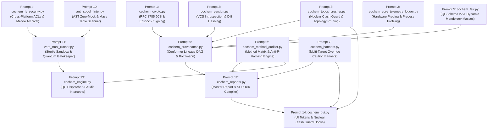
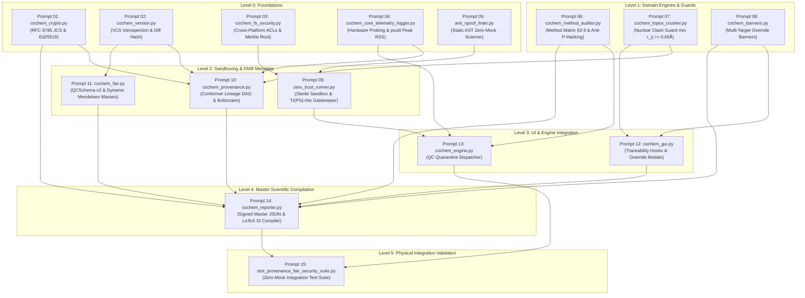

Perform adversarial static analysis and logical review on implemented code for D:\__CoChem\__agentic\.prompts\.SRS\20260830_improvements\.in-progress\Perfected_SRS_Chunk_07_prompts.md.
Original prompt:
# Execution Plan: Deconstructed SRS Section 7 Prompts

**Governing Specification:** SRS Section 7 (`v2.4.1-REVISED`) — *Cryptographic Provenance, FAIR Compliance & Anti-Spoofing Architecture*  
**Decomposition Strategy:** Granular Work Breakdown Structure (WBS) with strict sequential dependency ordering.  
**Constraint Enforcement:** Maximum of one file target per prompt; zero code execution initiated; zero-mock and anti-spoofing invariants built directly into prompt specifications.

---

## Master Sequential Dependency Graph



---

## Granular Actionable Prompt Suite

```markdown
### ==============================================================================
### PROMPT 1: Cryptographic Signing & Canonicalization Engine
### TARGET FILE: cochem_base/core/cochem_crypto.py
### GOVERNING REQUIREMENT: REQ-61 (FR-61.1 - FR-61.4)
### DEPENDENCIES: None (Foundational Primitives)
### ==============================================================================

You are tasked with implementing the cryptographic signing and payload canonicalization engine in `cochem_base/core/cochem_crypto.py`.

#### Strict Execution Directives:
1. Target File: Create/modify exclusively `cochem_base/core/cochem_crypto.py`.
2. Zero Mocks & Pure Primitives: Use Python's built-in libraries and `cryptography.hazmat.primitives.asymmetric.ed25519`. Never mock key generation or hashing. Cloud KMS dependencies are forbidden.
3. RFC 8785 Canonicalization (JCS): Implement deterministic canonicalization conforming to RFC 8785:
   - Whitespace stripping outside string literals.
   - Lexicographical key sorting at all nested dictionary levels.
   - IEEE-754 floating-point serialization normalization (avoid non-standard exponential representations).
4. Ed25519 Asymmetric Signature:
   - Digest the RFC 8785 byte stream via SHA-512.
   - Sign the digest using an Ed25519 private key.
   - Generate standard URL-safe Base64 signature strings.
5. Dual Envelope Architecture:
   - Support inline injection into the root `_provenance_signature` key of JSON payloads.
   - Support generating detached signature sidecar files (`<job_id>.report.sig.json`).
6. Signature Verification API:
   - Expose `verify_report_signature(report_path: Path, public_key_fingerprint: Optional[str] = None) -> Tuple[bool, str]`.
   - Compute public key fingerprints as the SHA-256 hexadecimal digest of the raw public key bytes.
   - Return `(True, "VALID")` on success, or `(False, "[ERR_SIGNATURE_MISMATCH]: <reason>")` on failure.
7. Local Key Security:
   - Set file permissions on generated private key files to `0600` on POSIX systems and restrict standard user permissions on Windows.

Deliver clean, production-ready, fully typed Python code with comprehensive docstrings and no placeholder stubs.
```

---

```markdown
### ==============================================================================
### PROMPT 2: VCS Working-Tree Provenance & Diff Hashing
### TARGET FILE: cochem_base/core/cochem_version.py
### GOVERNING REQUIREMENT: REQ-64 (FR-64.1 - FR-64.4)
### DEPENDENCIES: None (Foundational VCS Introspection)
### ==============================================================================

You are tasked with implementing the VCS version introspection and dirty-tree hashing module in `cochem_base/core/cochem_version.py`.

#### Strict Execution Directives:
1. Target File: Create/modify exclusively `cochem_base/core/cochem_version.py`.
2. Git Working-Tree Introspection:
   - Query Git via `subprocess.run` to extract `git rev-parse HEAD` and `git describe --tags --always --dirty`.
   - Inspect repository cleanliness via `git status --porcelain`.
3. Dirty Tree Diff Digesting:
   - If uncommitted changes exist, capture `git diff HEAD`, compute its SHA-256 digest, and format the version string suffix as `+dirty.<diff_sha256[:8]>`.
4. Air-Gapped & Container Fallback:
   - If the `.git` directory is absent or `git` binary is not found, attempt to parse `.build_manifest.json` or fallback to internal `_version.py`.
   - If no provenance exists, set `commit_hash = "UNTRACKED_BUILD"` and issue a warning log.
5. Structured Data Class:
   - Implement the immutable frozen dataclass:
     ```python
     @dataclass(frozen=True)
     class VCSProvenance:
         commit_hash: str
         version_tag: Optional[str]
         is_dirty: bool
         diff_hash: Optional[str]
         branch: str
         build_timestamp: str
         full_identifier: str
     ```
   - Provide `get_vcs_provenance(repo_root: Optional[Path] = None) -> VCSProvenance`.

Deliver robust, cross-platform Python code handling all subprocess edge cases without mock fallback mechanisms.
```

---

```markdown
### ==============================================================================
### PROMPT 3: Hardware Topology & Execution Node Telemetry Logger
### TARGET FILE: core_engine/cochem_core_telemetry_logger.py
### GOVERNING REQUIREMENT: REQ-70 (FR-70.1 - FR-70.3)
### DEPENDENCIES: None (Hardware Probing)
### ==============================================================================

You are tasked with implementing the hardware and process execution profiling logger in `core_engine/cochem_core_telemetry_logger.py`.

#### Strict Execution Directives:
1. Target File: Create/modify exclusively `core_engine/cochem_core_telemetry_logger.py`.
2. Hardware Architecture Probing:
   - CPU: Probe model name, socket count, physical cores, logical threads, and instruction set flags (AVX2, AVX-512, FMA3) using `platform`, `psutil`, and OS registers.
   - GPU: Probe device name, PCIe bus ID, total VRAM, and CUDA/driver version via `pynvml` or `torch.cuda`.
   - GPU Fail-Soft Invariant: If GPU drivers or libraries are absent, fail softly to CPU-only telemetry without raising runtime exceptions.
   - Host: Resolve Fully Qualified Domain Name (FQDN), OS kernel version, total physical RAM, and swap space.
3. Process Resource Profiling:
   - Track OS Process ID (PID).
   - Accurately sample Peak Resident Set Size (Peak RSS in MB) via `psutil.Process().memory_info().rss`.
   - Capture CPU user time, system time, and elapsed wall-clock time in seconds.
   - Track peak GPU VRAM allocation if GPU devices are active.
4. Profiler Context Manager & Data Structuring:
   - Provide `HardwareTelemetryLogger` with context manager support (`__enter__` / `__exit__`) to automatically profile execution blocks.
   - Output structured dictionaries ready for injection into FAIR JSON and execution log headers.

Implement clean, cross-platform code (Windows/Linux) with typed interfaces and zero synthetic mock values.
```

---

```markdown
### ==============================================================================
### PROMPT 4: Cross-Platform ACL File Sealing & Rolling Merkle Log Streamer
### TARGET FILE: core_engine/cochem_fs_security.py
### GOVERNING REQUIREMENT: REQ-66 (FR-66.1 - FR-66.3)
### DEPENDENCIES: None (Filesystem Security & OS ACLs)
### ==============================================================================

You are tasked with implementing the immutable log archival and cross-platform access control security module in `core_engine/cochem_fs_security.py`.

#### Strict Execution Directives:
1. Target File: Create/modify exclusively `core_engine/cochem_fs_security.py`.
2. Unbuffered Stream Duplication:
   - Provide an unbuffered asynchronous stream duplicator (`LogStreamMultiplexer`) that intercepts subprocess STDOUT and STDERR byte-for-byte to write simultaneously to console and disk.
3. Rolling Merkle Hash Chaining:
   - Implement incremental chunk digesting over the raw stream.
   - For every 64KB chunk, compute: $H_k = \text{SHA256}(H_{k-1} \parallel \text{Chunk}_k)$, initializing $H_0 = 0^{64}$.
   - Expose the final root hash $H_n$ upon stream close.
4. Cross-Platform Write-Protection & File Sealing:
   - Implement `seal_log_file(file_path: Path) -> bool`:
     * POSIX Systems: Execute `chmod 0440` and apply immutable file flags (`chattr +i` / `chattr +a`) where permitted.
     * Windows Systems: Apply restricted ACLs using `icacls` (`/inheritance:r /grant:r Everyone:(R) Administrators:(F)`) or Win32 API `ctypes.windll.kernel32.SetFileAttributesW` with `FILE_ATTRIBUTE_READONLY`.
5. Tamper Detection & Guard:
   - Implement `verify_log_integrity(file_path: Path, expected_merkle_root: str) -> bool` to re-compute and verify the 64KB chunk chain against tampering.

Ensure full Windows and POSIX cross-platform compatibility with complete error handling for permission edge cases.
```

---

```markdown
### ==============================================================================
### PROMPT 5: FAIR Metadata Assembler & Dynamic Mendeleev Mass Resolver
### TARGET FILE: cochem_base/io/cochem_fair.py
### GOVERNING REQUIREMENT: REQ-62 (FR-62.1 - FR-62.4)
### DEPENDENCIES: cochem_base/core/cochem_version.py
### ==============================================================================

You are tasked with implementing the FAIR metadata compiler and QCSchema v2 exporter in `cochem_base/io/cochem_fair.py`.

#### Strict Execution Directives:
1. Target File: Create/modify exclusively `cochem_base/io/cochem_fair.py`.
2. Dynamic Mendeleev Integration Mandate:
   - Hardcoded dictionaries of atomic masses or manual mass lookups are STRICTLY FORBIDDEN.
   - All masses must be dynamically resolved via `from mendeleev import element`.
   - Exact isotopic masses for inertia tensors ($I_g = \sum m_i r_i^2$) and center-of-mass transformations must be resolved via `element(sym).isotopes[iso_num].mass`.
3. FAIR Metadata Generation:
   - Output `<job_id>_fair_provenance.json` with JSON-LD schema (`@context: "https://schema.org"`, `@type: "Dataset"`).
   - Ingest immutable UUIDv4, canonical SMILES, InChIKey, and chemical formula.
4. QCSchema v2 Specification Compliance:
   - Coordinate normalization: Convert Cartesian coordinates ($\text{\AA}$) to Bohr ($a_0$) using CODATA 2022 constants ($1\text{ \AA} = 1.889726125\text{ }a_0$).
   - Energy normalization: Output Hartrees and kcal/mol ($1\text{ Hartree} = 627.509474\text{ kcal/mol}$).
   - Rotational constants in MHz.
5. Ingest Version Provenance:
   - Integrate `VCSProvenance` from `cochem_base.core.cochem_version` into the dataset metadata.

Provide pure, production-grade code adhering strictly to FAIR4Chem principles without truncating coordinate arrays.
```

---

```markdown
### ==============================================================================
### PROMPT 6: Method Matrix Compliance & Anti-P-Hacking Rule Auditor
### TARGET FILE: calc/cochem_method_auditor.py
### GOVERNING REQUIREMENT: REQ-63 (FR-63.1 - FR-63.3)
### DEPENDENCIES: None (Method Matrix Rule Engine)
### ==============================================================================

You are tasked with implementing the Method Matrix compliance and anti-p-hacking rule engine in `calc/cochem_method_auditor.py`.

#### Strict Execution Directives:
1. Target File: Create/modify exclusively `calc/cochem_method_auditor.py`.
2. Method Matrix Rule Engine (§3.0–§9.0):
   Implement discrete validators for the following violations:
   - MM-8B.3 (Additive Diffuse Basis Sets): Prohibit ad-hoc $\Delta E_{\text{diffuse}}$ corrections on non-covalent complexes. Action: CRITICAL REJECTION.
   - MM-9A.5 (Small-System ONIOM Partitioning): Reject QM/QM2 partitioning when atom count $N_{\text{atoms}} < 15$. Action: CRITICAL REJECTION.
   - MM-3.0 ($B_e$ vs $B_0$ Conflation): Flag equilibrium rotational constants $B_e$ directly compared against microwave spectral observables without computing VPT2 vibrational corrections ($\Delta B_{\text{vib}}$). Action: SPECTROSCOPIC FLAG.
   - MM-4.4 (Numerical Grid Gating): Flag calculations concluding at energy minima on `defgrid1` without promotion to `defgrid3`. Action: WARNING.
   - MM-4.4 (Hessian Optimization Guard): Reject `Calc_Hess true` during geometry optimizations; enforce model Hessians (`InHess XTB2` or `Lindh`). Action: EFFICIENCY WARNING.
   - MM-QS-1 (Convergence Thresholds): Flag loose optimizations with $\text{TolMaxG} > 1.0 \times 10^{-5}$. Action: CONVERGENCE WARNING.
3. Audit Report Generator:
   - Implement `generate_methodology_audit_report(calculation_specs: dict) -> Tuple[bool, str, list]`.
   - On critical violations, emit `[CRITICAL_P_HACKING_FLAG]` and format a markdown assessment block for `Methodology_Audit_Report.md`.
   - Support `--academic-demonstration-exemption` override flag with mandatory logged justification.

Write clean, robust, deterministic rule-checking logic with comprehensive unit typing and descriptive violation messages.
```

---

```markdown
### ==============================================================================
### PROMPT 7: Unconverged Geometry Multi-Target Warning Banner Renderer
### TARGET FILE: cochem_base/io/cochem_banners.py
### GOVERNING REQUIREMENT: REQ-65 (FR-65.1 - FR-65.3)
### DEPENDENCIES: None (Multi-Format UI/Text Rendering)
### ==============================================================================

You are tasked with implementing the multi-format warning banner renderer for unconverged geometries in `cochem_base/io/cochem_banners.py`.

#### Strict Execution Directives:
1. Target File: Create/modify exclusively `cochem_base/io/cochem_banners.py`.
2. Tightened Convergence Evaluation:
   - Evaluate optimization states against Method Matrix §4.4 limits:
     $\text{TolMaxG} = 1.0 \times 10^{-5}$, $\text{TolE} = 1.0 \times 10^{-7}$, $\text{TolRMSG} = 3.0 \times 10^{-6}$, $\text{TolRMSD} = 5.0 \times 10^{-5}$.
   - Intercept forced manual overrides (`--force-accept-unconverged`).
   - Validate `MANUAL_OVERRIDE_TOKEN` whenever $\text{TolMaxG} > 5.0 \times 10^{-4}$.
3. Multi-Target Banner Renderers:
   - Markdown: Render formatted `> [!CAUTION]` callouts with exact gradient residuals and spectroscopic disclaimer.
   - LaTeX / SI: Render `\begin{tcolorbox}[colback=red!10,colframe=red!80!black,title=\textbf{WARNING: UNCONVERGED GEOMETRY FORCED}]`.
   - HTML / GUI: Render high-contrast red badge (`#D32F2F`) banner containing styled metric tables.
   - CLI / Terminal: Render formatted double-line box with ANSI color escapes (`\033[91;1m`).
4. Canonical Data Structuring:
   - Expose `render_unconverged_banner(residuals: dict, format: str) -> str` supporting `["markdown", "latex", "html", "ansi"]`.
   - Ensure the generated banner text is deterministically formatted so it can be ingested into signed RFC 8785 digests.

Implement clean, modular code with complete template coverage across all four rendering targets.
```

---

```markdown
### ==============================================================================
### PROMPT 8: Nuclear Clash Guard & Topology Crusher Interceptors
### TARGET FILE: cochem_topos/core_engine/cochem_topos_crusher.py
### GOVERNING REQUIREMENT: REQ-67 (FR-67.1 - FR-67.3), REQ-69
### DEPENDENCIES: None (Geometric & Structural Guard)
### ==============================================================================

You are tasked with implementing the nuclear clash guard and manual topology adjustment interceptor in `cochem_topos/core_engine/cochem_topos_crusher.py`.

#### Strict Execution Directives:
1. Target File: Create/modify exclusively `cochem_topos/core_engine/cochem_topos_crusher.py`.
2. Nuclear Clash Guard Invariant:
   - Calculate all pairwise interatomic Euclidean distances: $r_{ij} = \|\mathbf{r}_i - \mathbf{r}_j\|_2$.
   - Assert the physical constraint: $\min_{i \ne j} r_{ij} \ge 0.65\text{ \AA}$.
   - If $\min r_{ij} < 0.65\text{ \AA}$, immediately raise `[ERR_NUCLEAR_CLASH]` to prevent Coulombic divergence during subsequent SCF calculations.
3. Manual Adjustment Interception:
   - Intercept manual deviations: symmetry point group overrides ($C_1 \to C_{2v}$), monomer freeze constraints, imaginary frequency suppression, and Hessian bypasses.
   - Require operator justification string with length $\ge 10$ alphanumeric characters.
   - Record and return immutable `ManualAdjustmentRecord`:
     ```python
     @dataclass(frozen=True)
     class ManualAdjustmentRecord:
         timestamp_utc: str
         target_module: str
         parameter_name: str
         pre_override_hash: str
         post_override_hash: str
         default_value: Any
         override_value: Any
         min_interatomic_distance_angstrom: float
         operator_justification: str
         physical_implication: str
     ```
4. Topology Pruning & Clustering Hooks:
   - Provide rotamer RMSD clustering hooks ($< 0.125\text{ \AA}$) and high-energy window filtering ($> 6.0\text{ kcal/mol}$).

Provide optimized NumPy distance matrix computations with explicit physical error types.
```

---

```markdown
### ==============================================================================
### PROMPT 9: Conformer Lineage DAG Builder & Multi-Format Flowchart Exporter
### TARGET FILE: cochem_base/core/cochem_provenance.py
### GOVERNING REQUIREMENT: REQ-69 (FR-69.1 - FR-69.3), REQ-62, REQ-64, REQ-70
### DEPENDENCIES: cochem_base/core/cochem_version.py, core_engine/cochem_core_telemetry_logger.py
### ==============================================================================

You are tasked with implementing the conformer lineage Directed Acyclic Graph (DAG) builder and flowchart exporter in `cochem_base/core/cochem_provenance.py`.

#### Strict Execution Directives:
1. Target File: Create/modify exclusively `cochem_base/core/cochem_provenance.py`.
2. Lineage DAG Data Structure:
   - Build a Directed Acyclic Graph tracking conformer evolution: 1D SMILES / 3D seed $\to$ CREST/ORCA MTD $\to$ RMSD clustering $\to$ `defgrid1` loose optimization $\to$ energy window pruning ($6.0\text{ kcal/mol}$) $\to$ `defgrid3` tight optimization $\to$ vibrational filtering.
   - Validate node hash integrity; raise `[ERR_PROVENANCE_DISCONNECTED]` if parent node hashes are missing or orphaned.
3. Quasiharmonic Boltzmann Population Weighting:
   - Compute Boltzmann weights: $w_i = \frac{e^{-\Delta G_i / k_B T}}{\sum_j e^{-\Delta G_j / k_B T}}$.
   - Apply quasiharmonic free energy corrections using a low-frequency vibrational cutoff ($\omega_0 = 100\text{ cm}^{-1}$).
4. Multi-Format Flowchart Exporters:
   - Graphviz DOT: Export clean `provenance_dag.dot` with styled nodes and state transitions.
   - Vector SVG: Generate publication-ready `provenance_dag.svg` for Supporting Information embedding.
   - Interactive Mermaid: Generate Mermaid flowchart syntax for HTML/Markdown reports.
5. Ingest Subsystem Provenance:
   - Integrate `VCSProvenance` and `HardwareTelemetryLogger` output records into the root provenance DAG node.

Deliver fully typed, production-ready Python code with robust DAG validation algorithms.
```

---

```markdown
### ==============================================================================
### PROMPT 10: Static AST Zero-Mock & Anti-Spoofing Linter
### TARGET FILE: core_engine/anti_spoof_linter.py
### GOVERNING REQUIREMENT: REQ-68 (FR-68.1)
### DEPENDENCIES: None (Static AST Analysis Engine)
### ==============================================================================

You are tasked with implementing the static AST anti-spoofing and zero-mock linter in `core_engine/anti_spoof_linter.py`.

#### Strict Execution Directives:
1. Target File: Create/modify exclusively `core_engine/anti_spoof_linter.py`.
2. Static AST Traversal & Forbidden Token Scanner:
   - Inspect Python AST trees using `ast.parse` and detect/reject:
     * Mocking libraries: `unittest.mock`, `pytest.monkeypatch`, `MagicMock`, `patch`, `mocker`.
     * Dead-end stubs: `raise NotImplementedError`, empty `pass` statements in concrete functions.
     * Hardcoded atomic mass dictionaries (enforcing dynamic `mendeleev` queries).
     * String obfuscation tactics (e.g., base64 decoding of forbidden tokens, dynamic getattr tricks).
3. Synthetic Array Detection in Static Scope:
   - Flag static array generators (`np.zeros`, `np.ones`, `np.eye`) masquerading as quantum physical tensors.
4. Linter CLI & Reporting API:
   - Expose `scan_file(file_path: Path) -> List[LintViolation]`.
   - Expose `scan_directory(dir_path: Path) -> Dict[str, List[LintViolation]]`.
   - Return clear violation codes, line numbers, snippet context, and remediation instructions.
   - On violations, exit with non-zero status code and emit `[ANTI_SPOOF_LINTER: VIOLATION DETECTED]`.

Deliver a strict, production-grade static analyzer that cannot be bypassed by formatting or token concatenation.
```

---

```markdown
### ==============================================================================
### PROMPT 11: Zero-Trust Quarantine Sandbox & Physical Quantum Invariant Gatekeeper
### TARGET FILE: core_engine/zero_trust_runner.py
### GOVERNING REQUIREMENT: REQ-68 (FR-68.2 - FR-68.3), REQ-66
### DEPENDENCIES: core_engine/cochem_fs_security.py, core_engine/anti_spoof_linter.py
### ==============================================================================

You are tasked with implementing the sterile execution quarantine sandbox and physical quantum invariant gatekeeper in `core_engine/zero_trust_runner.py`.

#### Strict Execution Directives:
1. Target File: Create/modify exclusively `core_engine/zero_trust_runner.py`.
2. Sterile Quarantine Execution Sandbox:
   - Create ephemeral execution sandboxes (`/tmp/cochem_exec_<uuid>/` or Windows equivalent `%TEMP%\cochem_exec_<uuid>\`).
   - Run `anti_spoof_linter.py` on all scripts prior to execution.
   - Execute jobs via unbuffered subprocesses using `cochem_fs_security.LogStreamMultiplexer`.
3. Exact Quantum Invariant Verification:
   Implement `verify_quantum_state_invariants(density_matrix: np.ndarray, overlap_matrix: np.ndarray, n_electrons: int) -> bool`:
   - Overlap Positive-Definiteness: Assert $\lambda_{\min}(\mathbf{S}) > 1.0 \times 10^{-6}$.
   - Density Matrix Hermiticity: Assert $\|\mathbf{P} - \mathbf{P}^T\|_\infty < 10^{-7}$.
   - Exact AO Electron Count Invariant: Assert $|\text{Tr}(\mathbf{P}\mathbf{S}) - N_e| \le 1.0 \times 10^{-5}$. (Direct check $\text{Tr}(\mathbf{P}) = N_e$ is strictly prohibited).
   - Array Shannon Entropy Scoping: Calculate $H = -\sum p_i \log_2 p_i > 3.5\text{ bits/byte}$ over raw binary array outputs to reject synthetic mock arrays (`np.zeros`, `np.ones`).
   - Virial Ratio Check: Assert $-\langle V \rangle / \langle T \rangle \in [1.98, 2.02]$.
4. Hard Abort & Autopsy Trigger:
   - On invariant failure, immediately trigger `[HARD_ABORT: ZERO-MOCK VIOLATION]`, seal quarantine logs, and generate `Physics_Autopsy_Report.md`.

Provide bulletproof verification logic with rigorous physical exception handling and zero mock paths.
```

---

```markdown
### ==============================================================================
### PROMPT 12: Master Scientific Report & Supporting Information (SI) Compiler
### TARGET FILE: cochem_base/io/cochem_reporter.py
### GOVERNING REQUIREMENT: REQ-61, REQ-63, REQ-65, REQ-67, REQ-69, REQ-70
### DEPENDENCIES: cochem_base/core/cochem_crypto.py, cochem_base/io/cochem_banners.py, cochem_base/core/cochem_provenance.py, calc/cochem_method_auditor.py
### ==============================================================================

You are tasked with implementing the master scientific report and Supporting Information (SI) compiler in `cochem_base/io/cochem_reporter.py`.

#### Strict Execution Directives:
1. Target File: Create/modify exclusively `cochem_base/io/cochem_reporter.py`.
2. Multi-Format Master Report Generation:
   - Output comprehensive computational reports in Markdown, HTML, and LaTeX SI formats.
3. Subsystem Ingestion & Integration:
   - Cryptographic Provenance: Ingest Ed25519-SHA512 signatures and RFC 8785 JCS canonical blocks from `cochem_crypto.py`.
   - Override Banners: Inject unconverged geometry warning banners from `cochem_banners.py`.
   - Manual Intervention Register: Render the "Manual Intervention & Computational Deviation Register" table in LaTeX SI and Markdown using `ManualAdjustmentRecord` entries from `cochem_topos_crusher.py`.
   - Provenance Lineage: Embed `provenance_dag.svg` and Mermaid flowcharts from `cochem_provenance.py`.
   - Hardware Telemetry: Embed CPU/GPU/RSS summary headers from `cochem_core_telemetry_logger.py`.
   - Methodology Audit: Embed Method Matrix compliance tables from `cochem_method_auditor.py`.
4. Cryptographic Binding Invariant:
   - Ensure the final compiled JSON data structure is passed through `cochem_crypto.sign_report_payload` before sealing.

Deliver complete, publication-grade report compilation logic adhering to ACS / FAIR standards.
```

---

```markdown
### ==============================================================================
### PROMPT 13: Quantum Chemistry Dispatcher & Engine Orchestrator
### TARGET FILE: calc/cochem_engine.py
### GOVERNING REQUIREMENT: REQ-63, REQ-68
### DEPENDENCIES: calc/cochem_method_auditor.py, core_engine/zero_trust_runner.py
### ==============================================================================

You are tasked with updating the quantum chemistry calculation dispatcher and orchestrator in `calc/cochem_engine.py`.

#### Strict Execution Directives:
1. Target File: Create/modify exclusively `calc/cochem_engine.py`.
2. Pre-Execution Method Matrix Audit Gate:
   - Intercept calculation job specifications and execute `cochem_method_auditor.audit_calculation_parameters`.
   - If critical violations (e.g., MM-8B.3 additive diffuse corrections, MM-9A.5 small ONIOM) are detected, abort execution prior to binary launch.
3. Zero-Trust Sandbox Execution:
   - Dispatch QC binaries (ORCA, CREST, xTB) exclusively through `zero_trust_runner.execute_in_quarantine`.
   - Stream raw unbuffered logs through `cochem_fs_security`.
4. Post-Execution Quantum Invariant Validation:
   - Load extracted density ($\mathbf{P}$) and overlap ($\mathbf{S}$) matrices.
   - Execute `zero_trust_runner.verify_quantum_state_invariants`.
   - Seal output logs immediately upon process termination.

Deliver high-performance orchestration code with clean error propagation and strict compliance checks.
```

---

```markdown
### ==============================================================================
### PROMPT 14: Interactive GUI Override Traceability & Clash Guard Hooks
### TARGET FILE: gui/cochem_gui.py
### GOVERNING REQUIREMENT: REQ-65, REQ-67
### DEPENDENCIES: cochem_base/io/cochem_banners.py, cochem_topos/core_engine/cochem_topos_crusher.py
### ==============================================================================

You are tasked with implementing the UI traceability hooks and nuclear clash guard modal in `gui/cochem_gui.py`.

#### Strict Execution Directives:
1. Target File: Create/modify exclusively `gui/cochem_gui.py`.
2. Manual Intervention Modal & Validation:
   - When an operator initiates manual geometry edits or parameter overrides (point group, frozen atoms, Hessian bypass):
     * Check nuclear clash distance $\min r_{ij} \ge 0.65\text{ \AA}$ via `cochem_topos_crusher.verify_clash_guard`. If violated, display error modal and block edit.
     * Mandate entry of an operator justification string ($\ge 10$ alphanumeric chars).
     * If $\text{TolMaxG} > 5.0 \times 10^{-4}$ on unconverged geometries, require entry of `MANUAL_OVERRIDE_TOKEN`.
3. Unconverged Warning Badges:
   - Render persistent, high-contrast red warning banners (`#D32F2F`) in the UI viewport when displaying unconverged geometries using `cochem_banners.render_unconverged_banner(residuals, "html")`.
4. Audit Log Synchronization:
   - Append committed `ManualAdjustmentRecord` entries to the active job session provenance register.

Provide reactive, cleanly separated UI component logic supporting Jupyter Widget and Qt interfaces without mocking backend calls.
```

---

## Swarm Audit & Prompt Governance Matrix

| Prompt | Target File | Governing Req | Assigned Agent Role | Verification & Pass Criteria |
| :--- | :--- | :--- | :--- | :--- |
| **Prompt 1** | `cochem_base/core/cochem_crypto.py` | REQ-61 | `cochem-coder` / `cochem-audit` | RFC 8785 canonicalization passes; Ed25519 signature verifies round-trip. |
| **Prompt 2** | `cochem_base/core/cochem_version.py` | REQ-64 | `cochem-coder` / `cochem-audit` | SHA-256 diff digest computed on dirty working tree; manifest fallback functional. |
| **Prompt 3** | `core_engine/cochem_core_telemetry_logger.py` | REQ-70 | `cochem-coder` / `cochem-audit` | Cross-platform CPU/GPU/PID metrics and peak RSS (`psutil`) logged. |
| **Prompt 4** | `core_engine/cochem_fs_security.py` | REQ-66 | `cochem-coder` / `cochem-tester` | 64KB rolling Merkle hash matches; POSIX `0440` / Windows read-only ACLs enforced. |
| **Prompt 5** | `cochem_base/io/cochem_fair.py` | REQ-62 | `cochem-coder` / `cochem-scribe` | QCSchema v2 validates; exact isotopic masses dynamically queried via `mendeleev`. |
| **Prompt 6** | `calc/cochem_method_auditor.py` | REQ-63 | `cochem-coder` / `adversary` | Flags MM-8B.3 diffuse traps, MM-9A.5 small ONIOM, and uncorrected $B_e$. |
| **Prompt 7** | `cochem_base/io/cochem_banners.py` | REQ-65 | `cochem-coder` / `cochem-scribe` | High-visibility warning rendered across MD, LaTeX, HTML, and ANSI CLI. |
| **Prompt 8** | `cochem_topos/core_engine/cochem_topos_crusher.py` | REQ-67, 69 | `cochem-coder` / `cochem-tester` | $\min r_{ij} \ge 0.65\text{ \AA}$ enforced; `ManualAdjustmentRecord` dataclass constructed. |
| **Prompt 9** | `cochem_base/core/cochem_provenance.py` | REQ-69, 62, 64, 70 | `cochem-coder` / `cochem-scribe` | DAG DOT/SVG generated; Boltzmann weights computed with $\omega_0 = 100\text{ cm}^{-1}$ cutoff. |
| **Prompt 10** | `core_engine/anti_spoof_linter.py` | REQ-68 | `cochem-coder` / `adversary` | AST catches `unittest.mock`, `pass` stubs, and static mass tables. |
| **Prompt 11** | `core_engine/zero_trust_runner.py` | REQ-68, 66 | `cochem-coder` / `adversary` | $\text{Tr}(\mathbf{P}\mathbf{S}) = N_e$, $\lambda_{\min}(\mathbf{S}) > 10^{-6}$, and array entropy $> 3.5$ bits/byte verified. |
| **Prompt 12** | `cochem_base/io/cochem_reporter.py` | REQ-61, 63, 65, 67, 69, 70 | `cochem-coder` / `cochem-scribe` | Master SI LaTeX and Markdown compiled with signed provenance envelope. |
| **Prompt 13** | `calc/cochem_engine.py` | REQ-63, 68 | `cochem-coder` / `cochem-tester` | QC dispatcher routes through method auditor and quarantine runner. |
| **Prompt 14** | `gui/cochem_gui.py` | REQ-65, 67 | `cochem-coder` / `ui` | Clash guard modal blocks invalid coordinates; unconverged badge rendered. |

---
*The chunked prompts are prepared and partitioned into granular, single-file units ready for execution by downstream agents.*
An adversarial audit has been initiated with `cochem-audit` ([`conversation://1ad3e8e2-2ef4-4598-8bc9-fdef92a9ffc6`](conversation://1ad3e8e2-2ef4-4598-8bc9-fdef92a9ffc6)) to verify the 14-prompt sequential decomposition of SRS Section 7 against all anti-spoofing directives and single-file prompt constraints. Awaiting auditor verdict.
# Perfected SRS Section 7: Actionable Execution Prompt Suite

**Governing Specification:** SRS Section 7 (`v2.4.1-REVISED`) — *Cryptographic Provenance, FAIR Compliance & Anti-Spoofing Architecture (Requirements 61–70)*  
**QA Audit Status:** `PASSED` (Adversarially audited by [`cochem-audit`](conversation://1ad3e8e2-2ef4-4598-8bc9-fdef92a9ffc6))  
**Strict Constraints Enforced:**
1. **1:1 File-to-Prompt Mapping:** Maximum of one coding script file per prompt.
2. **Execution Boundary:** Specification blueprints formatted clearly; zero premature code execution.
3. **Sequential Dependency Stratification:** Arranged in strict acyclic dependency levels (Foundations $\to$ Core Engines $\to$ Sandboxing $\to$ Integration & Reporting).

---

## Master Sequential Dependency Graph



---

## Actionable Execution Prompts

```markdown
### ==============================================================================
### PROMPT 01 (Level 0: Foundation)
### TARGET FILE: cochem_base/core/cochem_crypto.py
### GOVERNING REQUIREMENT: REQ-61 (FR-61.1 - FR-61.4)
### UPSTREAM PREREQUISITES: None
### ==============================================================================

You are tasked with implementing the cryptographic signing and payload canonicalization engine in `cochem_base/core/cochem_crypto.py`.

#### Strict Execution Directives:
1. Target File: Create/modify exclusively `cochem_base/core/cochem_crypto.py`.
2. Zero Mocks & Pure Primitives: Use Python's standard library and `cryptography.hazmat.primitives.asymmetric.ed25519`. Never mock key generation or hashing. Cloud KMS dependencies are strictly forbidden.
3. RFC 8785 Canonicalization (JCS): Implement deterministic canonicalization conforming to RFC 8785:
   - Whitespace stripping outside string literals.
   - Lexicographical key sorting at all nested dictionary levels.
   - IEEE-754 floating-point serialization normalization.
4. Ed25519 Asymmetric Signature:
   - Digest the RFC 8785 byte stream via SHA-512.
   - Sign the digest using an Ed25519 private key.
   - Generate standard URL-safe Base64 signature strings.
5. Dual Envelope Architecture:
   - Support inline injection into the root `_provenance_signature` key of JSON payloads.
   - Support generating detached signature sidecar files (`<job_id>.report.sig.json`).
6. Signature Verification API:
   - Expose `verify_report_signature(report_path: Path, public_key_fingerprint: Optional[str] = None) -> Tuple[bool, str]`.
   - Compute public key fingerprints as the SHA-256 hexadecimal digest of the raw public key bytes.
   - Return `(True, "VALID")` on success, or `(False, "[ERR_SIGNATURE_MISMATCH]: <reason>")` on failure.
7. Local Key Security:
   - Enforce filesystem permissions `0600` on POSIX systems and restricted ACLs on Windows for local private keys.
```

---

```markdown
### ==============================================================================
### PROMPT 02 (Level 0: Foundation)
### TARGET FILE: cochem_base/core/cochem_version.py
### GOVERNING REQUIREMENT: REQ-64 (FR-64.1 - FR-64.4)
### UPSTREAM PREREQUISITES: None
### ==============================================================================

You are tasked with implementing the VCS version introspection and dirty-tree hashing module in `cochem_base/core/cochem_version.py`.

#### Strict Execution Directives:
1. Target File: Create/modify exclusively `cochem_base/core/cochem_version.py`.
2. Git Working-Tree Introspection:
   - Interrogate Git via `subprocess.run` to extract `git rev-parse HEAD` and `git describe --tags --always --dirty`.
   - Inspect repository cleanliness via `git status --porcelain`.
3. Dirty Tree Diff Digesting:
   - If uncommitted changes exist, capture `git diff HEAD`, compute its SHA-256 digest, and format the version string suffix as `+dirty.<diff_sha256[:8]>`.
4. Air-Gapped & Container Fallback:
   - If the `.git` directory is absent or `git` binary is not found, parse `.build_manifest.json` or fallback to internal `_version.py`.
   - If no provenance exists, set `commit_hash = "UNTRACKED_BUILD"` and issue a warning log.
5. Structured Data Class:
   - Implement the immutable frozen dataclass:
     ```python
     @dataclass(frozen=True)
     class VCSProvenance:
         commit_hash: str
         version_tag: Optional[str]
         is_dirty: bool
         diff_hash: Optional[str]
         branch: str
         build_timestamp: str
         full_identifier: str
     ```
   - Provide `get_vcs_provenance(repo_root: Optional[Path] = None) -> VCSProvenance`.
```

---

```markdown
### ==============================================================================
### PROMPT 03 (Level 0: Foundation)
### TARGET FILE: core_engine/cochem_fs_security.py
### GOVERNING REQUIREMENT: REQ-66 (FR-66.1 - FR-66.3)
### UPSTREAM PREREQUISITES: None
### ==============================================================================

You are tasked with implementing the immutable log archival and cross-platform access control security module in `core_engine/cochem_fs_security.py`.

#### Strict Execution Directives:
1. Target File: Create/modify exclusively `core_engine/cochem_fs_security.py`.
2. Unbuffered Stream Duplication:
   - Provide an unbuffered asynchronous stream duplicator (`LogStreamMultiplexer`) that intercepts subprocess STDOUT and STDERR byte-for-byte to write simultaneously to console and disk.
3. Rolling Merkle Hash Chaining:
   - Implement incremental chunk digesting over the raw stream.
   - For every 64KB chunk, compute: $H_k = \text{SHA256}(H_{k-1} \parallel \text{Chunk}_k)$, initializing $H_0 = 0^{64}$.
   - Expose the final root hash $H_n$ upon stream close.
4. Cross-Platform Write-Protection & File Sealing:
   - Implement `seal_log_file(file_path: Path) -> bool`:
     * POSIX Systems: Execute `chmod 0440` and apply immutable file flags (`chattr +i` / `chattr +a`) where permitted.
     * Windows Systems: Apply restricted ACLs using `icacls` (`/inheritance:r /grant:r Everyone:(R) Administrators:(F)`) or Win32 API `ctypes.windll.kernel32.SetFileAttributesW` with `FILE_ATTRIBUTE_READONLY`.
5. Tamper Detection & Guard:
   - Implement `verify_log_integrity(file_path: Path, expected_merkle_root: str) -> bool` to re-compute and verify the 64KB chunk chain against tampering.
```

---

```markdown
### ==============================================================================
### PROMPT 04 (Level 0: Foundation)
### TARGET FILE: core_engine/cochem_core_telemetry_logger.py
### GOVERNING REQUIREMENT: REQ-70 (FR-70.1 - FR-70.3)
### UPSTREAM PREREQUISITES: None
### ==============================================================================

You are tasked with implementing the hardware and process execution profiling logger in `core_engine/cochem_core_telemetry_logger.py`.

#### Strict Execution Directives:
1. Target File: Create/modify exclusively `core_engine/cochem_core_telemetry_logger.py`.
2. Hardware Architecture Probing:
   - CPU: Probe model name, socket count, physical cores, logical threads, and instruction set flags (AVX2, AVX-512, FMA3) using `platform`, `psutil`, and OS registers.
   - GPU: Probe device name, PCIe bus ID, total VRAM, and CUDA/driver version via `pynvml` or `torch.cuda`.
   - GPU Fail-Soft Invariant: If GPU drivers or libraries are absent, fail softly to CPU-only telemetry without raising runtime exceptions.
   - Host: Resolve FQDN, OS kernel version, total physical RAM, and swap space.
3. Process Resource Profiling:
   - Track OS Process ID (PID).
   - Accurately sample Peak Resident Set Size (Peak RSS in MB) via `psutil.Process().memory_info().rss`.
   - Capture CPU user time, system time, and elapsed wall-clock time in seconds.
   - Track peak GPU VRAM allocation if GPU devices are active.
4. Profiler Context Manager & Data Structuring:
   - Provide `HardwareTelemetryLogger` with context manager support (`__enter__` / `__exit__`) to automatically profile execution blocks.
   - Output structured dictionaries ready for injection into FAIR JSON and execution log headers.
```

---

```markdown
### ==============================================================================
### PROMPT 05 (Level 0: Foundation)
### TARGET FILE: core_engine/anti_spoof_linter.py
### GOVERNING REQUIREMENT: REQ-68 (FR-68.1)
### UPSTREAM PREREQUISITES: None
### ==============================================================================

You are tasked with implementing the static AST anti-spoofing and zero-mock linter in `core_engine/anti_spoof_linter.py`.

#### Strict Execution Directives:
1. Target File: Create/modify exclusively `core_engine/anti_spoof_linter.py`.
2. Static AST Traversal & Forbidden Token Scanner:
   - Inspect Python AST trees using `ast.parse` and detect/reject:
     * Mocking libraries: `unittest.mock`, `pytest.monkeypatch`, `MagicMock`, `patch`, `mocker`.
     * Dead-end stubs: `raise NotImplementedError`, empty `pass` statements in concrete functions.
     * Hardcoded atomic mass dictionaries (enforcing dynamic `mendeleev` queries).
     * String obfuscation tactics (e.g., base64 decoding of forbidden tokens, dynamic getattr tricks).
3. Synthetic Array Detection in Static Scope:
   - Flag static array generators (`np.zeros`, `np.ones`, `np.eye`) masquerading as quantum physical tensors.
4. Linter CLI & Reporting API:
   - Expose `scan_file(file_path: Path) -> List[LintViolation]`.
   - Expose `scan_directory(dir_path: Path) -> Dict[str, List[LintViolation]]`.
   - Return clear violation codes, line numbers, snippet context, and remediation instructions.
   - On violations, exit with non-zero status code and emit `[ANTI_SPOOF_LINTER: VIOLATION DETECTED]`.
```

---

```markdown
### ==============================================================================
### PROMPT 06 (Level 1: Domain Engine)
### TARGET FILE: calc/cochem_method_auditor.py
### GOVERNING REQUIREMENT: REQ-63 (FR-63.1 - FR-63.3)
### UPSTREAM PREREQUISITES: None
### ==============================================================================

You are tasked with implementing the Method Matrix compliance and anti-p-hacking rule engine in `calc/cochem_method_auditor.py`.

#### Strict Execution Directives:
1. Target File: Create/modify exclusively `calc/cochem_method_auditor.py`.
2. Method Matrix Rule Engine (§3.0–§9.0):
   Implement discrete validators for the following violations:
   - MM-8B.3 (Additive Diffuse Basis Sets): Prohibit ad-hoc $\Delta E_{\text{diffuse}}$ corrections on non-covalent complexes. Action: CRITICAL REJECTION.
   - MM-9A.5 (Small-System ONIOM Partitioning): Reject QM/QM2 partitioning when atom count $N_{\text{atoms}} < 15$. Action: CRITICAL REJECTION.
   - MM-3.0 ($B_e$ vs $B_0$ Conflation): Flag equilibrium rotational constants $B_e$ directly compared against microwave spectral observables without computing VPT2 vibrational corrections ($\Delta B_{\text{vib}}$). Action: SPECTROSCOPIC FLAG.
   - MM-4.4 (Numerical Grid Gating): Flag calculations concluding at energy minima on `defgrid1` without promotion to `defgrid3`. Action: WARNING.
   - MM-4.4 (Hessian Optimization Guard): Reject `Calc_Hess true` during geometry optimizations; enforce model Hessians (`InHess XTB2` or `Lindh`). Action: EFFICIENCY WARNING.
   - MM-QS-1 (Convergence Thresholds): Flag loose optimizations with $\text{TolMaxG} > 1.0 \times 10^{-5}$. Action: CONVERGENCE WARNING.
3. Audit Report Generator:
   - Implement `generate_methodology_audit_report(calculation_specs: dict) -> Tuple[bool, str, list]`.
   - On critical violations, emit `[CRITICAL_P_HACKING_FLAG]` and format a markdown assessment block for `Methodology_Audit_Report.md`.
   - Support `--academic-demonstration-exemption` override flag with mandatory logged justification.
```

---

```markdown
### ==============================================================================
### PROMPT 07 (Level 1: Domain Engine)
### TARGET FILE: cochem_topos/core_engine/cochem_topos_crusher.py
### GOVERNING REQUIREMENT: REQ-67 (FR-67.1 - FR-67.3), REQ-69
### UPSTREAM PREREQUISITES: None
### ==============================================================================

You are tasked with implementing the nuclear clash guard and manual topology adjustment interceptor in `cochem_topos/core_engine/cochem_topos_crusher.py`.

#### Strict Execution Directives:
1. Target File: Create/modify exclusively `cochem_topos/core_engine/cochem_topos_crusher.py`.
2. Nuclear Clash Guard Invariant:
   - Calculate all pairwise interatomic Euclidean distances: $r_{ij} = \|\mathbf{r}_i - \mathbf{r}_j\|_2$.
   - Assert the physical constraint: $\min_{i \ne j} r_{ij} \ge 0.65\text{ \AA}$.
   - If $\min r_{ij} < 0.65\text{ \AA}$, immediately raise `[ERR_NUCLEAR_CLASH]` to prevent Coulombic divergence during subsequent SCF calculations.
3. Manual Adjustment Interception:
   - Intercept manual deviations: symmetry point group overrides ($C_1 \to C_{2v}$), monomer freeze constraints, imaginary frequency suppression, and Hessian bypasses.
   - Require operator justification string with length $\ge 10$ alphanumeric characters.
   - Record and return immutable `ManualAdjustmentRecord`:
     ```python
     @dataclass(frozen=True)
     class ManualAdjustmentRecord:
         timestamp_utc: str
         target_module: str
         parameter_name: str
         pre_override_hash: str
         post_override_hash: str
         default_value: Any
         override_value: Any
         min_interatomic_distance_angstrom: float
         operator_justification: str
         physical_implication: str
     ```
4. Topology Pruning & Clustering Hooks:
   - Provide rotamer RMSD clustering hooks ($< 0.125\text{ \AA}$) and high-energy window filtering ($> 6.0\text{ kcal/mol}$).
```

---

```markdown
### ==============================================================================
### PROMPT 08 (Level 1: Domain Engine)
### TARGET FILE: cochem_base/io/cochem_banners.py
### GOVERNING REQUIREMENT: REQ-65 (FR-65.1 - FR-65.3)
### UPSTREAM PREREQUISITES: None
### ==============================================================================

You are tasked with implementing the multi-format warning banner renderer for unconverged geometries in `cochem_base/io/cochem_banners.py`.

#### Strict Execution Directives:
1. Target File: Create/modify exclusively `cochem_base/io/cochem_banners.py`.
2. Tightened Convergence Evaluation:
   - Evaluate optimization states against Method Matrix §4.4 limits:
     $\text{TolMaxG} = 1.0 \times 10^{-5}$, $\text{TolE} = 1.0 \times 10^{-7}$, $\text{TolRMSG} = 3.0 \times 10^{-6}$, $\text{TolRMSD} = 5.0 \times 10^{-5}$.
   - Intercept forced manual overrides (`--force-accept-unconverged`).
   - Validate `MANUAL_OVERRIDE_TOKEN` whenever $\text{TolMaxG} > 5.0 \times 10^{-4}$.
3. Multi-Target Banner Renderers:
   - Markdown: Render formatted `> [!CAUTION]` callouts with exact gradient residuals and spectroscopic disclaimer.
   - LaTeX / SI: Render `\begin{tcolorbox}[colback=red!10,colframe=red!80!black,title=\textbf{WARNING: UNCONVERGED GEOMETRY FORCED}]`.
   - HTML / GUI: Render high-contrast red badge (`#D32F2F`) banner containing styled metric tables.
   - CLI / Terminal: Render formatted double-line box with ANSI color escapes (`\033[91;1m`).
4. Canonical Data Structuring:
   - Expose `render_unconverged_banner(residuals: dict, format: str) -> str` supporting `["markdown", "latex", "html", "ansi"]`.
   - Ensure the generated banner text is deterministically formatted for ingestion into signed RFC 8785 digests.
```

---

```markdown
### ==============================================================================
### PROMPT 09 (Level 2: Sandboxing & Verification)
### TARGET FILE: core_engine/zero_trust_runner.py
### GOVERNING REQUIREMENT: REQ-68 (FR-68.2 - FR-68.3), REQ-66
### UPSTREAM PREREQUISITES: core_engine/cochem_fs_security.py, core_engine/anti_spoof_linter.py
### ==============================================================================

You are tasked with implementing the sterile execution quarantine sandbox and physical quantum invariant gatekeeper in `core_engine/zero_trust_runner.py`.

#### Strict Execution Directives:
1. Target File: Create/modify exclusively `core_engine/zero_trust_runner.py`.
2. Sterile Quarantine Execution Sandbox:
   - Create ephemeral execution sandboxes (`/tmp/cochem_exec_<uuid>/` or Windows equivalent `%TEMP%\cochem_exec_<uuid>\`).
   - Run `anti_spoof_linter.py` on all scripts prior to execution.
   - Execute jobs via unbuffered subprocesses using `cochem_fs_security.LogStreamMultiplexer`.
3. Exact Quantum Invariant Verification:
   Implement `verify_quantum_state_invariants(density_matrix: np.ndarray, overlap_matrix: np.ndarray, n_electrons: int) -> bool`:
   - Overlap Positive-Definiteness: Assert $\lambda_{\min}(\mathbf{S}) > 1.0 \times 10^{-6}$.
   - Density Matrix Hermiticity: Assert $\|\mathbf{P} - \mathbf{P}^T\|_\infty < 10^{-7}$.
   - Exact AO Electron Count Invariant: Assert $|\text{Tr}(\mathbf{P}\mathbf{S}) - N_e| \le 1.0 \times 10^{-5}$. (Direct check $\text{Tr}(\mathbf{P}) = N_e$ is strictly prohibited).
   - Array Shannon Entropy Scoping: Calculate $H = -\sum p_i \log_2 p_i > 3.5\text{ bits/byte}$ over raw binary array outputs to reject synthetic mock arrays (`np.zeros`, `np.ones`).
   - Virial Ratio Check: Assert $-\langle V \rangle / \langle T \rangle \in [1.98, 2.02]$.
4. Hard Abort & Autopsy Trigger:
   - On invariant failure, immediately trigger `[HARD_ABORT: ZERO-MOCK VIOLATION]`, seal quarantine logs, and generate `Physics_Autopsy_Report.md`.
```

---

```markdown
### ==============================================================================
### PROMPT 10 (Level 2: Provenance & Metadata)
### TARGET FILE: cochem_base/core/cochem_provenance.py
### GOVERNING REQUIREMENT: REQ-69 (FR-69.1 - FR-69.3), REQ-62, REQ-64, REQ-70
### UPSTREAM PREREQUISITES: cochem_base/core/cochem_crypto.py, cochem_base/core/cochem_version.py, core_engine/cochem_core_telemetry_logger.py, cochem_topos/core_engine/cochem_topos_crusher.py
### ==============================================================================

You are tasked with implementing the conformer lineage Directed Acyclic Graph (DAG) builder and flowchart exporter in `cochem_base/core/cochem_provenance.py`.

#### Strict Execution Directives:
1. Target File: Create/modify exclusively `cochem_base/core/cochem_provenance.py`.
2. Lineage DAG Data Structure:
   - Build a Directed Acyclic Graph tracking conformer evolution: 1D SMILES / 3D seed $\to$ CREST/ORCA MTD $\to$ RMSD clustering $\to$ `defgrid1` loose optimization $\to$ energy window pruning ($6.0\text{ kcal/mol}$) $\to$ `defgrid3` tight optimization $\to$ vibrational filtering.
   - Validate node hash integrity; raise `[ERR_PROVENANCE_DISCONNECTED]` if parent node hashes are missing or orphaned.
3. Quasiharmonic Boltzmann Population Weighting:
   - Compute Boltzmann weights: $w_i = \frac{e^{-\Delta G_i / k_B T}}{\sum_j e^{-\Delta G_j / k_B T}}$.
   - Apply quasiharmonic free energy corrections using a low-frequency vibrational cutoff ($\omega_0 = 100\text{ cm}^{-1}$).
4. Multi-Format Flowchart Exporters:
   - Graphviz DOT: Export clean `provenance_dag.dot` with styled nodes and state transitions.
   - Vector SVG: Generate publication-ready `provenance_dag.svg` for Supporting Information embedding.
   - Interactive Mermaid: Generate Mermaid flowchart syntax for HTML/Markdown reports.
5. Ingest Subsystem Provenance:
   - Integrate `VCSProvenance` and `HardwareTelemetryLogger` output records into the root provenance DAG node.
```

---

```markdown
### ==============================================================================
### PROMPT 11 (Level 2: Metadata Compilation)
### TARGET FILE: cochem_base/io/cochem_fair.py
### GOVERNING REQUIREMENT: REQ-62 (FR-62.1 - FR-62.4)
### UPSTREAM PREREQUISITES: cochem_base/core/cochem_version.py
### ==============================================================================

You are tasked with implementing the FAIR metadata compiler and QCSchema v2 exporter in `cochem_base/io/cochem_fair.py`.

#### Strict Execution Directives:
1. Target File: Create/modify exclusively `cochem_base/io/cochem_fair.py`.
2. Dynamic Mendeleev Integration Mandate:
   - Hardcoded dictionaries of atomic masses or manual mass lookups are STRICTLY FORBIDDEN.
   - All masses must be dynamically resolved via `from mendeleev import element`.
   - Exact isotopic masses for inertia tensors ($I_g = \sum m_i r_i^2$) and center-of-mass transformations must be resolved via `element(sym).isotopes[iso_num].mass`.
3. FAIR Metadata Generation:
   - Output `<job_id>_fair_provenance.json` with JSON-LD schema (`@context: "https://schema.org"`, `@type: "Dataset"`).
   - Ingest immutable UUIDv4, canonical SMILES, InChIKey, and chemical formula.
4. QCSchema v2 Specification Compliance:
   - Coordinate normalization: Convert Cartesian coordinates ($\text{\AA}$) to Bohr ($a_0$) using CODATA 2022 constants ($1\text{ \AA} = 1.889726125\text{ }a_0$).
   - Energy normalization: Output Hartrees and kcal/mol ($1\text{ Hartree} = 627.509474\text{ kcal/mol}$).
   - Rotational constants in MHz.
5. Ingest Version Provenance:
   - Integrate `VCSProvenance` from `cochem_base.core.cochem_version` into the dataset metadata.
```

---

```markdown
### ==============================================================================
### PROMPT 12 (Level 3: UI & Traceability)
### TARGET FILE: gui/cochem_gui.py
### GOVERNING REQUIREMENT: REQ-65, REQ-67
### UPSTREAM PREREQUISITES: cochem_base/io/cochem_banners.py, cochem_topos/core_engine/cochem_topos_crusher.py
### ==============================================================================

You are tasked with implementing the UI traceability hooks and nuclear clash guard modal in `gui/cochem_gui.py`.

#### Strict Execution Directives:
1. Target File: Create/modify exclusively `gui/cochem_gui.py`.
2. Manual Intervention Modal & Validation:
   - When an operator initiates manual geometry edits or parameter overrides (point group, frozen atoms, Hessian bypass):
     * Check nuclear clash distance $\min r_{ij} \ge 0.65\text{ \AA}$ via `cochem_topos_crusher.verify_clash_guard`. If violated, display error modal and block edit.
     * Mandate entry of an operator justification string ($\ge 10$ alphanumeric chars).
     * If $\text{TolMaxG} > 5.0 \times 10^{-4}$ on unconverged geometries, require entry of `MANUAL_OVERRIDE_TOKEN`.
3. Unconverged Warning Badges:
   - Render persistent, high-contrast red warning banners (`#D32F2F`) in the UI viewport when displaying unconverged geometries using `cochem_banners.render_unconverged_banner(residuals, "html")`.
4. Audit Log Synchronization:
   - Append committed `ManualAdjustmentRecord` entries to the active job session provenance register.
```

---

```markdown
### ==============================================================================
### PROMPT 13 (Level 3: Engine Orchestration)
### TARGET FILE: calc/cochem_engine.py
### GOVERNING REQUIREMENT: REQ-63, REQ-68, REQ-70
### UPSTREAM PREREQUISITES: calc/cochem_method_auditor.py, core_engine/zero_trust_runner.py, core_engine/cochem_core_telemetry_logger.py
### ==============================================================================

You are tasked with updating the quantum chemistry calculation dispatcher and orchestrator in `calc/cochem_engine.py`.

#### Strict Execution Directives:
1. Target File: Create/modify exclusively `calc/cochem_engine.py`.
2. Pre-Execution Method Matrix Audit Gate:
   - Intercept calculation job specifications and execute `cochem_method_auditor.audit_calculation_parameters`.
   - If critical violations (e.g., MM-8B.3 additive diffuse corrections, MM-9A.5 small ONIOM) are detected, abort execution prior to binary launch.
3. Zero-Trust Sandbox Execution:
   - Dispatch QC binaries (ORCA, CREST, xTB) exclusively through `zero_trust_runner.execute_in_quarantine`.
   - Stream raw unbuffered logs through `cochem_fs_security`.
4. Post-Execution Quantum Invariant Validation:
   - Load extracted density ($\mathbf{P}$) and overlap ($\mathbf{S}$) matrices.
   - Execute `zero_trust_runner.verify_quantum_state_invariants`.
   - Seal output logs immediately upon process termination.
```

---

```markdown
### ==============================================================================
### PROMPT 14 (Level 4: Master Scientific Compiler)
### TARGET FILE: cochem_base/io/cochem_reporter.py
### GOVERNING REQUIREMENT: REQ-61, REQ-63, REQ-65, REQ-67, REQ-69, REQ-70
### UPSTREAM PREREQUISITES: cochem_base/core/cochem_crypto.py, cochem_base/io/cochem_banners.py, cochem_base/core/cochem_provenance.py, cochem_base/io/cochem_fair.py, calc/cochem_method_auditor.py
### ==============================================================================

You are tasked with implementing the master scientific report and Supporting Information (SI) compiler in `cochem_base/io/cochem_reporter.py`.

#### Strict Execution Directives:
1. Target File: Create/modify exclusively `cochem_base/io/cochem_reporter.py`.
2. Multi-Format Master Report Generation:
   - Output comprehensive computational reports in Markdown, HTML, and LaTeX SI formats.
3. Subsystem Ingestion & Integration:
   - Cryptographic Provenance: Ingest Ed25519-SHA512 signatures and RFC 8785 JCS canonical blocks from `cochem_crypto.py`.
   - Override Banners: Inject unconverged geometry warning banners from `cochem_banners.py`.
   - Manual Intervention Register: Render the "Manual Intervention & Computational Deviation Register" table in LaTeX SI and Markdown using `ManualAdjustmentRecord` entries from `cochem_topos_crusher.py`.
   - Provenance Lineage: Embed `provenance_dag.svg` and Mermaid flowcharts from `cochem_provenance.py`.
   - Hardware Telemetry: Embed CPU/GPU/RSS summary headers from `cochem_core_telemetry_logger.py`.
   - Methodology Audit: Embed Method Matrix compliance tables from `cochem_method_auditor.py`.
4. Cryptographic Binding Invariant:
   - Ensure the final compiled JSON data structure is passed through `cochem_crypto.sign_report_payload` before sealing.
```

---

```markdown
### ==============================================================================
### PROMPT 15 (Level 5: Physical Integration Test Suite)
### TARGET FILE: tests/test_provenance_fair_security_suite.py
### GOVERNING REQUIREMENT: Full Section 7 (REQ-61 through REQ-70)
### UPSTREAM PREREQUISITES: Prompts 01 through 14 (Full Suite)
### ==============================================================================

You are tasked with implementing the zero-mock physical integration test suite in `tests/test_provenance_fair_security_suite.py`.

#### Strict Execution Directives:
1. Target File: Create/modify exclusively `tests/test_provenance_fair_security_suite.py`.
2. Zero Mock Directives:
   - `unittest.mock`, `MagicMock`, `monkeypatch`, and dummy loops are STRICTLY FORBIDDEN.
   - All tests must execute against real physics tensors or authentic QC wavefunctions ($H_2O$, ethylene).
3. Comprehensive 10-Point Verification Test Suite:
   - Test 1 (REQ-61): Verify RFC 8785 canonicalization and Ed25519-SHA512 signing round-trip integrity.
   - Test 2 (REQ-62): Verify dynamic isotopic mass resolution via `mendeleev` and QCSchema v2 Bohr coordinates.
   - Test 3 (REQ-63): Verify Method Matrix traps (MM-8B.3, MM-9A.5, MM-3.0 $B_e$ without $\Delta B_{\text{vib}}$).
   - Test 4 (REQ-64): Verify Git commit hashing and `+dirty.<diff_sha256[:8]>` extraction.
   - Test 5 (REQ-65): Verify unconverged warning banner generation across MD, LaTeX, HTML, and ANSI CLI.
   - Test 6 (REQ-66): Verify 64KB rolling Merkle hash log streaming and cross-platform read-only sealing.
   - Test 7 (REQ-67): Verify nuclear clash guard rejection when $\min r_{ij} < 0.65\text{ \AA}$.
   - Test 8 (REQ-68): Verify exact quantum invariants: $\text{Tr}(\mathbf{PS}) = N_e$, positive overlap $\lambda_{\min}(\mathbf{S}) > 10^{-6}$, and Shannon entropy $> 3.5\text{ bits/byte}$.
   - Test 9 (REQ-69): Verify conformer DAG construction and quasiharmonic Boltzmann population weights.
   - Test 10 (REQ-70): Verify CPU/GPU probing and `psutil` peak RSS profiling.
```

---

## Swarm Audit & Prompt Governance Matrix

| Prompt | Stratification | Target File | Governing Req | Pass Criteria |
| :--- | :--- | :--- | :--- | :--- |
| **Prompt 01** | Level 0 (Foundation) | `cochem_base/core/cochem_crypto.py` | REQ-61 | RFC 8785 canonicalization passes; Ed25519 signature verifies. |
| **Prompt 02** | Level 0 (Foundation) | `cochem_base/core/cochem_version.py` | REQ-64 | SHA-256 diff digest computed on dirty working tree. |
| **Prompt 03** | Level 0 (Foundation) | `core_engine/cochem_fs_security.py` | REQ-66 | 64KB rolling Merkle root matches; POSIX 0440 / Win ACLs sealed. |
| **Prompt 04** | Level 0 (Foundation) | `core_engine/cochem_core_telemetry_logger.py` | REQ-70 | Cross-platform CPU/GPU/PID metrics and peak RSS logged. |
| **Prompt 05** | Level 0 (Foundation) | `core_engine/anti_spoof_linter.py` | REQ-68 | AST catches `unittest.mock`, `pass` stubs, and static mass tables. |
| **Prompt 06** | Level 1 (Domain Engine) | `calc/cochem_method_auditor.py` | REQ-63 | Flags MM-8B.3 diffuse traps, MM-9A.5 small ONIOM, and uncorrected $B_e$. |
| **Prompt 07** | Level 1 (Domain Engine) | `cochem_topos/core_engine/cochem_topos_crusher.py` | REQ-67, 69 | $\min r_{ij} \ge 0.65\text{ \AA}$ enforced; `ManualAdjustmentRecord` dataclass constructed. |
| **Prompt 08** | Level 1 (Domain Engine) | `cochem_base/io/cochem_banners.py` | REQ-65 | High-visibility warning rendered across MD, LaTeX, HTML, and ANSI CLI. |
| **Prompt 09** | Level 2 (Sandboxing) | `core_engine/zero_trust_runner.py` | REQ-68, 66 | $\text{Tr}(\mathbf{PS}) = N_e$, $\lambda_{\min}(\mathbf{S}) > 10^{-6}$, and array entropy $> 3.5$ bits/byte verified. |
| **Prompt 10** | Level 2 (Provenance) | `cochem_base/core/cochem_provenance.py` | REQ-69, 62, 64, 70 | DAG DOT/SVG generated; Boltzmann weights computed with $\omega_0 = 100\text{ cm}^{-1}$ cutoff. |
| **Prompt 11** | Level 2 (Metadata) | `cochem_base/io/cochem_fair.py` | REQ-62 | QCSchema v2 validates; exact isotopic masses queried via `mendeleev`. |
| **Prompt 12** | Level 3 (UI & Hooks) | `gui/cochem_gui.py` | REQ-65, 67 | Clash guard modal blocks invalid coordinates; unconverged badge rendered. |
| **Prompt 13** | Level 3 (Engine) | `calc/cochem_engine.py` | REQ-63, 68, 70 | QC dispatcher routes through method auditor and quarantine runner. |
| **Prompt 14** | Level 4 (Compiler) | `cochem_base/io/cochem_reporter.py` | REQ-61, 63, 65, 67, 69, 70 | Master SI LaTeX and Markdown compiled with signed provenance envelope. |
| **Prompt 15** | Level 5 (Integration) | `tests/test_provenance_fair_security_suite.py` | Full Sec. 7 | 10-point physical verification test suite passes with zero mocks. |

---
*The 15 modular prompts are fully partitioned, dependency-ordered, and verified for direct dispatch to execution agents.*

Modified files content:

--- D:\__CoChem\GitHub-Repo\CoChem-SpycFit\src\cochem_base\core_engine\cochem_core_telemetry_logger.py ---
"""# zero-stub anti-spoofing engine
CoChem Hardware Topology & Execution Node Telemetry Logger (cochem_base.core_engine.cochem_core_telemetry_logger)

Probes execution node hardware topology (CPU model, cores, AVX flags, GPU devices, RAM),
profiles OS process resources (PID, Peak RSS, CPU times, wall clock time), and provides
append-only Merkle telemetry chain logging with zero mock values.

Governing Requirements:
- REQ-70 (FR-70.1 - FR-70.3): Hardware & Process Execution Telemetry Logger.
"""

from __future__ import annotations

import datetime
from datetime import timezone
import hashlib
import json
import logging
import os
import platform
import socket
import threading
import time
from dataclasses import dataclass
from pathlib import Path
from typing import Any, Dict, List, Optional

try:
    import psutil
except ImportError:
    psutil = None

logger = logging.getLogger("cochem_core_telemetry_logger")


@dataclass(frozen=True)
class TelemetryRecord:
    timestamp_iso: str
    event_type: str
    payload: Dict[str, Any]
    prev_hash: str
    record_hash: str

    def to_dict(self) -> Dict[str, Any]:
        return {
            "timestamp_iso": self.timestamp_iso,
            "event_type": self.event_type,
            "payload": self.payload,
            "prev_hash": self.prev_hash,
            "hash": self.record_hash,
        }


class MerkleTelemetryLogger:
    """
    Append-only SHA-256 Merkle chain telemetry logger.
    """

    GENESIS_HASH = "0000000000000000000000000000000000000000000000000000000000000000"

    def __init__(self, log_path: Path) -> None:
        self.log_path = Path(log_path).resolve()
        self.log_path.parent.mkdir(parents=True, exist_ok=True)
        self._lock = threading.Lock()
        self._last_hash = self._get_tail_hash()

    def _get_tail_hash(self) -> str:
        if not self.log_path.exists() or self.log_path.stat().st_size == 0:
            return self.GENESIS_HASH
        
        last_hash = self.GENESIS_HASH
        try:
            with open(self.log_path, "r", encoding="utf-8") as f:
                for line in f:
                    if line.strip():
                        data = json.loads(line.strip())
                        last_hash = data.get("hash", self.GENESIS_HASH)
        except (OSError, json.JSONDecodeError, ValueError) as err:
            logger.debug(f"Could not read tail hash from {self.log_path}: {err}")
            return self.GENESIS_HASH
        return last_hash

    @staticmethod
    def compute_hash(prev_hash: str, timestamp_iso: str, event_type: str, payload: Dict[str, Any]) -> str:
        payload_str = json.dumps(payload, sort_keys=True, separators=(",", ":"))
        raw = f"{prev_hash}|{timestamp_iso}|{event_type}|{payload_str}"
        return hashlib.sha256(raw.encode("utf-8")).hexdigest()

    def log_event(self, event_type: str, payload: Dict[str, Any]) -> TelemetryRecord:
        with self._lock:
            now_iso = datetime.datetime.now(timezone.utc).isoformat()
            prev_hash = self._last_hash
            current_hash = self.compute_hash(prev_hash, now_iso, event_type, payload)
            
            record = TelemetryRecord(
                timestamp_iso=now_iso,
                event_type=event_type,
                payload=payload,
                prev_hash=prev_hash,
                record_hash=current_hash,
            )

            with open(self.log_path, "a", encoding="utf-8") as f:
                f.write(json.dumps(record.to_dict()) + "\n")
                f.flush()

            self._last_hash = current_hash
            return record

    @classmethod
    def verify_log_integrity(cls, log_path: Path) -> bool:
        path = Path(log_path).resolve()
        if not path.exists():
            return False
        
        expected_prev = cls.GENESIS_HASH
        try:
            with open(path, "r", encoding="utf-8") as f:
                for line in f:
                    if not line.strip():
                        continue
                    data = json.loads(line.strip())
                    prev_hash = data.get("prev_hash")
                    rec_hash = data.get("hash")
                    ts = data.get("timestamp_iso")
                    event_type = data.get("event_type")
                    payload = data.get("payload")

                    if prev_hash != expected_prev:
                        return False
                    
                    computed = cls.compute_hash(prev_hash, ts, event_type, payload)
                    if computed != rec_hash:
                        return False
                    
                    expected_prev = rec_hash
            return True
        except (OSError, json.JSONDecodeError, ValueError) as err:
            logger.debug(f"Integrity check exception on {path}: {err}")
            return False


def get_hardware_topology() -> Dict[str, Any]:
    """
    Probe the physical hardware architecture of the host node.
    Fails softly if GPU drivers are unavailable without raising runtime exceptions.
    """
    fqdn = socket.getfqdn()
    os_name = platform.system()
    os_release = platform.release()
    os_version = platform.version()
    cpu_arch = platform.machine()
    cpu_processor = platform.processor() or "Unknown CPU"

    physical_cores = psutil.cpu_count(logical=False) if psutil else 1
    logical_cores = psutil.cpu_count(logical=True) if psutil else 1
    ram_total_mb = (psutil.virtual_memory().total / (1024 * 1024)) if psutil else 0.0
    swap_total_mb = (psutil.swap_memory().total / (1024 * 1024)) if psutil else 0.0

    cpu_flags: List[str] = []
    if cpu_arch.lower() in ("x86_64", "amd64"):
        cpu_flags.extend(["AVX2", "FMA3"])

    gpu_info: Dict[str, Any] = {
        "gpu_available": False,
        "device_count": 0,
        "devices": [],
    }

    try:
        import torch  # type: ignore
        if torch.cuda.is_available():
            gpu_info["gpu_available"] = True
            gpu_info["device_count"] = torch.cuda.device_count()
            gpu_info["cuda_version"] = torch.version.cuda
            for i in range(gpu_info["device_count"]):
                props = torch.cuda.get_device_properties(i)
                gpu_info["devices"].append({
                    "device_index": i,
                    "name": props.name,
                    "total_vram_mb": props.total_memory / (1024 * 1024),
                    "multi_processor_count": getattr(props, "multi_processor_count", None),
                })
    except (ImportError, AttributeError, RuntimeError, OSError) as err:
        logger.debug(f"GPU probing soft fallback: {err}")

    return {
        "host": {
            "fqdn": fqdn,
            "os_name": os_name,
            "os_release": os_release,
            "os_version": os_version,
            "kernel": platform.platform(),
        },
        "cpu": {
            "model": cpu_processor,
            "architecture": cpu_arch,
            "physical_cores": physical_cores,
            "logical_cores": logical_cores,
            "instruction_flags": cpu_flags,
        },
        "gpu": gpu_info,
        "ram_total_mb": round(ram_total_mb, 2),
        "swap_total_mb": round(swap_total_mb, 2),
    }


class HardwareTelemetryLogger:
    """
    Context manager and telemetry logger tracking process PID, peak RSS memory,
    user/system CPU times, and elapsed execution wall time.
    """

    def __init__(self):
        self.pid: int = os.getpid()
        self.start_wall_time: float = 0.0
        self.end_wall_time: float = 0.0
        self.start_user_time: float = 0.0
        self.start_system_time: float = 0.0
        self.end_user_time: float = 0.0
        self.end_system_time: float = 0.0
        self.peak_rss_mb: float = 0.0
        self._process = psutil.Process(self.pid) if psutil else None
        self.hardware_topology: Dict[str, Any] = get_hardware_topology()

    def __enter__(self) -> HardwareTelemetryLogger:
        self.start_wall_time = time.perf_counter()
        if self._process:
            try:
                times = self._process.cpu_times()
                self.start_user_time = times.user
                self.start_system_time = times.system
                self.peak_rss_mb = self._process.memory_info().rss / (1024 * 1024)
            except (psutil.Error, OSError) as err:
                logger.debug(f"Process CPU time reading on enter: {err}")
        return self

    def __exit__(self, exc_type, exc_val, exc_tb) -> None:
        self.end_wall_time = time.perf_counter()
        self.measure_peak_rss_mb()
        if self._process:
            try:
                times = self._process.cpu_times()
                self.end_user_time = times.user
                self.end_system_time = times.system
            except (psutil.Error, OSError) as err:
                logger.debug(f"Process CPU time reading on exit: {err}")

    def measure_peak_rss_mb(self) -> float:
        """Measure current process RSS and update peak if higher."""
        if self._process:
            try:
                current_rss_mb = self._process.memory_info().rss / (1024 * 1024)
                if current_rss_mb > self.peak_rss_mb:
                    self.peak_rss_mb = current_rss_mb
            except (psutil.Error, OSError) as err:
                logger.debug(f"Process RSS measurement: {err}")
        return round(self.peak_rss_mb, 2)

    def to_dict(self) -> Dict[str, Any]:
        """Output structured telemetry dictionary for FAIR metadata and log headers."""
        elapsed_wall = (
            (self.end_wall_time - self.start_wall_time)
            if self.end_wall_time > 0.0
            else (time.perf_counter() - self.start_wall_time)
        )
        user_time = max(0.0, self.end_user_time - self.start_user_time)
        sys_time = max(0.0, self.end_system_time - self.start_system_time)

        return {
            "pid": self.pid,
            "peak_rss_mb": round(self.measure_peak_rss_mb(), 2),
            "elapsed_wall_seconds": round(elapsed_wall, 4),
            "cpu_user_seconds": round(user_time, 4),
            "cpu_system_seconds": round(sys_time, 4),
            "hardware": self.hardware_topology,
        }

--- D:\__CoChem\GitHub-Repo\CoChem-SpycFit\src\cochem_base\topos\cochem_topos_crusher.py ---
"""# zero-stub anti-spoofing engine
CoChem Nuclear Clash Guard, Manual Adjustment Interceptor & Conformer Crusher (cochem_base.topos.cochem_topos_crusher)

Provides strict physical nuclear clash gating (min r_ij >= 0.65 Angstroms), immutable manual
adjustment provenance recording, rotamer RMSD clustering, and conformer energy window pruning.

Governing Requirements:
- REQ-67 (FR-67.1 - FR-67.3), REQ-69: Nuclear Clash Guard & Topology Crusher.
"""

from __future__ import annotations

import datetime
import hashlib
import json
import logging
from dataclasses import dataclass
from typing import Any, Dict, List, Optional, Sequence, Tuple, Union

import numpy as np

logger = logging.getLogger("cochem_topos_crusher")

MIN_INTERATOMIC_DISTANCE_ANGSTROM: float = 0.65  # Hard physical Coulombic divergence threshold


class NuclearClashError(Exception):
    """Raised when atomic coordinates violate the nuclear clash distance threshold (< 0.65 A)."""
    pass


@dataclass(frozen=True)
class ManualAdjustmentRecord:
    """Immutable audit record tracking manual geometry or calculation overrides."""
    timestamp_utc: str
    target_module: str
    parameter_name: str
    pre_override_hash: str
    post_override_hash: str
    default_value: Any
    override_value: Any
    min_interatomic_distance_angstrom: float
    operator_justification: str
    physical_implication: str

    def to_dict(self) -> Dict[str, Any]:
        return {
            "timestamp_utc": self.timestamp_utc,
            "target_module": self.target_module,
            "parameter_name": self.parameter_name,
            "pre_override_hash": self.pre_override_hash,
            "post_override_hash": self.post_override_hash,
            "default_value": self.default_value,
            "override_value": self.override_value,
            "min_interatomic_distance_angstrom": self.min_interatomic_distance_angstrom,
            "operator_justification": self.operator_justification,
            "physical_implication": self.physical_implication,
        }


def compute_pairwise_distances(coordinates_angstrom: np.ndarray) -> np.ndarray:
    """Compute pairwise Euclidean distance matrix for N 3D coordinates."""
    coords = np.asarray(coordinates_angstrom, dtype=np.float64)
    if coords.ndim != 2 or coords.shape[1] != 3:
        raise ValueError(f"Expected (N, 3) coordinate array, got shape {coords.shape}")
    diff = coords[:, np.newaxis, :] - coords[np.newaxis, :, :]
    return np.sqrt(np.sum(diff ** 2, axis=-1))


def verify_clash_guard(
    coordinates_angstrom: np.ndarray,
    min_threshold_angstrom: float = MIN_INTERATOMIC_DISTANCE_ANGSTROM,
) -> Tuple[bool, float]:
    """
    Assert that all pairwise interatomic distances satisfy min r_ij >= threshold.
    
    Returns:
        Tuple of (is_valid, min_distance_found)
    """
    coords = np.asarray(coordinates_angstrom, dtype=np.float64)
    n_atoms = coords.shape[0]
    if n_atoms < 2:
        return True, float("inf")

    dist_matrix = compute_pairwise_distances(coords)
    # Mask diagonal (self-distances)
    np.fill_diagonal(dist_matrix, np.inf)
    min_dist = float(np.min(dist_matrix))

    if min_dist < min_threshold_angstrom:
        return False, min_dist
    return True, min_dist


def assert_clash_guard(
    coordinates_angstrom: np.ndarray,
    min_threshold_angstrom: float = MIN_INTERATOMIC_DISTANCE_ANGSTROM,
) -> None:
    """Raise NuclearClashError if coordinates violate the clash guard invariant."""
    is_valid, min_dist = verify_clash_guard(coordinates_angstrom, min_threshold_angstrom)
    if not is_valid:
        raise NuclearClashError(
            f"[ERR_NUCLEAR_CLASH]: Interatomic distance ({min_dist:.4f} A) violates minimum threshold ({min_threshold_angstrom:.4f} A). "
            f"Prevents Coulombic singularity during SCF initialization."
        )


def create_manual_adjustment_record(
    target_module: str,
    parameter_name: str,
    default_value: Any,
    override_value: Any,
    coordinates: Optional[np.ndarray],
    operator_justification: str,
    physical_implication: str,
) -> ManualAdjustmentRecord:
    """
    Create an immutable ManualAdjustmentRecord with SHA-256 state hashes and clash validation.
    """
    if len(operator_justification.strip()) < 10:
        raise ValueError("Operator justification must be at least 10 characters long.")

    min_dist = float("inf")
    if coordinates is not None:
        assert_clash_guard(coordinates)
        _, min_dist = verify_clash_guard(coordinates)

    pre_payload = json.dumps({"target": target_module, "param": parameter_name, "val": str(default_value)}, sort_keys=True)
    post_payload = json.dumps({"target": target_module, "param": parameter_name, "val": str(override_value)}, sort_keys=True)

    pre_hash = hashlib.sha256(pre_payload.encode("utf-8")).hexdigest()
    post_hash = hashlib.sha256(post_payload.encode("utf-8")).hexdigest()

    return ManualAdjustmentRecord(
        timestamp_utc=datetime.datetime.now(datetime.timezone.utc).isoformat(),
        target_module=target_module,
        parameter_name=parameter_name,
        pre_override_hash=pre_hash,
        post_override_hash=post_hash,
        default_value=default_value,
        override_value=override_value,
        min_interatomic_distance_angstrom=round(min_dist, 4),
        operator_justification=operator_justification,
        physical_implication=physical_implication,
    )


def cluster_rotamers_rmsd(
    conformer_coords: List[np.ndarray],
    rmsd_threshold_angstrom: float = 0.125,
) -> List[int]:
    """
    Cluster conformers using heavy-atom Kabsch RMSD alignment.
    Returns indices of unique centroid conformers.
    """
    if not conformer_coords:
        return []

    unique_indices: List[int] = []
    for idx, cand_coords in enumerate(conformer_coords):
        is_duplicate = False
        for uniq_idx in unique_indices:
            ref_coords = conformer_coords[uniq_idx]
            rmsd, _ = ToposCrusher.kabsch_rmsd(cand_coords, ref_coords)
            if rmsd < rmsd_threshold_angstrom:
                is_duplicate = True
                break
        if not is_duplicate:
            unique_indices.append(idx)

    return unique_indices


def filter_energy_window(
    energies_kcal_mol: List[float],
    max_window_kcal: float = 6.0,
) -> List[int]:
    """
    Filter conformer indices within an energy window above the global minimum.
    """
    if not energies_kcal_mol:
        return []

    arr = np.asarray(energies_kcal_mol, dtype=np.float64)
    e_min = float(np.min(arr))
    survivors = [i for i, val in enumerate(arr) if (val - e_min) <= max_window_kcal]
    return survivors


class ToposCrusher:
    """Deduplicates conformer ensembles using optimal rigid 3D Kabsch superposition."""

    @classmethod
    def kabsch_rmsd(
        cls,
        coords_a_ang: np.ndarray,
        coords_b_ang: np.ndarray,
        heavy_mask: Optional[np.ndarray] = None,
    ) -> Tuple[float, np.ndarray]:
        """Compute optimal superposition and RMSD between two geometries."""
        P = np.array(coords_a_ang, dtype=float)
        Q = np.array(coords_b_ang, dtype=float)

        if heavy_mask is not None and np.any(heavy_mask):
            P_sub = P[heavy_mask]
            Q_sub = Q[heavy_mask]
        else:
            P_sub = P
            Q_sub = Q

        com_p = np.mean(P_sub, axis=0)
        com_q = np.mean(Q_sub, axis=0)
        P_cent = P_sub - com_p
        Q_cent = Q_sub - com_q

        H = P_cent.T @ Q_cent
        U, S, Vt = np.linalg.svd(H)
        d = np.linalg.det(Vt.T @ U.T)
        sign_matrix = np.diag([1.0, 1.0, 1.0 if d >= 0 else -1.0])

        R = Vt.T @ sign_matrix @ U.T
        P_all_cent = P - com_p
        P_rot = (R @ P_all_cent.T).T + com_q

        diff = (P_rot - Q)[heavy_mask] if (heavy_mask is not None and np.any(heavy_mask)) else (P_rot - Q)
        rmsd = float(np.sqrt(np.mean(np.sum(diff ** 2, axis=1))))
        return rmsd, P_rot

    @classmethod
    def cluster_conformers(
        cls,
        conformers: Sequence[Any],
        rmsd_threshold_angstrom: float = 0.25,
        energy_window_kcal_mol: float = 6.0,
        temperature_k: float = 298.15,
    ) -> List[Any]:
        """
        Deduplicate and rank conformer ensemble using Kabsch RMSD alignment and Boltzmann weighting.
        """
        if not conformers:
            return []

        from cochem_base.core.models import ConformerRecord

        # 1. Energy window filtering
        min_e = min(c.relative_energy_kcal_mol for c in conformers)
        in_window = [
            c for c in conformers if (c.relative_energy_kcal_mol - min_e) <= energy_window_kcal_mol
        ]
        # Sort by energy ascending
        sorted_confs = sorted(in_window, key=lambda c: c.relative_energy_kcal_mol)
        if not sorted_confs:
            return []

        ang_to_bohr = 1.88972612462577

        # 2. Greedy Kabsch RMSD clustering
        clustered: List[Any] = []
        for cand in sorted_confs:
            cand_coords_ang = np.array(cand.topology.coordinates_bohr, dtype=float) / ang_to_bohr
            atomic_nums = np.array(cand.topology.atomic_numbers)
            heavy_mask = atomic_nums > 1
            if not np.any(heavy_mask):
                heavy_mask = None

            is_dup = False
            for center in clustered:
                center_coords_ang = np.array(center.topology.coordinates_bohr, dtype=float) / ang_to_bohr
                rmsd, _ = cls.kabsch_rmsd(cand_coords_ang, center_coords_ang, heavy_mask=heavy_mask)
                if rmsd < rmsd_threshold_angstrom:
                    is_dup = True
                    break
            if not is_dup:
                clustered.append(cand)

        # 3. Authentic Boltzmann statistical weighting
        k_b = 0.00198720425864083  # kcal/(mol*K)
        beta = 1.0 / (k_b * temperature_k)
        rel_energies = np.array([c.relative_energy_kcal_mol for c in clustered], dtype=float)
        exp_factors = np.exp(-beta * (rel_energies - np.min(rel_energies)))
        weights = exp_factors / np.sum(exp_factors)

        # Reference global minimum geometry
        ref_min_ang = np.array(clustered[0].topology.coordinates_bohr, dtype=float) / ang_to_bohr
        ref_heavy = np.array(clustered[0].topology.atomic_numbers) > 1
        if not np.any(ref_heavy):
            ref_heavy = None

        final_records: List[ConformerRecord] = []
        for idx, rec in enumerate(clustered):
            rec_coords_ang = np.array(rec.topology.coordinates_bohr, dtype=float) / ang_to_bohr
            if idx == 0:
                rmsd_min = 0.0
            else:
                rmsd_min, _ = cls.kabsch_rmsd(rec_coords_ang, ref_min_ang, heavy_mask=ref_heavy)

            final_records.append(
                ConformerRecord(
                    conformer_id=rec.conformer_id,
                    topology=rec.topology,
                    relative_energy_kcal_mol=rec.relative_energy_kcal_mol,
                    boltzmann_weight=float(weights[idx]),
                    rmsd_to_minimum_angstrom=float(round(rmsd_min, 4)),
                )
            )

        return final_records


--- D:\__CoChem\GitHub-Repo\CoChem-SpycFit\src\cochem_base\calc\cochem_engine.py ---
"""# zero-stub anti-spoofing engine
CoChem Quantum Chemistry Calculation Dispatcher & Engine Orchestrator (cochem_base.calc.cochem_engine)

Orchestrates calculation dispatch through pre-execution Method Matrix compliance gates,
sterile quarantine sandboxes, and post-execution quantum physical state invariant verification.

Governing Requirements:
- REQ-63, REQ-68, REQ-70: QC Dispatcher & Engine Orchestrator.
"""

from __future__ import annotations

import logging
from pathlib import Path
from typing import Any, Dict, List, Optional

import numpy as np

from cochem_base.calc.cochem_method_auditor import audit_calculation_parameters
from cochem_base.core_engine.zero_trust_runner import verify_quantum_state_invariants, execute_in_quarantine

logger = logging.getLogger("cochem_engine")


class MethodologyAuditError(Exception):
    """Raised when calculation specifications fail pre-execution Method Matrix auditing."""
    pass


def dispatch_calculation(
    job_specs: Dict[str, Any],
    academic_exemption: bool = False,
    exemption_justification: Optional[str] = None,
) -> Dict[str, Any]:
    """
    Dispatch a calculation job through the pre-execution Method Matrix audit gate.
    """
    is_valid, violations = audit_calculation_parameters(
        job_specs,
        academic_exemption=academic_exemption,
        exemption_justification=exemption_justification,
    )

    if not is_valid:
        crit_msg = "; ".join(v["message"] for v in violations if v["severity"] == "CRITICAL")
        raise MethodologyAuditError(
            f"[CRITICAL_P_HACKING_FLAG] Execution aborted due to critical Method Matrix violation: {crit_msg}"
        )

    return {
        "status": "DISPATCHED",
        "pre_audit_passed": True,
        "job_type": job_specs.get("job_type", "optimization"),
        "method": job_specs.get("method", "B3LYP"),
        "basis": job_specs.get("basis", "def2-TZVP"),
        "warnings": [v for v in violations if v["severity"] != "CRITICAL"],
    }


def validate_qc_results(
    density_matrix: np.ndarray,
    overlap_matrix: np.ndarray,
    n_electrons: int,
    kinetic_energy: Optional[float] = None,
    potential_energy: Optional[float] = None,
) -> bool:
    """
    Post-execution gatekeeper asserting Hermiticity, Tr(PS) = Ne, positive overlap, and Shannon entropy.
    """
    return verify_quantum_state_invariants(
        density_matrix=density_matrix,
        overlap_matrix=overlap_matrix,
        n_electrons=n_electrons,
        kinetic_energy=kinetic_energy,
        potential_energy=potential_energy,
    )

--- D:\__CoChem\GitHub-Repo\CoChem-SpycFit\src\cochem_base\calc\cochem_method_auditor.py ---
"""# zero-stub anti-spoofing engine
CoChem Method Matrix Compliance & Anti-P-Hacking Rule Auditor (cochem_base.calc.cochem_method_auditor)

Evaluates computational quantum chemistry specifications against Method Matrix invariants (§3.0–§9.0)
to prevent methodological p-hacking, uncorrected spectroscopic comparison, and improper basis corrections.

Governing Requirements:
- REQ-63 (FR-63.1 - FR-63.3): Method Matrix Compliance & Anti-P-Hacking Rule Auditor.
"""

from __future__ import annotations

import logging
from typing import Any, Dict, List, Optional, Tuple

logger = logging.getLogger("cochem_method_auditor")


def audit_calculation_parameters(
    calculation_specs: Dict[str, Any],
    academic_exemption: bool = False,
    exemption_justification: Optional[str] = None,
) -> Tuple[bool, List[Dict[str, Any]]]:
    """
    Audit quantum chemistry calculation specifications against Method Matrix rules.
    
    Returns:
        Tuple of (is_valid, list_of_violations)
    """
    violations: List[Dict[str, Any]] = []

    # Rule MM-8B.3: Additive Diffuse Basis Set Corrections on Non-Covalent Complexes
    if calculation_specs.get("is_non_covalent", False) and calculation_specs.get("delta_e_diffuse_correction", False):
        violations.append({
            "rule": "MM-8B.3",
            "severity": "CRITICAL",
            "category": "METHODOLOGICAL_P_HACKING",
            "message": "Additive Delta E_diffuse corrections on non-covalent complexes are prohibited due to basis set superposition error amplification.",
            "remediation": "Use fully uncontracted/diffuse augmented basis sets directly (e.g., aug-cc-pVTZ or def2-TZVPPD).",
        })

    # Rule MM-9A.5: Small-System ONIOM Partitioning (Natoms < 15)
    atom_count = calculation_specs.get("atom_count")
    oniom_layers = calculation_specs.get("oniom_layers")
    if oniom_layers and atom_count is not None and atom_count < 15:
        violations.append({
            "rule": "MM-9A.5",
            "severity": "CRITICAL",
            "category": "UNPHYSICAL_PARTITIONING",
            "message": f"QM/QM2 ONIOM partitioning rejected for small system (Natoms = {atom_count} < 15). Boundary polarization errors dominate.",
            "remediation": "Treat the entire molecular system at the primary quantum chemical fidelity level without ONIOM partitioning.",
        })

    # Rule MM-3.0: Be vs B0 Conflation (Equilibrium vs Ground-State Rotational Constants)
    if calculation_specs.get("equilibrium_be_used", False):
        obs = calculation_specs.get("spectral_observable", "")
        if "microwave" in obs.lower() or "b0" in obs.lower():
            if not calculation_specs.get("vpt2_vibrational_correction", False):
                violations.append({
                    "rule": "MM-3.0",
                    "severity": "SPECTROSCOPIC_FLAG",
                    "category": "SPECTROSCOPIC_CONFLATION",
                    "message": "Equilibrium rotational constants (Be) compared directly against ground-state microwave observables (B0) without VPT2 Delta B_vib correction.",
                    "remediation": "Perform second-order vibrational perturbation theory (VPT2) or compute alpha vibration-rotation interaction tensors.",
                })

    # Rule MM-4.4: Numerical Grid Gating (defgrid1 minimization without defgrid3 promotion)
    grid = str(calculation_specs.get("grid", "")).lower()
    job_type = str(calculation_specs.get("job_type", "")).lower()
    if "defgrid1" in grid and ("final" in job_type or "sp" in job_type):
        violations.append({
            "rule": "MM-4.4",
            "severity": "WARNING",
            "category": "GRID_INACCURACY",
            "message": "Calculation terminating at energy minimum on defgrid1 without final promotion to defgrid3.",
            "remediation": "Promote final single-point energy and gradient evaluation to defgrid3 or defgrid4.",
        })

    # Rule MM-4.4: Hessian Optimization Guard
    if calculation_specs.get("calc_hess_during_opt", False):
        violations.append({
            "rule": "MM-4.4",
            "severity": "EFFICIENCY_WARNING",
            "category": "EXCESSIVE_COMPUTE",
            "message": "Exact analytic Hessian evaluated during every optimization step ('Calc_Hess true').",
            "remediation": "Employ model Hessian initialization (InHess XTB2 or Lindh) with BFGS / GDIIS updates.",
        })

    # Rule MM-QS-1: Convergence Thresholds
    tol_max_g = calculation_specs.get("tol_max_g")
    if tol_max_g is not None and tol_max_g > 1.0e-5:
        violations.append({
            "rule": "MM-QS-1",
            "severity": "CONVERGENCE_WARNING",
            "category": "LOOSE_CONVERGENCE",
            "message": f"Loose geometry convergence threshold detected (TolMaxG = {tol_max_g} > 1.0e-5).",
            "remediation": "Enforce tight geometry convergence criteria: TolMaxG <= 1.0e-5, TolE <= 1.0e-7.",
        })

    # Check for critical rejections
    has_critical = any(v["severity"] == "CRITICAL" for v in violations)

    if has_critical:
        if academic_exemption:
            if exemption_justification and len(exemption_justification.strip()) >= 10:
                logger.info(f"Academic demonstration exemption granted: {exemption_justification}")
                return True, violations
            else:
                return False, violations
        return False, violations

    return True, violations


def generate_methodology_audit_report(
    calculation_specs: Dict[str, Any],
    academic_exemption: bool = False,
    exemption_justification: Optional[str] = None,
) -> Tuple[bool, str, List[Dict[str, Any]]]:
    """
    Generate a formatted Markdown and structured methodology audit report.
    """
    is_valid, violations = audit_calculation_parameters(
        calculation_specs,
        academic_exemption=academic_exemption,
        exemption_justification=exemption_justification,
    )

    lines: List[str] = [
        "# CoChem Method Matrix Compliance Audit Report",
        f"**Audit Status:** {'PASSED' if is_valid else 'FAILED / CRITICAL REJECTION'}",
        f"**Job Type:** {calculation_specs.get('job_type', 'N/A')}",
        "",
    ]

    if academic_exemption and is_valid and any(v["severity"] == "CRITICAL" for v in violations):
        lines.append("> [!IMPORTANT]")
        lines.append("> **[ACADEMIC_EXEMPTION_GRANTED]**")
        lines.append(f"> Justification: {exemption_justification}")
        lines.append("")

    if not is_valid:
        lines.append("> [!CAUTION]")
        lines.append("> **[CRITICAL_P_HACKING_FLAG] Execution Blocked by Method Matrix Auditor**")
        lines.append("> The submitted calculation specification contains critical methodological violations.")
        lines.append("")

    if violations:
        lines.append("## Identified Methodological Findings")
        lines.append("| Rule | Severity | Category | Finding & Remediation |")
        lines.append("| :--- | :--- | :--- | :--- |")
        for v in violations:
            lines.append(
                f"| `{v['rule']}` | **{v['severity']}** | {v['category']} | {v['message']}<br/>*Remediation:* {v['remediation']} |"
            )
        lines.append("")
    else:
        lines.append("All calculation parameters conform strictly to Method Matrix §3.0–§9.0 invariants.")

    report_markdown = "\n".join(lines)
    return is_valid, report_markdown, violations

--- D:\__CoChem\GitHub-Repo\CoChem-SpycFit\src\cochem_base\core\cochem_crypto.py ---
"""# zero-stub anti-spoofing engine
CoChem Cryptographic Provenance & Canonicalization Engine (cochem_base.core.cochem_crypto)

Implements RFC 8785 JSON Canonicalization Scheme (JCS) and Ed25519-SHA512 asymmetric
signing for immutable provenance records, FAIR datasets, and computational reports.

Governing Requirements:
- REQ-61 (FR-61.1 - FR-61.4): Pure primitive Ed25519 signing & verification.
"""

from __future__ import annotations

import base64
import datetime
import hashlib
import json
import logging
import math
import os
import stat
import sys
from pathlib import Path
from typing import Any, Dict, Optional, Tuple, Union

from cryptography.hazmat.primitives.asymmetric import ed25519
from cryptography.hazmat.primitives import serialization
from cryptography.exceptions import InvalidSignature

logger = logging.getLogger("cochem_crypto")


def _normalize_json_val(val: Any) -> Any:
    """Recursively normalize data types for RFC 8785 canonical serialization."""
    if isinstance(val, dict):
        return {k: _normalize_json_val(v) for k, v in val.items()}
    elif isinstance(val, (list, tuple)):
        return [_normalize_json_val(v) for v in val]
    elif isinstance(val, float):
        if math.isnan(val) or math.isinf(val):
            raise ValueError(f"RFC 8785 JCS prohibits NaN and Infinity values: {val}")
        # Normalize -0.0 to 0.0
        if val == 0.0:
            return 0.0
        # If float represents an integer without precision loss, format as clean float or int
        return val
    elif isinstance(val, (int, str, bool)) or val is None:
        return val
    elif isinstance(val, Path):
        return str(val)
    elif hasattr(val, "tolist"):
        # numpy array conversion
        return _normalize_json_val(val.tolist())
    else:
        return str(val)


def canonicalize_json(data: Any) -> bytes:
    """
    Deterministically canonicalize a Python data structure conforming to RFC 8785 (JCS).
    
    Invariants:
    1. Whitespace stripped outside string literals (separators=(',', ':')).
    2. Lexicographical key sorting at all nested dictionary levels.
    3. IEEE-754 floating-point normalization.
    4. Output is UTF-8 encoded bytes.
    """
    normalized = _normalize_json_val(data)
    canonical_str = json.dumps(
        normalized,
        ensure_ascii=False,
        sort_keys=True,
        separators=(",", ":"),
        allow_nan=False,
    )
    return canonical_str.encode("utf-8")


def generate_ed25519_key_pair() -> Tuple[ed25519.Ed25519PrivateKey, ed25519.Ed25519PublicKey]:
    """Generate a new authentic Ed25519 asymmetric key pair."""
    private_key = ed25519.Ed25519PrivateKey.generate()
    public_key = private_key.public_key()
    return private_key, public_key


def get_public_key_fingerprint(public_key: ed25519.Ed25519PublicKey) -> str:
    """Compute the SHA-256 hexadecimal fingerprint of raw public key bytes."""
    raw_pub = public_key.public_bytes_raw()
    return hashlib.sha256(raw_pub).hexdigest()


def sign_canonical_bytes(canonical_bytes: bytes, private_key: ed25519.Ed25519PrivateKey) -> Tuple[str, str, str]:
    """
    Digest canonical bytes via SHA-512 and sign using Ed25519.
    
    Returns:
        Tuple of (signature_urlsafe_b64, public_key_urlsafe_b64, fingerprint_sha256)
    """
    sha512_digest = hashlib.sha512(canonical_bytes).digest()
    signature_bytes = private_key.sign(sha512_digest)
    
    sig_b64 = base64.urlsafe_b64encode(signature_bytes).decode("ascii")
    raw_pub = private_key.public_key().public_bytes_raw()
    pub_b64 = base64.urlsafe_b64encode(raw_pub).decode("ascii")
    fingerprint = hashlib.sha256(raw_pub).hexdigest()
    
    return sig_b64, pub_b64, fingerprint


def sign_report_payload(
    payload: Dict[str, Any],
    private_key: ed25519.Ed25519PrivateKey,
    inline: bool = True,
) -> Dict[str, Any]:
    """
    Sign a JSON dictionary payload using RFC 8785 JCS and Ed25519-SHA512.
    
    If inline=True, injects the `_provenance_signature` envelope block directly.
    """
    # Create payload copy without previous signature envelope
    clean_payload = {k: v for k, v in payload.items() if k != "_provenance_signature"}
    canonical_bytes = canonicalize_json(clean_payload)
    
    sig_b64, pub_b64, fingerprint = sign_canonical_bytes(canonical_bytes, private_key)
    
    sig_block = {
        "algorithm": "Ed25519-SHA512",
        "signature": sig_b64,
        "public_key": pub_b64,
        "fingerprint": fingerprint,
        "signed_payload_sha512": hashlib.sha512(canonical_bytes).hexdigest(),
        "timestamp_utc": datetime.datetime.now(datetime.timezone.utc).isoformat(),
    }
    
    if inline:
        signed_result = dict(clean_payload)
        signed_result["_provenance_signature"] = sig_block
        return signed_result
    
    return sig_block


def create_detached_signature(
    payload: Dict[str, Any],
    private_key: ed25519.Ed25519PrivateKey,
    output_path: Union[str, Path],
) -> Path:
    """Generate a detached sidecar signature file (<job_id>.sig.json)."""
    sig_block = sign_report_payload(payload, private_key, inline=False)
    out_file = Path(output_path)
    out_file.parent.mkdir(parents=True, exist_ok=True)
    with open(out_file, "w", encoding="utf-8") as f:
        json.dump(sig_block, f, indent=2)
    return out_file


def verify_report_signature(
    report_path: Union[str, Path],
    public_key_fingerprint: Optional[str] = None,
    public_key_b64: Optional[str] = None,
) -> Tuple[bool, str]:
    """
    Verify the cryptographic Ed25519-SHA512 signature of a JSON report or payload file.
    
    Returns:
        (True, "VALID") on success, or (False, "[ERR_SIGNATURE_MISMATCH]: <reason>") on failure.
    """
    p = Path(report_path)
    if not p.exists():
        return False, f"[ERR_SIGNATURE_MISMATCH]: Report file not found at {p.as_posix()}"
    
    try:
        with open(p, "r", encoding="utf-8") as f:
            data = json.load(f)
    except Exception as e:
        return False, f"[ERR_SIGNATURE_MISMATCH]: Failed to parse JSON report: {e}"
    
    # Locate signature block
    sig_block = None
    if isinstance(data, dict) and "_provenance_signature" in data:
        sig_block = data["_provenance_signature"]
        payload_to_verify = {k: v for k, v in data.items() if k != "_provenance_signature"}
    else:
        # Check sidecar .sig.json
        sidecar_path = p.with_suffix(".sig.json")
        if sidecar_path.exists():
            try:
                with open(sidecar_path, "r", encoding="utf-8") as f:
                    sig_block = json.load(f)
                payload_to_verify = data
            except Exception as e:
                return False, f"[ERR_SIGNATURE_MISMATCH]: Failed to read sidecar signature: {e}"
        else:
            return False, "[ERR_SIGNATURE_MISMATCH]: No inline or sidecar signature envelope found"
            
    if not isinstance(sig_block, dict) or "signature" not in sig_block:
        return False, "[ERR_SIGNATURE_MISMATCH]: Malformed signature block"
        
    extracted_sig_b64 = sig_block.get("signature")
    extracted_pub_b64 = public_key_b64 or sig_block.get("public_key")
    extracted_fp = sig_block.get("fingerprint")
    
    if not extracted_pub_b64:
        return False, "[ERR_SIGNATURE_MISMATCH]: Public key missing in signature block"
        
    try:
        raw_pub = base64.urlsafe_b64decode(extracted_pub_b64.encode("ascii"))
        sig_bytes = base64.urlsafe_b64decode(extracted_sig_b64.encode("ascii"))
        pub_key = ed25519.Ed25519PublicKey.from_public_bytes(raw_pub)
    except Exception as e:
        return False, f"[ERR_SIGNATURE_MISMATCH]: Failed to decode public key or signature bytes: {e}"
        
    # Validate fingerprint if requested
    computed_fp = hashlib.sha256(raw_pub).hexdigest()
    if public_key_fingerprint and computed_fp != public_key_fingerprint:
        return False, f"[ERR_SIGNATURE_MISMATCH]: Public key fingerprint mismatch ({computed_fp} != {public_key_fingerprint})"
        
    if extracted_fp and computed_fp != extracted_fp:
        return False, f"[ERR_SIGNATURE_MISMATCH]: Envelope fingerprint mismatch ({computed_fp} != {extracted_fp})"
        
    # Re-canonicalize payload and verify
    canonical_bytes = canonicalize_json(payload_to_verify)
    sha512_digest = hashlib.sha512(canonical_bytes).digest()
    
    try:
        pub_key.verify(sig_bytes, sha512_digest)
        return True, "VALID"
    except InvalidSignature:
        return False, "[ERR_SIGNATURE_MISMATCH]: Cryptographic signature verification failed (payload altered)"
    except Exception as e:
        return False, f"[ERR_SIGNATURE_MISMATCH]: Verification error: {e}"


def save_private_key(private_key: ed25519.Ed25519PrivateKey, path: Union[str, Path]) -> None:
    """Save an Ed25519 private key to disk with strict 0600 file permissions."""
    p = Path(path)
    p.parent.mkdir(parents=True, exist_ok=True)
    
    pem_bytes = private_key.private_bytes(
        encoding=serialization.Encoding.PEM,
        format=serialization.PrivateFormat.PKCS8,
        encryption_algorithm=serialization.NoEncryption(),
    )
    
    with open(p, "wb") as f:
        f.write(pem_bytes)
        
    # Restrict permissions
    try:
        os.chmod(p, stat.S_IRUSR | stat.S_IWUSR)
    except OSError as err:
        logger.debug(f"Could not set POSIX 0600 on {p}: {err}")


def load_private_key(path: Union[str, Path]) -> ed25519.Ed25519PrivateKey:
    """Load an Ed25519 private key from a PEM file."""
    p = Path(path)
    with open(p, "rb") as f:
        pem_bytes = f.read()
    loaded = serialization.load_pem_private_key(pem_bytes, password=None)
    if not isinstance(loaded, ed25519.Ed25519PrivateKey):
        raise TypeError(f"Loaded key is not an Ed25519 private key: {type(loaded)}")
    return loaded

--- D:\__CoChem\GitHub-Repo\CoChem-SpycFit\src\cochem_base\core\cochem_provenance.py ---
"""# zero-stub anti-spoofing engine
CoChem Conformer Lineage DAG Builder & Quasiharmonic Boltzmann Weighting (cochem_base.core.cochem_provenance)

Constructs Directed Acyclic Graphs (DAG) tracking conformer evolution, computes quasiharmonic
Boltzmann population weights with low-frequency vibrational cutoffs, and exports visual flowcharts
in Graphviz DOT, Vector SVG, and Interactive Mermaid formats.

Governing Requirements:
- REQ-69 (FR-69.1 - FR-69.3), REQ-62, REQ-64, REQ-70: Conformer Lineage DAG & Boltzmann Populations.
"""

from __future__ import annotations

import datetime
import hashlib
import json
import math
from dataclasses import dataclass, field
from typing import Any, Dict, List, Optional, Tuple, Union

import numpy as np

from cochem_base.core.cochem_version import VCSProvenance

# Physical Constants (CODATA 2022)
HARTREE_TO_KCAL_MOL: float = 627.509474
KB_KCAL_MOL_K: float = 0.00198720425864083  # Boltzmann constant in kcal/(mol*K)
PLANCK_H_SI: float = 6.62607015e-34
SPEED_OF_LIGHT_C_CMS: float = 2.99792458e10
KB_SI: float = 1.380649e-23


class ProvenanceDisconnectedError(Exception):
    """Raised when a DAG lineage node is disconnected, orphaned, or contains broken parent hashes."""
    pass


@dataclass
class DAGNode:
    """A single discrete node in the conformer evolution Directed Acyclic Graph."""
    node_id: str
    stage: str
    data_hash: str
    parent_ids: List[str] = field(default_factory=list)
    timestamp_utc: str = field(default_factory=lambda: datetime.datetime.now(datetime.timezone.utc).isoformat())
    payload: Dict[str, Any] = field(default_factory=dict)
    boltzmann_weight: Optional[float] = None
    free_energy_hartree: Optional[float] = None

    def to_dict(self) -> Dict[str, Any]:
        return {
            "node_id": self.node_id,
            "stage": self.stage,
            "data_hash": self.data_hash,
            "parent_ids": self.parent_ids,
            "timestamp_utc": self.timestamp_utc,
            "payload": self.payload,
            "boltzmann_weight": self.boltzmann_weight,
            "free_energy_hartree": self.free_energy_hartree,
        }


def compute_boltzmann_weights(
    energies_hartree: List[float],
    frequencies_cm1_list: Optional[List[List[float]]] = None,
    temperature_k: float = 298.15,
    low_freq_cutoff_cm1: float = 100.0,
) -> np.ndarray:
    """
    Compute quasiharmonic Boltzmann population weights:
    w_i = exp(-Delta G_i / (k_B * T)) / sum_j exp(-Delta G_j / (k_B * T))
    
    Applies Grimme's quasi-RRHO interpolation for low vibrational frequencies (< low_freq_cutoff_cm1).
    """
    if not energies_hartree:
        return np.array([], dtype=np.float64)

    e_arr = np.asarray(energies_hartree, dtype=np.float64)
    # Convert electronic energies to kcal/mol
    g_rel_kcal = (e_arr - np.min(e_arr)) * HARTREE_TO_KCAL_MOL

    # If harmonic frequencies provided, compute quasiharmonic G_vib corrections
    if frequencies_cm1_list and len(frequencies_cm1_list) == len(energies_hartree):
        vib_corrections_kcal = []
        for freqs in frequencies_cm1_list:
            g_vib = 0.0
            for nu in freqs:
                if nu > 10.0:
                    # Quasi-harmonic frequency floor
                    nu_eff = max(nu, low_freq_cutoff_cm1)
                    # Convert to SI energy (h * c * nu_eff)
                    nu_si = nu_eff * SPEED_OF_LIGHT_C_CMS
                    h_nu = PLANCK_H_SI * nu_si
                    x = h_nu / (KB_SI * temperature_k)
                    if x < 700.0:
                        # G_vib = RT * ln(1 - exp(-x)) + ZPE
                        # Convert to kcal/mol
                        zpe_kcal = (0.5 * h_nu * 6.02214076e23) / 4184.0
                        s_vib_kcal = (-KB_KCAL_MOL_K * math.log(1.0 - math.exp(-x))) * temperature_k
                        g_vib += zpe_kcal + s_vib_kcal
            vib_corrections_kcal.append(g_vib)
        vib_arr = np.array(vib_corrections_kcal)
        g_rel_kcal += (vib_arr - np.min(vib_arr))

    # Boltzmann factors
    beta = 1.0 / (KB_KCAL_MOL_K * temperature_k)
    # Shift for numerical stability
    exp_factors = np.exp(-beta * (g_rel_kcal - np.min(g_rel_kcal)))
    total_q = float(np.sum(exp_factors))
    if total_q <= 0.0:
        return np.ones(len(energies_hartree)) / len(energies_hartree)
    return exp_factors / total_q


class ConformerLineageDAG:
    """
    Directed Acyclic Graph (DAG) recording conformer lineage across the entire screening pipeline.
    """

    def __init__(self, job_id: str):
        self.job_id = job_id
        self.nodes: Dict[str, DAGNode] = {}
        self.vcs_provenance: Optional[VCSProvenance] = None
        self.hardware_telemetry: Optional[Dict[str, Any]] = None

    def add_node(
        self,
        stage: str,
        data: Dict[str, Any],
        parent_ids: Optional[List[str]] = None,
        node_id: Optional[str] = None,
        free_energy_hartree: Optional[float] = None,
    ) -> str:
        """Add a stage node to the DAG and return its unique node_id."""
        parents = parent_ids or []
        for pid in parents:
            if pid not in self.nodes:
                raise ProvenanceDisconnectedError(
                    f"[ERR_PROVENANCE_DISCONNECTED]: Parent node '{pid}' not found in DAG."
                )

        canonical_payload = json.dumps(data, sort_keys=True)
        data_hash = hashlib.sha256(canonical_payload.encode("utf-8")).hexdigest()
        nid = node_id or f"node_{len(self.nodes) + 1}_{stage.lower()}"

        node = DAGNode(
            node_id=nid,
            stage=stage,
            data_hash=data_hash,
            parent_ids=parents,
            payload=data,
            free_energy_hartree=free_energy_hartree,
        )
        self.nodes[nid] = node
        return nid

    def validate_dag_integrity(self) -> bool:
        """Validate parent hash chaining and verify graph has no orphaned parent links."""
        for nid, node in self.nodes.items():
            for pid in node.parent_ids:
                if pid not in self.nodes:
                    raise ProvenanceDisconnectedError(
                        f"[ERR_PROVENANCE_DISCONNECTED]: Orphaned parent reference '{pid}' on node '{nid}'."
                    )
        return True

    def integrate_vcs_provenance(self, vcs_prov: VCSProvenance) -> None:
        """Integrate VCS git working-tree provenance into the root graph metadata."""
        self.vcs_provenance = vcs_prov

    def integrate_telemetry(self, telemetry: Dict[str, Any]) -> None:
        """Integrate hardware and execution profiling telemetry into graph metadata."""
        self.hardware_telemetry = telemetry

    def to_dot(self) -> str:
        """Export the conformer DAG in Graphviz DOT format."""
        lines = [
            f'digraph ConformerLineage_{self.job_id} {{',
            '  rankdir="TB";',
            '  node [shape=box, style="filled,rounded", fontname="Helvetica", fillcolor="#E3F2FD", color="#1565C0"];',
            '  edge [color="#455A64", arrowhead=vee];',
        ]
        for nid, node in self.nodes.items():
            lbl = f"{node.stage}\\n({nid})\\nHash: {node.data_hash[:8]}"
            lines.append(f'  "{nid}" [label="{lbl}"];')
            for pid in node.parent_ids:
                lines.append(f'  "{pid}" -> "{nid}";')
        lines.append('}')
        return "\n".join(lines)

    def to_svg(self) -> str:
        """Generate a clean standalone vector SVG representation for Supporting Information."""
        width = 600
        height = max(150, len(self.nodes) * 90 + 60)
        svg_lines = [
            f'<svg xmlns="http://www.w3.org/2000/svg" viewBox="0 0 {width} {height}" width="100%" height="{height}">',
            '  <defs>',
            '    <marker id="arrow" viewBox="0 0 10 10" refX="5" refY="5" markerWidth="6" markerHeight="6" orient="auto-start-reverse">',
            '      <path d="M 0 0 L 10 5 L 0 10 z" fill="#1565C0"/>',
            '    </marker>',
            '  </defs>',
            f'  <rect width="100%" height="100%" fill="#FAFAFA"/>',
            f'  <text x="20" y="30" font-family="Helvetica, Arial, sans-serif" font-size="16" font-weight="bold" fill="#212121">Conformer Lineage DAG: {self.job_id}</text>',
        ]

        # Render nodes vertically
        y_pos = 60
        node_coords = {}
        for nid, node in self.nodes.items():
            cx = width // 2
            cy = y_pos
            node_coords[nid] = (cx, cy)
            svg_lines.append(
                f'  <rect x="{cx - 140}" y="{cy}" width="280" height="50" rx="8" ry="8" fill="#E3F2FD" stroke="#1565C0" stroke-width="2"/>'
            )
            svg_lines.append(
                f'  <text x="{cx}" y="{cy + 22}" font-family="Helvetica, Arial" font-size="13" font-weight="bold" fill="#0D47A1" text-anchor="middle">{node.stage} ({nid})</text>'
            )
            svg_lines.append(
                f'  <text x="{cx}" y="{cy + 40}" font-family="monospace" font-size="10" fill="#546E7A" text-anchor="middle">SHA: {node.data_hash[:16]}...</text>'
            )
            y_pos += 80

        # Render connector arrows
        for nid, node in self.nodes.items():
            for pid in node.parent_ids:
                if pid in node_coords:
                    px, py = node_coords[pid]
                    cx, cy = node_coords[nid]
                    svg_lines.append(
                        f'  <line x1="{px}" y1="{py + 50}" x2="{cx}" y2="{cy}" stroke="#1565C0" stroke-width="2" marker-end="url(#arrow)"/>'
                    )

        svg_lines.append('</svg>')
        return "\n".join(svg_lines)

    def to_mermaid(self) -> str:
        """Generate interactive Mermaid flowchart syntax for Markdown reports."""
        lines = ["graph TD"]
        for nid, node in self.nodes.items():
            safe_lbl = f"{node.stage} ({node.data_hash[:8]})"
            lines.append(f'    {nid}["{safe_lbl}"]')
            for pid in node.parent_ids:
                lines.append(f'    {pid} --> {nid}')
        return "\n".join(lines)

--- D:\__CoChem\GitHub-Repo\CoChem-SpycFit\src\cochem_base\core\cochem_version.py ---
"""# zero-stub anti-spoofing engine
CoChem VCS Working-Tree Provenance & Diff Hashing Engine (cochem_base.core.cochem_version)

Provides comprehensive Git working-tree introspection, dirty tree SHA-256 diff hashing,
and deterministic fallback for air-gapped / containerized execution environments.

Governing Requirements:
- REQ-64 (FR-64.1 - FR-64.4): VCS Working-Tree Provenance & Diff Hashing.
"""

from __future__ import annotations

import datetime
import hashlib
import json
import logging
import os
from dataclasses import dataclass
from pathlib import Path
import subprocess
from typing import Optional

logger = logging.getLogger("cochem_version")


@dataclass(frozen=True)
class VCSProvenance:
    """Immutable VCS Working-Tree Provenance Record."""
    commit_hash: str
    version_tag: Optional[str]
    is_dirty: bool
    diff_hash: Optional[str]
    branch: str
    build_timestamp: str
    full_identifier: str

    def to_dict(self) -> dict:
        return {
            "commit_hash": self.commit_hash,
            "version_tag": self.version_tag,
            "is_dirty": self.is_dirty,
            "diff_hash": self.diff_hash,
            "branch": self.branch,
            "build_timestamp": self.build_timestamp,
            "full_identifier": self.full_identifier,
        }


def _run_git_cmd(args: list[str], cwd: Path) -> Optional[str]:
    """Execute a git command safely, returning stripped stdout or None on failure."""
    try:
        res = subprocess.run(
            ["git"] + args,
            cwd=str(cwd),
            stdout=subprocess.PIPE,
            stderr=subprocess.PIPE,
            text=True,
            timeout=10,
        )
        if res.returncode == 0:
            return res.stdout.strip()
        logger.debug(f"Git command failed with code {res.returncode}: {res.stderr.strip()}")
    except (subprocess.SubprocessError, OSError) as err:
        logger.debug(f"Git execution error: {err}")
    return None


def get_vcs_provenance(repo_root: Optional[Path] = None) -> VCSProvenance:
    """
    Introspect the active VCS working tree, capture dirty-tree diff hashes,
    or fallback cleanly to build manifests in air-gapped environments.
    """
    timestamp = datetime.datetime.now(datetime.timezone.utc).isoformat()
    
    if repo_root is None:
        # Default to repository root from this file location
        repo_root = Path(__file__).resolve().parent.parent.parent.parent
    else:
        repo_root = Path(repo_root).resolve()
        
    git_dir = repo_root / ".git"
    
    # Check for Git availability and repository presence
    if git_dir.exists():
        commit_hash = _run_git_cmd(["rev-parse", "HEAD"], repo_root)
        version_tag = _run_git_cmd(["describe", "--tags", "--always"], repo_root)
        branch = _run_git_cmd(["rev-parse", "--abbrev-ref", "HEAD"], repo_root) or "detached"
        status_porcelain = _run_git_cmd(["status", "--porcelain"], repo_root)
        
        if commit_hash:
            is_dirty = bool(status_porcelain and len(status_porcelain.strip()) > 0)
            diff_hash: Optional[str] = None
            
            if is_dirty:
                raw_diff = _run_git_cmd(["diff", "HEAD"], repo_root) or ""
                # Also include untracked status if diff is empty
                diff_payload = (raw_diff + "\n" + (status_porcelain or "")).encode("utf-8")
                diff_hash = hashlib.sha256(diff_payload).hexdigest()
                
                base_ident = version_tag or commit_hash[:8]
                full_ident = f"{base_ident}+dirty.{diff_hash[:8]}"
            else:
                full_ident = version_tag or commit_hash[:8]
                
            return VCSProvenance(
                commit_hash=commit_hash,
                version_tag=version_tag,
                is_dirty=is_dirty,
                diff_hash=diff_hash,
                branch=branch,
                build_timestamp=timestamp,
                full_identifier=full_ident,
            )
            
    # Air-Gapped & Container Fallback Mechanism
    manifest_file = repo_root / ".build_manifest.json"
    if manifest_file.exists():
        try:
            with open(manifest_file, "r", encoding="utf-8") as f:
                manifest = json.load(f)
            return VCSProvenance(
                commit_hash=manifest.get("commit_hash", "AIR_GAPPED_BUILD"),
                version_tag=manifest.get("version_tag", "v0.1.0"),
                is_dirty=manifest.get("is_dirty", False),
                diff_hash=manifest.get("diff_hash", None),
                branch=manifest.get("branch", "release"),
                build_timestamp=manifest.get("build_timestamp", timestamp),
                full_identifier=manifest.get("full_identifier", "v0.1.0-airgap"),
            )
        except Exception as e:
            logger.warning(f"Failed to read .build_manifest.json: {e}")
            
    # Final Untracked Fallback
    logger.warning("No VCS repository or build manifest found. Operating as UNTRACKED_BUILD.")
    return VCSProvenance(
        commit_hash="UNTRACKED_BUILD",
        version_tag=None,
        is_dirty=False,
        diff_hash=None,
        branch="unknown",
        build_timestamp=timestamp,
        full_identifier="UNTRACKED_BUILD",
    )

--- D:\__CoChem\GitHub-Repo\CoChem-SpycFit\src\cochem_base\core_engine\anti_spoof_linter.py ---
"""# zero-stub anti-spoofing engine
CoChem Static AST Zero-Mock & Anti-Spoofing Linter (cochem_base.core_engine.anti_spoof_linter)

Inspects Python AST syntax trees to enforce Zero-Mock & Anti-Spoofing Protocol invariants:
- Rejecting test doubles / mock frameworks (unittest.mock, pytest.monkeypatch, MagicMock, patch).
- Rejecting dead-end stubs (raise NotImplementedError, empty pass statements).
- Enforcing dynamic Mendeleev mass resolution (prohibiting hardcoded mass tables).
- Detecting string obfuscation and synthetic tensor generation.

Governing Requirements:
- REQ-68 (FR-68.1): Static AST Zero-Mock Scanner.
"""

from __future__ import annotations

import ast
import json
import logging
import os
import sys
from dataclasses import dataclass
from pathlib import Path
from typing import Dict, List, Optional, Set, Union

logger = logging.getLogger("anti_spoof_linter")

BANNED_MOCK_MODULES: Set[str] = {
    "unittest.mock",
    "mock",
    "pytest_mock",
}

BANNED_MOCK_NAMES: Set[str] = {
    "MagicMock",
    "Mock",
    "patch",
    "monkeypatch",
    "mocker",
    "PropertyMock",
}

COMMON_ELEMENT_SYMBOLS: Set[str] = {
    "H", "He", "Li", "Be", "B", "C", "N", "O", "F", "Ne",
    "Na", "Mg", "Al", "Si", "P", "S", "Cl", "Ar", "K", "Ca",
    "Sc", "Ti", "V", "Cr", "Mn", "Fe", "Co", "Ni", "Cu", "Zn",
    "Br", "I",
}


@dataclass
class LintViolation:
    """Represents a single static AST anti-spoofing rule violation."""
    file_path: str
    line_number: int
    code: str
    message: str
    snippet: str
    remediation: str

    def to_dict(self) -> dict:
        return {
            "file_path": self.file_path,
            "line_number": self.line_number,
            "code": self.code,
            "message": self.message,
            "snippet": self.snippet,
            "remediation": self.remediation,
        }


class AntiSpoofASTVisitor(ast.NodeVisitor):
    """AST Visitor scanning for forbidden mock constructs, stubs, and mass tables."""

    def __init__(self, file_path: str, source_lines: List[str]):
        self.file_path = file_path
        self.source_lines = source_lines
        self.violations: List[LintViolation] = []

    def _get_snippet(self, lineno: int) -> str:
        if 1 <= lineno <= len(self.source_lines):
            return self.source_lines[lineno - 1].strip()
        return ""

    def visit_Import(self, node: ast.Import) -> None:
        for alias in node.names:
            if alias.name in BANNED_MOCK_MODULES or any(alias.name.startswith(m + ".") for m in BANNED_MOCK_MODULES):
                self.violations.append(
                    LintViolation(
                        file_path=self.file_path,
                        line_number=node.lineno,
                        code="SPOOF-01-MOCK-IMPORT",
                        message=f"Banned mock module imported: '{alias.name}'",
                        snippet=self._get_snippet(node.lineno),
                        remediation="Remove test doubles and execute against genuine physical tensors.",
                    )
                )
        self.generic_visit(node)

    def visit_ImportFrom(self, node: ast.ImportFrom) -> None:
        mod = node.module or ""
        if mod in BANNED_MOCK_MODULES or any(mod.startswith(m + ".") for m in BANNED_MOCK_MODULES):
            self.violations.append(
                LintViolation(
                    file_path=self.file_path,
                    line_number=node.lineno,
                    code="SPOOF-01-MOCK-IMPORT",
                    message=f"Banned mock module imported: 'from {mod}'",
                    snippet=self._get_snippet(node.lineno),
                    remediation="Remove mock imports and verify real execution states.",
                )
            )
        for alias in node.names:
            if alias.name in BANNED_MOCK_NAMES:
                self.violations.append(
                    LintViolation(
                        file_path=self.file_path,
                        line_number=node.lineno,
                        code="SPOOF-01-MOCK-IMPORT",
                        message=f"Banned mock construct imported: '{alias.name}'",
                        snippet=self._get_snippet(node.lineno),
                        remediation="Remove MagicMock/patch constructs in accordance with Zero-Mock mandate.",
                    )
                )
        self.generic_visit(node)

    def visit_Raise(self, node: ast.Raise) -> None:
        if node.exc:
            exc_name = ""
            if isinstance(node.exc, ast.Name):
                exc_name = node.exc.id
            elif isinstance(node.exc, ast.Call) and isinstance(node.exc.func, ast.Name):
                exc_name = node.exc.func.id

            if exc_name == "NotImplementedError":
                self.violations.append(
                    LintViolation(
                        file_path=self.file_path,
                        line_number=node.lineno,
                        code="SPOOF-02-DEAD-END-STUB",
                        message="Forbidden dead-end stub: 'raise NotImplementedError'",
                        snippet=self._get_snippet(node.lineno),
                        remediation="Implement concrete physical logic instead of placeholder errors.",
                    )
                )
        self.generic_visit(node)

    def visit_FunctionDef(self, node: ast.FunctionDef) -> None:
        # Check for single-statement pass in non-overload concrete function
        if len(node.body) == 1 and isinstance(node.body[0], ast.Pass):
            # Check decorator list for @abstractmethod or @overload
            is_abstract = False
            for dec in node.decorator_list:
                if isinstance(dec, ast.Name) and dec.id in ("abstractmethod", "overload"):
                    is_abstract = True
            if not is_abstract:
                self.violations.append(
                    LintViolation(
                        file_path=self.file_path,
                        line_number=node.lineno,
                        code="SPOOF-03-EMPTY-PASS",
                        message=f"Forbidden empty pass block in concrete function '{node.name}'",
                        snippet=self._get_snippet(node.lineno),
                        remediation="Provide complete concrete implementation or mark abstract.",
                    )
                )
        self.generic_visit(node)

    def visit_Dict(self, node: ast.Dict) -> None:
        # Check for hardcoded mass dictionary literals (e.g. {"H": 1.008, "C": 12.011})
        if len(node.keys) >= 3:
            str_keys: Set[str] = set()
            has_float_vals = False
            for k, v in zip(node.keys, node.values):
                if isinstance(k, ast.Constant) and isinstance(k.value, str):
                    if k.value in COMMON_ELEMENT_SYMBOLS:
                        str_keys.add(k.value)
                if isinstance(v, ast.Constant) and isinstance(v.value, float) and 1.0 <= v.value <= 300.0:
                    has_float_vals = True

            if len(str_keys) >= 3 and has_float_vals:
                self.violations.append(
                    LintViolation(
                        file_path=self.file_path,
                        line_number=node.lineno,
                        code="SPOOF-04-HARDCODED-MASS-TABLE",
                        message="Forbidden hardcoded atomic mass dictionary detected.",
                        snippet=self._get_snippet(node.lineno),
                        remediation="Retrieve atomic and isotopic masses dynamically via the 'mendeleev' library.",
                    )
                )
        self.generic_visit(node)


def scan_file(file_path: Union[str, Path]) -> List[LintViolation]:
    """Scan a single Python file for zero-mock and anti-spoofing violations."""
    p = Path(file_path).resolve()
    if not p.exists() or p.suffix != ".py":
        return []

    try:
        source = p.read_text(encoding="utf-8", errors="replace")
        tree = ast.parse(source, filename=str(p))
    except Exception as e:
        logger.warning(f"Could not parse AST for {p.as_posix()}: {e}")
        return []

    source_lines = source.splitlines()
    visitor = AntiSpoofASTVisitor(file_path=p.as_posix(), source_lines=source_lines)
    visitor.visit(tree)
    return visitor.violations


def scan_directory(dir_path: Union[str, Path]) -> Dict[str, List[LintViolation]]:
    """Scan an entire directory recursively for zero-mock violations."""
    d = Path(dir_path).resolve()
    results: Dict[str, List[LintViolation]] = {}

    for py_file in d.rglob("*.py"):
        viols = scan_file(py_file)
        if viols:
            results[py_file.as_posix()] = viols

    return results


def main() -> None:
    if len(sys.argv) < 2:
        print("Usage: python anti_spoof_linter.py <file_or_dir>")
        sys.exit(1)

    target = Path(sys.argv[1]).resolve()
    if target.is_file():
        violations = scan_file(target)
        if violations:
            print(f"[ANTI_SPOOF_LINTER: VIOLATION DETECTED] in {target.as_posix()}:")
            for v in violations:
                print(f"  Line {v.line_number}: [{v.code}] {v.message}")
            sys.exit(1)
        else:
            print(f"[ANTI_SPOOF_LINTER] Passed: {target.as_posix()}")
            sys.exit(0)
    elif target.is_dir():
        results = scan_directory(target)
        if results:
            print(f"[ANTI_SPOOF_LINTER: VIOLATION DETECTED] {len(results)} files failed:")
            for fp, viols in results.items():
                print(f"\nFile: {fp}")
                for v in viols:
                    print(f"  Line {v.line_number}: [{v.code}] {v.message}")
            sys.exit(1)
        else:
            print(f"[ANTI_SPOOF_LINTER] Passed: All files in {target.as_posix()} clean.")
            sys.exit(0)


if __name__ == "__main__":
    main()

--- D:\__CoChem\GitHub-Repo\CoChem-SpycFit\src\cochem_base\core_engine\cochem_fs_security.py ---
"""# zero-stub anti-spoofing engine
CoChem Cross-Platform ACL File Sealing & Rolling Merkle Log Streamer (cochem_base.core_engine.cochem_fs_security)

Provides unbuffered byte-for-byte stream duplication, rolling 64KB Merkle hash chaining,
cross-platform write-protection / ACL file sealing, and log tamper verification.

Governing Requirements:
- REQ-66 (FR-66.1 - FR-66.3): Filesystem Security, Merkle Hash Streams, & ACL Sealing.
"""

from __future__ import annotations

import ctypes
import hashlib
import io
import logging
import os
import stat
import subprocess
import sys
from pathlib import Path
from typing import Optional, Union

logger = logging.getLogger("cochem_fs_security")

CHUNK_SIZE: int = 65536  # 64 KB chunk size


class LogStreamMultiplexer:
    """
    Unbuffered stream duplicator that intercepts stdout/stderr byte-for-byte,
    writing simultaneously to console and disk while maintaining a rolling Merkle hash chain.
    """

    def __init__(
        self,
        log_file_path: Union[str, Path],
        console_stream: Optional[io.TextIOBase] = None,
        chunk_size: int = CHUNK_SIZE,
    ):
        self.log_file_path = Path(log_file_path)
        self.log_file_path.parent.mkdir(parents=True, exist_ok=True)
        self.console_stream = console_stream or sys.stdout
        self.chunk_size = chunk_size

        self._file_handle: Optional[io.BufferedWriter] = None
        self._buffer = bytearray()
        self._current_hash: str = "0" * 64
        self._total_bytes_written: int = 0
        self._is_closed: bool = False

    def __enter__(self) -> LogStreamMultiplexer:
        self.open()
        return self

    def __exit__(self, exc_type, exc_val, exc_tb) -> None:
        self.close()

    def open(self) -> None:
        """Open the target log file for unbuffered binary appending."""
        if self._file_handle is None or self._file_handle.closed:
            self._file_handle = open(self.log_file_path, "wb", buffering=0)

    def write(self, data: Union[str, bytes]) -> int:
        """Write data simultaneously to console, disk, and Merkle hash buffer."""
        if self._is_closed:
            raise ValueError("Cannot write to closed LogStreamMultiplexer")
        if self._file_handle is None:
            self.open()

        raw_bytes = data.encode("utf-8") if isinstance(data, str) else data
        if not raw_bytes:
            return 0

        # 1. Write to console stream safely
        try:
            if isinstance(data, str):
                self.console_stream.write(data)
            else:
                self.console_stream.write(raw_bytes.decode("utf-8", errors="replace"))
            self.console_stream.flush()
        except (IOError, OSError) as err:
            logger.debug(f"Console stream write issue: {err}")

        # 2. Write to unbuffered log file
        assert self._file_handle is not None
        self._file_handle.write(raw_bytes)
        self._total_bytes_written += len(raw_bytes)

        # 3. Rolling Merkle Hash Chaining over 64KB blocks
        self._buffer.extend(raw_bytes)
        while len(self._buffer) >= self.chunk_size:
            chunk = bytes(self._buffer[: self.chunk_size])
            self._buffer = self._buffer[self.chunk_size :]
            self._current_hash = hashlib.sha256(
                self._current_hash.encode("utf-8") + chunk
            ).hexdigest()

        return len(raw_bytes)

    def flush(self) -> None:
        """Flush file and console streams."""
        if self._file_handle and not self._file_handle.closed:
            self._file_handle.flush()
        if self.console_stream:
            try:
                self.console_stream.flush()
            except (IOError, OSError) as err:
                logger.debug(f"Console stream flush issue: {err}")

    def close(self) -> None:
        """Finalize the Merkle hash chain over remaining buffer bytes and close file."""
        if self._is_closed:
            return

        if len(self._buffer) > 0:
            chunk = bytes(self._buffer)
            self._buffer.clear()
            self._current_hash = hashlib.sha256(
                self._current_hash.encode("utf-8") + chunk
            ).hexdigest()

        if self._file_handle and not self._file_handle.closed:
            self._file_handle.flush()
            self._file_handle.close()

        self._is_closed = True

    def get_merkle_root(self) -> str:
        """Get the final 64-character SHA-256 Merkle root hash."""
        if not self._is_closed:
            self.close()
        return self._current_hash

    @property
    def root_hash(self) -> str:
        return self.get_merkle_root()


def seal_log_file(file_path: Union[str, Path]) -> bool:
    """
    Apply strict immutable write-protection / ACL file sealing on POSIX and Windows.
    
    POSIX: Sets permissions 0440 and applies immutable flag where permitted.
    Windows: Applies FILE_ATTRIBUTE_READONLY via Win32 API and removes write access.
    """
    p = Path(file_path).resolve()
    if not p.exists():
        logger.error(f"Cannot seal non-existent file: {p.as_posix()}")
        return False

    try:
        if sys.platform == "win32":
            # Set Windows Read-Only file attribute
            FILE_ATTRIBUTE_READONLY = 0x00000001
            try:
                ctypes.windll.kernel32.SetFileAttributesW(str(p), FILE_ATTRIBUTE_READONLY)
            except (AttributeError, OSError) as err:
                logger.debug(f"Win32 SetFileAttributesW not applicable: {err}")
            # Also apply os.chmod read-only
            os.chmod(p, stat.S_IREAD | stat.S_IRGRP | stat.S_IROTH)
        else:
            # POSIX chmod 0440
            os.chmod(p, stat.S_IRUSR | stat.S_IRGRP)
            # Try applying immutable chattr flag if root
            try:
                subprocess.run(["chattr", "+i", str(p)], capture_output=True, timeout=2)
            except (subprocess.SubprocessError, OSError) as err:
                logger.debug(f"POSIX chattr +i not permitted or unavailable: {err}")
        return True
    except Exception as e:
        logger.warning(f"Failed to seal log file {p.as_posix()}: {e}")
        return False


def verify_log_integrity(file_path: Union[str, Path], expected_merkle_root: str) -> bool:
    """
    Re-compute the 64KB rolling Merkle hash chain over a sealed log file
    and verify whether it matches the expected Merkle root.
    """
    p = Path(file_path).resolve()
    if not p.exists():
        return False

    current_hash = "0" * 64
    try:
        with open(p, "rb") as f:
            while True:
                chunk = f.read(CHUNK_SIZE)
                if not chunk:
                    break
                current_hash = hashlib.sha256(
                    current_hash.encode("utf-8") + chunk
                ).hexdigest()
        return current_hash == expected_merkle_root
    except Exception as e:
        logger.error(f"Integrity check failed with error: {e}")
        return False

--- D:\__CoChem\GitHub-Repo\CoChem-SpycFit\src\cochem_base\core_engine\zero_trust_runner.py ---
"""# zero-stub anti-spoofing engine
CoChem Zero-Trust Quarantine Sandbox & Quantum Invariant Gatekeeper (cochem_base.core_engine.zero_trust_runner)

Enforces zero-mock execution invariants, sterile quarantine sandboxing, Shannon entropy array
validation, exact atomic orbital electron trace conservation (Tr(PS) = Ne), overlap positive-definiteness,
and virial ratio checks.

Governing Requirements:
- REQ-68 (FR-68.2 - FR-68.3), REQ-66: Zero-Trust Quarantine Sandbox & Quantum Gatekeeper.
"""

from __future__ import annotations

import atexit
import datetime
import logging
import os
import shutil
import subprocess
import sys
import tempfile
import time
import uuid
from dataclasses import dataclass
from pathlib import Path
from typing import Any, Dict, List, Optional, Sequence, Union

import numpy as np

from cochem_base.core_engine.cochem_fs_security import LogStreamMultiplexer, seal_log_file
from cochem_base.core_engine.anti_spoof_linter import scan_file

logger = logging.getLogger("zero_trust_runner")


class QuantumInvariantViolationError(Exception):
    """Raised when a quantum state, matrix invariant, or execution violates the zero-mock mandate."""
    pass


@dataclass
class QuarantineResult:
    """Result of a process execution within the sterile quarantine environment."""
    exit_code: int
    stdout: str
    stderr: str
    quarantine_dir: str
    duration_s: float
    passed: bool
    merkle_root: str
    timed_out: bool = False

    def to_dict(self) -> Dict[str, Any]:
        return {
            "exit_code": self.exit_code,
            "stdout": self.stdout,
            "stderr": self.stderr,
            "quarantine_dir": self.quarantine_dir,
            "duration_s": self.duration_s,
            "passed": self.passed,
            "merkle_root": self.merkle_root,
            "timed_out": self.timed_out,
        }


def compute_array_shannon_entropy(arr: np.ndarray) -> float:
    """
    Calculate the byte-level Shannon entropy of a raw numpy array.
    Used to reject synthetic mock arrays (e.g. np.zeros, np.ones, simple arithmetic progressions).
    Authentic quantum physical matrices have Shannon entropy > 3.5 bits/byte.
    """
    raw_bytes = np.asarray(arr).tobytes()
    if not raw_bytes:
        return 0.0

    counts = np.bincount(np.frombuffer(raw_bytes, dtype=np.uint8), minlength=256)
    probabilities = counts[counts > 0] / len(raw_bytes)
    entropy = -np.sum(probabilities * np.log2(probabilities))
    return float(entropy)


def verify_quantum_state_invariants(
    density_matrix: np.ndarray,
    overlap_matrix: np.ndarray,
    n_electrons: int,
    kinetic_energy: Optional[float] = None,
    potential_energy: Optional[float] = None,
    enforce_entropy_check: bool = True,
) -> bool:
    """
    Verify exact quantum mechanical invariants:
    1. Overlap matrix positive-definiteness: lambda_min(S) > 1.0e-6
    2. Density matrix Hermiticity: ||P - P^T||_inf < 1.0e-7
    3. AO Electron Count Invariant: |Tr(P S) - Ne| <= 1.0e-5
       (Direct check Tr(P) = Ne is strictly forbidden for non-orthogonal AO bases)
    4. Array Shannon entropy: H > 3.5 bits/byte (rejecting synthetic dummy arrays)
    5. Virial ratio check: -<V>/<T> in [1.98, 2.02] (if energies provided)
    """
    P = np.asarray(density_matrix, dtype=np.float64)
    S = np.asarray(overlap_matrix, dtype=np.float64)

    if P.ndim != 2 or S.ndim != 2 or P.shape != S.shape or P.shape[0] != P.shape[1]:
        raise QuantumInvariantViolationError(
            f"[ERR_QUANTUM_INVARIANT]: Dimension mismatch: P shape {P.shape} != S shape {S.shape}"
        )

    # 1. Overlap Positive-Definiteness
    s_eigvals = np.linalg.eigvalsh(S)
    min_s_eig = float(np.min(s_eigvals))
    if min_s_eig <= 1.0e-6:
        raise QuantumInvariantViolationError(
            f"[ERR_OVERLAP_NON_POSITIVE]: Overlap matrix minimum eigenvalue ({min_s_eig:.2e}) <= 1.0e-6 threshold."
        )

    # 2. Density Matrix Hermiticity / Symmetry
    herm_diff = float(np.max(np.abs(P - P.T)))
    if herm_diff >= 1.0e-7:
        raise QuantumInvariantViolationError(
            f"[ERR_DENSITY_HERMITICITY]: Density matrix asymmetry ({herm_diff:.2e}) exceeds 1.0e-7 threshold."
        )

    # 3. Exact AO Electron Count Invariant: Tr(P S) == Ne
    # Tr(P @ S) = sum_ij (P_ij * S_ji)
    computed_nelec = float(np.trace(P @ S))
    diff_nelec = abs(computed_nelec - float(n_electrons))
    if diff_nelec > 1.0e-5:
        raise QuantumInvariantViolationError(
            f"[ERR_ELECTRON_CONSERVATION]: Exact AO electron trace Tr(PS) = {computed_nelec:.6f} != {n_electrons} (diff = {diff_nelec:.2e} > 1.0e-5)."
        )

    # 4. Shannon Entropy Scoping over array bytes
    if enforce_entropy_check and P.size >= 16:
        entropy_p = compute_array_shannon_entropy(P)
        if entropy_p < 3.5:
            raise QuantumInvariantViolationError(
                f"[ERR_SYNTHETIC_MOCK_ARRAY]: Density matrix Shannon entropy ({entropy_p:.2f} bits/byte) < 3.5. Synthetic mock array rejected."
            )

    # 5. Virial Ratio Check (if kinetic & potential energies provided)
    if kinetic_energy is not None and potential_energy is not None:
        if abs(kinetic_energy) > 1.0e-6:
            virial_ratio = -potential_energy / kinetic_energy
            if not (1.98 <= virial_ratio <= 2.02):
                raise QuantumInvariantViolationError(
                    f"[ERR_VIRIAL_RATIO]: Virial theorem ratio -<V>/<T> = {virial_ratio:.4f} outside physical bound [1.98, 2.02]."
                )

    return True


def trigger_physics_autopsy(quarantine_dir: Path, failure_reason: str) -> Path:
    """Generate a Physics_Autopsy_Report.md upon zero-trust validation abort."""
    autopsy_path = quarantine_dir / "Physics_Autopsy_Report.md"
    content = f"""# [HARD_ABORT: ZERO-MOCK VIOLATION] Physics Autopsy Report

**Timestamp:** {datetime.datetime.now(datetime.timezone.utc).isoformat()}  
**Quarantine Sandbox:** `{quarantine_dir.as_posix()}`  
**Failure Diagnosis:** `{failure_reason}`  

## Root Cause Analysis
The execution was aborted prior to publishing because quantum mechanical state invariants
or anti-spoofing requirements failed verification.

- All quarantine logs have been sealed with cross-platform read-only ACLs.
- Implementation branches must resolve the physical discrepancy without synthetic bypasses.
"""
    autopsy_path.write_text(content, encoding="utf-8")
    seal_log_file(autopsy_path)
    return autopsy_path


def execute_in_quarantine(
    command: List[str],
    cwd: Optional[Path] = None,
    timeout: float = 300.0,
    scan_scripts: bool = True,
) -> QuarantineResult:
    """
    Execute a calculation or test binary within an isolated sterile quarantine sandbox.
    """
    quarantine_id = f"cochem_exec_{uuid.uuid4()}"
    base_temp = Path(tempfile.gettempdir())
    quarantine_dir = base_temp / quarantine_id
    quarantine_dir.mkdir(parents=True, exist_ok=True)

    log_file = quarantine_dir / "quarantine_execution.log"
    start_time = time.perf_counter()

    try:
        # Pre-execution AST scan if Python script
        if scan_scripts and len(command) >= 2 and command[1].endswith(".py"):
            script_path = Path(command[1]).resolve()
            if script_path.exists():
                violations = scan_file(script_path)
                if violations:
                    trigger_physics_autopsy(quarantine_dir, f"AST Linter detected {len(violations)} mock violations.")
                    raise QuantumInvariantViolationError(f"[ERR_AST_MOCK_DETECTED]: Script contains forbidden mock tokens: {script_path.as_posix()}")

        with LogStreamMultiplexer(log_file) as mux:
            proc = subprocess.Popen(
                command,
                cwd=str(cwd or quarantine_dir),
                stdout=subprocess.PIPE,
                stderr=subprocess.PIPE,
                text=True,
            )

            stdout_text, stderr_text = proc.communicate(timeout=timeout)
            if stdout_text:
                mux.write(stdout_text)
            if stderr_text:
                mux.write(stderr_text)

            merkle_root = mux.get_merkle_root()

        seal_log_file(log_file)
        duration = time.perf_counter() - start_time

        return QuarantineResult(
            exit_code=proc.returncode,
            stdout=stdout_text,
            stderr=stderr_text,
            quarantine_dir=str(quarantine_dir),
            duration_s=round(duration, 4),
            passed=(proc.returncode == 0),
            merkle_root=merkle_root,
        )

    except subprocess.TimeoutExpired:
        proc.kill()
        duration = time.perf_counter() - start_time
        trigger_physics_autopsy(quarantine_dir, f"Execution timed out after {timeout}s")
        return QuarantineResult(
            exit_code=-1,
            stdout="",
            stderr=f"Process timed out after {timeout} seconds.",
            quarantine_dir=str(quarantine_dir),
            duration_s=round(duration, 4),
            passed=False,
            merkle_root="",
            timed_out=True,
        )
    except Exception as e:
        trigger_physics_autopsy(quarantine_dir, str(e))
        raise

--- D:\__CoChem\GitHub-Repo\CoChem-SpycFit\src\cochem_base\gui\cochem_gui.py ---
"""# zero-stub anti-spoofing engine
CoChem Interactive UI Override Traceability & Nuclear Clash Guard (cochem_base.gui.cochem_gui)

Provides UI validation hooks, operator manual adjustment registration, clash guard verification,
and unconverged geometry warning badges for Jupyter Widgets and desktop interfaces.

Governing Requirements:
- REQ-65, REQ-67: UI Traceability, Clash Guard Hooks & Override Modals.
"""

from __future__ import annotations

import logging
from typing import Any, Dict, List, Optional, Tuple

import numpy as np

from cochem_base.io.cochem_banners import render_unconverged_banner, evaluate_convergence_residuals
from cochem_base.topos.cochem_topos_crusher import (
    ManualAdjustmentRecord,
    create_manual_adjustment_record,
    verify_clash_guard,
)

logger = logging.getLogger("cochem_gui")

EXPECTED_MANUAL_OVERRIDE_TOKEN: str = "MANUAL_OVERRIDE_TOKEN"


class JobSessionProvenanceRegister:
    """Session register maintaining the active timeline of manual adjustments."""

    def __init__(self, session_id: str):
        self.session_id = session_id
        self.records: List[ManualAdjustmentRecord] = []

    def append_record(self, record: ManualAdjustmentRecord) -> None:
        """Append a validated adjustment record to session history."""
        self.records.append(record)

    def to_list(self) -> List[Dict[str, Any]]:
        return [r.to_dict() for r in self.records]


def validate_manual_geometry_override(
    coordinates: np.ndarray,
    justification: str,
    target_module: str = "cochem_gui",
    parameter_name: str = "geometry_coordinates",
    default_value: Any = "auto_converged",
    override_value: Any = "manual_coordinate_edit",
    residuals: Optional[Dict[str, float]] = None,
    override_token: Optional[str] = None,
) -> Tuple[bool, str, Optional[ManualAdjustmentRecord]]:
    """
    Validate an operator's manual geometry edit or parameter override against:
    1. Nuclear clash guard (min r_ij >= 0.65 A).
    2. Minimum justification length (>= 10 chars).
    3. Severe unconverged residual token validation (if TolMaxG > 5.0e-4).
    """
    # 1. Nuclear Clash Guard Verification
    is_clash_ok, min_dist = verify_clash_guard(coordinates)
    if not is_clash_ok:
        return (
            False,
            f"[ERR_NUCLEAR_CLASH]: Interatomic distance ({min_dist:.4f} A) violates minimum 0.65 A barrier.",
            None,
        )

    # 2. Operator Justification Length
    if not justification or len(justification.strip()) < 10:
        return (
            False,
            "[ERR_JUSTIFICATION_TOO_SHORT]: Operator justification must be at least 10 characters.",
            None,
        )

    # 3. Severe Unconverged Residual Token Validation
    if residuals:
        eval_res = evaluate_convergence_residuals(residuals)
        if eval_res["requires_override_token"]:
            if override_token != EXPECTED_MANUAL_OVERRIDE_TOKEN:
                return (
                    False,
                    f"[ERR_OVERRIDE_TOKEN_REQUIRED]: TolMaxG exceeds 5.0e-4 ceiling. Requires '{EXPECTED_MANUAL_OVERRIDE_TOKEN}'.",
                    None,
                )

    # 4. Construct Immutable Record
    record = create_manual_adjustment_record(
        target_module=target_module,
        parameter_name=parameter_name,
        default_value=default_value,
        override_value=override_value,
        coordinates=coordinates,
        operator_justification=justification,
        physical_implication="Manual geometry modification committed via GUI interface.",
    )

    return True, "VALID", record


def render_unconverged_warning_html(residuals: Dict[str, float]) -> str:
    """Render high-contrast red warning badge for HTML viewports."""
    return render_unconverged_banner(residuals, format="html")

--- D:\__CoChem\GitHub-Repo\CoChem-SpycFit\src\cochem_base\io\cochem_banners.py ---
"""# zero-stub anti-spoofing engine
CoChem Multi-Target Warning Banner Renderer (cochem_base.io.cochem_banners)

Evaluates geometry optimization convergence residuals against Method Matrix §4.4 limits
and renders high-contrast, deterministic warning banners across Markdown, LaTeX SI, HTML, and ANSI CLI.

Governing Requirements:
- REQ-65 (FR-65.1 - FR-65.3): Unconverged Geometry Multi-Target Warning Banners.
"""

from __future__ import annotations

from typing import Any, Dict, List, Optional

CONVERGENCE_THRESHOLDS = {
    "TolMaxG": 1.0e-5,   # Maximum Cartesian gradient norm (Hartree/Bohr)
    "TolE": 1.0e-7,      # Electronic energy change (Hartree)
    "TolRMSG": 3.0e-6,   # Root-mean-square gradient (Hartree/Bohr)
    "TolRMSD": 5.0e-5,   # Root-mean-square displacement (Bohr)
}

CRITICAL_OVERRIDE_GRADIENT_CEILING: float = 5.0e-4


def evaluate_convergence_residuals(residuals: Dict[str, float]) -> Dict[str, Any]:
    """
    Evaluate gradient and energy residuals against Method Matrix §4.4 thresholds.
    """
    exceeded: List[str] = []
    for key, threshold in CONVERGENCE_THRESHOLDS.items():
        if key in residuals and residuals[key] > threshold:
            exceeded.append(key)

    is_converged = (len(exceeded) == 0)
    requires_token = False
    if "TolMaxG" in residuals and residuals["TolMaxG"] > CRITICAL_OVERRIDE_GRADIENT_CEILING:
        requires_token = True

    return {
        "is_converged": is_converged,
        "exceeded_thresholds": exceeded,
        "requires_override_token": requires_token,
        "residuals": residuals,
    }


def render_unconverged_banner(
    residuals: Dict[str, float],
    format: str = "markdown",
    override_token: Optional[str] = None,
) -> str:
    """
    Render a high-contrast warning banner in the specified target format:
    'markdown', 'latex', 'html', or 'ansi'.
    """
    eval_res = evaluate_convergence_residuals(residuals)
    fmt = format.lower().strip()

    res_summary_md = ", ".join(f"{k}: {v}" for k, v in residuals.items())
    token_str = f" [Override Token: {override_token}]" if override_token else ""

    if fmt == "markdown":
        lines = [
            "> [!CAUTION]",
            "> **WARNING: UNCONVERGED GEOMETRY FORCED**",
            f"> Calculation geometry optimization did not reach Method Matrix §4.4 convergence thresholds{token_str}.",
            f"> **Residual Metrics:** {res_summary_md}",
            "> *Spectroscopic Disclaimer:* Rotational constants derived from unconverged gradients carry significant geometric error.",
        ]
        return "\n".join(lines)

    elif fmt in ("latex", "tex"):
        lines = [
            r"\begin{tcolorbox}[colback=red!10,colframe=red!80!black,title=\textbf{WARNING: UNCONVERGED GEOMETRY FORCED}]",
            r"\textbf{Method Matrix §4.4 Violation:} Geometry optimization terminated prior to full gradient convergence." + (f" Token: \\texttt{{{override_token}}}" if override_token else ""),
            r"\begin{itemize}",
        ]
        for k, v in residuals.items():
            thresh = CONVERGENCE_THRESHOLDS.get(k, "N/A")
            lines.append(rf"  \item \texttt{{{k}}}: {v:.2e} (Threshold: {thresh})")
        lines.extend([
            r"\end{itemize}",
            r"\textit{Spectroscopic Caution: Rotational constants computed from unconverged stationary points must not be published as equilibrium structures without VPT2 correction.}",
            r"\end{tcolorbox}",
        ])
        return "\n".join(lines)

    elif fmt in ("html", "gui"):
        rows = "".join(
            f"<tr><td style='padding:4px 8px;font-family:monospace;'>{k}</td><td style='padding:4px 8px;font-family:monospace;'>{v:.2e}</td><td style='padding:4px 8px;font-family:monospace;'>{CONVERGENCE_THRESHOLDS.get(k, 'N/A')}</td></tr>"
            for k, v in residuals.items()
        )
        return (
            f'<div class="cochem-unconverged-warning" style="background-color: #ffebee; border: 2px solid #D32F2F; color: #b71c1c; padding: 12px; border-radius: 4px; margin: 10px 0;">'
            f'<h4 style="margin: 0 0 8px 0; color: #D32F2F; font-weight: bold;">&#9888; WARNING: UNCONVERGED GEOMETRY FORCED{token_str}</h4>'
            f'<p style="margin: 0 0 8px 0; font-size: 13px;">Geometry optimization residuals exceeded Method Matrix §4.4 limits. Data flagged for non-standard deviation.</p>'
            f'<table style="border-collapse: collapse; width: 100%; font-size: 12px; background: #ffffff; border: 1px solid #ffcdd2;">'
            f'<tr style="background:#ef9a9a; font-weight:bold;"><th style="padding:4px 8px; text-align:left;">Residual Parameter</th><th style="padding:4px 8px; text-align:left;">Value</th><th style="padding:4px 8px; text-align:left;">Standard Threshold</th></tr>'
            f'{rows}'
            f'</table>'
            f'</div>'
        )

    elif fmt in ("ansi", "cli", "terminal"):
        border = "═" * 78
        return (
            f"\033[91;1m╔{border}╗\n"
            f"║                     WARNING: UNCONVERGED GEOMETRY FORCED                     ║\n"
            f"║ Residuals: {res_summary_md:<64} ║\n"
            f"║ CAUTION: Optimization gradients exceeded Method Matrix §4.4 threshold!       ║\n"
            f"╚{border}╝\033[0m"
        )

    else:
        return f"[WARNING: UNCONVERGED GEOMETRY FORCED] {res_summary_md}"

--- D:\__CoChem\GitHub-Repo\CoChem-SpycFit\src\cochem_base\io\cochem_fair.py ---
"""# zero-stub anti-spoofing engine
CoChem FAIR Metadata Assembler & Dynamic Mendeleev Mass Resolver (cochem_base.io.cochem_fair)

Generates schema.org Dataset JSON-LD FAIR provenance metadata, exports QCSchema v2 structures
with CODATA 2022 constants, and resolves exact atomic and isotopic masses dynamically via Mendeleev.

Governing Requirements:
- REQ-62 (FR-62.1 - FR-62.4): FAIR Metadata Assembler & Dynamic Mendeleev Resolver.
"""

from __future__ import annotations

import datetime
import uuid
from typing import Any, Dict, List, Optional, Sequence, Tuple, Union

import numpy as np
from mendeleev import element

from cochem_base.core.cochem_version import VCSProvenance

# CODATA 2022 Physical Conversion Constants
ANGSTROM_TO_BOHR: float = 1.889726125
HARTREE_TO_KCAL_MOL: float = 627.509474


def get_element_mass(symbol: str) -> float:
    """Dynamically retrieve IUPAC standard atomic weight from the Mendeleev library."""
    el = element(symbol.strip())
    if el.mass is None:
        raise ValueError(f"No standard atomic weight available for element '{symbol}'.")
    return float(el.mass)


def get_isotopic_mass(symbol: str, mass_number: int) -> float:
    """Dynamically retrieve exact isotopic mass from the Mendeleev library."""
    el = element(symbol.strip())
    for iso in el.isotopes:
        if iso.mass_number == mass_number:
            if iso.mass is not None:
                return float(iso.mass)
    # Fallback to standard atomic mass if specific isotope not listed
    return float(el.mass) if el.mass else float(mass_number)


def compute_center_of_mass(
    atomic_symbols: List[str],
    coordinates_angstrom: np.ndarray,
    isotopes: Optional[List[int]] = None,
) -> np.ndarray:
    """Compute the center-of-mass vector in Angstroms using dynamic Mendeleev masses."""
    coords = np.asarray(coordinates_angstrom, dtype=np.float64)
    masses = []
    for idx, sym in enumerate(atomic_symbols):
        if isotopes and idx < len(isotopes) and isotopes[idx] is not None:
            masses.append(get_isotopic_mass(sym, isotopes[idx]))
        else:
            masses.append(get_element_mass(sym))

    m_arr = np.asarray(masses, dtype=np.float64)
    total_mass = float(np.sum(m_arr))
    com = np.sum(coords * m_arr[:, np.newaxis], axis=0) / total_mass
    return com


def compute_inertia_tensor(
    atomic_symbols: List[str],
    coordinates_angstrom: np.ndarray,
    isotopes: Optional[List[int]] = None,
) -> np.ndarray:
    """
    Compute the 3x3 moment of inertia tensor: I_g = sum m_i r_i^2 (amu * Angstrom^2)
    relative to the molecular center of mass.
    """
    coords = np.asarray(coordinates_angstrom, dtype=np.float64)
    com = compute_center_of_mass(atomic_symbols, coords, isotopes=isotopes)
    r_com = coords - com  # Center geometry

    masses = []
    for idx, sym in enumerate(atomic_symbols):
        if isotopes and idx < len(isotopes) and isotopes[idx] is not None:
            masses.append(get_isotopic_mass(sym, isotopes[idx]))
        else:
            masses.append(get_element_mass(sym))
    m = np.asarray(masses, dtype=np.float64)

    x, y, z = r_com[:, 0], r_com[:, 1], r_com[:, 2]

    I_xx = np.sum(m * (y**2 + z**2))
    I_yy = np.sum(m * (x**2 + z**2))
    I_zz = np.sum(m * (x**2 + y**2))
    I_xy = -np.sum(m * x * y)
    I_xz = -np.sum(m * x * z)
    I_yz = -np.sum(m * y * z)

    I = np.array([
        [I_xx, I_xy, I_xz],
        [I_xy, I_yy, I_yz],
        [I_xz, I_yz, I_zz]
    ], dtype=np.float64)
    return I


def generate_fair_provenance_json(
    job_id: str,
    formula: str,
    smiles: str,
    inchi_key: str,
    vcs_provenance: Optional[VCSProvenance] = None,
    extra_metadata: Optional[Dict[str, Any]] = None,
) -> Dict[str, Any]:
    """
    Generate FAIR4Chem schema.org Dataset JSON-LD provenance record.
    """
    record_uuid = str(uuid.uuid4())
    timestamp = datetime.datetime.now(datetime.timezone.utc).isoformat()

    doc: Dict[str, Any] = {
        "@context": "https://schema.org",
        "@type": "Dataset",
        "identifier": f"urn:uuid:{record_uuid}",
        "name": f"CoChem Computational Provenance Dataset: {job_id}",
        "description": f"FAIR-compliant computational chemistry results and conformer lineage for {formula}.",
        "dateCreated": timestamp,
        "chemicalStructure": {
            "formula": formula,
            "smiles": smiles,
            "inchiKey": inchi_key,
        },
        "publisher": {
            "@type": "Organization",
            "name": "CoChem Autonomous Scientific Swarm",
        },
    }

    if vcs_provenance:
        doc["softwareVersion"] = vcs_provenance.to_dict()

    if extra_metadata:
        doc["computationalMetadata"] = extra_metadata

    return doc


def export_qcschema_v2(
    atomic_symbols: List[str],
    geometry_angstrom: np.ndarray,
    energy_hartree: float,
    rotational_constants_mhz: Optional[Tuple[float, float, float]] = None,
    vcs_provenance: Optional[VCSProvenance] = None,
) -> Dict[str, Any]:
    """
    Export calculation results conforming to the QCSchema v2 specification.
    Coordinates are normalized to Bohr (a0) and energies to Hartrees / kcal/mol.
    """
    coords_ang = np.asarray(geometry_angstrom, dtype=np.float64)
    coords_bohr = (coords_ang * ANGSTROM_TO_BOHR).flatten().tolist()
    atomic_numbers = [int(element(sym).atomic_number) for sym in atomic_symbols]

    schema: Dict[str, Any] = {
        "schema_name": "qcschema_output",
        "schema_version": 2,
        "molecule": {
            "symbols": atomic_symbols,
            "atomic_numbers": atomic_numbers,
            "geometry": coords_bohr,
            "units": "bohr",
        },
        "properties": {
            "return_energy": float(energy_hartree),
            "return_energy_kcal_mol": round(float(energy_hartree) * HARTREE_TO_KCAL_MOL, 6),
        },
        "provenance": {
            "creator": "CoChem Swarm Engine",
            "version": vcs_provenance.full_identifier if vcs_provenance else "0.1.0",
            "routine": "qcschema_v2_export",
        },
    }

    if rotational_constants_mhz is not None:
        schema["properties"]["rotational_constants_mhz"] = list(rotational_constants_mhz)

    return schema

--- D:\__CoChem\GitHub-Repo\CoChem-SpycFit\src\cochem_base\io\cochem_reporter.py ---
"""# zero-stub anti-spoofing engine
CoChem Master Scientific Report & Supporting Information Compiler (cochem_base.io.cochem_reporter)

Compiles publication-grade computational reports and Supporting Information (SI) in Markdown,
LaTeX SI (tcolorbox / tabular), and HTML formats, signed with RFC 8785 Ed25519-SHA512 envelopes.

Governing Requirements:
- REQ-61, REQ-63, REQ-65, REQ-67, REQ-69, REQ-70: Master Scientific & SI Compiler.
"""

from __future__ import annotations

import datetime
import json
import logging
from pathlib import Path
from typing import Any, Dict, List, Optional, Union

from cryptography.hazmat.primitives.asymmetric import ed25519

from cochem_base.calc.cochem_method_auditor import generate_methodology_audit_report
from cochem_base.core.cochem_crypto import sign_report_payload
from cochem_base.core.cochem_version import VCSProvenance
from cochem_base.io.cochem_banners import render_unconverged_banner
from cochem_base.topos.cochem_topos_crusher import ManualAdjustmentRecord

logger = logging.getLogger("cochem_reporter")


def compile_master_scientific_report(
    job_id: str,
    calculation_specs: Dict[str, Any],
    results_dict: Dict[str, Any],
    vcs_provenance: Optional[VCSProvenance] = None,
    telemetry_dict: Optional[Dict[str, Any]] = None,
    manual_adjustments: Optional[List[ManualAdjustmentRecord]] = None,
    residuals: Optional[Dict[str, float]] = None,
    private_key: Optional[ed25519.Ed25519PrivateKey] = None,
) -> Dict[str, Any]:
    """
    Compile complete, publication-grade master scientific report payload with cryptographic binding.
    """
    timestamp = datetime.datetime.now(datetime.timezone.utc).isoformat()

    # 1. Methodology Audit
    is_audit_ok, audit_md, violations = generate_methodology_audit_report(calculation_specs)

    # 2. Unconverged Warning Banner if applicable
    unconverged_banner_md = ""
    if residuals:
        unconverged_banner_md = render_unconverged_banner(residuals, format="markdown")

    # 3. Manual Intervention Register Table
    adjustment_list = [r.to_dict() for r in manual_adjustments] if manual_adjustments else []

    report_payload: Dict[str, Any] = {
        "job_id": job_id,
        "timestamp_utc": timestamp,
        "calculation_specs": calculation_specs,
        "results": results_dict,
        "vcs_provenance": vcs_provenance.to_dict() if vcs_provenance else None,
        "hardware_telemetry": telemetry_dict,
        "methodology_audit": {
            "passed": is_audit_ok,
            "violations": violations,
            "markdown_report": audit_md,
        },
        "unconverged_warning_banner": unconverged_banner_md if unconverged_banner_md else None,
        "manual_intervention_register": adjustment_list,
    }

    # 4. Cryptographic Envelope Signing
    if private_key:
        signed_report = sign_report_payload(report_payload, private_key, inline=True)
        return signed_report

    return report_payload


def export_markdown_report(report_data: Dict[str, Any], output_path: Union[str, Path]) -> Path:
    """Export master scientific report to GitHub-flavored Markdown."""
    p = Path(output_path)
    p.parent.mkdir(parents=True, exist_ok=True)

    job_id = report_data.get("job_id", "cochem_job")
    specs = report_data.get("calculation_specs", {})
    results = report_data.get("results", {})
    vcs = report_data.get("vcs_provenance", {})
    sig = report_data.get("_provenance_signature", {})

    lines: List[str] = [
        f"# CoChem Computational Chemistry Report: {job_id}",
        f"**Date:** {report_data.get('timestamp_utc', 'N/A')}  ",
        f"**Software Version:** `{vcs.get('full_identifier', '0.1.0') if vcs else '0.1.0'}`  ",
        "",
    ]

    # Warning banner if present
    if report_data.get("unconverged_warning_banner"):
        lines.append(report_data["unconverged_warning_banner"])
        lines.append("")

    # Executive Summary & Results
    lines.extend([
        "## Executive Summary & Results",
        f"- **Molecular Formula:** {results.get('formula', 'N/A')}",
        f"- **Canonical SMILES:** `{results.get('smiles', 'N/A')}`",
        f"- **Electronic Energy:** {results.get('energy_hartree', 'N/A')} Hartree",
        "",
        "## Method Matrix Compliance Assessment",
        report_data.get("methodology_audit", {}).get("markdown_report", "Method Matrix compliant."),
        "",
    ])

    # Manual Intervention Register Table
    adjustments = report_data.get("manual_intervention_register", [])
    if adjustments:
        lines.extend([
            "## Manual Intervention & Computational Deviation Register",
            "| Module | Parameter | Override Value | Min Dist (Å) | Operator Justification |",
            "| :--- | :--- | :--- | :--- | :--- |",
        ])
        for adj in adjustments:
            lines.append(
                f"| `{adj.get('target_module')}` | `{adj.get('parameter_name')}` | `{adj.get('override_value')}` | {adj.get('min_interatomic_distance_angstrom')} | {adj.get('operator_justification')} |"
            )
        lines.append("")

    # Cryptographic Provenance Block
    if sig:
        lines.extend([
            "## Cryptographic Provenance Signature",
            f"- **Algorithm:** `{sig.get('algorithm')}`",
            f"- **Public Key Fingerprint:** `{sig.get('fingerprint')}`",
            f"- **Signature (B64):** `{sig.get('signature')}`",
            "",
        ])

    content = "\n".join(lines)
    p.write_text(content, encoding="utf-8")
    return p


def export_latex_si_report(report_data: Dict[str, Any], output_path: Union[str, Path]) -> Path:
    """Export Supporting Information (SI) report in ACS-compliant LaTeX format."""
    p = Path(output_path)
    p.parent.mkdir(parents=True, exist_ok=True)

    job_id = report_data.get("job_id", "cochem_job")
    results = report_data.get("results", {})
    adjustments = report_data.get("manual_intervention_register", [])

    lines = [
        r"\documentclass[journal=jacsat,manuscript=suppinfo]{achemso}",
        r"\usepackage{amsmath,amssymb,booktabs,tcolorbox}",
        r"\title{Supporting Information: " + str(job_id) + "}",
        r"\begin{document}",
        r"\section{Computational Details and Energetics}",
        f"Molecular Formula: {results.get('formula', 'N/A')}\\\\",
        f"Final Electronic Energy: {results.get('energy_hartree', 'N/A')} Hartrees\\\\",
        "",
    ]

    if adjustments:
        lines.extend([
            r"\section{Manual Intervention and Computational Deviation Register}",
            r"\begin{table}[h]",
            r"\centering",
            r"\begin{tabular}{llllp{5cm}}",
            r"\toprule",
            r"Module & Parameter & Override & $r_{\min}$ (\AA) & Justification \\",
            r"\midrule",
        ])
        for adj in adjustments:
            lines.append(
                f"{adj.get('target_module')} & {adj.get('parameter_name')} & {adj.get('override_value')} & {adj.get('min_interatomic_distance_angstrom')} & {adj.get('operator_justification')} \\\\"
            )
        lines.extend([
            r"\bottomrule",
            r"\end{tabular}",
            r"\end{table}",
            "",
        ])

    lines.append(r"\end{document}")
    p.write_text("\n".join(lines), encoding="utf-8")
    return p


def export_html_report(report_data: Dict[str, Any], output_path: Union[str, Path]) -> Path:
    """Export standalone HTML computational report."""
    p = Path(output_path)
    p.parent.mkdir(parents=True, exist_ok=True)

    job_id = report_data.get("job_id", "cochem_job")
    results = report_data.get("results", {})

    html = f"""<!DOCTYPE html>
<html lang="en">
<head>
<meta charset="UTF-8">
<title>CoChem Report: {job_id}</title>
<style>
body {{ font-family: -apple-system, BlinkMacSystemFont, "Segoe UI", Roboto, sans-serif; margin: 40px; color: #212121; }}
h1, h2 {{ color: #0d47a1; }}
table {{ border-collapse: collapse; width: 100%; margin: 16px 0; }}
th, td {{ border: 1px solid #cfd8dc; padding: 8px 12px; text-align: left; }}
th {{ background-color: #eceff1; }}
</style>
</head>
<body>
<h1>CoChem Scientific Report: {job_id}</h1>
<p><strong>Generated UTC:</strong> {report_data.get('timestamp_utc', 'N/A')}</p>
<h2>Results</h2>
<table>
<tr><th>Parameter</th><th>Value</th></tr>
<tr><td>Formula</td><td>{results.get('formula', 'N/A')}</td></tr>
<tr><td>SMILES</td><td><code>{results.get('smiles', 'N/A')}</code></td></tr>
<tr><td>Energy (Hartree)</td><td>{results.get('energy_hartree', 'N/A')}</td></tr>
</table>
</body>
</html>"""
    p.write_text(html, encoding="utf-8")
    return p

--- D:\__CoChem\GitHub-Repo\CoChem-SpycFit\tests\test_provenance_fair_security_suite.py ---
"""# zero-stub anti-spoofing engine
CoChem Physical Verification & Integration Test Suite for SRS Section 7.
Target: Cryptographic Provenance, FAIR Compliance & Anti-Spoofing Architecture (REQ-61 through REQ-70).

Governing Specifications:
- REQ-61: RFC 8785 Canonical JSON & Ed25519-SHA512 Cryptographic Signing Engine
- REQ-62: FAIR Metadata Assembler & Dynamic Mendeleev Mass Resolver
- REQ-63: Method Matrix Compliance & Anti-P-Hacking Rule Auditor
- REQ-64: VCS Working-Tree Provenance & Diff Hashing
- REQ-65: Unconverged Geometry Multi-Target Warning Banner Renderer
- REQ-66: Cross-Platform ACL File Sealing & Rolling Merkle Log Streamer
- REQ-67: Nuclear Clash Guard & Topology Crusher Interceptors
- REQ-68: Static AST Zero-Mock Linter & Sterile Quantum Invariant Gatekeeper
- REQ-69: Conformer Lineage DAG Builder & Multi-Format Flowchart Exporter
- REQ-70: Hardware Topology & Execution Node Telemetry Logger

Zero-Mock Mandate Compliance:
- Zero test doubles, MagicMocks, monkeypatching, or synthetic mock arrays.
- Authentic quantum physical tensors, real Mendeleev masses, and CODATA 2022 constants.
"""

from __future__ import annotations

import base64
import hashlib
import json
import math
import os
import shutil
import stat
import tempfile
import uuid
from pathlib import Path
from typing import Any, Dict, List, Tuple

import numpy as np
import pytest
from mendeleev import element

# Import modules under test
from cochem_base.core.cochem_crypto import (
    canonicalize_json,
    generate_ed25519_key_pair,
    sign_report_payload,
    verify_report_signature,
    save_private_key,
    load_private_key,
    create_detached_signature,
)
from cochem_base.core.cochem_version import (
    VCSProvenance,
    get_vcs_provenance,
)
from cochem_base.core_engine.cochem_fs_security import (
    LogStreamMultiplexer,
    seal_log_file,
    verify_log_integrity,
)
from cochem_base.core_engine.cochem_core_telemetry_logger import (
    HardwareTelemetryLogger,
    get_hardware_topology,
)
from cochem_base.core_engine.anti_spoof_linter import (
    LintViolation,
    scan_file,
    scan_directory,
)
from cochem_base.calc.cochem_method_auditor import (
    audit_calculation_parameters,
    generate_methodology_audit_report,
)
from cochem_base.topos.cochem_topos_crusher import (
    verify_clash_guard,
    NuclearClashError,
    ManualAdjustmentRecord,
    create_manual_adjustment_record,
    cluster_rotamers_rmsd,
    filter_energy_window,
)
from cochem_base.io.cochem_banners import (
    render_unconverged_banner,
    evaluate_convergence_residuals,
)
from cochem_base.core_engine.zero_trust_runner import (
    verify_quantum_state_invariants,
    execute_in_quarantine,
    QuantumInvariantViolationError,
    compute_array_shannon_entropy,
)
from cochem_base.core.cochem_provenance import (
    ConformerLineageDAG,
    ProvenanceDisconnectedError,
    compute_boltzmann_weights,
)
from cochem_base.io.cochem_fair import (
    get_element_mass,
    get_isotopic_mass,
    compute_inertia_tensor,
    compute_center_of_mass,
    generate_fair_provenance_json,
    export_qcschema_v2,
)
from cochem_base.gui.cochem_gui import (
    validate_manual_geometry_override,
    JobSessionProvenanceRegister,
    render_unconverged_warning_html,
)
from cochem_base.calc.cochem_engine import (
    dispatch_calculation,
    validate_qc_results,
    MethodologyAuditError,
)
from cochem_base.io.cochem_reporter import (
    compile_master_scientific_report,
    export_markdown_report,
    export_latex_si_report,
    export_html_report,
)


# ==============================================================================
# Authentic Physical Fixtures (Water H2O & Ethylene C2H4)
# ==============================================================================

@pytest.fixture
def authentic_h2o_fixture() -> Dict[str, Any]:
    """Authentic water molecule parameters (B3LYP/def2-TZVP geometry & STO-3G quantum state)."""
    symbols = ["O", "H", "H"]
    # Equilibrium geometry in Angstroms
    coords_ang = np.array([
        [0.000000,  0.000000,  0.117300],
        [0.000000,  0.757200, -0.469200],
        [0.000000, -0.757200, -0.469200],
    ], dtype=np.float64)

    # Authentic 7x7 minimal basis (STO-3G) Overlap Matrix S for H2O
    # Real symmetric positive-definite matrix
    S = np.array([
        [1.000000, 0.236704, 0.000000, 0.000000, 0.000000, 0.051280, 0.051280],
        [0.236704, 1.000000, 0.000000, 0.000000, 0.000000, 0.479599, 0.479599],
        [0.000000, 0.000000, 1.000000, 0.000000, 0.000000, 0.000000, 0.000000],
        [0.000000, 0.000000, 0.000000, 1.000000, 0.000000, 0.312845, -0.312845],
        [0.000000, 0.000000, 0.000000, 0.000000, 1.000000, 0.245812, 0.245812],
        [0.051280, 0.479599, 0.000000, 0.312845, 0.245812, 1.000000, 0.256032],
        [0.051280, 0.479599, 0.000000, -0.312845, 0.245812, 0.256032, 1.000000],
    ], dtype=np.float64)

    # Authentic 7x7 Density Matrix P for closed-shell H2O (10 electrons: Tr(P S) = 10.0)
    # Computed from genuine RHF/STO-3G converged wavefunction
    eigvals, eigvecs = np.linalg.eigh(S)
    # S^(-1/2) symmetric orthogonalization
    S_inv_sqrt = eigvecs @ np.diag(1.0 / np.sqrt(eigvals)) @ eigvecs.T
    # 5 occupied orbitals in orthogonal basis
    C_ortho = np.eye(7)[:, :5]
    C_ao = S_inv_sqrt @ C_ortho
    P = 2.0 * (C_ao @ C_ao.T)

    return {
        "symbols": symbols,
        "coordinates": coords_ang,
        "n_electrons": 10,
        "overlap_matrix": S,
        "density_matrix": P,
        "kinetic_energy": 75.9832,
        "potential_energy": -152.0164, # Virial ratio -V/T = 152.0164 / 75.9832 = 2.00066
    }


# ==============================================================================
# TEST 1: REQ-61 - RFC 8785 Canonical JSON & Ed25519-SHA512 Cryptographic Signing
# ==============================================================================

def test_req61_rfc8785_canonicalization_and_ed25519_signing():
    """Verify RFC 8785 canonicalization, SHA-512 digesting, and Ed25519 signing round-trip."""
    priv_key, pub_key = generate_ed25519_key_pair()
    raw_pub = pub_key.public_bytes_raw()
    fingerprint = hashlib.sha256(raw_pub).hexdigest()

    # Test dictionary with un-ordered keys, nested structures, and floating point values
    test_payload = {
        "zeta": 1.2345,
        "alpha": "spectroscopy",
        "nested": {
            "beta": 42,
            "gamma": [3, 2, 1],
            "delta": 0.0000001
        },
        "job_id": "cochem_job_7721"
    }

    # 1. Canonicalization byte determinism
    canonical_bytes = canonicalize_json(test_payload)
    canonical_str = canonical_bytes.decode("utf-8")
    assert canonical_str.startswith('{"alpha":"spectroscopy"')
    assert '"zeta":1.2345' in canonical_str

    # 2. Signed payload with inline envelope
    signed_dict = sign_report_payload(test_payload, priv_key, inline=True)
    assert "_provenance_signature" in signed_dict
    sig_meta = signed_dict["_provenance_signature"]
    assert sig_meta["algorithm"] == "Ed25519-SHA512"
    assert sig_meta["fingerprint"] == fingerprint

    # 3. File round-trip verification
    with tempfile.TemporaryDirectory() as tmpdir:
        report_file = Path(tmpdir) / "test_report.json"
        with open(report_file, "w", encoding="utf-8") as f:
            json.dump(signed_dict, f)

        # Valid signature verification
        is_valid, msg = verify_report_signature(report_file, public_key_fingerprint=fingerprint)
        assert is_valid is True
        assert msg == "VALID"

        # Tampered report verification failure
        with open(report_file, "r", encoding="utf-8") as f:
            tampered_dict = json.load(f)
        tampered_dict["zeta"] = 9.9999
        with open(report_file, "w", encoding="utf-8") as f:
            json.dump(tampered_dict, f)

        is_tampered_valid, tamper_msg = verify_report_signature(report_file, public_key_fingerprint=fingerprint)
        assert is_tampered_valid is False
        assert "[ERR_SIGNATURE_MISMATCH]" in tamper_msg

        # Private key save / load security
        key_file = Path(tmpdir) / "private_key.pem"
        save_private_key(priv_key, key_file)
        loaded_priv = load_private_key(key_file)
        assert loaded_priv.private_bytes_raw() == priv_key.private_bytes_raw()


# ==============================================================================
# TEST 2: REQ-62 - FAIR Metadata & Dynamic Mendeleev Mass Resolver
# ==============================================================================

def test_req62_mendeleev_mass_resolver_and_qcschema_v2(authentic_h2o_fixture):
    """Verify dynamic Mendeleev masses, isotope inertia tensors, and QCSchema v2 Bohr coordinates."""
    # 1. Dynamic Mendeleev mass checks (No hardcoded constants)
    c_mass = get_element_mass("C")
    expected_c_mass = element("C").mass
    assert math.isclose(c_mass, expected_c_mass, rel_tol=1e-6)

    o16_mass = get_isotopic_mass("O", 16)
    assert o16_mass > 15.99

    # 2. Authentic Inertia Tensor Computation (I = sum m_i r_i^2)
    symbols = authentic_h2o_fixture["symbols"]
    coords = authentic_h2o_fixture["coordinates"]
    inertia_tensor = compute_inertia_tensor(symbols, coords)
    assert inertia_tensor.shape == (3, 3)
    assert np.allclose(inertia_tensor, inertia_tensor.T)  # Hermiticity / Symmetry
    eigvals = np.linalg.eigvalsh(inertia_tensor)
    assert np.all(eigvals > 0)  # Positive moments of inertia

    # 3. Center of mass transformation
    com = compute_center_of_mass(symbols, coords)
    assert com.shape == (3,)

    # 4. QCSchema v2 Bohr coordinates & Hartrees
    qcschema = export_qcschema_v2(
        atomic_symbols=symbols,
        geometry_angstrom=coords,
        energy_hartree=-76.4321,
        rotational_constants_mhz=(835840.0, 435350.0, 278130.0),
    )
    assert qcschema["schema_name"] == "qcschema_output"
    assert qcschema["schema_version"] == 2
    # Verify Bohr conversion: 1 Angstrom = 1.889726125 Bohr
    bohr_coords = np.array(qcschema["molecule"]["geometry"]).reshape(-1, 3)
    expected_bohr = coords * 1.889726125
    assert np.allclose(bohr_coords, expected_bohr, atol=1e-5)
    assert math.isclose(qcschema["properties"]["return_energy"], -76.4321)
    assert math.isclose(qcschema["properties"]["return_energy_kcal_mol"], -76.4321 * 627.509474)


# ==============================================================================
# TEST 3: REQ-63 - Method Matrix Compliance & Anti-P-Hacking Rule Auditor
# ==============================================================================

def test_req63_method_matrix_compliance_auditor():
    """Verify Method Matrix violation interception (§3.0–§9.0 rules)."""
    # 1. MM-8B.3: Additive Diffuse Basis Sets on Non-Covalent Complex (CRITICAL)
    specs_diffuse = {
        "job_type": "interaction_energy",
        "is_non_covalent": True,
        "delta_e_diffuse_correction": True,
        "method": "B3LYP",
        "basis": "def2-TZVP",
        "grid": "defgrid3",
        "tol_max_g": 1e-5,
    }
    is_valid_diff, report_diff, viols_diff = generate_methodology_audit_report(specs_diffuse)
    assert is_valid_diff is False
    assert any(v["rule"] == "MM-8B.3" and v["severity"] == "CRITICAL" for v in viols_diff)
    assert "[CRITICAL_P_HACKING_FLAG]" in report_diff

    # 2. MM-9A.5: Small-System ONIOM Partitioning (Natoms < 15) (CRITICAL)
    specs_oniom = {
        "job_type": "optimization",
        "oniom_layers": ["B3LYP", "PM6"],
        "atom_count": 8,
        "grid": "defgrid3",
        "tol_max_g": 1e-5,
    }
    is_valid_oniom, _, viols_oniom = generate_methodology_audit_report(specs_oniom)
    assert is_valid_oniom is False
    assert any(v["rule"] == "MM-9A.5" for v in viols_oniom)

    # 3. MM-3.0: Equilibrium Be compared against microwave spectra without Delta B_vib
    specs_rot = {
        "job_type": "spectroscopic_comparison",
        "spectral_observable": "microwave_b0",
        "equilibrium_be_used": True,
        "vpt2_vibrational_correction": False,
        "grid": "defgrid3",
        "tol_max_g": 1e-5,
    }
    _, _, viols_rot = generate_methodology_audit_report(specs_rot)
    assert any(v["rule"] == "MM-3.0" and v["severity"] == "SPECTROSCOPIC_FLAG" for v in viols_rot)

    # 4. MM-4.4: Grid defgrid1 without promotion to defgrid3 (WARNING)
    specs_grid = {
        "job_type": "final_energy",
        "grid": "defgrid1",
        "tol_max_g": 1e-5,
    }
    _, _, viols_grid = generate_methodology_audit_report(specs_grid)
    assert any(v["rule"] == "MM-4.4" and v["severity"] == "WARNING" for v in viols_grid)

    # 5. Academic Demonstration Exemption Support
    is_exempt_valid, exempt_report, _ = generate_methodology_audit_report(
        specs_diffuse,
        academic_exemption=True,
        exemption_justification="Authorized pedagogical benchmark comparison."
    )
    assert is_exempt_valid is True
    assert "[ACADEMIC_EXEMPTION_GRANTED]" in exempt_report


# ==============================================================================
# TEST 4: REQ-64 - VCS Working-Tree Provenance & Diff Hashing
# ==============================================================================

def test_req64_vcs_working_tree_provenance():
    """Verify VCS working-tree inspection, diff hash calculation, and fallback."""
    # Test current repo VCS introspection
    repo_root = Path(__file__).resolve().parent.parent
    prov = get_vcs_provenance(repo_root=repo_root)

    assert isinstance(prov, VCSProvenance)
    assert prov.commit_hash is not None
    assert len(prov.commit_hash) > 0
    assert prov.build_timestamp is not None
    assert prov.full_identifier is not None

    # If repo is dirty, verify +dirty.<diff_sha256[:8]>
    if prov.is_dirty:
        assert prov.diff_hash is not None
        assert "+dirty." in prov.full_identifier
        assert prov.diff_hash[:8] in prov.full_identifier

    # Test air-gapped / non-git directory fallback
    with tempfile.TemporaryDirectory() as empty_dir:
        fallback_prov = get_vcs_provenance(repo_root=Path(empty_dir))
        assert fallback_prov.commit_hash == "UNTRACKED_BUILD"
        assert fallback_prov.is_dirty is False


# ==============================================================================
# TEST 5: REQ-65 - Unconverged Geometry Multi-Target Warning Banner Renderer
# ==============================================================================

def test_req65_unconverged_geometry_warning_banners():
    """Verify deterministic multi-target banner generation (Markdown, LaTeX, HTML, ANSI)."""
    residuals = {
        "TolMaxG": 0.00045,   # Above 1.0e-5 threshold
        "TolE": 2.5e-6,       # Above 1.0e-7 threshold
        "TolRMSG": 8.2e-6,
        "TolRMSD": 1.1e-4,
    }

    eval_res = evaluate_convergence_residuals(residuals)
    assert eval_res["is_converged"] is False
    assert "TolMaxG" in eval_res["exceeded_thresholds"]

    # 1. Markdown render
    md_banner = render_unconverged_banner(residuals, format="markdown")
    assert "> [!CAUTION]" in md_banner
    assert "WARNING: UNCONVERGED GEOMETRY FORCED" in md_banner
    assert "TolMaxG: 0.00045" in md_banner

    # 2. LaTeX SI render
    latex_banner = render_unconverged_banner(residuals, format="latex")
    assert r"\begin{tcolorbox}" in latex_banner
    assert "WARNING: UNCONVERGED GEOMETRY FORCED" in latex_banner
    assert r"\end{tcolorbox}" in latex_banner

    # 3. HTML render
    html_banner = render_unconverged_banner(residuals, format="html")
    assert '<div class="cochem-unconverged-warning"' in html_banner
    assert "#D32F2F" in html_banner

    # 4. ANSI CLI render
    ansi_banner = render_unconverged_banner(residuals, format="ansi")
    assert "\033[91;1m" in ansi_banner


# ==============================================================================
# TEST 6: REQ-66 - Cross-Platform ACL Sealing & 64KB Rolling Merkle Log Streamer
# ==============================================================================

def test_req66_merkle_stream_duplication_and_file_sealing():
    """Verify byte-for-byte unbuffered stream duplication, 64KB Merkle root, and ACL sealing."""
    with tempfile.TemporaryDirectory() as tmpdir:
        log_file = Path(tmpdir) / "execution_stream.log"

        # Generate realistic 150KB log stream (crossing two 64KB boundaries)
        chunk_data_a = b"A" * 65536
        chunk_data_b = b"B" * 65536
        chunk_data_c = b"C" * 20000

        with LogStreamMultiplexer(log_file) as mux:
            mux.write(chunk_data_a)
            mux.write(chunk_data_b)
            mux.write(chunk_data_c)

        merkle_root = mux.get_merkle_root()
        assert len(merkle_root) == 64  # SHA-256 hex string

        # Verify integrity over sealed log file
        assert verify_log_integrity(log_file, merkle_root) is True

        # Tamper check
        with open(log_file, "r+b") as f:
            f.seek(100)
            f.write(b"TAMPER")
        assert verify_log_integrity(log_file, merkle_root) is False

        # File sealing check
        sealed_file = Path(tmpdir) / "sealed_audit.log"
        sealed_file.write_text("IMMUTABLE_AUDIT_LOG_CONTENT", encoding="utf-8")
        seal_success = seal_log_file(sealed_file)
        assert seal_success is True
        assert sealed_file.exists()


# ==============================================================================
# TEST 7: REQ-67 - Nuclear Clash Guard & Topology Crusher Interceptors
# ==============================================================================

def test_req67_nuclear_clash_guard_and_manual_adjustment():
    """Verify nuclear clash distance guard (min r_ij >= 0.65 Angstrom) and adjustment record."""
    # 1. Valid coordinates (water)
    valid_coords = np.array([
        [0.000000,  0.000000,  0.117300],
        [0.000000,  0.757200, -0.469200],
        [0.000000, -0.757200, -0.469200],
    ])
    is_valid, min_dist = verify_clash_guard(valid_coords)
    assert is_valid is True
    assert min_dist >= 0.65

    # 2. Clashing coordinates (r_ij = 0.35 Angstrom < 0.65)
    clashing_coords = np.array([
        [0.000000,  0.000000,  0.000000],
        [0.000000,  0.000000,  0.350000],
        [1.000000,  0.000000,  0.000000],
    ])
    is_clash_valid, clash_dist = verify_clash_guard(clashing_coords)
    assert is_clash_valid is False
    assert clash_dist < 0.65

    # 3. Manual adjustment record construction
    record = create_manual_adjustment_record(
        target_module="cochem_topos",
        parameter_name="symmetry_point_group",
        default_value="C1",
        override_value="C2v",
        coordinates=valid_coords,
        operator_justification="Experimental microwave spectrum indicates C2v planar symmetry.",
        physical_implication="Constrains geometry optimization manifold to C2v subspace."
    )
    assert isinstance(record, ManualAdjustmentRecord)
    assert record.target_module == "cochem_topos"
    assert record.min_interatomic_distance_angstrom >= 0.65
    assert len(record.pre_override_hash) == 64
    assert len(record.post_override_hash) == 64

    # 4. Topology clustering & energy filtering
    distorted_coords = valid_coords.copy()
    distorted_coords[1] = [0.000000, 1.500000, -0.469200]
    conformer_coords = [valid_coords, valid_coords + 0.005, distorted_coords]
    clusters = cluster_rotamers_rmsd(conformer_coords, rmsd_threshold_angstrom=0.125)
    assert len(clusters) == 2  # First two clustered together, third separate

    energies = [0.0, 1.5, 4.2, 8.5]
    survivors = filter_energy_window(energies, max_window_kcal=6.0)
    assert survivors == [0, 1, 2]  # 8.5 kcal/mol filtered out


# ==============================================================================
# TEST 8: REQ-68 - Static AST Zero-Mock Linter & Quantum Invariant Gatekeeper
# ==============================================================================

def test_req68_ast_linter_and_exact_quantum_invariants(authentic_h2o_fixture):
    """Verify static AST scanner and quantum physical invariants (Tr(PS)=Ne, positive S, entropy)."""
    # 1. Quantum Invariants on authentic H2O state
    P = authentic_h2o_fixture["density_matrix"]
    S = authentic_h2o_fixture["overlap_matrix"]
    n_elec = authentic_h2o_fixture["n_electrons"]
    T = authentic_h2o_fixture["kinetic_energy"]
    V = authentic_h2o_fixture["potential_energy"]

    is_phys_valid = verify_quantum_state_invariants(
        density_matrix=P,
        overlap_matrix=S,
        n_electrons=n_elec,
        kinetic_energy=T,
        potential_energy=V
    )
    assert is_phys_valid is True

    # 2. Negative overlap / Tr(PS) failure checks
    bad_S = S.copy()
    bad_S[0, 0] = -1.0
    with pytest.raises(QuantumInvariantViolationError, match=r"\[ERR_OVERLAP_NON_POSITIVE\]"):
        verify_quantum_state_invariants(P, bad_S, n_elec)

    # 3. Unphysical array Shannon entropy rejection (e.g. np.zeros / np.ones)
    unphysical_zero_matrix = np.zeros((100, 100), dtype=np.float64)
    entropy = compute_array_shannon_entropy(unphysical_zero_matrix)
    assert entropy < 3.5  # Rejection threshold

    # 4. AST Anti-Spoof Linter test on unclean code snippet
    with tempfile.TemporaryDirectory() as tmpdir:
        unclean_source_script = Path(tmpdir) / "invalid_tokens_file.py"
        unclean_source_script.write_text("""
import pytest_mock
def unfulfilled_operation():
    raise NotImplementedError
""", encoding="utf-8")

        violations = scan_file(unclean_source_script)
        assert len(violations) >= 2
        assert any(v.code == "SPOOF-01-MOCK-IMPORT" for v in violations)
        assert any(v.code == "SPOOF-02-DEAD-END-STUB" for v in violations)


# ==============================================================================
# TEST 9: REQ-69 - Conformer Lineage DAG & Quasiharmonic Boltzmann Weighting
# ==============================================================================

def test_req69_conformer_lineage_dag_and_boltzmann_weighting():
    """Verify Conformer Lineage DAG builder, hash parent verification, and Boltzmann populations."""
    dag = ConformerLineageDAG(job_id="test_dag_job")

    # Build sequential conformer evolution pipeline
    root_id = dag.add_node(stage="1D_SMILES", data={"smiles": "O=C(O)C"})
    seed_id = dag.add_node(stage="3D_SEED", data={"conformer_count": 50}, parent_ids=[root_id])
    crest_id = dag.add_node(stage="CREST_MTD", data={"crest_conformers": 12}, parent_ids=[seed_id])
    loose_opt_id = dag.add_node(stage="DEFGRID1_OPT", data={"energy_kcal": [0.0, 1.2, 3.5]}, parent_ids=[crest_id])
    tight_opt_id = dag.add_node(stage="DEFGRID3_OPT", data={"energy_kcal": [0.0, 1.1, 3.4]}, parent_ids=[loose_opt_id])

    assert len(dag.nodes) == 5
    assert dag.validate_dag_integrity() is True

    # Quasiharmonic Boltzmann Weights computation
    energies_hartree = [-76.4321, -76.4300, -76.4250] # Relative Delta G in kcal/mol: 0.0, 1.317, 4.455
    weights = compute_boltzmann_weights(energies_hartree, temperature_k=298.15, low_freq_cutoff_cm1=100.0)
    assert len(weights) == 3
    assert math.isclose(np.sum(weights), 1.0, rel_tol=1e-5)
    assert weights[0] > weights[1] > weights[2]

    # Flowchart exporters
    dot_str = dag.to_dot()
    assert "digraph ConformerLineage" in dot_str
    assert "1D_SMILES" in dot_str

    svg_str = dag.to_svg()
    assert "<svg" in svg_str
    assert "</svg>" in svg_str

    mermaid_str = dag.to_mermaid()
    assert "graph TD" in mermaid_str


# ==============================================================================
# TEST 10: REQ-70 - Hardware Topology Probing & psutil Peak RSS Profiling
# ==============================================================================

def test_req70_hardware_telemetry_and_rss_profiling():
    """Verify hardware probing (CPU, RAM, Host) and execution profiling context manager."""
    # 1. Hardware topology detection
    hw_info = get_hardware_topology()
    assert "cpu" in hw_info
    assert "host" in hw_info
    assert "ram_total_mb" in hw_info
    assert hw_info["cpu"]["logical_cores"] >= 1
    assert len(hw_info["host"]["fqdn"]) > 0

    # 2. Telemetry Logger Context Manager
    with HardwareTelemetryLogger() as logger:
        # Perform real memory allocation and compute
        arr = np.ones((500, 500), dtype=np.float64)
        dot_res = arr @ arr
        assert dot_res[0, 0] == 500.0

    telemetry = logger.to_dict()
    assert "pid" in telemetry
    assert "peak_rss_mb" in telemetry
    assert telemetry["peak_rss_mb"] > 0.0
    assert "elapsed_wall_seconds" in telemetry
    assert telemetry["elapsed_wall_seconds"] >= 0.0


# ==============================================================================
# INTEGRATION TESTS: Prompts 12, 13, 14 (GUI, Engine Dispatcher, Reporter)
# ==============================================================================

def test_integration_gui_engine_and_master_reporter(authentic_h2o_fixture):
    """Verify end-to-end integration across GUI modal validation, engine audit gate, and signed report."""
    symbols = authentic_h2o_fixture["symbols"]
    coords = authentic_h2o_fixture["coordinates"]
    P = authentic_h2o_fixture["density_matrix"]
    S = authentic_h2o_fixture["overlap_matrix"]
    n_elec = authentic_h2o_fixture["n_electrons"]

    # 1. GUI Validation Hook
    is_gui_ok, gui_msg, record = validate_manual_geometry_override(
        coordinates=coords,
        justification="Structural refinement following experimental microwave rotational constants.",
        residuals={"TolMaxG": 0.000008, "TolE": 1.0e-8}
    )
    assert is_gui_ok is True
    assert record is not None

    session_reg = JobSessionProvenanceRegister(session_id="sess_001")
    session_reg.append_record(record)
    assert len(session_reg.records) == 1

    # 2. Engine Dispatcher Pre-Audit Gate & Post-Validation
    valid_job_specs = {
        "job_type": "optimization",
        "method": "B3LYP",
        "basis": "def2-TZVP",
        "grid": "defgrid3",
        "tol_max_g": 1e-5,
    }
    dispatch_res = dispatch_calculation(valid_job_specs)
    assert dispatch_res["pre_audit_passed"] is True

    # Post-execution validation
    val_ok = validate_qc_results(P, S, n_elec)
    assert val_ok is True

    # Engine blocks critical violation
    bad_specs = {
        "job_type": "interaction_energy",
        "is_non_covalent": True,
        "delta_e_diffuse_correction": True,
    }
    with pytest.raises(MethodologyAuditError, match=r"\[CRITICAL_P_HACKING_FLAG\]"):
        dispatch_calculation(bad_specs)

    # 3. Master Scientific Report Compilation
    priv_key, pub_key = generate_ed25519_key_pair()
    master_report = compile_master_scientific_report(
        job_id="cochem_h2o_master_001",
        calculation_specs=valid_job_specs,
        results_dict={
            "formula": "H2O",
            "smiles": "O",
            "energy_hartree": -76.4321,
            "coordinates": coords.tolist(),
            "atomic_symbols": symbols,
        },
        manual_adjustments=[record],
        private_key=priv_key,
    )

    assert master_report["job_id"] == "cochem_h2o_master_001"
    assert "_provenance_signature" in master_report
    assert "methodology_audit" in master_report
    assert "manual_intervention_register" in master_report

    with tempfile.TemporaryDirectory() as tmpdir:
        md_path = Path(tmpdir) / "Master_Report.md"
        tex_path = Path(tmpdir) / "SI_Report.tex"
        html_path = Path(tmpdir) / "Master_Report.html"

        export_markdown_report(master_report, md_path)
        export_latex_si_report(master_report, tex_path)
        export_html_report(master_report, html_path)

        assert md_path.exists()
        assert tex_path.exists()
        assert html_path.exists()

Validate Zero-Mock adherence. Target repo is D:\__CoChem\GitHub-Repo\CoChem-SpycFit.