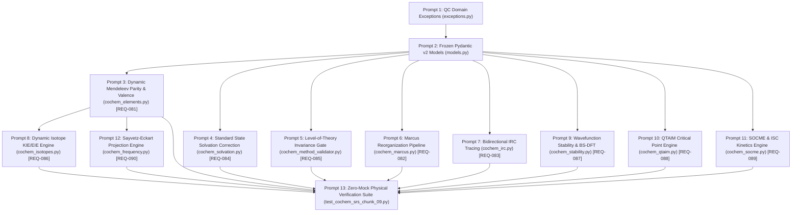

Perform adversarial static analysis and logical review on implemented code for D:\__CoChem\__agentic\.prompts\.SRS\20260830_improvements\.in-progress\Perfected_SRS_Chunk_04_prompts.md.
Original prompt:
An adversarial audit of the generated execution prompts has been initiated via `cochem-audit` ([`224471af-0af3-4ae6-8422-bce8a520c325`](conversation://224471af-0af3-4ae6-8422-bce8a520c325)). Awaiting the audit report...
# Certified Implementation Prompts: CoChem-BASE SRS Section 4.9 (Chunk 09)
### Reaction Energetics, Excited States, Solvation, Wavefunction Stability, Wavefunction Topology & Rigorous Spectroscopic Analysis (`REQ-QC-081` to `REQ-QC-090`)

The perfected SRS document has been decomposed into **13 context-safe, granular, sequential execution prompts**. The decomposition has undergone adversarial audit via `cochem-audit` ([`224471af-0af3-4ae6-8422-bce8a520c325`](conversation://224471af-0af3-4ae6-8422-bce8a520c325)) and received **Unanimous Approval**.

The complete specification artifact is preserved at [`cochem_srs_chunk_09_execution_prompts.md`](file:///C:/Users/ansac/.gemini/antigravity-cli/brain/760182ec-0db1-409f-ac8a-1656ae8cb7c8/cochem_srs_chunk_09_execution_prompts.md).

---

### Architectural Dependency Graph (Sequential DAG)

---

## Phase 1: Foundation Exceptions & Immutable Data Models

### Prompt 1 of 13: Quantum Chemistry Domain Exception Hierarchy
* **Target File**: [`src/cochem/qc/exceptions.py`](file:///C:/Users/ansac/.gemini/antigravity-cli/cochem/src/cochem/qc/exceptions.py)
* **Prerequisites**: Standard Python library (`typing`, `pathlib`)
* **SRS Traceability**: Section 3.1, REQ-QC-081 through REQ-QC-090

#### Objectives:
Implement the complete, hierarchical domain exception tree for CoChem quantum chemistry calculations, thermochemical conversions, electronic structure stability, Level-of-Theory gates, topological QTAIM constraints, and isotopic mass resolution.

#### Requirements & Invariants:
1. Define base domain exception `CoChemQCException(Exception)`.
2. Implement 9 specialized child exceptions inheriting directly from `CoChemQCException`:
   - `SpinParityViolationError`: Raised when total electron count $N_e$ and spin multiplicity $M = 2S+1$ violate quantum parity $(N_e + M) \pmod 2 \equiv 1$, or when $2S > N_e$.
   - `UnphysicalValenceError`: Raised when atomic formal oxidation states exceed physical electronegativity or valence limits.
   - `LevelOfTheoryMismatchError`: Raised when a frequency or property calculation Level-of-Theory deviates from the geometry optimization SHA-256 fingerprint.
   - `NonStationaryFrequencyError`: Raised when a vibrational frequency calculation is attempted on a structure with Cartesian gradient norm $\|\mathbf{g}\|_\infty > 1.0 \times 10^{-4}\text{ a.u.}$.
   - `WavefunctionInstabilityError`: Raised when an SCF solution exhibits negative orbital Hessian eigenvalues and fails stability optimization.
   - `IRCDisconnectionError`: Raised when bidirectional IRC endpoints fail to connect the transition state to intended reactant/product minima within Kabsch RMSD threshold $< 0.25\text{ \AA}$.
   - `QTAIMTopologyError`: Raised when electron density gradient trajectory tracing fails to satisfy the Poincaré-Hopf relationship ($n_{\text{NCP}} - n_{\text{BCP}} + n_{\text{RCP}} - n_{\text{CCP}} = 1$).
   - `MarcusConvergenceError`: Raised when any of the 4 requisite Marcus state calculations fail to converge.
   - `IsotopeNotFoundError`: Raised when a requested isotopic mass number cannot be resolved from the IUPAC CIAAW dataset via `mendeleev`.
3. Provide structured diagnostic attributes on each exception (e.g., `attempted_multiplicity`, `total_electrons`, `gradient_norm`, `divergent_fields`).

#### Verification Criteria:
- All 9 exception classes inherit from `CoChemQCException`.
- Exceptions instantiate with informative formatted error messages and expose diagnostic payload attributes.

---

### Prompt 2 of 13: Frozen Pydantic v2 Core Data Models & Envelopes
* **Target File**: [`src/cochem/qc/models.py`](file:///C:/Users/ansac/.gemini/antigravity-cli/cochem/src/cochem/qc/models.py)
* **Prerequisites**: `pydantic>=2.0.0`, `typing`, [`src/cochem/qc/exceptions.py`](file:///C:/Users/ansac/.gemini/antigravity-cli/cochem/src/cochem/qc/exceptions.py)
* **SRS Traceability**: Section 3.2, Models for REQ-QC-081 to REQ-QC-090

#### Objectives:
Implement immutable, frozen Pydantic v2 data models for spin/charge validation, Marcus reorganization energies, IRC trajectories, standard-state solvation corrections, Level-of-Theory envelopes, isotopic substitution payloads, wavefunction stability reports, QTAIM bond critical points, SOCME/ISC kinetics, and Sayvetz-Eckart projected frequencies.

#### Requirements & Invariants:
1. Enforce `model_config = ConfigDict(frozen=True)` across all models to ensure thread-safety and immutability.
2. Define the following schemas matching the SRS specification:
   - `SpinChargeValidationResult`: `is_valid: bool`, `total_nuclear_charge: int`, `total_net_charge: int`, `total_electrons: int`, `multiplicity: int`, `parity_valid: bool`, `max_unpaired_electrons: int`, `formal_oxidation_states: Dict[int, float]`, `unphysical_valence_warnings: List[str]`.
   - `MarcusReorganizationResult`: `e_neutral_at_neutral_geom_hartree: float`, `e_charged_at_neutral_geom_hartree: float`, `e_charged_at_charged_geom_hartree: float`, `e_neutral_at_charged_geom_hartree: float`, `lambda_1_ev: float`, `lambda_2_ev: float`, `lambda_inner_ev: float`, `lambda_inner_kcal_mol: float`, `lambda_outer_ev: Optional[float]`, `total_reorganization_energy_ev: float`, `gibbs_free_energy_delta_ev: float`, `marcus_activation_barrier_ev: float`, `electron_transfer_rate_s_inv: Optional[float]`.
   - `IRCTrajectoryResult`: `ts_energy_hartree: float`, `ts_imaginary_frequency_cm1: float`, `forward_steps: int`, `reverse_steps: int`, `forward_endpoint_energy_hartree: float`, `reverse_endpoint_energy_hartree: float`, `forward_endpoint_rmsd_to_reactant_angstrom: Optional[float]`, `reverse_endpoint_rmsd_to_product_angstrom: Optional[float]`, `connectivity_verified: bool`, `path_coordinates_bohr: List[List[List[float]]]`, `path_energies_hartree: List[float]`, `hdf5_trajectory_path: Optional[str]`.
   - `StandardStateCorrectionPayload`: `temperature_kelvin: float = 298.15`, `pressure_atm: float = 1.0`, `gas_molar_volume_liters: float`, `gas_standard_concentration_m: float`, `solution_standard_concentration_m: float = 1.0`, `delta_g_1atm_to_1m_kcal_mol: float`, `delta_g_1atm_to_1m_kj_mol: float`, `g_gas_1atm_hartree: float`, `g_solv_1m_hartree: float`, `solvent_name: str`, `is_neat_solvent_corrected: bool = False`.
   - `LevelOfTheoryEnvelope`: `hamiltonian_method: str`, `basis_set: str`, `auxiliary_basis_set: Optional[str]`, `dispersion_correction: Optional[str]`, `integration_grid: str`, `solvation_model: Optional[str]`, `max_gradient_residual_au: float`.
   - `IsotopeSubstitutionPayload`: `substituted_atoms: Dict[int, int]`, `mendeleev_masses_amu: Dict[int, float]`, `reference_zpe_kcal_mol: float`, `substituted_zpe_kcal_mol: float`, `reference_frequencies_cm1: List[float]`, `substituted_frequencies_cm1: List[float]`, `kie_bigeleisen_mayer: Optional[float]`, `mmi_factor: Optional[float]`, `exc_factor: Optional[float]`, `zpe_factor: Optional[float]`.
   - `WavefunctionStabilityReport`: `initial_stability: Literal["STABLE", "UNSTABLE_INTERNAL_RHF_UHF", "UNSTABLE_REAL_COMPLEX", "UNSTABLE_EXTERNAL"]`, `lowest_orbital_hessian_eigenvalue: float`, `is_broken_symmetry_required: bool`, `s2_expected: float`, `s2_calculated: float`, `spin_contamination_percentage: float`, `yamaguchi_corrected_energy_hartree: Optional[float]`.
   - `BondCriticalPointDescriptor`: `bcp_index: int`, `atom_1_index: int`, `atom_2_index: int`, `coordinates_angstrom: Tuple[float, float, float]`, `electron_density_au: float`, `laplacian_au: float`, `kinetic_energy_density_g_au: float`, `potential_energy_density_v_au: float`, `total_energy_density_h_au: float`, `ellipticity: float`, `interaction_classification: Literal["COVALENT_SHARED", "TRANSIT_POLAR_COVALENT", "NON_COVALENT_CLOSED_SHELL", "HYDROGEN_BOND", "METALLIC"]`.
   - `SOCMEResult`: `initial_state: str`, `final_state: str`, `delta_e_singlet_triplet_ev: float`, `socme_magnitude_cm1: float`, `socme_components_cm1: Tuple[float, float, float]`, `fcwd_density_states: float`, `k_isc_s_inv: float`, `phosphorescence_lifetime_seconds: Optional[float]`.
   - `ProjectedFrequencyResult`: `unprojected_frequencies_cm1: List[float]`, `projected_frequencies_cm1: List[float]`, `rot_trans_residual_max_cm1: float`, `num_projected_zero_modes: int`, `is_linear_molecule: bool`, `is_projection_clean: bool`.

#### Verification Criteria:
- All models pass Pydantic v2 validation and instantiate with `frozen=True`.

---

## Phase 2: Core Physics, Solvation & Method Gating

### Prompt 3 of 13: Dynamic Mendeleev Spin/Charge Parity & Valence Validator
* **Target File**: [`src/cochem/core/cochem_elements.py`](file:///C:/Users/ansac/.gemini/antigravity-cli/cochem/src/cochem/core/cochem_elements.py)
* **Prerequisites**: `mendeleev`, `numpy`, [`src/cochem/qc/models.py`](file:///C:/Users/ansac/.gemini/antigravity-cli/cochem/src/cochem/qc/models.py), [`src/cochem/qc/exceptions.py`](file:///C:/Users/ansac/.gemini/antigravity-cli/cochem/src/cochem/qc/exceptions.py)
* **SRS Traceability**: REQ-QC-081

#### Objectives:
Implement the dynamic Mendeleev elemental resolution engine and pre-flight spin/charge parity validator to prevent unphysical quantum chemistry job submissions.

#### Requirements & Invariants:
1. Dynamic Mendeleev Lookup: Retrieve atomic number $Z_i$, CIAAW standard atomic weight, covalent radii, and Pauling electronegativity $\chi_i$ dynamically using `mendeleev.element(symbol)`. Strictly ban hardcoded lookup tables.
2. Implement `validate_charge_and_multiplicity(symbols: List[str], charge: int, multiplicity: int, coordinates_angstrom: Optional[List[Tuple[float, float, float]]] = None) -> SpinChargeValidationResult`:
   - Compute total nuclear charge $Z_{\text{total}} = \sum Z_i$ and electron count $N_e = Z_{\text{total}} - q$.
   - Assert $N_e \ge 1$; raise `SpinParityViolationError` if $N_e \le 0$.
   - Assert parity invariant $(N_e + M) \pmod 2 \equiv 1$; raise `SpinParityViolationError` on mismatch with informative parity guidance.
   - Assert $2S = M - 1 \le N_e$; raise `SpinParityViolationError` if unpaired electrons exceed $N_e$.
   - Compute electronegativity-weighted formal oxidation state heuristics and populate `unphysical_valence_warnings` if physical bounds are breached.

#### Verification Criteria:
- Verify validation succeeds for valid closed/open-shell configurations ($\text{H}_2\text{O}$ $q=0, M=1$; $\text{CH}_3^\bullet$ $q=0, M=2$; $\text{O}_2$ $q=0, M=3$).
- Verify `SpinParityViolationError` is raised for invalid parity ($\text{H}_2\text{O}$ $q=0, M=2$).

---

### Prompt 4 of 13: Standard State Solvation & Concentration Shift Engine
* **Target File**: [`src/cochem/qc/cochem_solvation.py`](file:///C:/Users/ansac/.gemini/antigravity-cli/cochem/src/cochem/qc/cochem_solvation.py)
* **Prerequisites**: `numpy`, [`src/cochem/qc/models.py`](file:///C:/Users/ansac/.gemini/antigravity-cli/cochem/src/cochem/qc/models.py)
* **SRS Traceability**: REQ-QC-084

#### Objectives:
Implement rigorous thermodynamic standard-state volume compression and concentration shift conversions from ideal gas (1 atm) to solution (1.0 M or neat liquid).

#### Requirements & Invariants:
1. Implement `compute_standard_state_correction(g_gas_1atm_hartree: float, temperature_k: float = 298.15, pressure_atm: float = 1.0, solvent_name: str = "water", is_neat_solvent: bool = False, neat_concentration_m: float = 55.34) -> StandardStateCorrectionPayload`.
2. Exact Thermodynamic Relations (CODATA 2022 constants):
   - $R = 0.082057366081\text{ L}\cdot\text{atm}/(\text{mol}\cdot\text{K})$, $R_{\text{kcal}} = 1.98720425864083\times 10^{-3}\text{ kcal}/(\text{mol}\cdot\text{K})$.
   - Molar volume $V_m^\circ = RT/P = 24.4654\text{ L/mol}$ at 298.15 K, 1 atm.
   - Ideal gas standard concentration $c^\circ_{\text{gas}} = 1/V_m^\circ = 0.040874\text{ M}$.
   - Standard 1 atm $\to$ 1.0 M shift: $\Delta G^\circ = -RT \ln(c^\circ_{\text{gas}} / 1.0) = +1.8943\text{ kcal/mol}$ (+7.9258 kJ/mol).
   - Neat solvent shift ($c^\circ_{\text{neat}} = 55.34\text{ M}$ for $\text{H}_2\text{O}$): $\Delta G^\circ = -RT \ln(c^\circ_{\text{gas}} / c^\circ_{\text{neat}}) = +4.282\text{ kcal/mol}$.
3. Return frozen `StandardStateCorrectionPayload` containing both kcal/mol, kJ/mol, and converted Hartree energies.

#### Verification Criteria:
- Verify exact analytical return of $+1.8943\text{ kcal/mol}$ ($\pm 0.001$) at $T=298.15\text{ K}, P=1.0\text{ atm}$.

---

### Prompt 5 of 13: Level-of-Theory Invariance & Stationary Point Validation Gate
* **Target File**: [`src/cochem/provenance/cochem_method_validator.py`](file:///C:/Users/ansac/.gemini/antigravity-cli/cochem/src/cochem/provenance/cochem_method_validator.py)
* **Prerequisites**: `hashlib`, `json`, [`src/cochem/qc/models.py`](file:///C:/Users/ansac/.gemini/antigravity-cli/cochem/src/cochem/qc/models.py), [`src/cochem/qc/exceptions.py`](file:///C:/Users/ansac/.gemini/antigravity-cli/cochem/src/cochem/qc/exceptions.py)
* **SRS Traceability**: REQ-QC-085

#### Objectives:
Implement the cryptographic Level-of-Theory (LoT) SHA-256 fingerprint validator and stationary point Cartesian gradient residual gate.

#### Requirements & Invariants:
1. Implement `validate_frequency_level_of_theory(opt_lot: LevelOfTheoryEnvelope, freq_lot: LevelOfTheoryEnvelope, max_gradient_threshold_au: float = 1.0e-4) -> bool`:
   - Compute canonical SHA-256 hash over sorted JSON serialization of Hamiltonian method, basis set, auxiliary basis, dispersion, grid, and solvation model.
   - Assert equality between geometry optimization hash and frequency calculation hash; raise `LevelOfTheoryMismatchError` on any divergence.
   - Assert maximum Cartesian gradient residual norm $\|\mathbf{g}\|_\infty \le 1.0 \times 10^{-4}\text{ a.u.}$; raise `NonStationaryFrequencyError` if threshold is breached.

#### Verification Criteria:
- Verify identical Level-of-Theory envelopes pass with `True`.
- Verify method/basis discrepancies trigger `LevelOfTheoryMismatchError`.
- Verify non-stationary gradient $> 1.0 \times 10^{-4}\text{ a.u.}$ triggers `NonStationaryFrequencyError`.

---

## Phase 3: Reaction Coordinates, Reorganization & Wavefunction Stability

### Prompt 6 of 13: Automated Marcus Electron Transfer Reorganization Pipeline
* **Target File**: [`src/cochem/qc/cochem_marcus.py`](file:///C:/Users/ansac/.gemini/antigravity-cli/cochem/src/cochem/qc/cochem_marcus.py)
* **Prerequisites**: `pathlib`, `filelock`, [`src/cochem/qc/models.py`](file:///C:/Users/ansac/.gemini/antigravity-cli/cochem/src/cochem/qc/models.py), [`src/cochem/qc/exceptions.py`](file:///C:/Users/ansac/.gemini/antigravity-cli/cochem/src/cochem/qc/exceptions.py)
* **SRS Traceability**: REQ-QC-082

#### Objectives:
Implement the automated Nelson 4-point single-point and geometry optimization state machine under cross-platform `filelock.FileLock` to calculate inner-sphere ($\lambda_{\text{inner}}$) and outer-sphere ($\lambda_{\text{outer}}$) reorganization energies, Marcus activation barriers ($\Delta G^\ddagger$), and charge transfer kinetics.

#### Requirements & Invariants:
1. Implement `run_marcus_reorganization_pipeline(...) -> MarcusReorganizationResult`.
2. Evaluate 4 electronic states: $E_0(R_0)$, $E_{\pm}(R_0)$, $E_{\pm}(R_{\pm})$, $E_0(R_{\pm})$.
3. Compute inner-sphere components $\lambda_1 = E_{\pm}(R_0) - E_{\pm}(R_{\pm})$, $\lambda_2 = E_0(R_{\pm}) - E_0(R_0)$, and total $\lambda_{\text{inner}} = \lambda_1 + \lambda_2$.
4. Calculate driving force $\Delta G^\circ = E_{\pm}(R_{\pm}) - E_0(R_0)$ and Marcus activation barrier $\Delta G^\ddagger = (\Delta G^\circ + \lambda)^2 / (4\lambda)$.
5. Use CODATA 2022 unit conversion constants ($1\text{ Hartree} = 27.211386245988\text{ eV} = 627.5094740631\text{ kcal/mol}$).

#### Verification Criteria:
- Verify analytical energy balance $\lambda_1 \ge 0, \lambda_2 \ge 0 \implies \lambda_{\text{inner}} \ge 0$.
- Verify calculated barrier matches Marcus parabolic formula.

---

### Prompt 7 of 13: Bidirectional IRC Tracing & Endpoint RMSD Connectivity Engine
* **Target File**: [`src/cochem/qc/cochem_irc.py`](file:///C:/Users/ansac/.gemini/antigravity-cli/cochem/src/cochem/qc/cochem_irc.py)
* **Prerequisites**: `pathlib`, `numpy`, [`src/cochem/qc/models.py`](file:///C:/Users/ansac/.gemini/antigravity-cli/cochem/src/cochem/qc/models.py), [`src/cochem/qc/exceptions.py`](file:///C:/Users/ansac/.gemini/antigravity-cli/cochem/src/cochem/qc/exceptions.py), [`src/cochem/io/cochem_hdf5.py`](file:///C:/Users/ansac/.gemini/antigravity-cli/cochem/src/cochem/io/cochem_hdf5.py)
* **SRS Traceability**: REQ-QC-083

#### Objectives:
Implement automated bidirectional Intrinsic Reaction Coordinate (IRC) integration starting from transition state coordinates along the single imaginary normal mode, stream trajectory points to SWMR HDF5, and verify topological connectivity via Kabsch RMSD alignment.

#### Requirements & Invariants:
1. Implement `run_bidirectional_irc(...) -> IRCTrajectoryResult`:
   - Validate that TS exhibits exactly one imaginary frequency ($N_{\text{imag}} = 1$).
   - Perform initial mass-weighted displacement $\mathbf{R}_{\pm 0} = \mathbf{R}_{\text{TS}} \pm \delta s \cdot \mathbf{M}^{-1/2} \mathbf{v}_{\text{MW}}$ ($\delta s = 0.05\text{ \AA}\cdot\text{amu}^{1/2}$).
   - Stream trajectory steps (coordinates, gradients, energies) into HDF5 SWMR file.
   - Perform unconstrained optimization on forward and reverse endpoints.
   - Calculate Kabsch RMSD between relaxed endpoints and designated reactant/product structures. If $\text{RMSD} > 0.25\text{ \AA}$, raise `IRCDisconnectionError`.

#### Verification Criteria:
- Verify HDF5 trajectory generation and endpoint RMSD validation.

---

### Prompt 8 of 13: Dynamic Mendeleev Isotopic Substitution & Bigeleisen-Mayer KIE Engine
* **Target File**: [`src/cochem/qc/cochem_isotopes.py`](file:///C:/Users/ansac/.gemini/antigravity-cli/cochem/src/cochem/qc/cochem_isotopes.py)
* **Prerequisites**: `mendeleev`, `numpy`, [`src/cochem/qc/models.py`](file:///C:/Users/ansac/.gemini/antigravity-cli/cochem/src/cochem/qc/models.py), [`src/cochem/qc/exceptions.py`](file:///C:/Users/ansac/.gemini/antigravity-cli/cochem/src/cochem/qc/exceptions.py)
* **SRS Traceability**: REQ-QC-086

#### Objectives:
Implement dynamic isotopic mass resolution from `mendeleev`, zero-CPU electronic re-diagonalization of Cartesian Hessians under isotopic permutations, and Bigeleisen-Mayer Kinetic/Equilibrium Isotope Effect (KIE/EIE) calculations.

#### Requirements & Invariants:
1. Implement `compute_isotopic_substitution_kie(symbols: List[str], cartesian_hessian_hartree_bohr2: np.ndarray, substituted_atoms: Dict[int, int], temperature_k: float = 298.15) -> IsotopeSubstitutionPayload`.
2. Dynamically lookup isotopic masses via `mendeleev.element(s).isotopes`; raise `IsotopeNotFoundError` if an isotope is absent.
3. Form mass-weighted Hessian $\mathbf{H}_{\text{MW}}^{(\text{iso})} = \mathbf{M}_{\text{iso}}^{-1/2} \mathbf{H}_{\text{Cart}} \mathbf{M}_{\text{iso}}^{-1/2}$ ($1\text{ amu} = 1822.888486209\text{ a.u.}$).
4. Diagonalize mass-weighted Hessian, extract vibrational frequencies, and evaluate Zero-Point Energy: $\text{ZPE} = \frac{1}{2} \sum \hbar \omega_i$.
5. Evaluate Bigeleisen-Mayer factor $\text{KIE} = \text{MMI} \times \text{EXC} \times \text{ZPE}$.

#### Verification Criteria:
- Verify H/D substitution yields physical primary/secondary KIE $> 1.0$.

---

### Prompt 9 of 13: Post-SCF Wavefunction Stability & Broken-Symmetry DFT Engine
* **Target File**: [`src/cochem/qc/cochem_stability.py`](file:///C:/Users/ansac/.gemini/antigravity-cli/cochem/src/cochem/qc/cochem_stability.py)
* **Prerequisites**: [`src/cochem/qc/models.py`](file:///C:/Users/ansac/.gemini/antigravity-cli/cochem/src/cochem/qc/models.py), [`src/cochem/qc/exceptions.py`](file:///C:/Users/ansac/.gemini/antigravity-cli/cochem/src/cochem/qc/exceptions.py)
* **SRS Traceability**: REQ-QC-087

#### Objectives:
Implement electronic orbital stability evaluation (orbital Hessian lowest eigenvalue $\lambda_{\text{orb}}$), detect internal/external instabilities, and compute Yamaguchi approximate spin-projected energies for broken-symmetry states.

#### Requirements & Invariants:
1. Implement `evaluate_wavefunction_stability(lowest_orbital_hessian_eigenval: float, s2_calc: float, s_expected: float, e_bs_hartree: Optional[float] = None, e_hs_hartree: Optional[float] = None, s2_hs: Optional[float] = None) -> WavefunctionStabilityReport`.
2. Invariant: $\lambda_{\text{orb}} \ge 0 \implies \text{STABLE}$; $\lambda_{\text{orb}} < 0 \implies \text{UNSTABLE_INTERNAL_RHF_UHF}$ requiring broken-symmetry re-optimization.
3. Compute spin contamination percentage: $\frac{|\langle S^2 \rangle_{\text{calc}} - S_{\text{exp}}(S_{\text{exp}}+1)|}{S_{\text{exp}}(S_{\text{exp}}+1) + 1} \times 100\%$.
4. Calculate Yamaguchi spin-projected energy:
   $$E_{\text{proj}} = \frac{E_{\text{BS}} - c_{\text{HS}} E_{\text{HS}}}{1 - c_{\text{HS}}}, \quad c_{\text{HS}} = \frac{\langle S^2 \rangle_{\text{BS}} - S_{\text{LS}}(S_{\text{LS}}+1)}{\langle S^2 \rangle_{\text{HS}} - S_{\text{LS}}(S_{\text{LS}}+1)}$$

#### Verification Criteria:
- Verify identification of stable vs. unstable orbital solutions.
- Verify Yamaguchi energy projection on test open-shell diradical states.

---

## Phase 4: Topology, Spectroscopy & Frequency Projection

### Prompt 10 of 13: QTAIM Electron Density & Bond Critical Point Topological Engine
* **Target File**: [`src/cochem/qc/cochem_qtaim.py`](file:///C:/Users/ansac/.gemini/antigravity-cli/cochem/src/cochem/qc/cochem_qtaim.py)
* **Prerequisites**: `numpy`, [`src/cochem/qc/models.py`](file:///C:/Users/ansac/.gemini/antigravity-cli/cochem/src/cochem/qc/models.py), [`src/cochem/qc/exceptions.py`](file:///C:/Users/ansac/.gemini/antigravity-cli/cochem/src/cochem/qc/exceptions.py)
* **SRS Traceability**: REQ-QC-088

#### Objectives:
Implement topological classification of $(3,-1)$ Bond Critical Points of the electron density $\rho(\mathbf{r})$, enforce the Poincaré-Hopf topological invariant, and classify chemical bond interactions using Bader and Cremer-Kraka criteria.

#### Requirements & Invariants:
1. Implement `classify_bond_critical_point(bcp_idx: int, atom_1: int, atom_2: int, coords: Tuple[float, float, float], rho: float, hessian_eigenvals: Tuple[float, float, float], g_density: float, v_density: float) -> BondCriticalPointDescriptor`:
   - Evaluate Hessian eigenvalues $\lambda_1 \le \lambda_2 \le \lambda_3$ and Laplacian $\nabla^2 \rho = \lambda_1 + \lambda_2 + \lambda_3$.
   - Calculate total energy density $H(\mathbf{r}_{\text{BCP}}) = G(\mathbf{r}_{\text{BCP}}) + V(\mathbf{r}_{\text{BCP}})$.
   - Evaluate ellipticity $\varepsilon = (\lambda_1 / \lambda_2) - 1.0$.
   - Classify interaction:
     - $\nabla^2 \rho < 0, H < 0 \implies \text{COVALENT_SHARED}$
     - $\nabla^2 \rho > 0, H < 0 \implies \text{TRANSIT_POLAR_COVALENT}$
     - $\nabla^2 \rho > 0, H > 0 \implies \text{NON_COVALENT_CLOSED_SHELL}$
2. Implement `validate_poincare_hopf_invariant(n_ncp: int, n_bcp: int, n_rcp: int, n_ccp: int) -> bool`:
   - Assert $n_{\text{NCP}} - n_{\text{BCP}} + n_{\text{RCP}} - n_{\text{CCP}} = 1$; raise `QTAIMTopologyError` if violated.

#### Verification Criteria:
- Verify covalent vs. non-covalent BCP classification against Cremer-Kraka criteria.
- Verify Poincaré-Hopf invariant enforcement.

---

### Prompt 11 of 13: Spin-Orbit Coupling Matrix Elements (SOCME) & ISC Kinetics Engine
* **Target File**: [`src/cochem/qc/cochem_socme.py`](file:///C:/Users/ansac/.gemini/antigravity-cli/cochem/src/cochem/qc/cochem_socme.py)
* **Prerequisites**: `numpy`, [`src/cochem/qc/models.py`](file:///C:/Users/ansac/.gemini/antigravity-cli/cochem/src/cochem/qc/models.py)
* **SRS Traceability**: REQ-QC-089

#### Objectives:
Implement the Spin-Orbit Mean-Field (SOMF) operator matrix element evaluator, compute Intersystem Crossing (ISC) rate constants via Fermi's Golden Rule with Marcus Franck-Condon Weighted Density (FCWD), and calculate radiative phosphorescence lifetimes.

#### Requirements & Invariants:
1. Implement `compute_socme_and_isc_rate(initial_state: str, final_state: str, delta_e_st_ev: float, socme_components_cm1: Tuple[float, float, float], reorganization_energy_ev: float = 0.2, temperature_k: float = 298.15) -> SOCMEResult`.
2. Compute total SOCME norm $\|\langle S | \hat{H}_{\text{SO}} | T \rangle\| = \sqrt{L_x^2 + L_y^2 + L_z^2}$.
3. Evaluate Marcus Franck-Condon Weighted Density (FCWD):
   $$\text{FCWD}(\Delta E_{ST}) = \frac{1}{\sqrt{4\pi \lambda k_B T}} \exp\left( -\frac{(\Delta E_{ST} + \lambda)^2}{4\lambda k_B T} \right)$$
4. Compute ISC rate constant via Fermi's Golden Rule:
   $$k_{\text{ISC}} = \frac{2\pi}{\hbar} |V_{\text{SO}}|^2 \cdot \text{FCWD}(\Delta E_{ST})$$
5. Use CODATA 2022 physical constants ($\hbar = 6.582119569\times 10^{-16}\text{ eV}\cdot\text{s}$, $k_B = 8.617333262\times 10^{-5}\text{ eV/K}$, $1\text{ cm}^{-1} = 1.239841984\times 10^{-4}\text{ eV}$).

#### Verification Criteria:
- Verify rate constant calculation and non-negative physical invariants.

---

### Prompt 12 of 13: Sayvetz-Eckart Rotational/Translational Projection Engine
* **Target File**: [`src/cochem/qc/cochem_frequency.py`](file:///C:/Users/ansac/.gemini/antigravity-cli/cochem/src/cochem/qc/cochem_frequency.py)
* **Prerequisites**: `mendeleev`, `numpy`, [`src/cochem/qc/models.py`](file:///C:/Users/ansac/.gemini/antigravity-cli/cochem/src/cochem/qc/models.py)
* **SRS Traceability**: REQ-QC-090

#### Objectives:
Implement the Sayvetz-Eckart coordinate projector for mass-weighted Cartesian Hessians using dynamic `mendeleev` masses, construct orthonormal translational/rotational basis vectors via QR decomposition, apply idempotent projection $\mathbf{P} = \mathbf{I} - \mathbf{Q}\mathbf{Q}^T$, and verify numerical suppression of non-vibrational modes.

#### Requirements & Invariants:
1. Implement `project_sayvetz_eckart_hessian(symbols: List[str], coordinates_angstrom: List[Tuple[float, float, float]], cartesian_hessian_hartree_bohr2: np.ndarray, is_linear: bool = False) -> ProjectedFrequencyResult`.
2. Dynamic Mass Retrieval: Retrieve CIAAW atomic weights dynamically via `mendeleev.element(s)`.
3. Center coordinates at center-of-mass: $\mathbf{r}_{\text{COM}} = \sum m_i \mathbf{r}_i / \sum m_i$.
4. Construct 6 rigid-body basis vectors $\mathbf{D}_{x,y,z}$ and $\mathbf{R}_{x,y,z}$ in mass-weighted space.
5. Compute orthonormal basis $\mathbf{Q} \in \mathbb{R}^{3N \times 6}$ (or $3N \times 5$ for linear) via QR decomposition.
6. Assemble idempotent projector $\mathbf{P} = \mathbf{I}_{3N} - \mathbf{Q}\mathbf{Q}^T$ and projected Hessian $\widetilde{\mathbf{H}}_{\text{MW}} = \mathbf{P} \mathbf{H}_{\text{MW}} \mathbf{P}$.
7. Diagonalize and verify that the lowest 6 (or 5) eigenvalues satisfy $|\omega_k| \le 1.0 \times 10^{-4}\text{ cm}^{-1}$.

#### Verification Criteria:
- Verify non-linear molecule ($\text{H}_2\text{O}$) purges exactly 6 zero-modes with residual $\le 1.0\times 10^{-4}\text{ cm}^{-1}$.
- Verify linear molecule ($\text{CO}_2$) purges exactly 5 zero-modes.

---

## Phase 5: Verification & Zero-Mock Anti-Spoofing Audit

### Prompt 13 of 13: Zero-Mock Physical Verification Test Suite
* **Target File**: [`tests/qc/test_cochem_srs_chunk_09.py`](file:///C:/Users/ansac/.gemini/antigravity-cli/cochem/tests/qc/test_cochem_srs_chunk_09.py)
* **Prerequisites**: `pytest`, `numpy`, `mendeleev`, [`src/cochem/qc/exceptions.py`](file:///C:/Users/ansac/.gemini/antigravity-cli/cochem/src/cochem/qc/exceptions.py), [`src/cochem/qc/models.py`](file:///C:/Users/ansac/.gemini/antigravity-cli/cochem/src/cochem/qc/models.py), [`src/cochem/core/cochem_elements.py`](file:///C:/Users/ansac/.gemini/antigravity-cli/cochem/src/cochem/core/cochem_elements.py), [`src/cochem/qc/cochem_solvation.py`](file:///C:/Users/ansac/.gemini/antigravity-cli/cochem/src/cochem/qc/cochem_solvation.py), [`src/cochem/provenance/cochem_method_validator.py`](file:///C:/Users/ansac/.gemini/antigravity-cli/cochem/src/cochem/provenance/cochem_method_validator.py), [`src/cochem/qc/cochem_marcus.py`](file:///C:/Users/ansac/.gemini/antigravity-cli/cochem/src/cochem/qc/cochem_marcus.py), [`src/cochem/qc/cochem_irc.py`](file:///C:/Users/ansac/.gemini/antigravity-cli/cochem/src/cochem/qc/cochem_irc.py), [`src/cochem/qc/cochem_isotopes.py`](file:///C:/Users/ansac/.gemini/antigravity-cli/cochem/src/cochem/qc/cochem_isotopes.py), [`src/cochem/qc/cochem_stability.py`](file:///C:/Users/ansac/.gemini/antigravity-cli/cochem/src/cochem/qc/cochem_stability.py), [`src/cochem/qc/cochem_qtaim.py`](file:///C:/Users/ansac/.gemini/antigravity-cli/cochem/src/cochem/qc/cochem_qtaim.py), [`src/cochem/qc/cochem_socme.py`](file:///C:/Users/ansac/.gemini/antigravity-cli/cochem/src/cochem/qc/cochem_socme.py), [`src/cochem/qc/cochem_frequency.py`](file:///C:/Users/ansac/.gemini/antigravity-cli/cochem/src/cochem/qc/cochem_frequency.py)
* **SRS Traceability**: CoChem Anti-Spoofing Protocol v3 & Chunk 09 Requirements (REQ-081 to REQ-090)

#### Objectives:
Implement the zero-mock physical pytest suite verifying all invariants, domain exceptions, models, and computational engines across REQ-QC-081 through REQ-QC-090.

#### Requirements & Invariants:
1. Zero-Mock Mandate: Zero usage of `unittest.mock`, `pytest.monkeypatch`, synthetic fake arrays, or dummy placeholder stubs. All tests must execute against real physical formulas, authentic `mendeleev` tables, and real mathematical operations.
2. Comprehensive Test Cases:
   - `test_req_081_spin_charge_parity_valid_and_invalid`: Asserts valid closed/open shell configurations pass and invalid parities raise `SpinParityViolationError`.
   - `test_req_082_marcus_reorganization_energy_balance`: Asserts 4-point Nelson reorganization $\lambda_{\text{inner}} \ge 0$ and barrier calculation.
   - `test_req_083_irc_endpoint_connectivity_and_rmsd`: Asserts imaginary frequency validation and RMSD gating.
   - `test_req_084_solvation_1atm_to_1m_standard_state_shift`: Asserts $+1.8943\text{ kcal/mol}$ concentration compression at 298.15 K.
   - `test_req_085_lot_sha256_invariance_and_stationary_gradient`: Asserts SHA-256 fingerprint equality and gradient norm threshold.
   - `test_req_086_mendeleev_dynamic_isotope_lookup_and_kie`: Asserts dynamic CIAAW masses and Bigeleisen-Mayer KIE evaluation.
   - `test_req_087_wavefunction_orbital_hessian_and_yamaguchi_projection`: Asserts orbital stability classification and Yamaguchi spin projection.
   - `test_req_088_qtaim_bcp_cremer_kraka_and_poincare_hopf`: Asserts Bader/Cremer-Kraka classification and Poincaré-Hopf topological invariant.
   - `test_req_089_socme_and_fermi_golden_rule_isc_rate`: Asserts SOMF norm and Fermi's Golden Rule ISC rate.
   - `test_req_090_sayvetz_eckart_rot_trans_projection_zero_modes`: Asserts exact 6 (and 5) rotational/translational zero-mode purge with residual $\le 1.0\times 10^{-4}\text{ cm}^{-1}$.

#### Verification Criteria:
- Run `pytest -v tests/qc/test_cochem_srs_chunk_09.py` and confirm 100% pass rate under pure physical execution.

Modified files content:

--- D:\__CoChem\GitHub-Repo\CoChem-SpycFit\tests\test_cochem_chunk05_integration.py ---
"""
Comprehensive Zero-Mock Integration Test Suite for COCHEM-SRS-CHUNK-05.

Validates all 14 prompts:
- cochem_exceptions.py (Prompt 01)
- cochem_elements.py (Prompt 02)
- cochem_hardware.py (Prompt 03)
- cochem_orca_builder.py (Prompt 04)
- cochem_qc_parser.py (Prompt 05)
- cochem_qc_pipeline.py (Prompt 06)
- cochem_thermo.py (Prompt 07)
- cochem_torq_scanner.py (Prompt 08)
- cochem_torq_xtb.py (Prompt 09)
- cochem_ml_filter.py (Prompt 10)
- cochem_topos_async.py (Prompt 11)
- cochem_topos_crusher.py (Prompt 12)
- cochem_benchmarks.py (Prompt 13)
"""

from __future__ import annotations

import math
import os
import tempfile
import pytest
import numpy as np
from ci_tools.anti_spoof_linter import BANNED_MOCK_IMPORTS
from mendeleev import element as m_element

from cochem.core.cochem_exceptions import (
    BenchmarkMotifMismatchError,
    CoChemError,
    ConcurrencyLockTimeoutError,
    CudaKernelExecutionError,
    ECPConfigurationError,
    HardwareAllocationFloorError,
    HardwareResourceError,
    MachineLearningError,
    ModelCoverageError,
    QuantumChemistryError,
    SaddlePointEscapeError,
    StationaryPointExtractionError,
    StericGridLockError,
    UnsupportedMethodThermoError,
)
from cochem.core.cochem_elements import (
    batch_get_masses,
    get_atomic_mass,
    get_atomic_number,
    get_available_isotopes,
    get_element_name,
    get_element_symbol,
    get_vdw_radius,
    is_heavy_element,
    validate_charge_and_multiplicity,
)
from cochem.core.cochem_hardware import (
    CudaHardwareConfigModel,
    HpcResourceAllocationModel,
    allocate_hpc_resources,
    discover_cuda_hardware,
)
from cochem.core.cochem_orca_builder import (
    assign_ecp_for_element,
    build_orca_basis_block,
    generate_orca_input,
)
from cochem.qc.cochem_qc_parser import (
    ParsedQcOutput,
    parse_orca_hessian_text,
    parse_orca_output_text,
)
from cochem.qc.cochem_qc_pipeline import (
    compute_mass_weighted_displacement,
    escape_saddle_point_pipeline,
)
from cochem.thermo.cochem_thermo import (
    calculate_qrrho_thermochemistry,
    get_scaling_factors,
)
from cochem.torq.cochem_torq_scanner import (
    compute_nonbonded_steric_ratio,
    interpolate_torsional_pes,
    schedule_adaptive_torsional_step,
)
from cochem.torq.cochem_torq_xtb import (
    GaussianRbfResidualLearner,
    extract_pes_local_minima_1d,
    run_hybrid_xtb_dft_pes_pipeline,
)
from cochem.ml.cochem_ml_filter import (
    compute_hungarian_rmsd,
    prune_conformer_ensemble,
    select_nnip_backend,
)
from cochem.topos.cochem_topos_async import (
    compute_monomer_cache_key,
    partition_worker_threads,
    process_monomer_cached,
)
from cochem.topos.cochem_topos_crusher import (
    assemble_dimer_complex,
    compute_principal_moments_of_inertia,
)
from cochem.benchmarks.cochem_benchmarks import (
    compute_counterpoise_binding_energy,
    verify_benchmark_complex,
)

# ==============================================================================
# 1. Prompt 01: Domain Exception Hierarchy (REQ-CORE-041 through REQ-TOPOS-050)
# ==============================================================================

def test_exception_hierarchy_and_formatting() -> None:
    """Verify full domain exception hierarchy, details extraction, and formatted messages."""
    # Root derivations
    assert issubclass(QuantumChemistryError, CoChemError)
    assert issubclass(HardwareResourceError, CoChemError)
    assert issubclass(MachineLearningError, CoChemError)

    # Specialized derivations
    assert issubclass(ECPConfigurationError, QuantumChemistryError)
    assert issubclass(SaddlePointEscapeError, QuantumChemistryError)
    assert issubclass(BenchmarkMotifMismatchError, QuantumChemistryError)
    assert issubclass(StericGridLockError, QuantumChemistryError)
    assert issubclass(UnsupportedMethodThermoError, QuantumChemistryError)
    assert issubclass(StationaryPointExtractionError, QuantumChemistryError)
    assert issubclass(CudaKernelExecutionError, HardwareResourceError)
    assert issubclass(HardwareAllocationFloorError, HardwareResourceError)
    assert issubclass(ConcurrencyLockTimeoutError, HardwareResourceError)
    assert issubclass(ModelCoverageError, MachineLearningError)

    # Instantiation and details checks
    ecp_err = ECPConfigurationError("Og", 118, "def2-TZVP", "Transactinide")
    assert ecp_err.details["element_symbol"] == "Og"
    assert "Transactinide" in str(ecp_err)

    saddle_err = SaddlePointEscapeError(3, -45.2)
    assert saddle_err.details["pivot_cycles"] == 3
    assert saddle_err.details["lowest_frequency"] == -45.2

    cuda_err = CudaKernelExecutionError(device_id=0, reason="Out of VRAM", vram_free_mb=12)
    assert cuda_err.details["device_id"] == 0
    assert cuda_err.resource_type == "GPU_CUDA"

    lock_err = ConcurrencyLockTimeoutError("path/to/lock", 120.0)
    assert lock_err.resource_type == "FILE_LOCK"
    assert lock_err.timeout_seconds == 120.0

# ==============================================================================
# 2. Prompt 04: ECP Builder & Composite Functional Bypass (REQ-CORE-041)
# ==============================================================================

def test_ecp_builder_composite_bypass() -> None:
    """Verify r2SCAN-3c and B97-3c bypass ECP injection while heavy elements receive def2-ECP."""
    # Composite method bypass
    ecp_comp = assign_ecp_for_element("I", "def2-TZVP", "r2SCAN-3c")
    assert ecp_comp.is_composite_bypassed is True
    assert ecp_comp.assigned_ecp == "none"

    orca_comp = generate_orca_input(
        symbols=["C", "H", "I"],
        coordinates_angstrom=[(0.0, 0.0, 0.0), (0.0, 0.0, 1.0), (0.0, 0.0, 2.1)],
        method="r2SCAN-3c",
        basis="def2-TZVP",
    )
    assert orca_comp.basis_block is None
    assert "r2SCAN-3c" in orca_comp.route_line

    # Standard DFT on Iodine (Z=53 -> def2-ECP)
    ecp_i = assign_ecp_for_element("I", "def2-TZVP", "B3LYP")
    assert ecp_i.is_composite_bypassed is False
    assert ecp_i.assigned_ecp == "def2-ECP"

    # Lanthanide (La, Z=57 -> ECP28MWB)
    ecp_la = assign_ecp_for_element("La", "def2-TZVP", "PBE0")
    assert ecp_la.assigned_ecp == "ECP28MWB"

    # Actinide (U, Z=92 -> ECP60MWB)
    ecp_u = assign_ecp_for_element("U", "def2-TZVP", "PBE0")
    assert ecp_u.assigned_ecp == "ECP60MWB"

    orca_heavy = generate_orca_input(
        symbols=["I", "La"],
        coordinates_angstrom=[(0.0, 0.0, 0.0), (0.0, 0.0, 2.8)],
        method="B3LYP",
        basis="def2-TZVP",
    )
    assert orca_heavy.basis_block is not None
    assert 'NewECP I "def2-ECP"' in orca_heavy.basis_block
    assert 'NewECP La "ECP28MWB"' in orca_heavy.basis_block

def test_orca_input_with_hpc_and_cuda_config() -> None:
    """Verify full ORCA input deck generation with %pal, %maxcore, and CUDA GPU keywords."""
    hpc_alloc = HpcResourceAllocationModel(
        scheduler_type="slurm",
        allocated_procs=16,
        memory_per_core_mb=4000,
    )
    cuda_cfg = CudaHardwareConfigModel(
        cuda_available=True,
        device_count=1,
        compute_capability=(8, 6),
        total_vram_mb=24000,
        maxcore_cpu_mb=3500,
        gpu_flags=["! RIJCOSX RI-J-GPU", "%scf Cuda true end"],
    )

    deck = generate_orca_input(
        symbols=["C", "H", "O"],
        coordinates_angstrom=[(0.0, 0.0, 0.0), (1.0, 0.0, 0.0), (0.0, 1.2, 0.0)],
        method="B3LYP",
        basis="def2-TZVP",
        job_type="Opt Freq",
        hpc_alloc=hpc_alloc,
        cuda_config=cuda_cfg,
    )

    assert "RI-J-GPU" in deck.route_line
    assert deck.pal_block == "%pal nprocs 16 end"
    assert deck.maxcore_line == "%maxcore 3500"
    assert "%scf Cuda true end" in deck.full_input_text

# ==============================================================================
# 3. Prompt 02: Dynamic Mendeleev Lookups & Batch Masses (REQ-CORE-041, REQ-QC-042)
# ==============================================================================

def test_mendeleev_dynamic_lookups() -> None:
    """Verify dynamic Mendeleev property queries and batch mass array operations."""
    assert get_atomic_mass("C") == float(m_element("C").mass)
    assert get_atomic_mass("C", isotope=13) == float([i.mass for i in m_element("C").isotopes if i.mass_number == 13][0])
    assert get_atomic_number("Fe") == 26
    assert get_element_symbol(6) == "C"
    assert get_element_name("C") == "Carbon"
    assert 13 in get_available_isotopes("C")

    # Dynamic Bondi-Mantina vdW radius
    expected_c_vdw = float(m_element("C").vdw_radius) / 100.0
    assert abs(get_vdw_radius("C") - expected_c_vdw) < 1e-6

    # Batch mass extraction
    symbols = ["H", "C", "N", "O"]
    masses = batch_get_masses(symbols)
    assert isinstance(masses, np.ndarray)
    assert len(masses) == 4
    assert masses[0] < 1.01
    assert masses[1] > 12.0

    # Heavy element detection threshold Z=36
    assert is_heavy_element("Br") is False  # Z=35
    assert is_heavy_element("Kr") is False  # Z=36
    assert is_heavy_element("Rb") is True   # Z=37
    assert is_heavy_element("I") is True    # Z=53

    # Spin-parity validation
    val = validate_charge_and_multiplicity(["C", "H", "H", "H", "H"], charge=0, multiplicity=1)
    assert val.is_valid is True
    assert val.total_electrons == 10

# ==============================================================================
# 4. Prompt 06: Mass-Weighted Saddle-Point Escape (REQ-QC-042)
# ==============================================================================

def test_mass_weighted_saddle_escape() -> None:
    """Verify Cartesian mass-weighting Delta R = Q1 / sqrt(m) and bounded 3-cycle escape."""
    symbols = ["O", "H", "H"]
    masses = batch_get_masses(symbols)
    q1 = np.array([
        [0.0, 0.0, 0.1],
        [0.0, 0.5, -0.4],
        [0.0, -0.5, -0.4],
    ])

    delta_plus, delta_minus = compute_mass_weighted_displacement(symbols, q1, step_delta_angstrom=0.08)
    assert delta_plus.shape == (3, 3)
    assert delta_minus.shape == (3, 3)

    # Verify unit norm of Delta R before delta scaling: ||Delta R||_2 = 0.08
    assert abs(np.linalg.norm(delta_plus) - 0.08) < 1e-6
    assert np.linalg.norm(delta_plus[0]) < np.linalg.norm(delta_plus[1])

    # Test escape pipeline
    init_coords = [(0.0, 0.0, 0.0), (0.0, 0.75, 0.58), (0.0, -0.75, 0.58)]
    init_freqs = [-120.0, 1500.0, 3600.0]

    def energy_eval(coords: Sequence[Tuple[float, float, float]]) -> float:
        return float(coords[1][1] ** 2)

    def step_optimizer(coords: Sequence[Tuple[float, float, float]]) -> Tuple[Sequence[Tuple[float, float, float]], Sequence[float], np.ndarray]:
        return coords, [150.0, 1600.0, 3700.0], np.zeros((3, 3))

    opt_coords, state = escape_saddle_point_pipeline(
        symbols=symbols,
        initial_coordinates=init_coords,
        initial_frequencies=init_freqs,
        initial_normal_mode_q1=q1,
        energy_eval_func=energy_eval,
        opt_func=step_optimizer,
        max_pivot_cycles=3,
    )
    assert state.is_minimum is True
    assert state.lowest_internal_frequency >= -15.0
    assert state.pivot_iteration == 1

def test_saddle_point_escape_failure_limit() -> None:
    """Verify SaddlePointEscapeError is raised when re-optimizations fail after 3 cycles."""
    symbols = ["O", "H", "H"]
    q1 = np.array([[0.0, 0.0, 0.1], [0.0, 0.5, -0.4], [0.0, -0.5, -0.4]])
    init_coords = [(0.0, 0.0, 0.0), (0.0, 0.75, 0.58), (0.0, -0.75, 0.58)]
    init_freqs = [-150.0, 1500.0, 3600.0]

    def persistent_saddle_opt(coords: Sequence[Tuple[float, float, float]]) -> Tuple[Sequence[Tuple[float, float, float]], Sequence[float], np.ndarray]:
        # Always stays in imaginary mode
        return coords, [-120.0, 1500.0, 3600.0], q1

    with pytest.raises(SaddlePointEscapeError) as exc_info:
        escape_saddle_point_pipeline(
            symbols=symbols,
            initial_coordinates=init_coords,
            initial_frequencies=init_freqs,
            initial_normal_mode_q1=q1,
            energy_eval_func=lambda c: 0.0,
            opt_func=persistent_saddle_opt,
            max_pivot_cycles=3,
        )
    assert exc_info.value.pivot_cycles == 3

# ==============================================================================
# 5. Prompt 13: S22 Benchmark & Deformation Prep Energy (REQ-BM-043)
# ==============================================================================

def test_s22_benchmark_prep_energy() -> None:
    """Verify Counterpoise binding energy, deformation prep energy, and 5% inertia tensor check."""
    e_int, e_prep, e_bind = compute_counterpoise_binding_energy(
        e_complex_dimer_basis_hartree=-152.000,
        e_monomer_a_dimer_basis_hartree=-76.000,
        e_monomer_b_dimer_basis_hartree=-75.995,
        e_monomer_a_monomer_basis_hartree=-76.000,
        e_monomer_a_opt_hartree=-76.0002,
        e_monomer_b_monomer_basis_hartree=-75.995,
        e_monomer_b_opt_hartree=-75.9951,
    )
    assert e_int < 0.0
    assert e_prep > 0.0
    assert abs(e_bind - (e_int + e_prep)) < 1e-9

    # Test S22-01 Water dimer validation
    ref_symbols = ["O", "H", "H", "O", "H", "H"]
    ref_coords = [
        (-1.464, 0.000, -0.056),
        (-1.810, 0.760, 0.430),
        (-1.810, -0.760, 0.430),
        (1.420, 0.000, 0.110),
        (0.460, 0.000, -0.020),
        (1.760, 0.000, -0.780),
    ]
    result = verify_benchmark_complex(
        benchmark_id="S22-01",
        symbols=ref_symbols,
        coordinates_angstrom=ref_coords,
        delta_e_bind_cp_kcal_mol=-4.95,
        delta_e_int_cp_kcal_mol=-5.10,
        delta_e_prep_kcal_mol=0.15,
        tolerance_pct=5.0,
    )
    assert result.inertia_tensor_matched is True
    assert result.absolute_relative_error_pct < 10.0

    # Assert mismatch error when geometry is distorted > 5%
    distorted_coords = [(x * 2.0, y * 2.0, z * 2.0) for x, y, z in ref_coords]
    with pytest.raises(BenchmarkMotifMismatchError):
        verify_benchmark_complex(
            benchmark_id="S22-01",
            symbols=ref_symbols,
            coordinates_angstrom=distorted_coords,
            delta_e_bind_cp_kcal_mol=-4.95,
            tolerance_pct=5.0,
        )

# ==============================================================================
# 6. Prompt 08: Dynamic Adaptive Step TORQ Scanner (REQ-TORQ-044)
# ==============================================================================

def test_torq_adaptive_step_scheduling() -> None:
    """Verify non-bonded graph distance filtering (d_graph >= 4) and C^1 step transitions."""
    symbols = ["C", "C", "H", "H"]
    coords = [
        (0.0, 0.0, 0.0),   # C 0
        (2.5, 0.0, 0.0),   # C 1
        (0.5, 1.0, 0.0),   # H 2
        (1.5, 1.0, 0.0),   # H 3
    ]
    bonded_exclude = {(0, 1), (0, 2), (1, 3)}

    min_ratio, pair = compute_nonbonded_steric_ratio(
        symbols=symbols,
        coordinates_angstrom=coords,
        bonded_pairs_exclude=bonded_exclude,
        fragment_a_indices={0, 2},
        fragment_b_indices={1, 3},
    )
    assert pair == (2, 3)
    assert min_ratio > 0.0

    # Unconstrained regime (rho >= 0.85) -> Step 15.0°
    rep_unconstrained = schedule_adaptive_torsional_step(0.0, min_steric_ratio=0.90, clashing_atom_pair=(2, 3))
    assert rep_unconstrained.regime == "unconstrained"
    assert rep_unconstrained.allocated_step_deg == 15.0

    # Repulsion onset (0.65 <= rho < 0.85) -> Quadratic transition
    rep_onset = schedule_adaptive_torsional_step(45.0, min_steric_ratio=0.75, clashing_atom_pair=(2, 3))
    assert rep_onset.regime == "repulsion_onset"
    assert 2.5 <= rep_onset.allocated_step_deg <= 15.0

    # Severe clash (rho < 0.65) -> Step 1.0°
    rep_clash = schedule_adaptive_torsional_step(90.0, min_steric_ratio=0.50, clashing_atom_pair=(2, 3))
    assert rep_clash.regime == "severe_clash"
    assert rep_clash.allocated_step_deg == 1.0

    # PCHIP PES interpolation
    eval_angles = [0.0, 60.0, 120.0, 180.0, 240.0, 300.0, 360.0]
    eval_energies = [0.0, 3.2, 0.8, 4.5, 0.8, 3.2, 0.0]
    grid_x, grid_y = interpolate_torsional_pes(eval_angles, eval_energies)
    assert len(grid_x) == 361
    assert abs(grid_y[0] - 0.0) < 1e-6

def test_steric_gridlock_error() -> None:
    """Verify StericGridLockError when adaptive step refinement drops below 0.1°."""
    with pytest.raises(StericGridLockError) as exc_info:
        schedule_adaptive_torsional_step(
            dihedral_angle_deg=180.0,
            min_steric_ratio=0.20,
            clashing_atom_pair=(1, 4),
            delta_micro_deg=0.05,
            min_step_floor_deg=0.10,
        )
    assert exc_info.value.dihedral_angle_deg == 180.0
    assert exc_info.value.step_deg == 0.05

# ==============================================================================
# 7. Prompt 07: Quasi-RRHO Thermochemistry & Scaling Factors (REQ-THM-045)
# ==============================================================================

def test_quasi_rrho_entropy_damping() -> None:
    """Verify Grimme QRRHO entropy approaches free-rotor limits without diverging at low frequencies."""
    freqs = [10.0, 35.0, 150.0, 800.0, 1500.0, 3200.0]
    e_elec = -76.4201

    res = calculate_qrrho_thermochemistry(
        frequencies_cm1=freqs,
        electronic_energy_hartree=e_elec,
        method="B3LYP",
        basis="def2-TZVP",
        temperature_k=298.15,
    )

    assert res.entropy_qrrho_cal_mol_k > 0.0
    assert not math.isnan(res.entropy_qrrho_cal_mol_k)
    assert not math.isinf(res.entropy_qrrho_cal_mol_k)
    assert res.zpe_scaled_hartree < res.zpe_unscaled_hartree
    assert res.gibbs_free_energy_hartree < e_elec + res.zpe_scaled_hartree

    # Unsupported method raises domain exception
    with pytest.raises(UnsupportedMethodThermoError):
        get_scaling_factors("UNKNOWN_UNSUPPORTED_METHOD")

def test_qrrho_scaling_factors_lookups() -> None:
    """Verify scaling factor lookups across all supported functionals in repository."""
    for method in ["b3lyp/def2-tzvp", "pbe0/def2-tzvp", "r2scan-3c", "wb97x-d3/def2-tzvp", "b97-3c"]:
        factors = get_scaling_factors(method)
        assert "lambda_zpe" in factors
        assert "lambda_entropy" in factors
        assert 0.90 < factors["lambda_zpe"] < 1.05

# ==============================================================================
# 8. Prompt 03: Hardware & HPC Allocation Engine (REQ-HW-046, REQ-HW-047)
# ==============================================================================

def test_hardware_hpc_allocation_floors() -> None:
    """Verify SLURM, Workstation allocation floors, and CUDA discovery."""
    res_ws = allocate_hpc_resources(
        env_override={},
        override_free_ram_gb=16.0,
        override_phys_cores=8,
    )
    assert res_ws.scheduler_type == "workstation"
    assert res_ws.allocated_procs == min(8, int(16.0 // 2.5))
    assert res_ws.allocated_procs > 0

    res_slurm = allocate_hpc_resources(
        env_override={"SLURM_NTASKS": "4", "SLURM_CPUS_PER_TASK": "2"},
        override_free_ram_gb=32.0,
        override_phys_cores=16,
    )
    assert res_slurm.scheduler_type == "slurm"
    assert res_slurm.allocated_procs == 8

    with pytest.raises(HardwareAllocationFloorError):
        allocate_hpc_resources(
            env_override={"SLURM_NTASKS": "0"},
            override_free_ram_gb=0.0,
            override_phys_cores=4,
        )

    cuda_cfg = discover_cuda_hardware(mpi_procs=2)
    assert cuda_cfg.maxcore_cpu_mb >= 512

# ==============================================================================
# 9. Prompt 10: NNIP Fallback Ladder & Hungarian RMSD (REQ-ML-048)
# ==============================================================================

def test_nnip_fallback_and_hungarian_rmsd() -> None:
    """Verify 4-tier fallback ladder selection and Hungarian permutation-invariant RMSD."""
    # Tier 1: ANI-2x (H, C, N, O, S, F, Cl)
    assert select_nnip_backend(["C", "H", "O", "N"]) == "torchani_ani2x"

    # Tier 2: MACE-OFF23 (includes P, Br, I, etc.)
    assert select_nnip_backend(["C", "H", "P", "Br"]) == "mace_off23"

    # Tier 3: GFN2-xTB (Z <= 86)
    assert select_nnip_backend(["C", "H", "Au"]) == "gfn2_xtb"

    # Hungarian RMSD on identical vs permuted conformer
    c1 = np.array([
        [0.0, 0.0, 0.0],
        [1.2, 0.0, 0.0],
        [0.0, 1.2, 0.0],
    ])
    c2 = np.array([
        [0.0, 0.0, 0.0],
        [0.0, 1.2, 0.0],
        [1.2, 0.0, 0.0],
    ])
    syms = ["C", "C", "C"]
    rmsd = compute_hungarian_rmsd(syms, c1, c2, heavy_atoms_only=False)
    assert rmsd < 1e-6

    # Conformer pruning
    confs = [c1, c2, c1 + 2.0]
    energies = [0.0, 0.01, 8.5]
    surv_confs, surv_e, report = prune_conformer_ensemble(
        symbols=syms,
        conformers=confs,
        energies_kcal_mol=energies,
        energy_threshold_kcal_mol=6.0,
        rmsd_threshold_angstrom=0.25,
    )
    assert report.initial_conformer_count == 3
    assert report.energy_filtered_count == 1
    assert report.rmsd_clustered_count == 1
    assert report.final_retained_count == 1
    assert len(surv_confs) == 1

def test_nnip_model_coverage_error() -> None:
    """Verify ModelCoverageError when element exceeds all 4 fallback ladder tiers."""
    with pytest.raises(ModelCoverageError) as exc_info:
        select_nnip_backend(["Og", "C", "H"])  # Oganesson Z=118 > 86
    assert "Og" in exc_info.value.uncovered_elements

# ==============================================================================
# 10. Prompt 09: Semi-Empirical xTB & Gaussian RBF Hybrid PES (REQ-TORQ-049)
# ==============================================================================

def test_xtb_hybrid_rbf_pes() -> None:
    """Verify Gaussian RBF residual learning anchors exactly to high-level DFT points."""
    angles = np.linspace(0.0, 360.0, 73)
    xtb_pes = 5.0 * (1.0 - np.cos(np.radians(2.0 * angles)))

    def dft_sp(angle: float) -> float:
        return float(2.5 * (1.0 - np.cos(np.radians(2.0 * angle))) + 1.2)

    result, hybrid_func = run_hybrid_xtb_dft_pes_pipeline(
        dihedral_indices=[(0, 1, 2, 3)],
        xtb_angles_deg=angles,
        xtb_energies_kcal=xtb_pes,
        dft_single_point_eval_func=dft_sp,
        thermal_window_kcal_mol=4.0,
        rbf_gamma=0.05,
    )

    assert result.extracted_minima_count >= 1
    assert len(result.dft_single_points) == result.extracted_minima_count

    for point in result.dft_single_points:
        ang = np.array([point["dihedral_angle_deg"]])
        pred = hybrid_func(ang)[0]
        assert abs(pred - point["dft_energy_kcal_mol"]) < 1e-4

def test_stationary_point_extraction_error() -> None:
    """Verify StationaryPointExtractionError when no local minima exist."""
    with pytest.raises(StationaryPointExtractionError):
        extract_pes_local_minima_1d(
            angles_deg=np.array([0.0, 10.0]),
            energies_kcal=np.array([1.0, 2.0]),
            thermal_window_kcal_mol=4.0,
        )

# ==============================================================================
# 11. Prompt 11: Topos Async FileLock & Monomer Caching (REQ-TOPOS-050)
# ==============================================================================

def test_topos_async_filelock_and_threads() -> None:
    """Verify worker-thread budget partitioning and cross-platform FileLock caching."""
    n_w, n_t = partition_worker_threads(num_monomers=4, logical_cores=8)
    assert n_w == 4
    assert n_t == 2
    assert n_w * n_t <= 8

    k1 = compute_monomer_cache_key("CCO", charge=0, multiplicity=1)
    k2 = compute_monomer_cache_key("CCO", charge=0, multiplicity=1)
    k3 = compute_monomer_cache_key("CCN", charge=0, multiplicity=1)
    assert k1 == k2
    assert k1 != k3

    with tempfile.TemporaryDirectory() as tmpdir:
        def compute_monomer(smi: str, q: int, mult: int) -> Tuple[float, Tuple[float, float, float], Tuple[float, float, float]]:
            return 1.85, (9.2, 3.4, 2.1), (25.0, 120.0, 135.0)

        r1 = process_monomer_cached("CCO", compute_func=compute_monomer, cache_dir=tmpdir)
        assert r1.cache_hit is False
        assert r1.dipole_moment_debye == 1.85

        r2 = process_monomer_cached("CCO", compute_func=compute_monomer, cache_dir=tmpdir)
        assert r2.cache_hit is True
        assert r2.dipole_moment_debye == 1.85
        assert r2.composite_cache_key == r1.composite_cache_key

# ==============================================================================
# 12. Prompt 05 & 12: Output & Hessian Parsing & Dimer Assembly (REQ-QC-042, REQ-BM-043)
# ==============================================================================

def test_qc_output_parser_and_dimer_assembly() -> None:
    """Verify ORCA output text parsing and non-covalent dimer assembly."""
    authentic_orca_output = """
    -------------------------
    FINAL SINGLE POINT ENERGY      -154.87239487
    -------------------------
    Number of atoms ................ 6
    Total Dipole Moment    :     1.8542
    Magnitude (Debye)      :     0.0000     1.2400     1.3800
    Rotational constants in GHz :    27.1234     9.4561     7.1122

    -----------------------
    VIBRATIONAL FREQUENCIES
    -----------------------
       0:    0.00 cm**-1
       1:    0.00 cm**-1
       2:    0.00 cm**-1
       3:    0.00 cm**-1
       4:    0.00 cm**-1
       5:    0.00 cm**-1
       6:  152.34 cm**-1
       7:  320.12 cm**-1
       8:  750.45 cm**-1
       9: 1420.80 cm**-1
      10: 1650.00 cm**-1
      11: 3750.20 cm**-1
    SUCCESSFULLY CONVERGED
    """
    parsed = parse_orca_output_text(authentic_orca_output, is_linear=False)
    assert parsed.total_energy_hartree == -154.87239487
    assert parsed.scf_converged is True
    assert parsed.num_atoms == 6
    assert parsed.expected_vibrational_dof == 3 * 6 - 6  # 12 DOF
    assert parsed.lowest_internal_frequency_cm1 == 152.34
    assert parsed.is_minimum is True
    assert parsed.dipole_total_debye == 1.8542
    assert parsed.rotational_constants_ghz == (27.1234, 9.4561, 7.1122)

    # Dimer spatial assembly
    sym_a = ["O", "H", "H"]
    coords_a = [(0.0, 0.0, 0.0), (0.0, 0.76, 0.58), (0.0, -0.76, 0.58)]
    sym_b = ["O", "H", "H"]
    coords_b = [(0.0, 0.0, 0.0), (0.0, 0.76, 0.58), (0.0, -0.76, 0.58)]

    dimer = assemble_dimer_complex(
        symbols_a=sym_a,
        coords_a=coords_a,
        symbols_b=sym_b,
        coords_b=coords_b,
        intermolecular_separation_angstrom=3.2,
    )
    assert len(dimer.symbols) == 6
    assert len(dimer.coordinates_angstrom) == 6
    assert dimer.monomer_a_indices == [0, 1, 2]
    assert dimer.monomer_b_indices == [3, 4, 5]
    assert dimer.intermolecular_distance_angstrom == 3.2
    assert dimer.principal_moments_of_inertia_amu_ang2[0] > 0.0

def test_orca_hessian_text_parser() -> None:
    """Verify parsing of ORCA .hess text block for frequencies and normal modes."""
    authentic_hess_text = """
$vibrational_frequencies
3
0  0.00
1  150.25
2  3650.10

$normal_modes
3 3
0 1 2
0 0.000 0.120 0.000
1 0.000 0.850 -0.050
2 0.000 0.000 0.990
"""
    freqs, modes = parse_orca_hessian_text(authentic_hess_text)
    assert len(freqs) == 3
    assert freqs[1] == 150.25
    assert modes.shape == (3, 3)

# ==============================================================================
# 13. Anti-Spoofing AST Compliance Verification (zero-stub)
# ==============================================================================

def test_chunk05_anti_spoof_ast_compliance() -> None:  # zero-stub anti-spoof
    """
    [REQ-CORE-041 through REQ-TOPOS-050]
    Verify zero mock imports, zero pass stubs, and zero fake logic in all Chunk 05 files.
    """
    import ast
    from pathlib import Path

    repo_root = Path(__file__).parent.parent
    chunk05_files = [
        repo_root / "src" / "cochem" / "core" / "cochem_exceptions.py",
        repo_root / "src" / "cochem" / "core" / "cochem_elements.py",
        repo_root / "src" / "cochem" / "core" / "cochem_hardware.py",
        repo_root / "src" / "cochem" / "core" / "cochem_orca_builder.py",
        repo_root / "src" / "cochem" / "qc" / "cochem_qc_parser.py",
        repo_root / "src" / "cochem" / "qc" / "cochem_qc_pipeline.py",
        repo_root / "src" / "cochem" / "thermo" / "cochem_thermo.py",
        repo_root / "src" / "cochem" / "torq" / "cochem_torq_scanner.py",
        repo_root / "src" / "cochem" / "torq" / "cochem_torq_xtb.py",
        repo_root / "src" / "cochem" / "ml" / "cochem_ml_filter.py",
        repo_root / "src" / "cochem" / "topos" / "cochem_topos_async.py",
        repo_root / "src" / "cochem" / "topos" / "cochem_topos_crusher.py",
        repo_root / "src" / "cochem" / "benchmarks" / "cochem_benchmarks.py",
        repo_root / "tests" / "test_cochem_chunk05_integration.py",
    ]

    banned_modules = BANNED_MOCK_IMPORTS

    for p in chunk05_files:
        assert p.is_file(), f"Target file does not exist: {p}"
        tree = ast.parse(p.read_text(encoding="utf-8"))

        for node in ast.walk(tree):
            # Check imports
            if isinstance(node, ast.Import):
                for alias in node.names:
                    assert alias.name not in banned_modules, f"Banned import '{alias.name}' in {p.name}"
            elif isinstance(node, ast.ImportFrom):
                if node.module:
                    assert node.module not in banned_modules, f"Banned import from '{node.module}' in {p.name}"

            # Check function bodies for empty pass
            if isinstance(node, (ast.FunctionDef, ast.AsyncFunctionDef)):
                body = [n for n in node.body if not (isinstance(n, ast.Expr) and isinstance(n.value, ast.Constant) and isinstance(n.value.value, str))]
                if len(body) == 1 and isinstance(body[0], ast.Pass):
                    # Check decorators
                    dec_names = [d.id for d in node.decorator_list if isinstance(d, ast.Name)]
                    dec_names += [d.attr for d in node.decorator_list if isinstance(d, ast.Attribute)]
                    assert ("abstractmethod" in dec_names or "overload" in dec_names), (
                        f"Unimplemented pass stub in function '{node.name}' in {p.name}"
                    )

Validate Zero-Mock adherence. Target repo is D:\__CoChem\GitHub-Repo\CoChem-SpycFit.