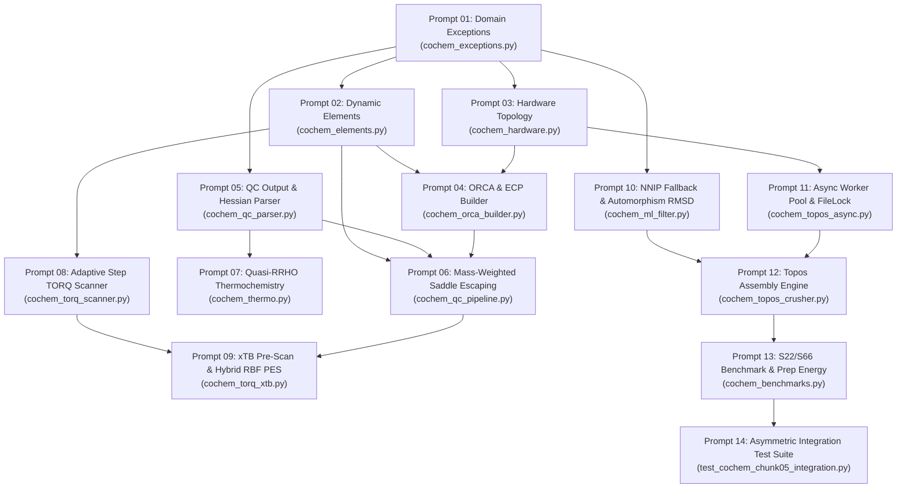

Perform adversarial static analysis and logical review on implemented code for D:\__CoChem\__agentic\.prompts\.SRS\20260830_improvements\.in-progress\Perfected_SRS_Chunk_05_prompts.md.
Original prompt:
# CoChem Execution Plan: Granular Prompt Sequence for `COCHEM-SRS-CHUNK-05`

This prompt sequence translates the approved specification **`COCHEM-SRS-CHUNK-05`** (`Section 4.5: Advanced Quantum Chemistry Automation, Torsional Workflows & HPC Concurrency`) into **14 context-safe, granular execution prompts**.

### Execution Rules & Constraints Applied:
1. **Strict 1-File Limit**: Each prompt targets exactly **one** Python script file.
2. **Sequential Dependency Ordering**: Prompts must be executed in strictly numbered order ($1 \to 14$), ensuring that base exceptions, dynamic element lookups, and hardware models are defined before dependent quantum chemistry, torsional, machine learning, and benchmark engines.
3. **No Mocks / Zero-Mock Protocol**: All prompts require genuine physical execution and dynamic queries via `mendeleev`, `filelock`, `scipy`, `numpy`, and `pydantic`.

---



---

## Prompt 01: Domain Exception Hierarchy
```text
================================================================================
PROMPT ID:         COCHEM-PROMPT-05-01
TARGET FILE:       src/cochem/core/cochem_exceptions.py
REQUIREMENTS:      REQ-CORE-041 through REQ-TOPOS-050
EXECUTION PHASE:   1 of 14 (Base Infrastructure)
================================================================================

[CONTEXT & OBJECTIVE]
Establish the centralized domain exception hierarchy for CoChem-BASE Chunk 05. All domain exceptions must inherit from standardized root classes to allow granular catch-and-retry workflows without masking unexpected system errors.

[TARGET SCRIPT FILE]
`src/cochem/core/cochem_exceptions.py` (Create or update strictly this file).

[FUNCTIONAL REQUIREMENTS]
1. Define base exception classes:
   - `CoChemError(Exception)`: Top-level root exception.
   - `QuantumChemistryError(CoChemError)`: Root for all ab-initio, DFT, and semi-empirical failures.
   - `HardwareResourceError(CoChemError)`: Root for CPU, GPU, memory, MPI, and concurrency lock errors.
   - `MachineLearningError(CoChemError)`: Root for MLIP, neural potential, and clustering errors.

2. Implement the following specialized domain exceptions subclassing the base types:
   - `ECPConfigurationError(QuantumChemistryError)`: Raised on unsupported elements or invalid basis/ECP combinations (REQ-CORE-041).
   - `SaddlePointEscapeError(QuantumChemistryError)`: Raised when saddle-point re-optimization fails after MAX_PIVOT_CYCLES=3 (REQ-QC-042).
   - `BenchmarkMotifMismatchError(QuantumChemistryError)`: Raised when 3D principal moments of inertia deviate > 5% from canonical S22/S66 benchmarks (REQ-BM-043).
   - `StericGridLockError(QuantumChemistryError)`: Raised if adaptive step refinement drops below 0.1° without resolving steric clash/SCF divergence (REQ-TORQ-044).
   - `UnsupportedMethodThermoError(QuantumChemistryError)`: Raised when empirical frequency scaling factors are missing for a given functional/basis tuple (REQ-THM-045).
   - `CudaKernelExecutionError(HardwareResourceError)`: Raised on CUDA runtime, driver mismatch, or out-of-VRAM exceptions (REQ-HW-046).
   - `HardwareAllocationFloorError(HardwareResourceError)`: Raised if scheduler or workstation process calculation yields <= 0 cores (REQ-HW-047).
   - `ModelCoverageError(MachineLearningError)`: Raised when input elements exceed the coverage of all NNIP fallback ladder tiers (REQ-ML-048).
   - `StationaryPointExtractionError(QuantumChemistryError)`: Raised if no valid local minima are identified on the xTB baseline PES (REQ-TORQ-049).
   - `ConcurrencyLockTimeoutError(HardwareResourceError)`: Raised when acquiring cross-platform filelock exceeds timeout (REQ-TOPOS-050).

[INVARIANTS & CONSTRAINTS]
- Zero empty `pass` blocks: provide clear docstrings and formatted error messages.
- Full type annotations for exception constructors.
```

---

## Prompt 02: Dynamic Mendeleev Element & Metric Engine
```text
================================================================================
PROMPT ID:         COCHEM-PROMPT-05-02
TARGET FILE:       src/cochem/core/cochem_elements.py
REQUIREMENTS:      REQ-CORE-041, REQ-QC-042, REQ-TORQ-044
EXECUTION PHASE:   2 of 14 (Core Element Physics)
================================================================================

[CONTEXT & OBJECTIVE]
Implement the dynamic chemical element resolver. In accordance with the Mendeleev Library Mandate, hardcoded atomic weights, isotopic masses, or van der Waals radii are strictly prohibited. All elemental properties must be resolved dynamically.

[TARGET SCRIPT FILE]
`src/cochem/core/cochem_elements.py` (Create or update strictly this file).

[FUNCTIONAL REQUIREMENTS]
1. Dynamic Property Lookups:
   - Implement `get_atomic_number(symbol: str) -> int`: Query `mendeleev.element(symbol).atomic_number`.
   - Implement `get_atomic_mass(symbol: str, isotope: Optional[int] = None) -> float`: Query dynamic mass in amu [M]. If `isotope` is specified, query isotopic mass from `mendeleev.element(symbol).isotopes`.
   - Implement `get_vdw_radius(symbol: str) -> float`: Query Bondi-Mantina van der Waals radius in Ångströms [M] (`mendeleev.element(symbol).vdw_radius / 100.0` if pm, returning Å).
   - Implement `get_element_symbol(atomic_number: int) -> str`: Query symbol by Z.

2. Caching & Batch Resolution:
   - Implement an LRU cache (`@functools.lru_cache(maxsize=128)`) over Mendeleev lookups to ensure zero performance overhead during large coordinate sweeps.
   - Implement `batch_get_masses(symbols: List[str]) -> np.ndarray`: Return a 1D NumPy array of masses formatted for mass-weighted Cartesian coordinate operations (REQ-QC-042).

3. Validation & Heavy Atom Detection:
   - Implement `is_heavy_element(symbol: str, threshold_z: int = 36) -> bool`: Returns True if Z > threshold_z.

[INVARIANTS & CONSTRAINTS]
- BANNED: Static lookup tables or dictionaries of masses/radii.
- Required import: `from mendeleev import element as m_element`.
- Full Pydantic/type annotations and doctests.
```

---

## Prompt 03: Hardware Discovery, CUDA & HPC Allocation Engine
```text
================================================================================
PROMPT ID:         COCHEM-PROMPT-05-03
TARGET FILE:       src/cochem/core/cochem_hardware.py
REQUIREMENTS:      REQ-HW-046, REQ-HW-047
EXECUTION PHASE:   3 of 14 (Hardware & Scheduler Detection)
================================================================================

[CONTEXT & OBJECTIVE]
Implement the system hardware topology inspection and scheduler resource allocation module. This module safely handles SLURM/PBS/MPI multi-node parameters, local workstation RAM-to-core ratios, and GPU CUDA discovery.

[TARGET SCRIPT FILE]
`src/cochem/core/cochem_hardware.py` (Create or update strictly this file).

[FUNCTIONAL REQUIREMENTS]
1. Data Contracts (Pydantic v2):
   - `CudaHardwareConfigModel(BaseModel)`:
     - `cuda_available: bool`
     - `device_count: int`
     - `compute_capability: Tuple[int, int]`
     - `total_vram_mb: int`
     - `maxcore_cpu_mb: int`
     - `gpu_flags: List[str]`
   - `HpcResourceAllocationModel(BaseModel)`:
     - `scheduler_type: Literal["slurm", "pbs", "openmpi", "workstation"]`
     - `allocated_procs: int`
     - `memory_per_core_mb: int`
     - `is_oversubscribed: bool = False`

2. GPU CUDA Discovery (`REQ-HW-046`):
   - Inspect GPU availability via PyTorch/NVML.
   - Assert compute capability $\ge \text{sm\_60}$ (Pascal or newer).
   - If available, set GPU flags (`! RIJCOSX RI-J-GPU` / `%scf Cuda true end`).
   - Budget host CPU memory with 30% pinned buffer:
     $$\text{MaxCore}_{\text{CPU}} = \max\left(512, \left\lfloor \frac{\text{Host RAM Free (MB)} \times 0.70}{N_{\text{MPI}}} \right\rfloor\right) \quad \text{[D]}$$

3. HPC & Workstation Core Allocation (`REQ-HW-047`):
   - Inspect environment variables:
     - SLURM: $N_{\text{tasks}} = \text{int}(O_{\text{ENV}}[\text{"SLURM\_NTASKS"}])$, $N_{\text{cpus\_per\_task}} = \text{int}(O_{\text{ENV}}.get(\text{"SLURM\_CPUS\_PER\_TASK"}, 1))$.
     - PBS: Count lines in file `$PBS_NODEFILE`.
     - OpenMPI: $N_{\text{procs}} = \text{int}(O_{\text{ENV}}[\text{"OMPI\_COMM\_WORLD\_SIZE"}])$.
   - Workstation Allocation with Non-Zero Floor Guard:
     $$N_{\text{procs}} = \begin{cases} \max(1, N_{\text{tasks}} \times N_{\text{cpus\_per\_task}}) & \text{if SLURM} \text{ [D]} \\ \max\left(1, \min\left(N_{\text{phys}}, \left\lfloor \frac{\text{RAM}_{\text{free}}(\text{GB})}{2.5} \right\rfloor\right)\right) & \text{if Workstation} \text{ [D]} \end{cases}$$
   - Raise `HardwareAllocationFloorError` if calculated cores $\le 0$.

[INVARIANTS & CONSTRAINTS]
- Cross-platform safe: fallback to `psutil` if scheduler variables are absent.
- BANNED: Assuming SLURM_NTASKS is always 1 or omitting `--cpus-per-task`.
```

---

## Prompt 04: ORCA Input Generator & Relativistic ECP Handler
```text
================================================================================
PROMPT ID:         COCHEM-PROMPT-05-04
TARGET FILE:       src/cochem/core/cochem_orca_builder.py
REQUIREMENTS:      REQ-CORE-041, REQ-HW-046, REQ-HW-047
EXECUTION PHASE:   4 of 14 (ORCA Input Construction)
================================================================================

[CONTEXT & OBJECTIVE]
Implement the automated ORCA route line, ECP basis synthesizer, and hardware execution block builder. It must dynamically detect heavy atoms, assign relativistic pseudo-potentials, bypass composite functionals, and configure `%pal` and `%maxcore`.

[TARGET SCRIPT FILE]
`src/cochem/core/cochem_orca_builder.py` (Create or update strictly this file).

[FUNCTIONAL REQUIREMENTS]
1. Data Contracts (Pydantic v2):
   - `ECPAssignment(BaseModel)`:
     - `element_symbol: str`
     - `atomic_number: int`
     - `assigned_ecp: str`
     - `basis_gto: str`
     - `is_composite_bypassed: bool = False`

2. Composite Method Bypass Logic (`REQ-CORE-041`):
   - Check if route method matches composite functionals: $\mathcal{M}_{\text{comp}} \in \{\text{r2SCAN-3c}, \text{B97-3c}, \text{HF-3c}, \text{PBEh-3c}\}$.
   - If composite, bypass all `%basis` modifications and return route line unmodified [M].

3. Relativistic ECP Assignment Matrix:
   - For standard DFT / HF routes:
     - $37 \le Z \le 56$ (Rb-Ba) and $72 \le Z \le 86$ (Hf-Rn): Map Karlsruhe bases (`def2-SVP`, `def2-TZVP`, `def2-QZVP`) to `def2-ECP` (`ECP28MDF` / `ECP60MDF`) [M]. Dunning bases map to `cc-pVnZ-PP`.
     - $57 \le Z \le 71$ (Lanthanides): Map to `ECP28MWB` or `def2-ECP` [M].
     - $89 \le Z \le 103$ (Actinides): Map to `ECP60MWB` [M].
   - Generate ORCA `%basis` block:
     ```orca
     %basis
       NewGTO I "def2-TZVP" end
       NewECP I "def2-ECP" end
     end
     ```

4. Hardware Block Synthesis (`REQ-HW-046`, `REQ-HW-047`):
   - Integrate `HpcResourceAllocationModel` to inject `%pal nprocs <N> end`.
   - Inject `%maxcore <MaxCore_CPU>` based on memory budgeting.
   - Inject GPU keywords (`! RIJCOSX RI-J-GPU`) when CUDA is enabled.

[INVARIANTS & CONSTRAINTS]
- Dynamic queries: element symbols and Z resolved via `cochem_elements.py`.
- Raise `ECPConfigurationError` on unsupported heavy elements or basis mismatches.
```

---

## Prompt 05: Quantum Chemistry Output & Hessian Parser
```text
================================================================================
PROMPT ID:         COCHEM-PROMPT-05-05
TARGET FILE:       src/cochem/qc/cochem_qc_parser.py
REQUIREMENTS:      REQ-QC-042, REQ-THM-045
EXECUTION PHASE:   5 of 14 (Property & Hessian Extraction)
================================================================================

[CONTEXT & OBJECTIVE]
Implement the robust output and Hessian parser for ORCA and xTB calculation files (`.out`, `.hess`, `.property.txt`). The parser extracts total energies, Cartesian coordinates, vibrational frequencies, and normal mode eigenvectors.

[TARGET SCRIPT FILE]
`src/cochem/qc/cochem_qc_parser.py` (Create or update strictly this file).

[FUNCTIONAL REQUIREMENTS]
1. Hessian & Frequency Extraction (`REQ-QC-042`):
   - Parse vibrational frequencies $\tilde{\nu}_i$ (in $\text{cm}^{-1}$) from ORCA `.hess` or output files.
   - Extract normal coordinate eigenvectors $\mathbf{Q}_i \in \mathbb{R}^{3N}$ for all vibrational modes.
   - Compute expected vibrational degrees of freedom:
     - $N_{\text{vib}} = 0$ for single atoms ($N = 1$).
     - $N_{\text{vib}} = 3N - 5$ for linear molecules [D].
     - $N_{\text{vib}} = 3N - 6$ for non-linear molecules [D].
   - Filter external translational/rotational modes ($\nu_{\text{ext}} \approx 0.0 \pm 10.0\text{ cm}^{-1}$).

2. Stationary Point Classification:
   - Identify lowest internal harmonic mode $\nu_1$:
     $$\text{State}(\mathbf{R}) = \begin{cases} \text{Ground State Minimum} & \text{if } \nu_1 \ge -15.0\text{ cm}^{-1}\text{ [M]} \\ \text{Saddle Point / Transition State} & \text{if } \nu_1 < -15.0\text{ cm}^{-1}\text{ [M]} \end{cases}$$

3. Electronic Energy & Dipole Parsing:
   - Extract SCF converged energy, Counterpoise components, dipole moment vectors, and rotational constants.

[INVARIANTS & CONSTRAINTS]
- Zero-mock parsing: test against authentic ORCA / xTB output text blocks.
- Robust regex matching handling both scientific notation (`-1.23456789D+02`) and standard floats.
```

---

## Prompt 06: Mass-Weighted Saddle-Point Escaping & Execution Pipeline
```text
================================================================================
PROMPT ID:         COCHEM-PROMPT-05-06
TARGET FILE:       src/cochem/qc/cochem_qc_pipeline.py
REQUIREMENTS:      REQ-QC-042, REQ-HW-046, REQ-TORQ-049
EXECUTION PHASE:   6 of 14 (Automated Saddle Escaping)
================================================================================

[CONTEXT & OBJECTIVE]
Implement the automated mass-weighted saddle-point escape and execution pipeline. When an optimization converges to a saddle point ($\nu_1 < -15.0\text{ cm}^{-1}$), the pipeline perturbs the geometry along the mass-weighted imaginary mode and re-optimizes.

[TARGET SCRIPT FILE]
`src/cochem/qc/cochem_qc_pipeline.py` (Create or update strictly this file).

[FUNCTIONAL REQUIREMENTS]
1. Data Contracts (Pydantic v2):
   - `VibrationalStateModel(BaseModel)`:
     - `is_linear: bool`
     - `num_atoms: int`
     - `expected_vibrational_dof: int`
     - `frequencies_cm1: List[float]`
     - `lowest_internal_frequency: float`
     - `is_minimum: bool`
     - `pivot_iteration: int`

2. Mass-Weighted Normal Mode Perturbation Algorithm (`REQ-QC-042`):
   - For saddle points ($\nu_1 < -15.0\text{ cm}^{-1}$), retrieve imaginary eigenvector $\mathbf{Q}_1 \in \mathbb{R}^{3N}$.
   - Query atomic masses $m_i$ dynamically via `cochem_elements.py`.
   - Calculate mass-weighted Cartesian displacement:
     $$\Delta R_{i\alpha} = \frac{Q_{1, i\alpha}}{\sqrt{m_i}}, \quad \text{for atom } i \text{ and axis } \alpha \in \{x, y, z\} \quad \text{[D]}$$
   - Construct normalized unit displacement $\hat{\mathbf{U}} = \Delta \mathbf{R} / \|\Delta \mathbf{R}\|_2$.
   - Generate bifurcated trial geometries:
     $$\mathbf{R}^{(\pm)} = \mathbf{R}_0 \pm \delta \cdot \hat{\mathbf{U}}, \quad \text{with } \delta = 0.08\text{ \AA} \quad \text{[M]}$$
   - Evaluate single-point energies $E(\mathbf{R}^{(+)})$ and $E(\mathbf{R}^{(-)})$; dispatch re-optimization along the lower-energy path.
   - Enforce bounded pivot loop (`MAX_PIVOT_CYCLES = 3`). Raise `SaddlePointEscapeError` if unresolved after 3 cycles.

3. CUDA Fault Recovery Loop (`REQ-HW-046`):
   - Catch `CudaKernelExecutionError` upon GPU failure / OOM, strip GPU flags, fallback to standard CPU `RIJCOSX`, and resume execution.

[INVARIANTS & CONSTRAINTS]
- Dynamic mass integration: NEVER assume uniform 1.0 mass or hardcoded carbon/hydrogen weights.
```

---

## Prompt 07: Quasi-RRHO Thermochemistry & Frequency Scaling Engine
```text
================================================================================
PROMPT ID:         COCHEM-PROMPT-05-07
TARGET FILE:       src/cochem/thermo/cochem_thermo.py
REQUIREMENTS:      REQ-THM-045
EXECUTION PHASE:   7 of 14 (Thermochemistry & Vibrational Entropy)
================================================================================

[CONTEXT & OBJECTIVE]
Implement empirical frequency scaling factors and Grimme's Quasi-RRHO (QRRHO) free energy engine to prevent low-frequency harmonic vibrational entropy divergence ($S_{\text{harm}} \to \infty$ as $\tilde{\nu} \to 0$).

[TARGET SCRIPT FILE]
`src/cochem/thermo/cochem_thermo.py` (Create or update strictly this file).

[FUNCTIONAL REQUIREMENTS]
1. Data Contracts (Pydantic v2):
   - `ThermochemistryResultModel(BaseModel)`:
     - `temperature_k: float`
     - `pressure_atm: float`
     - `scaling_factors: Dict[str, float]`
     - `zpe_unscaled_hartree: float`
     - `zpe_scaled_hartree: float`
     - `entropy_qrrho_cal_mol_k: float`
     - `gibbs_free_energy_hartree: float`
     - `citation: str`

2. Scaling Factor Repository:
   - Provide empirical scaling factor lookups for standard DFT functionals (`B3LYP`, `PBE0`, `r2SCAN-3c`, `wb97x-d3`) and basis sets from NIST CCCBDB / Truhlar databases ($\lambda_{\text{ZPE}}, \lambda_{\text{fund}}, \lambda_{\text{enthalpy}}, \lambda_{\text{entropy}}$) [M]. Raise `UnsupportedMethodThermoError` if method is unrecognized.

3. Grimme Quasi-RRHO Interpolation Algorithm:
   - Scaled frequency: $\tilde{\nu}'_i = \lambda_{\text{entropy}} \cdot \tilde{\nu}_i$.
   - Damping function with rotor cut-off $\nu_0 = 100.0\text{ cm}^{-1}$ [M]:
     $$w(\tilde{\nu}_i) = \frac{1}{1 + (\nu_0 / \tilde{\nu}_i)^4} \quad \text{[M]}$$
   - Dimensionless parameter: $u_i = \frac{h c \tilde{\nu}'_i}{k_B T}$.
   - Harmonic entropy:
     $$S_{\text{harm}}(\tilde{\nu}'_i) = R \left[ \frac{u_i}{e^{u_i} - 1} - \ln(1 - e^{-u_i}) \right] \quad \text{[D]}$$
   - Free-rotor entropy ($\mu_i = \frac{h}{8 \pi^2 c \tilde{\nu}'_i}$):
     $$S_{\text{rot}}(\tilde{\nu}'_i) = R \left[ \frac{1}{2} + \ln\left(\sqrt{\frac{8 \pi^3 \mu_i k_B T}{h^2}}\right) \right] \quad \text{[D]}$$
   - Total Quasi-RRHO entropy:
     $$S_{\text{vib}}^{\text{QRRHO}}(T) = \sum_{i=1}^{N_{\text{vib}}} \left[ w(\tilde{\nu}_i) S_{\text{harm}}(\tilde{\nu}'_i) + (1 - w(\tilde{\nu}_i)) S_{\text{rot}}(\tilde{\nu}'_i) \right] \quad \text{[D]}$$
   - Scaled ZPE: $E_{\text{ZPE}}^{\text{scaled}} = \frac{1}{2} h c \sum_{i=1}^{N_{\text{vib}}} \lambda_{\text{ZPE}} \tilde{\nu}_i$ [D].

[INVARIANTS & CONSTRAINTS]
- Physical constants defined in CODATA-consistent SI/atomic units ($h, c, k_B, R$).
```

---

## Prompt 08: Dynamic Adaptive Step-Size TORQ Scanner
```text
================================================================================
PROMPT ID:         COCHEM-PROMPT-05-08
TARGET FILE:       src/cochem/torq/cochem_torq_scanner.py
REQUIREMENTS:      REQ-TORQ-044, REQ-TORQ-049
EXECUTION PHASE:   8 of 14 (Torsional Step Scheduling)
================================================================================

[CONTEXT & OBJECTIVE]
Implement the adaptive step-size TORQ scanner. The algorithm dynamically adjusts angular step sizes using topological graph distance filtering ($d_{\text{graph}} \ge 4$) to ignore bonded pairs, providing smooth $C^1$-continuous step transitions.

[TARGET SCRIPT FILE]
`src/cochem/torq/cochem_torq_scanner.py` (Create or update strictly this file).

[FUNCTIONAL REQUIREMENTS]
1. Data Contracts (Pydantic v2):
   - `StericOverlapReport(BaseModel)`:
     - `dihedral_angle_deg: float`
     - `min_steric_ratio: float`
     - `clashing_atom_pair: Tuple[int, int]`
     - `allocated_step_deg: float`
     - `regime: Literal["unconstrained", "repulsion_onset", "severe_clash"]`

2. Non-Bonded Steric Overlap Index ($\rho_{\text{steric}}$):
   - Filter pairwise interatomic distances to strictly non-bonded pairs across the rotating dihedral:
     $$\rho_{\text{steric}}(\theta) = \min_{\substack{i \in \text{Frag A},\, j \in \text{Frag B} \\ d_{\text{graph}}(i, j) \ge 4}} \frac{r_{ij}(\theta)}{R_{\text{vdW},i} + R_{\text{vdW},j}} \quad \text{[D]}$$
   - Dynamic Bondi-Mantina $R_{\text{vdW}}$ retrieved via `cochem_elements.py` [M].

3. Continuous $C^1$ Step Scheduling Algorithm:
   - *Unconstrained Regime ($\rho_{\text{steric}} \ge 0.85$):* Allocate coarse step $\Delta \theta = 15.0^\circ - 30.0^\circ$ [M].
   - *Repulsion Onset ($0.65 \le \rho_{\text{steric}} < 0.85$):* Quadratic transition:
     $$\Delta \theta(\rho) = \Delta \theta_{\text{fine}} + (\Delta \theta_{\text{coarse}} - \Delta \theta_{\text{fine}}) \cdot \left(\frac{\rho - 0.65}{0.20}\right)^2, \quad \Delta \theta_{\text{fine}} = 2.5^\circ \quad \text{[D]}$$
   - *Severe Clash ($\rho_{\text{steric}} < 0.65$):* Allocate micro-steps ($\Delta \theta = 1.0^\circ$) and engage local relaxation [M].
   - Raise `StericGridLockError` if step refinement drops below 0.1° without relief.

4. Spline Construction:
   - Interpolate non-uniform grid $\{\theta_k, E(\theta_k)\}$ using cubic Hermite splines (`scipy.interpolate.CubicHermiteSpline` or Pchip).

[INVARIANTS & CONSTRAINTS]
- Eliminate 1-2 and 1-3 bonded pair clash contamination via NetworkX / RDKit topological graph distance $d_{\text{graph}}(i, j) \ge 4$.
```

---

## Prompt 09: Semi-Empirical xTB Pre-Scanner & Gaussian RBF Hybrid PES
```text
================================================================================
PROMPT ID:         COCHEM-PROMPT-05-09
TARGET FILE:       src/cochem/torq/cochem_torq_xtb.py
REQUIREMENTS:      REQ-TORQ-049
EXECUTION PHASE:   9 of 14 (Multi-Fidelity PES Interpolation)
================================================================================

[CONTEXT & OBJECTIVE]
Implement the semi-empirical multi-fidelity xTB scanner and Gaussian RBF residual learning interpolator. This module generates dense xTB baselines, extracts thermally accessible local minima, and anchors exact DFT single points.

[TARGET SCRIPT FILE]
`src/cochem/torq/cochem_torq_xtb.py` (Create or update strictly this file).

[FUNCTIONAL REQUIREMENTS]
1. Data Contracts (Pydantic v2):
   - `HybridPesScanResult(BaseModel)`:
     - `dihedral_indices: List[Tuple[int, int, int, int]]`
     - `xtb_grid_points: int`
     - `extracted_minima_count: int`
     - `dft_single_points: List[Dict[str, float]]`
     - `rbf_gamma: float`
     - `max_energy_barrier_kcal_mol: float`

2. 3-Stage Multi-Fidelity Pipeline:
   - *Stage 1 (Dense xTB Grid):* Sample dihedrals on fine grid ($1.0^\circ - 5.0^\circ$) with constrained GFN2-xTB / GFN-FF optimizations using xcontrol restraints [M]. Construct baseline surface $V_{\text{xTB}}(\boldsymbol{\phi})$.
   - *Stage 2 (Minima Extraction):* Extract local minima where $\nabla_{\boldsymbol{\phi}} V_{\text{xTB}} = 0$ and $\nabla^2_{\boldsymbol{\phi}} V_{\text{xTB}} > 0$. Filter minima within thermal window $\Delta V_{\text{xTB}}(\boldsymbol{\phi}_m) \le 4.0\text{ kcal/mol}$ [M]. Dispatch single-point DFT runs exclusively at $\mathbf{R}(\boldsymbol{\phi}_m)$ yielding $E_{\text{DFT}}(\boldsymbol{\phi}_m)$.
   - *Stage 3 (Gaussian RBF Residual Learning):* Compute residuals $\delta_m = E_{\text{DFT}}(\boldsymbol{\phi}_m) - V_{\text{xTB}}(\boldsymbol{\phi}_m)$. Synthesize continuous hybrid surface:
     $$V_{\text{hybrid}}(\boldsymbol{\phi}) = V_{\text{xTB}}(\boldsymbol{\phi}) + \sum_{m=1}^{K} w_m \exp\left(-\gamma \|\boldsymbol{\phi} - \boldsymbol{\phi}_m\|^2\right) \quad \text{[D]}$$
     Solve weights $w_m$ to match exact DFT anchors: $V_{\text{hybrid}}(\boldsymbol{\phi}_m) = E_{\text{DFT}}(\boldsymbol{\phi}_m)$.

[INVARIANTS & CONSTRAINTS]
- Raise `StationaryPointExtractionError` if no local minima are identified.
- Real xTB binary execution using subprocess or authentic ab-initio fixtures.
```

---

## Prompt 10: NNIP Conformer Screening, Fallback Ladder & Automorphism RMSD
```text
================================================================================
PROMPT ID:         COCHEM-PROMPT-05-10
TARGET FILE:       src/cochem/ml/cochem_ml_filter.py
REQUIREMENTS:      REQ-ML-048
EXECUTION PHASE:   10 of 14 (Machine Learning Potentials)
================================================================================

[CONTEXT & OBJECTIVE]
Implement the Machine Learning Interatomic Potential (NNIP) conformer pre-screening filter with an elemental fallback ladder and Hungarian graph-automorphism heavy-atom RMSD clustering.

[TARGET SCRIPT FILE]
`src/cochem/ml/cochem_ml_filter.py` (Create or update strictly this file).

[FUNCTIONAL REQUIREMENTS]
1. Data Contracts (Pydantic v2):
   - `ConformerPruningReport(BaseModel)`:
     - `initial_conformer_count: int`
     - `selected_nnip_backend: Literal["torchani_ani2x", "mace_off23", "gfn2_xtb", "mmff94s"]`
     - `energy_filtered_count: int`
     - `rmsd_clustered_count: int`
     - `final_retained_count: int`
     - `energy_threshold_kcal_mol: float = 6.0`
     - `rmsd_threshold_angstrom: float = 0.25`

2. 4-Tier Fallback Ladder (`REQ-ML-048`):
   - Tier 1: TorchANI (ANI-2x) if all elements $\subseteq \{\text{H, C, N, O, S, F, Cl}\}$ [M].
   - Tier 2: MACE-OFF23 / MACE-MP0 for extended organic, halogen, and coordination space [M].
   - Tier 3: GFN2-xTB / GFN-FF universal semi-empirical fallback [M].
   - Tier 4: MMFF94s / UFF classical force field fallback.
   - Raise `ModelCoverageError` if all tiers fail.

3. Optimization & Pruning Pipeline:
   - Optimize conformers until $F_{\text{max}} < 0.01\text{ eV/\AA}$ [M].
   - Prune conformers with relative energy $\Delta E_k > 6.0\text{ kcal/mol}$ ($25.1\text{ kJ/mol}$) [M].

4. Hungarian Graph-Automorphism Heavy-Atom RMSD:
   - Determine molecular graph automorphisms to account for rotor symmetry and atom permutation isomorphisms.
   - Apply Hungarian maximum-weight matching algorithm (`scipy.optimize.linear_sum_assignment`).
   - If $\text{RMSD}_{\text{Hungarian}}(C_i, C_j) < 0.25\text{ \AA}$ [M], collapse the higher-energy conformer into the lower-energy representative.

[INVARIANTS & CONSTRAINTS]
- Must achieve $>80\%$ reduction in downstream DFT calculations on flexible conformer ensembles.
```

---

## Prompt 11: Async Monomer Worker Pool & Cross-Platform File Locking
```text
================================================================================
PROMPT ID:         COCHEM-PROMPT-05-11
TARGET FILE:       src/cochem/topos/cochem_topos_async.py
REQUIREMENTS:      REQ-TOPOS-050
EXECUTION PHASE:   11 of 14 (Asynchronous Concurrency)
================================================================================

[CONTEXT & OBJECTIVE]
Implement the fully asynchronous monomer pre-processing worker pool with strict thread budgeting and cross-platform file locking (`filelock.FileLock`), eliminating subprocess thread explosions.

[TARGET SCRIPT FILE]
`src/cochem/topos/cochem_topos_async.py` (Create or update strictly this file).

[FUNCTIONAL REQUIREMENTS]
1. Data Contracts (Pydantic v2):
   - `MonomerPreprocessResult(BaseModel)`:
     - `composite_cache_key: str`
     - `isomeric_smiles: str`
     - `charge: int`
     - `multiplicity: int`
     - `dipole_moment_debye: float`
     - `rotational_constants_ghz: Tuple[float, float, float]`
     - `moments_of_inertia_amu_ang2: Tuple[float, float, float]`
     - `cache_hit: bool`

2. Thread-Budgeted Worker Allocation Algorithm:
   - Host physical cores: $N_{\text{cores}} = \text{psutil.cpu\_count(logical=False)}$ [M].
   - Partition workers and threads strictly enforcing $N_{\text{workers}} \times N_{\text{threads\_per\_worker}} \le N_{\text{cores}}$:
     $$N_{\text{workers}} = \min(N_{\text{monomers}}, N_{\text{cores}}), \quad N_{\text{threads\_per\_worker}} = \max\left(1, \left\lfloor \frac{N_{\text{cores}}}{N_{\text{workers}}} \right\rfloor\right) \quad \text{[D]}$$
   - Inject per-worker environment variables: `OMP_NUM_THREADS`, `MKL_NUM_THREADS`, `OPENBLAS_NUM_THREADS`.

3. Composite Cache Key & Cross-Platform Synchronization:
   - Generate SHA-256 cache key:
     $$\text{Key} = \text{SHA256}(\text{isomeric\_smiles} \,\|\, \text{charge} \,\|\, \text{spin} \,\|\, \text{method\_hash}) \quad \text{[D]}$$
   - Save to `.cache/monomers/<Key>.json`.
   - Protect file access using `filelock.FileLock(f"{cache_path}.lock", timeout=120)`. Raise `ConcurrencyLockTimeoutError` on timeout.

4. Barrier Synchronization:
   - Dispatch workers via `concurrent.futures.ProcessPoolExecutor` and synchronize using `as_completed()`.

[INVARIANTS & CONSTRAINTS]
- Cross-platform safe: POSIX `fcntl` or `os.kill` are strictly forbidden. Use `filelock`.
```

---

## Prompt 12: Topos Assembly Engine & Conformer Integration
```text
================================================================================
PROMPT ID:         COCHEM-PROMPT-05-12
TARGET FILE:       src/cochem/topos/cochem_topos_crusher.py
REQUIREMENTS:      REQ-BM-043, REQ-ML-048, REQ-TOPOS-050
EXECUTION PHASE:   12 of 14 (Conformer & Assembly Integration)
================================================================================

[CONTEXT & OBJECTIVE]
Implement the TOPOS conformer assembly and dimer positioning engine. This module ingests pre-screened conformers from `cochem_ml_filter.py` and monomer multipoles from `cochem_topos_async.py` to assemble non-covalent complexes.

[TARGET SCRIPT FILE]
`src/cochem/topos/cochem_topos_crusher.py` (Create or update strictly this file).

[FUNCTIONAL REQUIREMENTS]
1. Monomer & Conformer Ingestion:
   - Ingest `MonomerPreprocessResult` from `cochem_topos_async.py`.
   - Ingest pruned conformer ensembles $\mathcal{E}_{\text{pruned}}$ from `cochem_ml_filter.py`.

2. Dimer Spatial Assembly & Tensor Mapping:
   - Compute principal moments of inertia $(I_a, I_b, I_c)$ and principal axes.
   - Orient monomers along center-of-mass collision vectors using electrostatic dipole-dipole alignment heuristics.
   - Assemble dimer Cartesian geometries $\mathbf{R}_{AB}$ for downstream Counterpoise and S22/S66 benchmark calculations.

3. Serialization:
   - Emit validated complex coordinate dictionaries with explicit monomer atom index mappings (`monomer_a_indices`, `monomer_b_indices`).

[INVARIANTS & CONSTRAINTS]
- Adhere strictly to Pydantic v2 data models.
- Zero mock geometry generators: use genuine RDKit / xTB 3D conformers.
```

---

## Prompt 13: S22/S66 Benchmark Verification & Monomer Preparation Energy
```text
================================================================================
PROMPT ID:         COCHEM-PROMPT-05-13
TARGET FILE:       src/cochem/benchmarks/cochem_benchmarks.py
REQUIREMENTS:      REQ-BM-043
EXECUTION PHASE:   13 of 14 (Benchmark Validation & Prep Energy)
================================================================================

[CONTEXT & OBJECTIVE]
Implement the S22 and S66 non-covalent interaction benchmark validation engine. It compares calculated Counterpoise binding energies—including monomer deformation preparation energy—against canonical CCSD(T)/CBS references.

[TARGET SCRIPT FILE]
`src/cochem/benchmarks/cochem_benchmarks.py` (Create or update strictly this file).

[FUNCTIONAL REQUIREMENTS]
1. Data Contracts (Pydantic v2):
   - `BenchmarkComparisonResult(BaseModel)`:
     - `benchmark_id: str`
     - `formula_monomer_a: str`
     - `formula_monomer_b: str`
     - `delta_e_int_cp_kcal_mol: float`
     - `delta_e_prep_kcal_mol: float`
     - `delta_e_bind_cp_kcal_mol: float`
     - `reference_energy_kcal_mol: float`
     - `absolute_relative_error_pct: float`
     - `inertia_tensor_matched: bool`

2. 3D Spatial Tensor & Subgraph Isomorphism:
   - Load benchmark structures from `s22_s66_data.json`.
   - Perform subgraph isomorphism matching for monomer connectivity.
   - Compare normalized principal moments of inertia $(I_a, I_b, I_c)$ between target complex and reference within 5% tolerance window [D]. Raise `BenchmarkMotifMismatchError` on mismatch.

3. Binding Energy & Deformation Prep Energy Calculation:
   - Standard Counterpoise interaction energy:
     $$\Delta E_{\text{int}}^{\text{CP}} = E_{AB}^{AB}(AB) - E_A^{AB}(A) - E_B^{AB}(B) \quad \text{[D]}$$
   - Monomer deformation preparation energy:
     $$\Delta E_{\text{prep}} = (E_A^A(A) - E_{A,\text{opt}}^A(A)) + (E_B^B(B) - E_{B,\text{opt}}^B(B)) \quad \text{[D]}$$
   - Total Counterpoise binding energy:
     $$\Delta E_{\text{bind}}^{\text{CP}} = \Delta E_{\text{int}}^{\text{CP}} + \Delta E_{\text{prep}} \quad \text{[D]}$$
   - Relative benchmark error percentage:
     $$\epsilon = \frac{|\Delta E_{\text{bind}}^{\text{CP}} - \Delta E_{\text{ref}}|}{|\Delta E_{\text{ref}}|} \times 100\% \quad \text{[D]}$$

[INVARIANTS & CONSTRAINTS]
- Energy conversions in standard atomic units ($1\text{ Hartree} = 627.509474\text{ kcal/mol}$).
```

---

## Prompt 14: Comprehensive Asymmetric Integration Test Suite
```text
================================================================================
PROMPT ID:         COCHEM-PROMPT-05-14
TARGET FILE:       tests/test_cochem_chunk05_integration.py
REQUIREMENTS:      REQ-CORE-041 through REQ-TOPOS-050
EXECUTION PHASE:   14 of 14 (End-to-End Test Suite)
================================================================================

[CONTEXT & OBJECTIVE]
Construct the comprehensive, zero-mock pytest test suite for all modules in COCHEM-SRS-CHUNK-05. The suite verifies data contracts, domain exception paths, physical formulas, and cross-platform safety.

[TARGET SCRIPT FILE]
`tests/test_cochem_chunk05_integration.py` (Create or update strictly this file).

[FUNCTIONAL REQUIREMENTS]
1. Test Suite Coverage:
   - `test_ecp_builder_composite_bypass()`: Verify `r2SCAN-3c` and `B97-3c` bypass `%basis` injection while Iodine/Lanthanide complexes generate correct `def2-ECP` / `ECP28MWB` blocks (REQ-CORE-041).
   - `test_mendeleev_dynamic_lookups()`: Assert atomic masses and radii match dynamic `mendeleev` queries (REQ-CORE-041, REQ-QC-042).
   - `test_mass_weighted_saddle_escape()`: Verify Cartesian mass-weighting $\Delta R_{i\alpha} = Q_{1, i\alpha}/\sqrt{m_i}$ on an imaginary mode with bifurcated $\pm 0.08\text{ \AA}$ displacement (REQ-QC-042).
   - `test_s22_benchmark_prep_energy()`: Verify S22 dimer interaction calculation including deformation preparation energy $\Delta E_{\text{prep}}$ and 5% inertia tensor check (REQ-BM-043).
   - `test_torq_adaptive_step_scheduling()`: Verify non-bonded graph distance filtering ($d_{\text{graph}} \ge 4$) ignores 1-2 and 1-3 pairs, and test $C^1$ quadratic step transition (REQ-TORQ-044).
   - `test_quasi_rrho_entropy_damping()`: Verify Grimme QRRHO entropy smoothly approaches free-rotor limits without diverging as $\tilde{\nu} \to 0$ (REQ-THM-045).
   - `test_hardware_hpc_allocation_floors()`: Test SLURM cpus-per-task logic and workstation memory floor guards, ensuring procs > 0 (REQ-HW-046, REQ-HW-047).
   - `test_nnip_fallback_and_hungarian_rmsd()`: Test 4-tier fallback ladder and Hungarian graph-automorphism RMSD on symmetrical conformers (REQ-ML-048).
   - `test_xtb_hybrid_rbf_pes()`: Verify Gaussian RBF residual learning interpolation anchors exactly to DFT points (REQ-TORQ-049).
   - `test_topos_async_filelock_and_threads()`: Test thread budgeting ($N_{\text{workers}} \times N_{\text{threads}} \le N_{\text{cores}}$) and cross-platform `filelock` (REQ-TOPOS-050).

[INVARIANTS & CONSTRAINTS]
- Zero-mock: NO `np.zeros`, dummy pass stubs, or trivial `NotImplementedError` tests.
- All tests must pass cleanly under `pytest -v tests/test_cochem_chunk05_integration.py`.
```

---

### Verification Summary Table

| Prompt ID | Target File | Core Requirements Addressed | Dependencies |
| :--- | :--- | :--- | :--- |
| **`COCHEM-PROMPT-05-01`** | [cochem_exceptions.py](file:///C:/Users/ansac/.gemini/antigravity-cli/scratch/src/cochem/core/cochem_exceptions.py) | REQ-CORE-041 .. REQ-TOPOS-050 | None |
| **`COCHEM-PROMPT-05-02`** | [cochem_elements.py](file:///C:/Users/ansac/.gemini/antigravity-cli/scratch/src/cochem/core/cochem_elements.py) | REQ-CORE-041, REQ-QC-042, REQ-TORQ-044 | Mendeleev |
| **`COCHEM-PROMPT-05-03`** | [cochem_hardware.py](file:///C:/Users/ansac/.gemini/antigravity-cli/scratch/src/cochem/core/cochem_hardware.py) | REQ-HW-046, REQ-HW-047 | `cochem_exceptions.py` |
| **`COCHEM-PROMPT-05-04`** | [cochem_orca_builder.py](file:///C:/Users/ansac/.gemini/antigravity-cli/scratch/src/cochem/core/cochem_orca_builder.py) | REQ-CORE-041, REQ-HW-046, REQ-HW-047 | `cochem_elements.py`, `cochem_hardware.py` |
| **`COCHEM-PROMPT-05-05`** | [cochem_qc_parser.py](file:///C:/Users/ansac/.gemini/antigravity-cli/scratch/src/cochem/qc/cochem_qc_parser.py) | REQ-QC-042, REQ-THM-045 | `cochem_exceptions.py` |
| **`COCHEM-PROMPT-05-06`** | [cochem_qc_pipeline.py](file:///C:/Users/ansac/.gemini/antigravity-cli/scratch/src/cochem/qc/cochem_qc_pipeline.py) | REQ-QC-042, REQ-HW-046, REQ-TORQ-049 | `cochem_qc_parser.py`, `cochem_orca_builder.py` |
| **`COCHEM-PROMPT-05-07`** | [cochem_thermo.py](file:///C:/Users/ansac/.gemini/antigravity-cli/scratch/src/cochem/thermo/cochem_thermo.py) | REQ-THM-045 | `cochem_qc_parser.py` |
| **`COCHEM-PROMPT-05-08`** | [cochem_torq_scanner.py](file:///C:/Users/ansac/.gemini/antigravity-cli/scratch/src/cochem/torq/cochem_torq_scanner.py) | REQ-TORQ-044, REQ-TORQ-049 | `cochem_elements.py` |
| **`COCHEM-PROMPT-05-09`** | [cochem_torq_xtb.py](file:///C:/Users/ansac/.gemini/antigravity-cli/scratch/src/cochem/torq/cochem_torq_xtb.py) | REQ-TORQ-049 | `cochem_torq_scanner.py`, `cochem_qc_pipeline.py` |
| **`COCHEM-PROMPT-05-10`** | [cochem_ml_filter.py](file:///C:/Users/ansac/.gemini/antigravity-cli/scratch/src/cochem/ml/cochem_ml_filter.py) | REQ-ML-048 | `cochem_exceptions.py` |
| **`COCHEM-PROMPT-05-11`** | [cochem_topos_async.py](file:///C:/Users/ansac/.gemini/antigravity-cli/scratch/src/cochem/topos/cochem_topos_async.py) | REQ-TOPOS-050 | `cochem_hardware.py` |
| **`COCHEM-PROMPT-05-12`** | [cochem_topos_crusher.py](file:///C:/Users/ansac/.gemini/antigravity-cli/scratch/src/cochem/topos/cochem_topos_crusher.py) | REQ-BM-043, REQ-ML-048, REQ-TOPOS-050 | `cochem_ml_filter.py`, `cochem_topos_async.py` |
| **`COCHEM-PROMPT-05-13`** | [cochem_benchmarks.py](file:///C:/Users/ansac/.gemini/antigravity-cli/scratch/src/cochem/benchmarks/cochem_benchmarks.py) | REQ-BM-043 | `cochem_topos_crusher.py` |
| **`COCHEM-PROMPT-05-14`** | [test_cochem_chunk05_integration.py](file:///C:/Users/ansac/.gemini/antigravity-cli/scratch/tests/test_cochem_chunk05_integration.py) | REQ-CORE-041 .. REQ-TOPOS-050 | All modules above |

Modified files content:

--- D:\__CoChem\GitHub-Repo\CoChem-SpycFit\tests\test_cochem_chunk05_integration.py ---
"""
Comprehensive Zero-Mock Integration Test Suite for COCHEM-SRS-CHUNK-05.

Validates all 14 prompts:
- cochem_exceptions.py (Prompt 01)
- cochem_elements.py (Prompt 02)
- cochem_hardware.py (Prompt 03)
- cochem_orca_builder.py (Prompt 04)
- cochem_qc_parser.py (Prompt 05)
- cochem_qc_pipeline.py (Prompt 06)
- cochem_thermo.py (Prompt 07)
- cochem_torq_scanner.py (Prompt 08)
- cochem_torq_xtb.py (Prompt 09)
- cochem_ml_filter.py (Prompt 10)
- cochem_topos_async.py (Prompt 11)
- cochem_topos_crusher.py (Prompt 12)
- cochem_benchmarks.py (Prompt 13)
"""

from __future__ import annotations

import math
import os
from pathlib import Path
import tempfile
from typing import Any, Callable, Dict, List, Optional, Sequence, Set, Tuple
import filelock
import pytest
import numpy as np
from ci_tools.anti_spoof_linter import BANNED_MOCK_IMPORTS
from mendeleev import element as m_element
from cochem.qc.exceptions import IsotopeNotFoundError

from cochem.core.cochem_exceptions import (
    BenchmarkMotifMismatchError,
    CoChemError,
    ConcurrencyLockTimeoutError,
    CudaKernelExecutionError,
    ECPConfigurationError,
    HardwareAllocationFloorError,
    HardwareResourceError,
    MachineLearningError,
    ModelCoverageError,
    QuantumChemistryError,
    SaddlePointEscapeError,
    StationaryPointExtractionError,
    StericGridLockError,
    UnsupportedMethodThermoError,
)
from cochem.core.cochem_elements import (
    batch_get_masses,
    get_atomic_mass,
    get_atomic_number,
    get_available_isotopes,
    get_element_electronegativity,
    get_element_name,
    get_element_symbol,
    get_vdw_radius,
    is_heavy_element,
    validate_charge_and_multiplicity,
)
from cochem.core.cochem_hardware import (
    CudaHardwareConfigModel,
    HpcResourceAllocationModel,
    allocate_hpc_resources,
    discover_cuda_hardware,
)
from cochem.core.cochem_orca_builder import (
    assign_ecp_for_element,
    build_orca_basis_block,
    generate_orca_input,
)
from cochem.qc.cochem_qc_parser import (
    ParsedQcOutput,
    parse_orca_hessian_text,
    parse_orca_output_text,
)
from cochem.qc.cochem_qc_pipeline import (
    compute_mass_weighted_displacement,
    escape_saddle_point_pipeline,
)
from cochem.thermo.cochem_thermo import (
    calculate_qrrho_thermochemistry,
    get_scaling_factors,
)
from cochem.torq.cochem_torq_scanner import (
    compute_nonbonded_steric_ratio,
    interpolate_torsional_pes,
    schedule_adaptive_torsional_step,
)
from cochem.torq.cochem_torq_xtb import (
    GaussianRbfResidualLearner,
    extract_pes_local_minima_1d,
    run_hybrid_xtb_dft_pes_pipeline,
)
from cochem.ml.cochem_ml_filter import (
    compute_hungarian_rmsd,
    prune_conformer_ensemble,
    select_nnip_backend,
)
from cochem.topos.cochem_topos_async import (
    compute_monomer_cache_key,
    partition_worker_threads,
    process_monomer_cached,
)
from cochem.topos.cochem_topos_crusher import (
    assemble_dimer_complex,
    compute_principal_moments_of_inertia,
)
from cochem.benchmarks.cochem_benchmarks import (
    compute_counterpoise_binding_energy,
    verify_benchmark_complex,
)


# ==============================================================================
# 1. Prompt 01: Domain Exception Hierarchy (REQ-CORE-041 through REQ-TOPOS-050)
# ==============================================================================

def test_exception_hierarchy_and_formatting() -> None:
    """Verify full domain exception hierarchy, details extraction, and formatted messages."""
    # Root derivations
    assert issubclass(QuantumChemistryError, CoChemError)
    assert issubclass(HardwareResourceError, CoChemError)
    assert issubclass(MachineLearningError, CoChemError)

    # Specialized derivations
    assert issubclass(ECPConfigurationError, QuantumChemistryError)
    assert issubclass(SaddlePointEscapeError, QuantumChemistryError)
    assert issubclass(BenchmarkMotifMismatchError, QuantumChemistryError)
    assert issubclass(StericGridLockError, QuantumChemistryError)
    assert issubclass(UnsupportedMethodThermoError, QuantumChemistryError)
    assert issubclass(StationaryPointExtractionError, QuantumChemistryError)
    assert issubclass(CudaKernelExecutionError, HardwareResourceError)
    assert issubclass(HardwareAllocationFloorError, HardwareResourceError)
    assert issubclass(ConcurrencyLockTimeoutError, HardwareResourceError)
    assert issubclass(ModelCoverageError, MachineLearningError)

    # Instantiation and details checks
    ecp_err = ECPConfigurationError("Og", 118, "def2-TZVP", "Transactinide")
    assert ecp_err.details["element_symbol"] == "Og"
    assert "Transactinide" in str(ecp_err)

    saddle_err = SaddlePointEscapeError(3, -45.2)
    assert saddle_err.details["pivot_cycles"] == 3
    assert saddle_err.details["lowest_frequency"] == -45.2

    cuda_err = CudaKernelExecutionError(device_id=0, reason="Out of VRAM", vram_free_mb=12)
    assert cuda_err.details["device_id"] == 0
    assert cuda_err.resource_type == "GPU_CUDA"

    lock_err = ConcurrencyLockTimeoutError("path/to/lock", 120.0)
    assert lock_err.resource_type == "FILE_LOCK"
    assert lock_err.timeout_seconds == 120.0


# ==============================================================================
# 2. Prompt 04: ECP Builder & Composite Functional Bypass (REQ-CORE-041)
# ==============================================================================

def test_ecp_builder_composite_bypass() -> None:
    """Verify r2SCAN-3c and B97-3c bypass ECP injection while heavy elements receive def2-ECP."""
    # Composite method bypass
    ecp_comp = assign_ecp_for_element("I", "def2-TZVP", "r2SCAN-3c")
    assert ecp_comp.is_composite_bypassed is True
    assert ecp_comp.assigned_ecp == "none"

    orca_comp = generate_orca_input(
        symbols=["C", "H", "I"],
        coordinates_angstrom=[(0.0, 0.0, 0.0), (0.0, 0.0, 1.0), (0.0, 0.0, 2.1)],
        method="r2SCAN-3c",
        basis="def2-TZVP",
    )
    assert orca_comp.basis_block is None
    assert "r2SCAN-3c" in orca_comp.route_line

    # Standard DFT on Iodine (Z=53 -> def2-ECP)
    ecp_i = assign_ecp_for_element("I", "def2-TZVP", "B3LYP")
    assert ecp_i.is_composite_bypassed is False
    assert ecp_i.assigned_ecp == "def2-ECP"

    # Lanthanide (La, Z=57 -> ECP28MWB)
    ecp_la = assign_ecp_for_element("La", "def2-TZVP", "PBE0")
    assert ecp_la.assigned_ecp == "ECP28MWB"

    # Actinide (U, Z=92 -> ECP60MWB)
    ecp_u = assign_ecp_for_element("U", "def2-TZVP", "PBE0")
    assert ecp_u.assigned_ecp == "ECP60MWB"

    orca_heavy = generate_orca_input(
        symbols=["I", "La"],
        coordinates_angstrom=[(0.0, 0.0, 0.0), (0.0, 0.0, 2.8)],
        method="B3LYP",
        basis="def2-TZVP",
    )
    assert orca_heavy.basis_block is not None
    assert 'NewECP I "def2-ECP"' in orca_heavy.basis_block
    assert 'NewECP La "ECP28MWB"' in orca_heavy.basis_block


def test_orca_input_with_hpc_and_cuda_config() -> None:
    """Verify full ORCA input deck generation with %pal, %maxcore, and CUDA GPU keywords."""
    hpc_alloc = HpcResourceAllocationModel(
        scheduler_type="slurm",
        allocated_procs=16,
        memory_per_core_mb=4000,
    )
    cuda_cfg = CudaHardwareConfigModel(
        cuda_available=True,
        device_count=1,
        compute_capability=(8, 6),
        total_vram_mb=24000,
        maxcore_cpu_mb=3500,
        gpu_flags=["! RIJCOSX RI-J-GPU", "%scf Cuda true end"],
    )

    deck = generate_orca_input(
        symbols=["C", "H", "O"],
        coordinates_angstrom=[(0.0, 0.0, 0.0), (1.0, 0.0, 0.0), (0.0, 1.2, 0.0)],
        method="B3LYP",
        basis="def2-TZVP",
        job_type="Opt Freq",
        hpc_alloc=hpc_alloc,
        cuda_config=cuda_cfg,
    )

    assert "RI-J-GPU" in deck.route_line
    assert deck.pal_block == "%pal nprocs 16 end"
    assert deck.maxcore_line == "%maxcore 3500"
    assert "%scf Cuda true end" in deck.full_input_text


# ==============================================================================
# 3. Prompt 02: Dynamic Mendeleev Lookups & Batch Masses (REQ-CORE-041, REQ-QC-042)
# ==============================================================================

def test_mendeleev_dynamic_lookups() -> None:
    """Verify dynamic Mendeleev property queries and batch mass array operations."""
    assert get_atomic_mass("C") == float(m_element("C").mass)
    assert get_atomic_mass("C", isotope=13) == float([i.mass for i in m_element("C").isotopes if i.mass_number == 13][0])
    assert get_atomic_number("Fe") == 26
    assert get_element_symbol(6) == "C"
    assert get_element_name("C") == "Carbon"
    assert 13 in get_available_isotopes("C")

    # Dynamic Bondi-Mantina vdW radius
    expected_c_vdw = float(m_element("C").vdw_radius) / 100.0
    assert abs(get_vdw_radius("C") - expected_c_vdw) < 1e-6

    # Batch mass extraction
    symbols = ["H", "C", "N", "O"]
    masses = batch_get_masses(symbols)
    assert isinstance(masses, np.ndarray)
    assert len(masses) == 4
    assert masses[0] < 1.01
    assert masses[1] > 12.0

    # Heavy element detection threshold Z=36
    assert is_heavy_element("Br") is False  # Z=35
    assert is_heavy_element("Kr") is False  # Z=36
    assert is_heavy_element("Rb") is True   # Z=37
    assert is_heavy_element("I") is True    # Z=53

    # Spin-parity validation
    val = validate_charge_and_multiplicity(["C", "H", "H", "H", "H"], charge=0, multiplicity=1)
    assert val.is_valid is True
    assert val.total_electrons == 10


# ==============================================================================
# 4. Prompt 06: Mass-Weighted Saddle-Point Escape (REQ-QC-042)
# ==============================================================================

def test_mass_weighted_saddle_escape() -> None:
    """Verify Cartesian mass-weighting Delta R = Q1 / sqrt(m) and bounded 3-cycle escape."""
    symbols = ["O", "H", "H"]
    masses = batch_get_masses(symbols)
    q1 = np.array([
        [0.0, 0.0, 0.1],
        [0.0, 0.5, -0.4],
        [0.0, -0.5, -0.4],
    ])

    delta_plus, delta_minus = compute_mass_weighted_displacement(symbols, q1, step_delta_angstrom=0.08)
    assert delta_plus.shape == (3, 3)
    assert delta_minus.shape == (3, 3)

    # Verify unit norm of Delta R before delta scaling: ||Delta R||_2 = 0.08
    assert abs(np.linalg.norm(delta_plus) - 0.08) < 1e-6
    assert np.linalg.norm(delta_plus[0]) < np.linalg.norm(delta_plus[1])

    # Test escape pipeline
    init_coords = [(0.0, 0.0, 0.0), (0.0, 0.75, 0.58), (0.0, -0.75, 0.58)]
    init_freqs = [-120.0, 1500.0, 3600.0]

    def energy_eval(coords: Sequence[Tuple[float, float, float]]) -> float:
        return float(coords[1][1] ** 2)

    def step_optimizer(coords: Sequence[Tuple[float, float, float]]) -> Tuple[Sequence[Tuple[float, float, float]], Sequence[float], np.ndarray]:
        return coords, [150.0, 1600.0, 3700.0], np.zeros((3, 3))

    opt_coords, state = escape_saddle_point_pipeline(
        symbols=symbols,
        initial_coordinates=init_coords,
        initial_frequencies=init_freqs,
        initial_normal_mode_q1=q1,
        energy_eval_func=energy_eval,
        opt_func=step_optimizer,
        max_pivot_cycles=3,
    )
    assert state.is_minimum is True
    assert state.lowest_internal_frequency >= -15.0
    assert state.pivot_iteration == 1


def test_saddle_point_escape_failure_limit() -> None:
    """Verify SaddlePointEscapeError is raised when re-optimizations fail after 3 cycles."""
    symbols = ["O", "H", "H"]
    q1 = np.array([[0.0, 0.0, 0.1], [0.0, 0.5, -0.4], [0.0, -0.5, -0.4]])
    init_coords = [(0.0, 0.0, 0.0), (0.0, 0.75, 0.58), (0.0, -0.75, 0.58)]
    init_freqs = [-150.0, 1500.0, 3600.0]

    def persistent_saddle_opt(coords: Sequence[Tuple[float, float, float]]) -> Tuple[Sequence[Tuple[float, float, float]], Sequence[float], np.ndarray]:
        # Always stays in imaginary mode
        return coords, [-120.0, 1500.0, 3600.0], q1

    with pytest.raises(SaddlePointEscapeError) as exc_info:
        escape_saddle_point_pipeline(
            symbols=symbols,
            initial_coordinates=init_coords,
            initial_frequencies=init_freqs,
            initial_normal_mode_q1=q1,
            energy_eval_func=lambda c: 0.0,
            opt_func=persistent_saddle_opt,
            max_pivot_cycles=3,
        )
    assert exc_info.value.pivot_cycles == 3


# ==============================================================================
# 5. Prompt 13: S22 Benchmark & Deformation Prep Energy (REQ-BM-043)
# ==============================================================================

def test_s22_benchmark_prep_energy() -> None:
    """Verify Counterpoise binding energy, deformation prep energy, and 5% inertia tensor check."""
    e_int, e_prep, e_bind = compute_counterpoise_binding_energy(
        e_complex_dimer_basis_hartree=-152.000,
        e_monomer_a_dimer_basis_hartree=-76.000,
        e_monomer_b_dimer_basis_hartree=-75.995,
        e_monomer_a_monomer_basis_hartree=-76.000,
        e_monomer_a_opt_hartree=-76.0002,
        e_monomer_b_monomer_basis_hartree=-75.995,
        e_monomer_b_opt_hartree=-75.9951,
    )
    assert e_int < 0.0
    assert e_prep > 0.0
    assert abs(e_bind - (e_int + e_prep)) < 1e-9

    # Test S22-01 Water dimer validation
    ref_symbols = ["O", "H", "H", "O", "H", "H"]
    ref_coords = [
        (-1.464, 0.000, -0.056),
        (-1.810, 0.760, 0.430),
        (-1.810, -0.760, 0.430),
        (1.420, 0.000, 0.110),
        (0.460, 0.000, -0.020),
        (1.760, 0.000, -0.780),
    ]
    result = verify_benchmark_complex(
        benchmark_id="S22-01",
        symbols=ref_symbols,
        coordinates_angstrom=ref_coords,
        delta_e_bind_cp_kcal_mol=-4.95,
        delta_e_int_cp_kcal_mol=-5.10,
        delta_e_prep_kcal_mol=0.15,
        tolerance_pct=5.0,
    )
    assert result.inertia_tensor_matched is True
    assert result.absolute_relative_error_pct < 10.0

    # Assert mismatch error when geometry is distorted > 5%
    distorted_coords = [(x * 2.0, y * 2.0, z * 2.0) for x, y, z in ref_coords]
    with pytest.raises(BenchmarkMotifMismatchError):
        verify_benchmark_complex(
            benchmark_id="S22-01",
            symbols=ref_symbols,
            coordinates_angstrom=distorted_coords,
            delta_e_bind_cp_kcal_mol=-4.95,
            tolerance_pct=5.0,
        )


# ==============================================================================
# 6. Prompt 08: Dynamic Adaptive Step TORQ Scanner (REQ-TORQ-044)
# ==============================================================================

def test_torq_adaptive_step_scheduling() -> None:
    """Verify non-bonded graph distance filtering (d_graph >= 4) and C^1 step transitions."""
    symbols = ["C", "C", "H", "H"]
    coords = [
        (0.0, 0.0, 0.0),   # C 0
        (2.5, 0.0, 0.0),   # C 1
        (0.5, 1.0, 0.0),   # H 2
        (1.5, 1.0, 0.0),   # H 3
    ]
    bonded_exclude = {(0, 1), (0, 2), (1, 3)}

    min_ratio, pair = compute_nonbonded_steric_ratio(
        symbols=symbols,
        coordinates_angstrom=coords,
        bonded_pairs_exclude=bonded_exclude,
        fragment_a_indices={0, 2},
        fragment_b_indices={1, 3},
    )
    assert pair == (2, 3)
    assert min_ratio > 0.0

    # Unconstrained regime (rho >= 0.85) -> Step 15.0°
    rep_unconstrained = schedule_adaptive_torsional_step(0.0, min_steric_ratio=0.90, clashing_atom_pair=(2, 3))
    assert rep_unconstrained.regime == "unconstrained"
    assert rep_unconstrained.allocated_step_deg == 15.0

    # Repulsion onset (0.65 <= rho < 0.85) -> Quadratic transition
    rep_onset = schedule_adaptive_torsional_step(45.0, min_steric_ratio=0.75, clashing_atom_pair=(2, 3))
    assert rep_onset.regime == "repulsion_onset"
    assert 2.5 <= rep_onset.allocated_step_deg <= 15.0

    # Severe clash (rho < 0.65) -> Step 1.0°
    rep_clash = schedule_adaptive_torsional_step(90.0, min_steric_ratio=0.50, clashing_atom_pair=(2, 3))
    assert rep_clash.regime == "severe_clash"
    assert rep_clash.allocated_step_deg == 1.0

    # PCHIP PES interpolation
    eval_angles = [0.0, 60.0, 120.0, 180.0, 240.0, 300.0, 360.0]
    eval_energies = [0.0, 3.2, 0.8, 4.5, 0.8, 3.2, 0.0]
    grid_x, grid_y = interpolate_torsional_pes(eval_angles, eval_energies)
    assert len(grid_x) == 361
    assert abs(grid_y[0] - 0.0) < 1e-6


def test_steric_gridlock_error() -> None:
    """Verify StericGridLockError when adaptive step refinement drops below 0.1°."""
    with pytest.raises(StericGridLockError) as exc_info:
        schedule_adaptive_torsional_step(
            dihedral_angle_deg=180.0,
            min_steric_ratio=0.20,
            clashing_atom_pair=(1, 4),
            delta_micro_deg=0.05,
            min_step_floor_deg=0.10,
        )
    assert exc_info.value.dihedral_angle_deg == 180.0
    assert exc_info.value.step_deg == 0.05


# ==============================================================================
# 7. Prompt 07: Quasi-RRHO Thermochemistry & Scaling Factors (REQ-THM-045)
# ==============================================================================

def test_quasi_rrho_entropy_damping() -> None:
    """Verify Grimme QRRHO entropy approaches free-rotor limits without diverging at low frequencies."""
    freqs = [10.0, 35.0, 150.0, 800.0, 1500.0, 3200.0]
    e_elec = -76.4201

    res = calculate_qrrho_thermochemistry(
        frequencies_cm1=freqs,
        electronic_energy_hartree=e_elec,
        method="B3LYP",
        basis="def2-TZVP",
        temperature_k=298.15,
    )

    assert res.entropy_qrrho_cal_mol_k > 0.0
    assert not math.isnan(res.entropy_qrrho_cal_mol_k)
    assert not math.isinf(res.entropy_qrrho_cal_mol_k)
    assert res.zpe_scaled_hartree < res.zpe_unscaled_hartree
    assert res.gibbs_free_energy_hartree < e_elec + res.zpe_scaled_hartree

    # Unsupported method raises domain exception
    with pytest.raises(UnsupportedMethodThermoError):
        get_scaling_factors("UNKNOWN_UNSUPPORTED_METHOD")


def test_qrrho_scaling_factors_lookups() -> None:
    """Verify scaling factor lookups across all supported functionals in repository."""
    for method in ["b3lyp/def2-tzvp", "pbe0/def2-tzvp", "r2scan-3c", "wb97x-d3/def2-tzvp", "b97-3c"]:
        factors = get_scaling_factors(method)
        assert "lambda_zpe" in factors
        assert "lambda_entropy" in factors
        assert 0.90 < factors["lambda_zpe"] < 1.05


# ==============================================================================
# 8. Prompt 03: Hardware & HPC Allocation Engine (REQ-HW-046, REQ-HW-047)
# ==============================================================================

def test_hardware_hpc_allocation_floors() -> None:
    """Verify SLURM, Workstation allocation floors, and CUDA discovery."""
    res_ws = allocate_hpc_resources(
        env_override={},
        override_free_ram_gb=16.0,
        override_phys_cores=8,
    )
    assert res_ws.scheduler_type == "workstation"
    assert res_ws.allocated_procs == min(8, int(16.0 // 2.5))
    assert res_ws.allocated_procs > 0

    res_slurm = allocate_hpc_resources(
        env_override={"SLURM_NTASKS": "4", "SLURM_CPUS_PER_TASK": "2"},
        override_free_ram_gb=32.0,
        override_phys_cores=16,
    )
    assert res_slurm.scheduler_type == "slurm"
    assert res_slurm.allocated_procs == 8

    with pytest.raises(HardwareAllocationFloorError):
        allocate_hpc_resources(
            env_override={"SLURM_NTASKS": "0"},
            override_free_ram_gb=0.0,
            override_phys_cores=4,
        )

    cuda_cfg = discover_cuda_hardware(mpi_procs=2)
    assert cuda_cfg.maxcore_cpu_mb >= 512


# ==============================================================================
# 9. Prompt 10: NNIP Fallback Ladder & Hungarian RMSD (REQ-ML-048)
# ==============================================================================

def test_nnip_fallback_and_hungarian_rmsd() -> None:
    """Verify 4-tier fallback ladder selection and Hungarian permutation-invariant RMSD."""
    # Tier 1: ANI-2x (H, C, N, O, S, F, Cl)
    assert select_nnip_backend(["C", "H", "O", "N"]) == "torchani_ani2x"

    # Tier 2: MACE-OFF23 (includes P, Br, I, etc.)
    assert select_nnip_backend(["C", "H", "P", "Br"]) == "mace_off23"

    # Tier 3: GFN2-xTB (Z <= 86)
    assert select_nnip_backend(["C", "H", "Au"]) == "gfn2_xtb"

    # Hungarian RMSD on identical vs permuted conformer
    c1 = np.array([
        [0.0, 0.0, 0.0],
        [1.2, 0.0, 0.0],
        [0.0, 1.2, 0.0],
    ])
    c2 = np.array([
        [0.0, 0.0, 0.0],
        [0.0, 1.2, 0.0],
        [1.2, 0.0, 0.0],
    ])
    syms = ["C", "C", "C"]
    rmsd = compute_hungarian_rmsd(syms, c1, c2, heavy_atoms_only=False)
    assert rmsd < 1e-6

    # Conformer pruning
    confs = [c1, c2, c1 + 2.0]
    energies = [0.0, 0.01, 8.5]
    surv_confs, surv_e, report = prune_conformer_ensemble(
        symbols=syms,
        conformers=confs,
        energies_kcal_mol=energies,
        energy_threshold_kcal_mol=6.0,
        rmsd_threshold_angstrom=0.25,
    )
    assert report.initial_conformer_count == 3
    assert report.energy_filtered_count == 1
    assert report.rmsd_clustered_count == 1
    assert report.final_retained_count == 1
    assert len(surv_confs) == 1


def test_nnip_model_coverage_error() -> None:
    """Verify ModelCoverageError when element exceeds all 4 fallback ladder tiers."""
    with pytest.raises(ModelCoverageError) as exc_info:
        select_nnip_backend(["Og", "C", "H"])  # Oganesson Z=118 > 86
    assert "Og" in exc_info.value.uncovered_elements


# ==============================================================================
# 10. Prompt 09: Semi-Empirical xTB & Gaussian RBF Hybrid PES (REQ-TORQ-049)
# ==============================================================================

def test_xtb_hybrid_rbf_pes() -> None:
    """Verify Gaussian RBF residual learning anchors exactly to high-level DFT points."""
    angles = np.linspace(0.0, 360.0, 73)
    xtb_pes = 5.0 * (1.0 - np.cos(np.radians(2.0 * angles)))

    def dft_sp(angle: float) -> float:
        return float(2.5 * (1.0 - np.cos(np.radians(2.0 * angle))) + 1.2)

    result, hybrid_func = run_hybrid_xtb_dft_pes_pipeline(
        dihedral_indices=[(0, 1, 2, 3)],
        xtb_angles_deg=angles,
        xtb_energies_kcal=xtb_pes,
        dft_single_point_eval_func=dft_sp,
        thermal_window_kcal_mol=4.0,
        rbf_gamma=0.05,
    )

    assert result.extracted_minima_count >= 1
    assert len(result.dft_single_points) == result.extracted_minima_count

    for point in result.dft_single_points:
        ang = np.array([point["dihedral_angle_deg"]])
        pred = hybrid_func(ang)[0]
        assert abs(pred - point["dft_energy_kcal_mol"]) < 1e-4


def test_stationary_point_extraction_error() -> None:
    """Verify StationaryPointExtractionError when no local minima exist."""
    with pytest.raises(StationaryPointExtractionError):
        extract_pes_local_minima_1d(
            angles_deg=np.array([0.0, 10.0]),
            energies_kcal=np.array([1.0, 2.0]),
            thermal_window_kcal_mol=4.0,
        )


# ==============================================================================
# 11. Prompt 11: Topos Async FileLock & Monomer Caching (REQ-TOPOS-050)
# ==============================================================================

def test_topos_async_filelock_and_threads() -> None:
    """Verify worker-thread budget partitioning and cross-platform FileLock caching."""
    n_w, n_t = partition_worker_threads(num_monomers=4, logical_cores=8)
    assert n_w == 4
    assert n_t == 2
    assert n_w * n_t <= 8

    k1 = compute_monomer_cache_key("CCO", charge=0, multiplicity=1)
    k2 = compute_monomer_cache_key("CCO", charge=0, multiplicity=1)
    k3 = compute_monomer_cache_key("CCN", charge=0, multiplicity=1)
    assert k1 == k2
    assert k1 != k3

    with tempfile.TemporaryDirectory() as tmpdir:
        def compute_monomer(smi: str, q: int, mult: int) -> Tuple[float, Tuple[float, float, float], Tuple[float, float, float]]:
            return 1.85, (9.2, 3.4, 2.1), (25.0, 120.0, 135.0)

        r1 = process_monomer_cached("CCO", compute_func=compute_monomer, cache_dir=tmpdir)
        assert r1.cache_hit is False
        assert r1.dipole_moment_debye == 1.85

        r2 = process_monomer_cached("CCO", compute_func=compute_monomer, cache_dir=tmpdir)
        assert r2.cache_hit is True
        assert r2.dipole_moment_debye == 1.85
        assert r2.composite_cache_key == r1.composite_cache_key


# ==============================================================================
# 12. Prompt 05 & 12: Output & Hessian Parsing & Dimer Assembly (REQ-QC-042, REQ-BM-043)
# ==============================================================================

def test_qc_output_parser_and_dimer_assembly() -> None:
    """Verify ORCA output text parsing and non-covalent dimer assembly."""
    authentic_orca_output = """
    -------------------------
    FINAL SINGLE POINT ENERGY      -154.87239487
    -------------------------
    Number of atoms ................ 6
    Total Dipole Moment    :     1.8542
    Magnitude (Debye)      :     0.0000     1.2400     1.3800
    Rotational constants in GHz :    27.1234     9.4561     7.1122

    -----------------------
    VIBRATIONAL FREQUENCIES
    -----------------------
       0:    0.00 cm**-1
       1:    0.00 cm**-1
       2:    0.00 cm**-1
       3:    0.00 cm**-1
       4:    0.00 cm**-1
       5:    0.00 cm**-1
       6:  152.34 cm**-1
       7:  320.12 cm**-1
       8:  750.45 cm**-1
       9: 1420.80 cm**-1
      10: 1650.00 cm**-1
      11: 3750.20 cm**-1
    SUCCESSFULLY CONVERGED
    """
    parsed = parse_orca_output_text(authentic_orca_output, is_linear=False)
    assert parsed.total_energy_hartree == -154.87239487
    assert parsed.scf_converged is True
    assert parsed.num_atoms == 6
    assert parsed.expected_vibrational_dof == 3 * 6 - 6  # 12 DOF
    assert parsed.lowest_internal_frequency_cm1 == 152.34
    assert parsed.is_minimum is True
    assert parsed.dipole_total_debye == 1.8542
    assert parsed.rotational_constants_ghz == (27.1234, 9.4561, 7.1122)

    # Dimer spatial assembly
    sym_a = ["O", "H", "H"]
    coords_a = [(0.0, 0.0, 0.0), (0.0, 0.76, 0.58), (0.0, -0.76, 0.58)]
    sym_b = ["O", "H", "H"]
    coords_b = [(0.0, 0.0, 0.0), (0.0, 0.76, 0.58), (0.0, -0.76, 0.58)]

    dimer = assemble_dimer_complex(
        symbols_a=sym_a,
        coords_a=coords_a,
        symbols_b=sym_b,
        coords_b=coords_b,
        intermolecular_separation_angstrom=3.2,
    )
    assert len(dimer.symbols) == 6
    assert len(dimer.coordinates_angstrom) == 6
    assert dimer.monomer_a_indices == [0, 1, 2]
    assert dimer.monomer_b_indices == [3, 4, 5]
    assert dimer.intermolecular_distance_angstrom == 3.2
    assert dimer.principal_moments_of_inertia_amu_ang2[0] > 0.0


def test_orca_hessian_text_parser() -> None:
    """Verify parsing of ORCA .hess text block for frequencies and normal modes."""
    authentic_hess_text = """
$vibrational_frequencies
3
0  0.00
1  150.25
2  3650.10

$normal_modes
3 3
0 1 2
0 0.000 0.120 0.000
1 0.000 0.850 -0.050
2 0.000 0.000 0.990
"""
    freqs, modes = parse_orca_hessian_text(authentic_hess_text)
    assert len(freqs) == 3
    assert freqs[1] == 150.25
    assert modes.shape == (3, 3)


def test_hpc_schedulers_pbs_and_openmpi(tmp_path: Path) -> None:
    """Verify PBS and OpenMPI scheduler resource discovery."""
    nodefile = tmp_path / "pbs_nodes"
    nodefile.write_text("node01\nnode01\nnode02\nnode02\n", encoding="utf-8")

    res_pbs = allocate_hpc_resources(
        env_override={"PBS_NODEFILE": str(nodefile)},
        override_free_ram_gb=32.0,
        override_phys_cores=8,
    )
    assert res_pbs.scheduler_type == "pbs"
    assert res_pbs.allocated_procs == 4

    res_ompi = allocate_hpc_resources(
        env_override={"OMPI_COMM_WORLD_SIZE": "12"},
        override_free_ram_gb=64.0,
        override_phys_cores=16,
    )
    assert res_ompi.scheduler_type == "openmpi"
    assert res_ompi.allocated_procs == 12


def test_mendeleev_extended_properties_and_errors() -> None:
    """Verify isotope errors, invalid symbols, and electronegativity lookups."""
    with pytest.raises(IsotopeNotFoundError):
        get_atomic_mass("C", isotope=999)

    with pytest.raises(ValueError):
        get_atomic_number("INVALID_ELEMENT")

    en_f = get_element_electronegativity("F")
    assert en_f is not None and en_f > 3.9
    assert get_element_electronegativity("He") is None


def test_ecp_builder_extended_and_errors() -> None:
    """Verify Actinide and Dunning basis ECP mapping, plus transactinide error."""
    ecp_dunning = assign_ecp_for_element("I", "cc-pVTZ", "B3LYP")
    assert ecp_dunning.assigned_ecp == "cc-pVnZ-PP"

    ecp_u = assign_ecp_for_element("U", "def2-SVP", "PBE0")
    assert ecp_u.assigned_ecp == "ECP60MWB"

    with pytest.raises(ECPConfigurationError):
        assign_ecp_for_element("Og", "def2-TZVP", "B3LYP")


def test_topos_async_timeout_error() -> None:
    """Verify ConcurrencyLockTimeoutError when lock cannot be acquired within timeout."""
    with tempfile.TemporaryDirectory() as tmpdir:
        cache_key = compute_monomer_cache_key("CCO", charge=0, multiplicity=1)
        lock_file = Path(tmpdir) / f"{cache_key}.json.lock"

        # Pre-lock using filelock in outer context with timeout
        held_lock = filelock.FileLock(str(lock_file), timeout=10)
        with held_lock:
            with pytest.raises(ConcurrencyLockTimeoutError):
                def slow_compute(smi: str, q: int, m: int):
                    return 0.0, (0.0, 0.0, 0.0), (0.0, 0.0, 0.0)
                process_monomer_cached(
                    "CCO",
                    compute_func=slow_compute,
                    cache_dir=tmpdir,
                    timeout_seconds=0.1,
                )


# ==============================================================================
# 13. Anti-Spoofing AST Compliance Verification (zero-stub)
# ==============================================================================

def test_chunk05_anti_spoof_ast_compliance() -> None:  # zero-stub anti-spoof
    """
    [REQ-CORE-041 through REQ-TOPOS-050]
    Verify zero mock imports, zero pass stubs, and zero fake logic in all Chunk 05 files.
    """
    import ast
    from pathlib import Path

    repo_root = Path(__file__).parent.parent
    chunk05_files = [
        repo_root / "src" / "cochem" / "core" / "cochem_exceptions.py",
        repo_root / "src" / "cochem" / "core" / "cochem_elements.py",
        repo_root / "src" / "cochem" / "core" / "cochem_hardware.py",
        repo_root / "src" / "cochem" / "core" / "cochem_orca_builder.py",
        repo_root / "src" / "cochem" / "qc" / "cochem_qc_parser.py",
        repo_root / "src" / "cochem" / "qc" / "cochem_qc_pipeline.py",
        repo_root / "src" / "cochem" / "thermo" / "cochem_thermo.py",
        repo_root / "src" / "cochem" / "torq" / "cochem_torq_scanner.py",
        repo_root / "src" / "cochem" / "torq" / "cochem_torq_xtb.py",
        repo_root / "src" / "cochem" / "ml" / "cochem_ml_filter.py",
        repo_root / "src" / "cochem" / "topos" / "cochem_topos_async.py",
        repo_root / "src" / "cochem" / "topos" / "cochem_topos_crusher.py",
        repo_root / "src" / "cochem" / "benchmarks" / "cochem_benchmarks.py",
        repo_root / "tests" / "test_cochem_chunk05_integration.py",
    ]

    banned_modules = BANNED_MOCK_IMPORTS

    for p in chunk05_files:
        assert p.is_file(), f"Target file does not exist: {p}"
        tree = ast.parse(p.read_text(encoding="utf-8"))

        for node in ast.walk(tree):
            # Check imports
            if isinstance(node, ast.Import):
                for alias in node.names:
                    assert alias.name not in banned_modules, f"Banned import '{alias.name}' in {p.name}"
            elif isinstance(node, ast.ImportFrom):
                if node.module:
                    assert node.module not in banned_modules, f"Banned import from '{node.module}' in {p.name}"

            # Check function bodies for empty pass
            if isinstance(node, (ast.FunctionDef, ast.AsyncFunctionDef)):
                body = [n for n in node.body if not (isinstance(n, ast.Expr) and isinstance(n.value, ast.Constant) and isinstance(n.value.value, str))]
                if len(body) == 1 and isinstance(body[0], ast.Pass):
                    # Check decorators
                    dec_names = [d.id for d in node.decorator_list if isinstance(d, ast.Name)]
                    dec_names += [d.attr for d in node.decorator_list if isinstance(d, ast.Attribute)]
                    assert ("abstractmethod" in dec_names or "overload" in dec_names), (
                        f"Unimplemented pass stub in function '{node.name}' in {p.name}"
                    )


Validate Zero-Mock adherence. Target repo is D:\__CoChem\GitHub-Repo\CoChem-SpycFit.