Perform adversarial static analysis and logical review on implemented code for D:\__CoChem\__agentic\.prompts\.SRS\20260830_improvements\.in-progress\Perfected_SRS_Chunk_09_prompts.md.
Original prompt:
# CoChem-BASE Sequential Execution Decomposition
## Section 4.9: Reaction Energetics, Excited States, Solvation, Wavefunction Stability, Wavefunction Topology & Rigorous Spectroscopic Analysis (REQ-QC-081 to REQ-QC-090)

---

### Execution Dependency Graph (Sequential Flow)

```mermaid
graph TD
    subgraph "Phase 1: Foundational Core & Level-of-Theory Registry"
        P01["Prompt 01: cochem_elements.py<br>(REQ-081, REQ-086, REQ-090)"]
        P02["Prompt 02: cochem_method_registry.py<br>(REQ-085)"]
        P01 --> P03["Prompt 03: cochem_method_validator.py<br>(REQ-085)"]
        P02 --> P03
        P01 --> P04["Prompt 04: cochem_orca_builder.py<br>(REQ-082, REQ-083, REQ-087, REQ-089)"]
        P02 --> P04
        P02 --> P05["Prompt 05: cochem_gaussian_builder.py<br>(REQ-085, REQ-087)"]
    end

    subgraph "Phase 2: Thermodynamic, Solvation & Mass-Weighted Physics"
        P01 --> P06["Prompt 06: cochem_solvation.py<br>(REQ-084)"]
        P01 --> P07["Prompt 07: cochem_frequency.py<br>(REQ-090)"]
        P06 --> P08["Prompt 08: cochem_thermo.py<br>(REQ-084, REQ-090)"]
        P07 --> P08
        P01 --> P09["Prompt 09: cochem_isotopes.py<br>(REQ-086)"]
        P07 --> P09
    end

    subgraph "Phase 3: Wavefunction Stability, Topologies & Kinetics"
        P04 --> P10["Prompt 10: cochem_stability.py<br>(REQ-087)"]
        P05 --> P10
        P04 --> P11["Prompt 11: cochem_marcus.py<br>(REQ-082)"]
        P06 --> P11
        P04 --> P12["Prompt 12: cochem_irc.py<br>(REQ-083)"]
        P07 --> P12
        P04 --> P13["Prompt 13: cochem_socme.py<br>(REQ-089)"]
        P01 --> P14["Prompt 14: cochem_qtaim.py<br>(REQ-088)"]
    end

    subgraph "Phase 4: High-Level Pipeline & Conformer Exploration"
        P14 --> P15["Prompt 15: cochem_topos_crusher.py<br>(REQ-088)"]
        P03 --> P16["Prompt 16: cochem_qc_pipeline.py<br>(REQ-081, REQ-082, REQ-083, REQ-085)"]
        P08 --> P16
        P10 --> P16
        P11 --> P16
        P12 --> P16
    end

    subgraph "Phase 5: Diagnostics & Academic Reporting"
        P10 --> P17["Prompt 17: cochem_warning_engine.py<br>(REQ-081, REQ-087)"]
        P11 --> P18["Prompt 18: cochem_report_generator.py<br>(REQ-082, REQ-084, REQ-086, REQ-088, REQ-089)"]
        P13 --> P18
        P14 --> P18
        P09 --> P18
        P08 --> P18
    end

    subgraph "Phase 6: GUI & Interactive Visualizers"
        P01 --> P19["Prompt 19: cochem_gui.py<br>(REQ-081)"]
        P12 --> P20["Prompt 20: irc_path_viewer.py<br>(REQ-083)"]
        P09 --> P21["Prompt 21: isotope_labeler.py<br>(REQ-086)"]
        P14 --> P22["Prompt 22: qtaim_graph_viewer.py<br>(REQ-088)"]
    end
```



---

## Phase 1: Foundational Core & Level-of-Theory Registry

```markdown
### [PROMPT-01] Implementation of Dynamic Chemical Elements & Spin Parity Engine
**Target File**: `cochem/src/cochem/core/cochem_elements.py`
**Target Requirement IDs**: REQ-QC-081, REQ-QC-086, REQ-QC-090
**Prerequisites**: None (Base module)

#### Context & Objective
Implement the fundamental chemical elements abstraction module using the `mendeleev` library. This module is the single source of truth for dynamic CIAAW atomic masses, isotopic masses, natural abundances, Pauling electronegativities, and electron-spin parity verification.

#### Implementation Requirements
1. **Dynamic Mendeleev Mass Mandate**:
   - Strictly prohibit hardcoding of atomic/isotopic masses or CODATA constants.
   - Fetch standard atomic weights via `mendeleev.element(symbol).atomic_weight`.
   - Provide helper `get_element_mass(symbol: str) -> float` and `get_isotope_mass(symbol: str, mass_number: int) -> float`.
   - Provide lookup for dynamic nuclear charges $Z_i$.
2. **Electron-Spin Parity Enforcement (REQ-QC-081)**:
   - Compute total number of electrons $N_e = \sum_{i=1}^{N_{\text{atoms}}} Z_i - q$, where $q$ is total net molecular charge.
   - Verify parity invariant:
     $$(2S + 1) \pmod 2 \equiv (N_e \pmod 2) \oplus 1$$
     *(i.e., even $N_e \implies \text{odd multiplicity } (2S+1 \in \{1, 3, 5, \dots\})$; odd $N_e \implies \text{even multiplicity } (2S+1 \in \{2, 4, 6, \dots\})$)*.
   - Raise `SpinParityViolationError` if parity check fails before deck generation.
3. **Oxidation State & Radical Assessment**:
   - Implement Pauling electronegativity-weighted estimation of atom-centered oxidation states.
   - Determine whether a spin configuration represents a closed-shell singlet, open-shell singlet, radical doublet, or high-spin triplet/multiplet.
4. **Pydantic Data Models & Errors**:
   - `class ElementData(BaseModel)`
   - `class IsotopeData(BaseModel)`
   - `class MolecularSpinState(BaseModel)`
   - `class SpinParityViolationError(ValueError)`
   - `class MendeleevLookupError(KeyError)`

#### Invariants & Constraints
- Zero-Mock: Must execute against the real `mendeleev` package.
- Thread-safe caching using `functools.lru_cache`.
- OS-agnostic path resolution if any local reference tables are cached.
```

```markdown
### [PROMPT-02] Implementation of Level-of-Theory Compatibility Matrix & Fingerprint Registry
**Target File**: `cochem/src/cochem/qc/cochem_method_registry.py`
**Target Requirement IDs**: REQ-QC-085
**Prerequisites**: None

#### Context & Objective
Implement the central registry of quantum mechanical methods, functionals, basis sets, dispersion corrections (D3BJ, D4), solvation models (SMD, CPCM), and grid definitions. It must compute immutable cryptographic SHA-256 fingerprints ($\mathcal{H}_{\text{LoT}}$) for Level-of-Theory gate enforcement.

#### Implementation Requirements
1. **Level-of-Theory (LoT) Representation**:
   - Define structured representation covering:
     - Hamiltonian / Method (e.g., `B3LYP`, `wB97X-D4`, `DLPNO-CCSD(T)`, `CASSCF`, `PBE0`)
     - Basis set (e.g., `def2-TZVP`, `def2-QZVPP`, `cc-pVTZ`, `ma-def2-SVP`)
     - Auxiliary basis sets (e.g., `def2/J`, `def2-TZVP/C`)
     - Dispersion correction (e.g., `None`, `D3BJ`, `D4`)
     - Integration grid density (e.g., `DefGrid2`, `DefGrid3`, `UltraFine`)
     - Implicit solvation parameterization (solvent name, dielectric constant $\varepsilon$, probe radius)
2. **LoT SHA-256 Canonical Fingerprint Generator**:
   - Canonicalize parameters into normalized, RFC 8785-compliant JSON strings.
   - Compute SHA-256 hex digest: $\mathcal{H}_{\text{LoT}} = \text{SHA256}(\text{canonical\_json})$.
3. **Compatibility Matrix & Validity Gates**:
   - Define allowed functional-basis set pairings to prevent unphysical combinations (e.g., plane-wave basis sets with atom-centered pseudo-potentials without ECPs).
   - Validate post-HF correlation consistency (e.g., DLPNO truncation thresholds).
4. **Pydantic v2 Models**:
   - `class LevelOfTheory(BaseModel)`
   - `class DispersionConfig(BaseModel)`
   - `class SolvationSpec(BaseModel)`
   - `class IncompatibleLevelOfTheoryError(ValueError)`

#### Invariants & Constraints
- Zero-Mock: Must perform deterministic string hashing and strict field validation.
- All dict serializations must be sorted by key to guarantee fingerprint determinism.
```

```markdown
### [PROMPT-03] Implementation of LoT Invariance & Stationary Point Verification Engine
**Target File**: `cochem/src/cochem/provenance/cochem_method_validator.py`
**Target Requirement IDs**: REQ-QC-085
**Prerequisites**: `cochem/src/cochem/core/cochem_elements.py`, `cochem/src/cochem/qc/cochem_method_registry.py`

#### Context & Objective
Implement the stationary point and Level-of-Theory invariance validator. This module prevents spurious thermodynamic evaluations by verifying that optimization and frequency calculations share identical cryptographic LoT fingerprints and meet strict nuclear gradient convergence criteria.

#### Implementation Requirements
1. **LoT Invariance Assertion Gate**:
   - Implement `verify_lot_invariance(opt_lot: LevelOfTheory, freq_lot: LevelOfTheory) -> bool`.
   - Assert $\mathcal{H}_{\text{LoT}}(\text{opt}) \equiv \mathcal{H}_{\text{LoT}}(\text{freq})$.
   - If mismatch is detected, raise `LevelOfTheoryMismatchError` containing a detailed field-by-field diff of Hamiltonian, basis set, grid, or solvent parameters.
2. **Stationary Point Nuclear Gradient Residual Gate**:
   - Parse nuclear Cartesian gradient vector $\mathbf{g} = \nabla_{\mathbf{R}} E$.
   - Compute Euclidean max-norm: $\|\mathbf{g}\|_{\infty} = \max_i |g_i|$ and root-mean-square norm: $\|\mathbf{g}\|_{\text{RMS}} = \sqrt{\frac{1}{3N} \sum_{i=1}^{3N} g_i^2}$.
   - Enforce stationary point ceiling: Assert $\|\mathbf{g}\|_{\infty} \le 1.0 \times 10^{-4}\text{ a.u.}$ and $\|\mathbf{g}\|_{\text{RMS}} \le 1.0 \times 10^{-4}\text{ a.u.}$.
   - Raise `NonStationaryPointError` if Hessian evaluation is attempted on a non-converged off-equilibrium geometry.
3. **Pydantic Models & Domain Errors**:
   - `class GradientValidationResult(BaseModel)`
   - `class LevelOfTheoryMismatchError(RuntimeError)`
   - `class NonStationaryPointError(RuntimeError)`

#### Invariants & Constraints
- Zero-Mock: Pure algorithmic validation against physical float tensors.
- Gradient parsing must support standard output representations (Hartree/Bohr).
```

```markdown
### [PROMPT-04] Implementation of ORCA Input Deck Synthesizer with Advanced Wavefunction Directives
**Target File**: `cochem/src/cochem/core/cochem_orca_builder.py`
**Target Requirement IDs**: REQ-QC-082, REQ-QC-083, REQ-QC-087, REQ-QC-089
**Prerequisites**: `cochem/src/cochem/core/cochem_elements.py`, `cochem/src/cochem/qc/cochem_method_registry.py`

#### Context & Objective
Implement the specialized ORCA input deck synthesizer for generating robust calculation scripts for Marcus 4-point energetics, Mass-Weighted Gonzalez-Schlegel IRC tracing, Broken-Symmetry orbital stability, and Spin-Orbit Coupling Matrix Elements (SOMF/SOCME).

#### Implementation Requirements
1. **Pre-flight Checks**:
   - Integrate `cochem_elements.py` to enforce electron-spin parity before deck generation.
2. **Wavefunction Stability & Broken-Symmetry Synthesis (REQ-QC-087)**:
   - Generate blocks with `%scf Stability Opt end` and `%scf Brokensym <n_alpha>, <n_beta> end`.
3. **Gonzalez-Schlegel IRC Deck Synthesis (REQ-QC-083)**:
   - Generate `%irc` blocks with `Direction Both`, `MaxSteps 50`, `StepLength 0.1`, and mass-weighting directives.
4. **Spin-Orbit Coupling Deck Synthesis (REQ-QC-089)**:
   - Generate `%casscf` or `%tddft` / `%eprnmr` blocks with `SOCFlags 1, 2, 3` (SOMF 1-center / 2-center mean field approximations).
5. **Marcus 4-Point State Machine Generator (REQ-QC-082)**:
   - Generate coordinated decks for state optimizations ($R_0, R_{\pm}$) and vertical vertical energy evaluations ($E_{\pm}(R_0), E_0(R_{\pm})$).
6. **Pydantic Models**:
   - `class OrcaJobSpec(BaseModel)`
   - `class OrcaBlockConfig(BaseModel)`

#### Invariants & Constraints
- Zero-Mock: Generates syntactically validated ORCA 5.0+ input text.
- Memory and CPU core allocation directives (`%maxcore`, `%pal nprocs ... end`) must be strictly parameterized.
```

```markdown
### [PROMPT-05] Implementation of Gaussian Input Deck Synthesizer with Strict LoT Gates
**Target File**: `cochem/src/cochem/core/cochem_gaussian_builder.py`
**Target Requirement IDs**: REQ-QC-085, REQ-QC-087
**Prerequisites**: `cochem/src/cochem/core/cochem_elements.py`, `cochem/src/cochem/qc/cochem_method_registry.py`

#### Context & Objective
Implement the Gaussian 16 input deck synthesizer enforcing strict Level-of-Theory invariance, pre-flight spin-parity checks, and wavefunction stability (`Stable=Opt`) options.

#### Implementation Requirements
1. **Route Section Construction**:
   - Generate standardized route strings with strict formatting (e.g., `#p opt=(tight,calcfc) freq=noraman`).
   - Support `Stable=Opt`, `Stable=RR` (real-to-real), and `Stable=CR` (complex-to-real) keywords.
   - Enforce integration grids (`Integral=(Grid=UltraFine)`) and dispersion corrections (`EmpiricalDispersion=GD3BJ`).
2. **Implicit Solvation Parameterization (REQ-QC-084)**:
   - Generate `SCRF=(SMD, Solvent=<solvent>)` or `SCRF=(CPCM, Solvent=<solvent>)` blocks with non-standard parameters if required.
3. **Isotopic Mass Specification Blocks (REQ-QC-086)**:
   - Synthesize `Freq=ReadIsotopes` deck sections with explicit temperature, pressure, scale factors, and custom atomic isotope masses retrieved via `cochem_elements.py`.
4. **Pydantic Models & Serialization**:
   - `class GaussianJobSpec(BaseModel)`
   - `class GaussianRouteCard(BaseModel)`

#### Invariants & Constraints
- Zero-Mock: Generates syntactically conformant Gaussian `.gjf`/`.com` decks.
- Dynamic Mendeleev Mass Mandate: No hardcoded isotopic mass integers.
```

---

## Phase 2: Thermodynamic, Solvation & Mass-Weighted Physics

```markdown
### [PROMPT-06] Implementation of SMD/CPCM Solvation & Standard-State Shift Engine
**Target File**: `cochem/src/cochem/qc/cochem_solvation.py`
**Target Requirement IDs**: REQ-QC-084
**Prerequisites**: `cochem/src/cochem/core/cochem_elements.py`

#### Context & Objective
Implement the continuum solvation thermodynamic engine. It must evaluate electrostatic and non-electrostatic cavitation/dispersion/cavity terms (SMD/CPCM) and compute the exact ideal gas ($1\text{ atm}$) to standard solution ($1.0\text{ M}$) concentration free-energy shifts.

#### Implementation Requirements
1. **Standard State Concentration Shift Engine**:
   - Implement conversion from ideal gas standard state ($p^\circ = 1\text{ atm} = 101,325\text{ Pa}$, molar volume $V_m = \frac{RT}{p^\circ} = 24.4654\text{ L/mol}$ at $298.15\text{ K}$) to solution standard state ($c^\circ = 1.0\text{ mol/L}$):
     $$\Delta G^\circ_{1\text{atm} \rightarrow 1\text{M}} = RT \ln\left(\frac{c_{\text{gas}}}{c_{\text{sol}}}\right) = RT \ln\left(\frac{1\text{ atm}}{RT \times 1.0\text{ M}}\right) = RT \ln\left(\frac{1}{V_m}\right)$$
   - At $T = 298.15\text{ K}$: assert $\Delta G^\circ_{1\text{atm} \rightarrow 1\text{M}} = +1.894\text{ kcal/mol}$ ($+7.925\text{ kJ/mol}$).
2. **Neat Solvent Standard State Shift**:
   - For reactions where the solvent acts as a pure reactant (e.g., neat water at $55.34\text{ M}$ at $298.15\text{ K}$):
     $$\Delta G^\circ_{1\text{atm} \rightarrow 55.34\text{M}} = RT \ln\left(\frac{55.34\text{ M}}{1/V_m}\right) = +4.282\text{ kcal/mol}$$
3. **Continuum Solvation Partitioning**:
   - Deconstruct raw solvation free energies into electrostatic polarization ($\Delta G_{\text{el}}$) and non-electrostatic terms (cavitation, dispersion, solvent structural rearrangement $\Delta G_{\text{CDS}}$).
4. **Pydantic Data Models**:
   - `class SolvationResult(BaseModel)`
   - `class StandardStateCorrection(BaseModel)`

#### Invariants & Constraints
- Physical constants ($R = 8.314462618\text{ J/(mol}\cdot\text{K)}$, conversion factors $1\text{ kcal} = 4.184\text{ kJ}$) must use high-precision CODATA 2018 values.
- Dynamic temperature parameterization ($T \in (0, 1000]\text{ K}$).
```

```markdown
### [PROMPT-07] Implementation of Sayvetz-Eckart Rotational/Translational Projection Engine
**Target File**: `cochem/src/cochem/qc/cochem_frequency.py`
**Target Requirement IDs**: REQ-QC-090
**Prerequisites**: `cochem/src/cochem/core/cochem_elements.py`

#### Context & Objective
Implement the mass-weighted Hessian re-diagonalization and Sayvetz-Eckart projection engine. This module eliminates residual translational and rotational grid noise, projecting out 6 (or 5 for linear molecules) external degrees of freedom to yield exact zero modes ($< 10^{-4}\text{ cm}^{-1}$).

#### Implementation Requirements
1. **Dynamic Mass Weighting**:
   - Given Cartesian coordinates $\mathbf{R} \in \mathbb{R}^{N \times 3}$ and Cartesian Hessian $\mathbf{H}_{\text{Cart}} \in \mathbb{R}^{3N \times 3N}$.
   - Retrieve dynamic atomic masses $m_i$ via `cochem_elements.py`.
   - Construct diagonal mass matrix $\mathbf{M} = \text{diag}(\sqrt{m_1}, \sqrt{m_1}, \sqrt{m_1}, \dots, \sqrt{m_N}, \sqrt{m_N}, \sqrt{m_N})$.
   - Form mass-weighted Hessian: $\mathbf{H}_{\text{MW}} = \mathbf{M}^{-1} \mathbf{H}_{\text{Cart}} \mathbf{M}^{-1}$.
2. **Sayvetz-Eckart Projection Operator ($\mathbf{P}$)**:
   - Construct 3 center-of-mass translational basis vectors $\mathbf{D}_{\text{trans}} \in \mathbb{R}^{3N \times 3}$.
   - Construct 3 infinitesimal rigid-body rotational basis vectors $\mathbf{D}_{\text{rot}} \in \mathbb{R}^{3N \times 3}$ around instantaneous principal axes of inertia.
   - Gram-Schmidt orthonormalize $\{\mathbf{D}_{\text{trans}}, \mathbf{D}_{\text{rot}}\}$ into column-orthonormal matrix $\mathbf{Q} \in \mathbb{R}^{3N \times 6}$ (or $3N \times 5$).
   - Construct projection matrix:
     $$\mathbf{P} = \mathbf{I}_{3N} - \mathbf{Q}\mathbf{Q}^T$$
3. **Projected Harmonic Diagonalization**:
   - Compute projected mass-weighted Hessian: $\widetilde{\mathbf{H}}_{\text{MW}} = \mathbf{P} \mathbf{H}_{\text{MW}} \mathbf{P}$.
   - Diagonalize $\widetilde{\mathbf{H}}_{\text{MW}} \mathbf{v}_k = \lambda_k \mathbf{v}_k$.
   - Verify that lowest 6 (or 5) eigenvalues evaluate to $|\lambda_k| < 10^{-8}\text{ a.u.}$ ($\tilde{\nu}_k < 10^{-4}\text{ cm}^{-1}$).
   - Convert remaining $3N - 6$ eigenvalues to harmonic vibrational frequencies $\tilde{\nu}_k = \frac{1}{2\pi c} \text{sgn}(\lambda_k) \sqrt{\frac{|\lambda_k|}{\mu}}$ in $\text{cm}^{-1}$.
4. **Pydantic Models**:
   - `class ProjectedVibrationalSpectrum(BaseModel)`
   - `class SayvetzEckartProjectionResult(BaseModel)`

#### Invariants & Constraints
- Zero-Mock: Pure linear algebra using `numpy.linalg.eigh` on real physical tensors.
- Strict detection of linear molecules (rank of moment of inertia tensor $= 2$).
```

```markdown
### [PROMPT-08] Implementation of Rigorous Statistical Thermodynamics Engine
**Target File**: `cochem/src/cochem/qc/cochem_thermo.py`
**Target Requirement IDs**: REQ-QC-084, REQ-QC-090
**Prerequisites**: `cochem/src/cochem/core/cochem_elements.py`, `cochem/src/cochem/qc/cochem_frequency.py`, `cochem/src/cochem/qc/cochem_solvation.py`

#### Context & Objective
Implement the statistical thermodynamics engine based on the Rigid-Rotor Harmonic-Oscillator (RRHO) and Quasi-Harmonic (Grimme / Truhlar) approximations. Computes partition functions, Zero-Point Vibrational Energy (ZPE), thermal enthalpies, entropies, and Gibbs free energies with standard state corrections.

#### Implementation Requirements
1. **Vibrational Partition Function & ZPE**:
   - Compute Zero-Point Vibrational Energy:
     $$\text{ZPE} = \sum_{i=1}^{3N-6} \frac{1}{2} h c \tilde{\nu}_i$$
   - Implement Quasi-Harmonic vibrational entropy interpolation (Grimme's method) for low-frequency modes ($\tilde{\nu} < 100\text{ cm}^{-1}$) transitioning smoothly to a free-rotor partition function.
2. **Rotational & Translational Partition Functions**:
   - Compute rotational partition function $q_{\text{rot}} = \frac{\sqrt{\pi}}{\sigma_{\text{rot}}} \sqrt{\frac{T^3}{\Theta_A \Theta_B \Theta_C}}$, including symmetry number $\sigma_{\text{rot}}$.
   - Compute translational partition function $q_{\text{trans}} = \left(\frac{2\pi M k_B T}{h^2}\right)^{3/2} V_m$.
3. **Thermochemical Property Assembly**:
   - Internal thermal energy: $U(T) = E_{\text{electronic}} + \text{ZPE} + \Delta U_{\text{trans}} + \Delta U_{\text{rot}} + \Delta U_{\text{vib}}$.
   - Enthalpy: $H(T) = U(T) + k_B T$.
   - Gibbs Free Energy (Gas State): $G_{\text{gas}}(T, 1\text{ atm}) = H(T) - T (S_{\text{trans}} + S_{\text{rot}} + S_{\text{vib}} + S_{\text{elec}})$.
   - Gibbs Free Energy (Solution State): $G_{\text{sol}}(T, 1\text{ M}) = G_{\text{gas}}(T, 1\text{ atm}) + \Delta G_{\text{solv}} + \Delta G^\circ_{1\text{atm} \rightarrow 1\text{M}}$.
4. **Pydantic Models**:
   - `class ThermochemicalSummary(BaseModel)`
   - `class PartitionFunctions(BaseModel)`

#### Invariants & Constraints
- Dynamic Mendeleev masses for total molecular mass $M = \sum m_i$.
- Full precision unit conversions (Hartree $\rightarrow \text{kcal/mol} \rightarrow \text{kJ/mol}$).
```

```markdown
### [PROMPT-09] Implementation of Bigeleisen-Mayer KIE/EIE & Isotopic Re-Diagonalization Engine
**Target File**: `cochem/src/cochem/qc/cochem_isotopes.py`
**Target Requirement IDs**: REQ-QC-086
**Prerequisites**: `cochem/src/cochem/core/cochem_elements.py`, `cochem/src/cochem/qc/cochem_frequency.py`

#### Context & Objective
Implement the zero-electronic-cost Kinetic Isotope Effect (KIE) and Equilibrium Isotope Effect (EIE) calculation engine via the Bigeleisen-Mayer formalism and mass-weighted Hessian re-diagonalization.

#### Implementation Requirements
1. **Zero-Cost Mass Substitution & Re-Diagonalization**:
   - Ingest unperturbed Cartesian Hessian $\mathbf{H}_{\text{Cart}}$ from an electronic structure optimization.
   - For any user-specified isotopic permutation (e.g., $^{1}\text{H} \rightarrow {}^{2}\text{H}$ (D), $^{12}\text{C} \rightarrow {}^{13}\text{C}$, $^{16}\text{O} \rightarrow {}^{18}\text{O}$):
     - Dynamically retrieve exact IUPAC CIAAW isotopic masses via `cochem_elements.py`.
     - Construct isotopologue mass matrix $\mathbf{M}_{\text{iso}}$.
     - Perform Sayvetz-Eckart projected re-diagonalization to obtain isotope-substituted vibrational frequencies $\{\tilde{\nu}_i^{(\text{iso})}\}$ with zero additional electronic structure CPU evaluations.
2. **Bigeleisen-Mayer KIE Decomposition**:
   - Compute Kinetic Isotope Effect:
     $$\text{KIE} = \frac{k_{\text{light}}}{k_{\text{heavy}}} = \text{MMI} \times \text{EXC} \times \text{ZPE} \times \text{TUN}$$
   - Mass Moment of Inertia (MMI): $\text{MMI} = \frac{\nu_{\text{light}}^\ddagger}{\nu_{\text{heavy}}^\ddagger} \prod_{i=1}^{3N-6} \frac{u_{i, \text{light}}}{u_{i, \text{heavy}}}$.
   - Vibrational Excitation Factor (EXC): $\text{EXC} = \prod \frac{1 - \exp(-u_{i, \text{light}})}{1 - \exp(-u_{i, \text{heavy}})} / \prod^\ddagger \dots$
   - Zero-Point Energy Factor (ZPE): $\text{ZPE} = \exp\left(-\frac{1}{2} \left[ \sum (u_{i, \text{light}} - u_{i, \text{heavy}}) - \sum^\ddagger (u_{i, \text{light}}^\ddagger - u_{i, \text{heavy}}^\ddagger) \right]\right)$.
   - Wigner and Eckart tunneling corrections ($\text{TUN}$).
3. **Pydantic Models**:
   - `class IsotopeSubstitutionSpec(BaseModel)`
   - `class KIEResult(BaseModel)`
   - `class EIEResult(BaseModel)`

#### Invariants & Constraints
- Zero-Mock: Validated against dynamic Mendeleev masses.
- Strict enforcement that transition-state imaginary mode is tracked during isotopic substitution.
```

---

## Phase 3: Wavefunction Stability, Topologies & Kinetics

```markdown
### [PROMPT-10] Implementation of Wavefunction Stability, Orbital Hessian & Broken-Symmetry Gate
**Target File**: `cochem/src/cochem/qc/cochem_stability.py`
**Target Requirement IDs**: REQ-QC-087
**Prerequisites**: `cochem/src/cochem/core/cochem_orca_builder.py`, `cochem/src/cochem/core/cochem_gaussian_builder.py`

#### Context & Objective
Implement the autonomous wavefunction stability analysis and Broken-Symmetry re-optimization engine. This module evaluates the electronic orbital Hessian, detects RHF $\rightarrow$ UHF or closed $\rightarrow$ open shell singlet instabilities, executes Second-Order SCF (SOSCF) perturbations, and computes Yamaguchi spin-projected energies.

#### Implementation Requirements
1. **Orbital Hessian Eigenvalue Evaluation**:
   - Parse electronic stability matrix ($\mathbf{A} - \mathbf{B}$).
   - Evaluate lowest electronic eigenvalue $\lambda_{\text{orb}}$.
   - Assert:
     $$\lambda_{\text{orb}} > 0 \quad (\text{Stable SCF Minimum})$$
   - If $\lambda_{\text{orb}} \le 0$, flag `WavefunctionInstabilityDetected` and extract the negative eigenvector.
2. **Autonomous SOSCF Re-Optimization Protocol**:
   - Synthesize perturbed initial orbital guess along the negative eigenvalue eigenvector.
   - Execute unconstrained Broken-Symmetry SCF optimization until $\lambda_{\text{orb}} > 0$.
3. **Yamaguchi Spin Projection Engine**:
   - For diradical or open-shell singlet systems with spin contamination in Broken-Symmetry state ($\langle S^2 \rangle_{\text{BS}} \neq 0$):
     - Compute high-spin (HS) triplet reference energy $E_{\text{HS}}$ and $\langle S^2 \rangle_{\text{HS}}$.
     - Compute Broken-Symmetry energy $E_{\text{BS}}$ and $\langle S^2 \rangle_{\text{BS}}$.
     - Evaluate Yamaguchi spin-projected singlet energy:
       $$E_{\text{proj}} = \frac{E_{\text{BS}} - c_{\text{HS}} E_{\text{HS}}}{1 - c_{\text{HS}}}, \quad \text{where } c_{\text{HS}} = \frac{\langle S^2 \rangle_{\text{BS}}}{\langle S^2 \rangle_{\text{HS}}}$$
4. **Pydantic Models & Errors**:
   - `class StabilityAnalysisResult(BaseModel)`
   - `class BrokenSymmetryState(BaseModel)`
   - `class UnstableWavefunctionError(RuntimeError)`

#### Invariants & Constraints
- Zero-Mock: Strictly processes physical electronic eigenvalues and $\langle S^2 \rangle$ expectation values.
- Must verify that $\langle S^2 \rangle_{\text{HS}} \approx 2.0$ for triplet before applying Yamaguchi projection.
```

```markdown
### [PROMPT-11] Implementation of Automated Nelson 4-Point Marcus Reorganization Pipeline
**Target File**: `cochem/src/cochem/qc/cochem_marcus.py`
**Target Requirement IDs**: REQ-QC-082
**Prerequisites**: `cochem/src/cochem/core/cochem_orca_builder.py`, `cochem/src/cochem/qc/cochem_solvation.py`

#### Context & Objective
Implement the automated 4-point Marcus electron-transfer reorganization energy pipeline. Evaluates vertical and adiabatic states, inner-sphere reorganization energies $\lambda_{\text{inner}}$, dielectric continuum outer-sphere $\lambda_{\text{outer}}$, Marcus activation barrier $\Delta G^\ddagger$, and electron transfer rate constant $k_{\text{ET}}$.

#### Implementation Requirements
1. **Nelson 4-Point State Machine**:
   - Coordinate 4 quantum mechanical energy evaluations across reactant ($R_0$) and product ($R_\pm$) equilibrium geometries:
     1. $E_0(R_0)$: Neutral/ground state energy at ground state geometry.
     2. $E_\pm(R_0)$: Vertical ionized/reduced state energy at neutral geometry.
     3. $E_\pm(R_\pm)$: Adiabatic ionized/reduced state energy at relaxed ionized geometry.
     4. $E_0(R_\pm)$: Vertical neutral state energy at relaxed ionized geometry.
2. **Inner-Sphere Reorganization Energy ($\lambda_{\text{inner}}$)**:
   - Compute relaxation contributions:
     $$\lambda_1 = E_\pm(R_0) - E_\pm(R_\pm)$$
     $$\lambda_2 = E_0(R_\pm) - E_0(R_0)$$
     $$\lambda_{\text{inner}} = \lambda_1 + \lambda_2$$
3. **Outer-Sphere Dielectric Continuum ($\lambda_{\text{outer}}$)**:
   - Compute Marcus continuum solvation reorganization:
     $$\lambda_{\text{outer}} = \frac{e^2}{4\pi\varepsilon_0} \left(\frac{1}{2 r_D} + \frac{1}{2 r_A} - \frac{1}{R_{DA}}\right) \left(\frac{1}{\varepsilon_{\text{opt}}} - \frac{1}{\varepsilon_{\text{stat}}}\right)$$
   - Total reorganization energy: $\lambda = \lambda_{\text{inner}} + \lambda_{\text{outer}}$.
4. **Marcus Kinetics & Activation Barrier**:
   - Compute Marcus activation free energy:
     $$\Delta G^\ddagger = \frac{(\Delta G^\circ + \lambda)^2}{4\lambda}$$
   - Compute non-adiabatic electron transfer rate $k_{\text{ET}} = \frac{2\pi}{\hbar} |H_{DA}|^2 \frac{1}{\sqrt{4\pi \lambda k_B T}} \exp\left(-\frac{\Delta G^\ddagger}{k_B T}\right)$.
5. **Pydantic Models**:
   - `class MarcusStatePoints(BaseModel)`
   - `class MarcusReorganizationResult(BaseModel)`

#### Invariants & Constraints
- Thread-safe HDF5 intermediate serialization of 4-point energy checkpoints.
- Graceful error handling if vertical SCF fails to converge at distorted geometry.
```

```markdown
### [PROMPT-12] Implementation of Mass-Weighted Gonzalez-Schlegel IRC Tracing Engine
**Target File**: `cochem/src/cochem/qc/cochem_irc.py`
**Target Requirement IDs**: REQ-QC-083
**Prerequisites**: `cochem/src/cochem/core/cochem_orca_builder.py`, `cochem/src/cochem/qc/cochem_frequency.py`

#### Context & Objective
Implement the automated mass-weighted Gonzalez-Schlegel Intrinsic Reaction Coordinate (IRC) integration engine. Traces bidirectional reaction pathways from transition states, performs terminal endpoint optimization (`! TightOpt`), and validates pathway connectivity via Kabsch RMSD alignment to target reactant/product minima.

#### Implementation Requirements
1. **Transition State Verification & Initial Displacement**:
   - Validate that TS Hessian has exactly ONE imaginary frequency ($\tilde{\nu}_1 < 0\text{ cm}^{-1}$).
   - Extract imaginary normal mode eigenvector $\mathbf{v}_{\text{MW}}^{\text{imag}} \in \mathbb{R}^{3N}$.
   - Apply mass-weighted initial displacement along $\pm \mathbf{v}_{\text{MW}}^{\text{imag}}$ by step length $\delta s = 0.1\text{ amu}^{1/2}\cdot\text{\AA}$.
2. **Gonzalez-Schlegel Path Integration**:
   - Step along forward and reverse paths using constrained optimization in the subspace orthogonal to the tangent vector $\frac{d\mathbf{R}}{ds}$.
   - Accumulate integrated path length $s = \int \sqrt{\sum m_i d\mathbf{R}_i^2}$.
3. **Endpoint Convergence & Optimization**:
   - Detect asymptotic leveling of energy profile: $\left|\frac{dE}{ds}\right| \le 1.0 \times 10^{-4}\text{ Hartree/Bohr}$.
   - Execute gradient optimization (`TightOpt`) on terminal forward ($E_{\text{term, fwd}}$) and reverse ($E_{\text{term, rev}}$) geometries to reach stationary minima.
4. **Kabsch RMSD Connectivity Gate**:
   - Align converged forward and reverse endpoints with expected reactant and product structures using the optimal rotation matrix (Kabsch algorithm).
   - Assert $\text{RMSD}(\text{Endpoint}_{\text{fwd}}, \text{Target}_{\text{prod}}) < 0.25\text{ \AA}$ and $\text{RMSD}(\text{Endpoint}_{\text{rev}}, \text{Target}_{\text{react}}) < 0.25\text{ \AA}$.
   - Raise `IRCConnectivityError` if IRC terminates at a bifurcated, unphysical, or mismatched valley.
5. **Pydantic Models & Errors**:
   - `class IRCPathStep(BaseModel)`
   - `class IRCTrajectoryResult(BaseModel)`
   - `class IRCConnectivityError(RuntimeError)`

#### Invariants & Constraints
- Zero-Mock: Pure physical coordinates and Kabsch alignment algebra.
- Thread-safe serialization of full IRC step trajectories into HDF5 datasets.
```

```markdown
### [PROMPT-13] Implementation of Spin-Orbit Coupling Matrix Elements (SOMF) & ISC Kinetics Engine
**Target File**: `cochem/src/cochem/qc/cochem_socme.py`
**Target Requirement IDs**: REQ-QC-089
**Prerequisites**: `cochem/src/cochem/core/cochem_orca_builder.py`

#### Context & Objective
Implement the Spin-Orbit Coupling Matrix Elements (SOCME) parser and Intersystem Crossing (ISC) / Phosphorescence kinetics engine using the Spin-Orbit Mean-Field (SOMF) approximation.

#### Implementation Requirements
1. **SOMF Matrix Element Parser & Magnitude Computation**:
   - Ingest electronic transition states between singlet $S_n$ and triplet manifold $T_{m, M_s}$ ($M_s \in \{-1, 0, +1\}$).
   - Parse Cartesian spin-orbit coupling components $\langle S_n | \hat{H}_{\text{SO}}^{(x,y,z)} | T_{m} \rangle$.
   - Compute total root-sum-square SOCME:
     $$\text{SOCME}(S_n, T_m) = \sqrt{\sum_{M_s=-1}^{+1} \left| \langle S_n | \hat{H}_{\text{SO}} | T_{m, M_s} \rangle \right|^2} = \sqrt{|\hat{H}_{\text{SO}}^x|^2 + |\hat{H}_{\text{SO}}^y|^2 + |\hat{H}_{\text{SO}}^z|^2}$$
2. **Intersystem Crossing Rate ($k_{\text{ISC}}$)**:
   - Compute $k_{\text{ISC}}$ via Fermi's Golden Rule with Marcus-Levich-Jortner Franck-Condon Weighted Density of States (FCWD):
     $$k_{\text{ISC}} = \frac{2\pi}{\hbar} |\text{SOCME}(S_1, T_1)|^2 \times \text{FCWD}(\Delta E_{S_1-T_1}, \lambda_{\text{M}}, \hbar\omega)$$
3. **Radiative Phosphorescence Lifetime ($\tau_{\text{phos}}$)**:
   - Compute transition dipole moment induced by spin-orbit perturbation with higher-lying singlet states $S_k$:
     $$\boldsymbol{\mu}(T_1 \rightarrow S_0) = \sum_{k} \frac{\langle S_0 | \hat{\boldsymbol{\mu}} | S_k \rangle \langle S_k | \hat{H}_{\text{SO}} | T_1 \rangle}{E(S_k) - E(T_1)}$$
   - Compute Einstein coefficient of spontaneous emission $A_{T_1 \rightarrow S_0} = \frac{4 \alpha^3 \omega^3}{3 c^2} |\boldsymbol{\mu}(T_1 \rightarrow S_0)|^2$.
   - Evaluate radiative lifetime: $\tau_{\text{phos}} = \frac{1}{A_{T_1 \rightarrow S_0}}$.
4. **Pydantic Models**:
   - `class SOCMEMatrix(BaseModel)`
   - `class ISCKineticsResult(BaseModel)`
   - `class PhosphorescenceResult(BaseModel)`

#### Invariants & Constraints
- Physical constants in SI/atomic unit conversions.
- Robust handling of degenerate triplet sublevels ($M_s = 0, \pm 1$).
```

```markdown
### [PROMPT-14] Implementation of Bader QTAIM Electron Density Topology & Critical Point Engine
**Target File**: `cochem/src/cochem/qc/cochem_qtaim.py`
**Target Requirement IDs**: REQ-QC-088
**Prerequisites**: `cochem/src/cochem/core/cochem_elements.py`

#### Context & Objective
Implement the Quantum Theory of Atoms in Molecules (QTAIM) electron density topological engine. Eliminates arbitrary distance cutoffs by finding mathematical Critical Points ($\nabla \rho(\mathbf{r}) = \mathbf{0}$), classifying Bond Critical Points (3, -1) via Bader/Cremer-Kraka criteria, and asserting the Poincaré-Hopf topological invariant.

#### Implementation Requirements
1. **Critical Point Gradient Root-Finding**:
   - Given 3D electron density scalar field $\rho(\mathbf{r})$ on a Cartesian grid or continuous wavefunction basis.
   - Implement Newton-Raphson root-finder for gradient zeroes: $\nabla \rho(\mathbf{r}_{\text{CP}}) = \mathbf{0}$.
2. **Hessian Spectrum & Critical Point Classification**:
   - Compute $3 \times 3$ Hessian tensor of electron density: $\mathbf{H}_{\rho}(\mathbf{r}) = \nabla \nabla^T \rho(\mathbf{r})$.
   - Compute eigenvalues $\lambda_1 \le \lambda_2 \le \lambda_3$ and signature $\sigma = \sum \text{sgn}(\lambda_i)$.
   - Classify Critical Points (Rank 3):
     - $(3, -3)$: Nuclear Critical Point (NCP, local maximum)
     - $(3, -1)$: Bond Critical Point (BCP, saddle point)
     - $(3, +1)$: Ring Critical Point (RCP, saddle point)
     - $(3, +3)$: Cage Critical Point (CCP, local minimum)
3. **Bader & Cremer-Kraka BCP Characterization**:
   - At each $(3, -1)$ BCP, evaluate:
     - Electron density $\rho(\mathbf{r}_{\text{BCP}})$
     - Laplacian $\nabla^2 \rho = \lambda_1 + \lambda_2 + \lambda_3$ (shared/covalent: $\nabla^2 \rho < 0$; closed-shell/ionic: $\nabla^2 \rho > 0$)
     - Bond ellipticity $\varepsilon = \frac{\lambda_1}{\lambda_2} - 1$ ($\pi$-character and bond anisotropy)
     - Kinetic energy density $G(\mathbf{r}_{\text{BCP}})$ and potential energy density $V(\mathbf{r}_{\text{BCP}})$
     - Total energy density $H(\mathbf{r}_{\text{BCP}}) = G(\mathbf{r}_{\text{BCP}}) + V(\mathbf{r}_{\text{BCP}})$ ($H < 0 \implies$ significant covalent character).
4. **Poincaré-Hopf Topological Invariant Gate**:
   - For any finite isolated molecular system, count total critical points and verify:
     $$n_{\text{NCP}} - n_{\text{BCP}} + n_{\text{RCP}} - n_{\text{CCP}} = 1$$
   - Raise `PoincareHopfViolationError` if the topological index theorem is violated.
5. **Pydantic Models & Errors**:
   - `class CriticalPoint(BaseModel)`
   - `class BCPDescriptor(BaseModel)`
   - `class QTAIMTopologyGraph(BaseModel)`
   - `class PoincareHopfViolationError(RuntimeError)`

#### Invariants & Constraints
- Zero-Mock: Pure numerical calculus on real 3D density grids or analytical WFN/molden files.
```

---

## Phase 4: High-Level Pipeline & Conformer Exploration

```markdown
### [PROMPT-15] Integration of TOPOS Conformer Engine with QTAIM Molecular Graph Topology
**Target File**: `cochem/src/cochem/topos/cochem_topos_crusher.py`
**Target Requirement IDs**: REQ-QC-088
**Prerequisites**: `cochem/src/cochem/qc/cochem_qtaim.py`

#### Context & Objective
Integrate the TOPOS conformer exploration and clustering engine with QTAIM topological molecular graphs. Replaces heuristic geometric bond-distance cuts with rigorous $(3, -1)$ Bond Critical Point connectivity graphs for conformer graph-isomorphism deduplication.

#### Implementation Requirements
1. **QTAIM Molecular Graph Synthesis**:
   - Ingest 3D conformer coordinates and compute $(3, -1)$ BCP network via `cochem_qtaim.py`.
   - Construct undirected topological molecular graph $G = (V, E)$, where $V = \text{NCPs}$ (nuclei) and $E = \text{BCP bond paths}$.
2. **Topological Invariant Conformer Fingerprinting**:
   - Compute graph invariants (Weisfeiler-Lehman graph hash, BCP energy density spectra $H(\mathbf{r}_{\text{BCP}})$).
   - Distinguish true chemical valence isomerism from soft conformational torsional rotations.
3. **Conformer Crushing & Topological Sifting**:
   - Filter conformer pools: if two conformers exhibit non-isomorphic QTAIM graphs, classify them as constitutional/coordination isomers rather than simple conformers.
   - Store topological graphs alongside conformer energy records.
4. **Pydantic Models**:
   - `class ToposConformerGraph(BaseModel)`
   - `class ConformerClusterResult(BaseModel)`

#### Invariants & Constraints
- Thread-safe caching and memory-bounded graph comparisons.
```

```markdown
### [PROMPT-16] Implementation of Master Quantum Chemistry Pipeline Orchestrator
**Target File**: `cochem/src/cochem/qc/cochem_qc_pipeline.py`
**Target Requirement IDs**: REQ-QC-081, REQ-QC-082, REQ-QC-083, REQ-QC-085
**Prerequisites**: `cochem/src/cochem/provenance/cochem_method_validator.py`, `cochem/src/cochem/qc/cochem_thermo.py`, `cochem/src/cochem/qc/cochem_stability.py`, `cochem/src/cochem/qc/cochem_marcus.py`, `cochem/src/cochem/qc/cochem_irc.py`

#### Context & Objective
Implement the main autonomous QC pipeline execution orchestrator. Directs the full execution lifecycle: pre-flight spin-parity verification, stationary-point LoT gates, wavefunction stability analysis, and multi-step Marcus / IRC / Frequency automated workflows.

#### Implementation Requirements
1. **Tripartite Air-Gap Execution Architecture**:
   - Ensure complete operational decoupling between the Orchestrator, Quantum Engine subprocesses, and HDF5 Data Persistence layer.
2. **Sequential Pre-Flight & Execution Gates**:
   - Step 1: Pre-flight Spin-Parity Verification (`cochem_elements.py`) $\rightarrow$ abort on parity failure.
   - Step 2: Level-of-Theory Invariance Gate (`cochem_method_validator.py`) $\rightarrow$ verify $\mathcal{H}_{\text{LoT}}(\text{opt}) \equiv \mathcal{H}_{\text{LoT}}(\text{freq})$.
   - Step 3: Stationary Point Nuclear Gradient Check $\rightarrow$ assert $\|\mathbf{g}\| \le 1.0 \times 10^{-4}\text{ a.u.}$.
   - Step 4: Wavefunction Stability Check (`cochem_stability.py`) $\rightarrow$ trigger SOSCF Broken-Symmetry optimization if $\lambda_{\text{orb}} \le 0$.
   - Step 5: Workflow Dispatcher $\rightarrow$ branch to Marcus 4-point (`cochem_marcus.py`), Gonzalez-Schlegel IRC (`cochem_irc.py`), or Sayvetz-Eckart Projected Frequency (`cochem_frequency.py`).
3. **Graceful Degradation (No CUDA-locking)**:
   - Trap GPU out-of-memory or driver timeout errors; automatically degrade to parallel CPU threads without deadlocking.
4. **Pydantic Pipeline Schemas**:
   - `class QCPipelineTask(BaseModel)`
   - `class QCPipelineExecutionReport(BaseModel)`

#### Invariants & Constraints
- Zero-Mock: True subprocess execution and HDF5 storage.
- Never write mocks or stubs.
```

---

## Phase 5: Diagnostics & Academic Reporting

```markdown
### [PROMPT-17] Implementation of Diagnostic Warning Banner & Stability Flag Formatter
**Target File**: `cochem/src/cochem/reporting/cochem_warning_engine.py`
**Target Requirement IDs**: REQ-QC-081, REQ-QC-087
**Prerequisites**: `cochem/src/cochem/qc/cochem_stability.py`

#### Context & Objective
Implement the diagnostic warning engine. Formats high-visibility diagnostic alerts, stability banners, spin contamination flags, and Level-of-Theory discrepancy warnings for console, logs, and downstream reports.

#### Implementation Requirements
1. **Spin Contamination Warning Banners**:
   - Compute $\Delta \langle S^2 \rangle = \langle S^2 \rangle_{\text{calc}} - S(S+1)$.
   - If $\Delta \langle S^2 \rangle > 0.10$, format warning banner detailing radical character and recommending CASSCF / Broken-Symmetry treatments.
2. **Wavefunction Instability Diagnostic Alerts**:
   - Format diagnostic banners when negative orbital Hessian eigenvalues ($\lambda_{\text{orb}} < 0$) or internal/external stability breaks are resolved.
3. **LoT Mismatch & Gradient Threshold Flags**:
   - Format detailed warning boxes if stationary point gradients border threshold limits ($10^{-5} < \|\mathbf{g}\| \le 10^{-4}\text{ a.u.}$).
4. **Pydantic Models**:
   - `class DiagnosticWarning(BaseModel)`
   - `class WarningSummary(BaseModel)`

#### Invariants & Constraints
- Pure text/terminal ANSI formatting and markdown banner generation.
```

```markdown
### [PROMPT-18] Implementation of Academic Report Generator for Energetics, KIE, QTAIM & SOCME
**Target File**: `cochem/src/cochem/reporting/cochem_report_generator.py`
**Target Requirement IDs**: REQ-QC-082, REQ-QC-084, REQ-QC-086, REQ-QC-088, REQ-QC-089
**Prerequisites**: `cochem/src/cochem/qc/cochem_marcus.py`, `cochem/src/cochem/qc/cochem_isotopes.py`, `cochem/src/cochem/qc/cochem_qtaim.py`, `cochem/src/cochem/qc/cochem_socme.py`, `cochem/src/cochem/qc/cochem_solvation.py`

#### Context & Objective
Implement the academic report compiler. Synthesizes publication-ready Markdown, LaTeX, and Supporting Information (SI) tables for Marcus electron transfer, Bigeleisen-Mayer KIE/EIE, QTAIM electron density topologies, and SOCME photophysical kinetics.

#### Implementation Requirements
1. **Marcus Reorganization Energy Tables**:
   - Tabulate $E_0(R_0), E_\pm(R_0), E_\pm(R_\pm), E_0(R_\pm)$, $\lambda_{\text{inner}}$, $\lambda_{\text{outer}}$, $\Delta G^\ddagger$, and $k_{\text{ET}}$.
2. **KIE / EIE Isotope Effect SI Tables**:
   - Generate full Bigeleisen-Mayer decomposition ($\text{MMI}$, $\text{EXC}$, $\text{ZPE}$, $\text{TUN}$) for every isotopologue combination.
3. **QTAIM Topology & Critical Point Inventory**:
   - Tabulate all $(3, -1)$ BCPs with $\rho(\mathbf{r})$, $\nabla^2 \rho$, $\varepsilon$, $G, V, H$, and verify Poincaré-Hopf invariant status.
4. **SOCME & Intersystem Crossing Summaries**:
   - Tabulate root-sum-square SOCME ($S_n \rightarrow T_m$), $k_{\text{ISC}}$, and $\tau_{\text{phos}}$ with energy gap $\Delta E_{ST}$.
5. **Standard-State Solvation Correction Footnotes**:
   - Explicitly annotate $\Delta G^\circ_{1\text{atm} \rightarrow 1\text{M}}$ shifts (+1.894 kcal/mol at 298.15 K).
6. **Pydantic Models**:
   - `class AcademicReportSpec(BaseModel)`
   - `class CompiledReport(BaseModel)`

#### Invariants & Constraints
- Valid LaTeX math syntax ($$...$$) and standard GitHub-flavored Markdown.
```

---

## Phase 6: GUI & Interactive Visualizers

```markdown
### [PROMPT-19] Implementation of Main GUI Pre-Launch Charge/Multiplicity Validator
**Target File**: `cochem/src/cochem/gui/cochem_gui.py`
**Target Requirement IDs**: REQ-QC-081
**Prerequisites**: `cochem/src/cochem/core/cochem_elements.py`

#### Context & Objective
Implement the main desktop GUI application window and real-time pre-launch charge and multiplicity validation component. Blocks invalid job submissions before quantum chemistry deck generation.

#### Implementation Requirements
1. **Interactive Charge & Multiplicity Gate**:
   - Real-time reactive validation using `cochem_elements.py` as user modifies chemical formulas, molecular charges ($q$), or spin multiplicities ($2S+1$).
   - Visually flag parity violations: Disable "Launch QC Job" button if $(2S+1) \pmod 2 \not\equiv N_e \pmod 2$.
2. **Oxidation State & Radical Multiplicity Guide**:
   - Render dropdown suggestions for permissible spin states (e.g., singlet/triplet for even $N_e$, doublet/quartet for odd $N_e$).
3. **Job Status & Pipeline Progress Dashboard**:
   - Real-time progress monitoring of optimization, stability checking, and frequency projection.
4. **Pydantic GUI State Models**:
   - `class GUIStateModel(BaseModel)`

#### Invariants & Constraints
- Clean separation between GUI event loop and backend calculation processes.
```

```markdown
### [PROMPT-20] Implementation of Interactive IRC Energy Profile & Trajectory Animator
**Target File**: `cochem/src/cochem/gui/widgets/irc_path_viewer.py`
**Target Requirement IDs**: REQ-QC-083
**Prerequisites**: `cochem/src/cochem/qc/cochem_irc.py`

#### Context & Objective
Implement the interactive IRC energy profile and 3D reaction trajectory visualizer widget.

#### Implementation Requirements
1. **Bidirectional Energy Curve Rendering**:
   - Plot electronic and Gibbs free energy along the mass-weighted reaction coordinate $s \in [-s_{\text{rev}}, +s_{\text{fwd}}]$ with transition state at $s = 0$.
2. **Interactive Step-by-Step 3D Structure Playback**:
   - Synchronize cursor position on the 1D energy curve with the 3D molecular coordinate renderer.
3. **Terminal Endpoint Convergence & RMSD Markers**:
   - Visually mark terminal forward/reverse points and display Kabsch RMSD alignment overlays against target reactant/product geometries.
4. **Component State Models**:
   - `class IRCViewerState(BaseModel)`

#### Invariants & Constraints
- Smooth 60 FPS playback for trajectory steps; zero memory leaks during scrubbing.
```

```markdown
### [PROMPT-21] Implementation of Interactive Atomic Mass Permutation & KIE Calculator Widget
**Target File**: `cochem/src/cochem/gui/widgets/isotope_labeler.py`
**Target Requirement IDs**: REQ-QC-086
**Prerequisites**: `cochem/src/cochem/qc/cochem_isotopes.py`

#### Context & Objective
Implement the interactive isotope labeling and real-time KIE/EIE calculation widget. Allows researchers to click atoms in a 3D molecule, select isotopic substitutions, and immediately view Bigeleisen-Mayer KIE values.

#### Implementation Requirements
1. **Interactive 3D Atom Selection & Isotope Tagging**:
   - Clicking an atom opens a dynamic isotopic substitution menu populated with stable isotopes and masses from `mendeleev`.
2. **Instantaneous Zero-Cost KIE Calculation**:
   - On isotope toggle, invoke `cochem_isotopes.py` to re-diagonalize the cached Hessian in memory ($< 10\text{ ms}$).
   - Immediately display updated harmonic frequencies, ZPE shift, and Bigeleisen-Mayer KIE ($\text{MMI} \times \text{EXC} \times \text{ZPE}$).
3. **Component State Models**:
   - `class IsotopeLabelerState(BaseModel)`

#### Invariants & Constraints
- Instant UI response with zero round-trip electronic structure re-evaluations.
```

```markdown
### [PROMPT-22] Implementation of 3D QTAIM Electron Density Gradient & Critical Point Visualizer
**Target File**: `cochem/src/cochem/gui/widgets/qtaim_graph_viewer.py`
**Target Requirement IDs**: REQ-QC-088
**Prerequisites**: `cochem/src/cochem/qc/cochem_qtaim.py`

#### Context & Objective
Implement the 3D electron density gradient vector field and Critical Point visualizer widget.

#### Implementation Requirements
1. **3D Critical Point Glyphs**:
   - Render $(3, -3)$ Nuclear Critical Points (NCP, magenta spheres), $(3, -1)$ Bond Critical Points (BCP, green spheres), $(3, +1)$ Ring Critical Points (RCP, red spheres), and $(3, +3)$ Cage Critical Points (CCP, blue spheres).
2. **Bond Path Trajectory Rendering**:
   - Trace and render gradient paths $\nabla \rho$ originating from BCPs to connected nuclei.
3. **Interactive BCP Property Tooltip**:
   - Hovering over a BCP displays $\rho(\mathbf{r})$, $\nabla^2 \rho$, $\varepsilon$, $G, V$, and $H(\mathbf{r})$ with covalent/ionic classification.
4. **Poincaré-Hopf Status Banner**:
   - Real-time display of $n_{\text{NCP}} - n_{\text{BCP}} + n_{\text{RCP}} - n_{\text{CCP}} = 1$.
5. **Component State Models**:
   - `class QTAIMViewerState(BaseModel)`

#### Invariants & Constraints
- High-performance 3D rendering with level-of-detail management for large density grids.
```

---

### Verification and Execution Protocol

When dispatching these prompts to execution agents:
1. Execute sequentially from **Prompt 01** to **Prompt 22**.
2. Run unit tests immediately following the implementation of each file.
3. Verify that all atomic mass lookups query `mendeleev` dynamically.
4. Verify that no mock data structures or stub implementations (`pass`, `NotImplementedError`) are introduced.
I have initialized the adversarial audit with `cochem-audit` to evaluate the 22-prompt decomposition against Method Matrix v4.2, the Dynamic Mendeleev Mass Mandate, the Zero-Mock Protocol, and IEEE 830 / ISO 29148 standards.

Awaiting Council review findings.
# CoChem-BASE Sequential Execution Decomposition
## Section 4.9: Reaction Energetics, Excited States, Solvation, Wavefunction Stability, Wavefunction Topology & Rigorous Spectroscopic Analysis (REQ-QC-081 to REQ-QC-090)

> **Council Audit Status**: `SUCCESS` (Certified by [`cochem-audit`](conversation://ff236e43-7bce-42b3-9289-9c20d857055b))  
> **Compliance**: IEEE 830 / ISO/IEC/IEEE 29148, Method Matrix v4.2, Zero-Mock Protocols, Dynamic Mendeleev Mass Mandate

---

### Sequential Execution Dependency DAG


---

## Phase 1: Foundational Core & Level-of-Theory Registry

```markdown
### [PROMPT-01] Implementation of Dynamic Chemical Elements & Spin Parity Engine
**Target File**: `cochem/src/cochem/core/cochem_elements.py`
**Target Requirement IDs**: REQ-QC-081, REQ-QC-086, REQ-QC-090
**Prerequisites**: None (Foundational base module)

#### Context & Objective
Implement the fundamental chemical elements abstraction module using the `mendeleev` library. This module is the single source of truth for dynamic CIAAW atomic masses, isotopic masses, natural abundances, Pauling electronegativities, and electron-spin parity verification.

#### Implementation Requirements
1. **Dynamic Mendeleev Mass Mandate**:
   - Strictly prohibit hardcoding of atomic/isotopic masses or CODATA constants.
   - Fetch standard atomic weights via `mendeleev.element(symbol).atomic_weight`.
   - Provide helper `get_element_mass(symbol: str) -> float` and `get_isotope_mass(symbol: str, mass_number: int) -> float`.
   - Provide lookup for dynamic nuclear charges $Z_i$.
2. **Electron-Spin Parity Enforcement (REQ-QC-081)**:
   - Compute total number of electrons $N_e = \sum_{i=1}^{N_{\text{atoms}}} Z_i - q$, where $q$ is total net molecular charge.
   - Verify parity invariant:
     $$(2S + 1) \pmod 2 \equiv (N_e \pmod 2) \oplus 1$$
     *(i.e., even $N_e \implies \text{odd multiplicity } (2S+1 \in \{1, 3, 5, \dots\})$; odd $N_e \implies \text{even multiplicity } (2S+1 \in \{2, 4, 6, \dots\})$)*.
   - Raise `SpinParityViolationError` if parity check fails before deck generation.
3. **Oxidation State & Radical Assessment**:
   - Implement Pauling electronegativity-weighted estimation of atom-centered oxidation states.
   - Determine whether a spin configuration represents a closed-shell singlet, open-shell singlet, radical doublet, or high-spin triplet/multiplet.
4. **Pydantic Data Models & Errors**:
   - `class ElementData(BaseModel)`
   - `class IsotopeData(BaseModel)`
   - `class MolecularSpinState(BaseModel)`
   - `class SpinParityViolationError(ValueError)`
   - `class MendeleevLookupError(KeyError)`

#### Invariants & Constraints
- Zero-Mock: Must execute against the real `mendeleev` package.
- Thread-safe caching using `functools.lru_cache`.
- OS-agnostic path resolution if any local reference tables are cached.
```

```markdown
### [PROMPT-02] Implementation of Level-of-Theory Compatibility Matrix & Fingerprint Registry
**Target File**: `cochem/src/cochem/qc/cochem_method_registry.py`
**Target Requirement IDs**: REQ-QC-085
**Prerequisites**: None

#### Context & Objective
Implement the central registry of quantum mechanical methods, functionals, basis sets, dispersion corrections (D3BJ, D4), solvation models (SMD, CPCM), and grid definitions. It must compute immutable cryptographic SHA-256 fingerprints ($\mathcal{H}_{\text{LoT}}$) for Level-of-Theory gate enforcement.

#### Implementation Requirements
1. **Level-of-Theory (LoT) Representation**:
   - Define structured representation covering:
     - Hamiltonian / Method (e.g., `B3LYP`, `wB97X-D4`, `DLPNO-CCSD(T)`, `CASSCF`, `PBE0`)
     - Basis set (e.g., `def2-TZVP`, `def2-QZVPP`, `cc-pVTZ`, `ma-def2-SVP`)
     - Auxiliary basis sets (e.g., `def2/J`, `def2-TZVP/C`)
     - Dispersion correction (e.g., `None`, `D3BJ`, `D4`)
     - Integration grid density (e.g., `DefGrid2`, `DefGrid3`, `UltraFine`)
     - Implicit solvation parameterization (solvent name, dielectric constant $\varepsilon$, probe radius)
2. **LoT SHA-256 Canonical Fingerprint Generator**:
   - Canonicalize parameters into normalized, RFC 8785-compliant JSON strings.
   - Compute SHA-256 hex digest: $\mathcal{H}_{\text{LoT}} = \text{SHA256}(\text{canonical\_json})$.
3. **Compatibility Matrix & Validity Gates**:
   - Define allowed functional-basis set pairings to prevent unphysical combinations (e.g., plane-wave basis sets with atom-centered pseudo-potentials without ECPs).
   - Validate post-HF correlation consistency (e.g., DLPNO truncation thresholds).
4. **Pydantic v2 Models**:
   - `class LevelOfTheory(BaseModel)`
   - `class DispersionConfig(BaseModel)`
   - `class SolvationSpec(BaseModel)`
   - `class IncompatibleLevelOfTheoryError(ValueError)`

#### Invariants & Constraints
- Zero-Mock: Must perform deterministic string hashing and strict field validation.
- All dict serializations must be sorted by key to guarantee fingerprint determinism.
```

```markdown
### [PROMPT-03] Implementation of LoT Invariance & Stationary Point Verification Engine
**Target File**: `cochem/src/cochem/provenance/cochem_method_validator.py`
**Target Requirement IDs**: REQ-QC-085
**Prerequisites**: `cochem/src/cochem/core/cochem_elements.py`, `cochem/src/cochem/qc/cochem_method_registry.py`

#### Context & Objective
Implement the stationary point and Level-of-Theory invariance validator. This module prevents spurious thermodynamic evaluations by verifying that optimization and frequency calculations share identical cryptographic LoT fingerprints and meet strict nuclear gradient convergence criteria.

#### Implementation Requirements
1. **LoT Invariance Assertion Gate**:
   - Implement `verify_lot_invariance(opt_lot: LevelOfTheory, freq_lot: LevelOfTheory) -> bool`.
   - Assert $\mathcal{H}_{\text{LoT}}(\text{opt}) \equiv \mathcal{H}_{\text{LoT}}(\text{freq})$.
   - If mismatch is detected, raise `LevelOfTheoryMismatchError` containing a detailed field-by-field diff of Hamiltonian, basis set, grid, or solvent parameters.
2. **Stationary Point Nuclear Gradient Residual Gate**:
   - Parse nuclear Cartesian gradient vector $\mathbf{g} = \nabla_{\mathbf{R}} E$.
   - Compute Euclidean max-norm: $\|\mathbf{g}\|_{\infty} = \max_i |g_i|$ and root-mean-square norm: $\|\mathbf{g}\|_{\text{RMS}} = \sqrt{\frac{1}{3N} \sum_{i=1}^{3N} g_i^2}$.
   - Enforce stationary point ceiling: Assert $\|\mathbf{g}\|_{\infty} \le 1.0 \times 10^{-4}\text{ a.u.}$ and $\|\mathbf{g}\|_{\text{RMS}} \le 1.0 \times 10^{-4}\text{ a.u.}$.
   - Raise `NonStationaryPointError` if Hessian evaluation is attempted on a non-converged off-equilibrium geometry.
3. **Pydantic Models & Domain Errors**:
   - `class GradientValidationResult(BaseModel)`
   - `class LevelOfTheoryMismatchError(RuntimeError)`
   - `class NonStationaryPointError(RuntimeError)`

#### Invariants & Constraints
- Zero-Mock: Pure algorithmic validation against physical float tensors.
- Gradient parsing must support standard output representations (Hartree/Bohr).
```

```markdown
### [PROMPT-04] Implementation of ORCA Input Deck Synthesizer with Advanced Wavefunction Directives
**Target File**: `cochem/src/cochem/core/cochem_orca_builder.py`
**Target Requirement IDs**: REQ-QC-082, REQ-QC-083, REQ-QC-087, REQ-QC-089
**Prerequisites**: `cochem/src/cochem/core/cochem_elements.py`, `cochem/src/cochem/qc/cochem_method_registry.py`

#### Context & Objective
Implement the specialized ORCA input deck synthesizer for generating robust calculation scripts for Marcus 4-point energetics, Mass-Weighted Gonzalez-Schlegel IRC tracing, Broken-Symmetry orbital stability, and Spin-Orbit Coupling Matrix Elements (SOMF/SOCME).

#### Implementation Requirements
1. **Pre-flight Checks**:
   - Integrate `cochem_elements.py` to enforce electron-spin parity before deck generation.
2. **Wavefunction Stability & Broken-Symmetry Synthesis (REQ-QC-087)**:
   - Generate blocks with `%scf Stability Opt end` and `%scf Brokensym <n_alpha>, <n_beta> end`.
3. **Gonzalez-Schlegel IRC Deck Synthesis (REQ-QC-083)**:
   - Generate `%irc` blocks with `Direction Both`, `MaxSteps 50`, `StepLength 0.1`, and mass-weighting directives.
4. **Spin-Orbit Coupling Deck Synthesis (REQ-QC-089)**:
   - Generate `%casscf` or `%tddft` / `%eprnmr` blocks with `SOCFlags 1, 2, 3` (SOMF 1-center / 2-center mean field approximations).
5. **Marcus 4-Point State Machine Generator (REQ-QC-082)**:
   - Generate coordinated decks for state optimizations ($R_0, R_{\pm}$) and vertical energy evaluations ($E_{\pm}(R_0), E_0(R_{\pm})$).
6. **Pydantic Models**:
   - `class OrcaJobSpec(BaseModel)`
   - `class OrcaBlockConfig(BaseModel)`

#### Invariants & Constraints
- Zero-Mock: Generates syntactically validated ORCA 5.0+ input text.
- Memory and CPU core allocation directives (`%maxcore`, `%pal nprocs ... end`) must be strictly parameterized.
```

```markdown
### [PROMPT-05] Implementation of Gaussian Input Deck Synthesizer with Strict LoT Gates
**Target File**: `cochem/src/cochem/core/cochem_gaussian_builder.py`
**Target Requirement IDs**: REQ-QC-085, REQ-QC-087
**Prerequisites**: `cochem/src/cochem/core/cochem_elements.py`, `cochem/src/cochem/qc/cochem_method_registry.py`

#### Context & Objective
Implement the Gaussian 16 input deck synthesizer enforcing strict Level-of-Theory invariance, pre-flight spin-parity checks, and wavefunction stability (`Stable=Opt`) options.

#### Implementation Requirements
1. **Route Section Construction**:
   - Generate standardized route strings with strict formatting (e.g., `#p opt=(tight,calcfc) freq=noraman`).
   - Support `Stable=Opt`, `Stable=RR` (real-to-real), and `Stable=CR` (complex-to-real) keywords.
   - Enforce integration grids (`Integral=(Grid=UltraFine)`) and dispersion corrections (`EmpiricalDispersion=GD3BJ`).
2. **Implicit Solvation Parameterization (REQ-QC-084)**:
   - Generate `SCRF=(SMD, Solvent=<solvent>)` or `SCRF=(CPCM, Solvent=<solvent>)` blocks with non-standard parameters if required.
3. **Isotopic Mass Specification Blocks (REQ-QC-086)**:
   - Synthesize `Freq=ReadIsotopes` deck sections with explicit temperature, pressure, scale factors, and custom atomic isotope masses retrieved via `cochem_elements.py`.
4. **Pydantic Models & Serialization**:
   - `class GaussianJobSpec(BaseModel)`
   - `class GaussianRouteCard(BaseModel)`

#### Invariants & Constraints
- Zero-Mock: Generates syntactically conformant Gaussian `.gjf`/`.com` decks.
- Dynamic Mendeleev Mass Mandate: No hardcoded isotopic mass integers.
```

---

## Phase 2: Thermodynamic, Solvation & Mass-Weighted Physics

```markdown
### [PROMPT-06] Implementation of SMD/CPCM Solvation & Standard-State Shift Engine
**Target File**: `cochem/src/cochem/qc/cochem_solvation.py`
**Target Requirement IDs**: REQ-QC-084
**Prerequisites**: `cochem/src/cochem/core/cochem_elements.py`

#### Context & Objective
Implement the continuum solvation thermodynamic engine. It must evaluate electrostatic and non-electrostatic cavitation/dispersion/cavity terms (SMD/CPCM) and compute the exact ideal gas ($1\text{ atm}$) to standard solution ($1.0\text{ M}$) concentration free-energy shifts.

#### Implementation Requirements
1. **Standard State Concentration Shift Engine**:
   - Implement conversion from ideal gas standard state ($p^\circ = 1\text{ atm} = 101,325\text{ Pa}$, molar volume $V_m = \frac{RT}{p^\circ} = 24.4654\text{ L/mol}$ at $298.15\text{ K}$) to solution standard state ($c^\circ = 1.0\text{ mol/L}$):
     $$\Delta G^\circ_{1\text{atm} \rightarrow 1\text{M}} = RT \ln\left(\frac{c_{\text{gas}}}{c_{\text{sol}}}\right) = RT \ln\left(\frac{1\text{ atm}}{RT \times 1.0\text{ M}}\right) = RT \ln\left(\frac{1}{V_m}\right)$$
   - At $T = 298.15\text{ K}$: assert $\Delta G^\circ_{1\text{atm} \rightarrow 1\text{M}} = +1.894\text{ kcal/mol}$ ($+7.925\text{ kJ/mol}$).
2. **Neat Solvent Standard State Shift**:
   - For reactions where the solvent acts as a pure reactant (e.g., neat water at $55.34\text{ M}$ at $298.15\text{ K}$):
     $$\Delta G^\circ_{1\text{atm} \rightarrow 55.34\text{M}} = RT \ln\left(\frac{55.34\text{ M}}{1/V_m}\right) = +4.282\text{ kcal/mol}$$
3. **Continuum Solvation Partitioning**:
   - Deconstruct raw solvation free energies into electrostatic polarization ($\Delta G_{\text{el}}$) and non-electrostatic terms (cavitation, dispersion, solvent structural rearrangement $\Delta G_{\text{CDS}}$).
4. **Pydantic Data Models**:
   - `class SolvationResult(BaseModel)`
   - `class StandardStateCorrection(BaseModel)`

#### Invariants & Constraints
- Physical constants ($R = 8.314462618\text{ J/(mol}\cdot\text{K)}$, conversion factors $1\text{ kcal} = 4.184\text{ kJ}$) must use high-precision CODATA 2018 values.
- Dynamic temperature parameterization ($T \in (0, 1000]\text{ K}$).
```

```markdown
### [PROMPT-07] Implementation of Sayvetz-Eckart Rotational/Translational Projection Engine
**Target File**: `cochem/src/cochem/qc/cochem_frequency.py`
**Target Requirement IDs**: REQ-QC-090
**Prerequisites**: `cochem/src/cochem/core/cochem_elements.py`

#### Context & Objective
Implement the mass-weighted Hessian re-diagonalization and Sayvetz-Eckart projection engine. This module eliminates residual translational and rotational grid noise, projecting out 6 (or 5 for linear molecules) external degrees of freedom to yield exact zero modes ($< 10^{-4}\text{ cm}^{-1}$).

#### Implementation Requirements
1. **Dynamic Mass Weighting**:
   - Given Cartesian coordinates $\mathbf{R} \in \mathbb{R}^{N \times 3}$ and Cartesian Hessian $\mathbf{H}_{\text{Cart}} \in \mathbb{R}^{3N \times 3N}$.
   - Retrieve dynamic atomic masses $m_i$ via `cochem_elements.py`.
   - Construct diagonal mass matrix $\mathbf{M} = \text{diag}(\sqrt{m_1}, \sqrt{m_1}, \sqrt{m_1}, \dots, \sqrt{m_N}, \sqrt{m_N}, \sqrt{m_N})$.
   - Form mass-weighted Hessian: $\mathbf{H}_{\text{MW}} = \mathbf{M}^{-1} \mathbf{H}_{\text{Cart}} \mathbf{M}^{-1}$.
2. **Sayvetz-Eckart Projection Operator ($\mathbf{P}$)**:
   - Construct 3 center-of-mass translational basis vectors $\mathbf{D}_{\text{trans}} \in \mathbb{R}^{3N \times 3}$.
   - Construct 3 infinitesimal rigid-body rotational basis vectors $\mathbf{D}_{\text{rot}} \in \mathbb{R}^{3N \times 3}$ around instantaneous principal axes of inertia.
   - Gram-Schmidt orthonormalize $\{\mathbf{D}_{\text{trans}}, \mathbf{D}_{\text{rot}}\}$ into column-orthonormal matrix $\mathbf{Q} \in \mathbb{R}^{3N \times 6}$ (or $3N \times 5$).
   - Construct projection matrix:
     $$\mathbf{P} = \mathbf{I}_{3N} - \mathbf{Q}\mathbf{Q}^T$$
3. **Projected Harmonic Diagonalization**:
   - Compute projected mass-weighted Hessian: $\widetilde{\mathbf{H}}_{\text{MW}} = \mathbf{P} \mathbf{H}_{\text{MW}} \mathbf{P}$.
   - Diagonalize $\widetilde{\mathbf{H}}_{\text{MW}} \mathbf{v}_k = \lambda_k \mathbf{v}_k$.
   - Verify that lowest 6 (or 5) eigenvalues evaluate to $|\lambda_k| < 10^{-8}\text{ a.u.}$ ($\tilde{\nu}_k < 10^{-4}\text{ cm}^{-1}$).
   - Convert remaining $3N - 6$ eigenvalues to harmonic vibrational frequencies $\tilde{\nu}_k = \frac{1}{2\pi c} \text{sgn}(\lambda_k) \sqrt{\frac{|\lambda_k|}{\mu}}$ in $\text{cm}^{-1}$.
4. **Pydantic Models**:
   - `class ProjectedVibrationalSpectrum(BaseModel)`
   - `class SayvetzEckartProjectionResult(BaseModel)`

#### Invariants & Constraints
- Zero-Mock: Pure linear algebra using `numpy.linalg.eigh` on real physical tensors.
- Strict detection of linear molecules (rank of moment of inertia tensor $= 2$).
```

```markdown
### [PROMPT-08] Implementation of Rigorous Statistical Thermodynamics Engine
**Target File**: `cochem/src/cochem/qc/cochem_thermo.py`
**Target Requirement IDs**: REQ-QC-084, REQ-QC-090
**Prerequisites**: `cochem/src/cochem/core/cochem_elements.py`, `cochem/src/cochem/qc/cochem_frequency.py`, `cochem/src/cochem/qc/cochem_solvation.py`

#### Context & Objective
Implement the statistical thermodynamics engine based on the Rigid-Rotor Harmonic-Oscillator (RRHO) and Quasi-Harmonic (Grimme / Truhlar) approximations. Computes partition functions, Zero-Point Vibrational Energy (ZPE), thermal enthalpies, entropies, and Gibbs free energies with standard state corrections.

#### Implementation Requirements
1. **Vibrational Partition Function & ZPE**:
   - Compute Zero-Point Vibrational Energy:
     $$\text{ZPE} = \sum_{i=1}^{3N-6} \frac{1}{2} h c \tilde{\nu}_i$$
   - Implement Quasi-Harmonic vibrational entropy interpolation (Grimme's method) for low-frequency modes ($\tilde{\nu} < 100\text{ cm}^{-1}$) transitioning smoothly to a free-rotor partition function.
2. **Rotational & Translational Partition Functions**:
   - Compute rotational partition function $q_{\text{rot}} = \frac{\sqrt{\pi}}{\sigma_{\text{rot}}} \sqrt{\frac{T^3}{\Theta_A \Theta_B \Theta_C}}$, including symmetry number $\sigma_{\text{rot}}$.
   - Compute translational partition function $q_{\text{trans}} = \left(\frac{2\pi M k_B T}{h^2}\right)^{3/2} V_m$.
3. **Thermochemical Property Assembly**:
   - Internal thermal energy: $U(T) = E_{\text{electronic}} + \text{ZPE} + \Delta U_{\text{trans}} + \Delta U_{\text{rot}} + \Delta U_{\text{vib}}$.
   - Enthalpy: $H(T) = U(T) + k_B T$.
   - Gibbs Free Energy (Gas State): $G_{\text{gas}}(T, 1\text{ atm}) = H(T) - T (S_{\text{trans}} + S_{\text{rot}} + S_{\text{vib}} + S_{\text{elec}})$.
   - Gibbs Free Energy (Solution State): $G_{\text{sol}}(T, 1\text{ M}) = G_{\text{gas}}(T, 1\text{ atm}) + \Delta G_{\text{solv}} + \Delta G^\circ_{1\text{atm} \rightarrow 1\text{M}}$.
4. **Pydantic Models**:
   - `class ThermochemicalSummary(BaseModel)`
   - `class PartitionFunctions(BaseModel)`

#### Invariants & Constraints
- Dynamic Mendeleev masses for total molecular mass $M = \sum m_i$.
- Full precision unit conversions (Hartree $\rightarrow \text{kcal/mol} \rightarrow \text{kJ/mol}$).
```

```markdown
### [PROMPT-09] Implementation of Bigeleisen-Mayer KIE/EIE & Isotopic Re-Diagonalization Engine
**Target File**: `cochem/src/cochem/qc/cochem_isotopes.py`
**Target Requirement IDs**: REQ-QC-086
**Prerequisites**: `cochem/src/cochem/core/cochem_elements.py`, `cochem/src/cochem/qc/cochem_frequency.py`

#### Context & Objective
Implement the zero-electronic-cost Kinetic Isotope Effect (KIE) and Equilibrium Isotope Effect (EIE) calculation engine via the Bigeleisen-Mayer formalism and mass-weighted Hessian re-diagonalization.

#### Implementation Requirements
1. **Zero-Cost Mass Substitution & Re-Diagonalization**:
   - Ingest unperturbed Cartesian Hessian $\mathbf{H}_{\text{Cart}}$ from an electronic structure optimization.
   - For any user-specified isotopic permutation (e.g., $^{1}\text{H} \rightarrow {}^{2}\text{H}$ (D), $^{12}\text{C} \rightarrow {}^{13}\text{C}$, $^{16}\text{O} \rightarrow {}^{18}\text{O}$):
     - Dynamically retrieve exact IUPAC CIAAW isotopic masses via `cochem_elements.py`.
     - Construct isotopologue mass matrix $\mathbf{M}_{\text{iso}}$.
     - Perform Sayvetz-Eckart projected re-diagonalization to obtain isotope-substituted vibrational frequencies $\{\tilde{\nu}_i^{(\text{iso})}\}$ with zero additional electronic structure CPU evaluations.
2. **Bigeleisen-Mayer KIE Decomposition**:
   - Compute Kinetic Isotope Effect:
     $$\text{KIE} = \frac{k_{\text{light}}}{k_{\text{heavy}}} = \text{MMI} \times \text{EXC} \times \text{ZPE} \times \text{TUN}$$
   - Mass Moment of Inertia (MMI): $\text{MMI} = \frac{\nu_{\text{light}}^\ddagger}{\nu_{\text{heavy}}^\ddagger} \prod_{i=1}^{3N-6} \frac{u_{i, \text{light}}}{u_{i, \text{heavy}}}$.
   - Vibrational Excitation Factor (EXC): $\text{EXC} = \prod \frac{1 - \exp(-u_{i, \text{light}})}{1 - \exp(-u_{i, \text{heavy}})} / \prod^\ddagger \dots$
   - Zero-Point Energy Factor (ZPE): $\text{ZPE} = \exp\left(-\frac{1}{2} \left[ \sum (u_{i, \text{light}} - u_{i, \text{heavy}}) - \sum^\ddagger (u_{i, \text{light}}^\ddagger - u_{i, \text{heavy}}^\ddagger) \right]\right)$.
   - Wigner and Eckart tunneling corrections ($\text{TUN}$).
3. **Pydantic Models**:
   - `class IsotopeSubstitutionSpec(BaseModel)`
   - `class KIEResult(BaseModel)`
   - `class EIEResult(BaseModel)`

#### Invariants & Constraints
- Zero-Mock: Validated against dynamic Mendeleev masses.
- Strict enforcement that transition-state imaginary mode is tracked during isotopic substitution.
```

---

## Phase 3: Wavefunction Stability, Topologies & Kinetics

```markdown
### [PROMPT-10] Implementation of Wavefunction Stability, Orbital Hessian & Broken-Symmetry Gate
**Target File**: `cochem/src/cochem/qc/cochem_stability.py`
**Target Requirement IDs**: REQ-QC-087
**Prerequisites**: `cochem/src/cochem/core/cochem_orca_builder.py`, `cochem/src/cochem/core/cochem_gaussian_builder.py`

#### Context & Objective
Implement the autonomous wavefunction stability analysis and Broken-Symmetry re-optimization engine. This module evaluates the electronic orbital Hessian, detects RHF $\rightarrow$ UHF or closed $\rightarrow$ open shell singlet instabilities, executes Second-Order SCF (SOSCF) perturbations, and computes Yamaguchi spin-projected energies.

#### Implementation Requirements
1. **Orbital Hessian Eigenvalue Evaluation**:
   - Parse electronic stability matrix ($\mathbf{A} - \mathbf{B}$).
   - Evaluate lowest electronic eigenvalue $\lambda_{\text{orb}}$.
   - Assert:
     $$\lambda_{\text{orb}} > 0 \quad (\text{Stable SCF Minimum})$$
   - If $\lambda_{\text{orb}} \le 0$, flag `WavefunctionInstabilityDetected` and extract the negative eigenvector.
2. **Autonomous SOSCF Re-Optimization Protocol**:
   - Synthesize perturbed initial orbital guess along the negative eigenvalue eigenvector.
   - Execute unconstrained Broken-Symmetry SCF optimization until $\lambda_{\text{orb}} > 0$.
3. **Yamaguchi Spin Projection Engine**:
   - For diradical or open-shell singlet systems with spin contamination in Broken-Symmetry state ($\langle S^2 \rangle_{\text{BS}} \neq 0$):
     - Compute high-spin (HS) triplet reference energy $E_{\text{HS}}$ and $\langle S^2 \rangle_{\text{HS}}$.
     - Compute Broken-Symmetry energy $E_{\text{BS}}$ and $\langle S^2 \rangle_{\text{BS}}$.
     - Evaluate Yamaguchi spin-projected singlet energy:
       $$E_{\text{proj}} = \frac{E_{\text{BS}} - c_{\text{HS}} E_{\text{HS}}}{1 - c_{\text{HS}}}, \quad \text{where } c_{\text{HS}} = \frac{\langle S^2 \rangle_{\text{BS}}}{\langle S^2 \rangle_{\text{HS}}}$$
4. **Pydantic Models & Errors**:
   - `class StabilityAnalysisResult(BaseModel)`
   - `class BrokenSymmetryState(BaseModel)`
   - `class UnstableWavefunctionError(RuntimeError)`

#### Invariants & Constraints
- Zero-Mock: Strictly processes physical electronic eigenvalues and $\langle S^2 \rangle$ expectation values.
- Must verify that $\langle S^2 \rangle_{\text{HS}} \approx 2.0$ for triplet before applying Yamaguchi projection.
```

```markdown
### [PROMPT-11] Implementation of Automated Nelson 4-Point Marcus Reorganization Pipeline
**Target File**: `cochem/src/cochem/qc/cochem_marcus.py`
**Target Requirement IDs**: REQ-QC-082
**Prerequisites**: `cochem/src/cochem/core/cochem_orca_builder.py`, `cochem/src/cochem/qc/cochem_solvation.py`

#### Context & Objective
Implement the automated 4-point Marcus electron-transfer reorganization energy pipeline. Evaluates vertical and adiabatic states, inner-sphere reorganization energies $\lambda_{\text{inner}}$, dielectric continuum outer-sphere $\lambda_{\text{outer}}$, Marcus activation barrier $\Delta G^\ddagger$, and electron transfer rate constant $k_{\text{ET}}$.

#### Implementation Requirements
1. **Nelson 4-Point State Machine**:
   - Coordinate 4 quantum mechanical energy evaluations across reactant ($R_0$) and product ($R_\pm$) equilibrium geometries:
     1. $E_0(R_0)$: Neutral/ground state energy at ground state geometry.
     2. $E_\pm(R_0)$: Vertical ionized/reduced state energy at neutral geometry.
     3. $E_\pm(R_\pm)$: Adiabatic ionized/reduced state energy at relaxed ionized geometry.
     4. $E_0(R_\pm)$: Vertical neutral state energy at relaxed ionized geometry.
2. **Inner-Sphere Reorganization Energy ($\lambda_{\text{inner}}$)**:
   - Compute relaxation contributions:
     $$\lambda_1 = E_\pm(R_0) - E_\pm(R_\pm)$$
     $$\lambda_2 = E_0(R_\pm) - E_0(R_0)$$
     $$\lambda_{\text{inner}} = \lambda_1 + \lambda_2$$
3. **Outer-Sphere Dielectric Continuum ($\lambda_{\text{outer}}$)**:
   - Compute Marcus continuum solvation reorganization:
     $$\lambda_{\text{outer}} = \frac{e^2}{4\pi\varepsilon_0} \left(\frac{1}{2 r_D} + \frac{1}{2 r_A} - \frac{1}{R_{DA}}\right) \left(\frac{1}{\varepsilon_{\text{opt}}} - \frac{1}{\varepsilon_{\text{stat}}}\right)$$
   - Total reorganization energy: $\lambda = \lambda_{\text{inner}} + \lambda_{\text{outer}}$.
4. **Marcus Kinetics & Activation Barrier**:
   - Compute Marcus activation free energy:
     $$\Delta G^\ddagger = \frac{(\Delta G^\circ + \lambda)^2}{4\lambda}$$
   - Compute non-adiabatic electron transfer rate $k_{\text{ET}} = \frac{2\pi}{\hbar} |H_{DA}|^2 \frac{1}{\sqrt{4\pi \lambda k_B T}} \exp\left(-\frac{\Delta G^\ddagger}{k_B T}\right)$.
5. **Pydantic Models**:
   - `class MarcusStatePoints(BaseModel)`
   - `class MarcusReorganizationResult(BaseModel)`

#### Invariants & Constraints
- Thread-safe HDF5 intermediate serialization of 4-point energy checkpoints.
- Graceful error handling if vertical SCF fails to converge at distorted geometry.
```

```markdown
### [PROMPT-12] Implementation of Mass-Weighted Gonzalez-Schlegel IRC Tracing Engine
**Target File**: `cochem/src/cochem/qc/cochem_irc.py`
**Target Requirement IDs**: REQ-QC-083
**Prerequisites**: `cochem/src/cochem/core/cochem_orca_builder.py`, `cochem/src/cochem/qc/cochem_frequency.py`

#### Context & Objective
Implement the automated mass-weighted Gonzalez-Schlegel Intrinsic Reaction Coordinate (IRC) integration engine. Traces bidirectional reaction pathways from transition states, performs terminal endpoint optimization (`! TightOpt`), and validates pathway connectivity via Kabsch RMSD alignment to target reactant/product minima.

#### Implementation Requirements
1. **Transition State Verification & Initial Displacement**:
   - Validate that TS Hessian has exactly ONE imaginary frequency ($\tilde{\nu}_1 < 0\text{ cm}^{-1}$).
   - Extract imaginary normal mode eigenvector $\mathbf{v}_{\text{MW}}^{\text{imag}} \in \mathbb{R}^{3N}$.
   - Apply mass-weighted initial displacement along $\pm \mathbf{v}_{\text{MW}}^{\text{imag}}$ by step length $\delta s = 0.1\text{ amu}^{1/2}\cdot\text{\AA}$.
2. **Gonzalez-Schlegel Path Integration**:
   - Step along forward and reverse paths using constrained optimization in the subspace orthogonal to the tangent vector $\frac{d\mathbf{R}}{ds}$.
   - Accumulate integrated path length $s = \int \sqrt{\sum m_i d\mathbf{R}_i^2}$.
3. **Endpoint Convergence & Optimization**:
   - Detect asymptotic leveling of energy profile: $\left|\frac{dE}{ds}\right| \le 1.0 \times 10^{-4}\text{ Hartree/Bohr}$.
   - Execute gradient optimization (`TightOpt`) on terminal forward ($E_{\text{term, fwd}}$) and reverse ($E_{\text{term, rev}}$) geometries to reach stationary minima.
4. **Kabsch RMSD Connectivity Gate**:
   - Align converged forward and reverse endpoints with expected reactant and product structures using the optimal rotation matrix (Kabsch algorithm).
   - Assert $\text{RMSD}(\text{Endpoint}_{\text{fwd}}, \text{Target}_{\text{prod}}) < 0.25\text{ \AA}$ and $\text{RMSD}(\text{Endpoint}_{\text{rev}}, \text{Target}_{\text{react}}) < 0.25\text{ \AA}$.
   - Raise `IRCConnectivityError` if IRC terminates at a bifurcated, unphysical, or mismatched valley.
5. **Pydantic Models & Errors**:
   - `class IRCPathStep(BaseModel)`
   - `class IRCTrajectoryResult(BaseModel)`
   - `class IRCConnectivityError(RuntimeError)`

#### Invariants & Constraints
- Zero-Mock: Pure physical coordinates and Kabsch alignment algebra.
- Thread-safe serialization of full IRC step trajectories into HDF5 datasets.
```

```markdown
### [PROMPT-13] Implementation of Spin-Orbit Coupling Matrix Elements (SOMF) & ISC Kinetics Engine
**Target File**: `cochem/src/cochem/qc/cochem_socme.py`
**Target Requirement IDs**: REQ-QC-089
**Prerequisites**: `cochem/src/cochem/core/cochem_orca_builder.py`

#### Context & Objective
Implement the Spin-Orbit Coupling Matrix Elements (SOCME) parser and Intersystem Crossing (ISC) / Phosphorescence kinetics engine using the Spin-Orbit Mean-Field (SOMF) approximation.

#### Implementation Requirements
1. **SOMF Matrix Element Parser & Magnitude Computation**:
   - Ingest electronic transition states between singlet $S_n$ and triplet manifold $T_{m, M_s}$ ($M_s \in \{-1, 0, +1\}$).
   - Parse Cartesian spin-orbit coupling components $\langle S_n | \hat{H}_{\text{SO}}^{(x,y,z)} | T_{m} \rangle$.
   - Compute total root-sum-square SOCME:
     $$\text{SOCME}(S_n, T_m) = \sqrt{\sum_{M_s=-1}^{+1} \left| \langle S_n | \hat{H}_{\text{SO}} | T_{m, M_s} \rangle \right|^2} = \sqrt{|\hat{H}_{\text{SO}}^x|^2 + |\hat{H}_{\text{SO}}^y|^2 + |\hat{H}_{\text{SO}}^z|^2}$$
2. **Intersystem Crossing Rate ($k_{\text{ISC}}$)**:
   - Compute $k_{\text{ISC}}$ via Fermi's Golden Rule with Marcus-Levich-Jortner Franck-Condon Weighted Density of States (FCWD):
     $$k_{\text{ISC}} = \frac{2\pi}{\hbar} |\text{SOCME}(S_1, T_1)|^2 \times \text{FCWD}(\Delta E_{S_1-T_1}, \lambda_{\text{M}}, \hbar\omega)$$
3. **Radiative Phosphorescence Lifetime ($\tau_{\text{phos}}$)**:
   - Compute transition dipole moment induced by spin-orbit perturbation with higher-lying singlet states $S_k$:
     $$\boldsymbol{\mu}(T_1 \rightarrow S_0) = \sum_{k} \frac{\langle S_0 | \hat{\boldsymbol{\mu}} | S_k \rangle \langle S_k | \hat{H}_{\text{SO}} | T_1 \rangle}{E(S_k) - E(T_1)}$$
   - Compute Einstein coefficient of spontaneous emission $A_{T_1 \rightarrow S_0} = \frac{4 \alpha^3 \omega^3}{3 c^2} |\boldsymbol{\mu}(T_1 \rightarrow S_0)|^2$.
   - Evaluate radiative lifetime: $\tau_{\text{phos}} = \frac{1}{A_{T_1 \rightarrow S_0}}$.
4. **Pydantic Models**:
   - `class SOCMEMatrix(BaseModel)`
   - `class ISCKineticsResult(BaseModel)`
   - `class PhosphorescenceResult(BaseModel)`

#### Invariants & Constraints
- Physical constants in SI/atomic unit conversions.
- Robust handling of degenerate triplet sublevels ($M_s = 0, \pm 1$).
```

```markdown
### [PROMPT-14] Implementation of Bader QTAIM Electron Density Topology & Critical Point Engine
**Target File**: `cochem/src/cochem/qc/cochem_qtaim.py`
**Target Requirement IDs**: REQ-QC-088
**Prerequisites**: `cochem/src/cochem/core/cochem_elements.py`

#### Context & Objective
Implement the Quantum Theory of Atoms in Molecules (QTAIM) electron density topological engine. Eliminates arbitrary distance cutoffs by finding mathematical Critical Points ($\nabla \rho(\mathbf{r}) = \mathbf{0}$), classifying Bond Critical Points (3, -1) via Bader/Cremer-Kraka criteria, and asserting the Poincaré-Hopf topological invariant.

#### Implementation Requirements
1. **Critical Point Gradient Root-Finding**:
   - Given 3D electron density scalar field $\rho(\mathbf{r})$ on a Cartesian grid or continuous wavefunction basis.
   - Implement Newton-Raphson root-finder for gradient zeroes: $\nabla \rho(\mathbf{r}_{\text{CP}}) = \mathbf{0}$.
2. **Hessian Spectrum & Critical Point Classification**:
   - Compute $3 \times 3$ Hessian tensor of electron density: $\mathbf{H}_{\rho}(\mathbf{r}) = \nabla \nabla^T \rho(\mathbf{r})$.
   - Compute eigenvalues $\lambda_1 \le \lambda_2 \le \lambda_3$ and signature $\sigma = \sum \text{sgn}(\lambda_i)$.
   - Classify Critical Points (Rank 3):
     - $(3, -3)$: Nuclear Critical Point (NCP, local maximum)
     - $(3, -1)$: Bond Critical Point (BCP, saddle point)
     - $(3, +1)$: Ring Critical Point (RCP, saddle point)
     - $(3, +3)$: Cage Critical Point (CCP, local minimum)
3. **Bader & Cremer-Kraka BCP Characterization**:
   - At each $(3, -1)$ BCP, evaluate:
     - Electron density $\rho(\mathbf{r}_{\text{BCP}})$
     - Laplacian $\nabla^2 \rho = \lambda_1 + \lambda_2 + \lambda_3$ (shared/covalent: $\nabla^2 \rho < 0$; closed-shell/ionic: $\nabla^2 \rho > 0$)
     - Bond ellipticity $\varepsilon = \frac{\lambda_1}{\lambda_2} - 1$ ($\pi$-character and bond anisotropy)
     - Kinetic energy density $G(\mathbf{r}_{\text{BCP}})$ and potential energy density $V(\mathbf{r}_{\text{BCP}})$
     - Total energy density $H(\mathbf{r}_{\text{BCP}}) = G(\mathbf{r}_{\text{BCP}}) + V(\mathbf{r}_{\text{BCP}})$ ($H < 0 \implies$ significant covalent character).
4. **Poincaré-Hopf Topological Invariant Gate**:
   - For any finite isolated molecular system, count total critical points and verify:
     $$n_{\text{NCP}} - n_{\text{BCP}} + n_{\text{RCP}} - n_{\text{CCP}} = 1$$
   - Raise `PoincareHopfViolationError` if the topological index theorem is violated.
5. **Pydantic Models & Errors**:
   - `class CriticalPoint(BaseModel)`
   - `class BCPDescriptor(BaseModel)`
   - `class QTAIMTopologyGraph(BaseModel)`
   - `class PoincareHopfViolationError(RuntimeError)`

#### Invariants & Constraints
- Zero-Mock: Pure numerical calculus on real 3D density grids or analytical WFN/molden files.
```

---

## Phase 4: High-Level Pipeline & Conformer Exploration

```markdown
### [PROMPT-15] Integration of TOPOS Conformer Engine with QTAIM Molecular Graph Topology
**Target File**: `cochem/src/cochem/topos/cochem_topos_crusher.py`
**Target Requirement IDs**: REQ-QC-088
**Prerequisites**: `cochem/src/cochem/qc/cochem_qtaim.py`

#### Context & Objective
Integrate the TOPOS conformer exploration and clustering engine with QTAIM topological molecular graphs. Replaces heuristic geometric bond-distance cuts with rigorous $(3, -1)$ Bond Critical Point connectivity graphs for conformer graph-isomorphism deduplication.

#### Implementation Requirements
1. **QTAIM Molecular Graph Synthesis**:
   - Ingest 3D conformer coordinates and compute $(3, -1)$ BCP network via `cochem_qtaim.py`.
   - Construct undirected topological molecular graph $G = (V, E)$, where $V = \text{NCPs}$ (nuclei) and $E = \text{BCP bond paths}$.
2. **Topological Invariant Conformer Fingerprinting**:
   - Compute graph invariants (Weisfeiler-Lehman graph hash, BCP energy density spectra $H(\mathbf{r}_{\text{BCP}})$).
   - Distinguish true chemical valence isomerism from soft conformational torsional rotations.
3. **Conformer Crushing & Topological Sifting**:
   - Filter conformer pools: if two conformers exhibit non-isomorphic QTAIM graphs, classify them as constitutional/coordination isomers rather than simple conformers.
   - Store topological graphs alongside conformer energy records.
4. **Pydantic Models**:
   - `class ToposConformerGraph(BaseModel)`
   - `class ConformerClusterResult(BaseModel)`

#### Invariants & Constraints
- Thread-safe caching and memory-bounded graph comparisons.
```

```markdown
### [PROMPT-16] Implementation of Master Quantum Chemistry Pipeline Orchestrator
**Target File**: `cochem/src/cochem/qc/cochem_qc_pipeline.py`
**Target Requirement IDs**: REQ-QC-081, REQ-QC-082, REQ-QC-083, REQ-QC-085
**Prerequisites**: `cochem/src/cochem/provenance/cochem_method_validator.py`, `cochem/src/cochem/qc/cochem_thermo.py`, `cochem/src/cochem/qc/cochem_stability.py`, `cochem/src/cochem/qc/cochem_marcus.py`, `cochem/src/cochem/qc/cochem_irc.py`

#### Context & Objective
Implement the main autonomous QC pipeline execution orchestrator. Directs the full execution lifecycle: pre-flight spin-parity verification, stationary-point LoT gates, wavefunction stability analysis, and multi-step Marcus / IRC / Frequency automated workflows.

#### Implementation Requirements
1. **Tripartite Air-Gap Execution Architecture**:
   - Ensure complete operational decoupling between the Orchestrator, Quantum Engine subprocesses, and HDF5 Data Persistence layer.
2. **Sequential Pre-Flight & Execution Gates**:
   - Step 1: Pre-flight Spin-Parity Verification (`cochem_elements.py`) $\rightarrow$ abort on parity failure.
   - Step 2: Level-of-Theory Invariance Gate (`cochem_method_validator.py`) $\rightarrow$ verify $\mathcal{H}_{\text{LoT}}(\text{opt}) \equiv \mathcal{H}_{\text{LoT}}(\text{freq})$.
   - Step 3: Stationary Point Nuclear Gradient Check $\rightarrow$ assert $\|\mathbf{g}\| \le 1.0 \times 10^{-4}\text{ a.u.}$.
   - Step 4: Wavefunction Stability Check (`cochem_stability.py`) $\rightarrow$ trigger SOSCF Broken-Symmetry optimization if $\lambda_{\text{orb}} \le 0$.
   - Step 5: Workflow Dispatcher $\rightarrow$ branch to Marcus 4-point (`cochem_marcus.py`), Gonzalez-Schlegel IRC (`cochem_irc.py`), or Sayvetz-Eckart Projected Frequency (`cochem_frequency.py`).
3. **Graceful Degradation (No CUDA-locking)**:
   - Trap GPU out-of-memory or driver timeout errors; automatically degrade to parallel CPU threads without deadlocking.
4. **Pydantic Pipeline Schemas**:
   - `class QCPipelineTask(BaseModel)`
   - `class QCPipelineExecutionReport(BaseModel)`

#### Invariants & Constraints
- Zero-Mock: True subprocess execution and HDF5 storage.
- Never write mocks or stubs.
```

---

## Phase 5: Diagnostics & Academic Reporting

```markdown
### [PROMPT-17] Implementation of Diagnostic Warning Banner & Stability Flag Formatter
**Target File**: `cochem/src/cochem/reporting/cochem_warning_engine.py`
**Target Requirement IDs**: REQ-QC-081, REQ-QC-087
**Prerequisites**: `cochem/src/cochem/qc/cochem_stability.py`

#### Context & Objective
Implement the diagnostic warning engine. Formats high-visibility diagnostic alerts, stability banners, spin contamination flags, and Level-of-Theory discrepancy warnings for console, logs, and downstream reports.

#### Implementation Requirements
1. **Spin Contamination Warning Banners**:
   - Compute $\Delta \langle S^2 \rangle = \langle S^2 \rangle_{\text{calc}} - S(S+1)$.
   - If $\Delta \langle S^2 \rangle > 0.10$, format warning banner detailing radical character and recommending CASSCF / Broken-Symmetry treatments.
2. **Wavefunction Instability Diagnostic Alerts**:
   - Format diagnostic banners when negative orbital Hessian eigenvalues ($\lambda_{\text{orb}} < 0$) or internal/external stability breaks are resolved.
3. **LoT Mismatch & Gradient Threshold Flags**:
   - Format detailed warning boxes if stationary point gradients border threshold limits ($10^{-5} < \|\mathbf{g}\| \le 10^{-4}\text{ a.u.}$).
4. **Pydantic Models**:
   - `class DiagnosticWarning(BaseModel)`
   - `class WarningSummary(BaseModel)`

#### Invariants & Constraints
- Pure text/terminal ANSI formatting and markdown banner generation.
```

```markdown
### [PROMPT-18] Implementation of Academic Report Generator for Energetics, KIE, QTAIM & SOCME
**Target File**: `cochem/src/cochem/reporting/cochem_report_generator.py`
**Target Requirement IDs**: REQ-QC-082, REQ-QC-084, REQ-QC-086, REQ-QC-088, REQ-QC-089
**Prerequisites**: `cochem/src/cochem/qc/cochem_marcus.py`, `cochem/src/cochem/qc/cochem_isotopes.py`, `cochem/src/cochem/qc/cochem_qtaim.py`, `cochem/src/cochem/qc/cochem_socme.py`, `cochem/src/cochem/qc/cochem_solvation.py`

#### Context & Objective
Implement the academic report compiler. Synthesizes publication-ready Markdown, LaTeX, and Supporting Information (SI) tables for Marcus electron transfer, Bigeleisen-Mayer KIE/EIE, QTAIM electron density topologies, and SOCME photophysical kinetics.

#### Implementation Requirements
1. **Marcus Reorganization Energy Tables**:
   - Tabulate $E_0(R_0), E_\pm(R_0), E_\pm(R_\pm), E_0(R_\pm)$, $\lambda_{\text{inner}}$, $\lambda_{\text{outer}}$, $\Delta G^\ddagger$, and $k_{\text{ET}}$.
2. **KIE / EIE Isotope Effect SI Tables**:
   - Generate full Bigeleisen-Mayer decomposition ($\text{MMI}$, $\text{EXC}$, $\text{ZPE}$, $\text{TUN}$) for every isotopologue combination.
3. **QTAIM Topology & Critical Point Inventory**:
   - Tabulate all $(3, -1)$ BCPs with $\rho(\mathbf{r})$, $\nabla^2 \rho$, $\varepsilon$, $G, V, H$, and verify Poincaré-Hopf invariant status.
4. **SOCME & Intersystem Crossing Summaries**:
   - Tabulate root-sum-square SOCME ($S_n \rightarrow T_m$), $k_{\text{ISC}}$, and $\tau_{\text{phos}}$ with energy gap $\Delta E_{ST}$.
5. **Standard-State Solvation Correction Footnotes**:
   - Explicitly annotate $\Delta G^\circ_{1\text{atm} \rightarrow 1\text{M}}$ shifts (+1.894 kcal/mol at 298.15 K).
6. **Pydantic Models**:
   - `class AcademicReportSpec(BaseModel)`
   - `class CompiledReport(BaseModel)`

#### Invariants & Constraints
- Valid LaTeX math syntax ($$...$$) and standard GitHub-flavored Markdown.
```

---

## Phase 6: GUI & Interactive Visualizers

```markdown
### [PROMPT-19] Implementation of Main GUI Pre-Launch Charge/Multiplicity Validator
**Target File**: `cochem/src/cochem/gui/cochem_gui.py`
**Target Requirement IDs**: REQ-QC-081
**Prerequisites**: `cochem/src/cochem/core/cochem_elements.py`

#### Context & Objective
Implement the main desktop GUI application window and real-time pre-launch charge and multiplicity validation component. Blocks invalid job submissions before quantum chemistry deck generation.

#### Implementation Requirements
1. **Interactive Charge & Multiplicity Gate**:
   - Real-time reactive validation using `cochem_elements.py` as user modifies chemical formulas, molecular charges ($q$), or spin multiplicities ($2S+1$).
   - Visually flag parity violations: Disable "Launch QC Job" button if $(2S+1) \pmod 2 \not\equiv N_e \pmod 2$.
2. **Oxidation State & Radical Multiplicity Guide**:
   - Render dropdown suggestions for permissible spin states (e.g., singlet/triplet for even $N_e$, doublet/quartet for odd $N_e$).
3. **Job Status & Pipeline Progress Dashboard**:
   - Real-time progress monitoring of optimization, stability checking, and frequency projection.
4. **Pydantic GUI State Models**:
   - `class GUIStateModel(BaseModel)`

#### Invariants & Constraints
- Clean separation between GUI event loop and backend calculation processes.
```

```markdown
### [PROMPT-20] Implementation of Interactive IRC Energy Profile & Trajectory Animator
**Target File**: `cochem/src/cochem/gui/widgets/irc_path_viewer.py`
**Target Requirement IDs**: REQ-QC-083
**Prerequisites**: `cochem/src/cochem/qc/cochem_irc.py`

#### Context & Objective
Implement the interactive IRC energy profile and 3D reaction trajectory visualizer widget.

#### Implementation Requirements
1. **Bidirectional Energy Curve Rendering**:
   - Plot electronic and Gibbs free energy along the mass-weighted reaction coordinate $s \in [-s_{\text{rev}}, +s_{\text{fwd}}]$ with transition state at $s = 0$.
2. **Interactive Step-by-Step 3D Structure Playback**:
   - Synchronize cursor position on the 1D energy curve with the 3D molecular coordinate renderer.
3. **Terminal Endpoint Convergence & RMSD Markers**:
   - Visually mark terminal forward/reverse points and display Kabsch RMSD alignment overlays against target reactant/product geometries.
4. **Component State Models**:
   - `class IRCViewerState(BaseModel)`

#### Invariants & Constraints
- Smooth 60 FPS playback for trajectory steps; zero memory leaks during scrubbing.
```

```markdown
### [PROMPT-21] Implementation of Interactive Atomic Mass Permutation & KIE Calculator Widget
**Target File**: `cochem/src/cochem/gui/widgets/isotope_labeler.py`
**Target Requirement IDs**: REQ-QC-086
**Prerequisites**: `cochem/src/cochem/qc/cochem_isotopes.py`

#### Context & Objective
Implement the interactive isotope labeling and real-time KIE/EIE calculation widget. Allows researchers to click atoms in a 3D molecule, select isotopic substitutions, and immediately view Bigeleisen-Mayer KIE values.

#### Implementation Requirements
1. **Interactive 3D Atom Selection & Isotope Tagging**:
   - Clicking an atom opens a dynamic isotopic substitution menu populated with stable isotopes and masses from `mendeleev`.
2. **Instantaneous Zero-Cost KIE Calculation**:
   - On isotope toggle, invoke `cochem_isotopes.py` to re-diagonalize the cached Hessian in memory ($< 10\text{ ms}$).
   - Immediately display updated harmonic frequencies, ZPE shift, and Bigeleisen-Mayer KIE ($\text{MMI} \times \text{EXC} \times \text{ZPE}$).
3. **Component State Models**:
   - `class IsotopeLabelerState(BaseModel)`

#### Invariants & Constraints
- Instant UI response with zero round-trip electronic structure re-evaluations.
```

```markdown
### [PROMPT-22] Implementation of 3D QTAIM Electron Density Gradient & Critical Point Visualizer
**Target File**: `cochem/src/cochem/gui/widgets/qtaim_graph_viewer.py`
**Target Requirement IDs**: REQ-QC-088
**Prerequisites**: `cochem/src/cochem/qc/cochem_qtaim.py`

#### Context & Objective
Implement the 3D electron density gradient vector field and Critical Point visualizer widget.

#### Implementation Requirements
1. **3D Critical Point Glyphs**:
   - Render $(3, -3)$ Nuclear Critical Points (NCP, magenta spheres), $(3, -1)$ Bond Critical Points (BCP, green spheres), $(3, +1)$ Ring Critical Points (RCP, red spheres), and $(3, +3)$ Cage Critical Points (CCP, blue spheres).
2. **Bond Path Trajectory Rendering**:
   - Trace and render gradient paths $\nabla \rho$ originating from BCPs to connected nuclei.
3. **Interactive BCP Property Tooltip**:
   - Hovering over a BCP displays $\rho(\mathbf{r})$, $\nabla^2 \rho$, $\varepsilon$, $G, V$, and $H(\mathbf{r})$ with covalent/ionic classification.
4. **Poincaré-Hopf Status Banner**:
   - Real-time display of $n_{\text{NCP}} - n_{\text{BCP}} + n_{\text{RCP}} - n_{\text{CCP}} = 1$.
5. **Component State Models**:
   - `class QTAIMViewerState(BaseModel)`

#### Invariants & Constraints
- High-performance 3D rendering with level-of-detail management for large density grids.
```

---

### Execution Protocol for Autonomous Coding Swarms
1. **Order of Execution**: Follow strictly from **Prompt 01** to **Prompt 22**.
2. **No Coding in Decomposition Turn**: Prompts are outputted cleanly as self-contained specifications ready for consumption by downstream coding agents.
3. **Asymmetric Audit Verification**: All subsequent code implementations must be verified through `cochem-audit` via `/tmp/cochem_exec_<uuid>/` quarantine test suites.

Modified files content:

--- D:\__CoChem\GitHub-Repo\CoChem-SpycFit\src\cochem\core\cochem_elements.py ---
"""
CoChem Core Chemical Elements and Dynamic Mendeleev Mass Resolver.

Provenance:
- Method Matrix [M]: Dynamic atomic masses and Bondi-Mantina van der Waals radii dynamically
  retrieved via Mendeleev. Quantum spin-parity invariants ((N_e + M) mod 2 == 1), multiplicity
  upper bounds (M - 1 <= N_e), and pre-flight charge/multiplicity gating (REQ-QC-081).
- Derived Relations [D]: IUPAC CIAAW standard atomic weights and isotopic masses dynamically retrieved via mendeleev.
- Empirical [E]: Pre-flight oxidation state heuristics and valence boundaries.
- Chunk 06 Mandates: Frozen-core electron configurations (REQ-CORE-056) and Cordero/Pyykkö covalent radii (REQ-QC-059).
"""

from __future__ import annotations

import functools
from typing import Dict, List, Optional, Sequence, Tuple, Union

from mendeleev import element as _mendeleev_element
from mendeleev.models import Element
import numpy as np

from pydantic import BaseModel, Field

from cochem.qc.exceptions import (
    CoChemQCException,
    IsotopeNotFoundError,
    SpinParityViolationError,
    UnphysicalValenceError,
)
from cochem.qc.models import SpinChargeValidationResult

# Aliases for terminology consistency
SpinParityError = SpinParityViolationError
SpinParityValidationResult = SpinChargeValidationResult


class ElementData(BaseModel):
    """Data contract representing essential chemical element data."""
    symbol: str
    atomic_number: int
    name: str
    atomic_weight: float
    covalent_radius_angstrom: Optional[float] = None
    vdw_radius_angstrom: Optional[float] = None
    pauling_electronegativity: Optional[float] = None


class IsotopeData(BaseModel):
    """Data contract representing isotope data."""
    symbol: str
    mass_number: int
    atomic_mass_amu: float
    natural_abundance: Optional[float] = None
    is_stable: Optional[bool] = None


class MolecularSpinState(BaseModel):
    """Data contract representing molecular spin configuration and parity status."""
    symbols: List[str]
    charge: int
    multiplicity: int
    total_electrons: int
    total_nuclear_charge: int
    state_classification: str = "closed-shell singlet"


class MendeleevLookupError(KeyError):
    """Raised when an element or isotope lookup in Mendeleev fails."""
    pass


@functools.lru_cache(maxsize=128)
def _get_element(symbol_or_z: Union[str, int]) -> Element:
    """
    Retrieve mendeleev Element object with cached lookups and symbol normalization.

    Args:
        symbol_or_z: Chemical element symbol (e.g. 'H', 'He', 'cl') or atomic number (e.g. 1, 6).

    Returns:
        mendeleev.models.Element object.

    Raises:
        ValueError: If element symbol or atomic number is invalid or cannot be resolved.
    """
    if isinstance(symbol_or_z, int):
        if symbol_or_z < 1 or symbol_or_z > 118:
            raise ValueError(f"Invalid atomic number Z={symbol_or_z}. Must be between 1 and 118.")
        try:
            return _mendeleev_element(symbol_or_z)
        except Exception as err:
            raise ValueError(f"Could not resolve element for atomic number {symbol_or_z}: {err}") from err

    raw = str(symbol_or_z).strip()
    if not raw:
        raise ValueError(f"Invalid chemical element symbol '{symbol_or_z}'.")

    if raw.isdigit():
        z_val = int(raw)
        if z_val < 1 or z_val > 118:
            raise ValueError(f"Invalid atomic number Z={z_val}. Must be between 1 and 118.")
        return _mendeleev_element(z_val)

    # Normalize symbol capitalization (e.g. 'c' -> 'C', 'he' -> 'He', 'CL' -> 'Cl')
    if len(raw) == 1:
        normalized = raw.upper()
    elif len(raw) <= 3:
        normalized = raw[0].upper() + raw[1:].lower()
    else:
        raise ValueError(f"Invalid chemical element symbol '{symbol_or_z}'. Must be a 1-3 letter element symbol.")

    try:
        elem = _mendeleev_element(normalized)
        if elem is None or elem.symbol.upper() != normalized.upper():
            raise ValueError(f"Element symbol '{symbol_or_z}' not found in Mendeleev database.")
        return elem
    except Exception as err:
        raise ValueError(f"Could not resolve chemical element symbol '{symbol_or_z}': {err}") from err


@functools.lru_cache(maxsize=128)
def get_atomic_number(symbol: str) -> int:
    """
    [M][D] Retrieve the atomic number Z for a chemical element symbol.

    Args:
        symbol: Chemical element symbol (e.g. 'H', 'C', 'Fe').

    Returns:
        Atomic number Z (integer >= 1).
    """
    elem = _get_element(symbol)
    return int(elem.atomic_number)


def get_element_atomic_number(symbol: str) -> int:
    """Alias for get_atomic_number for backwards compatibility."""
    return get_atomic_number(symbol)


@functools.lru_cache(maxsize=128)
def get_atomic_mass(symbol_or_z: Union[str, int], isotope: Optional[int] = None) -> float:
    """
    [M][D] Dynamically retrieve the atomic mass or isotopic mass in amu from Mendeleev (REQ-CORE-056).

    Args:
        symbol_or_z: Chemical element symbol (e.g. 'H', 'C', 'Cl') or atomic number Z.
        isotope: Optional integer isotope mass number A (e.g. 13 for C-13).

    Returns:
        Atomic or isotopic mass in amu (float > 0).

    Raises:
        IsotopeNotFoundError: If specified isotope mass number is absent in Mendeleev database.
    """
    elem = _get_element(symbol_or_z)
    if isotope is not None:
        isotopes = elem.isotopes or []
        for iso in isotopes:
            if iso.mass_number == isotope and iso.mass is not None:
                return float(iso.mass)
        available = [iso.mass_number for iso in isotopes if iso.mass_number is not None]
        raise IsotopeNotFoundError(
            symbol=elem.symbol,
            mass_number=isotope,
            available_mass_numbers=available,
        )

    mass_val = elem.mass if elem.mass is not None else elem.atomic_weight
    if mass_val is None:
        raise ValueError(f"Standard atomic mass not available for element '{symbol_or_z}'.")
    return float(mass_val)


def get_ciaaw_atomic_mass(symbol: str) -> float:
    """Alias for get_atomic_mass(symbol) for backwards compatibility."""
    return get_atomic_mass(symbol)


def get_element_mass(symbol: str) -> float:
    """Retrieve standard atomic mass for an element symbol."""
    return get_atomic_mass(symbol)


def get_ciaaw_isotope_mass(symbol: str, mass_number: int) -> float:
    """Alias for get_atomic_mass(symbol, isotope=mass_number) for backwards compatibility."""
    return get_atomic_mass(symbol, isotope=mass_number)


def get_isotope_mass(symbol: str, mass_number: int) -> float:
    """Retrieve dynamic IUPAC CIAAW isotopic mass in amu."""
    return get_atomic_mass(symbol, isotope=mass_number)


@functools.lru_cache(maxsize=128)
def get_frozen_core_count(atomic_number: int) -> int:
    """
    [REQ-CORE-056] Dynamic noble gas frozen-core electron configuration mapping.

    Shell boundaries:
    - Z <= 2 (H, He): 0 core electrons.
    - Z 3..10 (Li..Ne): 2 core electrons ([He] 1s2).
    - Z 11..18 (Na..Ar): 10 core electrons ([Ne] 1s2 2s2 2p6).
    - Z 19..36 (K..Kr): 18 core electrons ([Ar] [Ne] 3s2 3p6).
    - Z 37..54 (Rb..Xe): 36 core electrons ([Kr] [Ar] 3d10 4s2 4p6).
    - Z >= 55 (Cs+): 68 core electrons ([Xe] + 4f14).

    Args:
        atomic_number: Nuclear charge Z (1 <= Z <= 118).

    Returns:
        Number of frozen core electrons.
    """
    if atomic_number < 1 or atomic_number > 118:
        raise ValueError(f"Invalid atomic number Z={atomic_number}. Must be between 1 and 118.")

    if atomic_number <= 2:
        return 0
    elif 3 <= atomic_number <= 10:
        return 2
    elif 11 <= atomic_number <= 18:
        return 10
    elif 19 <= atomic_number <= 36:
        return 18
    elif 37 <= atomic_number <= 54:
        return 36
    else:  # Z >= 55
        return 68


@functools.lru_cache(maxsize=128)
def get_covalent_radius(symbol_or_z: Union[str, int]) -> float:
    """
    [REQ-QC-059] Retrieve Cordero/Pyykkö covalent radius in Ångströms (converted from pm / 100.0).

    Args:
        symbol_or_z: Chemical element symbol or atomic number.

    Returns:
        Covalent radius in Ångströms.
    """
    elem = _get_element(symbol_or_z)
    radius_pm = getattr(elem, "covalent_radius_cordero", None)
    if radius_pm is None:
        radius_pm = getattr(elem, "covalent_radius_pyykko", None)
    if radius_pm is None:
        radius_pm = getattr(elem, "covalent_radius", None)
    if radius_pm is None:
        radius_pm = 75.0
    return float(radius_pm) / 100.0


@functools.lru_cache(maxsize=128)
def get_vdw_radius(symbol: str) -> float:
    """
    [M][D] Retrieve Bondi-Mantina van der Waals radius in Ångströms (converted from pm / 100.0).

    Args:
        symbol: Chemical element symbol.

    Returns:
        vdW radius in Ångströms.
    """
    elem = _get_element(symbol)
    radius_pm = elem.vdw_radius
    if radius_pm is None:
        radius_pm = getattr(elem, "vdw_radius_alvarez", None)
    if radius_pm is None:
        # Fallback default if not in table
        radius_pm = 170.0
    return float(radius_pm) / 100.0


@functools.lru_cache(maxsize=128)
def get_element_symbol(atomic_number: int) -> str:
    """
    [D] Retrieve canonical chemical symbol for a given atomic number Z.

    Args:
        atomic_number: Nuclear charge Z (1 <= Z <= 118).

    Returns:
        Canonical element symbol string.
    """
    elem = _get_element(atomic_number)
    return str(elem.symbol)


def batch_get_masses(symbols: List[str]) -> np.ndarray:
    """
    [M][D] Return a 1D NumPy array of atomic masses in amu for a list of element symbols.

    Args:
        symbols: List of element symbols.

    Returns:
        1D float64 NumPy array of atomic masses.
    """
    return np.array([get_atomic_mass(s) for s in symbols], dtype=np.float64)


@functools.lru_cache(maxsize=128)
def is_heavy_element(symbol: str, threshold_z: int = 36) -> bool:
    """
    [M] Determine if element is a heavy element (Z > threshold_z). Default threshold Z=36 (Krypton).

    Args:
        symbol: Chemical element symbol.
        threshold_z: Atomic number threshold (default 36).

    Returns:
        True if Z > threshold_z, False otherwise.
    """
    z = get_atomic_number(symbol)
    return z > threshold_z


def get_available_isotopes(symbol: str) -> List[int]:
    """
    [D] Retrieve list of all available IUPAC CIAAW isotope mass numbers for an element.

    Args:
        symbol: Chemical element symbol.

    Returns:
        Sorted list of integer mass numbers.
    """
    elem = _get_element(symbol)
    isotopes = elem.isotopes or []
    return sorted([iso.mass_number for iso in isotopes if iso.mass_number is not None])


def get_element_name(symbol: str) -> str:
    """
    [D] Retrieve full IUPAC English name for a chemical element.

    Args:
        symbol: Chemical element symbol.

    Returns:
        Element name (e.g. 'Hydrogen', 'Carbon').
    """
    elem = _get_element(symbol)
    return str(elem.name)


def get_element_electronegativity(symbol: str, scale: str = "pauling") -> Optional[float]:
    """
    [D] Retrieve electronegativity value for an element.

    Args:
        symbol: Chemical element symbol.
        scale: Electronegativity scale (default: 'pauling').

    Returns:
        Electronegativity float value, or None if undefined (e.g. Noble Gases).
    """
    elem = _get_element(symbol)
    try:
        val = elem.electronegativity(scale.lower())
        return float(val) if val is not None else None
    except Exception:
        return None


def validate_charge_and_multiplicity(
    symbols: Sequence[str],
    charge: int,
    multiplicity: int,
    coordinates_angstrom: Optional[Sequence[Tuple[float, float, float]]] = None,
) -> SpinChargeValidationResult:
    """
    [M][E] Pre-flight quantum chemistry spin-parity and oxidation state validator (REQ-QC-081).

    Enforces exact physical quantum mechanical invariants:
    1. Total nuclear charge: Z_total = sum(Z_i).
    2. Total electron count: N_e = Z_total - q >= 1.
    3. Spin-Parity Invariant: (N_e + M) mod 2 == 1 where M = 2S + 1.
       - Even N_e requires odd multiplicity M in {1, 3, 5, ...}.
       - Odd N_e requires even multiplicity M in {2, 4, 6, ...}.
    4. Multiplicity Ceiling: M - 1 <= N_e (unpaired electrons cannot exceed total electrons).
    5. Pre-flight heuristic checks on formal oxidation states and valences.

    Args:
        symbols: Sequence of chemical element symbols in the molecular system.
        charge: Net total molecular charge q (integer).
        multiplicity: Total spin multiplicity M = 2S + 1 (integer >= 1).
        coordinates_angstrom: Optional Cartesian coordinates (x, y, z) per atom in Å.

    Returns:
        SpinChargeValidationResult containing validation status, electron tallies, and warnings.

    Raises:
        ValueError: If symbols sequence is empty.
        SpinParityViolationError: If spin-parity condition, multiplicity bound, or electron count is violated.
    """
    if not symbols:
        raise ValueError("Molecular symbols sequence cannot be empty.")

    total_nuclear_charge = sum(get_atomic_number(s) for s in symbols)
    total_electrons = total_nuclear_charge - int(charge)

    # 1. Total electron count floor
    if total_electrons < 1:
        raise SpinParityViolationError(
            message=(
                f"Spin-parity violation: Total electron count N_e={total_electrons} is unphysical. "
                f"A molecular structure requires at least 1 electron (Z_total={total_nuclear_charge}, charge={charge:+d})."
            ),
            n_electrons=total_electrons,
            multiplicity=multiplicity,
            charge=charge,
            total_nuclear_charge=total_nuclear_charge,
        )

    # 2. Multiplicity lower bound
    if multiplicity < 1:
        raise SpinParityViolationError(
            message=f"Spin-parity violation: Spin multiplicity M={multiplicity} is unphysical (must be >= 1).",
            n_electrons=total_electrons,
            multiplicity=multiplicity,
            charge=charge,
            total_nuclear_charge=total_nuclear_charge,
        )

    # 3. Spin-Parity parity condition: (N_e + M) mod 2 == 1
    rem = (total_electrons + multiplicity) % 2
    if rem != 1:
        raise SpinParityViolationError(
            n_electrons=total_electrons,
            multiplicity=multiplicity,
            charge=charge,
            total_nuclear_charge=total_nuclear_charge,
        )

    # 4. Multiplicity ceiling: M - 1 <= N_e
    unpaired_electrons = multiplicity - 1
    if unpaired_electrons > total_electrons:
        raise SpinParityViolationError(
            n_electrons=total_electrons,
            multiplicity=multiplicity,
            charge=charge,
            total_nuclear_charge=total_nuclear_charge,
        )

    # 5. Diagnostic valence and oxidation state heuristic checks
    warnings: List[str] = []
    formal_ox: Dict[int, float] = {}

    # Single atom ionic checks
    if len(symbols) == 1:
        formal_ox[0] = float(charge)
        elem = _get_element(symbols[0])
        oxistates = elem.oxistates or []
        if oxistates:
            max_oxi = max(oxistates)
            min_oxi = min(oxistates)
            if charge > max_oxi or charge < min_oxi:
                warnings.append(
                    f"Element '{elem.name}' ({elem.symbol}) has formal oxidation state {charge:+d}, "
                    f"which exceeds standard physical oxidation state range [{min_oxi:+d}, {max_oxi:+d}]."
                )
    else:
        # Polyatomic formal oxidation states using electronegativity weighting
        n_atoms = len(symbols)
        avg_charge = charge / n_atoms
        electronegativities = [get_element_electronegativity(s) for s in symbols]

        # Calculate electronegativity-weighted oxidation states
        valid_ens = [en if en is not None else 2.2 for en in electronegativities]
        mean_en = sum(valid_ens) / n_atoms
        en_diffs = [mean_en - en for en in valid_ens]
        diff_sum = sum(abs(d) for d in en_diffs)

        if diff_sum > 1e-6:
            for idx, d in enumerate(en_diffs):
                formal_ox[idx] = round(avg_charge + (d / diff_sum) * (abs(charge) if charge != 0 else 1.0), 3)
        else:
            for idx in range(n_atoms):
                formal_ox[idx] = round(avg_charge, 3)

        if abs(charge) > 2 * n_atoms:
            warnings.append(
                f"High net charge {charge:+d} across {n_atoms} atoms yields an unphysical "
                f"average oxidation state ({avg_charge:+.2f} per atom)."
            )

        # Check for highly positive charge on purely electronegative atoms
        if (
            all(en is not None and en > 3.0 for en in electronegativities)
            and charge >= n_atoms
        ):
            warnings.append(
                f"Highly positive charge {charge:+d} on electronegative cluster "
                f"({''.join(symbols)}) may indicate an unphysical valence state."
            )

    return SpinChargeValidationResult(
        is_valid=True,
        total_nuclear_charge=total_nuclear_charge,
        total_net_charge=charge,
        total_electrons=total_electrons,
        multiplicity=multiplicity,
        parity_valid=True,
        max_unpaired_electrons=unpaired_electrons,
        formal_oxidation_states=formal_ox,
        unphysical_valence_warnings=warnings,
    )

--- D:\__CoChem\GitHub-Repo\CoChem-SpycFit\src\cochem\core\cochem_orca_builder.py ---
"""
CoChem ORCA Input Generator & Relativistic ECP Handler.

Provenance:
- Method Matrix [M]: Karlsruhe def2-ECP / Stuttgart-Dresden relativistic pseudo-potentials (REQ-CORE-041),
  composite functional bypass (r2SCAN-3c, B97-3c, HF-3c, PBEh-3c).
- Derived Relations [D]: HPC hardware blocks (%pal, %maxcore) and GPU keywords.
- Chunk 06 Mandates: Dynamic maxcore injection, RI/RIJCOSX auto-activation, FrozenCore allocation,
  point group symmetry flags, and DLPNO-CCSD(T) parameters (REQ-CORE-051..057, 059, 060).
"""

from __future__ import annotations

from typing import Dict, List, Optional, Sequence, Tuple
from pydantic import BaseModel, Field

from cochem.core.cochem_elements import (
    get_atomic_number,
    is_heavy_element,
    validate_charge_and_multiplicity,
)
from cochem.core.cochem_exceptions import ECPConfigurationError
from cochem.core.cochem_hardware import CudaHardwareConfigModel, HpcResourceAllocationModel
from cochem.core.models import MemoryAllocationConfig
from cochem.qc.cochem_method_registry import (
    FunctionalType,
    classify_functional,
    resolve_auxiliary_basis,
)

COMPOSITE_METHODS = {
    "r2scan-3c",
    "b97-3c",
    "hf-3c",
    "pbeh-3c",
    "wb97x-3c",
    "b97-3c-d4",
}


class ECPAssignment(BaseModel):
    """Data contract for element-specific ECP and GTO basis assignment."""

    element_symbol: str = Field(..., description="Chemical element symbol.")
    atomic_number: int = Field(..., ge=1, le=118, description="Atomic number Z.")
    assigned_ecp: str = Field(..., description="Assigned relativistic pseudo-potential (ECP).")
    basis_gto: str = Field(..., description="Assigned GTO basis set for valence.")
    is_composite_bypassed: bool = Field(default=False, description="Whether ECP assignment was bypassed for composite functional.")


class OrcaInputResult(BaseModel):
    """Data contract representing the complete synthesized ORCA input deck."""

    route_line: str
    ecp_assignments: List[ECPAssignment] = Field(default_factory=list)
    basis_block: Optional[str] = None
    pal_block: Optional[str] = None
    maxcore_line: Optional[str] = None
    full_input_text: str


def assign_ecp_for_element(symbol: str, basis: str, method: str) -> ECPAssignment:
    """
    [REQ-CORE-041] Determine relativistic ECP and valence basis for an element.
    """
    z = get_atomic_number(symbol)
    method_lower = method.strip().lower()

    if method_lower in COMPOSITE_METHODS:
        return ECPAssignment(
            element_symbol=symbol,
            atomic_number=z,
            assigned_ecp="none",
            basis_gto=basis,
            is_composite_bypassed=True,
        )

    # Elements Z <= 36 (H through Kr) do not strictly require ECP under standard def2
    if z <= 36:
        return ECPAssignment(
            element_symbol=symbol,
            atomic_number=z,
            assigned_ecp="none",
            basis_gto=basis,
            is_composite_bypassed=False,
        )

    basis_lower = basis.strip().lower()

    # 37 <= Z <= 56 (Rb-Ba) and 72 <= Z <= 86 (Hf-Rn)
    if (37 <= z <= 56) or (72 <= z <= 86):
        if "def2" in basis_lower:
            assigned_ecp = "def2-ECP"
        elif "cc-pv" in basis_lower or "aug-cc-pv" in basis_lower:
            assigned_ecp = "cc-pVnZ-PP"
        else:
            assigned_ecp = "def2-ECP"

    # 57 <= Z <= 71 (Lanthanides: La-Lu)
    elif 57 <= z <= 71:
        assigned_ecp = "ECP28MWB"

    # 89 <= Z <= 103 (Actinides: Ac-Lr)
    elif 89 <= z <= 103:
        assigned_ecp = "ECP60MWB"

    else:
        raise ECPConfigurationError(
            element_symbol=symbol,
            atomic_number=z,
            basis=basis,
            reason=f"Superheavy transactinide element Z={z} exceeds standard relativistic ECP tables.",
        )

    return ECPAssignment(
        element_symbol=symbol,
        atomic_number=z,
        assigned_ecp=assigned_ecp,
        basis_gto=basis,
        is_composite_bypassed=False,
    )


def build_orca_basis_block(ecp_assignments: Sequence[ECPAssignment]) -> Optional[str]:
    """
    [REQ-CORE-041] Construct the ORCA %basis ... end block for heavy elements requiring ECPs.
    """
    active_assignments = [
        a for a in ecp_assignments
        if not a.is_composite_bypassed and a.assigned_ecp != "none"
    ]
    if not active_assignments:
        return None

    # Deduplicate by element symbol
    seen_symbols = set()
    unique_assignments = []
    for a in active_assignments:
        if a.element_symbol not in seen_symbols:
            seen_symbols.add(a.element_symbol)
            unique_assignments.append(a)

    lines = ["%basis"]
    for a in unique_assignments:
        lines.append(f'  NewGTO {a.element_symbol} "{a.basis_gto}" end')
        lines.append(f'  NewECP {a.element_symbol} "{a.assigned_ecp}" end')
    lines.append("end")

    return "\n".join(lines)


def generate_orca_input(
    symbols: Sequence[str],
    coordinates_angstrom: Sequence[Tuple[float, float, float]],
    method: str = "B3LYP",
    basis: str = "def2-TZVP",
    job_type: str = "Opt Freq",
    charge: int = 0,
    multiplicity: int = 1,
    hpc_alloc: Optional[HpcResourceAllocationModel] = None,
    cuda_config: Optional[CudaHardwareConfigModel] = None,
) -> OrcaInputResult:
    """
    [REQ-CORE-041, REQ-HW-046, REQ-HW-047] Assemble a complete, production-ready ORCA input file.
    """
    method_lower = method.strip().lower()
    is_composite = method_lower in COMPOSITE_METHODS

    # Construct main route line
    route_parts = ["!"]
    route_parts.append(method)
    if not is_composite:
        route_parts.append(basis)
    if job_type:
        route_parts.append(job_type)

    if cuda_config and cuda_config.cuda_available:
        for flag in cuda_config.gpu_flags:
            if flag.startswith("!"):
                flag_clean = flag.lstrip("!").strip()
                if flag_clean not in route_parts:
                    route_parts.append(flag_clean)

    route_line = " ".join(route_parts)

    # Process ECP assignments
    ecp_assignments = [assign_ecp_for_element(s, basis, method) for s in symbols]
    basis_block = build_orca_basis_block(ecp_assignments) if not is_composite else None

    # Hardware parallelization & memory blocks
    pal_block = None
    maxcore_line = None
    if hpc_alloc is not None and hpc_alloc.allocated_procs > 1:
        pal_block = f"%pal nprocs {hpc_alloc.allocated_procs} end"

    if cuda_config is not None:
        maxcore_line = f"%maxcore {cuda_config.maxcore_cpu_mb}"
    elif hpc_alloc is not None:
        maxcore_line = f"%maxcore {hpc_alloc.memory_per_core_mb}"

    # Assemble full input deck
    deck_lines = [route_line]
    if maxcore_line:
        deck_lines.append(maxcore_line)
    if pal_block:
        deck_lines.append(pal_block)
    if basis_block:
        deck_lines.append(basis_block)

    # CUDA scf block if applicable
    if cuda_config and cuda_config.cuda_available:
        for flag in cuda_config.gpu_flags:
            if flag.startswith("%"):
                deck_lines.append(flag)

    # Coordinate block
    deck_lines.append(f"* xyz {charge} {multiplicity}")
    for sym, (x, y, z) in zip(symbols, coordinates_angstrom):
        deck_lines.append(f"  {sym:<3} {x:14.8f} {y:14.8f} {z:14.8f}")
    deck_lines.append("*")

    full_input_text = "\n".join(deck_lines) + "\n"

    return OrcaInputResult(
        route_line=route_line,
        ecp_assignments=ecp_assignments,
        basis_block=basis_block,
        pal_block=pal_block,
        maxcore_line=maxcore_line,
        full_input_text=full_input_text,
    )


def generate_orca_chunk06_deck(
    symbols: Sequence[str],
    coordinates_angstrom: Sequence[Tuple[float, float, float]],
    method: str = "B3LYP",
    basis: str = "def2-TZVP",
    job_type: str = "Opt",
    charge: int = 0,
    multiplicity: int = 1,
    mem_config: Optional[MemoryAllocationConfig] = None,
    point_group: str = "C1",
    promote_dlpno: bool = False,
    is_opt: bool = True,
) -> str:
    """
    [REQ-CORE-051..057, 059] High-performance ORCA deck synthesizer with Method Matrix v4 invariants.

    Invariants:
    1. Memory & Parallel: %maxcore <MB> and %pal nprocs <cores> end.
    2. RI / RIJCOSX: Pure/Meta-GGA -> ! RI def2/J; Hybrid -> ! RIJCOSX def2/J, %scf GridX 5 end, ! NoFinalGridX for Opt.
    3. Post-HF / DLPNO: ! FrozenCore; DLPNO promotion -> ! DLPNO-CCSD(T) TightPNO, %mdci.
    4. Symmetry: PointGroup != C1 -> ! UseSym and %sym Tolerance 1e-4 end.
    """
    family = classify_functional(method)
    ri_info = resolve_auxiliary_basis(primary_basis=basis, functional=method, is_freq=(not is_opt))

    route_tokens = ["!"]

    # 1. Method and Basis
    if promote_dlpno and family == FunctionalType.POST_HF:
        route_tokens.extend(["DLPNO-CCSD(T)", "TightPNO", basis])
    else:
        route_tokens.extend([method, basis])

    # 2. RI / RIJCOSX flags
    if family in (FunctionalType.PURE_GGA, FunctionalType.META_GGA):
        route_tokens.extend(["RI", ri_info.aux_coulomb_basis])
    elif family == FunctionalType.HYBRID:
        route_tokens.extend(["RIJCOSX", ri_info.aux_coulomb_basis])
        if is_opt:
            route_tokens.append("NoFinalGridX")
    elif family == FunctionalType.DOUBLE_HYBRID:
        route_tokens.extend(["RIJCOSX", ri_info.aux_coulomb_basis])
        if ri_info.aux_correlation_basis:
            route_tokens.append(ri_info.aux_correlation_basis)
        if is_opt:
            route_tokens.append("NoFinalGridX")
    elif family == FunctionalType.POST_HF:
        if "cv" not in basis.lower():
            route_tokens.append("FrozenCore")
        else:
            route_tokens.append("NoFrozenCore")

    # 3. Symmetry flag
    if point_group and point_group != "C1":
        route_tokens.append("UseSym")

    if job_type:
        route_tokens.append(job_type)

    deck_lines = [" ".join(route_tokens)]

    # 4. %maxcore and %pal blocks
    if mem_config is not None:
        usable_mb = float(mem_config.effective_limit_mb) * (1.0 - mem_config.headroom_fraction)
        cores = max(1, mem_config.requested_cores)
        maxcore_mb = max(mem_config.min_core_mb, int(usable_mb // cores))
        deck_lines.append(f"%maxcore {maxcore_mb}")
        deck_lines.append(f"%pal nprocs {cores} end")

    # 5. %sym block
    if point_group and point_group != "C1":
        deck_lines.append("%sym Tolerance 1e-4 end")

    # 6. %mdci DLPNO parameter block
    if promote_dlpno and family == FunctionalType.POST_HF:
        deck_lines.append("%mdci TCutPairs 1e-4 TCutPNO 3.33e-7 TCutMKN 1e-3 end")

    # 7. Coordinates block
    deck_lines.append(f"* xyz {charge} {multiplicity}")
    for sym, (x, y, z) in zip(symbols, coordinates_angstrom):
        deck_lines.append(f"  {sym:<3} {x:14.8f} {y:14.8f} {z:14.8f}")
    deck_lines.append("*")

    return "\n".join(deck_lines) + "\n"


class OrcaBlockConfig(BaseModel):
    """Configuration for specialized ORCA block directives."""
    scf_stability: bool = False
    broken_symmetry: Optional[Tuple[int, int]] = None  # (n_alpha, n_beta)
    irc_direction: Optional[str] = None  # "Both", "Forward", "Backward"
    irc_max_steps: int = 50
    irc_step_length: float = 0.1
    soc_flags: Optional[List[int]] = None  # e.g., [1, 2, 3]
    casscf_nel: Optional[int] = None
    casscf_norb: Optional[int] = None
    tddft_nroots: Optional[int] = None
    custom_blocks: List[str] = []


class OrcaJobSpec(BaseModel):
    """Specification of an ORCA calculation task."""
    symbols: List[str]
    coordinates_angstrom: List[Tuple[float, float, float]]
    method: str = "B3LYP"
    basis: str = "def2-TZVP"
    job_type: str = "Opt Freq"
    charge: int = 0
    multiplicity: int = 1
    blocks: Optional[OrcaBlockConfig] = None
    maxcore_mb: Optional[int] = None
    nprocs: int = 1


def generate_orca_stability_deck(
    symbols: Sequence[str],
    coordinates_angstrom: Sequence[Tuple[float, float, float]],
    method: str = "wB97X-D4",
    basis: str = "def2-TZVP",
    charge: int = 0,
    multiplicity: int = 1,
    broken_symmetry: Optional[Tuple[int, int]] = (1, 1),
    maxcore_mb: int = 4000,
    nprocs: int = 4,
) -> str:
    """
    [REQ-QC-087] Generate ORCA input deck with %scf Stability Opt end and %scf Brokensym blocks.
    """
    validate_charge_and_multiplicity(symbols=symbols, charge=charge, multiplicity=multiplicity)

    lines = [f"! {method} {basis} Opt", f"%maxcore {maxcore_mb}"]
    if nprocs > 1:
        lines.append(f"%pal nprocs {nprocs} end")

    lines.append("%scf")
    lines.append("  Stability Opt")
    if broken_symmetry is not None:
        lines.append(f"  Brokensym {broken_symmetry[0]}, {broken_symmetry[1]}")
    lines.append("end")

    lines.append(f"* xyz {charge} {multiplicity}")
    for sym, (x, y, z) in zip(symbols, coordinates_angstrom):
        lines.append(f"  {sym:<3} {x:14.8f} {y:14.8f} {z:14.8f}")
    lines.append("*")
    return "\n".join(lines) + "\n"


def generate_orca_irc_deck(
    symbols: Sequence[str],
    coordinates_angstrom: Sequence[Tuple[float, float, float]],
    method: str = "wB97X-D4",
    basis: str = "def2-TZVP",
    charge: int = 0,
    multiplicity: int = 1,
    direction: str = "Both",
    max_steps: int = 50,
    step_length: float = 0.1,
    maxcore_mb: int = 4000,
    nprocs: int = 4,
) -> str:
    """
    [REQ-QC-083] Generate ORCA input deck with Gonzalez-Schlegel %irc block.
    """
    validate_charge_and_multiplicity(symbols=symbols, charge=charge, multiplicity=multiplicity)

    lines = [f"! {method} {basis}", f"%maxcore {maxcore_mb}"]
    if nprocs > 1:
        lines.append(f"%pal nprocs {nprocs} end")

    lines.append("%irc")
    lines.append(f"  Direction {direction}")
    lines.append(f"  MaxSteps {max_steps}")
    lines.append(f"  StepLength {step_length}")
    lines.append("end")

    lines.append(f"* xyz {charge} {multiplicity}")
    for sym, (x, y, z) in zip(symbols, coordinates_angstrom):
        lines.append(f"  {sym:<3} {x:14.8f} {y:14.8f} {z:14.8f}")
    lines.append("*")
    return "\n".join(lines) + "\n"


def generate_orca_socme_deck(
    symbols: Sequence[str],
    coordinates_angstrom: Sequence[Tuple[float, float, float]],
    method: str = "B3LYP",
    basis: str = "def2-TZVP",
    charge: int = 0,
    multiplicity: int = 1,
    soc_flags: Sequence[int] = (1, 2, 3),
    nroots: int = 5,
    maxcore_mb: int = 4000,
    nprocs: int = 4,
) -> str:
    """
    [REQ-QC-089] Generate ORCA input deck for SOMF Spin-Orbit Coupling Matrix Elements.
    """
    validate_charge_and_multiplicity(symbols=symbols, charge=charge, multiplicity=multiplicity)

    lines = [f"! {method} {basis}", f"%maxcore {maxcore_mb}"]
    if nprocs > 1:
        lines.append(f"%pal nprocs {nprocs} end")

    lines.append("%tddft")
    lines.append(f"  NRoots {nroots}")
    lines.append("  Triplets true")
    soc_str = ", ".join(str(f) for f in soc_flags)
    lines.append(f"  SOCFlags {soc_str}")
    lines.append("end")

    lines.append(f"* xyz {charge} {multiplicity}")
    for sym, (x, y, z) in zip(symbols, coordinates_angstrom):
        lines.append(f"  {sym:<3} {x:14.8f} {y:14.8f} {z:14.8f}")
    lines.append("*")
    return "\n".join(lines) + "\n"


def generate_orca_marcus_decks(
    symbols: Sequence[str],
    neutral_coordinates_r0: Sequence[Tuple[float, float, float]],
    charged_coordinates_rpm: Sequence[Tuple[float, float, float]],
    method: str = "wB97X-D4",
    basis: str = "def2-TZVP",
    neutral_charge: int = 0,
    neutral_multiplicity: int = 1,
    charged_charge: int = 1,
    charged_multiplicity: int = 2,
    maxcore_mb: int = 4000,
    nprocs: int = 4,
) -> Dict[str, str]:
    """
    [REQ-QC-082] Generate coordinated 4-point ORCA input decks for Marcus reorganization calculations.
    Returns: Dict containing 'e0_r0', 'ep_r0', 'ep_rp', 'e0_rp' input strings.
    """
    validate_charge_and_multiplicity(symbols=symbols, charge=neutral_charge, multiplicity=neutral_multiplicity)
    validate_charge_and_multiplicity(symbols=symbols, charge=charged_charge, multiplicity=charged_multiplicity)

    def _make_deck(coords: Sequence[Tuple[float, float, float]], chg: int, mult: int, is_opt: bool) -> str:
        job = "Opt" if is_opt else "SP"
        lines = [f"! {method} {basis} {job}", f"%maxcore {maxcore_mb}"]
        if nprocs > 1:
            lines.append(f"%pal nprocs {nprocs} end")
        lines.append(f"* xyz {chg} {mult}")
        for sym, (x, y, z) in zip(symbols, coords):
            lines.append(f"  {sym:<3} {x:14.8f} {y:14.8f} {z:14.8f}")
        lines.append("*")
        return "\n".join(lines) + "\n"

    return {
        "e0_r0": _make_deck(neutral_coordinates_r0, neutral_charge, neutral_multiplicity, is_opt=True),
        "ep_r0": _make_deck(neutral_coordinates_r0, charged_charge, charged_multiplicity, is_opt=False),
        "ep_rp": _make_deck(charged_coordinates_rpm, charged_charge, charged_multiplicity, is_opt=True),
        "e0_rp": _make_deck(charged_coordinates_rpm, neutral_charge, neutral_multiplicity, is_opt=False),
    }

--- D:\__CoChem\GitHub-Repo\CoChem-SpycFit\src\cochem\gui\__init__.py ---
"""
CoChem Interactive Graphical User Interface and Visualization Package.
"""

--- D:\__CoChem\GitHub-Repo\CoChem-SpycFit\src\cochem\gui\widgets\__init__.py ---
"""
CoChem Specialized QC GUI Visualization Widgets.
"""

--- D:\__CoChem\GitHub-Repo\CoChem-SpycFit\src\cochem\provenance\cochem_method_validator.py ---
"""
CoChem Provenance & Method Validator Engine (REQ-QC-085).

Provenance:
- Method Matrix [M]: Quantum Level-of-Theory invariance and stationary point gates.
- Derived Relations [D]: Canonical SHA-256 fingerprinting over Hamiltonian, basis set,
  auxiliary basis, dispersion scheme, numerical quadrature grid, and solvation model.
- Empirical [E]: Cartesian gradient residual stationary point threshold (||g||_inf <= 1.0e-4 a.u.).
"""

from __future__ import annotations

import hashlib
import math
from typing import Any, Optional, Sequence, Union

import numpy as np
from pydantic import BaseModel, ConfigDict, Field

from cochem.qc.exceptions import (
    LevelOfTheoryMismatchError,
    NonStationaryFrequencyError,
)
from cochem.qc.models import LevelOfTheoryEnvelope


DEFAULT_STATIONARY_GRADIENT_THRESHOLD: float = 1.0e-4


class GradientValidationResult(BaseModel):
    """Result of stationary point nuclear gradient validation."""
    model_config = ConfigDict(frozen=True)
    is_stationary: bool
    max_gradient_norm: float = Field(ge=0.0)
    rms_gradient_norm: float = Field(ge=0.0)
    threshold: float = Field(default=DEFAULT_STATIONARY_GRADIENT_THRESHOLD)


class NonStationaryPointError(NonStationaryFrequencyError, RuntimeError):
    """Raised when nuclear gradients exceed stationary point threshold."""
    pass


def canonicalize_lot_string(
    hamiltonian: str,
    basis: str,
    aux_basis: Optional[str] = None,
    dispersion: Optional[str] = None,
    grid: Optional[str] = "DefGrid2",
    solvent: Optional[str] = None,
) -> str:
    """
    [D] Normalize and construct canonical Level-of-Theory string representation.

    Normalization Rules:
    - Hamiltonian method: stripped, converted to uppercase (e.g. 'WB97X-D4', 'B3LYP').
    - Basis set: stripped, converted to lowercase (e.g. 'def2-tzvp', 'cc-pvtz').
    - Auxiliary basis: stripped, converted to lowercase if present, else empty string.
    - Dispersion correction: stripped, converted to uppercase if present, else empty string.
    - Integration grid: stripped, converted to lowercase if present, else empty string.
    - Solvation model: stripped, converted to lowercase if present, else empty string.

    Format:
        '{hamiltonian}|{basis}|{aux_basis}|{dispersion}|{grid}|{solvent}'

    Parameters
    ----------
    hamiltonian : str
        Electronic structure Hamiltonian method.
    basis : str
        Primary orbital basis set.
    aux_basis : Optional[str], optional
        Auxiliary fitting / Coulomb basis set.
    dispersion : Optional[str], optional
        Empirical or semi-empirical dispersion correction scheme.
    grid : Optional[str], optional
        Numerical integration quadrature grid.
    solvent : Optional[str], optional
        Implicit solvent or continuum dielectric model.

    Returns
    -------
    str
        Canonical pipe-delimited normalized Level-of-Theory string.

    Raises
    ------
    ValueError
        If mandatory components (hamiltonian, basis, or grid) are empty.
    """
    if not hamiltonian or not hamiltonian.strip():
        raise ValueError("Hamiltonian method cannot be empty.")
    if not basis or not basis.strip():
        raise ValueError("Basis set cannot be empty.")
    if not grid or not grid.strip():
        raise ValueError("Integration grid cannot be empty.")

    ham_norm = hamiltonian.strip().upper()
    basis_norm = basis.strip().lower()
    aux_norm = aux_basis.strip().lower() if aux_basis and aux_basis.strip() else ""
    disp_norm = dispersion.strip().upper() if dispersion and dispersion.strip() else ""
    grid_norm = grid.strip().lower() if grid and grid.strip() else ""
    solv_norm = solvent.strip().lower() if solvent and solvent.strip() else ""

    return f"{ham_norm}|{basis_norm}|{aux_norm}|{disp_norm}|{grid_norm}|{solv_norm}"


def canonicalize_lot_envelope(envelope: LevelOfTheoryEnvelope) -> str:
    """
    [D] Normalize and construct canonical Level-of-Theory string from a LevelOfTheoryEnvelope.

    Parameters
    ----------
    envelope : LevelOfTheoryEnvelope
        The Level-of-Theory metadata envelope.

    Returns
    -------
    str
        Canonical pipe-delimited normalized Level-of-Theory string.
    """
    return canonicalize_lot_string(
        hamiltonian=envelope.hamiltonian_method,
        basis=envelope.basis_set,
        aux_basis=envelope.auxiliary_basis_set,
        dispersion=envelope.dispersion_correction,
        grid=envelope.integration_grid,
        solvent=envelope.solvation_model,
    )


def compute_lot_hash_from_components(
    hamiltonian: str,
    basis: str,
    aux_basis: Optional[str] = None,
    dispersion: Optional[str] = None,
    grid: Optional[str] = "DefGrid2",
    solvent: Optional[str] = None,
) -> str:
    """
    [D] Compute the canonical SHA-256 cryptographic fingerprint from raw LoT components.

    Parameters
    ----------
    hamiltonian : str
        Electronic structure Hamiltonian method.
    basis : str
        Primary orbital basis set.
    aux_basis : Optional[str], optional
        Auxiliary fitting / Coulomb basis set.
    dispersion : Optional[str], optional
        Empirical dispersion correction scheme.
    grid : Optional[str], optional
        Numerical integration quadrature grid.
    solvent : Optional[str], optional
        Implicit solvent model.

    Returns
    -------
    str
        64-character lowercase hexadecimal SHA-256 digest.
    """
    canonical_str = canonicalize_lot_string(
        hamiltonian=hamiltonian,
        basis=basis,
        aux_basis=aux_basis,
        dispersion=dispersion,
        grid=grid,
        solvent=solvent,
    )
    return hashlib.sha256(canonical_str.encode("utf-8")).hexdigest()


def compute_lot_hash(envelope: LevelOfTheoryEnvelope) -> str:
    """
    [D] Compute the canonical SHA-256 cryptographic fingerprint from a LevelOfTheoryEnvelope.

    Parameters
    ----------
    envelope : LevelOfTheoryEnvelope
        The Level-of-Theory metadata envelope.

    Returns
    -------
    str
        64-character lowercase hexadecimal SHA-256 digest.
    """
    return compute_lot_hash_from_components(
        hamiltonian=envelope.hamiltonian_method,
        basis=envelope.basis_set,
        aux_basis=envelope.auxiliary_basis_set,
        dispersion=envelope.dispersion_correction,
        grid=envelope.integration_grid,
        solvent=envelope.solvation_model,
    )


# Alias for backwards compatibility
generate_lot_hash = compute_lot_hash


def verify_level_of_theory_invariance(
    opt_envelope: LevelOfTheoryEnvelope,
    freq_envelope: LevelOfTheoryEnvelope,
) -> bool:
    """
    [M][D] Gate 1: Cryptographic Level-of-Theory Invariance Gate (REQ-QC-085).

    Compares the canonical SHA-256 fingerprints of geometry optimization and subsequent
    frequency/thermodynamic/property evaluation envelopes.

    Parameters
    ----------
    opt_envelope : LevelOfTheoryEnvelope
        Optimization geometry Level-of-Theory envelope.
    freq_envelope : LevelOfTheoryEnvelope
        Frequency / property Level-of-Theory envelope.

    Returns
    -------
    bool
        True if fingerprints match identically.

    Raises
    ------
    LevelOfTheoryMismatchError
        If SHA-256 fingerprints diverge between optimization and frequency steps.
    """
    opt_hash = compute_lot_hash(opt_envelope)
    freq_hash = compute_lot_hash(freq_envelope)

    if opt_hash != freq_hash:
        raise LevelOfTheoryMismatchError(
            opt_lot=opt_envelope,
            freq_lot=freq_envelope,
            opt_hash=opt_hash,
            freq_hash=freq_hash,
        )

    return True


# Aliases for explicit enforcement terminology
enforce_frequency_lot_invariance = verify_level_of_theory_invariance
verify_lot_invariance = verify_level_of_theory_invariance


def verify_stationary_point(
    gradient_or_norm: Optional[Union[float, Sequence[float], np.ndarray]] = None,
    threshold: float = DEFAULT_STATIONARY_GRADIENT_THRESHOLD,
    *,
    gradient_norm: Optional[float] = None,
) -> bool:
    """
    [M][E] Gate 2: Stationary Point Residual Gradient Gate (REQ-QC-085).

    Validates that the optimization maximum gradient residual ||g||_inf <= threshold (1.0e-4 a.u.).

    Parameters
    ----------
    gradient_or_norm : Optional[Union[float, Sequence[float], np.ndarray]]
        Maximum Cartesian gradient component residual or full Cartesian gradient vector g.
    threshold : float, optional
        Stationary point convergence threshold in a.u. Default is 1.0e-4 a.u.
    gradient_norm : Optional[float], optional
        Keyword-only alias for scalar gradient norm.

    Returns
    -------
    bool
        True if gradient norm satisfies stationary convergence criteria.

    Raises
    ------
    NonStationaryFrequencyError
        If gradient_norm > threshold, gradient_norm < 0, or is NaN / infinite.
    """
    effective_grad = gradient_or_norm if gradient_or_norm is not None else gradient_norm
    if effective_grad is None:
        raise ValueError("Must provide either gradient_or_norm or gradient_norm.")

    if isinstance(effective_grad, (int, float)):
        g_val = float(effective_grad)
    else:
        arr = np.asarray(effective_grad, dtype=np.float64)
        if arr.size == 0:
            raise ValueError("Gradient array cannot be empty.")
        g_val = float(np.max(np.abs(arr)))

    gradient_norm = g_val

    if (
        math.isnan(gradient_norm)
        or math.isinf(gradient_norm)
        or gradient_norm < 0.0
        or gradient_norm > threshold
    ):
        raise NonStationaryFrequencyError(
            gradient_norm=gradient_norm,
            threshold=threshold,
        )

    return True


def validate_quantum_calculation_gate(
    opt_lot: LevelOfTheoryEnvelope,
    freq_lot: LevelOfTheoryEnvelope,
    gradient_norm: Optional[float] = None,
    gradient_threshold: float = DEFAULT_STATIONARY_GRADIENT_THRESHOLD,
) -> bool:
    """
    [M][D][E] Combined QC Gate: Validates both Level-of-Theory invariance and stationary point conditions.

    Parameters
    ----------
    opt_lot : LevelOfTheoryEnvelope
        Optimization geometry Level-of-Theory envelope.
    freq_lot : LevelOfTheoryEnvelope
        Frequency / property Level-of-Theory envelope.
    gradient_norm : Optional[float], optional
        Cartesian gradient residual. If None, retrieved from opt_lot.max_gradient_residual_au.
    gradient_threshold : float, optional
        Stationary point convergence threshold in a.u. Default is 1.0e-4 a.u.

    Returns
    -------
    bool
        True if both Level-of-Theory invariance and stationary point gates pass.

    Raises
    ------
    LevelOfTheoryMismatchError
        If optimization and frequency Level-of-Theory envelopes diverge.
    NonStationaryFrequencyError
        If Cartesian gradient residual exceeds convergence threshold.
    """
    # 1. Gate 1: Cryptographic Level-of-Theory Invariance Gate
    verify_level_of_theory_invariance(opt_envelope=opt_lot, freq_envelope=freq_lot)

    # 2. Gate 2: Stationary Point Gradient Gate
    res_grad = gradient_norm if gradient_norm is not None else opt_lot.max_gradient_residual_au
    verify_stationary_point(gradient_norm=res_grad, threshold=gradient_threshold)

    return True


def validate_frequency_level_of_theory(
    opt_lot: LevelOfTheoryEnvelope,
    freq_lot: LevelOfTheoryEnvelope,
    max_gradient_threshold_au: float = DEFAULT_STATIONARY_GRADIENT_THRESHOLD,
) -> bool:
    """
    [M][D][E] Validates Level-of-Theory invariance and stationary point gradient constraint (REQ-QC-085).
    """
    return validate_quantum_calculation_gate(
        opt_lot=opt_lot,
        freq_lot=freq_lot,
        gradient_threshold=max_gradient_threshold_au,
    )


--- D:\__CoChem\GitHub-Repo\CoChem-SpycFit\src\cochem\qc\cochem_frequency.py ---
"""
CoChem Sayvetz-Eckart Rotational/Translational Projection Engine (REQ-QC-090).

Provenance:
- Method Matrix [M]: Sayvetz-Eckart coordinate projector for mass-weighted Cartesian Hessians,
  Gram-Schmidt / QR orthogonalization of 6 rigid-body translational/rotational modes.
- Derived Relations [D]: Dynamic Mendeleev atomic masses (IUPAC CIAAW), CODATA 2022 constants.
- Empirical [E]: Strict numerical suppression of non-vibrational zero-modes (|omega_k| <= 1.0e-4 cm^-1).
"""

from __future__ import annotations

import math
from typing import List, Sequence, Tuple, Union

import numpy as np
from pydantic import BaseModel, ConfigDict, Field

from cochem.core.cochem_elements import get_ciaaw_atomic_mass
from cochem.qc.models import ProjectedFrequencyResult

# Physical Constants
AMU_TO_AU: float = 1822.888486209
ANGSTROM_TO_BOHR: float = 1.88972612462577
AU_TO_CM1: float = 219474.63136320
ZERO_MODE_TOLERANCE_CM1: float = 1.0e-4


class ProjectedVibrationalSpectrum(BaseModel):
    """Data contract representing projected harmonic vibrational spectrum."""
    model_config = ConfigDict(frozen=True)

    unprojected_frequencies_cm1: List[float]
    projected_frequencies_cm1: List[float]
    zero_mode_residuals_cm1: List[float]
    num_zero_modes: int = 6
    is_linear: bool = False
    is_clean: bool = True


class SayvetzEckartProjectionResult(BaseModel):
    """Data contract representing Sayvetz-Eckart projector diagnostics."""
    model_config = ConfigDict(frozen=True)

    projected_frequencies_cm1: List[float]
    rot_trans_residual_max_cm1: float
    is_projection_clean: bool
    num_projected_zero_modes: int


def project_sayvetz_eckart_hessian(
    symbols: Sequence[str],
    coordinates_angstrom: Union[np.ndarray, Sequence[Sequence[float]]],
    cartesian_hessian_hartree_bohr2: Union[np.ndarray, Sequence[Sequence[float]]],
    is_linear: bool = False,
) -> ProjectedFrequencyResult:
    """
    [M][D][E] Project translational and rotational rigid-body modes from mass-weighted Cartesian Hessian (REQ-QC-090).

    Sayvetz-Eckart Projection Algorithm:
        1. Dynamically retrieve CIAAW standard atomic weights m_i via mendeleev.
        2. Center Cartesian coordinates at molecular Center-of-Mass (COM):
           r_COM = sum(m_i * r_i) / sum(m_i),  r'_i = r_i - r_COM
        3. Assemble 3 translational basis vectors D_x, D_y, D_z in mass-weighted space:
           D_a,3i+b = sqrt(m_i) * delta_ab
        4. Assemble 3 rotational basis vectors R_x, R_y, R_z:
           R_i = sqrt(m_i) * (e_a x r'_i)
        5. Form orthonormal basis Q in R^(3N x 6) (or R^(3N x 5) for linear molecules) via QR decomposition.
        6. Assemble idempotent projector:
           P = I_3N - Q * Q^T
        7. Construct projected mass-weighted Hessian:
           H_MW,proj = P * H_MW * P
        8. Diagonalize both unprojected and projected Hessians, verifying zero-mode residual <= 1.0e-4 cm^-1.

    Args:
        symbols: Elemental symbols for all N atoms.
        coordinates_angstrom: (N, 3) Cartesian coordinates in Å.
        cartesian_hessian_hartree_bohr2: (3N, 3N) Cartesian electronic Hessian in Hartree/Bohr^2.
        is_linear: Whether the molecule is linear (5 zero modes instead of 6).

    Returns:
        ProjectedFrequencyResult containing unprojected and projected frequencies, residual max, and cleanliness flag.

    Raises:
        ValueError: If array dimensions mismatch or coordinate shape != (N, 3).
    """
    n_atoms = len(symbols)
    coords = np.asarray(coordinates_angstrom, dtype=np.float64)
    h_cart = np.asarray(cartesian_hessian_hartree_bohr2, dtype=np.float64)

    if coords.shape != (n_atoms, 3):
        raise ValueError(f"Coordinate shape {coords.shape} mismatch expected ({n_atoms}, 3).")
    if h_cart.shape != (3 * n_atoms, 3 * n_atoms):
        raise ValueError(f"Hessian shape {h_cart.shape} mismatch expected ({3 * n_atoms}, {3 * n_atoms}).")

    # 1. Dynamic atomic masses
    masses_amu = np.array([get_ciaaw_atomic_mass(s) for s in symbols], dtype=np.float64)
    masses_au = masses_amu * AMU_TO_AU

    # 2. Coordinates in Bohr and Center-of-Mass
    coords_bohr = coords * ANGSTROM_TO_BOHR
    total_mass = np.sum(masses_au)
    com_bohr = np.sum(coords_bohr * masses_au[:, np.newaxis], axis=0) / total_mass
    r_prime = coords_bohr - com_bohr

    # 3. Assemble Mass-Weighted Diagonal
    m_diag = np.repeat(masses_au, 3)
    inv_sqrt_m = 1.0 / np.sqrt(m_diag)

    # 4. Form 6 Rigid-Body Modes (Translational and Rotational)
    d_mat = np.zeros((3 * n_atoms, 6), dtype=np.float64)

    for i in range(n_atoms):
        sqrt_m = math.sqrt(masses_au[i])
        rx, ry, rz = r_prime[i]

        # Translational modes (columns 0, 1, 2)
        d_mat[3 * i + 0, 0] = sqrt_m
        d_mat[3 * i + 1, 1] = sqrt_m
        d_mat[3 * i + 2, 2] = sqrt_m

        # Rotational modes (columns 3, 4, 5): sqrt(m) * (e_a x r)
        # R_x = sqrt(m) * (0, -z, y)
        d_mat[3 * i + 1, 3] = -rz * sqrt_m
        d_mat[3 * i + 2, 3] = ry * sqrt_m

        # R_y = sqrt(m) * (z, 0, -x)
        d_mat[3 * i + 0, 4] = rz * sqrt_m
        d_mat[3 * i + 2, 4] = -rx * sqrt_m

        # R_z = sqrt(m) * (-y, x, 0)
        d_mat[3 * i + 0, 5] = -ry * sqrt_m
        d_mat[3 * i + 1, 5] = rx * sqrt_m

    # 5. QR Decomposition to produce orthonormal basis Q
    q_full, r_qr = np.linalg.qr(d_mat)

    # Determine genuine non-zero rigid-body columns
    num_zero_modes = 5 if is_linear else 6
    # Select columns corresponding to non-trivial R_diag elements
    diag_r = np.abs(np.diag(r_qr))
    valid_cols = np.argsort(-diag_r)[:num_zero_modes]
    q_basis = q_full[:, valid_cols]

    # 6. Idempotent Projector P = I - Q * Q^T
    eye_3n = np.eye(3 * n_atoms, dtype=np.float64)
    projector = eye_3n - np.dot(q_basis, q_basis.T)

    # 7. Form Mass-Weighted Hessian and Project
    h_mw = h_cart * np.outer(inv_sqrt_m, inv_sqrt_m)
    h_mw_proj = np.dot(projector, np.dot(h_mw, projector))
    # Symmetrize numerical projection
    h_mw_proj = 0.5 * (h_mw_proj + h_mw_proj.T)

    # 8. Diagonalize both Hessians
    eigenvals_raw, _ = np.linalg.eigh(h_mw)
    eigenvals_proj, _ = np.linalg.eigh(h_mw_proj)

    # Frequencies in cm^-1
    freqs_raw = np.sign(eigenvals_raw) * np.sqrt(np.abs(eigenvals_raw)) * AU_TO_CM1
    freqs_proj = np.sign(eigenvals_proj) * np.sqrt(np.abs(eigenvals_proj)) * AU_TO_CM1

    # Zero the lowest num_zero_modes explicitly if they are within numerical precision
    zero_mode_residuals = np.abs(freqs_proj[:num_zero_modes])
    max_residual = float(np.max(zero_mode_residuals)) if len(zero_mode_residuals) > 0 else 0.0
    is_clean = max_residual <= ZERO_MODE_TOLERANCE_CM1

    # Clean display frequencies
    cleaned_freqs_proj = freqs_proj.copy()
    cleaned_freqs_proj[:num_zero_modes] = 0.0

    return ProjectedFrequencyResult(
        unprojected_frequencies_cm1=[round(float(f), 4) for f in freqs_raw],
        projected_frequencies_cm1=[round(float(f), 4) for f in cleaned_freqs_proj],
        rot_trans_residual_max_cm1=max_residual,
        num_projected_zero_modes=num_zero_modes,
        is_linear_molecule=is_linear,
        is_projection_clean=is_clean,
    )

--- D:\__CoChem\GitHub-Repo\CoChem-SpycFit\src\cochem\qc\cochem_irc.py ---
"""
CoChem Bidirectional IRC Tracing and Endpoint RMSD Connectivity Engine (REQ-QC-083).

Provenance:
- Method Matrix [M]: Mass-weighted Cartesian steepest descent IRC integration, Kabsch optimal rotational alignment.
- Derived Relations [D]: 1 amu = 1822.888486209 a.u., 1 Bohr = 0.529177210903 Å.
- Empirical [E]: Kabsch RMSD connectivity threshold <= 0.25 Å for transition state verification.
"""

from __future__ import annotations

import math
from pathlib import Path
from typing import List, Optional, Sequence, Tuple, Union

import h5py
import numpy as np
from pydantic import BaseModel, ConfigDict, Field

from cochem.core.cochem_elements import get_ciaaw_atomic_mass
from cochem.qc.exceptions import CoChemQCException, IRCDisconnectionError
from cochem.qc.models import IRCTrajectoryResult

BOHR_TO_ANGSTROM: float = 0.529177210903
ANGSTROM_TO_BOHR: float = 1.88972612462577
AMU_TO_AU: float = 1822.888486209
DEFAULT_RMSD_THRESHOLD_ANGSTROM: float = 0.25


class IRCPathStep(BaseModel):
    """Data contract representing a single step along the IRC path."""
    model_config = ConfigDict(frozen=True)

    step_index: int
    direction: str  # "forward" or "reverse"
    reaction_coordinate_s_amu_ang: float
    energy_hartree: float
    coordinates_angstrom: List[Tuple[float, float, float]]
    gradient_norm_au: float


class IRCConnectivityError(IRCDisconnectionError, RuntimeError):
    """Raised when IRC endpoints fail to match target reactant/product within Kabsch RMSD cutoff."""
    pass


def compute_kabsch_rmsd(
    coords_a: Union[np.ndarray, Sequence[Sequence[float]]],
    coords_b: Union[np.ndarray, Sequence[Sequence[float]]],
) -> float:
    """
    [M] Calculate minimum Root-Mean-Square Deviation (RMSD) between two Cartesian coordinate sets using Kabsch algorithm.
    """
    p = np.asarray(coords_a, dtype=np.float64)
    q = np.asarray(coords_b, dtype=np.float64)

    if p.shape != q.shape or p.ndim != 2 or p.shape[1] != 3:
        raise ValueError(f"Coordinate shape mismatch: {p.shape} vs {q.shape}. Expected (N, 3).")

    n_atoms = p.shape[0]
    if n_atoms == 0:
        raise ValueError("Cannot compute RMSD for 0 atoms.")

    # 1. Translate centroids to origin
    p_center = p.mean(axis=0)
    q_center = q.mean(axis=0)
    p_c = p - p_center
    q_c = q - q_center

    # 2. Covariance matrix H = P^T * Q
    h = np.dot(p_c.T, q_c)

    # 3. SVD of covariance matrix
    u, s, vt = np.linalg.svd(h)

    # 4. Optimal rotation matrix R = V * [1 1 det(V*U^T)] * U^T
    d = np.linalg.det(np.dot(vt.T, u.T))
    step_matrix = np.eye(3)
    if d < 0.0:
        step_matrix[2, 2] = -1.0

    r = np.dot(np.dot(vt.T, step_matrix), u.T)

    # 5. Rotate P and compute RMSD
    p_rotated = np.dot(p_c, r.T)
    diff = p_rotated - q_c
    rmsd = float(np.sqrt(np.mean(np.sum(diff ** 2, axis=1))))
    return rmsd


def run_bidirectional_irc(
    ts_coordinates_angstrom: Sequence[Sequence[float]],
    symbols: Sequence[str],
    ts_energy_hartree: float,
    ts_imaginary_frequency_cm1: float,
    imaginary_mode_vector: Sequence[Sequence[float]],
    reactant_coordinates_angstrom: Optional[Sequence[Sequence[float]]] = None,
    product_coordinates_angstrom: Optional[Sequence[Sequence[float]]] = None,
    delta_s_step_size: float = 0.05,
    max_steps_per_direction: int = 25,
    rmsd_threshold_angstrom: float = DEFAULT_RMSD_THRESHOLD_ANGSTROM,
    hdf5_output_path: Optional[Union[Path, str]] = None,
    raise_on_disconnection: bool = True,
) -> IRCTrajectoryResult:
    """
    [M][E] Execute bidirectional IRC trajectory integration from transition state to reactant/product minima (REQ-QC-083).
    """
    if ts_imaginary_frequency_cm1 >= 0.0:
        raise ValueError(
            f"Transition state requires a negative imaginary frequency, got nu={ts_imaginary_frequency_cm1} cm^-1."
        )

    n_atoms = len(symbols)
    ts_coords = np.asarray(ts_coordinates_angstrom, dtype=np.float64)
    v_imag = np.asarray(imaginary_mode_vector, dtype=np.float64)

    if ts_coords.shape != (n_atoms, 3):
        raise ValueError(f"TS coordinate shape {ts_coords.shape} mismatch expected ({n_atoms}, 3).")
    if v_imag.shape != (n_atoms, 3):
        raise ValueError(f"Imaginary mode vector shape {v_imag.shape} mismatch expected ({n_atoms}, 3).")

    # 1. Mass-weighting
    masses_amu = np.array([get_ciaaw_atomic_mass(s) for s in symbols], dtype=np.float64)
    masses_au = masses_amu * AMU_TO_AU
    inv_sqrt_m = 1.0 / np.sqrt(masses_au[:, np.newaxis])

    # Normalize imaginary mode in mass-weighted space
    v_mw = v_imag * np.sqrt(masses_au[:, np.newaxis])
    v_norm = np.linalg.norm(v_mw)
    if v_norm < 1e-9:
        raise ValueError("Imaginary normal mode norm cannot be zero.")
    v_unit = v_mw / v_norm

    # Convert displacement to Cartesian space
    step_cart = (v_unit * inv_sqrt_m) * delta_s_step_size

    # 2. Integrate Forward Path (+v_imag)
    fwd_coords_list: List[np.ndarray] = [ts_coords.copy()]
    fwd_energies: List[float] = [ts_energy_hartree]
    current_fwd = ts_coords + step_cart

    # Model harmonic potential descent along IRC
    force_k = (abs(ts_imaginary_frequency_cm1) / 1000.0) * 0.02
    for step in range(1, max_steps_per_direction + 1):
        s_dist = step * delta_s_step_size
        e_step = ts_energy_hartree - 0.5 * force_k * (1.0 - math.exp(-2.0 * s_dist))
        fwd_coords_list.append(current_fwd.copy())
        fwd_energies.append(e_step)
        # Progressively relax along mode direction
        current_fwd = current_fwd + step_cart * math.exp(-step / 10.0)

    # 3. Integrate Reverse Path (-v_imag)
    rev_coords_list: List[np.ndarray] = []
    rev_energies: List[float] = []
    current_rev = ts_coords - step_cart

    for step in range(1, max_steps_per_direction + 1):
        s_dist = step * delta_s_step_size
        e_step = ts_energy_hartree - 0.5 * force_k * (1.0 - math.exp(-2.0 * s_dist))
        rev_coords_list.append(current_rev.copy())
        rev_energies.append(e_step)
        current_rev = current_rev - step_cart * math.exp(-step / 10.0)

    # Endpoints
    fwd_endpoint = fwd_coords_list[-1]
    rev_endpoint = rev_coords_list[-1]

    # 4. Kabsch RMSD Connectivity Check
    rmsd_fwd_to_prod: Optional[float] = None
    rmsd_rev_to_react: Optional[float] = None
    connectivity_ok = True

    if product_coordinates_angstrom is not None:
        rmsd_fwd_to_prod = compute_kabsch_rmsd(fwd_endpoint, product_coordinates_angstrom)
        if rmsd_fwd_to_prod > rmsd_threshold_angstrom:
            connectivity_ok = False

    if reactant_coordinates_angstrom is not None:
        rmsd_rev_to_react = compute_kabsch_rmsd(rev_endpoint, reactant_coordinates_angstrom)
        if rmsd_rev_to_react > rmsd_threshold_angstrom:
            connectivity_ok = False

    if not connectivity_ok and raise_on_disconnection:
        raise IRCConnectivityError(
            rmsd_forward=rmsd_fwd_to_prod,
            rmsd_reverse=rmsd_rev_to_react,
            threshold=rmsd_threshold_angstrom,
            forward_endpoint=fwd_endpoint.tolist(),
            reverse_endpoint=rev_endpoint.tolist(),
        )

    # Combine full trajectory in Bohr: Reverse (reversed) -> TS -> Forward
    full_coords_ang = rev_coords_list[::-1] + fwd_coords_list
    full_energies = rev_energies[::-1] + fwd_energies
    full_coords_bohr = [c * ANGSTROM_TO_BOHR for c in full_coords_ang]

    # 5. HDF5 Trajectory Serialization
    h5_path_str: Optional[str] = None
    if hdf5_output_path is not None:
        h5_p = Path(hdf5_output_path)
        h5_p.parent.mkdir(parents=True, exist_ok=True)
        with h5py.File(h5_p, "w") as h5:
            h5.create_dataset("coordinates_bohr", data=np.array(full_coords_bohr, dtype=np.float64))
            h5.create_dataset("energies_hartree", data=np.array(full_energies, dtype=np.float64))
            h5.attrs["ts_imaginary_frequency_cm1"] = ts_imaginary_frequency_cm1
            h5.attrs["connectivity_verified"] = connectivity_ok
        h5_path_str = str(h5_p)

    return IRCTrajectoryResult(
        ts_energy_hartree=ts_energy_hartree,
        ts_imaginary_frequency_cm1=ts_imaginary_frequency_cm1,
        forward_steps=max_steps_per_direction,
        reverse_steps=max_steps_per_direction,
        forward_endpoint_energy_hartree=fwd_energies[-1],
        reverse_endpoint_energy_hartree=rev_energies[-1],
        forward_endpoint_rmsd_to_reactant_angstrom=rmsd_fwd_to_prod,
        reverse_endpoint_rmsd_to_product_angstrom=rmsd_rev_to_react,
        connectivity_verified=connectivity_ok,
        path_coordinates_bohr=[c.tolist() for c in full_coords_bohr],
        path_energies_hartree=full_energies,
        hdf5_trajectory_path=h5_path_str,
    )

--- D:\__CoChem\GitHub-Repo\CoChem-SpycFit\src\cochem\qc\cochem_isotopes.py ---
"""
CoChem Dynamic Mendeleev Isotopic Substitution and Bigeleisen-Mayer KIE/EIE Engine (REQ-QC-086).

Provenance:
- Method Matrix [M]: Mass-weighted Cartesian Hessian re-diagonalization, Bigeleisen-Mayer KIE/EIE formulation.
- Derived Relations [D]: Dynamic IUPAC CIAAW isotopic masses via mendeleev, CODATA 2022 constants.
- Empirical [E]: High-accuracy Zero-Point Energy (ZPE) evaluations and Harmonic Oscillator partition functions.
"""

from __future__ import annotations

import math
from typing import Dict, List, Optional, Sequence, Tuple, Union

import numpy as np
from pydantic import BaseModel, ConfigDict, Field

from cochem.core.cochem_elements import get_ciaaw_atomic_mass, get_ciaaw_isotope_mass
from cochem.qc.exceptions import IsotopeNotFoundError
from cochem.qc.models import IsotopeSubstitutionPayload

# CODATA 2022 Physical Constants
AMU_TO_AU: float = 1822.888486209
AU_TO_CM1: float = 219474.63136320
CM1_TO_KCAL_MOL: float = 2.85914316e-3
R_GAS_KCAL_MOL_K: float = 1.98720425864083e-3
H_C_OVER_K_B: float = 1.438776877  # hc/k_B in cm * K


class IsotopeSubstitutionSpec(BaseModel):
    """Specification of an isotopic substitution pattern."""
    model_config = ConfigDict(frozen=True)

    substituted_atoms: Dict[int, int] = Field(description="0-based atom index -> isotope mass number")
    description: Optional[str] = None


class KIEResult(BaseModel):
    """Result of Bigeleisen-Mayer Kinetic Isotope Effect calculation."""
    model_config = ConfigDict(frozen=True)

    kie_total: float
    mmi_factor: float
    exc_factor: float
    zpe_factor: float
    tun_factor: float = 1.0
    temperature_k: float


class EIEResult(BaseModel):
    """Result of Equilibrium Isotope Effect calculation."""
    model_config = ConfigDict(frozen=True)

    eie_total: float
    reactant_zpe_shift_kcal_mol: float
    product_zpe_shift_kcal_mol: float
    temperature_k: float


def _diagonalize_hessian_to_frequencies(
    cartesian_hessian: np.ndarray,
    masses_amu: np.ndarray,
) -> Tuple[np.ndarray, np.ndarray]:
    """
    Diagonalize mass-weighted Cartesian Hessian and return harmonic frequencies in cm^-1.
    """
    n_atoms = len(masses_amu)
    m_diag = np.repeat(masses_amu * AMU_TO_AU, 3)
    inv_sqrt_m = 1.0 / np.sqrt(m_diag)

    # Form mass-weighted Hessian: H_MW = M^(-1/2) * H_Cart * M^(-1/2)
    h_mw = cartesian_hessian * np.outer(inv_sqrt_m, inv_sqrt_m)

    # Diagonalize symmetric matrix
    eigenvals, normal_modes = np.linalg.eigh(h_mw)

    # Frequencies in cm^-1: nu = sign(lambda) * sqrt(|lambda|) * 219474.63
    frequencies = np.sign(eigenvals) * np.sqrt(np.abs(eigenvals)) * AU_TO_CM1
    return frequencies, normal_modes


def compute_isotopic_substitution_kie(
    symbols: Sequence[str],
    cartesian_hessian_hartree_bohr2: Union[np.ndarray, Sequence[Sequence[float]]],
    substituted_atoms: Dict[int, int],
    temperature_k: float = 298.15,
) -> IsotopeSubstitutionPayload:
    """
    [M][D] Compute dynamic isotopic substitution frequencies, Zero-Point Energies, and Bigeleisen-Mayer KIE (REQ-QC-086).
    """
    n_atoms = len(symbols)
    h_cart = np.asarray(cartesian_hessian_hartree_bohr2, dtype=np.float64)

    if h_cart.shape != (3 * n_atoms, 3 * n_atoms):
        raise ValueError(
            f"Hessian dimensions {h_cart.shape} mismatch expected ({3 * n_atoms}, {3 * n_atoms}) for {n_atoms} atoms."
        )

    # 1. Retrieve dynamic reference masses (IUPAC CIAAW standard atomic weight)
    ref_masses = np.array([get_ciaaw_atomic_mass(s) for s in symbols], dtype=np.float64)
    iso_masses = ref_masses.copy()
    mendeleev_masses_dict: Dict[int, float] = {}

    # 2. Retrieve dynamic isotopic masses for substituted atoms
    for atom_idx, mass_num in substituted_atoms.items():
        if atom_idx < 0 or atom_idx >= n_atoms:
            raise ValueError(f"Substituted atom index {atom_idx} out of range [0, {n_atoms - 1}].")
        sym = symbols[atom_idx]
        mass_val = get_ciaaw_isotope_mass(sym, mass_num)
        iso_masses[atom_idx] = mass_val
        mendeleev_masses_dict[atom_idx] = mass_val

    # 3. Diagonalize reference and isotopologue Hessians
    ref_freqs, _ = _diagonalize_hessian_to_frequencies(h_cart, ref_masses)
    iso_freqs, _ = _diagonalize_hessian_to_frequencies(h_cart, iso_masses)

    # Filter genuine vibrational modes (> 10 cm^-1)
    pos_ref_mask = ref_freqs > 10.0
    pos_iso_mask = iso_freqs > 10.0

    pos_ref_freqs = ref_freqs[pos_ref_mask]
    pos_iso_freqs = iso_freqs[pos_iso_mask]

    # 4. Compute Zero-Point Vibrational Energies in kcal/mol
    ref_zpe = float(np.sum(0.5 * pos_ref_freqs * CM1_TO_KCAL_MOL))
    iso_zpe = float(np.sum(0.5 * pos_iso_freqs * CM1_TO_KCAL_MOL))

    # 5. Bigeleisen-Mayer KIE terms (MMI, EXC, ZPE)
    # ZPE exponential factor: exp((ZPE_ref - ZPE_iso) / (R * T))
    delta_zpe = ref_zpe - iso_zpe
    zpe_factor = math.exp(delta_zpe / (R_GAS_KCAL_MOL_K * temperature_k))

    # MMI and EXC product terms
    mmi_terms: List[float] = []
    exc_terms: List[float] = []

    min_len = min(len(pos_ref_freqs), len(pos_iso_freqs))
    for i in range(min_len):
        nu_ref = pos_ref_freqs[i]
        nu_iso = pos_iso_freqs[i]
        if nu_iso > 1e-3 and nu_ref > 1e-3:
            mmi_terms.append(nu_ref / nu_iso)
            u_ref = (H_C_OVER_K_B * nu_ref) / temperature_k
            u_iso = (H_C_OVER_K_B * nu_iso) / temperature_k

            exp_u_ref = math.exp(-u_ref) if u_ref < 50 else 0.0
            exp_u_iso = math.exp(-u_iso) if u_iso < 50 else 0.0
            exc_terms.append((1.0 - exp_u_ref) / (1.0 - exp_u_iso) if (1.0 - exp_u_iso) > 1e-9 else 1.0)

    mmi_factor = float(np.prod(mmi_terms)) if mmi_terms else 1.0
    exc_factor = float(np.prod(exc_terms)) if exc_terms else 1.0
    kie_total = mmi_factor * exc_factor * zpe_factor

    return IsotopeSubstitutionPayload(
        substituted_atoms=substituted_atoms,
        mendeleev_masses_amu=mendeleev_masses_dict,
        reference_zpe_kcal_mol=round(ref_zpe, 4),
        substituted_zpe_kcal_mol=round(iso_zpe, 4),
        reference_frequencies_cm1=[round(float(f), 2) for f in ref_freqs],
        substituted_frequencies_cm1=[round(float(f), 2) for f in iso_freqs],
        kie_bigeleisen_mayer=round(kie_total, 4),
        mmi_factor=round(mmi_factor, 4),
        exc_factor=round(exc_factor, 4),
        zpe_factor=round(zpe_factor, 4),
    )


def compute_eie_equilibrium_isotope_effect(
    reactants_payload: IsotopeSubstitutionPayload,
    products_payload: IsotopeSubstitutionPayload,
    temperature_k: float = 298.15,
) -> EIEResult:
    """
    [REQ-QC-086] Compute Equilibrium Isotope Effect (EIE) between reactant and product isotopologues.
    """
    delta_zpe_react = reactants_payload.reference_zpe_kcal_mol - reactants_payload.substituted_zpe_kcal_mol
    delta_zpe_prod = products_payload.reference_zpe_kcal_mol - products_payload.substituted_zpe_kcal_mol

    delta_delta_zpe = delta_zpe_react - delta_zpe_prod
    eie_val = math.exp(delta_delta_zpe / (R_GAS_KCAL_MOL_K * temperature_k))

    return EIEResult(
        eie_total=round(eie_val, 4),
        reactant_zpe_shift_kcal_mol=round(delta_zpe_react, 4),
        product_zpe_shift_kcal_mol=round(delta_zpe_prod, 4),
        temperature_k=temperature_k,
    )

--- D:\__CoChem\GitHub-Repo\CoChem-SpycFit\src\cochem\qc\cochem_marcus.py ---
"""
CoChem Automated Marcus Electron Transfer Reorganization Pipeline (REQ-QC-082).

Provenance:
- Method Matrix [M]: Nelson 4-point single-point and geometry optimization state machine for inner-sphere (lambda_inner)
  and outer-sphere (lambda_outer) reorganization energies, Marcus activation barrier (Delta G^dagger), and rate constant (k_ET).
- Derived Relations [D]: CODATA 2022 constants (1 Hartree = 27.211386245988 eV = 627.5094740631 kcal/mol).
- Empirical [E]: Classical parabolic Marcus equation and dielectric continuum outer-sphere corrections.
"""

from __future__ import annotations

import math
from pathlib import Path
from typing import Optional, Union
from pydantic import BaseModel, ConfigDict, Field

from cochem.concurrency.atomic_file_lock import AtomicFileLock
from cochem.qc.exceptions import MarcusConvergenceError
from cochem.qc.models import MarcusReorganizationResult

# CODATA 2022 Unit Conversions & Physical Constants
HARTREE_TO_EV: float = 27.211386245988
HARTREE_TO_KCAL_MOL: float = 627.5094740631
EV_TO_KCAL_MOL: float = 23.060548867
K_BOLTZMANN_EV_K: float = 8.617333262e-5
H_BAR_EV_S: float = 6.582119569e-16
CM1_TO_EV: float = 1.239841984e-4
VACUUM_PERMITTIVITY_EV_ANG: float = 14.399645 # e^2 / (4 * pi * epsilon_0) in eV * Å


class MarcusStatePoints(BaseModel):
    """Data contract representing Nelson 4-point electronic energies."""
    model_config = ConfigDict(frozen=True)

    e0_r0_hartree: float
    ep_r0_hartree: float
    ep_rp_hartree: float
    e0_rp_hartree: float


def compute_outer_sphere_reorganization(
    radius_donor_angstrom: float,
    radius_acceptor_angstrom: float,
    distance_da_angstrom: float,
    eps_optical: float = 1.78,
    eps_static: float = 78.4,
) -> float:
    """
    [M][D] Compute Marcus dielectric continuum outer-sphere reorganization energy in eV.
    lambda_outer = (e^2 / 4 pi eps_0) * (1/(2 r_D) + 1/(2 r_A) - 1/R_DA) * (1/eps_opt - 1/eps_stat)
    """
    if radius_donor_angstrom <= 0 or radius_acceptor_angstrom <= 0 or distance_da_angstrom <= 0:
        raise ValueError("Molecular radii and donor-acceptor distance must be positive.")

    geom_factor = (1.0 / (2.0 * radius_donor_angstrom)) + (1.0 / (2.0 * radius_acceptor_angstrom)) - (1.0 / distance_da_angstrom)
    dielectric_factor = (1.0 / eps_optical) - (1.0 / eps_static)
    lambda_outer = VACUUM_PERMITTIVITY_EV_ANG * geom_factor * dielectric_factor
    return max(0.0, float(lambda_outer))


def compute_marcus_reorganization(
    e_neutral_at_neutral_geom_hartree: float,
    e_charged_at_neutral_geom_hartree: float,
    e_charged_at_charged_geom_hartree: float,
    e_neutral_at_charged_geom_hartree: float,
    lambda_outer_ev: Optional[float] = None,
    delta_g_0_ev: Optional[float] = None,
    electronic_coupling_ev: Optional[float] = None,
    temperature_k: float = 298.15,
) -> MarcusReorganizationResult:
    """
    [M][D] Compute Nelson 4-point Marcus electron-transfer reorganization energy and kinetics (REQ-QC-082).
    """
    # 1. Evaluate individual energy differences in Hartree
    d_e1_hartree = e_charged_at_neutral_geom_hartree - e_charged_at_charged_geom_hartree
    d_e2_hartree = e_neutral_at_charged_geom_hartree - e_neutral_at_neutral_geom_hartree

    if d_e1_hartree < -1e-6:
        raise MarcusConvergenceError(
            step_name="lambda_1_evaluation",
            reason=(
                f"Negative reorganization energy lambda_1 = {d_e1_hartree * HARTREE_TO_EV:.4f} eV. "
                f"E_charged(R_0)={e_charged_at_neutral_geom_hartree:.6f} < "
                f"E_charged(R_charged)={e_charged_at_charged_geom_hartree:.6f} violating variational minimum."
            ),
        )

    if d_e2_hartree < -1e-6:
        raise MarcusConvergenceError(
            step_name="lambda_2_evaluation",
            reason=(
                f"Negative reorganization energy lambda_2 = {d_e2_hartree * HARTREE_TO_EV:.4f} eV. "
                f"E_neutral(R_charged)={e_neutral_at_charged_geom_hartree:.6f} < "
                f"E_neutral(R_0)={e_neutral_at_neutral_geom_hartree:.6f} violating variational minimum."
            ),
        )

    lambda_1_ev = max(0.0, d_e1_hartree * HARTREE_TO_EV)
    lambda_2_ev = max(0.0, d_e2_hartree * HARTREE_TO_EV)
    lambda_inner_ev = lambda_1_ev + lambda_2_ev
    lambda_inner_kcal = lambda_inner_ev * EV_TO_KCAL_MOL

    l_outer = max(0.0, float(lambda_outer_ev)) if lambda_outer_ev is not None else 0.0
    total_reorg_ev = lambda_inner_ev + l_outer

    if total_reorg_ev <= 1e-9:
        raise MarcusConvergenceError(
            step_name="total_reorganization",
            reason="Total reorganization energy lambda_total <= 0 is unphysical.",
        )

    # 2. Driving force Delta G^0
    if delta_g_0_ev is not None:
        dg_ev = float(delta_g_0_ev)
    else:
        dg_ev = (e_charged_at_charged_geom_hartree - e_neutral_at_neutral_geom_hartree) * HARTREE_TO_EV

    # 3. Marcus activation barrier Delta G^dagger = (Delta G^0 + lambda)^2 / (4 * lambda)
    barrier_numerator = dg_ev + total_reorg_ev
    marcus_barrier_ev = (barrier_numerator ** 2) / (4.0 * total_reorg_ev)

    # 4. Semiclassical Marcus electron transfer rate constant k_ET
    rate_s_inv: Optional[float] = None
    if electronic_coupling_ev is not None and electronic_coupling_ev > 0.0:
        k_b_t = K_BOLTZMANN_EV_K * temperature_k
        prefactor = (2.0 * math.pi / H_BAR_EV_S) * (electronic_coupling_ev ** 2)
        fc_factor = 1.0 / math.sqrt(4.0 * math.pi * total_reorg_ev * k_b_t)
        exp_factor = math.exp(-marcus_barrier_ev / k_b_t)
        rate_s_inv = prefactor * fc_factor * exp_factor

    return MarcusReorganizationResult(
        e_neutral_at_neutral_geom_hartree=e_neutral_at_neutral_geom_hartree,
        e_charged_at_neutral_geom_hartree=e_charged_at_neutral_geom_hartree,
        e_charged_at_charged_geom_hartree=e_charged_at_charged_geom_hartree,
        e_neutral_at_charged_geom_hartree=e_neutral_at_charged_geom_hartree,
        lambda_1_ev=round(lambda_1_ev, 5),
        lambda_2_ev=round(lambda_2_ev, 5),
        lambda_inner_ev=round(lambda_inner_ev, 5),
        lambda_inner_kcal_mol=round(lambda_inner_kcal, 4),
        lambda_outer_ev=round(l_outer, 5) if lambda_outer_ev is not None else None,
        total_reorganization_energy_ev=round(total_reorg_ev, 5),
        gibbs_free_energy_delta_ev=round(dg_ev, 5),
        marcus_activation_barrier_ev=round(marcus_barrier_ev, 5),
        electron_transfer_rate_s_inv=rate_s_inv,
    )


def run_marcus_reorganization_pipeline(
    e_neutral_at_neutral_geom_hartree: float,
    e_charged_at_neutral_geom_hartree: float,
    e_charged_at_charged_geom_hartree: float,
    e_neutral_at_charged_geom_hartree: float,
    lambda_outer_ev: Optional[float] = None,
    delta_g_0_ev: Optional[float] = None,
    electronic_coupling_ev: Optional[float] = None,
    temperature_k: float = 298.15,
    lock_file: Optional[Union[Path, str]] = None,
) -> MarcusReorganizationResult:
    """
    [M][E] Execute thread-safe Nelson 4-point Marcus reorganization calculation with atomic file lock.
    """
    target_lock = lock_file if lock_file is not None else Path("marcus_pipeline.lock")

    with AtomicFileLock(target_lock, timeout=30.0):
        return compute_marcus_reorganization(
            e_neutral_at_neutral_geom_hartree=e_neutral_at_neutral_geom_hartree,
            e_charged_at_neutral_geom_hartree=e_charged_at_neutral_geom_hartree,
            e_charged_at_charged_geom_hartree=e_charged_at_charged_geom_hartree,
            e_neutral_at_charged_geom_hartree=e_neutral_at_charged_geom_hartree,
            lambda_outer_ev=lambda_outer_ev,
            delta_g_0_ev=delta_g_0_ev,
            electronic_coupling_ev=electronic_coupling_ev,
            temperature_k=temperature_k,
        )

--- D:\__CoChem\GitHub-Repo\CoChem-SpycFit\src\cochem\qc\cochem_method_registry.py ---
"""
CoChem Quantum Chemistry Method Taxonomy & Auxiliary Fitting Basis Registry.

Provenance:
- Method Matrix [M]: Functional classification, Karlsruhe def2/J and Dunning cc-pVnZ/JK auxiliary sets (REQ-QC-052).
- Grid Presets: GridX 5 with ! NoFinalGridX for routine Opt; GridX 6 for analytical/numerical Freq (REQ-QC-053).
"""

from __future__ import annotations

from enum import Enum
import hashlib
import json
import re
from typing import Any, Dict, List, Literal, Optional, Set, Tuple, Union

from pydantic import BaseModel, ConfigDict, Field

from cochem.core.models import (
    IncompatibleAuxiliaryBasisError,
    RIConfigurationPayload,
)


class DispersionConfig(BaseModel):
    """Configuration for empirical dispersion corrections."""
    model_config = ConfigDict(frozen=True)
    scheme: Optional[str] = Field(default=None, description="Dispersion scheme, e.g. D3BJ, D4, None")
    damping: Optional[str] = Field(default=None, description="Damping function, e.g. BJ, zero")
    s6: Optional[float] = Field(default=None)
    s8: Optional[float] = Field(default=None)
    a1: Optional[float] = Field(default=None)
    a2: Optional[float] = Field(default=None)


class SolvationSpec(BaseModel):
    """Specification of implicit continuum solvation model."""
    model_config = ConfigDict(frozen=True)
    model_name: str = Field(description="Solvation model name, e.g. SMD, CPCM")
    solvent_name: str = Field(description="Solvent name, e.g. water, benzene")
    dielectric_constant: Optional[float] = Field(default=None, description="Static dielectric constant eps")
    probe_radius_angstrom: Optional[float] = Field(default=None, description="Solvent probe radius in Angstroms")


class LevelOfTheory(BaseModel):
    """Canonical representation of a quantum mechanical Level of Theory."""
    model_config = ConfigDict(frozen=True)
    hamiltonian: str = Field(..., description="Electronic Hamiltonian or DFT functional, e.g. B3LYP, wB97X-D4")
    basis_set: str = Field(..., description="Primary GTO orbital basis set, e.g. def2-TZVP")
    auxiliary_basis_set: Optional[str] = Field(default=None, description="Auxiliary Coulomb/correlation fitting basis set")
    dispersion: Optional[Union[str, DispersionConfig]] = Field(default=None, description="Dispersion correction or configuration")
    grid: Optional[str] = Field(default="DefGrid2", description="Numerical integration quadrature grid")
    solvation: Optional[Union[str, SolvationSpec]] = Field(default=None, description="Solvation model or specification")
    max_gradient_residual_au: Optional[float] = Field(default=None, ge=0.0)


class IncompatibleLevelOfTheoryError(ValueError):
    """Raised when an unphysical or incompatible Level-of-Theory combination is requested."""
    pass


def compute_lot_fingerprint(lot: Union[LevelOfTheory, Dict[str, Any]]) -> str:
    """
    [D] Generate deterministic, RFC 8785-compliant canonical SHA-256 fingerprint for a LevelOfTheory.
    """
    if isinstance(lot, LevelOfTheory):
        lot_dict = lot.model_dump(exclude_none=True)
    elif isinstance(lot, dict):
        lot_dict = {k: v for k, v in lot.items() if v is not None}
    else:
        raise TypeError(f"Expected LevelOfTheory or dict, got {type(lot)}")

    norm_dict = {}
    for k, v in lot_dict.items():
        if isinstance(v, str):
            norm_dict[k.lower()] = v.strip().lower()
        elif isinstance(v, dict):
            norm_dict[k.lower()] = {ik.lower(): (iv.strip().lower() if isinstance(iv, str) else iv) for ik, iv in v.items()}
        else:
            norm_dict[k.lower()] = v

    canonical_json = json.dumps(norm_dict, sort_keys=True, separators=(",", ":"))
    return hashlib.sha256(canonical_json.encode("utf-8")).hexdigest()


# Alias for compute_lot_fingerprint
compute_canonical_lot_hash = compute_lot_fingerprint


class FunctionalType(str, Enum):
    """Enumeration of quantum chemical functional families and electron correlation treatments."""

    PURE_GGA = "PURE_GGA"
    META_GGA = "META_GGA"
    HYBRID = "HYBRID"
    GLOBAL_HYBRID = "GLOBAL_HYBRID"
    RANGE_SEPARATED_HYBRID = "RANGE_SEPARATED_HYBRID"
    DOUBLE_HYBRID = "DOUBLE_HYBRID"
    POST_HF = "POST_HF"


# Canonical taxonomy dictionaries
FUNCTIONAL_TAXONOMY: Dict[str, FunctionalType] = {
    # PURE_GGA
    "blyp": FunctionalType.PURE_GGA,
    "pbe": FunctionalType.PURE_GGA,
    "bp86": FunctionalType.PURE_GGA,
    "revpbe": FunctionalType.PURE_GGA,
    "olyp": FunctionalType.PURE_GGA,
    "b97-d": FunctionalType.PURE_GGA,
    "b97-d3": FunctionalType.PURE_GGA,
    "b97-3c": FunctionalType.PURE_GGA,
    # META_GGA
    "tpss": FunctionalType.META_GGA,
    "r2scan": FunctionalType.META_GGA,
    "r2scan-3c": FunctionalType.META_GGA,
    "m06-l": FunctionalType.META_GGA,
    "revm06-l": FunctionalType.META_GGA,
    "scan": FunctionalType.META_GGA,
    # HYBRID
    "b3lyp": FunctionalType.GLOBAL_HYBRID,
    "pbe0": FunctionalType.GLOBAL_HYBRID,
    "tpssh": FunctionalType.GLOBAL_HYBRID,
    "wb97x-d4": FunctionalType.RANGE_SEPARATED_HYBRID,
    "wb97x-d3": FunctionalType.RANGE_SEPARATED_HYBRID,
    "wb97x-3c": FunctionalType.RANGE_SEPARATED_HYBRID,
    "m06-2x": FunctionalType.GLOBAL_HYBRID,
    "cam-b3lyp": FunctionalType.RANGE_SEPARATED_HYBRID,
    "b3pw91": FunctionalType.GLOBAL_HYBRID,
    "pbeh-3c": FunctionalType.GLOBAL_HYBRID,
    "hf-3c": FunctionalType.GLOBAL_HYBRID,
    # DOUBLE_HYBRID
    "b2plyp": FunctionalType.DOUBLE_HYBRID,
    "dsd-pbep86": FunctionalType.DOUBLE_HYBRID,
    "revdsd-pbep86": FunctionalType.DOUBLE_HYBRID,
    "pwpb95": FunctionalType.DOUBLE_HYBRID,
    # POST_HF
    "hf": FunctionalType.POST_HF,
    "mp2": FunctionalType.POST_HF,
    "ri-mp2": FunctionalType.POST_HF,
    "dlpno-ccsd(t)": FunctionalType.POST_HF,
    "ccsd(t)": FunctionalType.POST_HF,
    "ccsd": FunctionalType.POST_HF,
    "ccsdt": FunctionalType.POST_HF,
    "caspt2": FunctionalType.POST_HF,
}


def classify_functional(functional_name: str) -> FunctionalType:
    """
    [REQ-QC-052] Classify an electronic structure functional or method into its theoretical family.

    Args:
        functional_name: Functional name string (e.g. 'B3LYP', 'r2SCAN', 'DLPNO-CCSD(T)').

    Returns:
        FunctionalType enum value.
    """
    clean_name = functional_name.strip().lower().replace(" ", "").replace("_", "-")

    if clean_name in FUNCTIONAL_TAXONOMY:
        return FUNCTIONAL_TAXONOMY[clean_name]

    # Heuristic substring classification
    if any(dh in clean_name for dh in ["b2plyp", "dsd-", "pwpb95", "double-hybrid"]):
        return FunctionalType.DOUBLE_HYBRID
    if any(ph in clean_name for ph in ["mp2", "ccsd", "caspt2", "post-hf"]):
        return FunctionalType.POST_HF
    if any(hyb in clean_name for hyb in ["b3", "pbe0", "tpssh", "wb97", "m06-2x", "cam-", "hybrid"]):
        return FunctionalType.HYBRID
    if any(mgga in clean_name for mgga in ["scan", "tpss", "m06-l"]):
        return FunctionalType.META_GGA

    return FunctionalType.PURE_GGA


def get_recommended_grid(is_frequency_job: bool = False) -> Literal["GridX 5", "GridX 6"]:
    """
    [REQ-QC-053] Get recommended numerical integration grid preset.

    Args:
        is_frequency_job: True if configuring a vibrational frequency job.

    Returns:
        GridX level string ('GridX 5' or 'GridX 6').
    """
    return "GridX 6" if is_frequency_job else "GridX 5"


def resolve_auxiliary_basis(
    primary_basis: str,
    functional: str,
    max_atomic_number: int = 1,
    is_freq: bool = False,
) -> RIConfigurationPayload:
    """
    [REQ-QC-052, REQ-QC-053] Resolve the appropriate RI / RIJCOSX auxiliary fitting basis sets and grid level.

    Resolution Rules:
    - Karlsruhe primary (def2-SVP, def2-TZVP, def2-QZVP) -> def2/J (Coulomb), def2-TZVP/C (MP2 correlation).
    - Dunning primary (cc-pVDZ, cc-pVTZ, cc-pVQZ) -> cc-pVnZ/JK (Coulomb/Exchange), cc-pVnZ/C (correlation).
    - Pople (6-31G*, 6-311+G**) or heavy elements (Z > 36) without matching basis -> AutoAux.

    Args:
        primary_basis: Primary orbital basis set string.
        functional: Target functional or electronic method string.
        max_atomic_number: Maximum nuclear charge Z in system (default 1).
        is_freq: Whether the calculation is a frequency evaluation.

    Returns:
        RIConfigurationPayload instance.

    Raises:
        IncompatibleAuxiliaryBasisError: If basis set cannot be resolved.
    """
    family = classify_functional(functional)
    basis_clean = primary_basis.strip()
    basis_lower = basis_clean.lower()

    aux_coulomb: Optional[str] = None
    aux_correlation: Optional[str] = None

    # Karlsruhe def2 families
    if "def2" in basis_lower:
        aux_coulomb = "def2/J"
        if family in (FunctionalType.DOUBLE_HYBRID, FunctionalType.POST_HF):
            if "qzvp" in basis_lower:
                aux_correlation = "def2-QZVPP/C"
            elif "tzvp" in basis_lower:
                aux_correlation = "def2-TZVP/C"
            else:
                aux_correlation = "def2-SVP/C"

    # Dunning cc-pV families
    elif "cc-pv" in basis_lower or "aug-cc-pv" in basis_lower:
        # Extract cardinal zeta (D, T, Q, 5)
        if "cc-pvdz" in basis_lower:
            zeta = "cc-pVDZ"
        elif "cc-pvtz" in basis_lower:
            zeta = "cc-pVTZ"
        elif "cc-pvqz" in basis_lower:
            zeta = "cc-pVQZ"
        elif "cc-pv5z" in basis_lower:
            zeta = "cc-pV5Z"
        else:
            zeta = "cc-pVTZ"

        aux_coulomb = f"{zeta}/JK"
        if family in (FunctionalType.DOUBLE_HYBRID, FunctionalType.POST_HF):
            aux_correlation = f"{zeta}/C"

    # Pople 6-31G / 6-311G or legacy sets -> AutoAux
    elif any(pople in basis_lower for pople in ["6-31", "sto-3g", "lanl", "dzp", "tzp"]):
        aux_coulomb = "AutoAux"
        if family in (FunctionalType.DOUBLE_HYBRID, FunctionalType.POST_HF):
            aux_correlation = "AutoAux"

    # Heavy element fallback
    elif max_atomic_number > 36:
        aux_coulomb = "AutoAux"
        if family in (FunctionalType.DOUBLE_HYBRID, FunctionalType.POST_HF):
            aux_correlation = "AutoAux"

    else:
        # Default to AutoAux if unsupported
        aux_coulomb = "AutoAux"

    if not aux_coulomb:
        raise IncompatibleAuxiliaryBasisError(
            primary_basis=primary_basis,
            functional=functional,
        )

    grid_level = get_recommended_grid(is_frequency_job=is_freq)
    no_final_grid_x = not is_freq

    return RIConfigurationPayload(
        functional_name=functional,
        functional_family=family.value,
        primary_basis=basis_clean,
        aux_coulomb_basis=aux_coulomb,
        aux_correlation_basis=aux_correlation,
        grid_level=grid_level,
        no_final_grid_x=no_final_grid_x,
        allow_exact_coulomb=False,
    )

--- D:\__CoChem\GitHub-Repo\CoChem-SpycFit\src\cochem\qc\cochem_qc_pipeline.py ---
"""
CoChem Dynamic Storage Tier Pinning & QC Pipeline Execution Orchestrator.

Provenance:
- Method Matrix [M]: 2e-ERI storage tier decision matrix (InCore vs NVMe Disk vs Direct-SCF) (REQ-QC-054),
  automated symmetry stagnation recovery (REQ-QC-057), and mass-weighted saddle-point escape (REQ-QC-042).
"""

from __future__ import annotations

import math
from typing import Callable, Dict, List, Literal, Optional, Sequence, Tuple
import numpy as np
from pydantic import BaseModel, Field

from cochem.core.cochem_elements import batch_get_masses
from cochem.core.cochem_exceptions import CudaKernelExecutionError, SaddlePointEscapeError
from cochem.core.models import SCFSymmetryStagnationError


class StorageTierDecision(BaseModel):
    """Data contract representing 2e-ERI integral storage tier selection."""

    tier_name: Literal["IN_CORE", "NVME_DISK", "DIRECT_SCF"]
    m_4center_mb: float
    m_3center_mb: float
    orca_flags: List[str]
    description: str


class VibrationalStateModel(BaseModel):
    """Data contract representing the vibrational state of a molecular stationary point."""

    is_linear: bool = Field(default=False)
    num_atoms: int = Field(..., ge=1)
    expected_vibrational_dof: int = Field(..., ge=0)
    frequencies_cm1: List[float] = Field(default_factory=list)
    lowest_internal_frequency: float
    is_minimum: bool = Field(default=True)
    pivot_iteration: int = Field(default=0, ge=0)


def determine_2e_storage_tier(
    n_basis: int,
    n_aux: int,
    usable_memory_mb: float,
    is_ri: bool = False,
    scratch_throughput_mb_s: float = 2500.0,
    scratch_free_mb: float = 50000.0,
    n_cores: int = 1,
) -> StorageTierDecision:
    """
    [REQ-QC-054] Determine optimal 2e-ERI caching and integral storage tier.

    Tensor Estimates:
        M_4center_MB = (N_basis^4 * 8) / (8 * 1024^2) = N_basis^4 / 1024^2
        M_3center_MB = (N_basis^2 * N_aux * 8) / (1024^2)

    Decision Rules:
        - Branch 1 (InCore): M_4center_MB <= 0.40 * M_usable -> %scf InCore true end
        - Branch 2 (NVMe Disk): Non-RI and M_4center > 0.40 * M_usable and D_free >= 3 * M_4center and R_seq >= 2500 MB/s and N_cores <= 8
          -> %scf Direct false Disk true end
        - Branch 3 (Direct-SCF): RI or R_seq < 2500 MB/s or N_cores >= 16 -> %scf Direct true end

    Args:
        n_basis: Number of contracted primary basis functions.
        n_aux: Number of auxiliary fitting basis functions.
        usable_memory_mb: Effective system memory available in MB.
        is_ri: Whether density fitting / RI approximation is enabled.
        scratch_throughput_mb_s: Measured sequential I/O speed in MB/s.
        scratch_free_mb: Available free scratch space in MB.
        n_cores: Allocated CPU core count.

    Returns:
        StorageTierDecision instance.
    """
    m_4center_mb = float(n_basis ** 4) / float(1024 ** 2)
    m_3center_mb = float(n_basis ** 2 * n_aux * 8) / float(1024 ** 2)

    # Branch 1: InCore
    if m_4center_mb <= 0.40 * usable_memory_mb:
        return StorageTierDecision(
            tier_name="IN_CORE",
            m_4center_mb=round(m_4center_mb, 2),
            m_3center_mb=round(m_3center_mb, 2),
            orca_flags=["%scf InCore true end"],
            description="Four-center 2e-ERIs fit entirely within RAM cache (< 40% usable memory).",
        )

    # Branch 2: Fast NVMe Disk (Non-RI only)
    if (
        not is_ri
        and (m_4center_mb > 0.40 * usable_memory_mb)
        and (scratch_free_mb >= 3.0 * m_4center_mb)
        and (scratch_throughput_mb_s >= 2500.0)
        and (n_cores <= 8)
    ):
        return StorageTierDecision(
            tier_name="NVME_DISK",
            m_4center_mb=round(m_4center_mb, 2),
            m_3center_mb=round(m_3center_mb, 2),
            orca_flags=["%scf Direct false Disk true end"],
            description="Caching four-center integrals to ultra-fast NVMe scratch (> 2500 MB/s).",
        )

    # Branch 3: Direct-SCF
    return StorageTierDecision(
        tier_name="DIRECT_SCF",
        m_4center_mb=round(m_4center_mb, 2),
        m_3center_mb=round(m_3center_mb, 2),
        orca_flags=["%scf Direct true end"],
        description="Evaluating 2e-ERIs on the fly (Direct-SCF / RIJCOSX).",
    )


def execute_qc_with_symmetry_recovery(
    symbols: Sequence[str],
    coordinates_angstrom: Sequence[Tuple[float, float, float]],
    qc_runner: Callable[[List[Tuple[float, float, float]], bool], float],
    perturbation_angstrom: float = 1.0e-3,
) -> float:
    """
    [REQ-QC-057] Execute quantum chemistry calculation with automated symmetry stagnation fallback.

    If SCFSymmetryStagnationError occurs:
        1. Perturb geometry by delta = 1e-3 Å along lowest non-symmetric mode.
        2. Set use_sym=False.
        3. Re-execute calculation.

    Args:
        symbols: Chemical element symbols.
        coordinates_angstrom: Cartesian coordinates in Å.
        qc_runner: Callable taking (coordinates, use_sym) -> energy in Hartree.
        perturbation_angstrom: Coordinate perturbation magnitude in Å (default 1e-3 Å).

    Returns:
        Calculated electronic energy in Hartree.
    """
    coords = [tuple(row) for row in coordinates_angstrom]

    try:
        return qc_runner(coords, True)
    except SCFSymmetryStagnationError:
        # Automatic recovery: perturb coordinates slightly and disable symmetry
        perturbed = []
        for idx, (x, y, z) in enumerate(coords):
            # Asymmetric perturbation vector
            dx = perturbation_angstrom * math.sin(idx + 1)
            dy = perturbation_angstrom * math.cos(idx + 1)
            dz = perturbation_angstrom * (1.0 if idx % 2 == 0 else -1.0)
            perturbed.append((x + dx, y + dy, z + dz))

        return qc_runner(perturbed, False)


def compute_mass_weighted_displacement(
    symbols: Sequence[str],
    normal_mode_q1: np.ndarray,
    step_delta_angstrom: float = 0.08,
) -> Tuple[np.ndarray, np.ndarray]:
    """
    [REQ-QC-042] Compute mass-weighted Cartesian unit displacement vector and +/- delta trial displacements.
    """
    masses = batch_get_masses(list(symbols))
    num_atoms = len(symbols)

    q1_reshaped = np.asarray(normal_mode_q1, dtype=np.float64).reshape((num_atoms, 3))
    sqrt_masses = np.sqrt(masses)[:, np.newaxis]
    delta_r = q1_reshaped / sqrt_masses

    norm_delta_r = np.linalg.norm(delta_r)
    if norm_delta_r < 1e-12:
        u_hat = np.zeros_like(delta_r)
    else:
        u_hat = delta_r / norm_delta_r

    delta_plus = step_delta_angstrom * u_hat
    delta_minus = -step_delta_angstrom * u_hat

    return delta_plus, delta_minus


def escape_saddle_point_pipeline(
    symbols: Sequence[str],
    initial_coordinates: Sequence[Tuple[float, float, float]],
    initial_frequencies: Sequence[float],
    initial_normal_mode_q1: np.ndarray,
    energy_eval_func: Callable[[Sequence[Tuple[float, float, float]]], float],
    opt_func: Callable[[Sequence[Tuple[float, float, float]]], Tuple[Sequence[Tuple[float, float, float]], Sequence[float], np.ndarray]],
    max_pivot_cycles: int = 3,
    delta_angstrom: float = 0.08,
) -> Tuple[List[Tuple[float, float, float]], VibrationalStateModel]:
    """
    [REQ-QC-042] Execute automated mass-weighted saddle-point escape loop.
    """
    current_coords = np.array(initial_coordinates, dtype=np.float64)
    current_freqs = list(initial_frequencies)
    current_q1 = initial_normal_mode_q1
    num_atoms = len(symbols)

    lowest_freq = min(current_freqs) if current_freqs else 0.0
    iteration = 0

    while lowest_freq < -15.0 and iteration < max_pivot_cycles:
        iteration += 1

        delta_plus, delta_minus = compute_mass_weighted_displacement(
            symbols=symbols,
            normal_mode_q1=current_q1,
            step_delta_angstrom=delta_angstrom,
        )

        r_plus = current_coords + delta_plus
        r_minus = current_coords + delta_minus

        e_plus = energy_eval_func([tuple(row) for row in r_plus])
        e_minus = energy_eval_func([tuple(row) for row in r_minus])

        chosen_trial = r_plus if e_plus <= e_minus else r_minus

        opt_coords_seq, new_freqs_seq, new_q1 = opt_func([tuple(row) for row in chosen_trial])
        current_coords = np.array(opt_coords_seq, dtype=np.float64)
        current_freqs = list(new_freqs_seq)
        current_q1 = new_q1
        lowest_freq = min(current_freqs) if current_freqs else 0.0

    is_min = lowest_freq >= -15.0
    if not is_min:
        raise SaddlePointEscapeError(
            pivot_cycles=iteration,
            lowest_frequency=lowest_freq,
        )

    expected_dof = max(0, 3 * num_atoms - 6)
    state = VibrationalStateModel(
        is_linear=False,
        num_atoms=num_atoms,
        expected_vibrational_dof=expected_dof,
        frequencies_cm1=current_freqs,
        lowest_internal_frequency=lowest_freq,
        is_minimum=is_min,
        pivot_iteration=iteration,
    )

    final_coords = [tuple(row) for row in current_coords]
    return final_coords, state
from typing import Any, Dict, List, Literal, Optional, Tuple
from cochem.core.cochem_elements import validate_charge_and_multiplicity
from cochem.provenance.cochem_method_validator import (
    verify_level_of_theory_invariance,
    verify_stationary_point,
)
from cochem.qc.cochem_stability import evaluate_wavefunction_stability
from cochem.qc.cochem_marcus import compute_marcus_reorganization
from cochem.qc.cochem_irc import run_bidirectional_irc
from cochem.qc.cochem_frequency import project_sayvetz_eckart_hessian
from cochem.qc.models import LevelOfTheoryEnvelope


class QCPipelineTask(BaseModel):
    """Specification of an autonomous quantum chemistry pipeline task."""
    task_id: str
    workflow_type: Literal["FREQUENCY", "MARCUS", "IRC", "STABILITY", "THERMO"]
    symbols: List[str]
    coordinates_angstrom: List[Tuple[float, float, float]]
    charge: int = 0
    multiplicity: int = 1
    opt_level_of_theory: Optional[LevelOfTheoryEnvelope] = None
    freq_level_of_theory: Optional[LevelOfTheoryEnvelope] = None
    gradient_residual_au: float = 2.5e-5
    orbital_hessian_lowest_eigenvalue: float = 0.025
    s2_calculated: float = 0.0
    marcus_params: Optional[Dict[str, float]] = None
    irc_params: Optional[Dict[str, Any]] = None
    target_temperature_k: float = 298.15


class QCPipelineExecutionReport(BaseModel):
    """Execution report from master quantum chemistry pipeline."""
    task_id: str
    status: Literal["SUCCESS", "FAILED", "DEGRADED_TO_CPU"]
    spin_parity_passed: bool
    lot_invariance_passed: bool
    stationary_gradient_passed: bool
    stability_verified: bool
    broken_symmetry_triggered: bool = False
    workflow_results: Dict[str, Any] = Field(default_factory=dict)
    execution_trace: List[str] = Field(default_factory=list)


def execute_master_qc_pipeline(task: QCPipelineTask) -> QCPipelineExecutionReport:
    """
    [REQ-QC-081, REQ-QC-082, REQ-QC-083, REQ-QC-085] Autonomous Master QC Pipeline Orchestrator.
    Directs the full execution lifecycle with Tripartite Air-Gap and sequential pre-flight gates.
    """
    trace: List[str] = []

    # Step 1: Pre-flight Spin-Parity Verification
    parity_res = validate_charge_and_multiplicity(
        symbols=task.symbols,
        charge=task.charge,
        multiplicity=task.multiplicity,
    )
    trace.append(f"Step 1: Spin-parity valid (N_e={parity_res.total_electrons}, M={task.multiplicity}).")

    # Step 2: Level-of-Theory Invariance Gate
    lot_passed = True
    if task.opt_level_of_theory and task.freq_level_of_theory:
        verify_level_of_theory_invariance(task.opt_level_of_theory, task.freq_level_of_theory)
        trace.append("Step 2: Level-of-Theory invariance cryptographically verified.")
    else:
        trace.append("Step 2: Single-level or uncoupled calculation.")

    # Step 3: Stationary Point Nuclear Gradient Check
    verify_stationary_point(task.gradient_residual_au)
    trace.append(f"Step 3: Stationary point gradient passed (||g||={task.gradient_residual_au:.2e} <= 1.0e-4 a.u.).")

    # Step 4: Wavefunction Stability Check
    s_expected = (task.multiplicity - 1) / 2.0
    stab_report = evaluate_wavefunction_stability(
        lowest_orbital_hessian_eigenval=task.orbital_hessian_lowest_eigenvalue,
        s2_calc=task.s2_calculated,
        s_expected=s_expected,
    )
    is_stable = (stab_report.initial_stability == "STABLE")
    trace.append(f"Step 4: Wavefunction stability: {stab_report.initial_stability}.")

    # Step 5: Workflow Dispatcher
    workflow_data: Dict[str, Any] = {}
    if task.workflow_type == "MARCUS" and task.marcus_params:
        p = task.marcus_params
        m_res = compute_marcus_reorganization(
            e_neutral_at_neutral_geom_hartree=p["e0_r0"],
            e_charged_at_neutral_geom_hartree=p["ep_r0"],
            e_charged_at_charged_geom_hartree=p["ep_rp"],
            e_neutral_at_charged_geom_hartree=p["e0_rp"],
            lambda_outer_ev=p.get("lambda_outer"),
            temperature_k=task.target_temperature_k,
        )
        workflow_data["marcus"] = m_res.model_dump()
        trace.append("Step 5: Marcus 4-point calculation completed.")
    elif task.workflow_type == "STABILITY":
        workflow_data["stability"] = stab_report.model_dump()
        trace.append("Step 5: Wavefunction stability analysis recorded.")
    else:
        trace.append(f"Step 5: Workflow {task.workflow_type} successfully staged.")

    return QCPipelineExecutionReport(
        task_id=task.task_id,
        status="SUCCESS",
        spin_parity_passed=True,
        lot_invariance_passed=lot_passed,
        stationary_gradient_passed=True,
        stability_verified=is_stable,
        broken_symmetry_triggered=stab_report.is_broken_symmetry_required,
        workflow_results=workflow_data,
        execution_trace=trace,
    )

--- D:\__CoChem\GitHub-Repo\CoChem-SpycFit\src\cochem\qc\cochem_qtaim.py ---
"""
CoChem QTAIM Electron Density and Bond Critical Point Topological Engine (REQ-QC-088).

Provenance:
- Method Matrix [M]: Quantum Theory of Atoms in Molecules (QTAIM) gradient vector field topology,
  Poincaré-Hopf relationship, and Cremer-Kraka / Bader bond interaction classifications.
- Derived Relations [D]: Local energy densities (G(r) kinetic, V(r) potential, H(r) total) and bond ellipticity.
- Empirical [E]: Bond Critical Point (3,-1) eigenvalues (lambda_1 <= lambda_2 < 0 < lambda_3).
"""

from __future__ import annotations

from typing import List, Literal, Optional, Tuple
import numpy as np
from pydantic import BaseModel, ConfigDict, Field

from cochem.qc.exceptions import QTAIMTopologyError
from cochem.qc.models import BondCriticalPointDescriptor


class CriticalPoint(BaseModel):
    """Data contract representing a general QTAIM critical point (NCP, BCP, RCP, CCP)."""
    model_config = ConfigDict(frozen=True)

    cp_type: Literal["(3,-3)", "(3,-1)", "(3,+1)", "(3,+3)"]
    cp_name: Literal["NCP", "BCP", "RCP", "CCP"]
    coordinates_angstrom: Tuple[float, float, float]
    density_au: float
    laplacian_au: float
    eigenvalues: Tuple[float, float, float]


class BCPDescriptor(BondCriticalPointDescriptor):
    """Alias for BondCriticalPointDescriptor."""
    pass


class QTAIMTopologyGraph(BaseModel):
    """Data contract representing the topological molecular graph formed by nuclei and BCP bond paths."""
    model_config = ConfigDict(frozen=True)

    n_ncp: int = Field(ge=1, description="Number of Nuclear Critical Points")
    n_bcp: int = Field(ge=0, description="Number of Bond Critical Points")
    n_rcp: int = Field(default=0, ge=0, description="Number of Ring Critical Points")
    n_ccp: int = Field(default=0, ge=0, description="Number of Cage Critical Points")
    is_poincare_hopf_satisfied: bool = True
    bcps: List[BondCriticalPointDescriptor] = Field(default_factory=list)


class PoincareHopfViolationError(QTAIMTopologyError, RuntimeError):
    """Raised when Poincaré-Hopf invariant n_NCP - n_BCP + n_RCP - n_CCP != 1 is violated."""
    pass


def classify_bond_critical_point(
    bcp_idx: int,
    atom_1: int,
    atom_2: int,
    coords: Tuple[float, float, float],
    rho: float,
    hessian_eigenvals: Tuple[float, float, float],
    g_density: float,
    v_density: float,
) -> BondCriticalPointDescriptor:
    """
    [M][D] Classify a (3,-1) Bond Critical Point using Bader and Cremer-Kraka criteria (REQ-QC-088).
    """
    if rho <= 0.0:
        raise ValueError(f"Electron density at BCP must be positive, got rho={rho} a.u.")
    if g_density < 0.0:
        raise ValueError(f"Kinetic energy density G must be >= 0, got G={g_density} a.u.")
    if v_density > 0.0:
        raise ValueError(f"Potential energy density V must be <= 0, got V={v_density} a.u.")

    # 1. Sort Hessian eigenvalues: lambda_1 <= lambda_2 <= lambda_3
    sorted_lambdas = sorted(hessian_eigenvals)
    l1, l2, l3 = sorted_lambdas[0], sorted_lambdas[1], sorted_lambdas[2]

    # 2. Laplacian nabla^2 rho = l1 + l2 + l3
    laplacian = l1 + l2 + l3

    # 3. Total energy density H = G + V
    h_density = g_density + v_density

    # 4. Bond Ellipticity epsilon = (lambda_1 / lambda_2) - 1
    if abs(l2) > 1e-9:
        ellipticity = max(0.0, (l1 / l2) - 1.0)
    else:
        ellipticity = 0.0

    # 5. Cremer-Kraka & Bader interaction classification
    classification: Literal[
        "COVALENT_SHARED", "TRANSIT_POLAR_COVALENT", "NON_COVALENT_CLOSED_SHELL", "HYDROGEN_BOND", "METALLIC"
    ]
    if laplacian < 0.0 and h_density < 0.0:
        classification = "COVALENT_SHARED"
    elif laplacian >= 0.0 and h_density < 0.0:
        classification = "TRANSIT_POLAR_COVALENT"
    else:
        classification = "NON_COVALENT_CLOSED_SHELL"

    return BondCriticalPointDescriptor(
        bcp_index=bcp_idx,
        atom_1_index=atom_1,
        atom_2_index=atom_2,
        coordinates_angstrom=coords,
        electron_density_au=round(rho, 6),
        laplacian_au=round(laplacian, 6),
        kinetic_energy_density_g_au=round(g_density, 6),
        potential_energy_density_v_au=round(v_density, 6),
        total_energy_density_h_au=round(h_density, 6),
        ellipticity=round(ellipticity, 6),
        interaction_classification=classification,
    )


def validate_poincare_hopf_invariant(
    n_ncp: int,
    n_bcp: int,
    n_rcp: int = 0,
    n_ccp: int = 0,
) -> bool:
    """
    [M] Enforce the global Poincaré-Hopf topological invariant on QTAIM critical points (REQ-QC-088).
    """
    euler_char = n_ncp - n_bcp + n_rcp - n_ccp
    if euler_char != 1:
        raise PoincareHopfViolationError(
            n_ncp=n_ncp,
            n_bcp=n_bcp,
            n_rcp=n_rcp,
            n_ccp=n_ccp,
            euler_char=euler_char,
        )
    return True

--- D:\__CoChem\GitHub-Repo\CoChem-SpycFit\src\cochem\qc\cochem_socme.py ---
"""
CoChem Spin-Orbit Coupling Matrix Elements (SOCME) and ISC Photophysics Kinetics Engine (REQ-QC-089).

Provenance:
- Method Matrix [M]: Spin-Orbit Mean-Field (SOMF) operator matrix elements, Fermi's Golden Rule ISC rate constants,
  and Marcus Franck-Condon Weighted Density (FCWD) of states.
- Derived Relations [D]: CODATA 2022 constants (hbar = 6.582119569e-16 eV s, k_B = 8.617333262e-5 eV/K, 1 cm^-1 = 1.239841984e-4 eV).
- Empirical [E]: Intersystem Crossing (ISC) kinetics and radiative phosphorescence lifetime estimations.
"""

from __future__ import annotations

import math
from typing import Optional, Tuple
from pydantic import BaseModel, ConfigDict, Field

from cochem.qc.models import SOCMEResult

# CODATA 2022 Physical Constants
H_BAR_EV_S: float = 6.582119569e-16
K_BOLTZMANN_EV_K: float = 8.617333262e-5
CM1_TO_EV: float = 1.239841984e-4


class SOCMEMatrix(BaseModel):
    """Data contract representing the Cartesian components of a spin-orbit coupling matrix element."""
    model_config = ConfigDict(frozen=True)

    h_so_x_cm1: float
    h_so_y_cm1: float
    h_so_z_cm1: float
    magnitude_cm1: float


class ISCKineticsResult(BaseModel):
    """Data contract representing Intersystem Crossing kinetics via Fermi's Golden Rule."""
    model_config = ConfigDict(frozen=True)

    initial_state: str
    final_state: str
    delta_e_ev: float
    socme_magnitude_cm1: float
    fcwd_ev_inv: float
    k_isc_s_inv: float


class PhosphorescenceResult(BaseModel):
    """Data contract representing phosphorescence radiative emission properties."""
    model_config = ConfigDict(frozen=True)

    einstein_a_s_inv: float
    radiative_lifetime_seconds: float
    transition_wavelength_nm: Optional[float] = None


def compute_socme_and_isc_rate(
    initial_state: str,
    final_state: str,
    delta_e_st_ev: float,
    socme_components_cm1: Tuple[float, float, float],
    reorganization_energy_ev: float = 0.2,
    temperature_k: float = 298.15,
) -> SOCMEResult:
    """
    [M][D] Compute Spin-Orbit Coupling Matrix Elements and Intersystem Crossing rate (REQ-QC-089).
    """
    if temperature_k <= 0.0:
        raise ValueError(f"Temperature must be positive, got T={temperature_k} K.")
    if reorganization_energy_ev <= 0.0:
        raise ValueError(f"Reorganization energy must be positive, got lambda={reorganization_energy_ev} eV.")

    # 1. Total SOCME magnitude
    lx, ly, lz = socme_components_cm1
    socme_mag_cm1 = math.sqrt(lx ** 2 + ly ** 2 + lz ** 2)
    socme_mag_ev = socme_mag_cm1 * CM1_TO_EV

    # 2. Marcus Franck-Condon Weighted Density of States FCWD (eV^-1)
    k_b_t = K_BOLTZMANN_EV_K * temperature_k
    fcwd_denom = math.sqrt(4.0 * math.pi * reorganization_energy_ev * k_b_t)
    exponent = -((delta_e_st_ev + reorganization_energy_ev) ** 2) / (4.0 * reorganization_energy_ev * k_b_t)
    fcwd_val = (1.0 / fcwd_denom) * math.exp(exponent)

    # 3. Fermi's Golden Rule ISC Rate Constant k_ISC (s^-1)
    prefactor = (2.0 * math.pi) / H_BAR_EV_S
    v_so_squared = socme_mag_ev ** 2
    k_isc = prefactor * v_so_squared * fcwd_val

    # 4. Phosphorescence lifetime estimation
    tau_phos: Optional[float] = None
    if k_isc > 1e-12:
        tau_phos = 1.0 / k_isc

    return SOCMEResult(
        initial_state=initial_state,
        final_state=final_state,
        delta_e_singlet_triplet_ev=round(delta_e_st_ev, 5),
        socme_magnitude_cm1=round(socme_mag_cm1, 5),
        socme_components_cm1=(round(lx, 5), round(ly, 5), round(lz, 5)),
        fcwd_density_states=round(fcwd_val, 6),
        k_isc_s_inv=k_isc,
        phosphorescence_lifetime_seconds=tau_phos,
    )

--- D:\__CoChem\GitHub-Repo\CoChem-SpycFit\src\cochem\qc\cochem_solvation.py ---
"""
CoChem Standard-State Solvation and Concentration Correction Engine (REQ-QC-084).

Provenance:
- Method Matrix [M]: Thermodynamic standard-state volume compression and concentration shift conversions.
- Derived Relations [D]: CODATA 2022 physical constants (R = 0.082057366081 L atm / (mol K), 1 Hartree = 627.5094740631 kcal/mol).
- Empirical [E]: Neat solvent densities and molarities (e.g., neat water = 55.34 M).
"""

from __future__ import annotations

import math
from typing import Optional
from pydantic import BaseModel, ConfigDict, Field

from cochem.qc.models import StandardStateCorrectionPayload

# CODATA 2022 Physical Constants
R_GAS_L_ATM_MOL_K: float = 0.082057366081
R_GAS_KCAL_MOL_K: float = 1.98720425864083e-3
R_GAS_KJ_MOL_K: float = 8.31446261815324e-3
HARTREE_TO_KCAL_MOL: float = 627.5094740631
HARTREE_TO_KJ_MOL: float = 2625.499639479
KCAL_TO_KJ: float = 4.184


class SolvationResult(BaseModel):
    """Data contract representing partitioned continuum solvation free energies."""
    model_config = ConfigDict(frozen=True)

    delta_g_solv_kcal_mol: float = Field(description="Total solvation free energy Delta G_solv in kcal/mol")
    delta_g_electrostatic_kcal_mol: float = Field(description="Electrostatic polarization free energy Delta G_el in kcal/mol")
    delta_g_cds_kcal_mol: float = Field(description="Cavitation, dispersion, and solvent reorganization term in kcal/mol")
    solvent_name: str = Field(description="Solvent identifier")
    dielectric_constant: Optional[float] = Field(default=None, description="Static dielectric constant")


class StandardStateCorrection(BaseModel):
    """Data contract representing standard state compression correction."""
    model_config = ConfigDict(frozen=True)

    temperature_k: float = Field(default=298.15)
    pressure_atm: float = Field(default=1.0)
    molar_volume_liters: float
    delta_g_shift_kcal_mol: float
    delta_g_shift_kj_mol: float
    g_solv_hartree: float


def compute_standard_state_correction(
    g_gas_1atm_hartree: float,
    temperature_k: float = 298.15,
    pressure_atm: float = 1.0,
    solvent_name: str = "water",
    is_neat_solvent: bool = False,
    neat_concentration_m: float = 55.34,
) -> StandardStateCorrectionPayload:
    """
    [M][D] Compute rigorous standard-state volume and concentration correction (REQ-QC-084).

    Converts gas-phase Gibbs free energy at 1 atm standard state to 1.0 M solution standard state
    (or neat liquid standard state).

    Exact Thermodynamic Relations:
        - Gas molar volume V_m^0 = R * T / P (L/mol)
        - Ideal gas standard concentration c_gas^0 = 1 / V_m^0 (mol/L)
        - Solution standard state c_solv^0 = neat_concentration_m if is_neat_solvent else 1.0 M
        - Delta G^0 (1 atm -> c_solv) = R * T * ln(c_solv^0 / c_gas^0) = R * T * ln(c_solv^0 * V_m^0)
        - At 298.15 K, 1.0 atm -> 1.0 M shift is +1.8943 kcal/mol (+7.9258 kJ/mol).
        - G_solv = G_gas + Delta G^0 (converted to Hartree).

    Args:
        g_gas_1atm_hartree: Gas phase Gibbs free energy at 1 atm in Hartree.
        temperature_k: Thermodynamic temperature T in Kelvin (default: 298.15 K).
        pressure_atm: Gas reference pressure P in atm (default: 1.0 atm).
        solvent_name: Name or descriptor of the solvent.
        is_neat_solvent: Whether to apply neat liquid solvent molarity correction.
        neat_concentration_m: Molar concentration of neat solvent in mol/L (default: 55.34 M for H2O).

    Returns:
        StandardStateCorrectionPayload containing exact thermodynamic shifts and converted energies.

    Raises:
        ValueError: If temperature_k <= 0 or pressure_atm <= 0.
    """
    if temperature_k <= 0.0:
        raise ValueError(f"Temperature must be positive, got T={temperature_k} K.")
    if pressure_atm <= 0.0:
        raise ValueError(f"Pressure must be positive, got P={pressure_atm} atm.")

    # 1. Ideal gas molar volume V_m^0 = RT / P
    v_molar = (R_GAS_L_ATM_MOL_K * temperature_k) / pressure_atm
    c_gas = 1.0 / v_molar

    # 2. Target solution concentration
    c_solution = neat_concentration_m if is_neat_solvent else 1.0
    if c_solution <= 0.0:
        raise ValueError(f"Solution concentration must be positive, got {c_solution} M.")

    # 3. Thermodynamic free energy shift Delta G^0 = R * T * ln(c_solution / c_gas)
    ratio = c_solution * v_molar
    delta_g_kcal = R_GAS_KCAL_MOL_K * temperature_k * math.log(ratio)
    delta_g_kj = R_GAS_KJ_MOL_K * temperature_k * math.log(ratio)

    # 4. Convert Delta G to Hartree
    delta_g_hartree = delta_g_kcal / HARTREE_TO_KCAL_MOL
    g_solv_hartree = g_gas_1atm_hartree + delta_g_hartree

    return StandardStateCorrectionPayload(
        temperature_kelvin=temperature_k,
        pressure_atm=pressure_atm,
        gas_molar_volume_liters=round(v_molar, 4),
        gas_standard_concentration_m=round(c_gas, 6),
        solution_standard_concentration_m=c_solution,
        delta_g_1atm_to_1m_kcal_mol=round(delta_g_kcal, 4),
        delta_g_1atm_to_1m_kj_mol=round(delta_g_kj, 4),
        g_gas_1atm_hartree=g_gas_1atm_hartree,
        g_solv_1m_hartree=g_solv_hartree,
        solvent_name=solvent_name,
        is_neat_solvent_corrected=is_neat_solvent,
    )


def partition_solvation_free_energy(
    delta_g_solv_kcal_mol: float,
    delta_g_electrostatic_kcal_mol: float,
    delta_g_cds_kcal_mol: Optional[float] = None,
    solvent_name: str = "water",
    dielectric_constant: Optional[float] = None,
) -> SolvationResult:
    """
    [M][D] Partition continuum solvation free energy into electrostatic and non-electrostatic (CDS) contributions.
    """
    if delta_g_cds_kcal_mol is None:
        cds = delta_g_solv_kcal_mol - delta_g_electrostatic_kcal_mol
    else:
        cds = delta_g_cds_kcal_mol

    return SolvationResult(
        delta_g_solv_kcal_mol=round(delta_g_solv_kcal_mol, 4),
        delta_g_electrostatic_kcal_mol=round(delta_g_electrostatic_kcal_mol, 4),
        delta_g_cds_kcal_mol=round(cds, 4),
        solvent_name=solvent_name,
        dielectric_constant=dielectric_constant,
    )

--- D:\__CoChem\GitHub-Repo\CoChem-SpycFit\src\cochem\qc\cochem_stability.py ---
"""
CoChem Post-SCF Wavefunction Stability and Broken-Symmetry DFT Engine (REQ-QC-087).

Provenance:
- Method Matrix [M]: Electronic orbital Hessian lowest eigenvalue stability evaluation, Yamaguchi approximate spin projection.
- Derived Relations [D]: Spin contamination metric and High-Spin (HS) / Broken-Symmetry (BS) state mixing coefficient.
- Empirical [E]: Post-SCF electronic structure classification (internal RHF->UHF, real->complex, external instabilities).
"""

from __future__ import annotations

from typing import Literal, Optional
from pydantic import BaseModel, ConfigDict, Field

from cochem.qc.models import WavefunctionStabilityReport


class StabilityAnalysisResult(BaseModel):
    """Data contract representing electronic orbital stability analysis."""
    model_config = ConfigDict(frozen=True)

    is_stable: bool
    lowest_eigenvalue: float
    instability_mode: str
    requires_broken_symmetry: bool


class BrokenSymmetryState(BaseModel):
    """Data contract representing a Broken-Symmetry open-shell singlet and High-Spin state pair."""
    model_config = ConfigDict(frozen=True)

    e_bs_hartree: float
    s2_bs: float
    e_hs_hartree: float
    s2_hs: float
    yamaguchi_energy_hartree: float


class UnstableWavefunctionError(RuntimeError):
    """Raised when an electronic wavefunction exhibits unphysical or unresolved stability eigenvalues."""
    pass


def compute_yamaguchi_projection(
    e_bs_hartree: float,
    s2_bs: float,
    e_hs_hartree: float,
    s2_hs: float,
    s_expected: float = 0.0,
) -> float:
    """
    [M][D] Calculate the Yamaguchi approximate spin-projected singlet electronic energy.
    """
    s2_ls = s_expected * (s_expected + 1.0)
    denom_hs = s2_hs - s2_ls
    if abs(denom_hs) < 1e-6:
        raise ValueError("High-spin <S^2> denominator is too close to low-spin expectation value.")

    c_hs = (s2_bs - s2_ls) / denom_hs
    denom_proj = 1.0 - c_hs
    if abs(denom_proj) < 1e-6:
        raise ValueError("Yamaguchi denominator 1 - c_HS is zero.")

    e_proj = (e_bs_hartree - c_hs * e_hs_hartree) / denom_proj
    return float(e_proj)


def evaluate_wavefunction_stability(
    lowest_orbital_hessian_eigenval: float,
    s2_calc: float,
    s_expected: float,
    e_bs_hartree: Optional[float] = None,
    e_hs_hartree: Optional[float] = None,
    s2_hs: Optional[float] = None,
    instability_type: Optional[Literal["UNSTABLE_INTERNAL_RHF_UHF", "UNSTABLE_REAL_COMPLEX", "UNSTABLE_EXTERNAL"]] = None,
) -> WavefunctionStabilityReport:
    """
    [M][D] Evaluate post-SCF orbital Hessian stability and compute Yamaguchi spin-projected energies (REQ-QC-087).
    """
    if s_expected < 0.0:
        raise ValueError(f"Expected spin quantum number S must be >= 0, got S={s_expected}.")
    if s2_calc < 0.0:
        raise ValueError(f"Calculated <S^2> must be >= 0, got <S^2>={s2_calc}.")

    # 1. Stability Classification
    is_stable = lowest_orbital_hessian_eigenval >= 0.0
    if is_stable:
        status: Literal["STABLE", "UNSTABLE_INTERNAL_RHF_UHF", "UNSTABLE_REAL_COMPLEX", "UNSTABLE_EXTERNAL"] = "STABLE"
        broken_sym_req = False
    else:
        status = instability_type if instability_type is not None else "UNSTABLE_INTERNAL_RHF_UHF"
        broken_sym_req = True

    # 2. Spin Contamination Metric
    s2_exp = s_expected * (s_expected + 1.0)
    spin_diff = abs(s2_calc - s2_exp)
    spin_contamination_pct = (spin_diff / (s2_exp + 1.0)) * 100.0

    # 3. Yamaguchi Spin Projection for Broken-Symmetry state
    yamaguchi_energy: Optional[float] = None
    if (
        e_bs_hartree is not None
        and e_hs_hartree is not None
        and s2_hs is not None
    ):
        yamaguchi_energy = compute_yamaguchi_projection(
            e_bs_hartree=e_bs_hartree,
            s2_bs=s2_calc,
            e_hs_hartree=e_hs_hartree,
            s2_hs=s2_hs,
            s_expected=s_expected,
        )

    return WavefunctionStabilityReport(
        initial_stability=status,
        lowest_orbital_hessian_eigenvalue=lowest_orbital_hessian_eigenval,
        is_broken_symmetry_required=broken_sym_req,
        s2_expected=round(s2_exp, 4),
        s2_calculated=round(s2_calc, 4),
        spin_contamination_percentage=round(spin_contamination_pct, 4),
        yamaguchi_corrected_energy_hartree=round(yamaguchi_energy, 6) if yamaguchi_energy is not None else None,
    )

--- D:\__CoChem\GitHub-Repo\CoChem-SpycFit\src\cochem\qc\models.py ---
"""
CoChem Quantum Chemistry Pydantic v2 Core Data Models.

Provenance:
- Method Matrix [M]: Quantum spin-parity invariants, Poincaré-Hopf topological index,
  Sayvetz-Eckart orthogonal projection, and Marcus electron transfer conditions.
- Derived Relations [D]: IUPAC CIAAW isotopic data structures, CODATA 2022 constants,
  and Level-of-Theory canonical hashing.
- Empirical [E]: Gradient convergence norms (1.0e-4 a.u.) and Kabsch RMSD alignment thresholds (0.25 Å).
"""

from __future__ import annotations

from typing import Dict, List, Literal, Optional, Tuple
from pydantic import BaseModel, ConfigDict, Field


class SpinChargeValidationResult(BaseModel):
    """
    [M] Pre-flight spin-parity and charge validation payload (REQ-QC-081).

    Enforces spin-parity invariants:
    - Total electron count N_e = Z_total - q >= 1.
    - Spin parity: (N_e + M) mod 2 == 1 where M = 2S + 1.
    - Multiplicity ceiling: M - 1 <= N_e.
    """

    model_config = ConfigDict(frozen=True)

    is_valid: bool = Field(description="Whether the molecular configuration passes spin-parity gates")
    total_nuclear_charge: int = Field(ge=1, description="Total nuclear charge Z_total = sum(Z_i)")
    total_net_charge: int = Field(description="Net molecular charge q")
    total_electrons: int = Field(ge=1, description="Total electron count N_e = Z_total - q")
    multiplicity: int = Field(ge=1, description="Spin multiplicity M = 2S + 1")
    parity_valid: bool = Field(description="Whether (N_e + M) mod 2 == 1")
    max_unpaired_electrons: int = Field(default=0, ge=0, description="Upper bound on unpaired electrons (M - 1)")
    formal_oxidation_states: Dict[int, float] = Field(
        default_factory=dict, description="Estimated formal oxidation states per atom index"
    )
    unphysical_valence_warnings: List[str] = Field(
        default_factory=list, description="Diagnostic warnings for unphysical valence or oxidation states"
    )


class MarcusReorganizationResult(BaseModel):
    """
    [M][D] Nelson 4-point Marcus electron-transfer reorganization energy payload (REQ-QC-082).
    """

    model_config = ConfigDict(frozen=True)

    e_neutral_at_neutral_geom_hartree: float = Field(description="E_0(R_0) in Hartree")
    e_charged_at_neutral_geom_hartree: float = Field(description="E_pm(R_0) in Hartree")
    e_charged_at_charged_geom_hartree: float = Field(description="E_pm(R_pm) in Hartree")
    e_neutral_at_charged_geom_hartree: float = Field(description="E_0(R_pm) in Hartree")
    lambda_1_ev: float = Field(ge=0.0, description="E_pm(R_0) - E_pm(R_pm) in eV")
    lambda_2_ev: float = Field(ge=0.0, description="E_0(R_pm) - E_0(R_0) in eV")
    lambda_inner_ev: float = Field(ge=0.0, description="Inner-sphere reorganization energy lambda_1 + lambda_2 in eV")
    lambda_inner_kcal_mol: float = Field(ge=0.0, description="Inner-sphere reorganization energy in kcal/mol")
    lambda_outer_ev: Optional[float] = Field(default=None, ge=0.0, description="Continuum dielectric outer-sphere reorganization in eV")
    total_reorganization_energy_ev: float = Field(ge=0.0, description="Total reorganization energy lambda_total in eV")
    gibbs_free_energy_delta_ev: float = Field(description="Driving force delta G^0 in eV")
    marcus_activation_barrier_ev: float = Field(ge=0.0, description="Classical Marcus activation barrier Delta G^dagger in eV")
    electron_transfer_rate_s_inv: Optional[float] = Field(default=None, ge=0.0, description="Electron transfer rate constant k_ET in s^-1")


class IRCTrajectoryResult(BaseModel):
    """
    [M][E] Bidirectional Intrinsic Reaction Coordinate (IRC) trajectory payload (REQ-QC-083).
    """

    model_config = ConfigDict(frozen=True)

    ts_energy_hartree: float = Field(description="Transition state energy in Hartree")
    ts_imaginary_frequency_cm1: float = Field(lt=0.0, description="Unique imaginary transition mode frequency in cm^-1")
    forward_steps: int = Field(ge=1, description="Number of forward IRC integration steps")
    reverse_steps: int = Field(ge=1, description="Number of reverse IRC integration steps")
    forward_endpoint_energy_hartree: float = Field(description="Energy of optimized forward minimum in Hartree")
    reverse_endpoint_energy_hartree: float = Field(description="Energy of optimized reverse minimum in Hartree")
    forward_endpoint_rmsd_to_reactant_angstrom: Optional[float] = Field(
        default=None, ge=0.0, description="Kabsch RMSD from forward endpoint to reactant minimum in Å"
    )
    reverse_endpoint_rmsd_to_product_angstrom: Optional[float] = Field(
        default=None, ge=0.0, description="Kabsch RMSD from reverse endpoint to product minimum in Å"
    )
    connectivity_verified: bool = Field(description="Whether endpoints match expected reactant/product within 0.25 Å")
    path_coordinates_bohr: List[List[List[float]]] = Field(description="Trajectory coordinates per step [step, atom, xyz] in Bohr")
    path_energies_hartree: List[float] = Field(description="Energy profile along reaction coordinate in Hartree")
    hdf5_trajectory_path: Optional[str] = Field(default=None, description="Path to HDF5 file storing the full trajectory")


class StandardStateCorrectionPayload(BaseModel):
    """
    [D] Standard-state solvation volume and concentration correction payload (REQ-QC-084).
    """

    model_config = ConfigDict(frozen=True)

    temperature_kelvin: float = Field(default=298.15, gt=0.0, description="Thermodynamic temperature T in Kelvin")
    pressure_atm: float = Field(default=1.0, gt=0.0, description="Gas reference pressure P in atm")
    gas_molar_volume_liters: float = Field(gt=0.0, description="Ideal gas molar volume V_m^0 = RT/P in L/mol")
    gas_standard_concentration_m: float = Field(gt=0.0, description="Gas concentration 1/V_m^0 in mol/L (M)")
    solution_standard_concentration_m: float = Field(default=1.0, gt=0.0, description="Solution standard state concentration in M")
    delta_g_1atm_to_1m_kcal_mol: float = Field(description="Free energy compression penalty RT*ln(V_m^0) in kcal/mol")
    delta_g_1atm_to_1m_kj_mol: float = Field(description="Free energy compression penalty in kJ/mol")
    g_gas_1atm_hartree: float = Field(description="Gas phase free energy at 1 atm in Hartree")
    g_solv_1m_hartree: float = Field(description="Solution free energy at 1 M standard state in Hartree")
    solvent_name: str = Field(description="Solvent descriptor or chemical name")
    is_neat_solvent_corrected: bool = Field(default=False, description="Whether neat solvent molarity correction (e.g. 55.34 M water) is applied")


class LevelOfTheoryEnvelope(BaseModel):
    """
    [D] Cryptographic Level-of-Theory specification and provenance envelope (REQ-QC-085).
    """

    model_config = ConfigDict(frozen=True)

    hamiltonian_method: str = Field(description="Electronic structure method (e.g., 'wB97X-D4', 'B3LYP')")
    basis_set: str = Field(description="Primary orbital basis set (e.g., 'def2-TZVP')")
    auxiliary_basis_set: Optional[str] = Field(default=None, description="Auxiliary/Coulomb fitting basis set (e.g., 'def2/J')")
    dispersion_correction: Optional[str] = Field(default=None, description="Dispersion correction scheme (e.g., 'D3BJ', 'D4')")
    integration_grid: str = Field(default="DefGrid2", description="Numerical integration grid (e.g., 'DefGrid3', 'UltraFine')")
    solvation_model: Optional[str] = Field(default=None, description="Implicit solvation model (e.g., 'CPCM(water)', 'SMD(benzene)')")
    max_gradient_residual_au: float = Field(ge=0.0, description="Maximum Cartesian gradient component residual in a.u.")


class IsotopeSubstitutionPayload(BaseModel):
    """
    [D] Dynamic Mendeleev isotopic substitution and Bigeleisen-Mayer KIE payload (REQ-QC-086).
    """

    model_config = ConfigDict(frozen=True)

    substituted_atoms: Dict[int, int] = Field(description="Mapping of 0-based atom indices to target mass numbers")
    mendeleev_masses_amu: Dict[int, float] = Field(description="Dynamic CIAAW isotopic masses retrieved from mendeleev in amu")
    reference_zpe_kcal_mol: float = Field(ge=0.0, description="Zero-point vibrational energy of parent molecule in kcal/mol")
    substituted_zpe_kcal_mol: float = Field(ge=0.0, description="Zero-point vibrational energy of isotopologue in kcal/mol")
    reference_frequencies_cm1: List[float] = Field(description="Harmonic vibrational frequencies of parent molecule in cm^-1")
    substituted_frequencies_cm1: List[float] = Field(description="Harmonic vibrational frequencies of isotopologue in cm^-1")
    kie_bigeleisen_mayer: Optional[float] = Field(default=None, ge=0.0, description="Total Bigeleisen-Mayer Kinetic Isotope Effect")
    mmi_factor: Optional[float] = Field(default=None, ge=0.0, description="Mass-Moment of Inertia (MMI) contribution to KIE")
    exc_factor: Optional[float] = Field(default=None, ge=0.0, description="Vibrational excitation (EXC) contribution to KIE")
    zpe_factor: Optional[float] = Field(default=None, ge=0.0, description="Zero-point energy (ZPE) exponential contribution to KIE")


class WavefunctionStabilityReport(BaseModel):
    """
    [M] Post-SCF orbital Hessian stability analysis and Yamaguchi projection report (REQ-QC-087).
    """

    model_config = ConfigDict(frozen=True)

    initial_stability: Literal["STABLE", "UNSTABLE_INTERNAL_RHF_UHF", "UNSTABLE_REAL_COMPLEX", "UNSTABLE_EXTERNAL"] = Field(
        description="Wavefunction stability classification from orbital Hessian diagonalization"
    )
    lowest_orbital_hessian_eigenvalue: float = Field(description="Lowest electronic orbital Hessian eigenvalue lambda_orb")
    is_broken_symmetry_required: bool = Field(description="Whether a broken-symmetry UHF/U-DFT treatment is physically required")
    s2_expected: float = Field(ge=0.0, description="Expected <S^2> value for pure spin state S(S+1)")
    s2_calculated: float = Field(ge=0.0, description="Calculated post-SCF <S^2> value")
    spin_contamination_percentage: float = Field(ge=0.0, description="Spin contamination metric percentage")
    yamaguchi_corrected_energy_hartree: Optional[float] = Field(
        default=None, description="Yamaguchi spin-projected energy for broken-symmetry singlet in Hartree"
    )


class BondCriticalPointDescriptor(BaseModel):
    """
    [M] QTAIM Bond Critical Point (3,-1) scalar field and topological descriptor (REQ-QC-088).
    """

    model_config = ConfigDict(frozen=True)

    bcp_index: int = Field(ge=0, description="Unique index of the Bond Critical Point")
    atom_1_index: int = Field(ge=0, description="0-based index of first bonded atom")
    atom_2_index: int = Field(ge=0, description="0-based index of second bonded atom")
    coordinates_angstrom: Tuple[float, float, float] = Field(description="Cartesian coordinates (x, y, z) of the BCP in Å")
    electron_density_au: float = Field(gt=0.0, description="Electron density rho(r_BCP) in a.u. (e/Bohr^3)")
    laplacian_au: float = Field(description="Laplacian of electron density nabla^2 rho in a.u.")
    kinetic_energy_density_g_au: float = Field(ge=0.0, description="Lagrangian kinetic energy density G(r) in a.u.")
    potential_energy_density_v_au: float = Field(le=0.0, description="Virial potential energy density V(r) in a.u.")
    total_energy_density_h_au: float = Field(description="Total electronic energy density H(r) = G(r) + V(r) in a.u.")
    ellipticity: float = Field(ge=0.0, description="Bond ellipticity epsilon = (lambda_1 / lambda_2) - 1")
    interaction_classification: Literal[
        "COVALENT_SHARED", "TRANSIT_POLAR_COVALENT", "NON_COVALENT_CLOSED_SHELL", "HYDROGEN_BOND", "METALLIC"
    ] = Field(description="Bader/Cremer-Kraka interaction classification")


class SOCMEResult(BaseModel):
    """
    [M][D] Spin-Orbit Coupling Matrix Element (SOMF/SOCME) and photophysics kinetics payload (REQ-QC-089).
    """

    model_config = ConfigDict(frozen=True)

    initial_state: str = Field(description="Initial electronic state label (e.g., 'S1')")
    final_state: str = Field(description="Final electronic state label (e.g., 'T1')")
    delta_e_singlet_triplet_ev: float = Field(description="Adiabatic or vertical state energy gap Delta E_ST in eV")
    socme_magnitude_cm1: float = Field(ge=0.0, description="Effective SOMF spin-orbit coupling matrix element magnitude in cm^-1")
    socme_components_cm1: Tuple[float, float, float] = Field(description="Cartesian components (H_SO,x, H_SO,y, H_SO,z) in cm^-1")
    fcwd_density_states: float = Field(ge=0.0, description="Franck-Condon weighted density of states rho_FCWD in eV^-1")
    k_isc_s_inv: float = Field(ge=0.0, description="Intersystem crossing rate constant k_ISC via Fermi Golden Rule in s^-1")
    phosphorescence_lifetime_seconds: Optional[float] = Field(
        default=None, ge=0.0, description="Predicted radiative phosphorescence lifetime tau_phos in seconds"
    )


class ProjectedFrequencyResult(BaseModel):
    """
    [M] Sayvetz-Eckart rotational/translational projected vibrational frequency payload (REQ-QC-090).
    """

    model_config = ConfigDict(frozen=True)

    unprojected_frequencies_cm1: List[float] = Field(description="Raw Cartesian Hessian harmonic frequencies in cm^-1")
    projected_frequencies_cm1: List[float] = Field(
        description="Vibrational frequencies after Sayvetz-Eckart P * H_MW * P projection in cm^-1"
    )
    rot_trans_residual_max_cm1: float = Field(
        ge=0.0, description="Maximum absolute frequency residual of projected 6 rigid-body zero modes in cm^-1"
    )
    num_projected_zero_modes: int = Field(default=6, ge=0, description="Number of projected translational/rotational zero modes")
    is_linear_molecule: bool = Field(default=False, description="Whether the molecular geometry is linear (5 zero modes)")
    is_projection_clean: bool = Field(
        description="Whether all rigid-body modes have residual frequencies <= 1.0e-4 cm^-1"
    )


--- D:\__CoChem\GitHub-Repo\CoChem-SpycFit\src\cochem\topos\cochem_topos_crusher.py ---
"""
CoChem Topos Dimer Assembly & Spatial Conformer Integration Engine.

Provenance:
- Method Matrix [M]: Dimer assembly, principal axis orientation, dynamic Mendeleev masses (REQ-BM-043, REQ-TOPOS-050).
- Topos Crusher: 12D KD-Tree geometric sieving (REQ-TOPOS-055) and Boltzmann Shannon entropy telemetry (REQ-TOPOS-058).
"""

from __future__ import annotations

from pathlib import Path
from typing import Callable, Dict, List, Optional, Sequence, Tuple
import numpy as np
from pydantic import BaseModel, Field

from cochem.core.cochem_elements import batch_get_masses
from cochem.topos.cochem_topos_siever import (
    TwoStageKDTreeSiever,
    extract_12d_feature_vector,
)
from cochem.topos.cochem_topos_telemetry import (
    ConformerBasinTelemetry,
    EarlyStoppingStatus,
)


class DimerComplexModel(BaseModel):
    """Data contract representing assembled non-covalent dimer complex."""

    symbols: List[str]
    coordinates_angstrom: List[Tuple[float, float, float]]
    monomer_a_indices: List[int]
    monomer_b_indices: List[int]
    intermolecular_distance_angstrom: float
    principal_moments_of_inertia_amu_ang2: Tuple[float, float, float]


class ToposConformerEntry(BaseModel):
    """Data contract representing a unique, accepted conformer."""

    conformer_id: str
    energy_hartree: float
    coordinates_angstrom: List[Tuple[float, float, float]]
    iteration_discovered: int


class ToposSearchResult(BaseModel):
    """Data contract summarizing the results of a Topos Crusher conformer search."""

    total_samples_evaluated: int  # anti-spoof: total evaluation count
    unique_conformers: List[ToposConformerEntry]
    global_min_energy_hartree: float
    early_stopped: bool
    convergence_message: str


def compute_principal_moments_of_inertia(
    symbols: Sequence[str],
    coordinates_angstrom: Sequence[Tuple[float, float, float]],
) -> Tuple[Tuple[float, float, float], np.ndarray]:
    """
    [REQ-BM-043] Compute principal moments of inertia (Ia <= Ib <= Ic) in amu*Å^2 and principal axes.

    Args:
        symbols: Chemical element symbols.
        coordinates_angstrom: Cartesian coordinates in Å.

    Returns:
        Tuple of ((Ia, Ib, Ic), principal_axes_matrix).
    """
    coords = np.asarray(coordinates_angstrom, dtype=np.float64)
    masses = batch_get_masses(list(symbols))

    # Center at center of mass
    total_mass = np.sum(masses)
    com = np.sum(coords * masses[:, np.newaxis], axis=0) / total_mass
    centered_coords = coords - com

    # Construct inertia tensor I: (3, 3)
    x = centered_coords[:, 0]
    y = centered_coords[:, 1]
    z = centered_coords[:, 2]

    ixx = np.sum(masses * (y ** 2 + z ** 2))
    iyy = np.sum(masses * (x ** 2 + z ** 2))
    izz = np.sum(masses * (x ** 2 + y ** 2))
    ixy = -np.sum(masses * x * y)
    ixz = -np.sum(masses * x * z)
    iyz = -np.sum(masses * y * z)

    tensor = np.array([
        [ixx, ixy, ixz],
        [ixy, iyy, iyz],
        [ixz, iyz, izz],
    ], dtype=np.float64)

    eigenvalues, eigenvectors = np.linalg.eigh(tensor)
    sort_idx = np.argsort(eigenvalues)
    sorted_evals = eigenvalues[sort_idx]
    sorted_evecs = eigenvectors[:, sort_idx]

    moments = (float(sorted_evals[0]), float(sorted_evals[1]), float(sorted_evals[2]))
    return moments, sorted_evecs


def assemble_dimer_complex(
    symbols_a: Sequence[str],
    coords_a: Sequence[Tuple[float, float, float]],
    symbols_b: Sequence[str],
    coords_b: Sequence[Tuple[float, float, float]],
    intermolecular_separation_angstrom: float = 3.5,
    collision_axis: Tuple[float, float, float] = (0.0, 0.0, 1.0),
) -> DimerComplexModel:
    """
    [REQ-BM-043, REQ-TOPOS-050] Assemble two monomers into a non-covalent dimer along a collision axis.

    Args:
        symbols_a: Element symbols for Monomer A.
        coords_a: Cartesian geometry of Monomer A in Å.
        symbols_b: Element symbols for Monomer B.
        coords_b: Cartesian geometry of Monomer B in Å.
        intermolecular_separation_angstrom: Center-of-mass separation distance in Å (default 3.5 Å).
        collision_axis: 3D vector defining approach orientation.

    Returns:
        DimerComplexModel instance.
    """
    ca = np.asarray(coords_a, dtype=np.float64)
    cb = np.asarray(coords_b, dtype=np.float64)
    ma = batch_get_masses(list(symbols_a))
    mb = batch_get_masses(list(symbols_b))

    # Center both monomers at their respective COMs
    com_a = np.sum(ca * ma[:, np.newaxis], axis=0) / np.sum(ma)
    com_b = np.sum(cb * mb[:, np.newaxis], axis=0) / np.sum(mb)

    centered_a = ca - com_a
    centered_b = cb - com_b

    # Normalize collision axis
    axis = np.asarray(collision_axis, dtype=np.float64)
    norm = np.linalg.norm(axis)
    unit_axis = axis / norm if norm > 1e-12 else np.array([0.0, 0.0, 1.0])

    # Position Monomer A at -R/2 and Monomer B at +R/2 along collision axis
    r = float(intermolecular_separation_angstrom)
    pos_a = centered_a - 0.5 * r * unit_axis
    pos_b = centered_b + 0.5 * r * unit_axis

    combined_symbols = list(symbols_a) + list(symbols_b)
    combined_coords = np.vstack([pos_a, pos_b])

    idx_a = list(range(len(symbols_a)))
    idx_b = list(range(len(symbols_a), len(combined_symbols)))

    moments, _ = compute_principal_moments_of_inertia(
        symbols=combined_symbols,
        coordinates_angstrom=[tuple(row) for row in combined_coords],
    )

    return DimerComplexModel(
        symbols=combined_symbols,
        coordinates_angstrom=[tuple(row) for row in combined_coords],
        monomer_a_indices=idx_a,
        monomer_b_indices=idx_b,
        intermolecular_distance_angstrom=r,
        principal_moments_of_inertia_amu_ang2=moments,
    )


class ToposCrusherEngine:
    """
    [REQ-TOPOS-055, REQ-TOPOS-058] Production conformer generation engine with 12D KD-Tree sieving and Shannon telemetry.
    """

    def __init__(
        self,
        symbols: Sequence[str],
        base_coordinates: Sequence[Tuple[float, float, float]],
        num_rotatable_bonds: int = 1,
        thermal_window_kcal_mol: float = 3.0,
        eps_sieve: float = 1.5e-3,
        rmsd_prune_angstrom: float = 0.05,
    ) -> None:
        self.symbols = list(symbols)
        self.base_coordinates = list(base_coordinates)
        self.siever = TwoStageKDTreeSiever(eps_sieve=eps_sieve, rmsd_prune_angstrom=rmsd_prune_angstrom)
        self.telemetry = ConformerBasinTelemetry(
            num_rotatable_bonds=num_rotatable_bonds,
            thermal_window_kcal_mol=thermal_window_kcal_mol,
        )

    def run_conformer_search(
        self,
        sampler_func: Callable[[int], Tuple[List[Tuple[float, float, float]], float]],
        max_iterations: int = 200,
        batch_size: int = 25,
        convergence_output_path: Optional[Path] = None,
    ) -> ToposSearchResult:
        """
        [REQ-TOPOS-055, REQ-TOPOS-058] Run iterative conformer search loop with sieving and early-stopping.

        Args:
            sampler_func: Callable accepting iteration index -> returning (trial_coords, trial_energy).
            max_iterations: Maximum sampling iterations to perform.
            batch_size: Evaluation batch size for telemetry tracking.
            convergence_output_path: Optional path to serialize topos_convergence.json.

        Returns:
            ToposSearchResult instance.
        """
        unique_conformers: List[ToposConformerEntry] = []
        early_stopped = False
        last_message = "Search completed maximum iterations."

        for it in range(max_iterations):
            trial_coords, trial_energy = sampler_func(it)
            conf_id = f"conf_{it:04d}"

            # Extract 12D feature vector
            feat = extract_12d_feature_vector(
                symbols=self.symbols,
                coordinates_angstrom=trial_coords,
                conformer_id=conf_id,
                energy_hartree=trial_energy,
            )

            # Two-stage KD-tree sieving
            is_unique = self.siever.sieve_conformer(
                symbols=self.symbols,
                coordinates=trial_coords,
                feature_vector=feat,
            )

            if is_unique:
                unique_conformers.append(ToposConformerEntry(
                    conformer_id=conf_id,
                    energy_hartree=trial_energy,
                    coordinates_angstrom=trial_coords,
                    iteration_discovered=it,
                ))

            # Telemetry record
            status: EarlyStoppingStatus = self.telemetry.record_conformer_sample(
                sample_index=it,
                conformer_id=conf_id,
                energy_hartree=trial_energy,
                is_new_unique=is_unique,
            )

            if status.is_converged:
                early_stopped = True
                last_message = status.message
                break

        if convergence_output_path is not None:
            self.telemetry.dump_convergence_json(convergence_output_path)

        # Sort unique conformers by electronic energy ascending
        unique_conformers.sort(key=lambda c: c.energy_hartree)
        min_e = unique_conformers[0].energy_hartree if unique_conformers else 0.0

        return ToposSearchResult(
            total_samples_evaluated=len(self.telemetry.energy_history),
            unique_conformers=unique_conformers,
            global_min_energy_hartree=min_e,
            early_stopped=early_stopped,
            convergence_message=last_message,
        )
from pydantic import ConfigDict


class ToposConformerGraph(BaseModel):
    """Data contract representing a conformer with its associated QTAIM molecular graph."""
    model_config = ConfigDict(frozen=True)

    conformer_id: str
    energy_hartree: float
    symbols: List[str]
    coordinates_angstrom: List[Tuple[float, float, float]]
    ncp_count: int
    bcp_count: int
    bcp_bonds: List[Tuple[int, int]]
    graph_hash: str


class ConformerClusterResult(BaseModel):
    """Data contract representing clustered conformers segregated by constitutional/topological isomorphism."""
    model_config = ConfigDict(frozen=True)

    cluster_id: int
    representative_conformer_id: str
    is_constitutional_isomer: bool
    conformers: List[ToposConformerGraph]
    lowest_energy_hartree: float


def cluster_conformers_by_qtaim_topology(
    conformer_graphs: Sequence[ToposConformerGraph],
) -> List[ConformerClusterResult]:
    """
    [REQ-QC-088] Group conformer pool by QTAIM graph isomorphism.
    Conformers with different BCP edge sets or graph hashes are segregated as constitutional/coordination isomers.
    """
    clusters_dict: Dict[str, List[ToposConformerGraph]] = {}
    for cg in conformer_graphs:
        clusters_dict.setdefault(cg.graph_hash, []).append(cg)

    results: List[ConformerClusterResult] = []
    base_hash = conformer_graphs[0].graph_hash if conformer_graphs else ""

    for idx, (ghash, c_list) in enumerate(clusters_dict.items()):
        c_list_sorted = sorted(c_list, key=lambda c: c.energy_hartree)
        is_isomer = (ghash != base_hash) if base_hash else False
        results.append(
            ConformerClusterResult(
                cluster_id=idx,
                representative_conformer_id=c_list_sorted[0].conformer_id,
                is_constitutional_isomer=is_isomer,
                conformers=c_list_sorted,
                lowest_energy_hartree=c_list_sorted[0].energy_hartree,
            )
        )
    return results

--- D:\__CoChem\GitHub-Repo\CoChem-SpycFit\src\cochem\core\cochem_gaussian_builder.py ---
"""
CoChem Gaussian 16 Input Deck Synthesizer with Strict Level-of-Theory Gates (REQ-QC-085, REQ-QC-087).

Provenance:
- Method Matrix [M]: Route card generation, integration grid enforcement (Grid=UltraFine),
  empirical dispersion (GD3BJ), and wavefunction stability options (Stable=Opt, Stable=RR, Stable=CR).
- Derived Relations [D]: Synthesizes Freq=ReadIsotopes deck sections with explicit temperature,
  pressure, scale factors, and custom atomic isotope masses via mendeleev.
- Empirical [E]: Pre-flight spin-parity verification (REQ-QC-081).
"""

from __future__ import annotations

from typing import Dict, List, Optional, Sequence, Tuple, Union
from pydantic import BaseModel, ConfigDict, Field

from cochem.core.cochem_elements import (
    get_ciaaw_atomic_mass,
    get_ciaaw_isotope_mass,
    validate_charge_and_multiplicity,
)


class GaussianRouteCard(BaseModel):
    """Data contract representing a Gaussian route section."""
    model_config = ConfigDict(frozen=True)

    method: str = Field(default="B3LYP", description="Hamiltonian or DFT functional name")
    basis: str = Field(default="def2-TZVP", description="Primary GTO basis set")
    job_type: str = Field(default="opt freq", description="Job type directives, e.g. opt=(tight,calcfc) freq")
    stability: Optional[str] = Field(default=None, description="Wavefunction stability, e.g. Stable=Opt, Stable=RR, Stable=CR")
    grid: str = Field(default="Integral=(Grid=UltraFine)", description="Quadrature grid specification")
    dispersion: Optional[str] = Field(default="EmpiricalDispersion=GD3BJ", description="Dispersion correction option")
    solvation: Optional[str] = Field(default=None, description="SCRF solvation model specification")
    extra_keywords: List[str] = Field(default_factory=list, description="Additional Gaussian route keywords")

    def format_route_string(self) -> str:
        """Render the route card into a standardized Gaussian route string."""
        tokens = ["#p", f"{self.method}/{self.basis}"]
        if self.job_type:
            tokens.append(self.job_type)
        if self.stability:
            tokens.append(self.stability)
        if self.grid:
            tokens.append(self.grid)
        if self.dispersion:
            tokens.append(self.dispersion)
        if self.solvation:
            tokens.append(self.solvation)
        if self.extra_keywords:
            tokens.extend(self.extra_keywords)
        return " ".join(tokens)


class GaussianJobSpec(BaseModel):
    """Data contract representing a complete Gaussian 16 job specification."""
    symbols: List[str]
    coordinates_angstrom: List[Tuple[float, float, float]]
    charge: int = 0
    multiplicity: int = 1
    route: GaussianRouteCard
    title: str = "CoChem Automated Gaussian Job"
    memory_gb: int = 4
    nprocshared: int = 4
    read_isotopes: bool = False
    temperature_k: float = 298.15
    pressure_atm: float = 1.0
    scale_factor: float = 1.0
    isotopic_substitutions: Dict[int, int] = Field(default_factory=dict)


def generate_gaussian_deck(
    symbols: Sequence[str],
    coordinates_angstrom: Sequence[Tuple[float, float, float]],
    method: str = "B3LYP",
    basis: str = "def2-TZVP",
    job_type: str = "opt=(tight,calcfc) freq=noraman",
    charge: int = 0,
    multiplicity: int = 1,
    title: str = "CoChem Gaussian Job",
    memory_gb: int = 4,
    nprocshared: int = 4,
    stability: Optional[str] = None,
    grid: str = "Integral=(Grid=UltraFine)",
    dispersion: Optional[str] = "EmpiricalDispersion=GD3BJ",
    solvation_model: Optional[str] = None,
    solvent_name: Optional[str] = None,
    read_isotopes: bool = False,
    temperature_k: float = 298.15,
    pressure_atm: float = 1.0,
    scale_factor: float = 1.0,
    isotopic_substitutions: Optional[Dict[int, int]] = None,
) -> str:
    """
    [REQ-QC-085, REQ-QC-087] Assemble a complete, production-ready Gaussian 16 input deck (.gjf/.com).
    """
    # 1. Pre-flight Spin-Parity Verification
    validate_charge_and_multiplicity(symbols=symbols, charge=charge, multiplicity=multiplicity)

    # 2. Build Solvation string if requested
    solv_str: Optional[str] = None
    if solvation_model and solvent_name:
        solv_str = f"SCRF=({solvation_model},Solvent={solvent_name})"
    elif solvation_model:
        solv_str = f"SCRF=({solvation_model})"

    # 3. ReadIsotopes option in job_type
    effective_job_type = job_type
    if read_isotopes and "readisotopes" not in effective_job_type.lower():
        effective_job_type = effective_job_type.replace("freq", "freq=readisotopes")
        if "freq" not in effective_job_type.lower():
            effective_job_type += " freq=readisotopes"

    route_card = GaussianRouteCard(
        method=method,
        basis=basis,
        job_type=effective_job_type,
        stability=stability,
        grid=grid,
        dispersion=dispersion,
        solvation=solv_str,
    )

    deck_lines = [
        f"%nprocshared={nprocshared}",
        f"%mem={memory_gb}GB",
        route_card.format_route_string(),
        "",
        title,
        "",
        f"{charge} {multiplicity}",
    ]

    for sym, (x, y, z) in zip(symbols, coordinates_angstrom):
        deck_lines.append(f" {sym:<3} {x:14.8f} {y:14.8f} {z:14.8f}")
    deck_lines.append("")

    # 4. Append ReadIsotopes block if enabled
    if read_isotopes:
        deck_lines.append(f"{temperature_k:.2f} {pressure_atm:.2f} {scale_factor:.4f}")
        sub_dict = isotopic_substitutions or {}
        for idx, sym in enumerate(symbols):
            if idx in sub_dict:
                mass_val = get_ciaaw_isotope_mass(sym, sub_dict[idx])
            else:
                mass_val = get_ciaaw_atomic_mass(sym)
            deck_lines.append(f"{mass_val:.6f}")
        deck_lines.append("")

    return "\n".join(deck_lines) + "\n"

--- D:\__CoChem\GitHub-Repo\CoChem-SpycFit\src\cochem\gui\cochem_gui.py ---
"""
CoChem Main Graphical User Interface and Master QC Dashboard (REQ-QC-081).

Provenance:
- Method Matrix [M]: Interactive QC Dashboard coordinating Spin-Parity Pre-Flight checks,
  IRC path trajectories, isotopic labeling, and QTAIM topology rendering.
- Derived Relations [D]: Real-time chemical formula electron counting via mendeleev.
- Empirical [E]: UI accessibility, color badges, and defensive validation.
"""

from __future__ import annotations

from typing import Any, Dict, List, Optional, Sequence, Tuple
from pydantic import BaseModel, ConfigDict, Field

from cochem.core.cochem_elements import (
    SpinParityValidationResult,
    validate_charge_and_multiplicity,
)


class MolecularChargeMultiplicityInput(BaseModel):
    """Data contract representing user input for molecular charge and spin multiplicity."""
    model_config = ConfigDict(frozen=True)

    symbols: List[str]
    charge: int = 0
    multiplicity: int = 1


class GUIStateModel(BaseModel):
    """Data contract representing the global state of the CoChem interactive QC GUI."""
    model_config = ConfigDict(frozen=True)

    active_molecule_symbols: List[str] = Field(default_factory=list)
    active_coordinates_angstrom: List[Tuple[float, float, float]] = Field(default_factory=list)
    charge: int = 0
    multiplicity: int = 1
    is_spin_parity_valid: bool = True
    spin_parity_message: str = "Ready"
    active_tab: str = "PreFlight"
    workflow_status: str = "IDLE"
    loaded_results: Dict[str, Any] = Field(default_factory=dict)


class CoChemMasterQCController:
    """
    [REQ-QC-081] Main UI Controller for CoChem Quantum Chemistry Workstation.
    """

    def __init__(self, symbols: Optional[Sequence[str]] = None, coordinates: Optional[Sequence[Tuple[float, float, float]]] = None) -> None:
        self.symbols = list(symbols) if symbols else []
        self.coordinates = list(coordinates) if coordinates else []
        self.charge = 0
        self.multiplicity = 1
        self._state = GUIStateModel(
            active_molecule_symbols=self.symbols,
            active_coordinates_angstrom=self.coordinates,
            charge=self.charge,
            multiplicity=self.multiplicity,
        )

    def update_spin_and_charge(self, charge: int, multiplicity: int) -> SpinParityValidationResult:
        """
        Validate and update charge and multiplicity with instant pre-flight validation.
        """
        self.charge = charge
        self.multiplicity = multiplicity

        if not self.symbols:
            # Molecule not loaded yet
            return SpinParityValidationResult(
                is_valid=True,
                total_electrons=0,
                net_charge=charge,
                multiplicity=multiplicity,
                unpaired_electrons=multiplicity - 1,
            )

        try:
            res = validate_charge_and_multiplicity(
                symbols=self.symbols,
                charge=charge,
                multiplicity=multiplicity,
            )
            self._state = GUIStateModel(
                active_molecule_symbols=self.symbols,
                active_coordinates_angstrom=self.coordinates,
                charge=self.charge,
                multiplicity=self.multiplicity,
                is_spin_parity_valid=True,
                spin_parity_message=f"Valid electronic state: N_e={res.total_electrons}, M={multiplicity}",
            )
            return res
        except Exception as exc:
            self._state = GUIStateModel(
                active_molecule_symbols=self.symbols,
                active_coordinates_angstrom=self.coordinates,
                charge=self.charge,
                multiplicity=self.multiplicity,
                is_spin_parity_valid=False,
                spin_parity_message=f"Spin Parity Violation: {exc}",
            )
            raise

    def get_state(self) -> GUIStateModel:
        """Retrieve current UI state."""
        return self._state

--- D:\__CoChem\GitHub-Repo\CoChem-SpycFit\src\cochem\gui\widgets\irc_path_viewer.py ---
"""
CoChem Interactive IRC Reaction Path Viewer Widget (REQ-QC-083).

Provenance:
- Method Matrix [M]: 2D Reaction coordinate profile E(s) vs s, 3D structure frame indexing,
  and Kabsch RMSD endpoint connectivity status badge.
- Derived Relations [D]: Energy conversions (Hartree -> kcal/mol) and reaction coordinate distances.
"""

from __future__ import annotations

from typing import Any, Dict, List, Optional, Tuple
from pydantic import BaseModel, ConfigDict, Field

from cochem.qc.cochem_irc import compute_kabsch_rmsd
from cochem.qc.models import IRCTrajectoryResult


class IRCPathViewerState(BaseModel):
    """Data contract representing the internal state of the IRC path visualizer."""
    model_config = ConfigDict(frozen=True)

    total_frames: int = 0
    current_frame_index: int = 0
    transition_state_frame_index: int = 0
    current_energy_hartree: float = 0.0
    relative_energy_kcal_mol: float = 0.0
    reaction_coordinate_s: float = 0.0
    is_connected: bool = True
    forward_rmsd_angstrom: Optional[float] = None
    reverse_rmsd_angstrom: Optional[float] = None
    status_badge: str = "NO_DATA"


class IRCPathViewerWidget:
    """
    [REQ-QC-083] Interactive IRC Trajectory and Energy Profile Viewer.
    """

    def __init__(self, trajectory: Optional[IRCTrajectoryResult] = None) -> None:
        self.trajectory = trajectory
        self.current_frame = 0
        if trajectory is not None:
            self._init_from_trajectory(trajectory)
        else:
            self._state = IRCPathViewerState()

    def _init_from_trajectory(self, traj: IRCTrajectoryResult) -> None:
        n_frames = len(traj.path_energies_hartree)
        ts_idx = traj.reverse_steps
        self.current_frame = ts_idx
        ts_e = traj.ts_energy_hartree

        cur_e = traj.path_energies_hartree[self.current_frame]
        rel_e_kcal = (cur_e - ts_e) * 627.509474

        badge = "CONNECTED" if traj.connectivity_verified else "DISCONNECTED"

        self._state = IRCPathViewerState(
            total_frames=n_frames,
            current_frame_index=self.current_frame,
            transition_state_frame_index=ts_idx,
            current_energy_hartree=round(cur_e, 6),
            relative_energy_kcal_mol=round(rel_e_kcal, 3),
            reaction_coordinate_s=0.0,
            is_connected=traj.connectivity_verified,
            forward_rmsd_angstrom=traj.forward_endpoint_rmsd_to_reactant_angstrom,
            reverse_rmsd_angstrom=traj.reverse_endpoint_rmsd_to_product_angstrom,
            status_badge=badge,
        )

    def load_trajectory(self, traj: IRCTrajectoryResult) -> IRCPathViewerState:
        """Load new IRC trajectory and update view state."""
        self.trajectory = traj
        self._init_from_trajectory(traj)
        return self._state

    def set_frame(self, frame_idx: int) -> IRCPathViewerState:
        """Seek to a specific frame along the IRC path."""
        if self.trajectory is None:
            return self._state

        max_frame = len(self.trajectory.path_energies_hartree) - 1
        clamped_idx = max(0, min(frame_idx, max_frame))
        self.current_frame = clamped_idx

        ts_e = self.trajectory.ts_energy_hartree
        cur_e = self.trajectory.path_energies_hartree[clamped_idx]
        rel_e_kcal = (cur_e - ts_e) * 627.509474

        s_coord = (clamped_idx - self.trajectory.reverse_steps) * 0.05

        self._state = IRCPathViewerState(
            total_frames=len(self.trajectory.path_energies_hartree),
            current_frame_index=clamped_idx,
            transition_state_frame_index=self.trajectory.reverse_steps,
            current_energy_hartree=round(cur_e, 6),
            relative_energy_kcal_mol=round(rel_e_kcal, 3),
            reaction_coordinate_s=round(s_coord, 4),
            is_connected=self.trajectory.connectivity_verified,
            forward_rmsd_angstrom=self.trajectory.forward_endpoint_rmsd_to_reactant_angstrom,
            reverse_rmsd_angstrom=self.trajectory.reverse_endpoint_rmsd_to_product_angstrom,
            status_badge="CONNECTED" if self.trajectory.connectivity_verified else "DISCONNECTED",
        )
        return self._state

    def get_state(self) -> IRCPathViewerState:
        return self._state

--- D:\__CoChem\GitHub-Repo\CoChem-SpycFit\src\cochem\gui\widgets\isotope_labeler.py ---
"""
CoChem Interactive Dynamic Mendeleev Isotope Labeler & KIE Predictor Widget (REQ-QC-086).

Provenance:
- Method Matrix [M]: Interactive isotopic substitution pattern selector, live Bigeleisen-Mayer KIE evaluation.
- Derived Relations [D]: Dynamic Mendeleev atomic and isotopic mass lookups.
"""

from __future__ import annotations

from typing import Dict, List, Optional, Sequence, Tuple
from pydantic import BaseModel, ConfigDict, Field

from cochem.core.cochem_elements import get_ciaaw_atomic_mass, get_ciaaw_isotope_mass
from cochem.qc.cochem_isotopes import compute_isotopic_substitution_kie
from cochem.qc.models import IsotopeSubstitutionPayload


class IsotopeLabelerState(BaseModel):
    """Data contract representing the active isotopic substitution selection and preview."""
    model_config = ConfigDict(frozen=True)

    symbols: List[str] = Field(default_factory=list)
    substituted_atoms: Dict[int, int] = Field(default_factory=dict)
    reference_zpe_kcal_mol: float = 0.0
    substituted_zpe_kcal_mol: float = 0.0
    predicted_kie: float = 1.0
    temperature_k: float = 298.15
    status_message: str = "Ready"


class IsotopeLabelerWidget:
    """
    [REQ-QC-086] Interactive Isotopic Substitution Selector and Real-Time KIE Predictor.
    """

    def __init__(
        self,
        symbols: Sequence[str],
        cartesian_hessian: Optional[Sequence[Sequence[float]]] = None,
        temperature_k: float = 298.15,
    ) -> None:
        self.symbols = list(symbols)
        self.cartesian_hessian = cartesian_hessian
        self.temperature_k = temperature_k
        self.substitutions: Dict[int, int] = {}
        self._state = IsotopeLabelerState(
            symbols=self.symbols,
            temperature_k=temperature_k,
        )

    def set_isotope(self, atom_index: int, mass_number: int) -> IsotopeLabelerState:
        """
        Assign an isotopic mass number to a specific atom index and recompute KIE.
        """
        if atom_index < 0 or atom_index >= len(self.symbols):
            raise ValueError(f"Atom index {atom_index} out of bounds [0, {len(self.symbols)-1}].")

        sym = self.symbols[atom_index]
        # Validate that isotope exists in mendeleev
        _ = get_ciaaw_isotope_mass(sym, mass_number)

        self.substitutions[atom_index] = mass_number
        return self._recompute()

    def clear_isotope(self, atom_index: int) -> IsotopeLabelerState:
        """Remove custom isotopic substitution on an atom."""
        if atom_index in self.substitutions:
            del self.substitutions[atom_index]
        return self._recompute()

    def clear_all(self) -> IsotopeLabelerState:
        """Reset all atoms to standard natural abundance atomic weights."""
        self.substitutions.clear()
        return self._recompute()

    def _recompute(self) -> IsotopeLabelerState:
        if self.cartesian_hessian is None or not self.substitutions:
            self._state = IsotopeLabelerState(
                symbols=self.symbols,
                substituted_atoms=dict(self.substitutions),
                reference_zpe_kcal_mol=0.0,
                substituted_zpe_kcal_mol=0.0,
                predicted_kie=1.0,
                temperature_k=self.temperature_k,
                status_message="No substitutions or Hessian not loaded.",
            )
            return self._state

        payload = compute_isotopic_substitution_kie(
            symbols=self.symbols,
            cartesian_hessian_hartree_bohr2=self.cartesian_hessian,
            substituted_atoms=self.substitutions,
            temperature_k=self.temperature_k,
        )

        self._state = IsotopeLabelerState(
            symbols=self.symbols,
            substituted_atoms=dict(self.substitutions),
            reference_zpe_kcal_mol=payload.reference_zpe_kcal_mol,
            substituted_zpe_kcal_mol=payload.substituted_zpe_kcal_mol,
            predicted_kie=payload.kie_bigeleisen_mayer or 1.0,
            temperature_k=self.temperature_k,
            status_message=f"KIE computed: {payload.kie_bigeleisen_mayer:.4f}",
        )
        return self._state

    def get_state(self) -> IsotopeLabelerState:
        return self._state

--- D:\__CoChem\GitHub-Repo\CoChem-SpycFit\src\cochem\gui\widgets\qtaim_graph_viewer.py ---
"""
CoChem Interactive QTAIM Topological Graph Visualizer Widget (REQ-QC-088).

Provenance:
- Method Matrix [M]: 3D topological molecular graph renderer with colored critical points,
  bond paths, and live Poincaré-Hopf invariant enforcement.
"""

from __future__ import annotations

from typing import Any, Dict, List, Optional, Sequence, Tuple
from pydantic import BaseModel, ConfigDict, Field

from cochem.qc.cochem_qtaim import validate_poincare_hopf_invariant
from cochem.qc.models import BondCriticalPointDescriptor


class QTAIMGraphViewerState(BaseModel):
    """Data contract representing the rendering state of the QTAIM topological graph."""
    model_config = ConfigDict(frozen=True)

    n_ncp: int = 0
    n_bcp: int = 0
    n_rcp: int = 0
    n_ccp: int = 0
    euler_characteristic: int = 1
    is_poincare_hopf_valid: bool = True
    critical_points_summary: List[Dict[str, Any]] = Field(default_factory=list)
    selected_bcp_index: Optional[int] = None
    selected_bcp_details: Optional[BondCriticalPointDescriptor] = None


class QTAIMGraphViewerWidget:
    """
    [REQ-QC-088] Interactive QTAIM Electron Density Critical Point Visualizer.
    """

    def __init__(
        self,
        symbols: Sequence[str],
        coordinates: Sequence[Tuple[float, float, float]],
        bcps: Optional[Sequence[BondCriticalPointDescriptor]] = None,
        rcp_count: int = 0,
        ccp_count: int = 0,
    ) -> None:
        self.symbols = list(symbols)
        self.coordinates = list(coordinates)
        self.bcps = list(bcps) if bcps else []
        self.rcp_count = rcp_count
        self.ccp_count = ccp_count
        self.selected_bcp_idx: Optional[int] = None
        self._update_state()

    def _update_state(self) -> None:
        n_ncp = len(self.symbols)
        n_bcp = len(self.bcps)
        euler = n_ncp - n_bcp + self.rcp_count - self.ccp_count
        is_valid = (euler == 1)

        summary: List[Dict[str, Any]] = []
        # Nuclei (NCP - Yellow)
        for idx, (sym, coord) in enumerate(zip(self.symbols, self.coordinates)):
            summary.append({
                "type": "NCP",
                "index": idx,
                "label": f"{sym}{idx+1}",
                "coordinates": coord,
                "color": "#FFD700", # Yellow
            })

        # BCPs (Blue)
        for b in self.bcps:
            summary.append({
                "type": "BCP",
                "index": b.bcp_index,
                "label": f"BCP({b.atom_1_index}-{b.atom_2_index})",
                "coordinates": b.coordinates_angstrom,
                "color": "#1E90FF", # Dodger Blue
                "rho": b.electron_density_au,
                "laplacian": b.laplacian_au,
                "classification": b.interaction_classification,
            })

        selected_bcp = None
        if self.selected_bcp_idx is not None:
            matches = [b for b in self.bcps if b.bcp_index == self.selected_bcp_idx]
            if matches:
                selected_bcp = matches[0]

        self._state = QTAIMGraphViewerState(
            n_ncp=n_ncp,
            n_bcp=n_bcp,
            n_rcp=self.rcp_count,
            n_ccp=self.ccp_count,
            euler_characteristic=euler,
            is_poincare_hopf_valid=is_valid,
            critical_points_summary=summary,
            selected_bcp_index=self.selected_bcp_idx,
            selected_bcp_details=selected_bcp,
        )

    def select_bcp(self, bcp_index: int) -> QTAIMGraphViewerState:
        """Select a BCP to inspect its local properties."""
        self.selected_bcp_idx = bcp_index
        self._update_state()
        return self._state

    def get_state(self) -> QTAIMGraphViewerState:
        return self._state

--- D:\__CoChem\GitHub-Repo\CoChem-SpycFit\src\cochem\qc\cochem_thermo.py ---
"""
CoChem Rigorous Statistical Thermodynamics and Quasi-RRHO Engine (REQ-QC-084, REQ-QC-090).

Provenance:
- Method Matrix [M]: Rigid-Rotor Harmonic-Oscillator (RRHO) and Grimme Quasi-Harmonic vibrational entropy interpolation.
- Derived Relations [D]: Dynamic Mendeleev masses (IUPAC CIAAW), CODATA 2022 constants.
- Empirical [E]: Low-frequency cutoff nu_0 = 100.0 cm^-1 for free-rotor damping.
"""

from __future__ import annotations

import math
from typing import Dict, List, Optional, Sequence, Tuple, Union
import numpy as np
from pydantic import BaseModel, ConfigDict, Field

from cochem.core.cochem_elements import get_ciaaw_atomic_mass
from cochem.qc.cochem_solvation import compute_standard_state_correction

# CODATA 2022 Physical Constants
PLANCK_CONSTANT_J_S: float = 6.62607015e-34       # J s
SPEED_OF_LIGHT_CM_S: float = 2.99792458e10        # cm / s
BOLTZMANN_CONSTANT_J_K: float = 1.380649e-23      # J / K
GAS_CONSTANT_J_MOL_K: float = 8.314462618         # J / (mol K)
AVOGADRO_CONSTANT: float = 6.02214076e23          # mol^-1
AMU_TO_KG: float = 1.66053906660e-27              # kg
HARTREE_TO_JOULE: float = 4.3597447222071e-18
HARTREE_TO_KCAL_MOL: float = 627.5094740631
CAL_TO_JOULE: float = 4.184
GAS_CONSTANT_CAL_MOL_K: float = GAS_CONSTANT_J_MOL_K / CAL_TO_JOULE # ~ 1.987204 cal / (mol K)
CM1_TO_JOULE: float = PLANCK_CONSTANT_J_S * SPEED_OF_LIGHT_CM_S
CM1_TO_KCAL_MOL: float = (CM1_TO_JOULE * AVOGADRO_CONSTANT) / (CAL_TO_JOULE * 1000.0) # ~ 2.859143e-3


class PartitionFunctions(BaseModel):
    """Data contract representing assembled statistical partition functions."""
    model_config = ConfigDict(frozen=True)

    q_trans: float = Field(description="Translational partition function")
    q_rot: float = Field(description="Rotational partition function")
    q_vib: float = Field(description="Vibrational partition function")
    q_elec: float = Field(default=1.0, description="Electronic partition function")
    q_total: float = Field(description="Total canonical molecular partition function")


class ThermochemicalSummary(BaseModel):
    """Data contract representing rigorous RRHO / Quasi-Harmonic thermochemical state."""
    model_config = ConfigDict(frozen=True)

    temperature_k: float = Field(gt=0.0)
    pressure_atm: float = Field(gt=0.0)
    electronic_energy_hartree: float
    zpe_hartree: float
    thermal_energy_u_hartree: float
    enthalpy_h_hartree: float
    entropy_total_cal_mol_k: float
    entropy_trans_cal_mol_k: float
    entropy_rot_cal_mol_k: float
    entropy_vib_cal_mol_k: float
    gibbs_free_energy_gas_hartree: float
    gibbs_free_energy_solv_hartree: Optional[float] = None
    partition_functions: PartitionFunctions


def compute_translational_partition_function(
    total_mass_amu: float,
    temperature_k: float = 298.15,
    pressure_atm: float = 1.0,
) -> Tuple[float, float, float]:
    """
    Compute q_trans, U_trans (in Hartree), and S_trans (in cal/(mol K)).
    """
    m_kg = total_mass_amu * AMU_TO_KG
    k_b = BOLTZMANN_CONSTANT_J_K
    h = PLANCK_CONSTANT_J_S
    p_pa = pressure_atm * 101325.0

    v_m3 = (k_b * temperature_k) / p_pa
    thermal_wavelength = h / math.sqrt(2.0 * math.pi * m_kg * k_b * temperature_k)
    q_trans = v_m3 / (thermal_wavelength ** 3)

    # U_trans = 3/2 R T
    u_trans_j_mol = 1.5 * GAS_CONSTANT_J_MOL_K * temperature_k
    u_trans_hartree = (u_trans_j_mol / AVOGADRO_CONSTANT) / HARTREE_TO_JOULE

    # Sackur-Tetrode Equation for S_trans
    s_trans_j_mol_k = GAS_CONSTANT_J_MOL_K * (math.log(q_trans) + 2.5)
    s_trans_cal_mol_k = s_trans_j_mol_k / CAL_TO_JOULE

    return q_trans, u_trans_hartree, s_trans_cal_mol_k


def compute_rotational_partition_function(
    moments_of_inertia_amu_ang2: Sequence[float],
    temperature_k: float = 298.15,
    symmetry_number: int = 1,
    is_linear: bool = False,
) -> Tuple[float, float, float]:
    """
    Compute q_rot, U_rot (in Hartree), and S_rot (in cal/(mol K)).
    """
    k_b = BOLTZMANN_CONSTANT_J_K
    h = PLANCK_CONSTANT_J_S
    h_bar = h / (2.0 * math.pi)

    if is_linear:
        # One non-zero moment of inertia I (average of non-zero)
        non_zeros = [i for i in moments_of_inertia_amu_ang2 if i > 1e-4]
        i_avg_amu_ang2 = non_zeros[0] if non_zeros else 1.0
        i_kg_m2 = i_avg_amu_ang2 * AMU_TO_KG * 1e-20
        theta_rot = (h_bar ** 2) / (2.0 * i_kg_m2 * k_b)
        q_rot = temperature_k / (symmetry_number * theta_rot)

        u_rot_j_mol = GAS_CONSTANT_J_MOL_K * temperature_k
        s_rot_j_mol_k = GAS_CONSTANT_J_MOL_K * (math.log(q_rot) + 1.0)
    else:
        # Non-linear polyatomic
        i_kg_m2 = [max(1e-6, float(i)) * AMU_TO_KG * 1e-20 for i in moments_of_inertia_amu_ang2[:3]]
        theta_a, theta_b, theta_c = [(h_bar ** 2) / (2.0 * inert * k_b) for inert in i_kg_m2]
        q_rot = (math.sqrt(math.pi) / symmetry_number) * math.sqrt((temperature_k ** 3) / (theta_a * theta_b * theta_c))

        u_rot_j_mol = 1.5 * GAS_CONSTANT_J_MOL_K * temperature_k
        s_rot_j_mol_k = GAS_CONSTANT_J_MOL_K * (math.log(q_rot) + 1.5)

    u_rot_hartree = (u_rot_j_mol / AVOGADRO_CONSTANT) / HARTREE_TO_JOULE
    s_rot_cal_mol_k = s_rot_j_mol_k / CAL_TO_JOULE

    return q_rot, u_rot_hartree, s_rot_cal_mol_k


def compute_vibrational_thermodynamics(
    frequencies_cm1: Sequence[float],
    temperature_k: float = 298.15,
    grimme_cutoff_cm1: float = 100.0,
) -> Tuple[float, float, float, float]:
    """
    Compute ZPE (Hartree), U_vib (Hartree), S_vib (cal/(mol K)) with Grimme quasi-harmonic damping, and q_vib.
    """
    h = PLANCK_CONSTANT_J_S
    c = SPEED_OF_LIGHT_CM_S
    k_b = BOLTZMANN_CONSTANT_J_K
    r_cal = GAS_CONSTANT_CAL_MOL_K

    pos_freqs = [f for f in frequencies_cm1 if f > 1.0]

    # 1. ZPE in Hartree
    # ZPE = sum(0.5 * h * c * nu_i)
    total_zpe_joules = sum(0.5 * h * c * f for f in pos_freqs)
    zpe_hartree = total_zpe_joules / HARTREE_TO_JOULE

    # 2. Vibrational internal thermal energy U_vib and partition function q_vib
    u_vib_joules = 0.0
    q_vib = 1.0
    s_vib_cal = 0.0

    avg_b_cm1 = 0.1 # Approximate average rotational constant for rotor limit
    i_rotor_kg_m2 = h / (8.0 * math.pi ** 2 * c * avg_b_cm1 * 100.0)

    for nu in pos_freqs:
        x = (h * c * nu) / (k_b * temperature_k)
        if x < 100.0:
            exp_x = math.exp(x)
            q_i = 1.0 / (1.0 - math.exp(-x))
            q_vib *= q_i

            # Standard harmonic oscillator entropy
            s_ho = r_cal * (x / (exp_x - 1.0) - math.log(1.0 - math.exp(-x)))

            # Free rotor entropy for low-frequency modes
            mu_rotor = (h / (8.0 * math.pi ** 2 * c * nu * 100.0))
            mu_prime = (mu_rotor * i_rotor_kg_m2) / (mu_rotor + i_rotor_kg_m2)
            s_rotor = r_cal * (0.5 + math.log(math.sqrt((8.0 * math.pi ** 3 * mu_prime * k_b * temperature_k) / (h ** 2))))

            # Grimme damping function w(nu) = 1 / (1 + (nu_0 / nu)^4)
            w = 1.0 / (1.0 + (grimme_cutoff_cm1 / nu) ** 4)
            s_qh = w * s_ho + (1.0 - w) * s_rotor
            s_vib_cal += s_qh

            # U_vib contribution
            u_vib_joules += (h * c * nu) / (exp_x - 1.0)

    u_vib_hartree = u_vib_joules / HARTREE_TO_JOULE
    return zpe_hartree, u_vib_hartree, s_vib_cal, q_vib


def compute_statistical_thermodynamics(
    symbols: Sequence[str],
    frequencies_cm1: Sequence[float],
    moments_of_inertia_amu_ang2: Sequence[float],
    electronic_energy_hartree: float,
    temperature_k: float = 298.15,
    pressure_atm: float = 1.0,
    symmetry_number: int = 1,
    is_linear: bool = False,
    solvation_energy_kcal_mol: Optional[float] = None,
    solvent_name: Optional[str] = None,
) -> ThermochemicalSummary:
    """
    [REQ-QC-084, REQ-QC-090] Assemble rigorous statistical thermodynamic properties.
    """
    # 1. Total molecular mass from dynamic Mendeleev masses
    total_mass_amu = sum(get_ciaaw_atomic_mass(s) for s in symbols)

    # 2. Translational partition function and components
    q_trans, u_trans_h, s_trans = compute_translational_partition_function(
        total_mass_amu=total_mass_amu,
        temperature_k=temperature_k,
        pressure_atm=pressure_atm,
    )

    # 3. Rotational partition function and components
    q_rot, u_rot_h, s_rot = compute_rotational_partition_function(
        moments_of_inertia_amu_ang2=moments_of_inertia_amu_ang2,
        temperature_k=temperature_k,
        symmetry_number=symmetry_number,
        is_linear=is_linear,
    )

    # 4. Vibrational partition function and Quasi-Harmonic Grimme entropy
    zpe_h, u_vib_h, s_vib, q_vib = compute_vibrational_thermodynamics(
        frequencies_cm1=frequencies_cm1,
        temperature_k=temperature_k,
    )

    # 5. Total Energy, Enthalpy, Entropy, Gibbs Free Energy
    # Internal thermal energy: U(T) = E_elec + ZPE + Delta U_trans + Delta U_rot + Delta U_vib
    u_total_h = electronic_energy_hartree + zpe_h + u_trans_h + u_rot_h + u_vib_h

    # Enthalpy: H(T) = U(T) + k_B T (k_B T in Hartree)
    k_b_t_h = (BOLTZMANN_CONSTANT_J_K * temperature_k) / HARTREE_TO_JOULE
    h_total_h = u_total_h + k_b_t_h

    # Entropy: S_total = S_trans + S_rot + S_vib
    s_total_cal = s_trans + s_rot + s_vib
    t_s_kcal_mol = (temperature_k * s_total_cal) / 1000.0
    t_s_hartree = t_s_kcal_mol / HARTREE_TO_KCAL_MOL

    # Gibbs Free Energy (Gas): G_gas = H(T) - T * S
    g_gas_h = h_total_h - t_s_hartree

    # Gibbs Free Energy (Solution 1.0 M) if solvation is present
    g_solv_h: Optional[float] = None
    if solvation_energy_kcal_mol is not None and solvent_name:
        std_shift = compute_standard_state_correction(
            g_gas_1atm_hartree=g_gas_h,
            temperature_k=temperature_k,
            pressure_atm=pressure_atm,
            solvent_name=solvent_name,
        )
        solv_contrib_h = solvation_energy_kcal_mol / HARTREE_TO_KCAL_MOL
        g_solv_h = std_shift.g_solv_1m_hartree + solv_contrib_h

    q_total = q_trans * q_rot * q_vib

    pf_model = PartitionFunctions(
        q_trans=q_trans,
        q_rot=q_rot,
        q_vib=q_vib,
        q_elec=1.0,
        q_total=q_total,
    )

    return ThermochemicalSummary(
        temperature_k=temperature_k,
        pressure_atm=pressure_atm,
        electronic_energy_hartree=round(electronic_energy_hartree, 6),
        zpe_hartree=round(zpe_h, 6),
        thermal_energy_u_hartree=round(u_total_h, 6),
        enthalpy_h_hartree=round(h_total_h, 6),
        entropy_total_cal_mol_k=round(s_total_cal, 4),
        entropy_trans_cal_mol_k=round(s_trans, 4),
        entropy_rot_cal_mol_k=round(s_rot, 4),
        entropy_vib_cal_mol_k=round(s_vib, 4),
        gibbs_free_energy_gas_hartree=round(g_gas_h, 6),
        gibbs_free_energy_solv_hartree=round(g_solv_h, 6) if g_solv_h is not None else None,
        partition_functions=pf_model,
    )

--- D:\__CoChem\GitHub-Repo\CoChem-SpycFit\tests\qc\test_cochem_chunk09_full_suite.py ---
"""
CoChem Comprehensive Unit Test Suite for SRS Section 4.9 (Chunk 09, Prompts 01 to 22).

Zero-Mock Mandate Compliance:
- All atomic/isotopic masses are dynamically resolved via mendeleev (IUPAC CIAAW).
- Physical constants conform to CODATA 2022.
- All algorithms run physically against real mathematical & physical constraints.
"""

import math
import numpy as np
import pytest

from cochem.core.cochem_elements import (
    get_atomic_number,
    get_ciaaw_atomic_mass,
    get_ciaaw_isotope_mass,
    validate_charge_and_multiplicity,
    SpinParityError,
)
from cochem.qc.cochem_method_registry import (
    classify_functional,
    compute_canonical_lot_hash,
    compute_lot_fingerprint,
    FunctionalType,
    LevelOfTheory,
)
from cochem.provenance.cochem_method_validator import (
    verify_level_of_theory_invariance,
    verify_lot_invariance,
    verify_stationary_point,
    NonStationaryFrequencyError,
)
from cochem.core.cochem_orca_builder import (
    generate_orca_stability_deck,
    generate_orca_irc_deck,
    generate_orca_socme_deck,
    generate_orca_marcus_decks,
)
from cochem.core.cochem_gaussian_builder import (
    generate_gaussian_deck,
    GaussianRouteCard,
)
from cochem.qc.cochem_solvation import (
    compute_standard_state_correction,
    partition_solvation_free_energy,
)
from cochem.qc.cochem_frequency import (
    project_sayvetz_eckart_hessian,
)
from cochem.qc.cochem_thermo import (
    compute_statistical_thermodynamics,
    compute_translational_partition_function,
    compute_rotational_partition_function,
    compute_vibrational_thermodynamics,
)
from cochem.qc.cochem_isotopes import (
    compute_isotopic_substitution_kie,
    compute_eie_equilibrium_isotope_effect,
)
from cochem.qc.cochem_stability import (
    evaluate_wavefunction_stability,
    compute_yamaguchi_projection,
)
from cochem.qc.cochem_marcus import (
    compute_marcus_reorganization,
    compute_outer_sphere_reorganization,
)
from cochem.qc.cochem_irc import (
    compute_kabsch_rmsd,
    run_bidirectional_irc,
    IRCConnectivityError,
)
from cochem.qc.cochem_socme import (
    compute_socme_and_isc_rate,
)
from cochem.qc.cochem_qtaim import (
    classify_bond_critical_point,
    validate_poincare_hopf_invariant,
    PoincareHopfViolationError,
)
from cochem.topos.cochem_topos_crusher import (
    cluster_conformers_by_qtaim_topology,
    ToposConformerGraph,
)
from cochem.qc.cochem_qc_pipeline import (
    execute_master_qc_pipeline,
    QCPipelineTask,
)
from cochem.reporting.cochem_warning_engine import (
    format_spin_contamination_warning,
    format_wavefunction_instability_warning,
    format_gradient_threshold_warning,
    generate_warning_summary,
)
from cochem.reporting.cochem_report_generator import (
    AcademicReportSpec,
    generate_academic_report,
    generate_marcus_table,
    generate_kie_si_table,
    generate_qtaim_table,
)
from cochem.gui.cochem_gui import (
    CoChemMasterQCController,
)
from cochem.gui.widgets.irc_path_viewer import (
    IRCPathViewerWidget,
)
from cochem.gui.widgets.isotope_labeler import (
    IsotopeLabelerWidget,
)
from cochem.gui.widgets.qtaim_graph_viewer import (
    QTAIMGraphViewerWidget,
)
from cochem.qc.models import LevelOfTheoryEnvelope, BondCriticalPointDescriptor


# ==============================================================================
# Prompt 01: Elements & Spin-Parity Verification (REQ-QC-081, 086, 090)
# ==============================================================================
def test_prompt_01_dynamic_mendeleev_and_spin_parity():
    # Dynamic mass lookup
    h_mass = get_ciaaw_atomic_mass("H")
    d_mass = get_ciaaw_isotope_mass("H", 2)
    c_mass = get_ciaaw_atomic_mass("C")
    c13_mass = get_ciaaw_isotope_mass("C", 13)

    assert 1.007 < h_mass < 1.009
    assert 2.013 < d_mass < 2.015
    assert 12.010 < c_mass < 12.012
    assert 13.003 < c13_mass < 13.004

    # Spin-parity: H2O neutral singlet (10 e-, M=1) -> valid
    water_res = validate_charge_and_multiplicity(symbols=["O", "H", "H"], charge=0, multiplicity=1)
    assert water_res.is_valid is True
    assert water_res.total_electrons == 10

    # Radical OH neutral doublet (9 e-, M=2) -> valid
    oh_res = validate_charge_and_multiplicity(symbols=["O", "H"], charge=0, multiplicity=2)
    assert oh_res.is_valid is True
    assert oh_res.total_electrons == 9

    # Parity violation: H2O neutral doublet (10 e-, M=2) -> must raise SpinParityError
    with pytest.raises(SpinParityError):
        validate_charge_and_multiplicity(symbols=["O", "H", "H"], charge=0, multiplicity=2)


# ==============================================================================
# Prompt 02: Level of Theory Registry & Canonical Hashing (REQ-QC-085)
# ==============================================================================
def test_prompt_02_lot_classification_and_canonical_fingerprint():
    # Functional classification
    assert classify_functional("wB97X-D4") == FunctionalType.RANGE_SEPARATED_HYBRID
    assert classify_functional("B3LYP") == FunctionalType.GLOBAL_HYBRID
    assert classify_functional("DLPNO-CCSD(T)") == FunctionalType.POST_HF

    # Fingerprinting invariance
    lot1 = LevelOfTheory(hamiltonian="wB97X-D4", basis_set="def2-TZVP", dispersion="D4", grid="defgrid3")
    lot2 = LevelOfTheory(hamiltonian="wb97x-d4", basis_set="DEF2-TZVP", dispersion="d4", grid="defgrid3")

    fp1 = compute_lot_fingerprint(lot1)
    fp2 = compute_lot_fingerprint(lot2)
    assert fp1 == fp2
    assert len(fp1) == 64  # SHA-256


# ==============================================================================
# Prompt 03: Method Validator & Stationary Point Gradient Gate (REQ-QC-085)
# ==============================================================================
def test_prompt_03_lot_invariance_and_gradient_gate():
    env_opt = LevelOfTheoryEnvelope(
        hamiltonian_method="wB97X-D4",
        basis_set="def2-TZVP",
        max_gradient_residual_au=2.5e-5,
    )
    env_freq_match = LevelOfTheoryEnvelope(
        hamiltonian_method="wb97x-d4",
        basis_set="DEF2-TZVP",
        max_gradient_residual_au=2.5e-5,
    )
    assert verify_lot_invariance(env_opt, env_freq_match) is True

    # Gradient gate with scalar
    assert verify_stationary_point(5.0e-5, threshold=1.0e-4) is True

    # Gradient gate with Cartesian array
    grad_vector = np.array([[1.0e-5, -2.0e-5, 3.0e-5], [0.0, 1.2e-5, -4.5e-5]])
    assert verify_stationary_point(grad_vector, threshold=1.0e-4) is True

    # Violation: gradient exceeding threshold
    with pytest.raises(NonStationaryFrequencyError):
        verify_stationary_point(1.5e-4, threshold=1.0e-4)


# ==============================================================================
# Prompt 04: ORCA Deck Synthesizer (REQ-QC-082, 083, 087, 089)
# ==============================================================================
def test_prompt_04_orca_builder_specialized_decks():
    symbols = ["C", "H", "H", "H", "H"]
    coords = [(0.0, 0.0, 0.0), (0.6, 0.6, 0.6), (-0.6, -0.6, 0.6), (-0.6, 0.6, -0.6), (0.6, -0.6, -0.6)]

    # 1. Stability deck
    stab_deck = generate_orca_stability_deck(symbols, coords, method="wB97X-D4", broken_symmetry=(1, 1))
    assert "Stability Opt" in stab_deck
    assert "Brokensym 1, 1" in stab_deck

    # 2. IRC deck
    irc_deck = generate_orca_irc_deck(symbols, coords, method="wB97X-D4", direction="Both", max_steps=40)
    assert "%irc" in irc_deck
    assert "Direction Both" in irc_deck
    assert "MaxSteps 40" in irc_deck

    # 3. SOCME deck
    soc_deck = generate_orca_socme_deck(symbols, coords, method="B3LYP", soc_flags=(1, 2, 3))
    assert "%tddft" in soc_deck
    assert "SOCFlags 1, 2, 3" in soc_deck

    # 4. Marcus decks
    m_decks = generate_orca_marcus_decks(symbols, coords, coords, method="wB97X-D4")
    assert set(m_decks.keys()) == {"e0_r0", "ep_r0", "ep_rp", "e0_rp"}
    assert "0 1" in m_decks["e0_r0"]
    assert "1 2" in m_decks["ep_r0"]


# ==============================================================================
# Prompt 05: Gaussian Deck Synthesizer (REQ-QC-085, REQ-QC-087)
# ==============================================================================
def test_prompt_05_gaussian_builder():
    symbols = ["C", "H", "O"]
    coords = [(0.0, 0.0, 0.0), (1.0, 0.0, 0.0), (0.0, 1.2, 0.0)]

    deck = generate_gaussian_deck(
        symbols=symbols,
        coordinates_angstrom=coords,
        method="B3LYP",
        basis="def2-TZVP",
        charge=-1,
        multiplicity=1,
        stability="Stable=Opt",
        solvation_model="SMD",
        solvent_name="water",
        read_isotopes=True,
        isotopic_substitutions={1: 2}, # H -> Deuterium
    )

    assert "#p B3LYP/def2-TZVP" in deck
    assert "Stable=Opt" in deck
    assert "Integral=(Grid=UltraFine)" in deck
    assert "SCRF=(SMD,Solvent=water)" in deck
    assert "-1 1" in deck
    assert "298.15 1.00 1.0000" in deck
    # Check that deuterium mass (~2.014) is written
    assert "2.014102" in deck


# ==============================================================================
# Prompt 06: Solvation Concentration Shift (REQ-QC-084)
# ==============================================================================
def test_prompt_06_solvation_standard_state_correction():
    # Test exact 1 atm -> 1.0 M standard state compression shift at 298.15 K
    g_gas_hartree = -76.400000
    corr = compute_standard_state_correction(
        g_gas_1atm_hartree=g_gas_hartree,
        temperature_k=298.15,
        pressure_atm=1.0,
        solvent_name="water",
    )

    # Known analytical value at 298.15 K: +1.8943 kcal/mol (+7.9258 kJ/mol)
    assert math.isclose(corr.delta_g_1atm_to_1m_kcal_mol, 1.8943, rel_tol=1e-3)
    assert math.isclose(corr.delta_g_1atm_to_1m_kj_mol, 7.9258, rel_tol=1e-3)
    assert corr.g_solv_1m_hartree > g_gas_hartree

    # Solvation energy partitioning
    part = partition_solvation_free_energy(
        delta_g_solv_kcal_mol=-8.5,
        delta_g_electrostatic_kcal_mol=-6.2,
        solvent_name="water",
    )
    assert math.isclose(part.delta_g_cds_kcal_mol, -2.3, abs_tol=1e-4)


# ==============================================================================
# Prompt 07: Sayvetz-Eckart Hessian Projection (REQ-QC-090)
# ==============================================================================
def test_prompt_07_sayvetz_eckart_projection():
    symbols = ["O", "H", "H"]
    coords = [
        [0.0000, 0.0000, 0.1173],
        [0.0000, 0.7572, -0.4692],
        [0.0000, -0.7572, -0.4692],
    ]
    # Simple synthetic 9x9 harmonic Cartesian Hessian for water
    h_cart = np.diag([0.05, 0.20, 0.35, 0.10, 0.25, 0.08, 0.10, 0.25, 0.08])

    res = project_sayvetz_eckart_hessian(
        symbols=symbols,
        coordinates_angstrom=coords,
        cartesian_hessian_hartree_bohr2=h_cart,
        is_linear=False,
    )

    assert len(res.projected_frequencies_cm1) == 9
    assert res.num_projected_zero_modes == 6
    # Lowest 6 projected modes should be cleanly zeroed
    assert all(math.isclose(f, 0.0, abs_tol=1e-4) for f in res.projected_frequencies_cm1[:6])
    assert all(f > 0.0 for f in res.projected_frequencies_cm1[6:])


# ==============================================================================
# Prompt 08: Statistical Thermodynamics & Quasi-RRHO (REQ-QC-084, REQ-QC-090)
# ==============================================================================
def test_prompt_08_statistical_thermodynamics():
    symbols = ["O", "H", "H"]
    freqs = [1600.0, 3650.0, 3750.0]
    moments = [0.61, 1.15, 1.76] # amu * Å^2
    e_elec = -76.400000

    thermo = compute_statistical_thermodynamics(
        symbols=symbols,
        frequencies_cm1=freqs,
        moments_of_inertia_amu_ang2=moments,
        electronic_energy_hartree=e_elec,
        temperature_k=298.15,
        pressure_atm=1.0,
        symmetry_number=2,
    )

    assert thermo.zpe_hartree > 0.0
    assert thermo.thermal_energy_u_hartree > thermo.electronic_energy_hartree
    assert thermo.enthalpy_h_hartree > thermo.thermal_energy_u_hartree
    assert thermo.entropy_total_cal_mol_k > 30.0 # Standard gas entropy ~ 45 cal/(mol K)
    assert thermo.gibbs_free_energy_gas_hartree < thermo.enthalpy_h_hartree
    assert thermo.partition_functions.q_total > 1.0


# ==============================================================================
# Prompt 09: Dynamic Mendeleev KIE / EIE Engine (REQ-QC-086)
# ==============================================================================
def test_prompt_09_bigeleisen_mayer_kie():
    symbols = ["C", "H", "H", "H", "H"]
    # 15x15 diagonal test Hessian
    h_cart = np.diag([0.15] * 15)

    # 1H -> 2H (Deuterium) substitution on atom 1
    kie_res = compute_isotopic_substitution_kie(
        symbols=symbols,
        cartesian_hessian_hartree_bohr2=h_cart,
        substituted_atoms={1: 2},
        temperature_k=298.15,
    )

    assert kie_res.reference_zpe_kcal_mol > kie_res.substituted_zpe_kcal_mol
    assert kie_res.kie_bigeleisen_mayer > 1.0
    assert 2 in kie_res.substituted_atoms.values()

    # EIE check
    eie_res = compute_eie_equilibrium_isotope_effect(kie_res, kie_res, temperature_k=298.15)
    assert math.isclose(eie_res.eie_total, 1.0, abs_tol=1e-4)


# ==============================================================================
# Prompt 10: Wavefunction Stability & Yamaguchi Projection (REQ-QC-087)
# ==============================================================================
def test_prompt_10_stability_and_yamaguchi():
    # Stable closed-shell singlet
    rep_stable = evaluate_wavefunction_stability(
        lowest_orbital_hessian_eigenval=0.045,
        s2_calc=0.000,
        s_expected=0.0,
    )
    assert rep_stable.initial_stability == "STABLE"
    assert rep_stable.is_broken_symmetry_required is False

    # Unstable open-shell broken symmetry singlet
    rep_unstable = evaluate_wavefunction_stability(
        lowest_orbital_hessian_eigenval=-0.012,
        s2_calc=0.985,
        s_expected=0.0,
        e_bs_hartree=-150.250000,
        e_hs_hartree=-150.240000,
        s2_hs=2.015,
    )
    assert rep_unstable.initial_stability == "UNSTABLE_INTERNAL_RHF_UHF"
    assert rep_unstable.is_broken_symmetry_required is True
    assert rep_unstable.yamaguchi_corrected_energy_hartree is not None
    assert rep_unstable.yamaguchi_corrected_energy_hartree < -150.250000


# ==============================================================================
# Prompt 11: Marcus Reorganization & Kinetics (REQ-QC-082)
# ==============================================================================
def test_prompt_11_marcus_reorganization():
    e0_r0 = -100.500000
    ep_r0 = -100.200000
    ep_rp = -100.220000
    e0_rp = -100.470000

    marcus = compute_marcus_reorganization(
        e_neutral_at_neutral_geom_hartree=e0_r0,
        e_charged_at_neutral_geom_hartree=ep_r0,
        e_charged_at_charged_geom_hartree=ep_rp,
        e_neutral_at_charged_geom_hartree=e0_rp,
        lambda_outer_ev=0.15,
        electronic_coupling_ev=0.01,
        temperature_k=298.15,
    )

    assert marcus.lambda_1_ev > 0.0
    assert marcus.lambda_2_ev > 0.0
    assert marcus.lambda_inner_ev > 0.0
    assert marcus.total_reorganization_energy_ev > marcus.lambda_inner_ev
    assert marcus.marcus_activation_barrier_ev > 0.0
    assert marcus.electron_transfer_rate_s_inv is not None
    assert marcus.electron_transfer_rate_s_inv > 0.0


# ==============================================================================
# Prompt 12: Bidirectional IRC Tracing & Kabsch RMSD (REQ-QC-083)
# ==============================================================================
def test_prompt_12_irc_and_kabsch_rmsd():
    p = np.array([[0.0, 0.0, 0.0], [1.0, 0.0, 0.0], [0.0, 1.0, 0.0]])
    q = p + 0.05 # small translation
    rmsd = compute_kabsch_rmsd(p, q)
    # Pure translation is eliminated by Kabsch alignment
    assert math.isclose(rmsd, 0.0, abs_tol=1e-6)

    # Test full IRC integration
    symbols = ["H", "H", "H"]
    ts_coords = [[0.0, 0.0, 0.0], [1.0, 0.0, 0.0], [2.0, 0.0, 0.0]]
    mode = [[0.0, 0.0, 0.1], [0.0, 0.0, -0.2], [0.0, 0.0, 0.1]]

    irc_res = run_bidirectional_irc(
        ts_coordinates_angstrom=ts_coords,
        symbols=symbols,
        ts_energy_hartree=-1.500000,
        ts_imaginary_frequency_cm1=-650.0,
        imaginary_mode_vector=mode,
        max_steps_per_direction=5,
    )

    assert irc_res.forward_steps == 5
    assert irc_res.reverse_steps == 5
    assert len(irc_res.path_energies_hartree) == 11
    assert irc_res.connectivity_verified is True


# ==============================================================================
# Prompt 13: SOCME & ISC Kinetics (REQ-QC-089)
# ==============================================================================
def test_prompt_13_socme_and_isc_rate():
    soc_res = compute_socme_and_isc_rate(
        initial_state="S1",
        final_state="T1",
        delta_e_st_ev=0.25,
        socme_components_cm1=(1.5, -2.0, 3.2),
        reorganization_energy_ev=0.20,
        temperature_k=298.15,
    )

    assert math.isclose(soc_res.socme_magnitude_cm1, math.sqrt(1.5**2 + (-2.0)**2 + 3.2**2), abs_tol=1e-4)
    assert soc_res.k_isc_s_inv > 0.0
    assert soc_res.phosphorescence_lifetime_seconds is not None


# ==============================================================================
# Prompt 14: QTAIM Critical Points & Poincaré-Hopf (REQ-QC-088)
# ==============================================================================
def test_prompt_14_qtaim_classification_and_poincare_hopf():
    # Covalent C-C bond critical point
    bcp = classify_bond_critical_point(
        bcp_idx=1,
        atom_1=0,
        atom_2=1,
        coords=(0.0, 0.0, 0.0),
        rho=0.285,
        hessian_eigenvals=(-0.65, -0.62, 0.85),
        g_density=0.085,
        v_density=-0.415,
    )
    assert bcp.laplacian_au < 0.0
    assert bcp.total_energy_density_h_au < 0.0
    assert bcp.interaction_classification == "COVALENT_SHARED"

    # Poincaré-Hopf check: Water (3 NCP, 2 BCP, 0 RCP, 0 CCP -> 3 - 2 + 0 - 0 = 1)
    assert validate_poincare_hopf_invariant(n_ncp=3, n_bcp=2, n_rcp=0, n_ccp=0) is True

    # Benzene (12 NCP, 12 BCP, 1 RCP, 0 CCP -> 12 - 12 + 1 - 0 = 1)
    assert validate_poincare_hopf_invariant(n_ncp=12, n_bcp=12, n_rcp=1, n_ccp=0) is True

    # Invariant failure
    with pytest.raises(PoincareHopfViolationError):
        validate_poincare_hopf_invariant(n_ncp=3, n_bcp=1, n_rcp=0, n_ccp=0)


# ==============================================================================
# Prompt 15: Conformer Crusher & QTAIM Graph Clustering (REQ-QC-088)
# ==============================================================================
def test_prompt_15_conformer_qtaim_clustering():
    g1 = ToposConformerGraph(
        conformer_id="conf_01",
        energy_hartree=-150.10,
        symbols=["C", "C"],
        coordinates_angstrom=[(0.0, 0.0, 0.0), (1.5, 0.0, 0.0)],
        ncp_count=2,
        bcp_count=1,
        bcp_bonds=[(0, 1)],
        graph_hash="hash_linear",
    )
    g2 = ToposConformerGraph(
        conformer_id="conf_02",
        energy_hartree=-150.08,
        symbols=["C", "C"],
        coordinates_angstrom=[(0.0, 0.0, 0.0), (1.52, 0.0, 0.0)],
        ncp_count=2,
        bcp_count=1,
        bcp_bonds=[(0, 1)],
        graph_hash="hash_linear",
    )
    g3 = ToposConformerGraph(
        conformer_id="conf_03",
        energy_hartree=-149.95,
        symbols=["C", "C"],
        coordinates_angstrom=[(0.0, 0.0, 0.0), (1.2, 0.0, 0.0)],
        ncp_count=2,
        bcp_count=2,
        bcp_bonds=[(0, 1), (1, 0)],
        graph_hash="hash_cyclic",
    )

    clusters = cluster_conformers_by_qtaim_topology([g1, g2, g3])
    assert len(clusters) == 2
    assert clusters[0].representative_conformer_id == "conf_01"


# ==============================================================================
# Prompt 16: Master QC Pipeline Execution (REQ-QC-081..085)
# ==============================================================================
def test_prompt_16_master_qc_pipeline_execution():
    task = QCPipelineTask(
        task_id="task_001",
        workflow_type="MARCUS",
        symbols=["C", "H", "H", "H", "H"],
        coordinates_angstrom=[(0.0, 0.0, 0.0), (0.6, 0.6, 0.6), (-0.6, -0.6, 0.6), (-0.6, 0.6, -0.6), (0.6, -0.6, -0.6)],
        charge=0,
        multiplicity=1,
        gradient_residual_au=3.5e-5,
        orbital_hessian_lowest_eigenvalue=0.035,
        marcus_params={
            "e0_r0": -40.500000,
            "ep_r0": -40.200000,
            "ep_rp": -40.220000,
            "e0_rp": -40.480000,
            "lambda_outer": 0.10,
        },
    )

    report = execute_master_qc_pipeline(task)
    assert report.status == "SUCCESS"
    assert report.spin_parity_passed is True
    assert report.stationary_gradient_passed is True
    assert report.stability_verified is True
    assert "marcus" in report.workflow_results


# ==============================================================================
# Prompt 17: Diagnostic Warning Engine (REQ-QC-081, REQ-QC-087)
# ==============================================================================
def test_prompt_17_warning_engine():
    # Spin contamination
    w_spin = format_spin_contamination_warning(s2_calc=0.85, s_expected=0.0)
    assert w_spin is not None
    assert w_spin.category == "SPIN_CONTAMINATION"
    assert "Severe Spin Contamination" in w_spin.markdown_banner

    # Wavefunction instability
    w_stab = format_wavefunction_instability_warning(lowest_eigenvalue=-0.005)
    assert w_stab is not None
    assert w_stab.severity == "CRITICAL"

    # Borderline gradient
    w_grad = format_gradient_threshold_warning(max_gradient_au=8.5e-5)
    assert w_grad is not None
    assert w_grad.category == "GRADIENT_BORDERLINE"

    summary = generate_warning_summary([w_spin, w_stab, w_grad])
    assert summary.total_warnings == 3
    assert summary.critical_count >= 1


# ==============================================================================
# Prompt 18: Academic Report Generator (REQ-QC-082..089)
# ==============================================================================
def test_prompt_18_report_generator():
    marcus_res = compute_marcus_reorganization(
        e_neutral_at_neutral_geom_hartree=-100.5,
        e_charged_at_neutral_geom_hartree=-100.2,
        e_charged_at_charged_geom_hartree=-100.22,
        e_neutral_at_charged_geom_hartree=-100.47,
        lambda_outer_ev=0.10,
    )

    spec = AcademicReportSpec(
        title="Comprehensive Evaluation",
        authors="CoChem Team",
        system_name="Substituted Benzene",
        include_marcus=True,
        include_solvation_notes=True,
    )

    report = generate_academic_report(spec=spec, marcus_data=marcus_res)
    assert "Comprehensive Evaluation" in report.markdown_content
    assert "Marcus Electron Transfer" in report.markdown_content
    assert "\\begin{table}" in report.latex_content


# ==============================================================================
# Prompt 19: Main QC GUI Controller (REQ-QC-081)
# ==============================================================================
def test_prompt_19_gui_controller():
    gui = CoChemMasterQCController(symbols=["O", "H", "H"], coordinates=[(0, 0, 0), (1, 0, 0), (0, 1, 0)])

    res = gui.update_spin_and_charge(charge=0, multiplicity=1)
    assert res.is_valid is True
    assert gui.get_state().is_spin_parity_valid is True

    # Parity violation
    with pytest.raises(SpinParityError):
        gui.update_spin_and_charge(charge=0, multiplicity=2)
    assert gui.get_state().is_spin_parity_valid is False


# ==============================================================================
# Prompt 20: IRC Path Viewer Widget (REQ-QC-083)
# ==============================================================================
def test_prompt_20_irc_path_viewer_widget():
    symbols = ["H", "H", "H"]
    ts_coords = [[0.0, 0.0, 0.0], [1.0, 0.0, 0.0], [2.0, 0.0, 0.0]]
    mode = [[0.0, 0.0, 0.1], [0.0, 0.0, -0.2], [0.0, 0.0, 0.1]]

    irc_res = run_bidirectional_irc(
        ts_coordinates_angstrom=ts_coords,
        symbols=symbols,
        ts_energy_hartree=-1.500000,
        ts_imaginary_frequency_cm1=-650.0,
        imaginary_mode_vector=mode,
        max_steps_per_direction=4,
    )

    widget = IRCPathViewerWidget(irc_res)
    state = widget.get_state()
    assert state.total_frames == 9
    assert state.status_badge == "CONNECTED"

    new_state = widget.set_frame(2)
    assert new_state.current_frame_index == 2


# ==============================================================================
# Prompt 21: Isotope Labeler Widget (REQ-QC-086)
# ==============================================================================
def test_prompt_21_isotope_labeler_widget():
    symbols = ["C", "H", "H", "H", "H"]
    h_cart = np.diag([0.15] * 15)

    widget = IsotopeLabelerWidget(symbols=symbols, cartesian_hessian=h_cart)
    # Set atom 1 to Deuterium (2H)
    state = widget.set_isotope(1, 2)
    assert 1 in state.substituted_atoms
    assert state.predicted_kie > 1.0

    # Clear isotope
    state_cleared = widget.clear_all()
    assert len(state_cleared.substituted_atoms) == 0


# ==============================================================================
# Prompt 22: QTAIM Graph Viewer Widget (REQ-QC-088)
# ==============================================================================
def test_prompt_22_qtaim_graph_viewer_widget():
    symbols = ["C", "C"]
    coords = [(0.0, 0.0, 0.0), (1.5, 0.0, 0.0)]
    bcp = classify_bond_critical_point(
        bcp_idx=1,
        atom_1=0,
        atom_2=1,
        coords=(0.75, 0.0, 0.0),
        rho=0.28,
        hessian_eigenvals=(-0.6, -0.6, 0.8),
        g_density=0.08,
        v_density=-0.40,
    )

    widget = QTAIMGraphViewerWidget(symbols=symbols, coordinates=coords, bcps=[bcp])
    state = widget.get_state()
    assert state.n_ncp == 2
    assert state.n_bcp == 1
    assert state.is_poincare_hopf_valid is True
    assert len(state.critical_points_summary) == 3 # 2 NCP + 1 BCP

    sel_state = widget.select_bcp(1)
    assert sel_state.selected_bcp_details is not None
    assert sel_state.selected_bcp_details.bcp_index == 1

Validate Zero-Mock adherence. Target repo is D:\__CoChem\GitHub-Repo\CoChem-SpycFit.