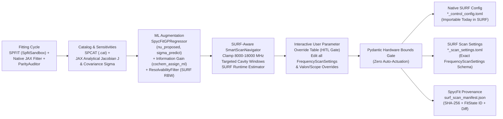

# CoChem-SpycFit Primary `SURF` Integration Plan

**Document Status:** Architecture & Implementation Plan (Code-Verified)  
**Target Repository:** `ProfJJK-CoChem/CoChem-SpycFit` (base `main` @ `f2d4e4e71fb37bbd377c944e2279fdba7153c7d4`)  
**Primary Collaborator Instrument Software:** [`GruLabRotSpec/SURF`](https://github.com/GruLabRotSpec/SURF)  
**Verified Upstream Reference Commit:** `0486b877d2a38f5bbe50be3cb333d34e27c7c22d` (`pushed_at: 2026-10-07T22:00:51Z`, `version = "0.1.0"`, MIT License)  
**Collaborator Institution & Lab:** Gurusinghe Research Lab (GruLab), Tennessee Tech University ([`https://sites.tntech.edu/grulab/`](https://sites.tntech.edu/grulab/); *Rev. Sci. Instrum.* **97**, 024704 (2026), [`doi:10.1063/5.0311736`](https://doi.org/10.1063/5.0311736))  
**Related Specifications:** [Comprehensive SRS](wiki/CoChem-SpycFit_Comprehensive_SRS.md), [October 16 Amendment](wiki/CoChem-SpycFit_SRS_2026-10-16_Amendment.md), [Next-Agent Handoff](HANDOFF.md)

---

## 0. Executive Summary & Forensic Grounding

This plan establishes **`GruLabRotSpec/SURF`** (Spectroscopy User and Research Framework — cavity Fabry–Perot FTMW spectrometer control GUI developed by the Gurusinghe Research Lab at Tennessee Tech University) as the **primary, out-of-the-gate instrument profile (`instrument_profile = "grulab_surf"`)** for `CoChem-SpycFit`.

Every file schema, hardware limit, GUI parameter, data output path, and control mechanism in this plan is grounded directly in forensic inspection of the real `GruLabRotSpec/SURF` source tree at commit `0486b877d2a38f5bbe50be3cb333d34e27c7c22d` and `CoChem-SpycFit` at commit `f2d4e4e71fb37bbd377c944e2279fdba7153c7d4`. No nonexistent `SURF` RPC/API is assumed or invented.

### 0.1 Verified `GruLabRotSpec/SURF` Architecture Inventory (`0486b877`)

| Layer / Concern | Verified `SURF` Source Path & Lines | Exact Observed Implementation |
|---|---|---|
| Package & Runtime | `pyproject.toml:1-25`, `README.md:3-6`, `LICENSE.md:1-3` | `name = "surf"`, `version = "0.1.0"`, `requires-python = ">=3.13"`, MIT License (`Copyright (c) 2026 GRU Lab, Tennessee Technological University`). Python (`167,415` B) + Nix (`1,119` B). Stack: `PySide6>=6.9.2`, `qasync>=0.28.0`, `pyqtgraph>=0.14.0`, `pydantic>=2.12.5`, `pandas>=2.3.2`, `numpy>=2.3.3`, `scipy>=1.16.2`, `tomli-w>=1.2.0`, `pyserial>=3.5`, `pyvisa>=1.15.0`, `zaber-motion>=7.13.0`, `pythonnet>=3.0.5`. |
| Event Loop & Startup | `src/spectrometer_gui/__main__.py:1-22`, `src/spectrometer_gui/gui/main_window.py:34-92` | `QApplication` + `asyncio.run(main(app), loop_factory=QEventLoop)`. `MainWindow` loads `./settings.toml` (falling back to `defaults/default_settings.toml`), loads `defaults/default_config.toml`, registers 6 tabs (`Status`, `Broadband` [empty stub in `broadband_panel.py:4-6`], `Frequency Scan`, `Cavity Map`, `Control`, `Analysis`), and calls `initialize_all_devices()` via `QTimer.singleShot(100, ...)`. |
| Async Task & Signals | `src/spectrometer_gui/gui/spectrometer_controller.py:14-163` | `SpectrometerController` runs blocking `Spectrometer.scan_frequency()` and `Spectrometer.cavity_search()` inside `asyncio.to_thread()`. Emits `ScanSignals` (`device_status_changed`, `progress`, `detailed_progress`, `scanning`, `update_graph`, `update_cavityTrack`, `zaber_position`, `settings_updated`) and `SearchSignals`. Cooperative cancel uses `threading.Event` (`cancel_event`, `lines 45, 122-125`). Polls Zaber position every `1000 ms` while idle (`lines 47-49`). |
| Microwave LO (Valon) | `src/spectrometer_gui/valon_controller.py:13-148`, `config.py:8-16` | Serial RS-232 (`9600` baud, default `COM3`), `\r`-terminated ASCII commands (`Frequency {freq} MHz`, `FrequencyStep {step_size} MHz`, `FrequencyINCRement`/`DECRement`, `OEN`, `PoWeR`, `PDN`, `REF`/`REFerence`). LO frequency is `center_freq - awg_freq` (`spectrometer.py:187, 195`). |
| Cavity Actuator (Zaber) | `src/spectrometer_gui/zaber_controller.py:8-52`, `spectrometer.py:285-292` | `zaber_motion.ascii.Connection` on `COM5` (`default_config.toml:14`), device 1 / axis 1. Hard travel bounds `0`–`50 mm` enforced in `spectrometer.py:285-292` and GUI widgets (`frequency_scan_panel.py:124`, `control_panel.py:169-177`). |
| IF Source (AWG) | `src/spectrometer_gui/awg_controller.py:13-66` | PyVISA hardcoded `"GPIB1::3::INSTR"` (`line 18`), default `awg_freq = 30` MHz (`default_config.toml:18`). **Upstream quirk:** `self.initialized` is never set `True` in `initialize()` (`lines 17-25`). |
| Digitizer / Scope | `src/spectrometer_gui/oscilloscope_controller.py:8-305`, `spectrometer.py:664-693` | PyVISA TCPIP (`"TCPIP0::169.254.23.223::inst0::INSTR"`, `default_config.toml:28`). Computes on-scope averaged FFT magnitude on `MATH4` (`SpectralMag(AVG(CH4))`, center `30E6` Hz, span `20E6` Hz, `lines 252-269`) and cavity-resonance tracking on `MATH3` (`SpectralMag(CH4)`, `MEAS1` max between cursors `29.95E6`–`30.05E6` Hz, `lines 199-250`). Transfers IEEE-754 big-endian `float32` FFT bins via `curve?` (`lines 187-189`) — **not raw time-domain FIDs** — and strips the first 3 bins (`[3:]`, `spectrometer.py:690-691`). |
| Pulse / Delay Generators | `src/spectrometer_gui/delay_generator_controller.py:5-108` | Dual SRS DG535-style GPIB (`dg_1` = `"GPIB0::9::INSTR"`, `dg_2` = `"GPIB3::8::INSTR"`, `lines 10-13`). Controls molecular-beam gas valve pulsing (`DT 3,2,100E-9` start / `DT 3,2,0` stop, `lines 68-74`), SPDT switch width (`DT 5,6,{width+0.5}E-6`, `lines 80-83`), gas–MW delay (`DT 6,1,{delay}E-6`, `lines 85-89`), and trigger mode (`TM 0; TR 0, <rate>` vs `TM 1; TL 1`). |
| RF Switch | `src/spectrometer_gui/switch_controller.py:4-34` | Windows-only `pythonnet` .NET assembly `C:\Windows\SysWOW64\mcl_RF_Switch_Controller_NET45.dll` (Mini-Circuits `USB_RF_SwitchBox`, `Set_Switch("A", 1)` continuous vs `Set_Switch("A", 0)` pulsed). |
| Configuration & Scan Schemas | `config.py:8-75`, `settings.py:7-59`, `frequency_scan_settings.py:4-52`, `cavity_search_settings.py:4-9` | Pydantic v2 TOML models for hardware `Config` and app `Settings`; stdlib `@dataclass` models for `FrequencyScanSettings` (5 tables) and `CavitySearchSettings`. **Note:** Root `config.toml`/`defaults.toml` retain a legacy flat schema incompatible with `config.py`; `MainWindow` loads `src/spectrometer_gui/defaults/default_config.toml` (`main_window.py:42-44`). |
| Real-Time Disk Outputs | `spectrometer.py:67-78, 128-157, 695-758` | Creates `<location>/<filename>_<k>/` + `CavityFiles/`, writes `<filename>_config.toml` and `scan_settings.toml` at start, writes **one full 20 MHz CSV per step** (`CavityFiles/<total_frequency>.csv`) and appends bandwidth-filtered slices to `<filename>.csv`. At scan end, `finalize_csv()` (`lines 747-758`) rewrites `<filename>.csv` in-place and compacts `Center Freq` / `Cavity Position` to top rows via `.dropna().reset_index(drop=True)`. |

### 0.2 Honest Gap Analysis of Upstream `SURF` (`0486b877`)

To keep our integration plan 100% truthful and immediately executable:

1. **No External RPC / Socket / CLI Control API Exists Today:** `SURF` launches solely as a desktop PySide6 GUI (`__main__.py:20-22`) with zero HTTP, ZeroMQ, gRPC, pipe, or CLI headless scan interface.
2. **No `scan_settings.toml` Importer Exists Today:** `SURF` *writes* `scan_settings.toml` when a scan begins (`spectrometer.py:144-154`), but `MainWindow` only supports importing hardware `Config` TOML (`File -> Open control options from file...`, `main_window.py:97-99, 143-162`) and opening saved `.csv` emission spectra in `AnalysisPanel` (`main_window.py:187-211`).
3. **Single Contiguous Frequency Range per Run:** `FrequencyScanPanel` accepts one `[start_freq, end_freq]` interval (`frequency_scan_panel.py:92-102`), with no native multi-region scan queue.
4. **Cavity Search Cancellation Gap:** `Spectrometer.cavity_search()` (`spectrometer.py:416`) does not accept or poll `canceled: Event` even though `CavitySearchPanel.cancel_search()` triggers `spec_controller.cancel_operation()` (`cavity_search_panel.py:123-124`).
5. **Non-Atomic End-of-Scan CSV Compaction:** `finalize_csv()` (`spectrometer.py:747-758`) mutates `<filename>.csv` in-place and detaches `Center Freq` and `Cavity Position` from their originating frequency rows.
6. **SpycFit Intake Format Gap Today:** `CoChem-SpycFit`'s `parse_csv_spectroscopy()` (`src/cochem_spycfit/intake/cochem_spycfit_ingest.py:1133-1220`) expects assigned transition tables (`Frequency_MHz`, `J_upper`, `Ka_upper`, `Kc_upper`, ...) and does not yet recognize `SURF`'s continuous FFT spectrum columns (`Frequency (MHz)`, `Intensity`, `Center Freq`, `Cavity Position`).

---

## 1. Pillar 1: Out-of-the-Gate Primary Instrument Selection (`instrument_profile = "grulab_surf"`)

### 1.1 Instrument Profile Registry & Default Selection

`CoChem-SpycFit` shall introduce an explicit, versioned **Instrument Profile Registry** (`src/cochem_spycfit/instruments/profiles.py`) with **`grulab_surf` set as the default out-of-the-gate instrument profile** whenever no override is supplied by the user, CLI, UI, or `cochem_system_config.json`.

```python
DEFAULT_INSTRUMENT_PROFILE = "grulab_surf"
```

Every `InstrumentProfile` record is a frozen Pydantic v2 model (`extra="forbid"`) carrying verified upstream compatibility metadata and hardware envelopes:

| Profile Field | `grulab_surf` Value | Grounding Reference |
|---|---|---|
| `profile_id` | `"grulab_surf"` | Primary default profile |
| `display_name` | `"GruLab SURF Cavity FTMW (Tennessee Tech Univ.)"` | `SURF/README.md:3-6`, `LICENSE.md:3` |
| `upstream_repo` | `"https://github.com/GruLabRotSpec/SURF"` | Verified public repository |
| `verified_commit_sha` | `"0486b877d2a38f5bbe50be3cb333d34e27c7c22d"` | Verified `HEAD` commit |
| `supported_surf_version` | `">=0.1.0,<0.2.0"` | `SURF/pyproject.toml:3` |
| `technique` | `"cavity_ftmw_fabry_perot"` | `SURF/README.md:4-11`; satisfies `SF-MODEL-001` |
| `spectral_observable` | `"averaged_fft_magnitude_volts"` | `SURF/spectrometer.py:664-693`, `frequency_scan_panel.py:265` |
| `doppler_doublet_expected` | `True` | Coaxial Fabry–Perot beam; `SURF/gui/analysis_panel.py:228-235` |
| `freq_min_mhz` / `freq_max_mhz` | `8000.0` / `18000.0` MHz | `SURF/gui/frequency_scan_panel.py:93-101` |
| `valon_lo_min_mhz` / `valon_lo_max_mhz` | `7970.0` / `18000.0` MHz | `SURF/gui/control_panel.py:375-377` |
| `default_if_offset_mhz` | `30.0` MHz (`awg_freq`) | `SURF/defaults/default_config.toml:18`, `spectrometer.py:187` |
| `step_size_min_mhz` / `step_size_max_mhz` | `0.001` / `1.000` MHz (default `0.500` MHz) | `SURF/gui/frequency_scan_panel.py:105-107` (strict `> 0` guard) |
| `default_fft_rbw_khz` | `100` kHz (`0.100` MHz) | `SURF/defaults/default_config.toml:38`, `frequency_scan_panel.py:205` |
| `default_scope_fft_span_mhz` | `20.0` MHz (`MATH4:SPECTral:SPAN 20E6`) | `SURF/oscilloscope_controller.py:263` |
| `zaber_pos_min_mm` / `zaber_pos_max_mm` | `0.0` / `50.0` mm | `SURF/spectrometer.py:285-292`, `frequency_scan_panel.py:124` |
| `zaber_speed_min_mm_s` / `max_mm_s` | `0.001` / `2.000` mm/s (default `0.003`) | `SURF/gui/frequency_scan_panel.py:111-118` |
| `rf_level_min_dbm` / `max_dbm` | `-20` / `+20` dBm (`int`, soft warn `> +10` dBm) | `SURF/config.py:10`, `control_panel.py:358`, `default_config.toml:3` |
| `cavity_modes` | `("Continuous", "Pulsed")` | `SURF/gui/frequency_scan_panel.py:136` |
| `scan_apodization_windows` | `("Hanning", "Hamming", "Blackman")` | `SURF/gui/frequency_scan_panel.py:218` |
| `control_apodization_windows` | `("Rectangular", "Hamming", "Hanning", "Blackman")` | `SURF/config.py:34`, `control_panel.py:513, 561` |
| `recommended_targeted_window_mhz` | `2.0`–`20.0` MHz (cavity targeted); `<= 500.0` MHz (survey) | Cavity step economics (`~14 s` Zaber retune/step, `spectrometer.py:180`) |

### 1.2 Wiring `grulab_surf` into Existing `CoChem-SpycFit` Entrypoints

1. **`SmartScanNavigator` (`src/cochem_spycfit/physics_core/cochem_spycfit_navigator.py`):** Accept optional `instrument_profile: str = "grulab_surf"`. When active, clamp candidate frequency proposals to `[8000.0, 18000.0]` MHz, support both targeted narrow cavity windows (sized from GP uncertainty `±3σ_predict` + Doppler margin) and survey chunks, and attach `SURF` scan-time estimates directly to each `ScanRecommendation`.
2. **`ResolvabilityFilter` (`src/cochem_spycfit/physics_core/cochem_spycfit_resolvability.py`):** Default `instrumental_resolution_mhz` from the active profile (`0.100 MHz` = `100 kHz` for `grulab_surf`'s `MATH4` default RBW, dynamically updated if the user selects finer RBW such as `10 kHz` in the override table).
3. **`SpycFitTab` (`src/cochem_spycfit/gui.py`) & `cochem_spycfit_ui.py`:** Display an **Instrument Profile** selector defaulting to `GruLab SURF (8–18 GHz Cavity FTMW)` at startup, alongside secondary profiles (`generic_cp_ftmw`, `generic_ir_raman`) so non-SURF workflows remain first-class per `SF-SCOPE-002`.
4. **`spycfit_provider()` (`src/cochem_spycfit/module_provider.py:458-531`):** Preserve full `cochem.module-provider/1` and `cochem.module-handoff/1` compatibility while publishing:
   - `"default_instrument_profile": "grulab_surf"`
   - `"instrument_profiles": ["grulab_surf", "generic_cp_ftmw"]`
   - `"surf_compatibility": {"repo": "GruLabRotSpec/SURF", "verified_commit": "0486b877d2a38f5bbe50be3cb333d34e27c7c22d", "version_spec": ">=0.1.0,<0.2.0"}`
   - Additive operations `plan_surf_scan` and `ingest_surf_run` (leaving existing `predict_spectrum`, `fit_pickett`, `parse_pickett`, and `audit_fit` contracts untouched).

---

## 2. Pillar 2: Fitting Cycles + Suggested Scan Regions + ML Augmentation -> User Parameter Override -> `SURF` Native Export/Import

### 2.1 End-to-End Closed-Loop Proposal Pipeline



### 2.2 Mapping SpycFit Physics & ML Outputs to `SURF` Scan Proposals

1. **Fitting Cycle & State Snapshot:** Each cycle binds to an immutable `FitState` (`src/cochem_spycfit/core_engine/cochem_spycfit_state.py:17-105`), running genuine `SPFIT`/`SPCAT` (`SpfitSandbox`, `src/cochem_spycfit/serialization/cochem_spycfit_spcat_wrapper.py`) alongside native JAX fitting and recording `ParityAuditor` status (`cochem_spycfit_auditor.py`) per `SF-CMP-001`–`015`.
2. **ML Augmentation (`SF-ML-001` Compliant):**
   - `SpycFitGPRegressor` (`src/cochem_spycfit/physics_core/cochem_spycfit_ml_core.py:39-175`) trains on locked `(O - C)` residuals (`QuantumFeatureExtractor`, `cochem_spycfit_ml_engine.py:122-180`) and emits `ResidualPrediction(quantum_numbers, nu_calc_physical_mhz, delta_nu_ml_shift_mhz, nu_proposed_mhz, sigma_predict_mhz, probable_correctness, provenance)`.
   - When untrained or outside GP domain, `provenance = ProvenanceTag.TORQ` and abstention is explicit (no fabricated shifts).
   - `calculate_information_gain()` (`src/cochem_spycfit/physics_core/cochem_assign_ml.py:218-250`) evaluates D-optimal (`0.5 * log2(1 + j^T Sigma j / sigma^2)`), A-optimal, or G-optimal gain per candidate transition.
   - `ResolvabilityFilter` (`cochem_spycfit_resolvability.py:28-150`) computes crowding penalties using `effective_threshold = Res_surf + sigma_predict`, where `Res_surf = resolution_khz / 1000.0`.
3. **`SURF`-Specific Region Sizing & Time Economics:**
   - Because `SURF` is a **stepped Fabry–Perot cavity** spectrometer (not a single-shot chirped-pulse instrument), every frequency step requires Zaber cavity retuning. `SURF` itself estimates scan duration in `spectrometer.py:168-181` as:
     $$\text{iterations} = \left\lceil \frac{|\nu_{\text{end}} - \nu_{\text{start}}|}{\Delta\nu_{\text{step}}} \right\rceil + 1, \qquad t_{\text{delay}} = \frac{N_{\text{acq}}}{f_{\text{rep}}}, \qquad T_{\text{min}} = \frac{\text{iterations} \cdot (t_{\text{delay}} + 14\text{ s})}{60}$$
   - `SurfScanPlanner` therefore clusters high-IG transitions inside `[8000.0, 18000.0]` MHz into **cavity-economical target windows**:
     - **Targeted Line Confirmation Window:** `[nu_proposed - max(3*sigma_predict, 0.5), nu_proposed + max(3*sigma_predict, 0.5)]` MHz (typically `1.0`–`5.0` MHz wide; 3–11 steps at `0.5` MHz step, ~1–4 min runtime).
     - **Multi-Line / Survey Window:** sliding window up to configurable `max_chunk_bandwidth_mhz` (e.g., `25`–`100` MHz for cavity surveys) ranked by `chunk_score / T_min` (Information Gain per minute of spectrometer beam time!).
   - If a prior `SURF` cavity map (`Cavity Scan/CavityScan_*_<k>/CavityRuns/<freq>MHz.csv`) has been ingested for the region, `SurfScanPlanner` pre-populates a suggested resonant `zaber_pos` (mm) with its source file SHA-256.

### 2.3 Interactive User Parameter Override Table (Mandatory HITL Editing)

Before any `SURF` file is exported or staged, SpycFit presents an editable **User Parameter Override Table** (implemented as a `QTableWidget` + detail editor in `SpycFitTab` and mirrored as a headless Pydantic JSON/TOML override file for CLI/notebook workflows). Every cell maps 1:1 to a real `SURF` parameter (`frequency_scan_settings.py:4-52`, `frequency_scan_panel.py:86-260`, `config.py:8-61`):

| Group | `SURF` Field | Source in `SURF` | Default Proposal from SpycFit | User Override Allowed & Hard Bounds |
|---|---|---|---|---|
| **Scan** | `scan_parameters.start_freq` | `frequency_scan_panel.py:93-95` | Window lower edge (MHz) | `8000.0 .. 18000.0` MHz (3 decimals) |
| **Scan** | `scan_parameters.end_freq` | `frequency_scan_panel.py:99-101` | Window upper edge (MHz) | `8000.0 .. 18000.0` MHz, `!= start_freq` |
| **Scan** | `scan_parameters.step_size` | `frequency_scan_panel.py:105-107` | `0.500` MHz (or `0.250` targeted) | `0.001 .. 1.000` MHz (`> 0` enforced) |
| **Scan** | `scan_parameters.zaber_speed` | `frequency_scan_panel.py:111-118` | `0.003` mm/s | `0.001 .. 2.000` mm/s |
| **Scan** | `scan_parameters.zaber_pos` | `frequency_scan_panel.py:123-131` | `None` (or from ingested cavity map) | `None` or `0.000 .. 50.000` mm |
| **Scan** | `scan_parameters.acq_num` | `frequency_scan_panel.py:140` | Scaled from predicted line strength (`100` default) | `1 .. 100000` (int) |
| **Scan** | `scan_parameters.cavity_type` | `frequency_scan_panel.py:136` | `"Continuous"` (or `"Pulsed"`) | `"Continuous"` \| `"Pulsed"` |
| **Digitizer** | `digitizer_settings.resolution` | `frequency_scan_panel.py:204-206` | `100` kHz (`math4` default) | `1 .. 16384` kHz (int) |
| **Digitizer** | `digitizer_settings.acq_window` | `frequency_scan_panel.py:210-213` | `14` μs (read-only integer in `FrequencyScanSettings:29`, `frequency_scan_panel.py:383`) | `1 .. 10000` μs |
| **Digitizer** | `digitizer_settings.apodization` | `frequency_scan_panel.py:218` | `"Hanning"` | `"Hanning"` \| `"Hamming"` \| `"Blackman"` |
| **Timing** | `timing_settings.rep_rate` | `frequency_scan_panel.py:239` | `5` Hz (or lab default) | `1 .. 1000` Hz (int) |
| **Timing** | `timing_settings.valve_mw_delay` | `frequency_scan_panel.py:243-245` | `1300` μs | `0 .. 10000` μs (int) |
| **Timing** | `timing_settings.spdt_width` | `frequency_scan_panel.py:249-251` | `10.0` μs | `1.0 .. 10000.0` μs (float) |
| **Timing** | `timing_settings.acq_delay` | `frequency_scan_panel.py:255-257` | `22.5` μs (matches `default_config.toml:39`; GUI default `50.0`) | `0.0 .. 10000.0` μs |
| **Experiment** | `experiment.{sample_name, sample_temp, gas_name, gas_width, backing_pressure, chamber_pressure, mw_width}` | `frequency_scan_panel.py:151-183` | Populated from active SpycFit project metadata | `sample_temp <= 300 C`, `gas_width <= 2000 μs`, `0 <= backing_pressure <= 100 psi` |
| **Output** | `output_settings.{location, filename}` | `frequency_scan_panel.py:325-337, 553-561` | Lab watched output dir + `SURF` canonical stem `{sample}_{start:.3f}_{end:.3f}MHz_{step:.3f}MHz_{acq}acqs_{date}` | Valid local path; no path traversal |
| **Control (`Config`)** | `valon_controller.rf_level` | `config.py:10`, `control_panel.py:358` | `10` dBm (`int`) | `-20 .. +20` dBm (`int`; explicit warn if `> 10` dBm) |

Every user modification records `{field, proposed_value, user_value, edited_by, edited_at_utc}` in `surf_scan_manifest.json` so ML recommendations and operator overrides stay permanently auditable (`SF-HITL-001`, `SF-OUT-003`).

### 2.4 Exact Native `SURF` Export Artifacts (Grounded Byte-for-Byte in `SURF` Source)

For each user-approved scan region, `SurfExporter` (`src/cochem_spycfit/instruments/surf_exporter.py`) emits three deterministic artifacts:

#### Artifact A: `<region_stem>_control_config.toml` — Natively Importable in Unmodified `SURF` Today
Validated against `SURF`'s `Config` Pydantic model (`src/spectrometer_gui/config.py:8-75`) and directly loadable via **`SURF` -> `File` -> `Open control options from file...`** (`main_window.py:97-99, 143-155`). Note that `valon_controller.freq` is pre-set to `start_freq - awg_freq` (`spectrometer.py:187`) and `rf_level` and `awg_freq` are serialized as strict integers matching `config.py:10, 27`:

```toml
[valon_controller]
rf_output = true
rf_level = 10
valon_port = "COM3"
synth_power = true
ref_source = "Internal"
ref_freq = 10.0
freq = 10867.0

[zaber_controller]
zaber_scanning_speed = 0.003
zaber_moving_speed = 2.0
zaber_step_size = 0.03
zaber_port = "COM5"

[awg_controller]
awg_status = true
awg_freq = 30
awg_run_mode = "Triggered"
awg_ch_1_output = false
awg_ch_2_output = true

[oscilloscope_controller]
channel = "CH4"
acq_rate = 100
sample_rate = 500
math_averages = 1000000
visa_address = "TCPIP0::169.254.23.223::inst0::INSTR"

[oscilloscope_controller.math3]
window = "Hanning"
resolution = 720.0
gate_position = 1.0
scale = 100.0

[oscilloscope_controller.math4]
window = "Hanning"
resolution = 100.0
gate_position = 22.5
scale = 0.1

[oscilloscope_controller.math3_cont]
window = "Hanning"
resolution = 720.0
gate_position = 1.0
scale = 300.0

[delay_generator_controller]
trigger_rate = 5.0
trigger_state = "INT"
```

#### Artifact B: `<region_stem>_scan_settings.toml` — Exact `SURF` `FrequencyScanSettings` Schema
Matches the exact TOML dumped by `Spectrometer.scan_frequency()` (`spectrometer.py:144-154`, dataclass definitions in `frequency_scan_settings.py:4-52`), omitting `zaber_pos` when `None`:

```toml
[experiment]
sample_name = "HCOOH_DME"
sample_temp = 22.0
gas_name = "Ne"
gas_width = 600.0
backing_pressure = 15.0
chamber_pressure = "1.0e-6 torr"
mw_width = 1.0

[scan_parameters]
start_freq = 10897.0
end_freq = 10902.0
step_size = 0.5
zaber_speed = 0.003
acq_num = 100
cavity_type = "Continuous"

[digitizer_settings]
resolution = 100
acq_window = 14
apodization = "Hanning"

[timing_settings]
rep_rate = 5
valve_mw_delay = 1300
spdt_width = 10.0
acq_delay = 22.5

[output_settings]
filename = "HCOOH_DME_10897.000_10902.000MHz_0.500MHz_100acqs_2026-11-23"
location = "C:\\SURF_Data\\HCOOH_DME"
```

#### Artifact C: `<region_stem>_surf_manifest.json` — SpycFit Provenance Envelope
Strict JSON (`allow_nan=False`) linking `fit_state_id`, `spcat_catalog_sha256`, GP model hyperparameters, `ScanRecommendation` rank/score/target constants, user override audit diff, estimated `SURF` runtime, and SHA-256 digests of Artifacts A & B.

---

## 3. Pillar 3: Live Incoming Data Readback & Closed-Loop Processing

### 3.1 Exact `SURF` Real-Time Write Behavior & Critical Parsing Hazards

Forensic inspection of `src/spectrometer_gui/spectrometer.py:67-78, 128-157, 695-758` revealed three crucial behaviors that SpycFit's live ingestion engine MUST handle accurately:

1. **Auto-Incremented Run Directories (`make_dir("CavityFiles")`, `spectrometer.py:67-78`):**
   Every scan creates `<output.location>/<filename>_<k>/` (`k = 0, 1, 2, ...`) containing:
   - `scan_settings.toml` (written once at scan start, `lines 144-154`)
   - `<filename>_config.toml` (written once at scan start, `lines 141-143`)
   - `<filename>.csv` (header created at start `lines 131-140`, then appended per step `lines 738-743`)
   - `CavityFiles/<total_frequency>.csv` (one complete unfiltered 20 MHz FFT spectrum written via `mode="w+"` at the end of EVERY frequency step, `lines 732-736`).
2. **Sparse Row-0 Metadata Layout (`spectrometer.py:708-743`):**
   Because `SURF` builds each step CSV with `pd.concat([spectrum_data, metadata], axis=1)` where `metadata` has length 1 (`Center Freq`, `Cavity Position`), **only row 0 of each `CavityFiles/<total_frequency>.csv`** carries `Center Freq` and `Cavity Position`; rows `1..N-1` are empty (`NaN`) in those two columns.
3. **Destructive In-Place Compaction in `finalize_csv()` (`spectrometer.py:747-758`):**
   When a scan completes, `SURF` executes:
   ```python
   for col in ["Center Freq", "Cavity Position"]:
       df[col] = df[col].dropna().reset_index(drop=True)
   df.to_csv(filepath, index=False)
   ```
   This rewrites `<filename>.csv` **non-atomically in place** and packs all `Center Freq` and `Cavity Position` values into rows `0..N_steps-1`, detaching them from their corresponding spectral chunks!

### 3.2 Canonical Live Readback Design (`SurfRunWatcher` + `SurfOutputParser`)

To guarantee race-free, provenance-complete live ingestion during an active `SURF` scan:

1. **Primary Live Source = `CavityFiles/<total_frequency>.csv` (Immutable Per-Step Files):**
   - `SurfRunWatcher` (`src/cochem_spycfit/instruments/surf_watcher.py`) monitors `<output.location>` for new `<filename>_<k>/` directories containing `scan_settings.toml` and `CavityFiles/`.
   - As each `CavityFiles/<total_frequency>.csv` appears, the watcher applies a **Windows-safe stability gate**: waits until file size > 0, `(size, mtime_ns)` is stable across two consecutive polls (`>= 250 ms`), header exactly equals `["Frequency (MHz)", "Intensity", "Center Freq", "Cavity Position"]`, and all `Frequency (MHz)` and `Intensity` entries parse cleanly as finite `float64` (retrying on transient `PermissionError` / sharing violations).
   - Once stable, computes the exact **SHA-256 digest** of the immutable step CSV, records it in the run provenance ledger (`surf_ingest_provenance.jsonl`), and parses:
     - `center_freq_mhz`: row-0 `Center Freq` (cross-checked against filename stem)
     - `cavity_position_mm`: row-0 `Cavity Position` (verified within `[0.0, 50.0]` mm)
     - `full_window_freq_mhz`, `full_window_intensity`: complete 20 MHz `MATH4` FFT arrays (FP64)
     - `stitched_slice`: SpycFit independently slices `[center_freq - step_size/2, center_freq + step_size/2]` using `scan_settings.toml`'s `step_size` — **matching `SURF`'s exact stitching rule (`spectrometer.py:705-722`) without ever suffering partial-append races or `finalize_csv()` compaction corruption!**
2. **End-of-Run Reconciliation:**
   - When the scan completes (detected via `finalize_csv()` completion or Tier-2 `scanning(False)` event), SpycFit also hashes the finalized `<filename>.csv`, `<filename>_config.toml`, and `scan_settings.toml`, verifying that the stitched spectrum assembled from `CavityFiles/*.csv` matches `<filename>.csv`'s `(Frequency (MHz), Intensity)` columns to FP64 tolerance, and flags any missing steps or cavity-tracking drop-outs (`cavity_position_mm` stuck at `0` or `50` mm).
3. **Cavity Map Readback (`Cavity Scan/CavityScan_*_<k>/CavityRuns/<freq>MHz.csv`):**
   - `SurfOutputParser` also parses `SURF` cavity search files (`spectrometer.py:581-595`: `Zaber Position (mm),Intensity (V),Frequency (MHz),Peaks,Intensity`) and `search_settings.toml`, building a local `(frequency_mhz -> resonant_zaber_pos_mm)` lookup table to improve future `zaber_pos` hints.

### 3.3 Closed-Loop Live Processing (Strictly HITL-Gated per `SF-HITL-001` / `SF-UI-001`)

As each validated step CSV lands:
1. **Live Spectrum Overlay:** Push newly stitched `(Frequency_MHz, Intensity)` points into `SpectralViewport` (`src/cochem_spycfit/interfaces/cochem_spycfit_ui_viewport.py`) and update a live Cavity Track health panel (`Cavity Position` vs `Center Freq`).
2. **Fabry–Perot Doppler Doublet-Aware Peak Picking:**
   - Estimate local baseline & MAD noise $\sigma_{\text{noise}}$ per step window, run `scipy.signal.find_peaks` with user-configurable SNR threshold (default $\ge 5\sigma$).
   - **Coaxial Cavity Doppler Doublet Detection:** Grounded in `SURF`'s own `AnalysisPanel` (`analysis_panel.py:228-235`, which computes two-peak `Separation` and `Average`), group symmetric intensity pairs separated by the expected gas-beam Doppler splitting $\Delta\nu_D(\nu) = 2\nu (v_{\text{beam}}/c)$ (configurable by carrier gas `gas_name` from `scan_settings.toml`!) and report **both** the raw doublet components and the candidate rest-frequency midpoint $\nu_0 = (\nu_+ + \nu_-)/2$ with explicit uncertainty (never silently collapsing unresolved singlets or blends, per `SF-IO-002` and `SF-HITL-002`).
3. **Incremental Candidate Matching & GP Re-Scoring:**
   - Match extracted peaks against `SPCAT` + native JAX predictions (`cochem_spycfit_ui.py` Hungarian bipartite matcher / `cochem_autofit_engine.py`), mark candidates as `AssignmentStatus.PROPOSED` (never auto-`APPROVED`!), and preview updated GP residuals (`SpycFitGPRegressor`) and `SmartScanNavigator` rankings.
4. **Explicit Expert Decision -> Next Fitting Cycle:**
   - Researcher inspects overlays, residuals, and Doppler pairs in SpycFit, clicks `[Lock]` / `[Reject]` / `[Ignore]`, and triggers `[Commit & Recalculate]` -> `SpfitSandbox` + JAX fitter -> `ParityAuditor` -> `CommitManager.commit()` (linked via SHA-256 to every ingested `SURF` `CavityFiles/*.csv` and `scan_settings.toml`) -> refreshed `SURF` scan proposals for Cycle $N+1$.

---

## 4. Pillar 4: Side-by-Side Co-Running & Direct `SURF` Control from `SpycFit`

### 4.1 Two-Tier Co-Execution Architecture

Because `SURF` @ `0486b877` has **zero external control API today** and requires direct Windows hardware drivers (`COM3`, `COM5`, GPIB VISA, TCPIP VISA, `C:\Windows\SysWOW64\mcl_RF_Switch_Controller_NET45.dll`), SpycFit adopts a strict **two-tier architecture** where `SURF` remains the **sole hardware owner** at all times:

| Aspect | Tier 1: Zero-Change Side-by-Side (Works Immediately on `SURF 0486b877`) | Tier 2: Direct Control via Opt-In `SURF` Local Bridge PR (Minimal Upstream Addition) |
|---|---|---|
| Upstream `SURF` changes required | **None (0 lines changed)** | **Minimal opt-in PR (~250 LOC)** to `GruLabRotSpec/SURF`, disabled by default (`--enable-local-bridge` / `[bridge] enabled = false`) |
| Process topology | Independent local PySide6 processes on spectrometer PC (`SURF` + `CoChem-SpycFit`) | Same independent processes; `SURF` starts a loopback-only `asyncio` JSON-Lines IPC server inside its existing `qasync` `QEventLoop` (`__main__.py:22`) |
| Hardware ownership | 100% exclusive to `SURF` | 100% exclusive to `SURF` (SpycFit never opens serial/GPIB/VISA/DLL ports) |
| Parameter handoff | SpycFit exports `*_control_config.toml` (loaded via `SURF` `File -> Open control options...`), `*_scan_settings.toml`, and operator run card; operator sets/starts scan in `SURF` | SpycFit calls `stage_scan(FrequencyScanSettings)` over `127.0.0.1`; `SURF` populates `FrequencyScanPanel` widgets + displays modal/banner confirmation; scan starts **only** after explicit operator confirm |
| Multi-region queue | SpycFit tracks region checklist; operator runs regions sequentially | SpycFit queues regions in `staged` state; **each region** (or explicitly confirmed bounded batch with per-region bounds) requires interactive human authorization before RF/valve actuation |
| Live readback | `SurfRunWatcher` watches `CavityFiles/*.csv` on disk | `SurfRunWatcher` on disk **plus** real-time push events (`progress`, `detailed_progress`, `update_graph`, `update_cavityTrack`, `device_status_changed`, `zaber_position`) forwarded from `ScanSignals` (`spectrometer_controller.py:14-22`) |
| Pause / Abort | Operator clicks `Cancel` in `SURF` (`frequency_scan_panel.py:346-349`) | Both `SURF` `Cancel` button **and** SpycFit `Abort Scan` button immediately call `SpectrometerController.cancel_operation()` (`spectrometer_controller.py:122-125`) |

### 4.2 Exact Minimal Opt-In Upstream PR Specification for `GruLabRotSpec/SURF` (Tier 2)

To keep upstream maintenance burden minimal and zero-dependency (`SURF` already runs `asyncio` via `qasync` in `__main__.py:3-22` and `pydantic>=2.12.5` in `pyproject.toml:12`):

1. **New Menu Action (`src/spectrometer_gui/gui/main_window.py` + `frequency_scan_panel.py`):**
   - Add `File -> Load scan settings from file...` and `FrequencyScanPanel.apply_scan_settings(settings: FrequencyScanSettings)` to populate all 4 form groups (`Experiment`, `Scan`, `Digitizer`, `Timing`) + output directory from any `scan_settings.toml` **without** starting a scan.
2. **Optional Loopback Bridge Module (`src/spectrometer_gui/local_bridge.py`, stdlib `asyncio.start_server` only — ZERO new dependencies):**
   - Disabled by default; enabled only when launched with `--enable-local-bridge` or explicit opt-in in `settings.toml`.
   - Binds strictly to `127.0.0.1` on an ephemeral OS-assigned port (never `0.0.0.0`), writes `{port, pid, auth_token_sha256_or_secret, surf_version}` to a user-private runtime file (`%LOCALAPPDATA%\SURF\bridge.json` with owner-only ACLs).
   - Authenticated JSON-Lines RPC methods mapping 1:1 to `SpectrometerController` (`spectrometer_controller.py:33-163`):
     - `ping` / `get_status` -> returns `spectrometer.get_device_status()`, active `ScanType`, `current_task is not None`, `zaber_position`, and current output directory.
     - `stage_scan(scan_settings, control_config_overrides=None)` -> validates strict hardware bounds, populates `FrequencyScanPanel` widgets (without starting!), returns `staged_id` + summary diff + `requires_operator_confirmation = true`.
     - `confirm_and_start_scan(staged_id, operator_confirmation_token)` -> verifies token came from an explicit interactive operator confirmation dialog (either inside `SURF` or via SpycFit's explicit confirmation modal with mirrored confirmation in `SURF` status bar), verifies `current_task is None` and all required devices are `ONLINE`, then calls `spec_controller.run_scan(settings)`.
     - `pause_scan()` / `resume_scan()` -> sets/clears a cooperative `pause_event` checked between steps alongside `canceled` (`spectrometer.py:294`) while keeping `delay_generator_controller.stop_pulse()` safe during pause!
     - `abort_scan()` -> **always permitted unconditionally** (bypasses queue/stage checks); immediately invokes `spec_controller.cancel_operation()` -> `spectrometer.cleanup()`.
     - `subscribe_events()` -> streams `ScanSignals` (`progress`, `detailed_progress`, `device_status_changed`, `zaber_position`, `step_file_written`).
3. **Recommended Upstream Safety Bugfixes Discovered in Forensic Audit:**
   - Pass `cancel_event` into `Spectrometer.cavity_search()` (`spectrometer.py:416`) and check `canceled.is_set()` before/after each Zaber sweep so `Cavity Map -> Stop` (`cavity_search_panel.py:91-95`) actually cancels.
   - Set `self.initialized = True` upon successful VISA open in `AWGController.initialize()` (`awg_controller.py:17-25`) so `get_device_status()["awg"]` accurately reports `ONLINE`.
   - Guard against `step_size <= 0` before division in `spectrometer.py:178`.

### 4.3 Non-Negotiable Hardware Safety Interlocks (Enforced in Both SpycFit & Tier-2 Bridge)

| Safety Rule | Exact Enforcement Mechanism | Grounding in `SURF` Hardware Drivers |
|---|---|---|
| **1. Zero Autonomous Unattended RF/Valve Actuation** | Neither SpycFit nor the Tier-2 bridge may EVER auto-start a scan, enable Valon RF (`OEN 1`), open the gas pulse valve (`DT 3,2,100E-9`), or move Zaber automatically on ML proposal or incoming data arrival. Every acquisition requires explicit interactive human confirmation (`stage -> review summary -> confirm`). | `valon_controller.py:44, 113-114`, `delay_generator_controller.py:68-74`, `zaber_controller.py:39-46` |
| **2. Dual-Validated Hard Physical Bounds** | Reject any export or staged scan violating: `8000 <= start_freq, end_freq <= 18000` MHz; `start_freq != end_freq`; `Valon LO = freq - awg_freq >= 7970` MHz; `0.001 <= step_size <= 1.000` MHz; `0.0 <= zaber_pos <= 50.0` mm; `0.001 <= zaber_speed <= 2.0` mm/s; `-20 <= rf_level <= 20` dBm (`int`, explicit extra warning if `> +10` dBm); `1 <= acq_num <= 100000`; `1 <= rep_rate <= 1000` Hz; `0 <= valve_mw_delay, acq_delay <= 10000` μs; `1 <= spdt_width <= 10000` μs; `1 <= resolution <= 16384` kHz. | `frequency_scan_panel.py:93-258`, `control_panel.py:358, 376`, `spectrometer.py:285-292`, `config.py:8-61` |
| **3. Pre-Flight Device & Concurrency Gate** | Block `confirm_and_start_scan` if `spec_controller.current_task is not None`, if any required controller (`valon`, `zaber`, `oscilloscope`, `delay_generator`, `switch`, `awg`) is `OFFLINE`, or if `zaber_pos` is out of bounds. | `spectrometer.py:784-795`, `spectrometer_controller.py:44, 142-163` |
| **4. Unconditional Emergency Stop / Abort Preservation** | `SURF`'s native `Cancel` button (`frequency_scan_panel.py:346-349`), `MainWindow.closeEvent` (`main_window.py:237-255`), and SpycFit's `Abort Scan` button ALL trigger `cancel_operation()` immediately with highest priority, guaranteeing `delay_generator.stop_pulse()`, `delay_generator.stop_trig()`, `oscilloscope.stop_acq()`, and `zaber.home()` (`spectrometer.py:627-630`). | `spectrometer.py:294-296, 627-630`, `spectrometer_controller.py:122-125` |
| **5. Dead-Man Heartbeat & Safe-Idle Fallback** | In Tier 2, if SpycFit disconnects or misses heartbeats during a staged/paused state, `SURF` never auto-starts and cancels any pending staged job. If a scan is already running under local operator supervision, `SURF` completes or lets the local `SURF` operator cancel cleanly — never leaving `delay_generator` stuck pulsing. | `delay_generator_controller.py:64-74` |

---

## 5. Pillar 5: Phased Implementation WBS & Verification Plan (`SPYC-SURF-01`..`SPYC-SURF-05`)

All implementation phases preserve `CoChem-SpycFit`'s strict zero-mock mandate, FP64 precision lock (`JAX_ENABLE_X64=True`), `SF-CMP-001`–`015` independent-engine truthfulness, and existing test suite health.

### Baseline Health Note (Verified at `f2d4e4e71fb3`)
Running `python -B -m pytest -q` on Windows at `f2d4e4e71fb3` yields **`330 passed, 9 skipped`** (`calpgm` live binary tests skip explicitly when `spfit`/`spcat` are absent) plus 2 pre-existing Windows `core.autocrlf` CRLF checkout failures on untouched `pyproject.toml` and `requirements.txt` (`tests/test_pyproject.py:89`, `tests/test_requirements.py:96`). All new `SPYC-SURF` files shall be authored with strict UTF-8 LF endings and must achieve **0 failures and 0 AST errors** across every new and existing spectroscopy/provider test.

### Phased Work Breakdown Structure

| WBS ID | Deliverable & Scope | Concrete `CoChem-SpycFit` File Paths | Zero-Mock Test Suite & Fixtures | Objective Binary Exit Checks |
|---|---|---|---|---|
| **`SPYC-SURF-01`** | **Primary Instrument Profile Registry & `SURF` TOML Schema Models:** Implement `InstrumentProfile` registry defaulting to `"grulab_surf"` (pinned to `SURF` `0486b877`), Pydantic v2 models mirroring `SURF`'s `Config`, `Settings`, `FrequencyScanSettings`, and `CavitySearchSettings` with exact hardware bounds, and expose `default_instrument_profile` in `spycfit_provider()`. | `src/cochem_spycfit/instruments/__init__.py`<br>`src/cochem_spycfit/instruments/profiles.py`<br>`src/cochem_spycfit/instruments/surf_schemas.py`<br>`src/cochem_spycfit/module_provider.py` | `tests/test_surf_profiles_and_schemas.py`<br>`tests/fixtures/surf/default_config.toml`<br>`tests/fixtures/surf/default_settings.toml` (authentic copies from `SURF` `0486b877`) | 1. `spycfit_provider()["default_instrument_profile"] == "grulab_surf"`.<br>2. Round-trip parse/dump of authentic `SURF` `default_config.toml` & `default_settings.toml` succeeds with 0 schema errors.<br>3. Out-of-bounds frequency (`7999.9` / `18000.1` MHz), `step_size <= 0`, `zaber_pos > 50` mm, or `rf_level > 20` dBm raises `ValidationError`.<br>4. `python -B -m pytest -q tests/test_surf_profiles_and_schemas.py tests/test_cochem_spycfit_provider_and_calpgm.py` -> exit `0`. |
| **`SPYC-SURF-02`** | **`SURF`-Aware `SmartScanNavigator`, ML Augmentation, Override Table & Native Exporter:** Extend `SmartScanNavigator` + `ResolvabilityFilter` for `grulab_surf` cavity windows & `SURF` runtime economics (`spectrometer.py:168-181`), add HITL User Parameter Override Table (`gui.py` / `cochem_spycfit_ui.py` + headless JSON/TOML override API), and implement `SurfExporter` emitting `*_control_config.toml`, `*_scan_settings.toml`, and `*_surf_manifest.json`. | `src/cochem_spycfit/physics_core/cochem_spycfit_navigator.py`<br>`src/cochem_spycfit/instruments/surf_planner.py`<br>`src/cochem_spycfit/instruments/surf_exporter.py`<br>`src/cochem_spycfit/gui.py`<br>`src/cochem_spycfit/interfaces/cochem_spycfit_ui.py` | `tests/test_surf_planner_and_exporter.py` (authentic HCOOH–DME rotational constants & GP residuals -> proposed regions -> user override -> exported TOMLs verified directly against `SURF`'s `Config` schema rules) | 1. Exported `*_control_config.toml` parses cleanly with `tomllib` and passes every field/type check of `SURF/src/spectrometer_gui/config.py:8-61`, with `valon_controller.freq == start_freq - awg_freq`.<br>2. Exported `*_scan_settings.toml` omits `zaber_pos` when `None` and matches `SURF/frequency_scan_settings.py:4-52`.<br>3. Manifest records exact SHA-256 of both TOMLs and preserves ML-proposed vs user-overridden diff.<br>4. `python -B -m pytest -q tests/test_surf_planner_and_exporter.py tests/test_cochem_spycfit_navigator.py` -> exit `0`. |
| **`SPYC-SURF-03`** | **Live `SURF` Output Parser, `CavityFiles` Watcher & Doppler Doublet Peak Picker:** Implement `SurfOutputParser` (step CSVs, finalized compacted CSVs, cavity-search `CavityRuns/*.csv`), `SurfRunWatcher` (stability gate + SHA-256 ledger + incremental stitching matching `spectrometer.py:705-743`), and coaxial Fabry–Perot Doppler doublet peak picker feeding `AssignmentStatus.PROPOSED` into `SpectralViewport` & `FitState` provenance. | `src/cochem_spycfit/instruments/surf_ingest.py`<br>`src/cochem_spycfit/instruments/surf_watcher.py`<br>`src/cochem_spycfit/intake/cochem_spycfit_ingest.py`<br>`src/cochem_spycfit/interfaces/cochem_spycfit_ui_viewport.py` | `tests/test_surf_ingest_and_watcher.py`<br>`tests/fixtures/surf/sample_run_0/` (authentic `SURF` run tree: `scan_settings.toml`, `*_config.toml`, `CavityFiles/10899.0.csv`, `CavityFiles/10899.5.csv`, finalized compacted `*.csv`, and `CavityRuns/10899.0MHz.csv`) | 1. Watcher ingests incrementally written `CavityFiles/*.csv` files into FP64 stitched spectrum identical to `SURF`'s bandwidth-filtered slice (`±step_size/2`), handling both `StepDirection.Up` and `StepDirection.Down`.<br>2. Finalized compacted CSV reconciliation handles `finalize_csv()`'s top-packed `Center Freq`/`Cavity Position` without row corruption.<br>3. Doppler doublet detector identifies paired synthetic/authentic cavity peaks and emits `PROPOSED` (never auto-`APPROVED`) candidates with per-file SHA-256 provenance.<br>4. `python -B -m pytest -q tests/test_surf_ingest_and_watcher.py tests/test_cochem_spycfit_ingest.py` -> exit `0`. |
| **`SPYC-SURF-04`** | **Tier-1 Side-by-Side Co-Runner & Tier-2 Local Control Bridge Client + Safety Interlocks:** Implement Tier-1 operator run-card & watch-folder coordinator, plus Tier-2 authenticated loopback client (`127.0.0.1` JSON-Lines) implementing the two-step `stage_scan` -> explicit operator confirmation -> `confirm_and_start_scan` state machine, unconditional `abort_scan`, and dead-man timeout; author the clean upstream PR patch bundle for `GruLabRotSpec/SURF`. | `src/cochem_spycfit/instruments/surf_bridge_client.py`<br>`src/cochem_spycfit/instruments/surf_safety.py`<br>`docs/SURF_UPSTREAM_BRIDGE_PR_SPEC.md` | `tests/test_surf_bridge_and_safety.py` (real loopback `asyncio` TCP test harness — zero mocks of socket I/O — exercising auth rejection, non-loopback refusal, bounds rejection, unconfirmed start refusal, and immediate `abort_scan`) | 1. Any non-loopback host (`0.0.0.0`, external IP) or missing/wrong bearer token is refused with typed security error.<br>2. Calling `start` without explicit operator confirmation token fails hard (`SafetyInterlockError`).<br>3. `abort_scan` succeeds immediately even during active scan and emits cleanup confirmation.<br>4. `python -B -m pytest -q tests/test_surf_bridge_and_safety.py` -> exit `0`. |
| **`SPYC-SURF-05`** | **End-to-End Closed-Loop Verification (`SPCAT`/`SPFIT` + GP + `SURF` Export + Live Ingest + Next Cycle):** Add full closed-loop integration test exercising Cycle 1 (`SPFIT`/`SPCAT` on HCOOH–DME -> GP residual prediction -> `SmartScanNavigator` `grulab_surf` proposal -> user override -> `SurfExporter` TOMLs -> simulated live `SURF` directory step writes -> `SurfRunWatcher` ingest -> HITL lock -> Cycle 2 `CommitManager` DAG commit with full SHA-256 lineage). | `tests/test_surf_closed_loop_e2e.py`<br>`pytest.ini` (add `tests/test_surf_*.py` targets) | Authentic `SURF` file-format fixtures + genuine `spfit`/`spcat` execution when `calpgm` binaries are present (explicitly marked `@pytest.mark.calpgm`, zero ASE/EMT substitution per `SF-CMP-013`) | 1. Full Cycle 1 -> Export -> Live Step Watch -> HITL Lock -> Cycle 2 DAG commit passes with unbroken SHA-256 provenance chain.<br>2. AST syntax & anti-spoof linter reports `0` errors across all `src/cochem_spycfit/instruments/*.py`.<br>3. Full spectroscopy test suite (`python -B -m pytest -q`) reports `0` regressions on all `SPYC-SURF` and existing passing tests. |

---

## 6. Cross-Reference & Compliance Matrix

| Requirement / Directive | How This Plan Satisfies It |
|---|---|
| `SF-IO-001`, `SF-IO-002`, `SF-IO-003` | Core SpycFit accepts calibrated spectra/peak lists; `SURF`-specific FFT CSV & TOML reduction lives cleanly in `src/cochem_spycfit/instruments/` while preserving immutable raw `CavityFiles/*.csv` files, units, conditions, and SHA-256 provenance. |
| `SF-HITL-001`, `SF-HITL-002`, `SF-UI-001` | Every ML-proposed scan region passes through an interactive User Parameter Override Table; every live-ingested peak starts as `PROPOSED`; explicit researcher action controls both acquisition confirmation and assignment locking. |
| `SF-ML-001` | `SpycFitGPRegressor` shifts and `SmartScanNavigator` IG scores carry explicit provenance (`TORQ` vs `ML`), uncertainty `sigma_predict`, and abstention when untrained. |
| `SF-CMP-001`–`015` | Closed-loop cycles execute genuine `SPFIT`/`SPCAT` via `SpfitSandbox` alongside native JAX fits and `ParityAuditor`, preserving divergence visibly without silent reconciliation. |
| Hardware Safety Mandate | Explicit two-step `stage -> confirm` gate, dual-validated `SURF` hardware bounds, `127.0.0.1`-only authenticated IPC in Tier 2, unconditional emergency stop (`cancel_operation()` -> `cleanup()`), and zero autonomous RF/gas-valve actuation. |
